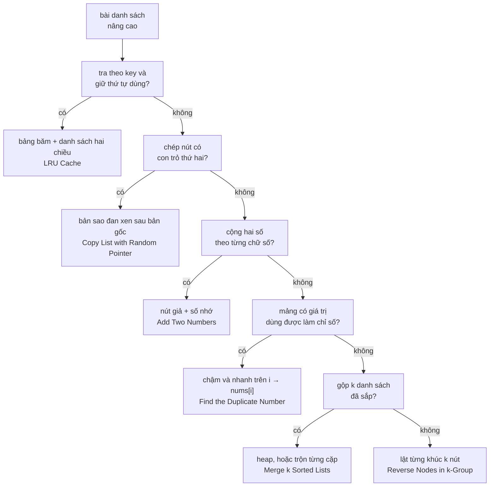

> [!tldr] Đọc nhanh
> - Pattern: ở ga này, [[concepts/linked-list|danh sách liên kết]] không đứng một mình. Nó ghép với [[concepts/hash-map|hash map]], với heap, hoặc với chính một bản sao của nó, để làm điều mà mỗi thứ riêng lẻ không làm được.
> - **Hash map + [[concepts/doubly-linked-list|danh sách hai chiều]]** (LRU Cache, bài neo): bảng băm tìm nút trong O(1), danh sách giữ thứ tự dùng và gỡ một nút ở giữa trong O(1). Đo 10⁶ thao tác với sức chứa 100: 17,9 triệu thao tác/s bằng danh sách tự viết.
> - **[[concepts/node-interleaving|Đan bản sao xen kẽ]]** (Copy List with Random Pointer): đặt bản sao ngay sau bản gốc, nên "bản sao của X" luôn là `X.next`, không cần bảng băm.
> - **[[concepts/carry-propagation|Mang số nhớ]]** (Add Two Numbers) và **lật từng khúc** (Reverse Nodes in k-Group) dùng lại [[concepts/dummy-node|nút giả]] và [[concepts/pointer-reversal|lật con trỏ]] của ga 1; Find the Duplicate Number là [[concepts/fast-slow-pointers|con trỏ chậm và nhanh]] chạy trên mảng.
> - **[[concepts/divide-and-conquer-merge|Trộn chia để trị]]** (Merge k Sorted Lists): trộn từng cặp, mỗi vòng số danh sách giảm một nửa. Với 1 000 danh sách × 100 nút: 8,3 ms, so với 287,1 ms khi trộn lần lượt vào một kết quả chung.

> [!info] Bối cảnh
> Ga 2 **tuyến NeetCode: Cấu trúc liên kết**. [[posts/2026-11-24-neetcode-linked-list|Ga 1]] dạy bốn động tác trên con trỏ: lật, nút giả, chậm và nhanh, cách nhau n bước. Ga này dùng lại cả bốn và ghép chúng với hai cấu trúc từ các tuyến trước: [[concepts/hash-map|hash map]] ([[series/neetcode-arr|tuyến Mảng và chuỗi]]) và [[concepts/heap|heap]] ([[series/neetcode-srch|tuyến Tìm kiếm và heap]]). Bạn không cần biết gì về cache hay Redis; phần đó được giải thích ngay trong bài.

> [!abstract]- Từ điển nhanh cho bài này (bấm để mở)
> - **Nút, `next`, `head`, nút giả**: xem [[posts/2026-11-24-neetcode-linked-list|ga 1]] và [[concepts/dummy-node|Dummy Node]].
> - **Cache**: chỗ cất tạm một ít dữ liệu hay dùng để lần sau lấy nhanh hơn. Chỗ có hạn, nên đầy thì phải đẩy bớt một key ra. Cách chọn key bị đẩy gọi là [[concepts/eviction-policy|eviction policy]].
> - **LRU (Least Recently Used)**: đẩy key lâu nhất chưa được dùng. Xem [[concepts/lru-va-lfu|LRU và LFU]].
> - **Danh sách hai chiều**: mỗi nút có cả `prev` lẫn `next`, nên đứng ở một nút là gỡ được chính nó. Xem [[concepts/doubly-linked-list|Doubly Linked List]].
> - **Con trỏ `random`**: con trỏ thứ hai của mỗi nút trong bài 138, trỏ tới một nút bất kỳ hoặc `null`.
> - **Số nhớ (carry)**: phần "nhớ 1" khi cộng hai chữ số được 10 trở lên.
> - **Heap**: cấu trúc luôn đưa phần tử nhỏ nhất lên đầu, thêm và lấy ra O(log n). Xem [[concepts/heap|Heap]].

## Hình dung trước: một bãi dồn toa

Ga 1 là một đoàn tàu ở sân ga. Ga 2 là **bãi dồn toa**, nơi người ta không chỉ móc lại toa mà còn chép đoàn tàu, ghép nhiều đoàn, và giữ một đường ray chờ có hạn chỗ.

| Đời thường | Khái niệm |
|---|---|
| Đường ray chờ chỉ đỗ được vài toa; toa vừa dùng đẩy lên đầu, hết chỗ thì kéo toa ở cuối đi | [[concepts/lru-va-lfu\|LRU]] (LRU Cache) |
| Sổ tra "toa số 7 đang đỗ ở chỗ nào" | bảng băm key → nút |
| Mỗi toa móc cả toa trước lẫn toa sau, nên tháo một toa giữa đoàn không cần đi từ đầu | [[concepts/doubly-linked-list\|danh sách hai chiều]] |
| Chép một đoàn mà mỗi toa còn buộc dây sang một toa bất kỳ: móc toa chép ngay sau toa gốc, dây của toa chép buộc vào "toa ngay sau đích của dây gốc" | [[concepts/node-interleaving\|đan bản sao xen kẽ]] (Copy List with Random Pointer) |
| Hai đoàn chở chữ số, cộng từng cặp toa, phần nhớ chuyển sang cặp sau | [[concepts/carry-propagation\|mang số nhớ]] (Add Two Numbers) |
| Mỗi toa ghi "đi tiếp tới toa số X"; hai toa cùng chỉ một đích thì đi theo bảng sẽ quay vòng, và đích chung là chỗ vào vòng | con trỏ chậm và nhanh trên mảng (Find the Duplicate Number) |
| Nhiều đoàn đã xếp số, ghép từng cặp như vòng đấu loại cho tới khi còn một | [[concepts/divide-and-conquer-merge\|trộn chia để trị]] (Merge k Sorted Lists) |
| Quay đầu từng cụm k toa, cụm cuối thiếu toa để nguyên | lật từng khúc (Reverse Nodes in k-Group) |



## Vấn đề: một cấu trúc không đủ

Mỗi cấu trúc quen thuộc giỏi một việc và dở một việc khác:

- **Hash map** tìm theo key trong O(1) nhưng không biết key nào cũ, key nào mới.
- **Mảng** giữ thứ tự nhưng chuyển một phần tử từ giữa lên đầu tốn O(n), vì mọi phần tử đứng trước phải dời chỗ.
- **Danh sách một chiều** gỡ được một nút trong O(1) nếu đang đứng ở nút **trước** nó, nhưng tìm ra nút trước đó lại tốn O(n).

Các bài ga này đòi hai việc cùng lúc: tìm nhanh **và** giữ thứ tự (LRU Cache), chép **và** giữ quan hệ giữa các nút (Copy List), gộp nhiều danh sách mà không so mọi đầu ở mỗi bước (Merge k). Cách làm chung là ghép hai cấu trúc sao cho chỗ yếu của cái này được cái kia che, hoặc mượn chính danh sách làm chỗ ghi tạm.

## Cơ chế

### Hash map + danh sách hai chiều: LRU Cache

<figure class="figure-map" style="--ar: 3 / 4">
<div class="frame"><iframe data-archify="../diagrams/neetcode-advanced-linked-list/lru-get-put.html" title="LRU Cache sức chứa 2: bảng băm tìm nút, danh sách hai chiều giữ thứ tự" loading="lazy"></iframe></div>
<figcaption><span><b>Hình 1.</b> LRU Cache sức chứa 2: put 1 và 2, get(1) đưa nút 1 lên đầu, put(3) gỡ nút đứng trước tail (key 2) và xóa key đó khỏi bảng băm, nên get(2) trả −1.</span><a href="../diagrams/neetcode-advanced-linked-list/lru-get-put.html" target="_blank" rel="noopener">Mở toàn màn hình</a></figcaption>
</figure>

Bài neo là [[problems/lru-cache|LRU Cache]]: một cache có sức chứa cố định, `get(key)` trả giá trị hoặc −1, `put(key, value)` thêm hoặc sửa, và khi đầy thì đẩy ra key **lâu nhất chưa được dùng**. Cả hai thao tác phải chạy O(1) trung bình.

Mình từng nghĩ chỉ cần một hash map cộng một "thời điểm dùng" cho mỗi key. Hóa ra tìm key có thời điểm nhỏ nhất lại phải duyệt cả map, O(n). Cách chuẩn ghép hai cấu trúc:

- **[[concepts/doubly-linked-list|Danh sách hai chiều]]** xếp các nút theo thứ tự dùng: ngay sau `head` là mới nhất, ngay trước `tail` là cũ nhất. `head` và `tail` là hai [[concepts/dummy-node|nút giả]], nên danh sách không bao giờ rỗng thật và không cần nhánh riêng cho nút đầu hay cuối.
- **Hash map** trỏ từ key tới **nút**, không phải tới giá trị. Có nút trong tay thì `prev` và `next` của nó cho biết hai hàng xóm, gỡ nút ra chỉ sửa 2 con trỏ, gắn lên đầu sửa thêm 4.

Mỗi lần `get` trúng hay `put` một key đã có, gỡ nút đó rồi gắn lại ngay sau `head`. Khi `put` một key mới mà cache đầy, nút cũ nhất là `tail.prev`: gỡ nó, **và xóa key của nó khỏi map**. Vì bước này cần biết key từ nút, mỗi nút phải lưu cả key lẫn giá trị.

Trang bài chạy ba bản sai, mỗi bản quên đúng một bước, so với một bản chậm làm chuẩn trên 8 ca:

| Bản sai | Hậu quả | Kết quả |
|---|---|---|
| `get` không đưa nút lên đầu | key vừa đọc vẫn bị coi là cũ và bị đẩy ra trước | 4/8 ca |
| Gỡ nút cuối mà quên xóa trong map | map lớn hơn sức chứa, điều kiện "đầy" không bao giờ đúng nữa: sau 10⁴ thao tác với sức chứa 50, map giữ 993 key | 1/8 ca |
| `put` key đã có chỉ sửa giá trị | key vừa ghi vẫn ở cuối, bị đẩy ra trước key cũ hơn | 4/8 ca |

Ngoài đời, Redis có chính sách `allkeys-lru` nhưng **không** làm LRU chính xác như bài này. Theo [tài liệu eviction của Redis](https://redis.io/docs/latest/develop/reference/eviction/), mỗi lần cần đẩy, Redis lấy mẫu ngẫu nhiên vài key (`maxmemory-samples`, mặc định 5) và đẩy key lâu chưa dùng nhất trong mẫu; từ Redis 3.0 có thêm một nhóm ứng viên tốt. Lý do được ghi rõ: LRU thật tốn thêm bộ nhớ, vì phải giữ hai con trỏ cho mỗi key. Xem thêm [[concepts/lru-va-lfu|LRU và LFU]].

### Đan bản sao xen kẽ: Copy List with Random Pointer

[[problems/copy-list-with-random-pointer|Copy List with Random Pointer]] cho một danh sách mà mỗi nút có thêm con trỏ `random` trỏ tới một nút bất kỳ (hoặc `null`). Phải chép sâu: n nút mới, `next` và `random` của chúng chỉ trỏ vào nút mới.

Chỗ khó là `random` có thể trỏ tới một nút **chưa được chép**. Cách thẳng là hai lượt với một hash map nút cũ → nút mới: lượt 1 tạo mọi bản sao, lượt 2 nối `next` và `random` qua map. Đúng, O(n) thời gian, O(n) bộ nhớ cho map.

[[concepts/node-interleaving|Đan bản sao xen kẽ]] bỏ được map bằng cách mượn chính danh sách làm bảng tra:

1. chèn bản sao của mỗi nút ngay sau nó: `A → A' → B → B' → …`;
2. với mỗi nút gốc `X`, `X'.random = X.random.next`, vì bản sao của bất kỳ nút nào cũng đứng ngay sau nó;
3. tách hai danh sách ra, trả lại `next` cho các nút gốc.

Ba lượt, O(n) thời gian, O(1) bộ nhớ ngoài các nút mới. Bước 3 phải trả danh sách gốc về như cũ; file kiểm cả điều đó, và kiểm rằng bản sao không dùng chung nút nào với bản gốc.

### Mang số nhớ: Add Two Numbers

[[problems/add-two-numbers|Add Two Numbers]] cho hai số không âm, mỗi số là một danh sách chữ số **viết ngược**: nút đầu là hàng đơn vị. Đề viết ngược để ta cộng đúng như cộng tay: từ hàng đơn vị lên, [[concepts/carry-propagation|mang số nhớ]] sang hàng kế.

Mỗi vòng: `s = a + b + carry`, ghi `s % 10` vào nút mới, `carry = s / 10` (lấy phần nguyên). Nút giả đứng trước kết quả như ở ga 1. Điều kiện lặp là `a || b || carry`: hai danh sách có thể dài khác nhau, và **số nhớ cuối cùng** thành một nút riêng. Quên `carry` trong điều kiện thì 9 999 999 + 9 999 mất chữ số 1 đứng đầu.

### Con trỏ chậm và nhanh trên mảng: Find the Duplicate Number

[[problems/find-the-duplicate-number|Find the Duplicate Number]] cho mảng n + 1 số, mỗi số trong khoảng 1..n, đúng một giá trị lặp lại (có thể lặp nhiều lần). Phải tìm nó **không sửa mảng** và chỉ dùng O(1) bộ nhớ thêm: không sắp xếp, không `Set`.

Mẹo là coi mỗi chỉ số `i` là một nút và `nums[i]` là `next` của nó. Mọi giá trị đều là chỉ số hợp lệ, nên đi từ 0 theo `i → nums[i]` không bao giờ dừng, và vì chỉ có hữu hạn nút, đường đi phải rơi vào một vòng. Giá trị lặp là chỗ hai chỉ số cùng trỏ vào, tức **chỗ vào vòng**. Không chỉ số nào trỏ về 0 (các giá trị đều ≥ 1), nên 0 nằm ngoài vòng.

Đó đúng là Linked List Cycle II: pha 1, [[concepts/fast-slow-pointers|chậm và nhanh]] gặp nhau trong vòng; pha 2, đặt một con trỏ về 0, cho cả hai cùng đi 1 bước, chỗ gặp là chỗ vào vòng. Pha 2 đúng vì quãng từ 0 tới chỗ vào vòng bằng quãng từ điểm gặp đi tiếp tới chỗ vào vòng, cộng thêm một số vòng trọn.

### Trộn chia để trị: Merge k Sorted Lists

[[problems/merge-k-sorted-lists|Merge k Sorted Lists]] gộp k danh sách đã sắp, tổng N nút. Có ba cách, đều dùng hàm trộn hai danh sách của ga 1:

| Cách | Thời gian | Ghi chú |
|---|---|---|
| Trộn lần lượt vào một kết quả chung | O(N · k) | kết quả dài dần, các nút đầu bị đi qua lại k lần |
| Heap k đầu danh sách ([[concepts/k-way-merge\|trộn k đường]]) | O(N log k) | mỗi bước lấy nút nhỏ nhất trong k đầu |
| [[concepts/divide-and-conquer-merge\|Trộn từng cặp]] | O(N log k) | log k vòng, mỗi vòng đi qua mọi nút một lần; không cần heap |

Trộn từng cặp giống vòng đấu loại: vòng 1 trộn danh sách 0 với 1, 2 với 3, …; vòng sau trộn các kết quả với nhau. Mỗi nút đi qua log₂ k lần trộn. Đo với k danh sách, mỗi danh sách 100 nút ngẫu nhiên đã sắp (mulberry32, trung vị 5 lần):

| k | N | Trộn từng cặp | Trộn lần lượt |
|---|---|---|---|
| 10 | 1 000 | 0,03 ms | 0,03 ms |
| 100 | 10 000 | 0,48 ms | 1,73 ms |
| 1 000 | 100 000 | 8,28 ms | 287,05 ms |

Từ k = 100 lên k = 1 000, N cũng tăng 10 lần. Cách trộn lần lượt chậm đi 166 lần (N · k tăng 100 lần); cách từng cặp chậm đi 17 lần (N log k tăng khoảng 15 lần).

### Lật từng khúc: Reverse Nodes in k-Group

[[problems/reverse-nodes-in-k-group|Reverse Nodes in k-Group]] lật từng khúc k nút liên tiếp; khúc cuối có ít hơn k nút thì để nguyên. Phải dùng O(1) bộ nhớ thêm.

Mỗi vòng giữ `groupPrev`, nút đứng ngay trước khúc (ban đầu là nút giả):

1. đi trước k bước tìm `kth`, nút cuối khúc. Không đủ k nút thì dừng: khúc cuối giữ nguyên;
2. lật khúc bằng ba con trỏ của ga 1, nhưng bắt đầu với `prev = kth.next` thay vì `null`, nên nút đầu khúc sau khi lật tự trỏ sang khúc kế;
3. `groupPrev.next = kth` (nối khúc trước vào đầu mới), rồi `groupPrev` tiến tới nút đầu cũ, giờ là cuối khúc.

Mỗi nút được đi qua hai lần (đếm, rồi lật): O(n) thời gian, O(1) bộ nhớ.

### Sáu bài, sáu kỹ thuật

| Bài | Ghép với | Kỹ thuật của ga 1 dùng lại | Thời gian, bộ nhớ thêm |
|---|---|---|---|
| [[problems/lru-cache\|LRU Cache]] | hash map | nút giả (hai đầu) | O(1) mỗi thao tác, O(sức chứa) |
| [[problems/copy-list-with-random-pointer\|Copy List with Random Pointer]] | chính bản sao | nút giả (khi tách) | O(n), O(1) |
| [[problems/add-two-numbers\|Add Two Numbers]] | số nhớ | nút giả | O(max(m, n)), O(1) |
| [[problems/find-the-duplicate-number\|Find the Duplicate Number]] | mảng làm con trỏ | chậm và nhanh | O(n), O(1) |
| [[problems/merge-k-sorted-lists\|Merge k Sorted Lists]] | heap hoặc chia để trị | trộn hai danh sách | O(N log k), O(k) cho mảng các đầu danh sách |
| [[problems/reverse-nodes-in-k-group\|Reverse Nodes in k-Group]] | đếm trước k bước | lật con trỏ, nút giả | O(n), O(1) |

### Bên dưới năm ngôn ngữ

| | Nút làm khóa bảng băm | Heap cho k danh sách | LRU có sẵn | Bẫy riêng |
|---|---|---|---|---|
| TypeScript / JavaScript | `Map` so khóa theo danh tính đối tượng | không có sẵn; tự viết, hoặc trộn từng cặp | `Map` nhớ thứ tự chèn: `delete` rồi `set` để đưa xuống cuối | lấy key cũ nhất bằng `keys().next()` chậm dần khi sức chứa lớn: 1,4 triệu thao tác/s ở sức chứa 10⁴, so với 13,5 triệu ở 100 |
| Python | `dict` băm theo danh tính, trừ khi lớp định nghĩa `__eq__` | `heapq` với bộ `(val, i, node)` | `OrderedDict.move_to_end`, `functools.lru_cache` | lớp có `__eq__` mà thiếu `__hash__` thì không băm được (`TypeError: unhashable type`); bộ `(val, node)` thiếu `i` thì hai giá trị bằng nhau làm `heapq` so hai nút: `TypeError: '<' not supported` |
| Go | `map[*Node]*Node` | `container/heap` (tự viết 5 phương thức) | `container/list` | `Element.Value` có kiểu `any`, phải ép kiểu khi đọc |
| Java | `HashMap` dùng `equals`/`hashCode`; `IdentityHashMap` so danh tính | `PriorityQueue` với comparator | `LinkedHashMap(cap, 0.75f, true)` + `removeEldestEntry` | quên `accessOrder = true` thì thứ tự là thứ tự chèn, thành FIFO: sai 5/8 ca |

## Ví dụ chạy được

[TypeScript](../code/neetcode-advanced-linked-list/advanced-list-station.ts) · [Python](../code/neetcode-advanced-linked-list/advanced_list_station.py) · [Go](../code/neetcode-advanced-linked-list/advanced_list_station.go) · [Java](../code/neetcode-advanced-linked-list/advanced-list-station.java) · [JavaScript](../code/neetcode-advanced-linked-list/advanced-list-station.js)

Mỗi file giải cả sáu bài và chạy 15 ca chung: ví dụ của đề cho mỗi bài, danh sách rỗng (138, 23), hai số 0 và một phép cộng nhớ tới tận cùng (2), giá trị lặp nhiều lần (287), cập nhật key đã có (146), và k = 2, k = 3 với khúc cuối thiếu nút (25). Ca 138 kiểm thêm rằng danh sách gốc không đổi và bản sao không dùng chung nút nào. Bản TypeScript đo thêm Merge k Sorted Lists.

Ba bài đầu: Copy List with Random Pointer, Add Two Numbers, Find the Duplicate Number.

```ts
// 138: chèn bản sao ngay sau mỗi nút, nối random qua bản sao, rồi tách hai danh sách. O(1) bộ nhớ thêm.
function copyRandomList(head: RNode | null): RNode | null {
  for (let p = head; p; p = p.next!.next) { const c = new RNode(p.val); c.next = p.next; p.next = c; }
  for (let p = head; p; p = p.next!.next) p.next!.random = p.random ? p.random.next : null;
  const dummy = new RNode(0);
  let tail = dummy;
  for (let p = head; p; p = p.next) { const c = p.next!; p.next = c.next; tail.next = c; tail = c; }
  return dummy.next;
}

// 2: cộng từng chữ số từ hàng đơn vị, mang số nhớ sang nút sau.
function addTwoNumbers(a: ListNode | null, b: ListNode | null): ListNode | null {
  const dummy = new ListNode(0);
  let tail = dummy, carry = 0;
  while (a || b || carry) {
    const s = (a ? a.val : 0) + (b ? b.val : 0) + carry;
    carry = s >= 10 ? 1 : 0;
    tail.next = new ListNode(s % 10);
    tail = tail.next;
    a = a ? a.next : null;
    b = b ? b.next : null;
  }
  return dummy.next;
}

// 287: coi i → nums[i] là con trỏ next; số trùng là đầu vòng (Floyd), O(1) bộ nhớ, không sửa mảng.
function findDuplicate(nums: number[]): number {
  let slow = 0, fast = 0;
  do { slow = nums[slow]; fast = nums[nums[fast]]; } while (slow !== fast);
  let p = 0;
  while (p !== slow) { p = nums[p]; slow = nums[slow]; }
  return p;
}
```

```python
# 138: chèn bản sao sau mỗi nút, nối random qua bản sao, rồi tách hai danh sách.
def copy_random_list(head):
    p = head
    while p:
        c = RNode(p.val)
        c.next, p.next = p.next, c
        p = c.next
    p = head
    while p:
        p.next.random = p.random.next if p.random else None
        p = p.next.next
    dummy = tail = RNode(0)
    p = head
    while p:
        c = p.next
        p.next = c.next
        tail.next = c
        tail = c
        p = p.next
    return dummy.next

# 2: cộng từng chữ số, mang số nhớ sang nút sau.
def add_two_numbers(a, b):
    dummy = tail = ListNode()
    carry = 0
    while a or b or carry:
        s = (a.val if a else 0) + (b.val if b else 0) + carry
        carry, digit = divmod(s, 10)
        tail.next = ListNode(digit)
        tail = tail.next
        a = a.next if a else None
        b = b.next if b else None
    return dummy.next

# 287: i → nums[i] là con trỏ next; số trùng là đầu vòng.
def find_duplicate(nums):
    slow = fast = 0
    while True:
        slow, fast = nums[slow], nums[nums[fast]]
        if slow == fast:
            break
    p = 0
    while p != slow:
        p, slow = nums[p], nums[slow]
    return p
```

```go
// 138: chèn bản sao sau mỗi nút, nối random qua bản sao, rồi tách hai danh sách.
func copyRandomList(head *RNode) *RNode {
	for p := head; p != nil; p = p.Next.Next {
		p.Next = &RNode{Val: p.Val, Next: p.Next}
	}
	for p := head; p != nil; p = p.Next.Next {
		if p.Random != nil {
			p.Next.Random = p.Random.Next
		}
	}
	dummy := &RNode{}
	tail := dummy
	for p := head; p != nil; p = p.Next {
		c := p.Next
		p.Next = c.Next
		tail.Next = c
		tail = c
	}
	return dummy.Next
}

// 2: cộng từng chữ số, mang số nhớ sang nút sau.
func addTwoNumbers(a, b *ListNode) *ListNode {
	dummy := &ListNode{}
	tail, carry := dummy, 0
	for a != nil || b != nil || carry > 0 {
		s := carry
		if a != nil {
			s, a = s+a.Val, a.Next
		}
		if b != nil {
			s, b = s+b.Val, b.Next
		}
		carry = s / 10
		tail.Next = &ListNode{Val: s % 10}
		tail = tail.Next
	}
	return dummy.Next
}

// 287: i → nums[i] là con trỏ next; số trùng là đầu vòng.
func findDuplicate(nums []int) int {
	slow, fast := nums[0], nums[nums[0]]
	for slow != fast {
		slow, fast = nums[slow], nums[nums[fast]]
	}
	p := 0
	for p != slow {
		p, slow = nums[p], nums[slow]
	}
	return p
}
```

```java
// 138: chèn bản sao sau mỗi nút, nối random qua bản sao, rồi tách hai danh sách.
static RNode copyRandomList(RNode head) {
    for (RNode p = head; p != null; p = p.next.next) { RNode c = new RNode(p.val); c.next = p.next; p.next = c; }
    for (RNode p = head; p != null; p = p.next.next) p.next.random = p.random != null ? p.random.next : null;
    RNode dummy = new RNode(0), tail = dummy;
    for (RNode p = head; p != null; p = p.next) { RNode c = p.next; p.next = c.next; tail.next = c; tail = c; }
    return dummy.next;
}

// 2: cộng từng chữ số, mang số nhớ sang nút sau.
static ListNode addTwoNumbers(ListNode a, ListNode b) {
    ListNode dummy = new ListNode(0, null), tail = dummy;
    int carry = 0;
    while (a != null || b != null || carry != 0) {
        int s = carry;
        if (a != null) { s += a.val; a = a.next; }
        if (b != null) { s += b.val; b = b.next; }
        carry = s / 10;
        tail.next = new ListNode(s % 10, null);
        tail = tail.next;
    }
    return dummy.next;
}

// 287: i → nums[i] là con trỏ next; số trùng là đầu vòng.
static int findDuplicate(int[] nums) {
    int slow = 0, fast = 0;
    do { slow = nums[slow]; fast = nums[nums[fast]]; } while (slow != fast);
    int p = 0;
    while (p != slow) { p = nums[p]; slow = nums[slow]; }
    return p;
}
```

```js
// 138: chèn bản sao ngay sau mỗi nút, nối random qua bản sao, rồi tách hai danh sách. O(1) bộ nhớ thêm.
function copyRandomList(head) {
  for (let p = head; p; p = p.next.next) { const c = new RNode(p.val); c.next = p.next; p.next = c; }
  for (let p = head; p; p = p.next.next) p.next.random = p.random ? p.random.next : null;
  const dummy = new RNode(0);
  let tail = dummy;
  for (let p = head; p; p = p.next) { const c = p.next; p.next = c.next; tail.next = c; tail = c; }
  return dummy.next;
}

// 2: cộng từng chữ số từ hàng đơn vị, mang số nhớ sang nút sau.
function addTwoNumbers(a, b) {
  const dummy = new ListNode(0);
  let tail = dummy, carry = 0;
  while (a || b || carry) {
    const s = (a ? a.val : 0) + (b ? b.val : 0) + carry;
    carry = s >= 10 ? 1 : 0;
    tail.next = new ListNode(s % 10);
    tail = tail.next;
    a = a ? a.next : null;
    b = b ? b.next : null;
  }
  return dummy.next;
}

// 287: coi i → nums[i] là con trỏ next; số trùng là đầu vòng (Floyd), O(1) bộ nhớ, không sửa mảng.
function findDuplicate(nums) {
  let slow = 0, fast = 0;
  do { slow = nums[slow]; fast = nums[nums[fast]]; } while (slow !== fast);
  let p = 0;
  while (p !== slow) { p = nums[p]; slow = nums[slow]; }
  return p;
}
```


Ba bài sau: LRU Cache, Merge k Sorted Lists, Reverse Nodes in k-Group.

```ts
// 146: Map tra key → nút; danh sách hai chiều có hai nút canh, đầu là mới dùng nhất, cuối là cũ nhất.
class DNode {
  key: number; val: number;
  prev: DNode | null = null; next: DNode | null = null;
  constructor(key: number, val: number) { this.key = key; this.val = val; }
}

class LRUCache {
  private map = new Map<number, DNode>();
  private head = new DNode(0, 0);
  private tail = new DNode(0, 0);
  private capacity: number;
  constructor(capacity: number) { this.capacity = capacity; this.head.next = this.tail; this.tail.prev = this.head; }
  private unlink(n: DNode) { n.prev!.next = n.next; n.next!.prev = n.prev; }
  private pushFront(n: DNode) { n.next = this.head.next; n.prev = this.head; this.head.next!.prev = n; this.head.next = n; }
  get(key: number): number {
    const n = this.map.get(key);
    if (!n) return -1;
    this.unlink(n); this.pushFront(n);
    return n.val;
  }
  put(key: number, val: number): void {
    const n = this.map.get(key);
    if (n) { n.val = val; this.unlink(n); this.pushFront(n); return; }
    if (this.map.size === this.capacity) { const old = this.tail.prev!; this.unlink(old); this.map.delete(old.key); }
    const m = new DNode(key, val);
    this.map.set(key, m); this.pushFront(m);
  }
}

// 23: trộn từng cặp danh sách, mỗi vòng số danh sách giảm một nửa: O(N log k).
function mergeTwo(a: ListNode | null, b: ListNode | null): ListNode | null {
  const dummy = new ListNode(0);
  let tail = dummy;
  while (a && b) {
    if (a.val <= b.val) { tail.next = a; a = a.next; } else { tail.next = b; b = b.next; }
    tail = tail.next;
  }
  tail.next = a ?? b;
  return dummy.next;
}

function mergeKLists(lists: (ListNode | null)[]): ListNode | null {
  if (lists.length === 0) return null;
  let cur = lists.slice();
  while (cur.length > 1) {
    const next: (ListNode | null)[] = [];
    for (let i = 0; i < cur.length; i += 2) next.push(i + 1 < cur.length ? mergeTwo(cur[i], cur[i + 1]) : cur[i]);
    cur = next;
  }
  return cur[0];
}

// 25: đếm đủ k nút thì lật khúc đó tại chỗ và nối lại; khúc cuối thiếu nút giữ nguyên.
function reverseKGroup(head: ListNode | null, k: number): ListNode | null {
  const dummy = new ListNode(0, head);
  let groupPrev = dummy;
  while (true) {
    let kth: ListNode | null = groupPrev;
    for (let i = 0; i < k && kth; i++) kth = kth.next;
    if (!kth) break;
    const groupNext = kth.next;
    let prev: ListNode | null = groupNext, cur = groupPrev.next;
    while (cur !== groupNext) { const nx: ListNode | null = cur!.next; cur!.next = prev; prev = cur; cur = nx; }
    const first = groupPrev.next!;
    groupPrev.next = kth;
    groupPrev = first;
  }
  return dummy.next;
}
```

```python
# 146: dict tra key → nút; danh sách hai chiều có hai nút canh.
class DNode:
    __slots__ = ("key", "val", "prev", "next")

    def __init__(self, key=0, val=0):
        self.key, self.val, self.prev, self.next = key, val, None, None

class LRUCache:
    def __init__(self, capacity):
        self.cap, self.map = capacity, {}
        self.head, self.tail = DNode(), DNode()
        self.head.next, self.tail.prev = self.tail, self.head

    def _unlink(self, n):
        n.prev.next, n.next.prev = n.next, n.prev

    def _push_front(self, n):
        n.prev, n.next = self.head, self.head.next
        self.head.next.prev = n
        self.head.next = n

    def get(self, key):
        n = self.map.get(key)
        if n is None:
            return -1
        self._unlink(n)
        self._push_front(n)
        return n.val

    def put(self, key, val):
        n = self.map.get(key)
        if n is not None:
            n.val = val
            self._unlink(n)
            self._push_front(n)
            return
        if len(self.map) == self.cap:
            old = self.tail.prev
            self._unlink(old)
            del self.map[old.key]
        n = DNode(key, val)
        self.map[key] = n
        self._push_front(n)

# 23: trộn từng cặp, mỗi vòng số danh sách giảm một nửa.
def merge_two(a, b):
    dummy = tail = ListNode()
    while a and b:
        if a.val <= b.val:
            tail.next, a = a, a.next
        else:
            tail.next, b = b, b.next
        tail = tail.next
    tail.next = a or b
    return dummy.next

def merge_k_lists(lists):
    if not lists:
        return None
    while len(lists) > 1:
        lists = [merge_two(lists[i], lists[i + 1]) if i + 1 < len(lists) else lists[i]
                 for i in range(0, len(lists), 2)]
    return lists[0]

# 25: đủ k nút thì lật khúc đó và nối lại.
def reverse_k_group(head, k):
    dummy = ListNode(0, head)
    group_prev = dummy
    while True:
        kth = group_prev
        for _ in range(k):
            kth = kth.next
            if kth is None:
                return dummy.next
        group_next = kth.next
        prev, cur = group_next, group_prev.next
        while cur is not group_next:
            cur.next, prev, cur = prev, cur, cur.next
        first = group_prev.next
        group_prev.next = kth
        group_prev = first
```

```go
// 146: map tra key → nút; danh sách hai chiều có hai nút canh.
type DNode struct {
	key, val   int
	prev, next *DNode
}

type LRUCache struct {
	cap        int
	m          map[int]*DNode
	head, tail *DNode
}

func NewLRUCache(capacity int) *LRUCache {
	c := &LRUCache{cap: capacity, m: map[int]*DNode{}, head: &DNode{}, tail: &DNode{}}
	c.head.next, c.tail.prev = c.tail, c.head
	return c
}

func (c *LRUCache) unlink(n *DNode) { n.prev.next, n.next.prev = n.next, n.prev }

func (c *LRUCache) pushFront(n *DNode) {
	n.prev, n.next = c.head, c.head.next
	c.head.next.prev = n
	c.head.next = n
}

func (c *LRUCache) Get(key int) int {
	n, ok := c.m[key]
	if !ok {
		return -1
	}
	c.unlink(n)
	c.pushFront(n)
	return n.val
}

func (c *LRUCache) Put(key, val int) {
	if n, ok := c.m[key]; ok {
		n.val = val
		c.unlink(n)
		c.pushFront(n)
		return
	}
	if len(c.m) == c.cap {
		old := c.tail.prev
		c.unlink(old)
		delete(c.m, old.key)
	}
	n := &DNode{key: key, val: val}
	c.m[key] = n
	c.pushFront(n)
}

// 23: trộn từng cặp, mỗi vòng số danh sách giảm một nửa.
func mergeTwo(a, b *ListNode) *ListNode {
	dummy := &ListNode{}
	tail := dummy
	for a != nil && b != nil {
		if a.Val <= b.Val {
			tail.Next, a = a, a.Next
		} else {
			tail.Next, b = b, b.Next
		}
		tail = tail.Next
	}
	if a != nil {
		tail.Next = a
	} else {
		tail.Next = b
	}
	return dummy.Next
}

func mergeKLists(lists []*ListNode) *ListNode {
	if len(lists) == 0 {
		return nil
	}
	for len(lists) > 1 {
		next := []*ListNode{}
		for i := 0; i < len(lists); i += 2 {
			if i+1 < len(lists) {
				next = append(next, mergeTwo(lists[i], lists[i+1]))
			} else {
				next = append(next, lists[i])
			}
		}
		lists = next
	}
	return lists[0]
}

// 25: đủ k nút thì lật khúc đó và nối lại.
func reverseKGroup(head *ListNode, k int) *ListNode {
	dummy := &ListNode{Next: head}
	groupPrev := dummy
	for {
		kth := groupPrev
		for i := 0; i < k && kth != nil; i++ {
			kth = kth.Next
		}
		if kth == nil {
			return dummy.Next
		}
		groupNext := kth.Next
		prev, cur := groupNext, groupPrev.Next
		for cur != groupNext {
			nx := cur.Next
			cur.Next, prev, cur = prev, cur, nx
		}
		first := groupPrev.Next
		groupPrev.Next = kth
		groupPrev = first
	}
}
```

```java
// 146: HashMap tra key → nút; danh sách hai chiều có hai nút canh.
static class LRUCache {
    static class DNode { int key, val; DNode prev, next; DNode(int k, int v) { key = k; val = v; } }
    final int cap;
    final Map<Integer, DNode> map = new HashMap<>();
    final DNode head = new DNode(0, 0), tail = new DNode(0, 0);
    LRUCache(int capacity) { cap = capacity; head.next = tail; tail.prev = head; }
    void unlink(DNode n) { n.prev.next = n.next; n.next.prev = n.prev; }
    void pushFront(DNode n) { n.next = head.next; n.prev = head; head.next.prev = n; head.next = n; }
    int get(int key) {
        DNode n = map.get(key);
        if (n == null) return -1;
        unlink(n); pushFront(n);
        return n.val;
    }
    void put(int key, int val) {
        DNode n = map.get(key);
        if (n != null) { n.val = val; unlink(n); pushFront(n); return; }
        if (map.size() == cap) { DNode old = tail.prev; unlink(old); map.remove(old.key); }
        DNode m = new DNode(key, val);
        map.put(key, m); pushFront(m);
    }
}

// 23: trộn từng cặp, mỗi vòng số danh sách giảm một nửa.
static ListNode mergeTwo(ListNode a, ListNode b) {
    ListNode dummy = new ListNode(0, null), tail = dummy;
    while (a != null && b != null) {
        if (a.val <= b.val) { tail.next = a; a = a.next; } else { tail.next = b; b = b.next; }
        tail = tail.next;
    }
    tail.next = a != null ? a : b;
    return dummy.next;
}

static ListNode mergeKLists(ListNode[] lists) {
    if (lists.length == 0) return null;
    List<ListNode> cur = new ArrayList<>(Arrays.asList(lists));
    while (cur.size() > 1) {
        List<ListNode> next = new ArrayList<>();
        for (int i = 0; i < cur.size(); i += 2) next.add(i + 1 < cur.size() ? mergeTwo(cur.get(i), cur.get(i + 1)) : cur.get(i));
        cur = next;
    }
    return cur.get(0);
}

// 25: đủ k nút thì lật khúc đó và nối lại.
static ListNode reverseKGroup(ListNode head, int k) {
    ListNode dummy = new ListNode(0, head), groupPrev = dummy;
    while (true) {
        ListNode kth = groupPrev;
        for (int i = 0; i < k && kth != null; i++) kth = kth.next;
        if (kth == null) return dummy.next;
        ListNode groupNext = kth.next, prev = groupNext, cur = groupPrev.next;
        while (cur != groupNext) { ListNode nx = cur.next; cur.next = prev; prev = cur; cur = nx; }
        ListNode first = groupPrev.next;
        groupPrev.next = kth;
        groupPrev = first;
    }
}
```

```js
// 146: Map tra key → nút; danh sách hai chiều có hai nút canh, đầu là mới dùng nhất, cuối là cũ nhất.
class DNode {
  constructor(key, val) { this.key = key; this.val = val; this.prev = null; this.next = null; }
}

class LRUCache {
  constructor(capacity) {
    this.capacity = capacity;
    this.map = new Map();
    this.head = new DNode(0, 0);
    this.tail = new DNode(0, 0);
    this.head.next = this.tail; this.tail.prev = this.head;
  }
  unlink(n) { n.prev.next = n.next; n.next.prev = n.prev; }
  pushFront(n) { n.next = this.head.next; n.prev = this.head; this.head.next.prev = n; this.head.next = n; }
  get(key) {
    const n = this.map.get(key);
    if (!n) return -1;
    this.unlink(n); this.pushFront(n);
    return n.val;
  }
  put(key, val) {
    const n = this.map.get(key);
    if (n) { n.val = val; this.unlink(n); this.pushFront(n); return; }
    if (this.map.size === this.capacity) { const old = this.tail.prev; this.unlink(old); this.map.delete(old.key); }
    const m = new DNode(key, val);
    this.map.set(key, m); this.pushFront(m);
  }
}

// 23: trộn từng cặp danh sách, mỗi vòng số danh sách giảm một nửa: O(N log k).
function mergeTwo(a, b) {
  const dummy = new ListNode(0);
  let tail = dummy;
  while (a && b) {
    if (a.val <= b.val) { tail.next = a; a = a.next; } else { tail.next = b; b = b.next; }
    tail = tail.next;
  }
  tail.next = a ?? b;
  return dummy.next;
}

function mergeKLists(lists) {
  if (lists.length === 0) return null;
  let cur = lists.slice();
  while (cur.length > 1) {
    const next = [];
    for (let i = 0; i < cur.length; i += 2) next.push(i + 1 < cur.length ? mergeTwo(cur[i], cur[i + 1]) : cur[i]);
    cur = next;
  }
  return cur[0];
}

// 25: đếm đủ k nút thì lật khúc đó tại chỗ và nối lại; khúc cuối thiếu nút giữ nguyên.
function reverseKGroup(head, k) {
  const dummy = new ListNode(0, head);
  let groupPrev = dummy;
  while (true) {
    let kth = groupPrev;
    for (let i = 0; i < k && kth; i++) kth = kth.next;
    if (!kth) break;
    const groupNext = kth.next;
    let prev = groupNext, cur = groupPrev.next;
    while (cur !== groupNext) { const nx = cur.next; cur.next = prev; prev = cur; cur = nx; }
    const first = groupPrev.next;
    groupPrev.next = kth;
    groupPrev = first;
  }
  return dummy.next;
}
```


Kết quả `node advanced-list-station.ts`:

```text
advanced-list-station 15/15 ca đúng

23: k danh sách × 100 nút   trộn từng cặp   trộn lần lượt
k = 10     N = 1000           0.03 ms        0.03 ms
k = 100    N = 10000          0.48 ms        1.73 ms
k = 1000   N = 100000         8.28 ms      287.05 ms
```

Python, Go, Java và JavaScript cũng in `15/15 ca đúng`.

## Hiểu lầm và bẫy hay gặp

- **"Hash map lưu key → giá trị là đủ cho LRU."** Phải lưu key → **nút**. Có nút thì mới gỡ nó khỏi danh sách trong O(1); có giá trị thì không.
- **"Danh sách một chiều cũng được."** Gỡ một nút cần nút đứng trước nó. Danh sách một chiều phải đi từ đầu để tìm, O(n). Con trỏ `prev` là thứ biến bài này thành O(1).
- **Quên một trong ba lần "đưa lên đầu".** `get` trúng, `put` key mới, `put` key đã có: cả ba đều làm key thành mới nhất. Bỏ một lần là đẩy nhầm key.
- **Đẩy ra mà không xóa khỏi map.** Map phình ra quá sức chứa, và `get` key đã bị đẩy vẫn trả giá trị cũ.
- **Copy List mà quên trả danh sách gốc về như cũ.** Bước tách phải sửa cả `next` của nút gốc, không chỉ của bản sao.
- **Add Two Numbers dừng khi hết hai danh sách.** Còn số nhớ thì còn một nút.
- **Find the Duplicate bằng cách đánh dấu âm hoặc sắp xếp.** Cho kết quả đúng nhưng sửa mảng, mà đề cấm.
- **Merge k bằng cách trộn lần lượt.** Đúng, nhưng O(N · k): chậm hơn 35 lần ở k = 1 000.
- **Reverse k-Group lật cả khúc cuối.** Phải đếm đủ k nút **trước** khi lật.

## Câu hỏi tự kiểm tra

> [!question]- Vì sao nút trong LRU Cache phải lưu cả key, không chỉ giá trị?
> Khi cache đầy, ta biết nút cần đẩy (`tail.prev`) nhưng phải xóa key của nó khỏi hash map. Không lưu key trong nút thì không biết xóa key nào, trừ khi duyệt cả map.

> [!question]- Trong cách đan xen của Copy List, vì sao `X'.random = X.random.next` đúng?
> Sau bước 1, bản sao của mọi nút gốc đứng ngay sau nó. `X.random` là một nút gốc (hoặc `null`), nên `X.random.next` là bản sao của nó, đúng thứ `X'.random` cần trỏ tới.

> [!question]- Với `nums = [3, 1, 3, 4, 2]`, đường đi từ 0 theo `i → nums[i]` là gì, và vòng ở đâu?
> 0 → 3 → 4 → 2 → 3 → 4 → … Vòng là 3 → 4 → 2 → 3, và chỗ vào vòng là 3: chỉ số 0 và chỉ số 2 đều trỏ vào 3. Giá trị lặp là 3.

> [!question]- Merge k bằng heap và bằng trộn từng cặp đều O(N log k). Khi nào chọn cách nào?
> Trộn từng cặp không cần heap, hợp khi ngôn ngữ không có heap sẵn (JavaScript) và có đủ k danh sách ngay từ đầu. Heap hợp khi các danh sách là luồng đến dần, hoặc khi chỉ cần vài phần tử nhỏ nhất đầu tiên: heap trả từng nút theo thứ tự ngay từ bước đầu.

> [!question]- Trong Reverse k-Group, vì sao khởi tạo `prev = kth.next` thay vì `null`?
> Nút đầu khúc sau khi lật thành nút cuối khúc, và phải trỏ sang khúc kế. Bắt đầu `prev` ở đầu khúc kế thì lần lật đầu tiên gán sẵn mũi tên đó, khỏi phải nối lại sau.

## Tham khảo

- [NeetCode 150](https://neetcode.io/practice) (danh sách bài và nhóm Linked List)
- LeetCode: [146 LRU Cache](https://leetcode.com/problems/lru-cache/), [138 Copy List with Random Pointer](https://leetcode.com/problems/copy-list-with-random-pointer/), [2 Add Two Numbers](https://leetcode.com/problems/add-two-numbers/), [287 Find the Duplicate Number](https://leetcode.com/problems/find-the-duplicate-number/), [23 Merge k Sorted Lists](https://leetcode.com/problems/merge-k-sorted-lists/), [25 Reverse Nodes in k-Group](https://leetcode.com/problems/reverse-nodes-in-k-group/)
- [Redis: Key eviction](https://redis.io/docs/latest/develop/reference/eviction/) (LRU xấp xỉ bằng lấy mẫu, `maxmemory-samples`, lý do không dùng LRU thật)
- [Python `heapq`](https://docs.python.org/3/library/heapq.html) (mục "Priority Queue Implementation Notes": bộ có phần tử không so sánh được)
- [Java `LinkedHashMap`](https://docs.oracle.com/en/java/javase/21/docs/api/java.base/java/util/LinkedHashMap.html) (`accessOrder`, `removeEldestEntry`)
- [Go `container/list`](https://pkg.go.dev/container/list)
- Cormen, Leiserson, Rivest, Stein, *Introduction to Algorithms*, mục 10.2 (danh sách liên kết hai chiều có nút canh)
