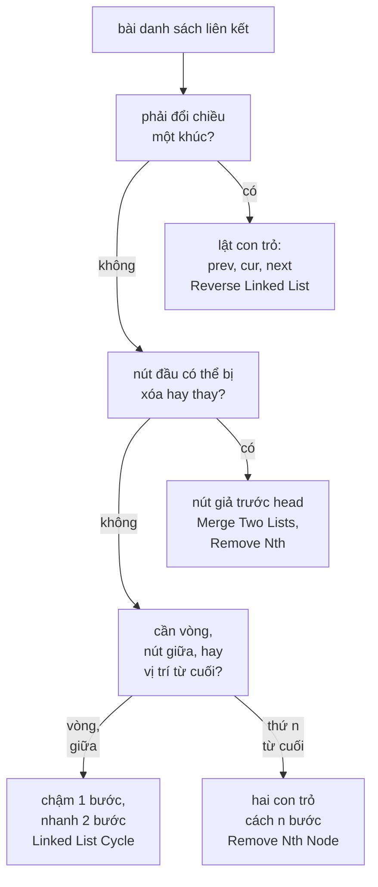

> [!tldr] Đọc nhanh
> - Pattern: [[concepts/linked-list|danh sách liên kết]] không có chỉ số. Ta chỉ cầm nút đầu, và mỗi nút chỉ biết nút sau nó. Mọi bài của ga là đổi vài con trỏ `next` theo đúng thứ tự, không để mất phần còn lại.
> - **[[concepts/pointer-reversal|Lật con trỏ tại chỗ]]** (Reverse Linked List, bài neo): ba con trỏ `prev`, `cur`, `next`; giữ `next` trước khi lật. O(n) thời gian, O(1) bộ nhớ. Bản đệ quy tốn một khung gọi hàm mỗi nút: Python mặc định dừng ở 998 nút, dưới giới hạn 5 000 của đề.
> - **[[concepts/dummy-node|Nút giả]]** (Merge Two Sorted Lists, Remove Nth Node): đặt một nút không mang dữ liệu trước đầu danh sách, để nút đầu thật được xử lý như mọi nút khác.
> - **[[concepts/fast-slow-pointers|Con trỏ chậm và nhanh]]** (Linked List Cycle, Reorder List): một con đi 1 bước, một con đi 2 bước. Có vòng thì chúng gặp nhau; không vòng thì khi con nhanh tới cuối, con chậm đứng giữa. Đo 10⁶ nút có vòng: 2,8 ms so với 64,1 ms của cách ghi nhớ nút đã gặp vào một `Set`.
> - **Hai con trỏ cách nhau n bước** (Remove Nth Node From End): con trước đi trước n + 1 bước; khi nó chạm cuối, con sau đứng ngay trước nút cần xóa, chỉ một lượt.

> [!info] Bối cảnh
> Ga 1, ga mở đầu **tuyến NeetCode: Cấu trúc liên kết**. [[series/neetcode-srch|Tuyến Tìm kiếm và heap]] vừa xong làm việc trên mảng, nơi mọi ô đến được ngay bằng chỉ số. Tuyến này làm việc trên các cấu trúc mà phần tử nối với nhau bằng con trỏ: danh sách liên kết ở ga 1 và 2, rồi cây và trie. Ga này không cần gì ngoài vòng lặp, biến và [[concepts/big-o-notation|Big-O]]; kỹ thuật [[concepts/two-pointers|hai con trỏ]] của tuyến Mảng và chuỗi xuất hiện lại dưới dạng mới.

> [!abstract]- Từ điển nhanh cho bài này (bấm để mở)
> - **Nút (node)**: một ô của danh sách, gồm giá trị `val` và con trỏ `next` tới nút kế. Xem [[concepts/linked-list|Linked List]].
> - **Con trỏ, tham chiếu**: biến "chỉ vào" một nút chứ không chứa nút. `a = b` làm hai biến chỉ cùng một nút.
> - **`head`**: con trỏ tới nút đầu, thứ duy nhất đề bài đưa cho ta.
> - **`null`, `None`, `nil`**: "không chỉ vào đâu". Nút cuối có `next` là giá trị này. Đọc `.next` của nó là lỗi.
> - **Vòng (cycle)**: một nút nào đó trỏ ngược về một nút đứng trước, nên đi theo `next` không bao giờ hết.
> - **Phần tử canh (sentinel)**: một phần tử giả đặt ở biên để code không cần nhánh riêng cho biên. Xem [[concepts/sentinel-value|Sentinel Value]].

## Hình dung trước: một đoàn tàu ở sân ga

Một đoàn tàu gồm nhiều toa móc nối nhau. Người điều độ chỉ biết toa đầu (có đầu máy) đang đỗ ở đâu; muốn tới toa thứ năm phải đi bộ qua bốn toa. Mỗi việc trong ga là tháo và móc lại vài cái móc, không bao giờ nhấc toa lên đặt chỗ khác.

| Đời thường | Khái niệm |
|---|---|
| Một toa | một nút |
| Cái móc nối sang toa sau | con trỏ `next` |
| Biết toa đầu đỗ ở đâu | `head` |
| Đảo chiều đoàn tàu: tháo từng móc, móc ngược lại về toa trước | [[concepts/pointer-reversal\|lật con trỏ tại chỗ]] (Reverse Linked List) |
| Trước khi tháo móc, ghi nhớ toa sau là toa nào | `next = cur.next` |
| Một toa trống đỗ sẵn đầu đường ray để móc kết quả vào | [[concepts/dummy-node\|nút giả]] (Merge Two Sorted Lists) |
| Hai đoàn đã xếp theo số hiệu, ghép thành một bằng cách lấy toa số nhỏ hơn ở đầu mỗi đoàn | trộn hai danh sách đã sắp |
| Hai người đi dọc đoàn, một người đi gấp đôi; đường ray khép vòng thì người nhanh đuổi kịp người chậm | [[concepts/fast-slow-pointers\|con trỏ chậm và nhanh]] (Linked List Cycle) |
| Người nhanh tới cuối thì người chậm đứng ở toa giữa | tìm nút giữa (Reorder List) |
| Hai người đi cách nhau đúng n toa; người trước tới cuối thì người sau đứng trước toa thứ n tính từ cuối | hai con trỏ cách nhau n bước (Remove Nth Node From End) |



Reorder List dùng ba trong bốn cách cùng lúc: tìm giữa bằng chậm và nhanh, lật nửa sau, rồi đan hai nửa.

## Vấn đề: không có chỉ số, chỉ có con trỏ

Trên mảng, các bài của ga này đều dễ: đảo chiều là đổi chỗ hai đầu, phần tử thứ n từ cuối là `a[len − n]`, phần tử giữa là `a[len / 2]`. Danh sách liên kết không có `len` cũng không có `a[i]`. Ta chỉ cầm `head`, và cách duy nhất để tới một nút là đi theo `next` từ đầu.

Chép hết ra mảng rồi làm trên mảng thì luôn đúng, nhưng tốn O(n) bộ nhớ và bỏ qua đúng thứ các bài này dạy. Đề nào cũng có thể viết lại thành: **dùng O(1) bộ nhớ phụ, đổi con trỏ chứ không đổi giá trị**. Khó khăn khi đó chỉ còn hai thứ: không làm mất phần còn lại khi đổi một con trỏ, và không viết nhánh riêng cho nút đầu.

## Cơ chế

### Lật con trỏ tại chỗ

<figure class="figure-map" style="--ar: 3 / 4">
<div class="frame"><iframe data-archify="../diagrams/neetcode-linked-list/pointer-dance.html" title="Lật danh sách 1 → 2 → 3 bằng ba con trỏ" loading="lazy"></iframe></div>
<figcaption><span><b>Hình 1.</b> Reverse Linked List với 1 → 2 → 3: mỗi bước giữ phần còn lại vào next, lật mũi tên của cur về prev, rồi tiến prev và cur; khi cur rỗng, prev là đầu mới.</span><a href="../diagrams/neetcode-linked-list/pointer-dance.html" target="_blank" rel="noopener">Mở toàn màn hình</a></figcaption>
</figure>

Bài neo của ga là [[problems/reverse-linked-list|Reverse Linked List]]. Giữ ba con trỏ: `prev` là đầu của khúc đã lật, `cur` là nút đang lật, `next` giữ phần còn lại. Mỗi vòng có đúng bốn phép gán, và thứ tự là toàn bộ bài toán:

1. `next = cur.next`: giữ phần còn lại, vì bước sau sẽ ghi đè `cur.next`;
2. `cur.next = prev`: lật một mũi tên;
3. `prev = cur`;
4. `cur = next`.

Khi `cur` thành `null`, `prev` là đầu của danh sách đã lật. Bỏ bước 1 thì sau bước 2, `cur.next` đã chỉ về `prev`, và phần còn lại không còn ai chỉ tới: trên trang bài, bản đó chỉ đúng 2/6 ca và trả danh sách còn một nút.

Bản đệ quy (lật phần sau `head` trước, rồi gắn `head` vào cuối) gọn hơn nhưng tốn một khung gọi hàm cho mỗi nút. Đo trên trang bài: Node 24 dừng ở khoảng 15 650 nút, Java 21 ở 29 470, Python 3.12 ở 998. Đề cho tới 5 000 nút, nên bản đệ quy của Python mặc định **không** qua.

### Nút giả: nút đầu không còn là trường hợp riêng

[[problems/merge-two-sorted-lists|Merge Two Sorted Lists]] ghép hai danh sách đã sắp thành một. Mỗi bước so hai nút đầu, nối nút nhỏ hơn vào đuôi kết quả. Chỗ vướng: lúc đầu kết quả rỗng, chưa có đuôi để nối, nên code dễ mọc một nhánh `if (result == null)` riêng.

[[concepts/dummy-node|Nút giả]] gỡ nhánh đó: tạo `dummy` không mang dữ liệu, đặt `tail = dummy`, rồi mọi bước đều là `tail.next = nhỏ hơn; tail = tail.next`. Hết một danh sách thì nối nguyên phần còn lại của danh sách kia, vì nó đã sắp sẵn. Kết quả là `dummy.next`. Đây là [[concepts/k-way-merge|trộn k đường]] với k = 2: chỉ có hai đầu để so nên không cần heap.

[[problems/remove-nth-node-from-end-of-list|Remove Nth Node From End of List]] dùng nút giả vì một lý do khác: nút cần xóa có thể chính là nút đầu. Muốn gỡ một nút phải sửa `next` của nút **đứng trước** nó, mà nút đầu không có nút đứng trước, trừ khi ta đặt `dummy.next = head`.

### Con trỏ chậm và nhanh

[[problems/linked-list-cycle|Linked List Cycle]] hỏi danh sách có vòng không. Cách thẳng nhất là ghi nhớ mọi nút đã gặp vào một tập hợp: gặp lại một nút thì có vòng. Đúng, nhưng O(n) bộ nhớ.

[[concepts/fast-slow-pointers|Con trỏ chậm và nhanh]] (thuật toán của Floyd) chỉ cần hai biến: `slow` đi 1 bước, `fast` đi 2 bước mỗi vòng. Không có vòng thì `fast` chạm `null` trước. Có vòng thì khi cả hai đã vào vòng, khoảng cách từ `fast` tới `slow` (đo theo chiều đi) giảm đúng 1 mỗi vòng lặp, nên nó về 0 trước khi `slow` đi hết một vòng: chúng gặp nhau ở cùng một nút. Phải so **cùng nút** (`===`, `is`, `==` trên con trỏ), không so giá trị.

```text
141, n = 10⁶ có vòng: Set 64.1 ms, chậm/nhanh 2.8 ms
```

Cùng một danh sách 10⁶ nút có vòng quay về nút giữa: hai con trỏ nhanh hơn trên 10 lần (14–23 lần qua các lần chạy), vì không phải băm và chèn từng nút vào `Set`.

[[problems/reorder-list|Reorder List]] dùng cùng cặp con trỏ để tìm **nút giữa**: khi `fast` tới cuối, `slow` mới đi được nửa quãng. Bài này sắp `L0 → L1 → … → Ln` thành `L0 → Ln → L1 → Ln−1 → …` và ghép ba bước: tìm giữa, cắt đôi rồi lật nửa sau bằng ba con trỏ ở trên, rồi đan xen hai nửa, mỗi lần lấy một nút từ mỗi nửa.

### Hai con trỏ cách nhau n bước

Remove Nth Node From End hỏi nút thứ n **tính từ cuối**, mà ta không biết danh sách dài bao nhiêu. Đếm độ dài rồi đi lại lần hai thì được, nhưng có cách một lượt: cho con trỏ `lead` đi trước n + 1 bước tính từ nút giả, rồi cho cả `lead` và `lag` cùng đi tới khi `lead` chạm `null`. Khoảng cách giữa chúng giữ nguyên n + 1, nên lúc đó `lag` đứng ngay **trước** nút cần xóa, và `lag.next = lag.next.next` gỡ nó ra. Đây là [[concepts/two-pointers|hai con trỏ]] cùng chiều, giống cửa sổ có độ rộng cố định.

### Năm bài, bốn kỹ thuật

| Bài | Lật con trỏ | Nút giả | Chậm và nhanh | Cách n bước | Thời gian, bộ nhớ |
|---|---|---|---|---|---|
| [[problems/reverse-linked-list\|Reverse Linked List]] | có | | | | O(n), O(1) |
| [[problems/merge-two-sorted-lists\|Merge Two Sorted Lists]] | | có | | | O(m + n), O(1) |
| [[problems/linked-list-cycle\|Linked List Cycle]] | | | có (gặp nhau) | | O(n), O(1) |
| [[problems/reorder-list\|Reorder List]] | có (nửa sau) | | có (tìm giữa) | | O(n), O(1) |
| [[problems/remove-nth-node-from-end-of-list\|Remove Nth Node From End]] | | có | | có | O(n), O(1) |

### Bên dưới năm ngôn ngữ

| | "Không có nút" | So cùng nút | Nút giả | Bẫy riêng |
|---|---|---|---|---|
| TypeScript / JavaScript | `null`; TypeScript có `strictNullChecks` | `===` | `new ListNode(0)` | dấu `!` tắt kiểm tra `null` của trình biên dịch; `a ?? b` nối phần còn lại |
| Python | `None` | `is` (không dùng `==` nếu lớp có `__eq__`) | `ListNode()` | gán bộ ba: vế phải tính trước, vế trái gán từ trái sang phải; đệ quy mặc định dừng ở khoảng 1 000 tầng |
| Go | `nil` | `==` trên con trỏ | `dummy := ListNode{}` rồi dùng `&dummy` | đọc trường qua con trỏ `nil` là panic |
| Java | `null` | `==` trên tham chiếu (`equals` là so nội dung) | `new ListNode(0, null)` | `NullPointerException`; thứ tự trong `\|\|` quan trọng |

## Ví dụ chạy được

[TypeScript](../code/neetcode-linked-list/linked-list-station.ts) · [Python](../code/neetcode-linked-list/linked_list_station.py) · [Go](../code/neetcode-linked-list/linked_list_station.go) · [Java](../code/neetcode-linked-list/linked-list-station.java) · [JavaScript](../code/neetcode-linked-list/linked-list-station.js)

Mỗi file giải cả năm bài và tự chạy 14 ca: hai ca Reverse Linked List, ba ca Merge Two Sorted Lists (ví dụ của đề, hai danh sách rỗng, một danh sách rỗng), ba ca Linked List Cycle (vòng về nút 1, vòng về nút 0, không vòng), ba ca Reorder List (số nút chẵn, lẻ, một nút) và ba ca Remove Nth Node (ví dụ của đề, xóa nút duy nhất, xóa nút đầu). Bản TypeScript còn đối chiếu Reorder List và Remove Nth Node với lời giải bằng mảng trên 2 000 danh sách ngẫu nhiên (sinh bằng mulberry32), và đo Linked List Cycle.

```ts
// 206: lật từng con trỏ, giữ next trước khi cắt.
function reverseList(head: ListNode | null): ListNode | null {
  let prev: ListNode | null = null, cur = head;
  while (cur) { const next: ListNode | null = cur.next; cur.next = prev; prev = cur; cur = next; }
  return prev;
}

// 21: nút giả đứng trước kết quả, nên không cần xử lý riêng nút đầu.
function mergeTwoLists(a: ListNode | null, b: ListNode | null): ListNode | null {
  const dummy = new ListNode(0);
  let tail = dummy;
  while (a && b) {
    if (a.val <= b.val) { tail.next = a; a = a.next; } else { tail.next = b; b = b.next; }
    tail = tail.next;
  }
  tail.next = a ?? b; // phần còn lại đã sắp sẵn, nối nguyên khúc
  return dummy.next;
}

// 141: con chậm đi 1 bước, con nhanh đi 2 bước; có vòng thì con nhanh đuổi kịp con chậm.
function hasCycle(head: ListNode | null): boolean {
  let slow = head, fast = head;
  while (fast && fast.next) {
    slow = slow!.next;
    fast = fast.next.next;
    if (slow === fast) return true;
  }
  return false;
}

// 143: tìm giữa bằng chậm/nhanh, lật nửa sau, rồi đan hai nửa.
function reorderList(head: ListNode | null): void {
  if (!head || !head.next) return;
  let slow: ListNode = head, fast: ListNode | null = head;
  while (fast.next && fast.next.next) { slow = slow.next!; fast = fast.next.next; }
  let second = reverseList(slow.next);
  slow.next = null; // cắt đôi
  let first: ListNode | null = head;
  while (second) {
    const n1: ListNode | null = first!.next, n2: ListNode | null = second.next;
    first!.next = second;
    second.next = n1;
    first = n1;
    second = n2;
  }
}

// 19: nút giả, con trước đi trước n + 1 bước; khi nó tới cuối, con sau đứng ngay trước nút cần xóa.
function removeNthFromEnd(head: ListNode | null, n: number): ListNode | null {
  const dummy = new ListNode(0, head);
  let lead: ListNode | null = dummy, lag: ListNode = dummy;
  for (let i = 0; i <= n; i++) lead = lead!.next;
  while (lead) { lead = lead.next; lag = lag.next!; }
  lag.next = lag.next!.next;
  return dummy.next;
}
```

```python
# 206: lật từng con trỏ.
def reverse_list(head):
    prev, cur = None, head
    while cur:
        nxt = cur.next
        cur.next = prev
        prev, cur = cur, nxt
    return prev

# 21: nút giả đứng trước kết quả.
def merge_two_lists(a, b):
    dummy = tail = ListNode()
    while a and b:
        if a.val <= b.val:
            tail.next, a = a, a.next
        else:
            tail.next, b = b, b.next
        tail = tail.next
    tail.next = a or b
    return dummy.next

# 141: chậm 1 bước, nhanh 2 bước; so bằng `is` (cùng một nút), không so giá trị.
def has_cycle(head):
    slow = fast = head
    while fast and fast.next:
        slow, fast = slow.next, fast.next.next
        if slow is fast:
            return True
    return False

# 143: tìm giữa, lật nửa sau, đan hai nửa.
def reorder_list(head):
    if head is None or head.next is None:
        return
    slow = fast = head
    while fast.next and fast.next.next:
        slow, fast = slow.next, fast.next.next
    second = reverse_list(slow.next)
    slow.next = None
    first = head
    while second:
        n1, n2 = first.next, second.next
        first.next, second.next = second, n1
        first, second = n1, n2

# 19: nút giả, con trước đi trước n + 1 bước.
def remove_nth_from_end(head, n):
    dummy = ListNode(0, head)
    lead = lag = dummy
    for _ in range(n + 1):
        lead = lead.next
    while lead:
        lead, lag = lead.next, lag.next
    lag.next = lag.next.next
    return dummy.next
```

```go
// 206: lật từng con trỏ.
func reverseList(head *ListNode) *ListNode {
	var prev *ListNode
	for cur := head; cur != nil; {
		next := cur.Next
		cur.Next = prev
		prev, cur = cur, next
	}
	return prev
}

// 21: nút giả là một giá trị ListNode trên stack; chỉ dùng con trỏ tới nó.
func mergeTwoLists(a, b *ListNode) *ListNode {
	dummy := ListNode{}
	tail := &dummy
	for a != nil && b != nil {
		if a.Val <= b.Val {
			tail.Next, a = a, a.Next
		} else {
			tail.Next, b = b, b.Next
		}
		tail = tail.Next
	}
	if a != nil {
		tail.Next = a
	} else {
		tail.Next = b
	}
	return dummy.Next
}

// 141: so hai con trỏ bằng ==, tức cùng địa chỉ.
func hasCycle(head *ListNode) bool {
	slow, fast := head, head
	for fast != nil && fast.Next != nil {
		slow, fast = slow.Next, fast.Next.Next
		if slow == fast {
			return true
		}
	}
	return false
}

// 143: tìm giữa, lật nửa sau, đan hai nửa.
func reorderList(head *ListNode) {
	if head == nil || head.Next == nil {
		return
	}
	slow, fast := head, head
	for fast.Next != nil && fast.Next.Next != nil {
		slow, fast = slow.Next, fast.Next.Next
	}
	second := reverseList(slow.Next)
	slow.Next = nil
	for first := head; second != nil; {
		n1, n2 := first.Next, second.Next
		first.Next, second.Next = second, n1
		first, second = n1, n2
	}
}

// 19: nút giả, con trước đi trước n + 1 bước.
func removeNthFromEnd(head *ListNode, n int) *ListNode {
	dummy := &ListNode{0, head}
	lead, lag := dummy, dummy
	for i := 0; i <= n; i++ {
		lead = lead.Next
	}
	for lead != nil {
		lead, lag = lead.Next, lag.Next
	}
	lag.Next = lag.Next.Next
	return dummy.Next
}
```

```java
// 206: lật từng con trỏ.
static ListNode reverseList(ListNode head) {
    ListNode prev = null, cur = head;
    while (cur != null) { ListNode next = cur.next; cur.next = prev; prev = cur; cur = next; }
    return prev;
}

// 21: nút giả đứng trước kết quả.
static ListNode mergeTwoLists(ListNode a, ListNode b) {
    ListNode dummy = new ListNode(0, null), tail = dummy;
    while (a != null && b != null) {
        if (a.val <= b.val) { tail.next = a; a = a.next; } else { tail.next = b; b = b.next; }
        tail = tail.next;
    }
    tail.next = a != null ? a : b;
    return dummy.next;
}

// 141: so hai tham chiếu bằng ==, tức cùng một đối tượng.
static boolean hasCycle(ListNode head) {
    ListNode slow = head, fast = head;
    while (fast != null && fast.next != null) {
        slow = slow.next;
        fast = fast.next.next;
        if (slow == fast) return true;
    }
    return false;
}

// 143: tìm giữa, lật nửa sau, đan hai nửa.
static void reorderList(ListNode head) {
    if (head == null || head.next == null) return;
    ListNode slow = head, fast = head;
    while (fast.next != null && fast.next.next != null) { slow = slow.next; fast = fast.next.next; }
    ListNode second = reverseList(slow.next);
    slow.next = null;
    for (ListNode first = head; second != null; ) {
        ListNode n1 = first.next, n2 = second.next;
        first.next = second;
        second.next = n1;
        first = n1;
        second = n2;
    }
}

// 19: nút giả, con trước đi trước n + 1 bước.
static ListNode removeNthFromEnd(ListNode head, int n) {
    ListNode dummy = new ListNode(0, head), lead = dummy, lag = dummy;
    for (int i = 0; i <= n; i++) lead = lead.next;
    while (lead != null) { lead = lead.next; lag = lag.next; }
    lag.next = lag.next.next;
    return dummy.next;
}
```

```js
// 206: lật từng con trỏ.
function reverseList(head) {
  let prev = null, cur = head;
  while (cur) { const next = cur.next; cur.next = prev; prev = cur; cur = next; }
  return prev;
}

// 21: nút giả đứng trước kết quả.
function mergeTwoLists(a, b) {
  const dummy = new ListNode();
  let tail = dummy;
  while (a && b) {
    if (a.val <= b.val) { tail.next = a; a = a.next; } else { tail.next = b; b = b.next; }
    tail = tail.next;
  }
  tail.next = a ?? b;
  return dummy.next;
}

// 141: === so hai tham chiếu, tức cùng một đối tượng.
function hasCycle(head) {
  let slow = head, fast = head;
  while (fast && fast.next) {
    slow = slow.next;
    fast = fast.next.next;
    if (slow === fast) return true;
  }
  return false;
}

// 143: tìm giữa, lật nửa sau, đan hai nửa.
function reorderList(head) {
  if (!head || !head.next) return;
  let slow = head, fast = head;
  while (fast.next && fast.next.next) { slow = slow.next; fast = fast.next.next; }
  let second = reverseList(slow.next);
  slow.next = null;
  let first = head;
  while (second) {
    const n1 = first.next, n2 = second.next;
    first.next = second;
    second.next = n1;
    first = n1;
    second = n2;
  }
}

// 19: nút giả, con trước đi trước n + 1 bước.
function removeNthFromEnd(head, n) {
  const dummy = new ListNode(0, head);
  let lead = dummy, lag = dummy;
  for (let i = 0; i <= n; i++) lead = lead.next;
  while (lead) { lead = lead.next; lag = lag.next; }
  lag.next = lag.next.next;
  return dummy.next;
}
```


Kết quả `node linked-list-station.ts`:

```text
linked-list-station 14/14 ca đúng
đối chiếu 2000 danh sách ngẫu nhiên (143, 19): 0 lần lệch
141, n = 10⁶ có vòng: Set 64.1 ms, chậm/nhanh 2.8 ms
```

Python, Go, Java và JavaScript cũng in `14/14 ca đúng`.

## Hiểu lầm và bẫy hay gặp

- **"Danh sách liên kết giống mảng, chỉ khác cách lưu."** Khác ở thứ quan trọng nhất: không có `a[i]`. Tới nút thứ i tốn O(i), nên mọi thuật toán phải đi theo thứ tự, và những gì cần "nhìn lại phía sau" phải được giữ bằng con trỏ.
- **Đổi con trỏ trước khi giữ phần còn lại.** Ghi đè `cur.next` khi chưa lưu nó thì phần sau không còn ai chỉ tới. Luôn giữ trước, đổi sau.
- **Nhánh riêng cho nút đầu.** Thường là chỗ sai nhất của code. Nút giả làm nút đầu giống mọi nút khác; nhớ trả `dummy.next`, không trả `head` cũ.
- **So giá trị thay vì so nút.** Hai nút khác nhau có thể cùng giá trị. Phát hiện vòng phải so tham chiếu.
- **Điều kiện dừng của con trỏ nhanh.** Phải kiểm tra cả `fast` và `fast.next` trước khi đi `fast.next.next`. Thiếu `fast.next` thì danh sách có số nút lẻ làm `fast` dừng ở nút cuối rồi đọc `.next` của `null`; thiếu `fast` thì danh sách có số nút chẵn làm `fast` thành `null` rồi đọc `.next` của nó. Trang [[problems/linked-list-cycle|Linked List Cycle]] chạy bản thiếu kiểm tra này.
- **Đệ quy trên danh sách dài.** Mỗi nút một khung gọi hàm. Python mặc định dừng ở khoảng 1 000 tầng, dưới giới hạn của chính bài Reverse Linked List.

## Câu hỏi tự kiểm tra

> [!question]- Lật `1 → 2 → 3` bằng ba con trỏ. Sau vòng thứ nhất, `prev`, `cur` và hai khúc là gì?
> `prev` chỉ nút 1 và khúc đã lật là `1 → null`. `cur` chỉ nút 2 và phần chưa lật là `2 → 3 → null`. Hai khúc không còn nối với nhau.

> [!question]- Merge Two Sorted Lists không dùng nút giả thì phải viết thêm gì?
> Một bước riêng để chọn nút đầu của kết quả (nhỏ hơn trong hai đầu, hoặc đầu của danh sách không rỗng), và kiểm tra cả hai danh sách rỗng trước khi chọn. Nút giả thay cả hai bằng `dummy.next` ở cuối.

> [!question]- Danh sách có vòng dài 5, và `slow` vừa vào vòng khi `fast` đứng trước nó 3 bước theo chiều đi. Sau bao nhiêu vòng lặp chúng gặp nhau?
> Khoảng cách từ `fast` đuổi tới `slow` là 5 − 3 = 2 bước. Mỗi vòng lặp khoảng cách giảm 1 (`fast` đi 2, `slow` đi 1), nên sau 2 vòng lặp chúng đứng cùng một nút.

> [!question]- Remove Nth Node: vì sao `lead` đi trước n + 1 bước chứ không phải n?
> Để `lag` dừng ở nút **đứng trước** nút cần xóa, vì gỡ một nút là sửa `next` của nút trước nó. Đi trước n bước thì `lag` dừng đúng ở nút cần xóa, và trong danh sách đơn không có cách lùi lại một nút.

## Tham khảo

- [NeetCode 150](https://neetcode.io/practice) (danh sách và nhóm bài)
- LeetCode: [206. Reverse Linked List](https://leetcode.com/problems/reverse-linked-list/), [21. Merge Two Sorted Lists](https://leetcode.com/problems/merge-two-sorted-lists/), [141. Linked List Cycle](https://leetcode.com/problems/linked-list-cycle/), [143. Reorder List](https://leetcode.com/problems/reorder-list/), [19. Remove Nth Node From End of List](https://leetcode.com/problems/remove-nth-node-from-end-of-list/)
- [Python: câu lệnh gán](https://docs.python.org/3/reference/simple_stmts.html#assignment-statements) (vế phải tính trước, các đích gán từ trái sang phải)
- [Go spec: Address operators](https://go.dev/ref/spec#Address_operators) (đọc qua con trỏ `nil` gây panic)
- Cormen, Leiserson, Rivest, Stein, *Introduction to Algorithms*, mục 10.2 "Linked lists" (danh sách liên kết và phần tử canh)
- Donald E. Knuth, *The Art of Computer Programming*, tập 1, mục 2.2 "Linear Lists"; tập 2, mục 3.1, bài tập 6 (tìm chu kỳ bằng hai con trỏ, Knuth ghi công cho Floyd)
