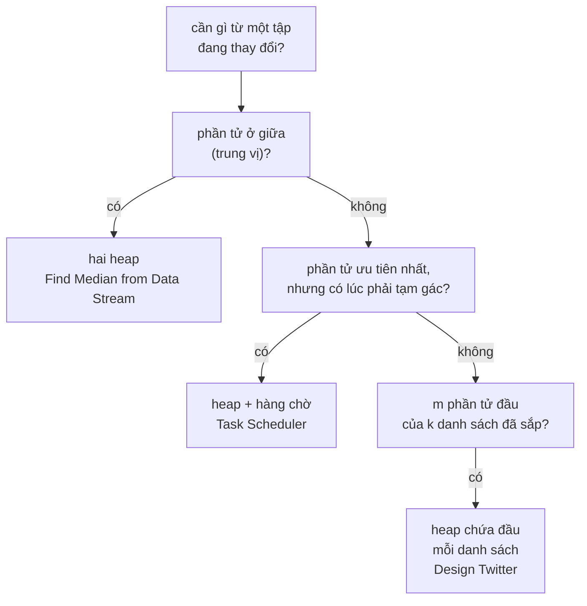

> [!tldr] Đọc nhanh
> - Pattern: heap ghép với một thứ khác. [[posts/2026-11-23-neetcode-heap-top-k|Ga 3]] dùng một heap để biết phần tử **đứng đầu**; ga này dùng heap làm một bộ phận trong cấu trúc lớn hơn.
> - **[[concepts/two-heaps|Hai heap]]** (Find Median from Data Stream): nửa nhỏ trong max-heap, nửa lớn trong min-heap, hai đỉnh đứng sát nhau ở giữa dãy. Trung vị đọc trong O(1), thêm số trong O(log n). Đo 2·10⁵ số: 50,8 ms so với 1 367,6 ms khi chèn vào mảng đã sắp.
> - **Heap và hàng chờ** (Task Scheduler): mỗi đơn vị thời gian chạy việc còn nhiều lần nhất; việc vừa chạy nghỉ trong hàng chờ n đơn vị rồi mới quay lại heap. Bài này còn có công thức đếm O(n) không cần mô phỏng.
> - **[[concepts/k-way-merge|Trộn k đường]]** (Design Twitter): bảng tin là 10 tweet mới nhất trong k danh sách đã sắp theo thời gian. Heap chứa đúng một tweet mới nhất chưa lấy của mỗi người; 10 lần lấy là xong. Đo 1 000 người × 1 000 tweet: 0,20 ms so với 266,17 ms khi gom hết rồi sắp.
> - Ga này khép lại tuyến Tìm kiếm và heap; [[series/neetcode-link|tuyến Cấu trúc liên kết]] dùng lại trộn k đường cho bài gộp k danh sách liên kết.

> [!info] Bối cảnh
> Ga 4, ga cuối của **tuyến NeetCode: Tìm kiếm và heap**. [[posts/2026-11-23-neetcode-binary-search|Ga 1]] và [[posts/2026-11-23-neetcode-binary-search-answer|ga 2]] tìm kiếm trên dữ liệu có thứ tự; [[posts/2026-11-23-neetcode-heap-top-k|ga 3]] dựng [[concepts/heap|heap]] và [[concepts/size-k-heap|heap k chỗ]] để biết phần tử đứng đầu của dữ liệu không có thứ tự. Ở đây ba bài thiết kế (đề cho một lớp với vài phương thức, không phải một hàm) dùng heap như một bộ phận. Cần biết heap là gì và nổi lên, chìm xuống ra sao ([[concepts/sift-up-sift-down|Sift Up and Sift Down]]); không cần gì khác.

> [!abstract]- Từ điển nhanh cho bài này (bấm để mở)
> - **Heap, đỉnh**: cây nhị phân lưu trong mảng, phần tử ưu tiên nhất ở ô 0. Min-heap: nhỏ nhất ở đỉnh; max-heap: lớn nhất ở đỉnh. Xem [[concepts/heap|Heap]].
> - **Trung vị (median)**: số đứng giữa khi sắp tăng dần; số phần tử chẵn thì lấy trung bình hai số giữa.
> - **Luồng (stream)**: dữ liệu đến từng phần tử, câu hỏi lặp lại sau mỗi phần tử. Xem [[concepts/running-median|Running Median]].
> - **Thời gian nghỉ (cooldown)**: hai lần chạy cùng một loại việc phải cách nhau ít nhất n đơn vị thời gian.
> - **Hàng đợi (queue)**: vào cuối, ra đầu, theo thứ tự đến.
> - **Trộn k đường (k-way merge)**: gộp k danh sách đã sắp thành một danh sách sắp. Xem [[concepts/k-way-merge|K-way Merge]].
> - **Bài thiết kế (design problem)**: đề cho một lớp và vài phương thức được gọi xen kẽ; phải chọn cấu trúc dữ liệu để mọi phương thức đều rẻ.

## Hình dung trước: một ngày ở lớp học

Cô chủ nhiệm có ba việc lặp lại mỗi ngày, và việc nào cũng chỉ cần biết "ai đứng đầu" của một nhóm đang thay đổi.

| Đời thường | Khái niệm |
|---|---|
| Đo chiều cao giữa lớp: chia lớp thành hàng thấp (em cao nhất đứng đầu) và hàng cao (em thấp nhất đứng đầu) | hai heap: max-heap nửa nhỏ, min-heap nửa lớn |
| Em mới vào hàng thấp, em cao nhất hàng thấp sang hàng cao, hàng nào đông quá thì chuyển một em về | thêm vào nửa nhỏ, chuyển đỉnh, cân lại cỡ |
| Hai em đầu hai hàng là hai em giữa lớp | trung vị = một hoặc hai đỉnh |
| Lịch trực nhật: mỗi giờ làm việc còn nhiều lượt nhất | max-heap theo số lần còn lại |
| Việc vừa làm phải nghỉ n giờ mới được làm tiếp, ngồi ghế chờ | hàng chờ thời gian nghỉ |
| Không việc nào sẵn sàng: cả lớp nghỉ một giờ | đơn vị thời gian rảnh |
| Bảng tin lớp: mỗi bạn có một chồng giấy nhắn, tờ mới nhất trên cùng | k danh sách đã sắp |
| Chỉ nhìn tờ trên cùng của mỗi chồng, lấy tờ mới nhất, rồi lật tờ kế của chồng đó | trộn k đường bằng heap |



## Vấn đề: heap một mình chỉ biết phần tử đứng đầu

Một heap trả lời đúng một câu hỏi: phần tử ưu tiên nhất là gì. Ba bài của ga hỏi thứ khác:

- **Find Median from Data Stream** hỏi phần tử ở **giữa**. Heap không biết gì về giữa. Giữ mảng đã sắp thì biết, nhưng mỗi lần chèn phải dời nửa mảng: 2·10⁵ số mất 1,37 giây.
- **Task Scheduler** hỏi phần tử ưu tiên nhất **trong số những phần tử đang được phép**. Việc vừa chạy vẫn có thể là việc còn nhiều lần nhất, nhưng phải nghỉ; heap không có khái niệm "tạm gác".
- **Design Twitter** hỏi 10 phần tử đầu của **hợp** k danh sách. Gom hết rồi sắp thì đụng tới mọi tweet của mọi người, dù chỉ cần 10.

Cả ba đều giải được bằng cách ghép heap với đúng một thứ nữa: một heap thứ hai, một hàng chờ, hoặc chỉ số vào từng danh sách.

## Cơ chế

### Hai heap: giữ phần giữa

<figure class="figure-map" style="--ar: 3 / 4">
<div class="frame"><iframe data-archify="../diagrams/neetcode-two-heaps/running-median.html" title="Trung vị của một luồng bằng hai heap" loading="lazy"></iframe></div>
<figcaption><span><b>Hình 1.</b> Find Median from Data Stream với luồng 5, 2, 8, 1, 9: mỗi số vào nửa nhỏ, đỉnh nửa nhỏ sang nửa lớn, nửa lớn đông hơn thì trả một số về; trung vị luôn nằm ở một hoặc hai đỉnh.</span><a href="../diagrams/neetcode-two-heaps/running-median.html" target="_blank" rel="noopener">Mở toàn màn hình</a></figcaption>
</figure>

Bài neo của ga là [[problems/find-median-from-data-stream|Find Median from Data Stream]]. Chia các số đã thấy thành **nửa nhỏ** (max-heap) và **nửa lớn** (min-heap), giữ hai bất biến:

1. mọi số nửa nhỏ ≤ mọi số nửa lớn;
2. nửa nhỏ có bằng hoặc hơn nửa lớn đúng một phần tử.

Khi đó đỉnh nửa nhỏ là số lớn nhất bên dưới ranh giới, đỉnh nửa lớn là số nhỏ nhất bên trên, và trung vị là đỉnh nửa nhỏ (n lẻ) hoặc trung bình hai đỉnh (n chẵn). Thêm một số theo ba bước: đẩy vào nửa nhỏ; chuyển đỉnh nửa nhỏ sang nửa lớn (giữ bất biến 1, vì số được chuyển là số lớn nhất của nửa nhỏ); nếu nửa lớn đông hơn thì chuyển đỉnh nửa lớn về (giữ bất biến 2). Mỗi bước O(log n), đọc trung vị O(1).

Hai bản sai trên trang bài mỗi bản giữ đúng một bất biến và đều chỉ đúng 3/8 ca: **chia luân phiên** giữa hai heap (cỡ đúng, thứ tự vỡ) và **không cân lại** (thứ tự đúng, cỡ lệch dần). Khác với [[problems/median-of-two-sorted-arrays|Median of Two Sorted Arrays]] của ga 2, nơi hai mảng có sẵn và chỉ hỏi một lần nên chia đôi vị trí cắt cho O(log min(m, n)); ở đây dữ liệu đến dần và câu hỏi lặp lại sau mỗi số.

| n | dữ liệu | Chèn mảng đã sắp | Hai heap | Mảng đếm [0, 100] |
|---|---|---|---|---|
| 10⁵ | ngẫu nhiên ±10⁵ | 292,8 ms | 24,5 ms | 8,6 ms |
| 2·10⁵ | ngẫu nhiên ±10⁵ | 1 367,6 ms | 50,8 ms | 17,6 ms |
| 2·10⁵ | giảm dần | 3 307,8 ms | 53,7 ms | |
| 10⁶ | ngẫu nhiên ±10⁵ | (không chạy) | 281,7 ms | 87,7 ms |

Đo TypeScript trên trang bài, trung vị 5 lần, mỗi lần thêm kèm một lần hỏi. Chèn vào mảng sắp tăng theo n², hai heap tăng tuyến tính. Cột cuối trả lời câu hỏi mở rộng của đề: khi mọi số nằm trong [0, 100], một mảng đếm 101 ô còn nhanh hơn hai heap.

### Heap và hàng chờ: lập lịch có thời gian nghỉ

[[problems/task-scheduler|Task Scheduler]]: một danh sách việc, mỗi việc là một chữ cái; mỗi đơn vị thời gian CPU chạy một việc hoặc nghỉ; hai lần chạy cùng một chữ phải cách nhau ít nhất n đơn vị. Hỏi số đơn vị thời gian ít nhất.

Tham lam: ở mỗi đơn vị, chạy việc **còn nhiều lần nhất** trong số những việc đang được phép. Việc còn nhiều lần nhất là việc dễ làm kéo dài lịch nhất, nên chạy nó sớm. Cấu trúc:

- một **max-heap** chứa số lần còn lại của các việc đang được phép;
- một **hàng chờ** chứa các việc vừa chạy, kèm thời điểm chúng được chạy lại (`bây giờ + n`). Vì mọi việc nghỉ đúng n đơn vị, việc vào hàng trước cũng hết nghỉ trước, nên hàng chờ thường (vào cuối, ra đầu) là đủ, không cần heap thứ hai.

Mỗi đơn vị: lấy đỉnh heap (nếu có), giảm một, còn lần thì đưa vào hàng chờ; đầu hàng chờ hết nghỉ thì trả về heap. Heap rỗng mà hàng chờ còn việc thì đơn vị đó CPU nghỉ.

Bài này còn có lời giải **không cần mô phỏng**. Gọi f là số lần của việc nhiều nhất và c là số việc có đúng f lần. Việc nhiều nhất chia lịch thành f − 1 khung, mỗi khung dài n + 1, cộng một khung cuối chứa c việc: (f − 1)(n + 1) + c. Nếu các việc khác nhiều đến mức lấp đầy mọi khung, lịch không có chỗ nghỉ nào và đáp án là số việc. Vậy đáp án là max(số việc, (f − 1)(n + 1) + c). Với `AAABBB`, n = 2: f = 3, c = 2, (3 − 1) · 3 + 2 = 8, tức `A B _ A B _ A B`.

```text
621, 10⁴ việc, 26 loại, n = 0  : mô phỏng 10000 (1.67 ms), công thức 10000 (0.30 ms)
621, 10⁴ việc, 26 loại, n = 2  : mô phỏng 10000 (1.19 ms), công thức 10000 (0.27 ms)
621, 10⁴ việc, 26 loại, n = 100: mô phỏng 42825 (0.48 ms), công thức 42825 (0.27 ms)
```

Mô phỏng và công thức cho cùng đáp án ở cả ba n. Công thức chỉ đếm một lượt nên nhanh hơn, nhưng mô phỏng tổng quát hơn: nó in được lịch, và vẫn đúng khi đề đổi luật (ví dụ mỗi việc có thời gian nghỉ riêng, khi đó hàng chờ cần thành một heap theo thời điểm được chạy lại).

### Heap chứa đầu k danh sách: trộn k đường

[[problems/design-twitter|Design Twitter]]: người dùng đăng tweet, theo dõi và bỏ theo dõi nhau; `getNewsFeed(user)` trả 10 tweet mới nhất của chính người đó và những người họ theo dõi, mới nhất trước.

Mỗi người giữ tweet của mình trong một danh sách theo thời gian đăng, nên đã sắp sẵn. Bảng tin là 10 phần tử đầu của **k danh sách đã sắp** gộp lại ([[concepts/k-way-merge|trộn k đường]]):

1. Đẩy vào max-heap (theo thời điểm) tweet mới nhất của mỗi người trong nhóm, cùng vị trí của nó trong danh sách.
2. Lấy đỉnh: đó là tweet mới nhất trong mọi tweet chưa lấy. Đẩy vào heap tweet cũ hơn kế tiếp của **cùng người**.
3. Lặp tới khi đủ 10 hoặc heap rỗng.

Heap không bao giờ quá k phần tử, nên một lần `getNewsFeed` tốn O(k + 10 log k), không phụ thuộc mỗi người đã đăng bao nhiêu tweet. Gom mọi tweet rồi sắp thì tốn O(N log N) với N là tổng số tweet của cả nhóm.

```text
355, 100 người × ~100 tweet: trộn k đường 0.03 ms, gom rồi sắp 1.07 ms, cùng kết quả: true
355, 1000 người × ~100 tweet: trộn k đường 0.21 ms, gom rồi sắp 17.99 ms, cùng kết quả: true
355, 1000 người × ~1000 tweet: trộn k đường 0.20 ms, gom rồi sắp 266.17 ms, cùng kết quả: true
```

Khoảng cách tăng theo số tweet mỗi người: ở 1 000 người × 1 000 tweet, trộn k đường vẫn khoảng 0,2 ms vì chỉ đụng tới 1 000 tweet đầu danh sách và 10 tweet được lấy, còn gom rồi sắp phải sắp 10⁶ tweet.

### Ba bài, ba cách ghép

| Bài | Heap | Ghép với | Mỗi thao tác |
|---|---|---|---|
| [[problems/find-median-from-data-stream\|Find Median from Data Stream]] | max-heap nửa nhỏ, min-heap nửa lớn | heap thứ hai | `addNum` O(log n), `findMedian` O(1) |
| [[problems/task-scheduler\|Task Scheduler]] | max-heap số lần còn lại | hàng chờ thời gian nghỉ | O(log 26) mỗi đơn vị thời gian; hoặc công thức đếm O(số việc) |
| [[problems/design-twitter\|Design Twitter]] | max-heap theo thời điểm, mỗi người một phần tử | chỉ số vào danh sách tweet của từng người | `getNewsFeed` O(k + 10 log k), `postTweet` O(1) |

### Bên dưới năm ngôn ngữ

| | Max-heap | Phần tử nhiều trường | Bẫy riêng |
|---|---|---|---|
| TypeScript / JavaScript | tự viết heap theo khóa, khóa âm | mảng `[thời điểm, người, chỉ số]` | `sort()` không truyền hàm so sánh thì so theo chuỗi |
| Python | `heapq` chỉ có min-heap: đảo dấu | tuple, so từng phần tử từ trái | quên đảo dấu ở một trong ba chỗ; `//` làm tròn xuống, dùng `/` cho trung vị |
| Go | `container/heap`, đổi `Less` | struct riêng cho mỗi loại heap | `Push`, `Pop` cần con trỏ; gọi `heap.Push(h, x)`; `int / int` chia nguyên |
| Java | `PriorityQueue` với `Collections.reverseOrder()` | `int[]` với comparator | comparator `(a, b) -> b - a` tràn `int`, dùng `Integer.compare`; `(a + b) / 2` chia nguyên |

## Ví dụ chạy được

[TypeScript](../code/neetcode-two-heaps/two-heaps-station.ts) · [Python](../code/neetcode-two-heaps/two_heaps_station.py) · [Go](../code/neetcode-two-heaps/two_heaps_station.go) · [Java](../code/neetcode-two-heaps/two-heaps-station.java) · [JavaScript](../code/neetcode-two-heaps/two-heaps-station.js)

Mỗi file giải cả ba bài và tự chạy 14 ca: năm ca Task Scheduler (ba ví dụ của đề, `AAAAAABCDEFG` với n = 2, và n = 0), bốn ca Design Twitter (ví dụ của đề, 11 tweet chỉ trả 10, tự theo dõi mình không bị trùng, ba người xen kẽ) và năm ca Find Median (ví dụ của đề, giảm dần, số âm, trùng nhau, xen kẽ). Bản TypeScript và JavaScript còn chạy hai phép đo của Task Scheduler và Design Twitter in ở trên.

```ts
// 621: mỗi đơn vị thời gian chạy việc còn nhiều lần nhất (max-heap theo số lần còn lại);
// việc vừa chạy vào hàng chờ, quay lại heap khi hết n đơn vị nghỉ.
function leastInterval(tasks: string[], n: number): number {
  const count = new Map<string, number>();
  for (const t of tasks) count.set(t, (count.get(t) ?? 0) + 1);
  const ready = new Heap<number>((c) => -c);
  for (const c of count.values()) ready.push(c);
  const cooling: [number, number][] = []; // [số lần còn lại, thời điểm được chạy lại], theo thứ tự thời gian
  let time = 0;
  while (ready.size > 0 || cooling.length > 0) {
    time++;
    if (ready.size > 0) {
      const left = ready.pop() - 1;
      if (left > 0) cooling.push([left, time + n]);
    } // heap rỗng: CPU nghỉ đơn vị này
    if (cooling.length > 0 && cooling[0][1] === time) ready.push(cooling.shift()![0]);
  }
  return time;
}

// 355: mỗi người giữ danh sách tweet theo thời gian; bảng tin là trộn k danh sách đã sắp (k-way merge)
// bằng max-heap theo thời điểm, mỗi danh sách chỉ có phần tử mới nhất chưa lấy nằm trong heap.
class Twitter {
  clock = 0;
  tweets = new Map<number, [number, number][]>(); // userId → [[thời điểm, tweetId], …] tăng dần theo thời điểm
  follows = new Map<number, Set<number>>();
  postTweet(userId: number, tweetId: number): void {
    if (!this.tweets.has(userId)) this.tweets.set(userId, []);
    this.tweets.get(userId)!.push([this.clock++, tweetId]);
  }
  getNewsFeed(userId: number): number[] {
    const heap = new Heap<[number, number, number]>((e) => -e[0]); // [thời điểm, người, chỉ số trong danh sách]
    for (const u of new Set([userId, ...(this.follows.get(userId) ?? [])])) {
      const list = this.tweets.get(u);
      if (list && list.length > 0) heap.push([list[list.length - 1][0], u, list.length - 1]);
    }
    const feed: number[] = [];
    while (heap.size > 0 && feed.length < 10) {
      const [, u, i] = heap.pop();
      const list = this.tweets.get(u)!;
      feed.push(list[i][1]);
      if (i > 0) heap.push([list[i - 1][0], u, i - 1]); // tweet cũ hơn kế tiếp của cùng người
    }
    return feed;
  }
  follow(a: number, b: number): void {
    if (!this.follows.has(a)) this.follows.set(a, new Set());
    this.follows.get(a)!.add(b);
  }
  unfollow(a: number, b: number): void { this.follows.get(a)?.delete(b); }
}

// 295: hai heap. lower (max-heap) giữ nửa nhỏ, upper (min-heap) giữ nửa lớn.
class MedianFinder {
  lower = new Heap<number>((x) => -x);
  upper = new Heap<number>((x) => x);
  addNum(x: number): void {
    this.lower.push(x);
    this.upper.push(this.lower.pop()); // số lớn nhất nửa nhỏ sang nửa lớn
    if (this.upper.size > this.lower.size) this.lower.push(this.upper.pop());
  }
  findMedian(): number {
    return this.lower.size > this.upper.size ? this.lower.peek() : (this.lower.peek() + this.upper.peek()) / 2;
  }
}
```

```python
def least_interval(tasks, n):
    # 621: max-heap số lần còn lại (heapq trên số âm); việc vừa chạy nghỉ trong hàng chờ tới thời điểm được chạy lại.
    ready = [-c for c in Counter(tasks).values()]
    heapq.heapify(ready)
    cooling = deque()  # (số lần còn lại, thời điểm được chạy lại)
    time = 0
    while ready or cooling:
        time += 1
        if ready:
            left = -heapq.heappop(ready) - 1
            if left:
                cooling.append((left, time + n))
        if cooling and cooling[0][1] == time:
            heapq.heappush(ready, -cooling.popleft()[0])
    return time

class Twitter:
    # 355: bảng tin là trộn k danh sách tweet (k-way merge) bằng max-heap theo thời điểm (số âm).
    def __init__(self):
        self.clock = 0
        self.tweets = {}  # user → [(thời điểm, tweetId), …] tăng dần
        self.follows = {}

    def postTweet(self, user, tweet):
        self.tweets.setdefault(user, []).append((self.clock, tweet))
        self.clock += 1

    def getNewsFeed(self, user):
        heap = []
        for u in {user} | self.follows.get(user, set()):
            lst = self.tweets.get(u)
            if lst:
                heap.append((-lst[-1][0], u, len(lst) - 1))
        heapq.heapify(heap)
        feed = []
        while heap and len(feed) < 10:
            _, u, i = heapq.heappop(heap)
            lst = self.tweets[u]
            feed.append(lst[i][1])
            if i > 0:
                heapq.heappush(heap, (-lst[i - 1][0], u, i - 1))
        return feed

    def follow(self, a, b):
        self.follows.setdefault(a, set()).add(b)

    def unfollow(self, a, b):
        self.follows.get(a, set()).discard(b)

class MedianFinder:
    # 295: lower là max-heap (số âm) giữ nửa nhỏ, upper là min-heap giữ nửa lớn.
    def __init__(self):
        self.lower, self.upper = [], []

    def addNum(self, x):
        heapq.heappush(self.lower, -x)
        heapq.heappush(self.upper, -heapq.heappop(self.lower))
        if len(self.upper) > len(self.lower):
            heapq.heappush(self.lower, -heapq.heappop(self.upper))

    def findMedian(self):
        if len(self.lower) > len(self.upper):
            return -self.lower[0]
        return (-self.lower[0] + self.upper[0]) / 2
```

```go
type maxIntHeap struct{ intHeap }

func (h maxIntHeap) Less(i, j int) bool { return h.intHeap[i] > h.intHeap[j] }

// 621: max-heap số lần còn lại; việc vừa chạy nghỉ trong hàng chờ tới thời điểm được chạy lại.
func leastInterval(tasks string, n int) int {
	count := map[rune]int{}
	for _, t := range tasks {
		count[t]++
	}
	ready := &maxIntHeap{}
	for _, c := range count {
		heap.Push(ready, c)
	}
	type wait struct{ left, at int }
	var cooling []wait
	time := 0
	for ready.Len() > 0 || len(cooling) > 0 {
		time++
		if ready.Len() > 0 {
			if left := heap.Pop(ready).(int) - 1; left > 0 {
				cooling = append(cooling, wait{left, time + n})
			}
		}
		if len(cooling) > 0 && cooling[0].at == time {
			heap.Push(ready, cooling[0].left)
			cooling = cooling[1:]
		}
	}
	return time
}

// 355: bảng tin là trộn k danh sách tweet (k-way merge) bằng max-heap theo thời điểm.
type tweet struct{ at, id int }

type cursor struct{ at, user, i int }

type cursorHeap []cursor

func (h cursorHeap) Less(i, j int) bool { return h[i].at > h[j].at }

func (t *Twitter) GetNewsFeed(user int) []int {
	h := &cursorHeap{}
	users := map[int]bool{user: true}
	for u := range t.follows[user] {
		users[u] = true
	}
	for u := range users {
		if l := t.tweets[u]; len(l) > 0 {
			heap.Push(h, cursor{l[len(l)-1].at, u, len(l) - 1})
		}
	}
	feed := []int{}
	for h.Len() > 0 && len(feed) < 10 {
		c := heap.Pop(h).(cursor)
		l := t.tweets[c.user]
		feed = append(feed, l[c.i].id)
		if c.i > 0 {
			heap.Push(h, cursor{l[c.i-1].at, c.user, c.i - 1})
		}
	}
	return feed
}

// 295: lower là max-heap giữ nửa nhỏ, upper là min-heap giữ nửa lớn.
type MedianFinder struct {
	lower *maxIntHeap
	upper *intHeap
}

func (m *MedianFinder) AddNum(x int) {
	heap.Push(m.lower, x)
	heap.Push(m.upper, heap.Pop(m.lower))
	if m.upper.Len() > m.lower.Len() {
		heap.Push(m.lower, heap.Pop(m.upper))
	}
}

func (m *MedianFinder) FindMedian() float64 {
	if m.lower.Len() > m.upper.Len() {
		return float64(m.lower.intHeap[0])
	}
	return float64(m.lower.intHeap[0]+(*m.upper)[0]) / 2
}
```

```java
// 621: max-heap số lần còn lại; việc vừa chạy nghỉ trong hàng chờ tới thời điểm được chạy lại.
static int leastInterval(char[] tasks, int n) {
    int[] count = new int[26];
    for (char t : tasks) count[t - 'A']++;
    PriorityQueue<Integer> ready = new PriorityQueue<>(Collections.reverseOrder());
    for (int c : count) if (c > 0) ready.offer(c);
    ArrayDeque<int[]> cooling = new ArrayDeque<>(); // {số lần còn lại, thời điểm được chạy lại}
    int time = 0;
    while (!ready.isEmpty() || !cooling.isEmpty()) {
        time++;
        if (!ready.isEmpty()) {
            int left = ready.poll() - 1;
            if (left > 0) cooling.add(new int[]{left, time + n});
        }
        if (!cooling.isEmpty() && cooling.peek()[1] == time) ready.offer(cooling.poll()[0]);
    }
    return time;
}

// 355: bảng tin là trộn k danh sách tweet (k-way merge) bằng max-heap theo thời điểm.
static class Twitter {
    int clock = 0;
    Map<Integer, List<int[]>> tweets = new HashMap<>(); // user → [{thời điểm, tweetId}, …] tăng dần
    Map<Integer, Set<Integer>> follows = new HashMap<>();

    void postTweet(int user, int id) { tweets.computeIfAbsent(user, k -> new ArrayList<>()).add(new int[]{clock++, id}); }

    List<Integer> getNewsFeed(int user) {
        PriorityQueue<int[]> heap = new PriorityQueue<>((a, b) -> Integer.compare(b[0], a[0])); // {thời điểm, user, chỉ số}
        Set<Integer> users = new HashSet<>(follows.getOrDefault(user, Set.of()));
        users.add(user);
        for (int u : users) {
            List<int[]> l = tweets.get(u);
            if (l != null && !l.isEmpty()) heap.offer(new int[]{l.get(l.size() - 1)[0], u, l.size() - 1});
        }
        List<Integer> feed = new ArrayList<>();
        while (!heap.isEmpty() && feed.size() < 10) {
            int[] c = heap.poll();
            List<int[]> l = tweets.get(c[1]);
            feed.add(l.get(c[2])[1]);
            if (c[2] > 0) heap.offer(new int[]{l.get(c[2] - 1)[0], c[1], c[2] - 1});
        }
        return feed;
    }

    void follow(int a, int b) { follows.computeIfAbsent(a, k -> new HashSet<>()).add(b); }

    void unfollow(int a, int b) { follows.getOrDefault(a, new HashSet<>()).remove(b); }
}

// 295: lower là max-heap giữ nửa nhỏ, upper là min-heap giữ nửa lớn.
static class MedianFinder {
    PriorityQueue<Integer> lower = new PriorityQueue<>(Collections.reverseOrder());
    PriorityQueue<Integer> upper = new PriorityQueue<>();

    void addNum(int x) {
        lower.offer(x);
        upper.offer(lower.poll());
        if (upper.size() > lower.size()) lower.offer(upper.poll());
    }

    double findMedian() {
        if (lower.size() > upper.size()) return lower.peek();
        return ((long) lower.peek() + upper.peek()) / 2.0;
    }
}
```

```js
// 621: mỗi đơn vị thời gian chạy việc còn nhiều lần nhất (max-heap theo số lần còn lại);
// việc vừa chạy vào hàng chờ, quay lại heap khi hết n đơn vị nghỉ.
function leastInterval(tasks, n) {
  const count = new Map();
  for (const t of tasks) count.set(t, (count.get(t) ?? 0) + 1);
  const ready = new Heap((c) => -c);
  for (const c of count.values()) ready.push(c);
  const cooling = []; // [số lần còn lại, thời điểm được chạy lại], theo thứ tự thời gian
  let time = 0;
  while (ready.size > 0 || cooling.length > 0) {
    time++;
    if (ready.size > 0) {
      const left = ready.pop() - 1;
      if (left > 0) cooling.push([left, time + n]);
    } // heap rỗng: CPU nghỉ đơn vị này
    if (cooling.length > 0 && cooling[0][1] === time) ready.push(cooling.shift()[0]);
  }
  return time;
}

// 355: mỗi người giữ danh sách tweet theo thời gian; bảng tin là trộn k danh sách đã sắp (k-way merge)
// bằng max-heap theo thời điểm, mỗi danh sách chỉ có phần tử mới nhất chưa lấy nằm trong heap.
class Twitter {
  clock = 0;
  tweets = new Map(); // userId → [[thời điểm, tweetId], …] tăng dần theo thời điểm
  follows = new Map();
  postTweet(userId, tweetId) {
    if (!this.tweets.has(userId)) this.tweets.set(userId, []);
    this.tweets.get(userId).push([this.clock++, tweetId]);
  }
  getNewsFeed(userId) {
    const heap = new Heap((e) => -e[0]); // [thời điểm, người, chỉ số trong danh sách]
    for (const u of new Set([userId, ...(this.follows.get(userId) ?? [])])) {
      const list = this.tweets.get(u);
      if (list && list.length > 0) heap.push([list[list.length - 1][0], u, list.length - 1]);
    }
    const feed = [];
    while (heap.size > 0 && feed.length < 10) {
      const [, u, i] = heap.pop();
      const list = this.tweets.get(u);
      feed.push(list[i][1]);
      if (i > 0) heap.push([list[i - 1][0], u, i - 1]); // tweet cũ hơn kế tiếp của cùng người
    }
    return feed;
  }
  follow(a, b) {
    if (!this.follows.has(a)) this.follows.set(a, new Set());
    this.follows.get(a).add(b);
  }
  unfollow(a, b) {
    this.follows.get(a)?.delete(b);
  }
}

// 295: hai heap. lower (max-heap) giữ nửa nhỏ, upper (min-heap) giữ nửa lớn.
class MedianFinder {
  lower = new Heap((x) => -x);
  upper = new Heap((x) => x);
  addNum(x) {
    this.lower.push(x);
    this.upper.push(this.lower.pop()); // số lớn nhất nửa nhỏ sang nửa lớn
    if (this.upper.size > this.lower.size) this.lower.push(this.upper.pop());
  }
  findMedian() {
    return this.lower.size > this.upper.size ? this.lower.peek() : (this.lower.peek() + this.upper.peek()) / 2;
  }
}
```


Kết quả `node two-heaps-station.ts`:

```text
two-heaps-station 14/14 ca đúng
621, 10⁴ việc, 26 loại, n = 0  : mô phỏng 10000 (1.67 ms), công thức 10000 (0.30 ms)
621, 10⁴ việc, 26 loại, n = 2  : mô phỏng 10000 (1.19 ms), công thức 10000 (0.27 ms)
621, 10⁴ việc, 26 loại, n = 100: mô phỏng 42825 (0.48 ms), công thức 42825 (0.27 ms)
355, 100 người × ~100 tweet: trộn k đường 0.03 ms, gom rồi sắp 1.07 ms, cùng kết quả: true
355, 1000 người × ~100 tweet: trộn k đường 0.21 ms, gom rồi sắp 17.99 ms, cùng kết quả: true
355, 1000 người × ~1000 tweet: trộn k đường 0.20 ms, gom rồi sắp 266.17 ms, cùng kết quả: true
```

Python, Go, Java và JavaScript cũng in `14/14 ca đúng`. Bản TypeScript dùng `Heap<T>` viết tay của [[posts/2026-11-23-neetcode-heap-top-k|ga 3]]; bản Go dùng chung kiểu `intHeap` (không in ở trên) cho min-heap.

## Hiểu lầm và bẫy hay gặp

- **"Trung vị cần một cấu trúc sắp xếp đầy đủ."** Chỉ cần hai số giữa. Hai heap không sắp gì bên trong mà vẫn đặt đúng hai số đó ở hai đỉnh.
- **Hai heap: giữ một bất biến mà quên cái kia.** Chia luân phiên giữ cỡ nhưng vỡ thứ tự; so với đỉnh mà không cân lại giữ thứ tự nhưng vỡ cỡ. Cả hai chỉ đúng 3/8 ca trên trang bài.
- **Task Scheduler: chạy việc theo thứ tự chữ cái, hoặc việc ít lần nhất trước.** Việc nhiều lần nhất để dồn về cuối thì phải chờ nghỉ nhiều lần ở cuối lịch. Luôn chọn việc còn nhiều lần nhất.
- **Task Scheduler: dùng heap cho hàng chờ.** Không sai, nhưng thừa: mọi việc nghỉ đúng n đơn vị nên thứ tự ra khỏi hàng chờ bằng thứ tự vào.
- **Design Twitter: đẩy mọi tweet vào heap.** Đúng nhưng O(N log N); chỉ cần một tweet mỗi người, và đẩy tweet kế tiếp khi lấy ra.
- **Design Twitter: quên chính mình, hoặc đếm mình hai lần.** Bảng tin gồm tweet của chính người dùng. Nếu họ tự theo dõi mình mà không gộp bằng tập hợp, tweet của họ xuất hiện hai lần.
- **Chia nguyên khi tính trung vị.** `(a + b) / 2` trong Go và Java mất phần .5.

## Câu hỏi tự kiểm tra

> [!question]- Thêm lần lượt 6, 10, 2 vào hai heap. Hai heap và trung vị sau mỗi lần?
> 6: nhỏ [6], lớn []: 6. 10: 10 vào nhỏ rồi sang lớn: nhỏ [6], lớn [10]: 8. 2: 2 vào nhỏ [6, 2], đỉnh 6 sang lớn [6, 10], lớn đông hơn nên 6 về: nhỏ [6, 2], lớn [10]: 6.

> [!question]- Task Scheduler với `AAABBBCC`, n = 2. Công thức cho bao nhiêu? Viết một lịch.
> f = 3 (A và B), c = 2: (3 − 1) · 3 + 2 = 8, bằng số việc nên không có chỗ nghỉ. Một lịch: `A B C A B C A B`.

> [!question]- Design Twitter với k người được theo dõi, mỗi người m tweet. Trộn k đường tốn bao nhiêu? Khi nào gom rồi sắp lại không tệ?
> O(k + 10 log k) ([[concepts/heapify|dựng heap]] k phần tử, rồi 10 lần lấy và đẩy). Gom rồi sắp tốn O(km log(km)). Khi km nhỏ (vài chục tweet tổng cộng) thì cả hai đều tức thì; trộn k đường thắng khi mỗi người có nhiều tweet.

> [!question]- Vì sao Task Scheduler dùng max-heap theo số lần còn lại chứ không theo tên việc?
> Chọn việc còn nhiều lần nhất làm giảm số chỗ nghỉ bắt buộc về sau. Nếu chạy hết việc ít lần trước, cuối lịch chỉ còn một loại việc nhiều lần và mỗi lần chạy phải chờ n đơn vị.

## Tham khảo

- [NeetCode 150](https://neetcode.io/practice) (danh sách và nhóm bài)
- LeetCode: [621. Task Scheduler](https://leetcode.com/problems/task-scheduler/), [355. Design Twitter](https://leetcode.com/problems/design-twitter/), [295. Find Median from Data Stream](https://leetcode.com/problems/find-median-from-data-stream/)
- [Python `heapq`](https://docs.python.org/3/library/heapq.html) (min-heap, `heapq.merge` cho trộn nhiều đầu vào đã sắp)
- [Go `container/heap`](https://pkg.go.dev/container/heap) (`heap.Interface`, ví dụ `PriorityQueue`)
- [Java 21 `PriorityQueue`](https://docs.oracle.com/en/java/javase/21/docs/api/java.base/java/util/PriorityQueue.html)
- Donald E. Knuth, *The Art of Computer Programming*, tập 3, mục 5.4.1 (trộn nhiều đường bằng cây chọn)
- Cormen, Leiserson, Rivest, Stein, *Introduction to Algorithms*, chương 6 "Heapsort" (hàng đợi ưu tiên) và bài tập 6.5-9 của bản thứ ba (trộn k danh sách đã sắp trong O(n log k))
