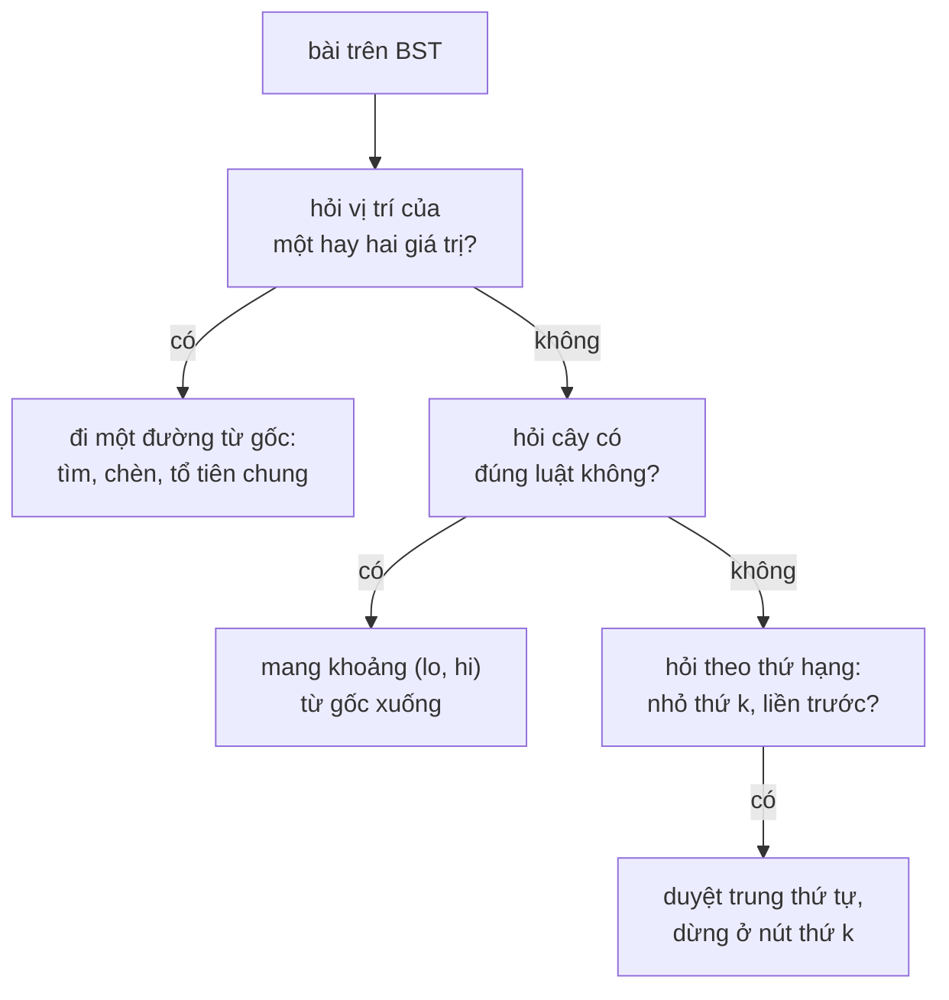

> [!tldr] Đọc nhanh
> - Pattern: một [[concepts/binary-search-tree|cây nhị phân tìm kiếm]] (BST) giữ một luật ở **mọi** nút: **cả** cây con trái nhỏ hơn nút, **cả** cây con phải lớn hơn. Ba bài của ga là ba cách đọc luật đó.
> - **Mang khoảng xuống** (Validate Binary Search Tree, bài neo): mỗi nút nhận một khoảng mở (lo, hi) từ mọi tổ tiên, rẽ trái hạ cận trên, rẽ phải nâng cận dưới. Chỉ so nút với cha thì sai: trên 238 cây hỏng, cách đó nhận nhầm 66 cây. Xem [[concepts/bounds-propagation|Bounds Propagation]].
> - **Đi một đường** (Lowest Common Ancestor of a Binary Search Tree): cả hai giá trị nhỏ hơn nút thì sang trái, cả hai lớn hơn thì sang phải, còn lại là đáp án. O(h): 0,34 µs mỗi truy vấn trên cây 10⁶ nút, so với 10,9 ms khi bỏ qua thứ tự và đi cả cây.
> - **Trung thứ tự là dãy tăng** (Kth Smallest Element in a BST): [[concepts/in-order-traversal|duyệt trung thứ tự]] bằng ngăn xếp và dừng ở nút thứ k, O(h + k): k = 10 mất 0,4 µs, gom cả cây ra mảng mất 23 ms.
> - Mọi chi phí ở đây là **O(h), không phải O(log n)**: cây lệch thì h = n. Đề cho tới 10⁵ nút, đủ để đệ quy vỡ ở Python.

> [!info] Bối cảnh
> Ga 4 **tuyến NeetCode: Cấu trúc liên kết**. [[posts/2026-11-25-neetcode-tree-recursion|Ga 3]] làm việc với cây nhị phân bất kỳ: muốn biết gì về cây thì hỏi cả hai cây con. Ga này thêm một luật về **thứ tự giá trị**, và luật đó cho phép bỏ hẳn nửa cây sau mỗi phép so, giống [[concepts/binary-search|tìm kiếm nhị phân]] trên mảng đã sắp. Ba bài đều mức Medium. Bạn chỉ cần biết cây nhị phân, chiều cao và đệ quy ở mức ga 3; mọi thứ khác được giải thích trong bài.

> [!abstract]- Từ điển nhanh cho bài này (bấm để mở)
> - **Nút, gốc, lá, cây con, chiều cao, mảng theo tầng**: xem [[posts/2026-11-25-neetcode-tree-recursion|ga 3]] và [[concepts/binary-tree|Binary Tree]].
> - **Tổ tiên, hậu duệ**: tổ tiên của một nút là mọi nút trên đường từ gốc xuống nó; nút đó là hậu duệ của chúng. Theo quy ước của LeetCode, một nút cũng là tổ tiên của chính nó.
> - **BST (cây nhị phân tìm kiếm)**: cây nhị phân mà ở mọi nút, mọi giá trị bên trái nhỏ hơn và mọi giá trị bên phải lớn hơn. Xem [[concepts/binary-search-tree|Binary Search Tree]].
> - **Khoảng mở (lo, hi)**: các số lớn hơn lo **và** nhỏ hơn hi, không tính hai đầu.
> - **Duyệt trung thứ tự**: thăm cây con trái, rồi nút, rồi cây con phải. Xem [[concepts/in-order-traversal|In-order Traversal]].
> - **O(h)**: chi phí tỉ lệ với chiều cao h của cây, không phải với số nút n.
> - **Ngăn xếp**: xem [[concepts/stack|Stack]].
> - **Giá trị canh**: một giá trị đặc biệt đứng thay cho "không có", như −∞ ở đây. Xem [[concepts/sentinel-value|Sentinel Value]].

## Hình dung trước: thư viện có biển rẽ ở mỗi ngã ba

Hình dung một thư viện mà lối đi chia đôi ở mỗi ngã ba. Mỗi ngã ba có một tấm biển ghi một mã sách: sách mã nhỏ hơn đi lối trái, lớn hơn đi lối phải. Luật áp cho **cả khu phía sau**, không chỉ kệ sát ngã ba.

| Đời thường | Khái niệm |
|---|---|
| Lối đi chia đôi ở mỗi ngã ba, biển ghi "nhỏ hơn rẽ trái, lớn hơn rẽ phải" | [[concepts/binary-search-tree\|cây nhị phân tìm kiếm]] |
| Tìm một cuốn sách: chỉ đi một lối, không bao giờ quay lại | tìm trên BST, O(h) |
| Hai người tìm hai cuốn sách, đi chung tới ngã ba nơi biển bảo hai người rẽ hai ngả | [[concepts/lowest-common-ancestor\|tổ tiên chung thấp nhất]] (Lowest Common Ancestor of a Binary Search Tree) |
| Đi tới đâu thì ghi lại "khu này chỉ chứa mã từ … tới …", gộp mọi tấm biển đã qua | [[concepts/bounds-propagation\|mang khoảng xuống]] (Validate Binary Search Tree) |
| Cuốn sách chỉ đúng chỗ so với biển gần nhất nhưng sai với một biển phía trước | bẫy "chỉ so nút với cha" |
| Đi hết mọi lối từ trái qua phải: mã sách hiện ra tăng dần | [[concepts/in-order-traversal\|duyệt trung thứ tự]] |
| Cần cuốn có mã nhỏ thứ k: đi từ lối trái nhất, đếm đủ k cuốn thì dừng | Kth Smallest Element in a BST |
| Sách được xếp vào theo thứ tự mã tăng dần, mọi ngã ba chỉ mở lối phải: một hành lang dài | cây lệch, h = n |



## Vấn đề: luật thứ tự đọc thiếu chữ "cả"

Mình từng nghĩ kiểm một cây có phải BST chỉ cần, ở mỗi nút, so với hai con: con trái nhỏ hơn, con phải lớn hơn. Cây dưới đây qua được phép kiểm đó ở mọi nút:

```text
        10
       /  \
      5    15
     / \   / \
    2   7 12  20
          /
         9
```

Nút 9 nhỏ hơn cha 12, ổn. Nhưng 9 nằm trong cây con **phải** của gốc 10, nên phải lớn hơn 10. Cây này không phải BST. Phép so cha-con chỉ nhìn một tầng, còn luật nói về cả cây con.

Lỗi này không hiếm. File của ga dựng 300 BST ngẫu nhiên, sửa bừa giá trị của một nút trong mỗi cây, rồi chấm lại: 238 cây thành hỏng, và cách chỉ so cha-con **nhận nhầm 66 cây** trong số đó, gần 28%.

Lỗi ngược lại cũng tốn: coi BST như một cây nhị phân bất kỳ và bỏ qua thứ tự. Tìm tổ tiên chung của hai nút theo cách ga 3 (hỏi cả hai cây con ở mọi nút) đúng, nhưng đi gần hết cây: 10,9 ms mỗi truy vấn trên cây 10⁶ nút, trong khi đi một đường theo giá trị chỉ mất 0,34 µs, nhanh hơn khoảng 30 000 lần.

## Cơ chế

### Luật áp lên cả cây con, và ba cách đọc nó

Với mọi nút x của một BST: mọi giá trị trong cây con trái của x **nhỏ hơn** `x.val`, mọi giá trị trong cây con phải **lớn hơn** `x.val`. Ba bài của LeetCode đều dùng định nghĩa ngặt, không có giá trị trùng.

Từ luật đó ra ba hệ quả, mỗi hệ quả là một khuôn:

```ts
// minh họa, không chạy trực tiếp
// (1) Đi một đường: mỗi phép so bỏ hẳn một nhánh. O(h).
let node = root;
while (node && !found(node)) node = target < node.val ? node.left : node.right;

// (2) Mang khoảng xuống: ràng buộc của mọi tổ tiên gói trong (lo, hi). O(n).
function check(node, lo, hi) {
  if (!node) return true;
  return lo < node.val && node.val < hi && check(node.left, lo, node.val) && check(node.right, node.val, hi);
}

// (3) Trung thứ tự: trái, nút, phải cho ra dãy tăng dần. Dừng được giữa chừng.
for (const v of inorder(root)) if (--k === 0) return v;
```

Thông tin chảy theo hai chiều khác nhau. Ở ga 3, chiều cao chảy **từ dưới lên** ([[concepts/post-order-traversal|hậu thứ tự]]). Ở khuôn (2), khoảng chảy **từ trên xuống**: cha biết con phải nằm trong khoảng nào trước khi con được thăm.

### Mang khoảng xuống: Validate Binary Search Tree

<figure class="figure-map" style="--ar: 16 / 10">
<div class="frame"><iframe data-archify="../diagrams/neetcode-binary-search-tree/bounds.html" title="Validate BST: khoảng hẹp dần khi đi xuống" loading="lazy"></iframe></div>
<figcaption><span><b>Hình 1.</b> Mỗi nút được ghi khoảng mở nó nhận từ các tổ tiên. Gốc 10 nhận (−∞, +∞); rẽ phải sang 15 thì cận dưới thành 10; rẽ trái sang 12 thì cận trên thành 15. Nút 9 dưới 12 nhận (10, 12) và trượt vì 9 < 10, dù so với cha 12 thì 9 vẫn đúng chỗ.</span><a href="../diagrams/neetcode-binary-search-tree/bounds.html" target="_blank" rel="noopener">Mở toàn màn hình</a></figcaption>
</figure>

Bài neo là [[problems/validate-binary-search-tree|Validate Binary Search Tree]]: cho một cây nhị phân tối đa 10⁴ nút, giá trị trong khoảng int 32 bit, hỏi nó có phải BST ngặt không.

Ý chính: mọi ràng buộc mà các tổ tiên đặt lên một nút gói gọn trong **hai số**. Đi từ gốc xuống nút, mỗi lần rẽ trái ở nút giá trị v thêm ràng buộc "nhỏ hơn v", mỗi lần rẽ phải thêm "lớn hơn v". Trong các ràng buộc "nhỏ hơn", chỉ cái chặt nhất có ý nghĩa, tức cái gần nhất. Vậy chỉ cần nhớ cận dưới `lo` và cận trên `hi`:

- gốc nhận (−∞, +∞);
- sang con trái: `(lo, node.val)`;
- sang con phải: `(node.val, hi)`;
- nút hợp lệ khi `lo < node.val < hi`.

Mỗi nút được so một lần: O(n) thời gian, O(h) bộ nhớ cho call stack, với [[concepts/sentinel-value|giá trị canh]] −∞ và +∞ thay cho "chưa có cận".

Cách thứ hai dùng hệ quả (3): một cây là BST ngặt khi và chỉ khi dãy trung thứ tự của nó **tăng ngặt**. Duyệt trung thứ tự bằng ngăn xếp, nhớ giá trị vừa thăm, gặp giá trị không lớn hơn thì dừng. Cách này không đệ quy, nên chịu được cây lệch 10⁴ nút ở mọi ngôn ngữ.

### Đi một đường: Lowest Common Ancestor of a Binary Search Tree

[[problems/lowest-common-ancestor-of-a-binary-search-tree|Lowest Common Ancestor of a Binary Search Tree]] cho một BST từ 2 tới 10⁵ nút, giá trị khác nhau, và hai nút p, q có trong cây. Tìm [[concepts/lowest-common-ancestor|tổ tiên chung thấp nhất]]: nút sâu nhất có cả p và q trong cây con của nó.

Đứng ở một nút, so p và q với giá trị nút:

- cả hai nhỏ hơn: cả hai nằm trong cây con trái, đáp án ở dưới bên trái;
- cả hai lớn hơn: tương tự, sang phải;
- còn lại: hoặc hai giá trị nằm hai phía, hoặc một trong hai **chính là** nút này. Đi xuống tiếp ở bên nào cũng làm mất một trong hai, nên nút này là đáp án.

Hàm không cần đệ quy, không cần bộ nhớ thêm: O(h) thời gian, O(1) bộ nhớ. Ca "một nút là tổ tiên của nút kia" là chỗ hay sai: tìm tổ tiên chung của 10 và 17 trong cây mẫu ra 10, không phải gốc 20.

### Trung thứ tự ra dãy tăng: Kth Smallest Element in a BST

[[problems/kth-smallest-element-in-a-bst|Kth Smallest Element in a BST]] hỏi giá trị nhỏ thứ k (đếm từ 1) trong một BST tối đa 10⁴ nút.

Cách thẳng: duyệt trung thứ tự, gom mọi giá trị ra mảng, lấy phần tử thứ k − 1. Đúng, nhưng luôn tốn O(n) thời gian và O(n) bộ nhớ, kể cả khi k = 1.

Cách tốt hơn: duyệt trung thứ tự bằng [[concepts/stack|ngăn xếp]] và **dừng** khi đếm đủ k. Ngăn xếp giữ các nút "đã đi qua bên trái, chưa xử lý":

1. đi trái hết mức, đẩy từng nút vào ngăn xếp;
2. lấy nút trên cùng ra: đó là giá trị nhỏ nhất chưa đếm, đếm nó;
3. sang cây con phải của nó, quay lại bước 1.

Chi phí là O(h + k): xuống tới nút nhỏ nhất mất h bước, mỗi giá trị sau đó tốn trung bình O(1). Trên cây 10⁶ nút, k = 10 mất 0,4 µs; gom cả cây mất 23 ms. Với k = n/2, dừng sớm vẫn đi nửa cây, nên chỉ còn nhanh hơn khoảng 5 lần (3,9 ms so với 21,4 ms).

Câu hỏi thêm của đề: nếu cây bị chèn, xóa liên tục và câu hỏi "nhỏ thứ k" đến thường xuyên? Lúc đó mỗi nút lưu thêm **kích thước cây con** của nó. Ở một nút, nếu cây con trái có L nút thì: k ≤ L đi trái; k = L + 1 là nút này; còn lại đi phải với k − L − 1. Mỗi truy vấn còn O(h), và chèn hay xóa chỉ cần cập nhật kích thước trên một đường. Trang bài giải kỹ cách này.

### Ba bài, một luật

| Bài | Điểm khác | Đọc thứ tự kiểu gì | Thời gian, bộ nhớ thêm |
|---|---|---|---|
| [[problems/lowest-common-ancestor-of-a-binary-search-tree\|Lowest Common Ancestor of a Binary Search Tree]] | hai giá trị đi chung tới chỗ tách nhau | đi một đường từ gốc | O(h), O(1) |
| [[problems/validate-binary-search-tree\|Validate Binary Search Tree]] | không được tin cây đúng luật, phải kiểm | mang khoảng (lo, hi) xuống, hoặc trung thứ tự tăng ngặt | O(n), O(h) |
| [[problems/kth-smallest-element-in-a-bst\|Kth Smallest Element in a BST]] | hỏi theo thứ hạng, không theo giá trị | trung thứ tự bằng ngăn xếp, dừng ở k | O(h + k), O(h) |

### O(h) không phải O(log n)

Mọi con số O(h) ở trên chỉ tốt khi cây thấp. Cây cân bằng 10⁶ nút cao 20. Nhưng BST không tự cân bằng: chèn các giá trị theo thứ tự tăng dần thì mỗi nút chỉ có con phải, cây thành một chuỗi cao n. Đề không hứa cây cân bằng, nên một input lệch 10⁵ nút ở bài 235 bắt vòng lặp đi 10⁵ bước, và bản đệ quy của bài 98 trên chuỗi 10⁴ nút vỡ ở Python:

```text
98 đệ quy trên chuỗi 10^4 nút: RecursionError; bản ngăn xếp: True
```

Giới hạn đệ quy của từng ngôn ngữ đã đo ở [[posts/2026-11-25-neetcode-tree-recursion|ga 3]] (xem [[concepts/recursion-depth-limit|Recursion Depth Limit]]). Ở ga này, bài 235 viết bằng vòng lặp là tự nhiên nhất, còn 98 và 230 có bản ngăn xếp chạy được mọi độ sâu. Ngoài LeetCode, cây có thứ tự trong thư viện chuẩn (`TreeMap` của Java, `std::map` của C++) là cây đỏ đen, tự xoay để giữ chiều cao cỡ log n.

### Bên dưới năm ngôn ngữ

| | "Vô cực" cho khoảng | Bẫy riêng |
|---|---|---|
| TypeScript / JavaScript | `-Infinity`, `Infinity` | giá trị là `number` (số thực 64 bit), so với ±Infinity luôn đúng; không có bẫy tràn số ở bài này |
| Python | `-math.inf`, `math.inf`; `lo < node.val < hi` viết được thành một biểu thức | generator đệ quy `yield from` gọn nhưng mỗi giá trị phải đi qua h tầng generator: với k = n, chậm hơn bản ngăn xếp 5 lần (51,8 ms so với 10,0 ms trên cây 2·10⁵ nút) |
| Go | `math.MinInt`, `math.MaxInt`: `int` là 64 bit nên nằm ngoài mọi giá trị int32 của đề | dùng `math.MinInt32` làm cận thì nút bằng −2³¹ bị chấm sai; hàm đệ quy lồng phải khai báo `var check func(…)` trước |
| Java | `long`: `Long.MIN_VALUE`, `Long.MAX_VALUE` | dùng `Integer.MIN_VALUE`, `Integer.MAX_VALUE` làm vô cực thì cây một nút `[2147483647]` bị chấm `false` (file in ra đúng như vậy); cách khác là `Integer` với `null` nghĩa là "không có cận" |

## Ví dụ chạy được

[TypeScript](../code/neetcode-binary-search-tree/bst.ts) · [Python](../code/neetcode-binary-search-tree/bst.py) · [Go](../code/neetcode-binary-search-tree/bst.go) · [Java](../code/neetcode-binary-search-tree/bst.java) · [JavaScript](../code/neetcode-binary-search-tree/bst.js)

Mỗi file giải cả ba bài và chạy 14 ca chung: bốn ca tổ tiên chung trên cây mẫu `[20, 10, 30, 5, 15, 25, 35, null, null, 12, 17]` (có ca một nút là tổ tiên của nút kia), các ca kiểm BST (nút sâu vi phạm tổ tiên, giá trị trùng, giá trị bằng đúng 2³¹ − 1 và −2³¹), các ca nhỏ thứ k (cây chỉ có nhánh trái, chỉ có nhánh phải). Ca thứ 13 sinh 300 BST ngẫu nhiên bằng mulberry32: so 230 với dãy đã sắp ở mọi k, so 235 với một bản tìm tổ tiên chung không dùng thứ tự, kiểm 98 trên cây gốc rồi trên cây đã bị sửa bừa một nút. Ca cuối chạy 98 và 230 trên chuỗi lệch 10⁵ nút. Sau phần kiểm, mỗi file in các phép đo ở trên.

Bài neo, hai cách: mang khoảng xuống, và trung thứ tự tăng ngặt.

```ts
// 98: mỗi nút phải nằm trong khoảng mở (lo, hi) mà MỌI tổ tiên đặt ra, không chỉ cha.
// Rẽ trái thì hi hạ xuống giá trị nút; rẽ phải thì lo nâng lên giá trị nút.
function isValidBST(root: TreeNode | null): boolean {
  const check = (node: TreeNode | null, lo: number, hi: number): boolean => {
    if (!node) return true;
    if (node.val <= lo || node.val >= hi) return false;
    return check(node.left, lo, node.val) && check(node.right, node.val, hi);
  };
  return check(root, -Infinity, Infinity);
}

// 98 cách hai: duyệt trung thứ tự bằng ngăn xếp, giá trị phải tăng ngặt. Không đệ quy, chịu được cây lệch.
function isValidBSTInorder(root: TreeNode | null): boolean {
  const stack: TreeNode[] = [];
  let node = root, prev = -Infinity;
  while (node || stack.length) {
    while (node) { stack.push(node); node = node.left; }
    node = stack.pop()!;
    if (node.val <= prev) return false;
    prev = node.val;
    node = node.right;
  }
  return true;
}
```

```python
# 98: mỗi nút phải nằm trong khoảng mở (lo, hi) do MỌI tổ tiên đặt ra.
def is_valid_bst(root):
    def check(node, lo, hi):
        if node is None:
            return True
        if not lo < node.val < hi:
            return False
        return check(node.left, lo, node.val) and check(node.right, node.val, hi)

    return check(root, -math.inf, math.inf)


# 98 cách hai: trung thứ tự bằng ngăn xếp, giá trị phải tăng ngặt. Không đệ quy.
def is_valid_bst_inorder(root):
    stack, node, prev = [], root, -math.inf
    while node or stack:
        while node:
            stack.append(node)
            node = node.left
        node = stack.pop()
        if node.val <= prev:
            return False
        prev = node.val
        node = node.right
    return True
```

```go
// 98: mỗi nút phải nằm trong khoảng mở (lo, hi) do MỌI tổ tiên đặt ra.
// int của Go là 64 bit, nên math.MinInt/MaxInt nằm ngoài mọi giá trị int32 của đề.
func isValidBST(root *TreeNode) bool {
	var check func(*TreeNode, int, int) bool
	check = func(node *TreeNode, lo, hi int) bool {
		if node == nil {
			return true
		}
		if node.Val <= lo || node.Val >= hi {
			return false
		}
		return check(node.Left, lo, node.Val) && check(node.Right, node.Val, hi)
	}
	return check(root, math.MinInt, math.MaxInt)
}

// 98 cách hai: trung thứ tự bằng ngăn xếp, giá trị phải tăng ngặt. Không đệ quy.
func isValidBSTInorder(root *TreeNode) bool {
	var stack []*TreeNode
	node, first, prev := root, true, 0
	for node != nil || len(stack) > 0 {
		for node != nil {
			stack = append(stack, node)
			node = node.Left
		}
		node = stack[len(stack)-1]
		stack = stack[:len(stack)-1]
		if !first && node.Val <= prev {
			return false
		}
		first, prev = false, node.Val
		node = node.Right
	}
	return true
}
```

```java
// 98: mỗi nút phải nằm trong khoảng mở (lo, hi) do MỌI tổ tiên đặt ra.
// Khoảng là long: Long.MIN_VALUE/MAX_VALUE nằm ngoài mọi giá trị int của đề.
static boolean isValidBST(TreeNode root) { return check(root, Long.MIN_VALUE, Long.MAX_VALUE); }
static boolean check(TreeNode node, long lo, long hi) {
    if (node == null) return true;
    if (node.val <= lo || node.val >= hi) return false;
    return check(node.left, lo, node.val) && check(node.right, node.val, hi);
}

// 98 cách hai: trung thứ tự bằng ngăn xếp, giá trị phải tăng ngặt. Không đệ quy.
static boolean isValidBSTInorder(TreeNode root) {
    ArrayDeque<TreeNode> stack = new ArrayDeque<>();
    TreeNode node = root;
    long prev = Long.MIN_VALUE;
    while (node != null || !stack.isEmpty()) {
        while (node != null) { stack.push(node); node = node.left; }
        node = stack.pop();
        if (node.val <= prev) return false;
        prev = node.val;
        node = node.right;
    }
    return true;
}
```

```js
// 98: mỗi nút phải nằm trong khoảng mở (lo, hi) mà MỌI tổ tiên đặt ra, không chỉ cha.
// Rẽ trái thì hi hạ xuống giá trị nút; rẽ phải thì lo nâng lên giá trị nút.
function isValidBST(root) {
  const check = (node, lo, hi) => {
    if (!node) return true;
    if (node.val <= lo || node.val >= hi) return false;
    return check(node.left, lo, node.val) && check(node.right, node.val, hi);
  };
  return check(root, -Infinity, Infinity);
}

// 98 cách hai: duyệt trung thứ tự bằng ngăn xếp, giá trị phải tăng ngặt. Không đệ quy, chịu được cây lệch.
function isValidBSTInorder(root) {
  const stack = [];
  let node = root, prev = -Infinity;
  while (node || stack.length) {
    while (node) { stack.push(node); node = node.left; }
    node = stack.pop();
    if (node.val <= prev) return false;
    prev = node.val;
    node = node.right;
  }
  return true;
}
```

Bản Java cách hai có một chỗ tinh: `prev` khởi tạo bằng `Long.MIN_VALUE`, nhỏ hơn mọi `int`, nên nút đầu tiên bằng −2³¹ vẫn qua. Bản Go dùng cờ `first` thay cho một giá trị canh.

Hai bài còn lại: đi một đường, và trung thứ tự dừng ở k.

```ts
// 235: đi một đường từ gốc. Cả hai nhỏ hơn nút → sang trái; cả hai lớn hơn → sang phải;
// còn lại (hai bên tách nhau, hoặc nút chính là p hay q) → nút này là tổ tiên chung thấp nhất.
function lowestCommonAncestor(root: TreeNode, p: TreeNode, q: TreeNode): TreeNode {
  let node: TreeNode = root;
  for (;;) {
    if (p.val < node.val && q.val < node.val) node = node.left!;
    else if (p.val > node.val && q.val > node.val) node = node.right!;
    else return node;
  }
}

// 230: trung thứ tự của BST là dãy tăng. Đi bằng ngăn xếp, đếm, dừng ở nút thứ k: O(h + k).
function kthSmallest(root: TreeNode | null, k: number): number {
  const stack: TreeNode[] = [];
  let node = root;
  for (;;) {
    while (node) { stack.push(node); node = node.left; }
    node = stack.pop()!;
    if (--k === 0) return node.val;
    node = node.right;
  }
}
```

```python
# 235: đi một đường từ gốc. Cả hai nhỏ hơn → trái; cả hai lớn hơn → phải; còn lại → đây là đáp án.
def lowest_common_ancestor(root, p, q):
    node = root
    while True:
        if p.val < node.val and q.val < node.val:
            node = node.left
        elif p.val > node.val and q.val > node.val:
            node = node.right
        else:
            return node


# 230: trung thứ tự của BST là dãy tăng. Đi bằng ngăn xếp, đếm, dừng ở nút thứ k: O(h + k).
def kth_smallest(root, k):
    stack, node = [], root
    while True:
        while node:
            stack.append(node)
            node = node.left
        node = stack.pop()
        k -= 1
        if k == 0:
            return node.val
        node = node.right
```

```go
// 235: đi một đường từ gốc. Cả hai nhỏ hơn → trái; cả hai lớn hơn → phải; còn lại → đây là đáp án.
func lowestCommonAncestor(root, p, q *TreeNode) *TreeNode {
	node := root
	for {
		if p.Val < node.Val && q.Val < node.Val {
			node = node.Left
		} else if p.Val > node.Val && q.Val > node.Val {
			node = node.Right
		} else {
			return node
		}
	}
}

// 230: trung thứ tự của BST là dãy tăng. Đi bằng ngăn xếp, đếm, dừng ở nút thứ k: O(h + k).
func kthSmallest(root *TreeNode, k int) int {
	var stack []*TreeNode
	node := root
	for {
		for node != nil {
			stack = append(stack, node)
			node = node.Left
		}
		node = stack[len(stack)-1]
		stack = stack[:len(stack)-1]
		k--
		if k == 0 {
			return node.Val
		}
		node = node.Right
	}
}
```

```java
// 235: đi một đường từ gốc. Cả hai nhỏ hơn → trái; cả hai lớn hơn → phải; còn lại → đây là đáp án.
static TreeNode lowestCommonAncestor(TreeNode root, TreeNode p, TreeNode q) {
    TreeNode node = root;
    while (true) {
        if (p.val < node.val && q.val < node.val) node = node.left;
        else if (p.val > node.val && q.val > node.val) node = node.right;
        else return node;
    }
}

// 230: trung thứ tự của BST là dãy tăng. Đi bằng ngăn xếp, đếm, dừng ở nút thứ k: O(h + k).
static int kthSmallest(TreeNode root, int k) {
    ArrayDeque<TreeNode> stack = new ArrayDeque<>();
    TreeNode node = root;
    while (true) {
        while (node != null) { stack.push(node); node = node.left; }
        node = stack.pop();
        if (--k == 0) return node.val;
        node = node.right;
    }
}
```

```js
// 235: đi một đường từ gốc. Cả hai nhỏ hơn nút → sang trái; cả hai lớn hơn → sang phải;
// còn lại (hai bên tách nhau, hoặc nút chính là p hay q) → nút này là tổ tiên chung thấp nhất.
function lowestCommonAncestor(root, p, q) {
  let node = root;
  for (;;) {
    if (p.val < node.val && q.val < node.val) node = node.left;
    else if (p.val > node.val && q.val > node.val) node = node.right;
    else return node;
  }
}

// 230: trung thứ tự của BST là dãy tăng. Đi bằng ngăn xếp, đếm, dừng ở nút thứ k: O(h + k).
function kthSmallest(root, k) {
  const stack = [];
  let node = root;
  for (;;) {
    while (node) { stack.push(node); node = node.left; }
    node = stack.pop();
    if (--k === 0) return node.val;
    node = node.right;
  }
}
```

Kết quả `node bst.ts`:

```text
bst 14/14 ca đúng
98 trên 300 cây bị sửa một nút: 238 cây hỏng, cách chỉ so cha-con nhận nhầm 66 cây
235 trên BST cân bằng 10^6 nút: đi theo giá trị 0.34 µs/truy vấn, LCA tổng quát 10.9 ms/truy vấn
230 trên BST cân bằng 10^6 nút, k = 10: dừng sớm 0.4 µs, gom cả cây 23.3 ms
230 trên BST cân bằng 10^6 nút, k = 500000: dừng sớm 3.9 ms, gom cả cây 21.4 ms
```

Cả năm file cùng in `14/14 ca đúng` và cùng con số 238 và 66, vì chúng dùng chung bộ sinh ngẫu nhiên với cùng hạt giống. Phần đo của từng file:

```text
python3 bst.py
98 đệ quy trên chuỗi 10^4 nút: RecursionError; bản ngăn xếp: True
235 trên BST cân bằng 2·10^5 nút: đi theo giá trị 0.66 µs/truy vấn, LCA tổng quát 16.1 ms/truy vấn
230 trên BST cân bằng 2·10^5 nút, k = 10: dừng sớm 0.7 µs, gom cả cây 11.9 ms
230 trên BST cân bằng 2·10^5 nút, k = 100000: dừng sớm 5.1 ms, gom cả cây 11.9 ms
230 với k = 200000: ngăn xếp 10.0 ms, generator yield from 51.8 ms

go run bst.go
235 trên BST cân bằng 10^6 nút: đi theo giá trị 0.12 µs/truy vấn, LCA tổng quát 3.9 ms/truy vấn
230 trên BST cân bằng 10^6 nút, k = 10: dừng sớm 0.3 µs, gom cả cây 18.0 ms
230 trên BST cân bằng 10^6 nút, k = 500000: dừng sớm 1.3 ms, gom cả cây 18.1 ms

java bst.java
98 với Integer.MIN_VALUE/MAX_VALUE làm vô cực: cây [2147483647] bị chấm false, bản dùng long: true
235 trên BST cân bằng 10^6 nút: đi theo giá trị 0.14 µs/truy vấn, LCA tổng quát 2.6 ms/truy vấn
230 trên BST cân bằng 10^6 nút, k = 10: dừng sớm 0.4 µs, gom cả cây 17.6 ms
230 trên BST cân bằng 10^6 nút, k = 500000: dừng sớm 1.6 ms, gom cả cây 13.5 ms
```

Cặp giá trị đo cho bài 235 là hai giá trị liền nhau (v, v + 2), để tổ tiên chung nằm sâu và đường đi dài gần bằng chiều cao; hai giá trị chọn ngẫu nhiên thường tách nhau ngay ở gốc. Số đo thời gian dao động theo lần chạy; tỉ lệ giữa các cách thì giữ nguyên.

## Hiểu lầm và bẫy hay gặp

- **"Kiểm BST chỉ cần so mỗi nút với hai con."** Luật nói về cả cây con. Một nút sâu có thể đúng với cha mà sai với một tổ tiên xa hơn; cách so cha-con nhận nhầm 66 trên 238 cây hỏng trong file của ga.
- **Dùng giá trị nhỏ nhất, lớn nhất của int làm vô cực.** Đề 98 cho giá trị chạm đúng −2³¹ và 2³¹ − 1. Java với `Integer.MAX_VALUE` làm cận trên chấm cây `[2147483647]` là sai. Dùng `long`, số thực vô cực, hoặc `null`.
- **Cho phép giá trị trùng.** Đề 98 đòi ngặt: `[5, 5]` hay `[5, null, 5]` đều không phải BST. Viết `<=` thay cho `<` ở một chỗ là lọt.
- **"Tổ tiên chung phải nằm trên cả hai nút."** Một nút là tổ tiên của chính nó. Nếu p nằm trong cây con của q thì đáp án là q, và điều kiện "còn lại" ở vòng lặp bắt đúng ca đó.
- **Tìm tổ tiên chung trên BST như trên cây bất kỳ.** Đúng, nhưng O(n) thay cho O(h): 10,9 ms so với 0,34 µs trên cây 10⁶ nút.
- **"BST thì mọi thao tác O(log n)."** Chỉ khi cây cân bằng. Cây do chèn theo thứ tự tăng dần là một chuỗi, h = n, và đệ quy trên nó vỡ như ở ga 3.
- **Gom cả trung thứ tự ra mảng rồi mới lấy phần tử k.** Đúng, nhưng luôn O(n) thời gian và bộ nhớ. Ngăn xếp cho phép dừng ở k.
- **Viết trung thứ tự bằng generator đệ quy trong Python cho gọn.** Mỗi giá trị đi qua h tầng `yield from`; với k = n chậm hơn bản ngăn xếp 5 lần.

## Câu hỏi tự kiểm tra

> [!question]- Vì sao chỉ cần hai số (lo, hi) là đủ gói mọi ràng buộc mà các tổ tiên đặt lên một nút?
> Mỗi tổ tiên đặt một ràng buộc "nhỏ hơn v" (nếu nút nằm bên trái nó) hoặc "lớn hơn v" (nếu bên phải). Nhiều ràng buộc "nhỏ hơn" thì chỉ cái có v nhỏ nhất là có ý nghĩa, và đó luôn là cái gần nút nhất, vì đường đi đã thỏa các ràng buộc trước đó. Tương tự với "lớn hơn". Nên chỉ cần nhớ cận dưới chặt nhất và cận trên chặt nhất.

> [!question]- Trong bài 235, vì sao khi p và q nằm hai phía của nút (hoặc một trong hai là chính nút) thì nút đó là đáp án?
> Nút đó chắc chắn là tổ tiên chung, vì đường đi từ gốc tới đây đều đúng hướng cho cả hai. Đi xuống trái thì mất giá trị nằm bên phải (hoặc chính nút), đi xuống phải thì mất giá trị bên trái. Không có nút nào sâu hơn còn chứa cả hai.

> [!question]- Một cây nhị phân có dãy trung thứ tự tăng ngặt. Nó có chắc là BST không? Ngược lại thì sao?
> Có, cả hai chiều. Nếu cây là BST thì trung thứ tự liệt kê cây con trái (toàn giá trị nhỏ hơn), rồi nút, rồi cây con phải (toàn giá trị lớn hơn), nên dãy tăng ngặt. Ngược lại, nếu dãy tăng ngặt thì mọi giá trị đứng trước một nút trong dãy, gồm cả cây con trái của nó, đều nhỏ hơn nút, và mọi giá trị trong cây con phải đều đứng sau nên lớn hơn.

> [!question]- Kth Smallest dừng sớm tốn O(h + k). Với k = 1 trên một cây lệch chỉ có nhánh trái, n nút, nó tốn bao nhiêu?
> O(n). Muốn tới nút nhỏ nhất phải đi trái hết mức, tức h = n bước, dù chỉ cần đếm một giá trị. Dừng sớm chỉ cắt phần "đếm k", không cắt phần "đi xuống".

> [!question]- Nếu cây bị chèn, xóa liên tục và câu hỏi "nhỏ thứ k" đến rất thường, nên đổi gì?
> Lưu ở mỗi nút kích thước cây con của nó. Ở một nút có cây con trái L nút: k ≤ L thì sang trái, k = L + 1 thì trả nút này, còn lại sang phải với k − L − 1. Mỗi truy vấn O(h); chèn, xóa cập nhật kích thước dọc một đường. Kết hợp với cây tự cân bằng thì h ≈ log n.

## Tham khảo

- [NeetCode 150](https://neetcode.io/practice) (danh sách bài và nhóm Trees)
- LeetCode: [235 Lowest Common Ancestor of a Binary Search Tree](https://leetcode.com/problems/lowest-common-ancestor-of-a-binary-search-tree/), [98 Validate Binary Search Tree](https://leetcode.com/problems/validate-binary-search-tree/), [230 Kth Smallest Element in a BST](https://leetcode.com/problems/kth-smallest-element-in-a-bst/)
- [Python reference: yield expressions](https://docs.python.org/3/reference/expressions.html#yieldexpr) (`yield from` ủy quyền cho generator con)
- [Java `TreeMap`](https://docs.oracle.com/en/java/javase/21/docs/api/java.base/java/util/TreeMap.html) (cài bằng cây đỏ đen, các thao tác O(log n))
- Cormen, Leiserson, Rivest, Stein, *Introduction to Algorithms*, ấn bản thứ ba, chương 12 (cây nhị phân tìm kiếm) và mục 14.1 (cây thống kê thứ tự, lưu kích thước cây con)
