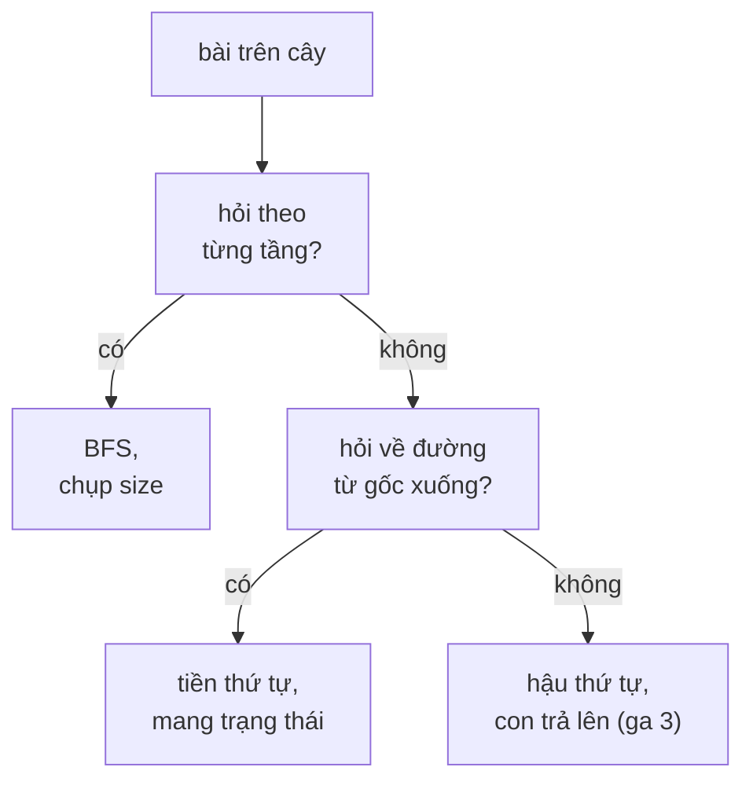

> [!tldr] Đọc nhanh
> - Pattern: hai cách đưa thông tin đi qua một cây mà không cần con trả kết quả lên. **Theo tầng**: một hàng đợi thăm hết tầng này rồi mới tới tầng sau. **Theo đường đi**: cha trao cho con một giá trị tóm tắt cả đường từ gốc xuống.
> - **Chụp kích thước tầng** (Binary Tree Level Order Traversal, bài neo): đầu mỗi vòng, đọc hàng đợi đang có `size` nút, lấy ra đúng `size` nút là trọn một tầng. Không chụp thì con vừa đẩy vào bị lấy luôn: trên 300 cây ngẫu nhiên, bản đó sai 294 cây. Xem [[concepts/level-size-snapshot|Level Size Snapshot]].
> - **Nút cuối mỗi tầng** (Binary Tree Right Side View): cùng khuôn, chỉ giữ nút `i = size − 1`. Đi theo con phải từ gốc là sai mỗi khi nhánh trái sâu hơn (279/300 cây).
> - **Mang trạng thái xuống** (Count Good Nodes in Binary Tree): [[concepts/pre-order-traversal|tiền thứ tự]], mỗi nút nhận giá trị lớn nhất trên đường từ gốc. Một phép so là đủ, O(n). Chỉ so với cha thì sai 255/300 cây. Xem [[concepts/path-state|Path State]].
> - Hàng đợi phải lấy ra được trong O(1): `shift()` của mảng JavaScript và `list.pop(0)` của Python dịch cả mảng: trên cây 131 071 nút, 528 ms so với 3,7 ms (TypeScript), 506 ms so với 7,3 ms (Python).

> [!info] Bối cảnh
> Ga 5 **tuyến NeetCode: Cấu trúc liên kết**. [[posts/2026-11-25-neetcode-tree-recursion|Ga 3]] cho thông tin chảy **từ dưới lên**: con tính xong rồi trả cho cha. [[posts/2026-11-25-neetcode-binary-search-tree|Ga 4]] mang một khoảng (lo, hi) **từ trên xuống**. Ga này làm tiếp hai việc: duyệt **ngang** từng tầng bằng hàng đợi, và mang xuống một trạng thái tổng quát hơn khoảng. Ba bài đều mức Medium. Bạn cần biết cây nhị phân và đệ quy ở mức ga 3; hàng đợi được giải thích ngay dưới.

> [!abstract]- Từ điển nhanh cho bài này (bấm để mở)
> - **Nút, gốc, lá, cây con, chiều cao, mảng theo tầng**: xem [[posts/2026-11-25-neetcode-tree-recursion|ga 3]] và [[concepts/binary-tree|Binary Tree]].
> - **Tầng (level), độ sâu**: gốc ở tầng 0, con của gốc ở tầng 1, và cứ thế. Độ sâu của một nút là số tầng của nó.
> - **Hàng đợi (queue)**: danh sách lấy ra ở đầu, thêm vào ở cuối: ai vào trước ra trước, như hàng người chờ ở quầy. Ở đây là cấu trúc dữ liệu trong bộ nhớ, không phải hàng đợi tin nhắn của RabbitMQ.
> - **Deque**: hàng đợi hai đầu, thêm và lấy ở cả hai đầu đều O(1). Python có `collections.deque`, Java có `ArrayDeque`.
> - **BFS, DFS**: duyệt theo chiều rộng (từng tầng một) và duyệt theo chiều sâu (đi xuống hết một nhánh rồi mới quay lại). Xem [[concepts/breadth-first-search|Breadth-First Search]].
> - **Tiền thứ tự, hậu thứ tự**: xử lý nút trước hai con, hoặc sau hai con. Xem [[concepts/pre-order-traversal|Pre-order Traversal]] và [[concepts/post-order-traversal|Post-order Traversal]].
> - **Ngăn xếp**: vào sau ra trước. Xem [[concepts/stack|Stack]].

## Hình dung trước: gọi họp theo sơ đồ tổ chức

Hình dung một công ty có sơ đồ tổ chức hình cây: giám đốc ở trên, mỗi người quản lý tối đa hai người. Có hai việc cần làm trên sơ đồ đó. Việc thứ nhất là họp theo từng cấp: cấp 0 họp trước, rồi cấp 1, rồi cấp 2. Việc thứ hai là chuyền một tờ phiếu từ trên xuống: mỗi người nhận phiếu từ sếp trực tiếp, đọc, sửa rồi chuyền tiếp cho cấp dưới.

| Đời thường | Khái niệm |
|---|---|
| Sơ đồ tổ chức, mỗi người quản lý tối đa hai người | [[concepts/binary-tree\|cây nhị phân]] |
| Người ngoài phòng họp xếp một hàng; ai vào phòng thì gọi cấp dưới của mình ra xếp cuối hàng | [[concepts/breadth-first-search\|BFS]] với một hàng đợi |
| Người giữ cửa đếm số người đang xếp hàng lúc mở phiên: đúng bấy nhiêu người vào phiên này, ai tới sau chờ phiên sau | [[concepts/level-size-snapshot\|chụp kích thước tầng]] (Binary Tree Level Order Traversal) |
| Người giữ cửa quên đếm, cứ cho vào tới khi hết hàng: cả công ty dồn vào một phiên | bẫy "không chụp" |
| Chụp ảnh sơ đồ từ bên phải: mỗi cấp chỉ thấy người đứng mép phải | Binary Tree Right Side View |
| Phiếu ghi "thâm niên cao nhất trong các sếp từ giám đốc tới bạn"; ai có thâm niên bằng hoặc hơn con số đó thì được ghi tên | [[concepts/path-state\|trạng thái đường đi]] (Count Good Nodes in Binary Tree) |
| Đọc phiếu, sửa, rồi mới chuyền xuống cấp dưới | [[concepts/pre-order-traversal\|tiền thứ tự]] |
| Chỉ so với sếp trực tiếp, không đọc phiếu | bẫy "chỉ so với cha" |
| Phòng chờ phải chứa cả cấp đông người nhất; phiếu đang chuyền dở chỉ dài bằng số cấp | bộ nhớ của BFS so với DFS |



## Vấn đề: hàng đợi không biết tầng ở đâu

Mình từng nghĩ duyệt theo tầng chỉ là "đẩy gốc vào hàng đợi, lấy ra một nút thì đẩy hai con vào cuối". Cách đó thăm đúng thứ tự: 1, 2, 3, 4, 5, 6, 7 với cây dưới đây. Nhưng bài 102 không hỏi một dãy, nó hỏi **danh sách các tầng**: `[[1], [2, 3], [4, 5, 6], [7]]`.

```text
        1
       / \
      2   3
     /   / \
    4   5   6
     \
      7
```

Hàng đợi chỉ là một dãy nút. Lúc lấy 3 ra và đẩy 5, 6 vào, hàng đợi là `[4, 5, 6]`, không có dấu gì cho biết 4 là nút đầu của tầng mới. Viết vòng lặp "lấy cho tới khi hết hàng đợi" thì cả cây thành một tầng. File của ga chạy bản sai đó trên 300 cây ngẫu nhiên: sai 294 cây; 6 cây còn lại chỉ có một nút.

Bài 1448 có một cái bẫy cùng họ. Một nút "tốt" khi không tổ tiên nào lớn hơn nó. Mình viết lần đầu là so nút với cha. Cây `[5, 1, null, 3]` có nút 3 lớn hơn cha 1 nhưng nhỏ hơn ông 5: so với cha thì đếm 2, đáp án là 1. Trên 300 cây ngẫu nhiên, cách so với cha sai 255 cây.

Cả hai lỗi đều do thiếu thông tin: hàng đợi thiếu ranh giới tầng, còn nút thiếu tin về những tổ tiên xa hơn cha. Ga này là hai cách bù phần thiếu đó.

## Cơ chế

### Hai chiều mới cho thông tin

Ở ga 3, chiều cao chảy từ dưới lên: mỗi nút chờ hai con trả về rồi mới tính ([[concepts/post-order-traversal|hậu thứ tự]]). Ở ga 4, khoảng (lo, hi) chảy từ trên xuống ([[concepts/bounds-propagation|Bounds Propagation]]). Ga này có hai khuôn:

```ts
// minh họa, không chạy trực tiếp
// (1) Theo tầng: hàng đợi + chụp kích thước. Mỗi vòng while là một tầng.
while (head < queue.length) {
  const size = queue.length - head;              // chụp
  for (let i = 0; i < size; i++) { const node = queue[head++]; /* xử lý; đẩy con vào cuối */ }
}

// (2) Theo đường đi: tiền thứ tự, trạng thái là tham số.
function go(node, state) {
  if (!node) return;
  /* dùng state cho node */
  go(node.left, next(state, node));
  go(node.right, next(state, node));
}
```

Khuôn (1) là [[concepts/breadth-first-search|BFS]]; khuôn (2) là DFS tiền thứ tự. Hai khuôn đổi chỗ cho nhau được: DFS mang độ sâu cũng dựng lại được từng tầng, và BFS cũng mang được trạng thái nếu đẩy trạng thái vào hàng đợi cùng nút.

### Chụp kích thước tầng: Binary Tree Level Order Traversal

<figure class="figure-map" style="--ar: 3 / 4">
<div class="frame"><iframe data-archify="../diagrams/neetcode-level-order/level-snapshot.html" title="Level order: chụp độ dài hàng đợi để tách tầng" loading="lazy"></iframe></div>
<figcaption><span><b>Hình 1.</b> BFS trên cây [1, 2, 3, 4, null, 5, 6, null, 7]. Đầu mỗi tầng, vòng lặp chụp size bằng độ dài hàng đợi, rồi lấy đúng size nút. Con đẩy vào trong lúc đó (như 4, 5, 6 khi lấy 2 và 3) nằm ngoài phần đã chụp nên chờ tầng sau.</span><a href="../diagrams/neetcode-level-order/level-snapshot.html" target="_blank" rel="noopener">Mở toàn màn hình</a></figcaption>
</figure>

Bài neo là [[problems/binary-tree-level-order-traversal|Binary Tree Level Order Traversal]]: cho một cây nhị phân tối đa 2000 nút (có thể rỗng), trả giá trị theo từng tầng, mỗi tầng từ trái sang phải.

Tính chất làm khuôn này chạy: tại đầu một vòng while, hàng đợi chứa **đúng các nút của một tầng** và không gì khác. Ban đầu nó chỉ có gốc, tức tầng 0. Giả sử đầu vòng nó chứa trọn tầng k. Vòng for lấy ra đúng `size` nút đó, và trong lúc lấy, đẩy vào cuối các con của chúng theo thứ tự trái sang phải, tức trọn tầng k + 1. Hết vòng for, tầng k đã ra hết, còn lại đúng tầng k + 1. Đây là một [[concepts/loop-invariant|bất biến vòng lặp]].

Mỗi nút vào và ra hàng đợi một lần: O(n) thời gian. Bộ nhớ thêm là hàng đợi dài nhất, bằng **tầng rộng nhất**, có thể tới khoảng n/2 nút.

Cách hai là DFS tiền thứ tự mang độ sâu: nút ở độ sâu d được thêm vào `res[d]`. Con trái được thăm trước con phải, nên trong mỗi tầng thứ tự vẫn là trái sang phải. Cách này ngắn, nhưng đệ quy sâu bằng chiều cao cây.

### Nút cuối mỗi tầng: Binary Tree Right Side View

[[problems/binary-tree-right-side-view|Binary Tree Right Side View]] hỏi: đứng bên phải cây nhìn sang, thấy những giá trị nào, từ trên xuống. Mỗi tầng ta thấy đúng một nút: nút phải nhất của tầng đó. Đề cho tối đa 100 nút.

Cách hiểu sai hay gặp là "đi theo con phải từ gốc". Với cây `[1, 2, 3, 4]`, nút 4 là con trái của 2, ở tầng 2, và tầng 2 không có nút nào khác. Đứng bên phải vẫn thấy 4. Đáp án là `[1, 3, 4]`, còn đi theo con phải chỉ ra `[1, 3]`.

Hai cách đúng:
- **BFS**: cùng khuôn với 102, chỉ giữ nút có `i === size - 1`. Đây là chỗ phép chụp kích thước có ích lần thứ hai: biết `size` mới biết nút nào là nút cuối.
- **DFS đi phải trước, mang độ sâu**: lần đầu chạm tới độ sâu d (khi `res.length === d`), nút đó là nút phải nhất của tầng d, vì mọi nút bên phải nó ở cùng tầng đã được thăm trước.

### Mang trạng thái xuống: Count Good Nodes in Binary Tree

[[problems/count-good-nodes-in-binary-tree|Count Good Nodes in Binary Tree]] gọi một nút là **tốt** khi trên đường từ gốc tới nó không có nút nào lớn hơn nó. Đếm số nút tốt. Đề cho từ 1 tới 10⁵ nút, giá trị trong [−10⁴, 10⁴]. Gốc luôn tốt.

"Không tổ tiên nào lớn hơn" tương đương "lớn hơn hoặc bằng giá trị lớn nhất trong các tổ tiên". Vậy mỗi nút chỉ cần một con số: max của đường đi tới nó. Cha biết con số đó, sửa nó bằng giá trị của mình, rồi trao cho hai con:

- gốc nhận −∞;
- nút tốt khi `node.val >= maxSoFar`;
- hai con nhận `max(maxSoFar, node.val)`.

Đó là [[concepts/path-state|trạng thái đường đi]]: một giá trị đủ để trả lời câu hỏi về cả đường, cập nhật mỗi bước xuống. Mỗi lời gọi có bản riêng, nên nhánh trái nâng max không ảnh hưởng nhánh phải. Tổng chi phí O(n), so với O(n·h) nếu giữ cả đường rồi quét lại ở mỗi nút.

Đề cho tới 10⁵ nút, và cây có thể là một chuỗi. Bản đệ quy trên chuỗi 10⁵ nút vỡ ở TypeScript (`RangeError`), Python (`RecursionError`) và Java (`StackOverflowError`); chỉ Go chạy được vì stack của goroutine tự nới (xem [[concepts/recursion-depth-limit|Recursion Depth Limit]]). Bản ngăn xếp đẩy cặp (nút, max) và chạy được ở mọi ngôn ngữ.

### Ba bài, hai khuôn

| Bài | Điểm khác | Khuôn | Thời gian, bộ nhớ thêm |
|---|---|---|---|
| [[problems/binary-tree-level-order-traversal\|Binary Tree Level Order Traversal]] | trả cả danh sách các tầng | BFS, chụp `size`; hoặc DFS mang độ sâu | O(n), O(tầng rộng nhất) |
| [[problems/binary-tree-right-side-view\|Binary Tree Right Side View]] | chỉ cần một nút mỗi tầng | BFS giữ `i = size − 1`; hoặc DFS phải trước, nút đầu tiên ở mỗi độ sâu | O(n), O(tầng rộng nhất) hoặc O(h) |
| [[problems/count-good-nodes-in-binary-tree\|Count Good Nodes in Binary Tree]] | không cần tầng, cần tin về cả đường đi | tiền thứ tự mang `maxSoFar`; ngăn xếp cặp (nút, max) | O(n), O(h) |

### BFS hay DFS: bộ nhớ đi theo hình dạng cây

Cả hai đều O(n) thời gian. Khác nhau ở bộ nhớ: BFS giữ một tầng, DFS giữ một đường. File của ga đo trên hai cây cực đoan:

```text
cây đầy đủ 2^20 - 1 nút: hàng đợi BFS dài nhất 524288, DFS đệ quy sâu nhất 20 tầng
chuỗi lệch 10^5 nút: hàng đợi BFS dài nhất 1, DFS đệ quy sâu nhất 100000 tầng
```

Cây rộng thì BFS tốn bộ nhớ, cây sâu thì DFS đệ quy vỡ stack. Bài 102 và 199 tự nhiên là BFS. Bài 1448 tự nhiên là DFS, và vì cây có thể là chuỗi 10⁵ nút, bản nộp an toàn là bản ngăn xếp (hoặc BFS mang trạng thái, file của ga có cả bản này).

### Bên dưới năm ngôn ngữ

| | Hàng đợi | Bẫy riêng |
|---|---|---|
| TypeScript / JavaScript | mảng + chỉ số `head` | `queue.shift()` dịch cả mảng mỗi lần lấy. Cây 2¹⁷ − 1 nút: 528 ms so với 3,7 ms dùng `head`, và mỗi lần gấp đôi số nút thì chậm gấp 4. Ở giới hạn 2000 nút của đề thì chưa thấy. |
| Python | `collections.deque`, lấy bằng `popleft()` | `list.pop(0)` cũng dịch cả list: 506 ms so với 7,3 ms trên cùng cây. Ngược lại `for _ in range(len(queue))` tự chụp kích thước, vì `range` được tính một lần lúc vào vòng. |
| Go | slice; lấy `queue[i]` trong tầng rồi cắt `queue = queue[size:]` một lần | điều kiện `i < len(queue)` được tính lại mỗi vòng, nên phải gán `size := len(queue)` trước. Đệ quy 10⁵ tầng chạy được (7,4 ms). |
| Java | `ArrayDeque`, `offer` và `poll` | `ArrayDeque` từ chối `null`: `offer(null)` ném `NullPointerException`, nên phải kiểm con khác null trước khi đẩy. `for (int i = 0; i < queue.size(); i++)` đọc lại kích thước mỗi vòng. |

## Ví dụ chạy được

[TypeScript](../code/neetcode-level-order/level-order.ts) · [Python](../code/neetcode-level-order/level_order.py) · [Go](../code/neetcode-level-order/level_order.go) · [Java](../code/neetcode-level-order/level-order.java) · [JavaScript](../code/neetcode-level-order/level-order.js)

Mỗi file giải cả ba bài và chạy 14 ca chung: bốn ca cho 102 (cây rỗng, một nút, cây bốn tầng ở trên, cây chỉ có nhánh trái), bốn ca cho 199 (có ca nhánh trái sâu hơn), bốn ca cho 1448 (có ca cháu nhỏ hơn ông, giá trị bằng nhau, gốc âm). Ca thứ 13 sinh 300 cây ngẫu nhiên bằng mulberry32, giá trị trong [−5, 5] để có nhiều giá trị trùng, và đối chiếu: 102 bằng BFS với 102 bằng DFS; 199 bằng BFS, bằng DFS, và bằng nút cuối của 102; 1448 đệ quy, ngăn xếp và BFS với một bản vét cạn giữ cả đường đi. Ca cuối chạy bản không đệ quy trên chuỗi lệch 10⁵ nút.

Bài neo và Right Side View, cùng một khuôn BFS:

```ts
// 102: BFS bằng hàng đợi. Đầu mỗi vòng, CHỤP số nút đang chờ: đó đúng là số nút của tầng này.
// Con của chúng được đẩy vào sau, nên vòng for chỉ lấy đúng `size` nút rồi dừng.
// Hàng đợi là mảng + chỉ số đầu `head`: lấy ra là head++, O(1), không dịch mảng.
function levelOrder(root: TreeNode | null): number[][] {
  const res: number[][] = [];
  if (!root) return res;
  const queue: TreeNode[] = [root];
  let head = 0;
  while (head < queue.length) {
    const size = queue.length - head;          // chụp kích thước tầng
    const level: number[] = [];
    for (let i = 0; i < size; i++) {
      const node = queue[head++];
      level.push(node.val);
      if (node.left) queue.push(node.left);
      if (node.right) queue.push(node.right);
    }
    res.push(level);
  }
  return res;
}

// 199: nhìn từ bên phải thấy nút CUỐI của mỗi tầng. Cùng khuôn BFS, chỉ giữ nút i = size - 1.
function rightSideView(root: TreeNode | null): number[] {
  const res: number[] = [];
  if (!root) return res;
  const queue: TreeNode[] = [root];
  let head = 0;
  while (head < queue.length) {
    const size = queue.length - head;
    for (let i = 0; i < size; i++) {
      const node = queue[head++];
      if (i === size - 1) res.push(node.val);
      if (node.left) queue.push(node.left);
      if (node.right) queue.push(node.right);
    }
  }
  return res;
}
```

```python
# 102: BFS bằng deque. range(len(queue)) được tính MỘT lần lúc vào vòng for,
# nên nó tự chụp kích thước tầng: con đẩy vào sau không làm vòng for dài thêm.
def level_order(root):
    res = []
    if root is None:
        return res
    queue = deque([root])
    while queue:
        level = []
        for _ in range(len(queue)):  # chụp kích thước tầng
            node = queue.popleft()
            level.append(node.val)
            if node.left:
                queue.append(node.left)
            if node.right:
                queue.append(node.right)
        res.append(level)
    return res


# 199: nút CUỐI của mỗi tầng. Cùng khuôn BFS, chỉ giữ nút i == size - 1.
def right_side_view(root):
    res = []
    if root is None:
        return res
    queue = deque([root])
    while queue:
        size = len(queue)
        for i in range(size):
            node = queue.popleft()
            if i == size - 1:
                res.append(node.val)
            if node.left:
                queue.append(node.left)
            if node.right:
                queue.append(node.right)
    return res
```

```go
// 102: BFS bằng slice làm hàng đợi. Chụp size := len(queue) trước vòng for:
// con được append vào sau, nên vòng for chỉ lấy đúng các nút của tầng này.
func levelOrder(root *TreeNode) [][]int {
	res := [][]int{}
	if root == nil {
		return res
	}
	queue := []*TreeNode{root}
	for len(queue) > 0 {
		size := len(queue) // chụp kích thước tầng
		level := make([]int, 0, size)
		for i := 0; i < size; i++ {
			node := queue[i]
			level = append(level, node.Val)
			if node.Left != nil {
				queue = append(queue, node.Left)
			}
			if node.Right != nil {
				queue = append(queue, node.Right)
			}
		}
		queue = queue[size:] // bỏ cả tầng vừa xử lý một lần
		res = append(res, level)
	}
	return res
}

// 199: nút CUỐI của mỗi tầng.
func rightSideView(root *TreeNode) []int {
	res := []int{}
	if root == nil {
		return res
	}
	queue := []*TreeNode{root}
	for len(queue) > 0 {
		size := len(queue)
		for i := 0; i < size; i++ {
			node := queue[i]
			if i == size-1 {
				res = append(res, node.Val)
			}
			if node.Left != nil {
				queue = append(queue, node.Left)
			}
			if node.Right != nil {
				queue = append(queue, node.Right)
			}
		}
		queue = queue[size:]
	}
	return res
}
```

```java
// 102: BFS bằng ArrayDeque. Chụp size = queue.size() TRƯỚC vòng for; con được offer vào sau.
// ArrayDeque không nhận null, nên phải kiểm con khác null trước khi offer.
static List<List<Integer>> levelOrder(TreeNode root) {
    List<List<Integer>> res = new ArrayList<>();
    if (root == null) return res;
    ArrayDeque<TreeNode> queue = new ArrayDeque<>();
    queue.offer(root);
    while (!queue.isEmpty()) {
        int size = queue.size(); // chụp kích thước tầng
        List<Integer> level = new ArrayList<>(size);
        for (int i = 0; i < size; i++) {
            TreeNode node = queue.poll();
            level.add(node.val);
            if (node.left != null) queue.offer(node.left);
            if (node.right != null) queue.offer(node.right);
        }
        res.add(level);
    }
    return res;
}

// 199: nút CUỐI của mỗi tầng.
static List<Integer> rightSideView(TreeNode root) {
    List<Integer> res = new ArrayList<>();
    if (root == null) return res;
    ArrayDeque<TreeNode> queue = new ArrayDeque<>();
    queue.offer(root);
    while (!queue.isEmpty()) {
        int size = queue.size();
        for (int i = 0; i < size; i++) {
            TreeNode node = queue.poll();
            if (i == size - 1) res.add(node.val);
            if (node.left != null) queue.offer(node.left);
            if (node.right != null) queue.offer(node.right);
        }
    }
    return res;
}
```

```js
// 102: BFS bằng hàng đợi. Đầu mỗi vòng, CHỤP số nút đang chờ: đó đúng là số nút của tầng này.
// Con của chúng được đẩy vào sau, nên vòng for chỉ lấy đúng `size` nút rồi dừng.
// Hàng đợi là mảng + chỉ số đầu `head`: lấy ra là head++, O(1), không dịch mảng.
function levelOrder(root) {
  const res = [];
  if (!root) return res;
  const queue = [root];
  let head = 0;
  while (head < queue.length) {
    const size = queue.length - head; // chụp kích thước tầng
    const level = [];
    for (let i = 0; i < size; i++) {
      const node = queue[head++];
      level.push(node.val);
      if (node.left) queue.push(node.left);
      if (node.right) queue.push(node.right);
    }
    res.push(level);
  }
  return res;
}

// 199: nhìn từ bên phải thấy nút CUỐI của mỗi tầng. Cùng khuôn BFS, chỉ giữ nút i = size - 1.
function rightSideView(root) {
  const res = [];
  if (!root) return res;
  const queue = [root];
  let head = 0;
  while (head < queue.length) {
    const size = queue.length - head;
    for (let i = 0; i < size; i++) {
      const node = queue[head++];
      if (i === size - 1) res.push(node.val);
      if (node.left) queue.push(node.left);
      if (node.right) queue.push(node.right);
    }
  }
  return res;
}
```

Bản Go không lấy từng nút ra khỏi đầu slice: nó đọc `queue[i]` trong cả tầng rồi cắt `queue[size:]` một lần. Bản Python không cần biến `size` ở bài 102, vì `range(len(queue))` đã chụp sẵn.

Count Good Nodes, đệ quy và ngăn xếp:

```ts
// 1448: tiền thứ tự, MANG XUỐNG giá trị lớn nhất trên đường từ gốc tới nút. Nút tốt khi val >= max đó.
function goodNodes(root: TreeNode | null): number {
  const go = (node: TreeNode | null, maxSoFar: number): number => {
    if (!node) return 0;
    const good = node.val >= maxSoFar ? 1 : 0;
    const m = Math.max(maxSoFar, node.val);
    return good + go(node.left, m) + go(node.right, m);
  };
  return go(root, -Infinity);
}

// 1448 cách hai: ngăn xếp tự quản lý, mỗi phần tử là cặp (nút, max trên đường tới nó). Không đệ quy.
function goodNodesIter(root: TreeNode | null): number {
  if (!root) return 0;
  let count = 0;
  const stack: [TreeNode, number][] = [[root, -Infinity]];
  while (stack.length) {
    const [node, maxSoFar] = stack.pop()!;
    if (node.val >= maxSoFar) count++;
    const m = Math.max(maxSoFar, node.val);
    if (node.right) stack.push([node.right, m]);
    if (node.left) stack.push([node.left, m]);
  }
  return count;
}
```

```python
# 1448: tiền thứ tự, MANG XUỐNG giá trị lớn nhất trên đường từ gốc. Nút tốt khi val >= max đó.
def good_nodes(root):
    def go(node, max_so_far):
        if node is None:
            return 0
        good = 1 if node.val >= max_so_far else 0
        m = max(max_so_far, node.val)
        return good + go(node.left, m) + go(node.right, m)

    return go(root, -math.inf)


# 1448 cách hai: ngăn xếp tự quản lý, mỗi phần tử là cặp (nút, max trên đường tới nó). Không đệ quy.
def good_nodes_iter(root):
    if root is None:
        return 0
    count, stack = 0, [(root, -math.inf)]
    while stack:
        node, max_so_far = stack.pop()
        if node.val >= max_so_far:
            count += 1
        m = max(max_so_far, node.val)
        if node.right:
            stack.append((node.right, m))
        if node.left:
            stack.append((node.left, m))
    return count
```

```go
// 1448: tiền thứ tự, MANG XUỐNG giá trị lớn nhất trên đường từ gốc.
func goodNodes(root *TreeNode) int {
	var gofn func(*TreeNode, int) int
	gofn = func(node *TreeNode, maxSoFar int) int {
		if node == nil {
			return 0
		}
		good := 0
		if node.Val >= maxSoFar {
			good = 1
		}
		m := max(maxSoFar, node.Val)
		return good + gofn(node.Left, m) + gofn(node.Right, m)
	}
	return gofn(root, math.MinInt)
}

// 1448 cách hai: ngăn xếp các cặp (nút, max trên đường tới nó).
type item struct {
	node     *TreeNode
	maxSoFar int
}

func goodNodesIter(root *TreeNode) int {
	if root == nil {
		return 0
	}
	count := 0
	stack := []item{{root, math.MinInt}}
	for len(stack) > 0 {
		it := stack[len(stack)-1]
		stack = stack[:len(stack)-1]
		if it.node.Val >= it.maxSoFar {
			count++
		}
		m := max(it.maxSoFar, it.node.Val)
		if it.node.Right != nil {
			stack = append(stack, item{it.node.Right, m})
		}
		if it.node.Left != nil {
			stack = append(stack, item{it.node.Left, m})
		}
	}
	return count
}
```

```java
// 1448: tiền thứ tự, MANG XUỐNG giá trị lớn nhất trên đường từ gốc.
static int goodNodes(TreeNode root) { return good(root, Integer.MIN_VALUE); }
static int good(TreeNode node, int maxSoFar) {
    if (node == null) return 0;
    int g = node.val >= maxSoFar ? 1 : 0;
    int m = Math.max(maxSoFar, node.val);
    return g + good(node.left, m) + good(node.right, m);
}

// 1448 cách hai: ngăn xếp các cặp (nút, max trên đường tới nó). record gói hai giá trị.
record Item(TreeNode node, int maxSoFar) {}
static int goodNodesIter(TreeNode root) {
    if (root == null) return 0;
    int count = 0;
    ArrayDeque<Item> stack = new ArrayDeque<>();
    stack.push(new Item(root, Integer.MIN_VALUE));
    while (!stack.isEmpty()) {
        Item it = stack.pop();
        if (it.node().val >= it.maxSoFar()) count++;
        int m = Math.max(it.maxSoFar(), it.node().val);
        if (it.node().right != null) stack.push(new Item(it.node().right, m));
        if (it.node().left != null) stack.push(new Item(it.node().left, m));
    }
    return count;
}
```

```js
// 1448: tiền thứ tự, MANG XUỐNG giá trị lớn nhất trên đường từ gốc tới nút. Nút tốt khi val >= max đó.
function goodNodes(root) {
  const go = (node, maxSoFar) => {
    if (!node) return 0;
    const good = node.val >= maxSoFar ? 1 : 0;
    const m = Math.max(maxSoFar, node.val);
    return good + go(node.left, m) + go(node.right, m);
  };
  return go(root, -Infinity);
}

// 1448 cách hai: ngăn xếp tự quản lý, mỗi phần tử là cặp (nút, max trên đường tới nó). Không đệ quy.
function goodNodesIter(root) {
  if (!root) return 0;
  let count = 0;
  const stack = [[root, -Infinity]];
  while (stack.length) {
    const [node, maxSoFar] = stack.pop();
    if (node.val >= maxSoFar) count++;
    const m = Math.max(maxSoFar, node.val);
    if (node.right) stack.push([node.right, m]);
    if (node.left) stack.push([node.left, m]);
  }
  return count;
}
```

Ở Java, `Integer.MIN_VALUE` làm giá trị khởi đầu an toàn vì đề cho giá trị trong [−10⁴, 10⁴], và phép so là `>=`: một nút bằng đúng −2³¹ vẫn được tính là tốt.

Kết quả `node level-order.ts`:

```text
level-order 14/14 ca đúng
bẫy trên 300 cây ngẫu nhiên: không chụp kích thước tầng sai 294 cây, chỉ đi con phải sai 279 cây, chỉ so với cha sai 255 cây
cây đầy đủ 2^20 - 1 nút: hàng đợi BFS dài nhất 524288, DFS đệ quy sâu nhất 20 tầng
chuỗi lệch 10^5 nút: hàng đợi BFS dài nhất 1, DFS đệ quy sâu nhất 100000 tầng
1448 đệ quy trên chuỗi 10^5 nút: RangeError; bản ngăn xếp: 100000
102 trên cây đầy đủ 2^15 - 1 nút: chỉ số head 0.5 ms, queue.shift() 30.1 ms
102 trên cây đầy đủ 2^16 - 1 nút: chỉ số head 1.4 ms, queue.shift() 123.1 ms
102 trên cây đầy đủ 2^17 - 1 nút: chỉ số head 3.7 ms, queue.shift() 528.5 ms
```

Cả năm file cùng in `14/14 ca đúng` và cùng ba con số 294, 279, 255, vì chúng dùng chung bộ sinh ngẫu nhiên với cùng hạt giống. Phần đo riêng của từng file:

```text
python3 level_order.py
1448 đệ quy trên chuỗi 10^5 nút: RecursionError; bản ngăn xếp: 100000
102 trên cây đầy đủ 2^15 - 1 nút: deque.popleft() 1.7 ms, list.pop(0) 31.4 ms
102 trên cây đầy đủ 2^16 - 1 nút: deque.popleft() 3.4 ms, list.pop(0) 125.2 ms
102 trên cây đầy đủ 2^17 - 1 nút: deque.popleft() 7.3 ms, list.pop(0) 506.3 ms

go run level_order.go
1448 đệ quy trên chuỗi 10^5 nút: chạy được, 100000 nút tốt, 7.4 ms
102 trên cây đầy đủ 2^20 - 1 nút: 50.4 ms

java level-order.java
1448 đệ quy trên chuỗi 10^5 nút: StackOverflowError; bản ngăn xếp: 100000
ArrayDeque.offer(null): NullPointerException
```

`node level-order.js` in cùng các dòng với bản TypeScript; số đo thời gian dao động theo lần chạy, còn tỉ lệ giữa các cách thì giữ nguyên. Chú ý cột `shift()` và `pop(0)`: số nút gấp đôi thì thời gian gấp khoảng 4, dấu hiệu của O(n²).

## Hiểu lầm và bẫy hay gặp

- **"Duyệt theo tầng chỉ là đẩy vào, lấy ra."** Thứ tự thăm thì đúng, nhưng hàng đợi không đánh dấu chỗ hết tầng. Thiếu bước chụp kích thước, mọi nút dồn vào một tầng: sai 294/300 cây.
- **Để điều kiện vòng for đọc lại độ dài hàng đợi.** `i < queue.length` (JS), `i < len(queue)` (Go), `i < queue.size()` (Java) đều tính lại mỗi vòng. Gán `size` vào biến trước vòng for. Python `range(len(queue))` thì tự chụp.
- **"Right Side View là đi theo con phải."** Một nút trái ở tầng sâu vẫn nhìn thấy được nếu tầng đó không có nút nào bên phải nó. Cách đó sai 279/300 cây.
- **"Nút tốt là nút lớn hơn hoặc bằng cha."** Phải so với mọi tổ tiên, tức với max của đường đi. Cây `[5, 1, null, 3]` cho đáp án 1, không phải 2.
- **Dùng `>` thay cho `>=` ở 1448.** Một nút bằng max của đường đi vẫn là nút tốt; `[2, 2, 2]` có 3 nút tốt.
- **Lấy ra bằng `shift()` hay `pop(0)`.** O(n) mỗi lần, nên BFS thành O(n²). Ở 2000 nút của đề 102 thì chưa thấy, ở 131 071 nút thì chậm hơn 70 tới 140 lần.
- **Đệ quy cho 1448 vì "đề chỉ là cây".** Đề cho tới 10⁵ nút và không hứa cây cân bằng. Đệ quy trên chuỗi 10⁵ nút vỡ ở TS, JS, Python và Java.
- **Java: đẩy `null` vào `ArrayDeque`.** Nó ném `NullPointerException`. `LinkedList` thì nhận `null`, nên lỗi bị dời tới lúc lấy ra và đọc `.val`.

## Câu hỏi tự kiểm tra

> [!question]- Vì sao đầu mỗi vòng while, hàng đợi chứa đúng một tầng và không gì khác?
> Ban đầu nó chỉ có gốc, tức tầng 0. Nếu đầu vòng nó chứa trọn tầng k, vòng for lấy ra đúng `size` nút đó, và trong lúc lấy đẩy vào các con của chúng theo thứ tự trái sang phải, tức trọn tầng k + 1. Hết vòng for, tầng k đã ra hết, còn lại đúng tầng k + 1. Đây là bất biến vòng lặp của khuôn.

> [!question]- DFS đi phải trước giải Right Side View thế nào, và vì sao đúng?
> Mang độ sâu d theo lời gọi; khi `res.length === d`, tức lần đầu chạm tới độ sâu d, ghi nút hiện tại. Đi phải trước nghĩa là ở mỗi độ sâu, các nút được chạm theo thứ tự từ phải sang trái, nên nút đầu tiên chạm tới là nút phải nhất của tầng đó.

> [!question]- Ở 1448, vì sao chỉ cần một số maxSoFar thay vì cả đường đi?
> Câu hỏi "không tổ tiên nào lớn hơn nút" tương đương "nút lớn hơn hoặc bằng max các tổ tiên". Chỉ max ảnh hưởng tới câu trả lời, và max của đường đi tới con bằng max(maxSoFar, node.val), tính được trong O(1) ở mỗi bước xuống.

> [!question]- Một cây có 10⁶ nút. Khi nào BFS tốn nhiều bộ nhớ hơn DFS đệ quy, và khi nào ngược lại?
> BFS giữ một tầng, DFS giữ một đường. Cây đầy đủ thì tầng cuối có khoảng n/2 nút (524 288 với 2²⁰ − 1 nút) trong khi đường chỉ dài 20: BFS tốn hơn. Cây lệch thành chuỗi thì mỗi tầng một nút còn đường dài n: DFS tốn hơn, và đệ quy vỡ stack.

> [!question]- Viết lại 1448 bằng BFS được không? Cần thêm gì?
> Được. Trạng thái phải đi cùng nút: đẩy cặp (nút, maxSoFar) vào hàng đợi thay vì chỉ nút. Thứ tự thăm không quan trọng với bài này, miễn mỗi nút nhận đúng max của đường tới nó. File của ga có bản `goodNodesBfs` và đối chiếu nó trên 300 cây.

## Tham khảo

- [NeetCode 150](https://neetcode.io/practice) (danh sách bài và nhóm Trees)
- LeetCode: [102 Binary Tree Level Order Traversal](https://leetcode.com/problems/binary-tree-level-order-traversal/), [199 Binary Tree Right Side View](https://leetcode.com/problems/binary-tree-right-side-view/), [1448 Count Good Nodes in Binary Tree](https://leetcode.com/problems/count-good-nodes-in-binary-tree/)
- [Python `collections.deque`](https://docs.python.org/3/library/collections.html#collections.deque) (thêm và lấy ở hai đầu O(1); list thì `pop(0)` là O(n))
- [Java `ArrayDeque`](https://docs.oracle.com/en/java/javase/21/docs/api/java.base/java/util/ArrayDeque.html) ("Null elements are prohibited")
- [ECMAScript `Array.prototype.shift`](https://tc39.es/ecma262/#sec-array.prototype.shift) (đặc tả dời từng phần tử về trước một chỗ)
- Cormen, Leiserson, Rivest, Stein, *Introduction to Algorithms*, ấn bản thứ ba, mục 22.2 (tìm kiếm theo chiều rộng)
