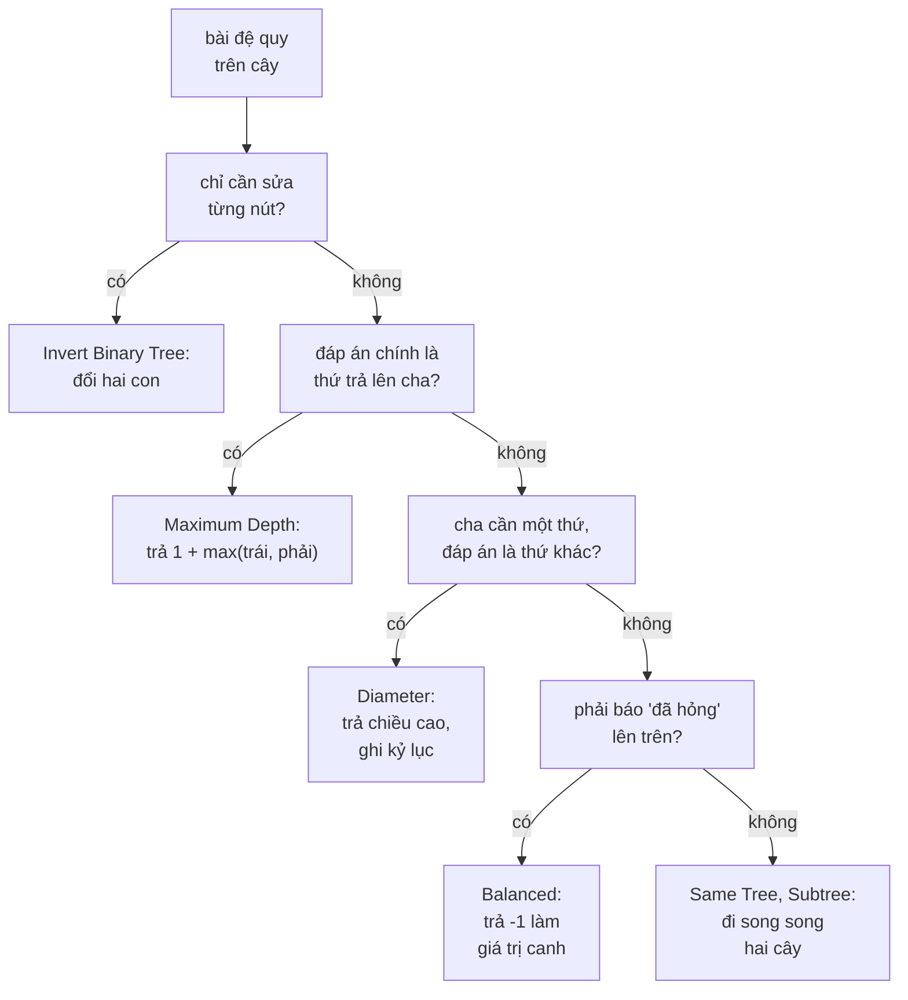

> [!tldr] Đọc nhanh
> - Pattern: một [[concepts/binary-tree|cây nhị phân]] là một nút gốc cộng hai cây con, nên bài trên cả cây thường là: giải cho cây con trái, giải cho cây con phải, ghép ở nút. Ghép **sau** khi hai con đã xong là [[concepts/post-order-traversal|duyệt hậu thứ tự]].
> - **Trả một thứ, ghi một thứ khác** (Diameter of Binary Tree, bài neo): hàm trả **chiều cao** lên cha, còn **đường kính** tốt nhất được ghi vào một biến kỷ lục bên ngoài. Bản ngây thơ tính lại chiều cao ở mỗi nút tốn O(n²): 134 ms trên chuỗi 4 000 nút, so với 0,09 ms.
> - **Trả thêm tín hiệu "đã hỏng"** (Balanced Binary Tree): trả chiều cao, hoặc -1 làm [[concepts/sentinel-value|giá trị canh]] để cha biết dừng ngay.
> - **Đi trên hai cây cùng lúc** (Same Tree, Subtree of Another Tree): mỗi lời gọi nhận một cặp nút. Subtree thử mọi nút làm gốc, O(m · n); [[concepts/tree-hashing|băm cây]] đưa về O(m + n).
> - **Cây lệch làm vỡ call stack**: Python dừng ở 997 nút, Node khoảng 14 000, Java khoảng 39 000, còn Go chạy được 10⁶ tầng. Xem [[concepts/recursion-depth-limit|Recursion Depth Limit]].

> [!info] Bối cảnh
> Ga 3 **tuyến NeetCode: Cấu trúc liên kết**, ga đầu tiên về cây. [[posts/2026-11-24-neetcode-linked-list|Ga 1]] và [[posts/2026-11-24-neetcode-advanced-linked-list|ga 2]] làm việc với nút có **một** con trỏ `next`; nút ở ga này có **hai** con trỏ, `left` và `right`. Sáu bài đều mức Easy và đều giải bằng cùng một khuôn đệ quy. Bạn không cần biết trước gì về cây hay đệ quy; cả hai được giải thích ngay trong bài.

> [!abstract]- Từ điển nhanh cho bài này (bấm để mở)
> - **Nút, con trỏ, `null`**: xem [[posts/2026-11-24-neetcode-linked-list|ga 1]].
> - **Cây nhị phân**: mỗi nút có tối đa hai con, `left` và `right`. Nút trên cùng là **gốc**, nút không có con là **lá**. Xem [[concepts/binary-tree|Binary Tree]].
> - **Cây con**: một nút cùng mọi nút bên dưới nó. Cây con của một nút lại là một cây nhị phân.
> - **Chiều cao**: số nút trên đường dài nhất từ một nút đi xuống tới lá. Cây rỗng cao 0, lá cao 1. LeetCode gọi chiều cao của cả cây là *maximum depth*.
> - **Đệ quy**: hàm tự gọi chính nó trên một phần nhỏ hơn của dữ liệu, và có một **ca cơ sở** (ở đây: cây rỗng) để dừng.
> - **Call stack**: chồng các lời gọi hàm đang chờ kết quả. Mỗi tầng đệ quy thêm một khung lên chồng; trả về thì gỡ khung đi. Chồng có giới hạn, vượt là tràn (stack overflow).
> - **Ngăn xếp**: xem [[concepts/stack|Stack]].
> - **Mảng theo tầng**: cách LeetCode ghi một cây, đọc từ trên xuống, trái sang phải, `null` là chỗ trống. `[1, null, 2]` là gốc 1, không có con trái, con phải là 2.

## Hình dung trước: báo cáo theo sơ đồ tổ chức

Hình dung một công ty mà mỗi người quản lý tối đa hai cấp dưới. Giám đốc muốn biết một con số về cả công ty, nhưng chỉ hỏi được hai người ngay dưới mình. Mỗi người lại hỏi hai cấp dưới của họ, và chỉ trả lời lên trên **sau khi** cả hai cấp dưới đã báo cáo.

| Đời thường | Khái niệm |
|---|---|
| Sơ đồ tổ chức, mỗi người quản lý tối đa hai cấp dưới | [[concepts/binary-tree\|cây nhị phân]] |
| Nhân viên không quản lý ai | lá |
| Chỉ báo cáo lên sau khi cả hai cấp dưới đã báo cáo xong | [[concepts/post-order-traversal\|hậu thứ tự]] |
| "Nhánh của tôi sâu mấy cấp?": mỗi người trả 1 + nhánh sâu hơn trong hai cấp dưới | chiều cao (Maximum Depth of Binary Tree) |
| Vẽ lại sơ đồ như soi gương: mọi người đổi chỗ hai cấp dưới | Invert Binary Tree |
| Chuỗi liên lạc dài nhất giữa hai nhân viên: báo lên trên chỉ "nhánh sâu nhất của tôi", nhưng nếu chuỗi uốn qua chính mình dài kỷ lục thì tự ghi lên bảng chung | chiều cao trả về, đường kính ghi vào kỷ lục (Diameter of Binary Tree) |
| Phòng nào hai nhánh chênh nhau quá một cấp thì báo "hỏng"; sếp nghe "hỏng" thì báo "hỏng" luôn, khỏi hỏi tiếp | -1 làm [[concepts/sentinel-value\|giá trị canh]] (Balanced Binary Tree) |
| So sơ đồ hai chi nhánh, từng vị trí một | đệ quy trên hai cây (Same Tree) |
| Tìm xem sơ đồ phòng X có y hệt một nhánh nào đó trong công ty không | Subtree of Another Tree |
| Công ty nhiều cấp quá, chồng giấy "đang chờ cấp dưới trả lời" cao quá bàn | tràn call stack, [[concepts/recursion-depth-limit\|giới hạn độ sâu đệ quy]] |



## Vấn đề: hỏi cả cây bằng một vòng lặp thì rối

Với danh sách liên kết, một vòng `while (p)` đi hết mọi nút. Với cây, mỗi nút rẽ hai ngả, nên một vòng lặp phải tự nhớ "còn nhánh nào chưa đi", tức tự quản lý một [[concepts/stack|ngăn xếp]]. Đệ quy làm việc đó thay ta: call stack của ngôn ngữ chính là ngăn xếp nhớ các nhánh đang dở.

Cái khó thứ hai là **ghép kết quả**. Mình từng nghĩ tính đường kính của cây chỉ cần, ở mỗi nút, gọi một hàm `height` cho con trái, một lần cho con phải, cộng lại, rồi lấy lớn nhất. Đúng, nhưng `height` lại đi hết cây con mỗi lần được gọi. Trên một cây lệch n nút, nút ở độ sâu k gọi `height` trên n − k nút, tổng cộng khoảng n²/2 bước. Đo bằng file TypeScript của ga:

| Chuỗi lệch | Tính lại chiều cao ở mỗi nút | Trả chiều cao lên cha |
|---|---|---|
| 1 000 nút | 8,41 ms | 0,02 ms |
| 2 000 nút | 34,24 ms | 0,05 ms |
| 4 000 nút | 134,16 ms | 0,09 ms |

Gấp đôi n thì bản ngây thơ chậm đi khoảng 4 lần, đúng dáng O(n²). Cách sửa là để mỗi nút tính chiều cao **một lần**, trả nó lên cha, và tận dụng lúc đang cầm chiều cao hai con để làm luôn việc khác.

## Cơ chế

### Khuôn chung: hỏi hai con, ghép ở nút

Cả sáu bài là biến thể của cùng một hàm:

```ts
// minh họa, không chạy trực tiếp
function solve(node: TreeNode | null): Result {
  if (!node) return BASE;                  // ca cơ sở: cây rỗng
  const left = solve(node.left);           // tin tưởng: hàm đã đúng trên cây nhỏ hơn
  const right = solve(node.right);
  record(node, left, right);               // (tùy bài) ghi vào kỷ lục bên ngoài
  return combine(node, left, right);       // thứ cha cần biết
}
```

Hai quyết định làm nên mỗi bài: **hàm trả gì lên cha** (`combine`) và **có ghi gì vào kỷ lục không** (`record`). Mẹo để viết đúng là đừng lần theo từng tầng lời gọi trong đầu. Chỉ cần kiểm hai điều: ca cơ sở đúng, và nếu `solve` đã đúng trên hai cây con thì dòng `combine` cho ra kết quả đúng trên cả cây.

### Trả một thứ, ghi một thứ khác: Diameter of Binary Tree

<figure class="figure-map" style="--ar: 3 / 4">
<div class="frame"><iframe data-archify="../diagrams/neetcode-tree-recursion/diameter.html" title="Diameter of Binary Tree: trả chiều cao lên trên, ghi đường kính vào kỷ lục" loading="lazy"></iframe></div>
<figcaption><span><b>Hình 1.</b> Cây bốn nút: gốc 1 chỉ có con trái 2, nút 2 có hai lá 3 và 4. Mỗi lá trả chiều cao 1; nút 2 ghi l + r = 2 vào kỷ lục nhưng chỉ trả chiều cao 2 lên gốc. Ở gốc l + r = 2 + 0 không phá kỷ lục, nên đáp án là 2 cạnh (3 → 2 → 4), trong khi hàm ở gốc trả 3.</span><a href="../diagrams/neetcode-tree-recursion/diameter.html" target="_blank" rel="noopener">Mở toàn màn hình</a></figcaption>
</figure>

Bài neo là [[problems/diameter-of-binary-tree|Diameter of Binary Tree]]: tìm số **cạnh** trên đường dài nhất nối hai nút bất kỳ. Đường đó không nhất thiết đi qua gốc.

Mọi đường trong cây đều có đúng một nút "cao nhất", chỗ nó uốn từ nhánh trái sang nhánh phải. Đường dài nhất uốn qua nút `x` dài đúng `height(x.left) + height(x.right)` cạnh: xuống trái hết mức, xuống phải hết mức. Vậy đáp án là giá trị lớn nhất của tổng đó trên mọi nút.

Chỗ mấu chốt: cha **không** cần biết đường kính của con. Một đường đã uốn ở con thì không nối tiếp lên cha được nữa. Cha chỉ cần chiều cao của con để tính đường uốn qua chính nó. Nên hàm tách làm hai:

- **trả về** chiều cao, `1 + max(l, r)`, thứ cha cần;
- **ghi** `l + r` vào biến `best` bên ngoài nếu nó phá kỷ lục, thứ đề hỏi.

Mỗi nút được thăm một lần: O(n) thời gian, O(h) bộ nhớ cho call stack, với h là chiều cao cây. Ca kiểm "đường dài nhất không qua gốc" (`[1, 2, null, 3, 4, 5, null, null, 6]`, đáp án 4) bắt lỗi của bản chỉ tính `l + r` ở gốc.

### Trả về kèm tín hiệu "đã hỏng": Balanced Binary Tree

[[problems/balanced-binary-tree|Balanced Binary Tree]] hỏi: ở **mọi** nút, chiều cao hai cây con có chênh nhau không quá 1 không? Kiểm mỗi gốc thì chưa đủ; ca `[1, 2, 2, 3, null, null, 3, 4, null, null, 4]` có gốc cân (hai bên cùng cao 3) nhưng hai nút con thì lệch.

Hàm cần trả lên hai thông tin: chiều cao, và "bên dưới có chỗ nào lệch chưa". Thay vì trả một cặp, ta dùng **-1 làm [[concepts/sentinel-value|giá trị canh]]**: chiều cao thật không bao giờ âm, nên -1 không thể nhầm với một chiều cao. Con trả -1 thì nút trả -1 luôn, không cần nhìn con còn lại. Bản kiểm mọi nút bằng `height` riêng là O(n²) trên cây lệch, đúng cái bẫy của mục trước.

### Hai cây cùng lúc: Same Tree và Subtree of Another Tree

[[problems/same-tree|Same Tree]] đi song song hai cây: mỗi lời gọi nhận một **cặp** nút `(p, q)`. Hai nút cùng rỗng thì giống; một rỗng một không thì khác; còn lại so giá trị rồi so cặp con trái, cặp con phải. Dòng `if (!p || !q) return p === q` gói ba ca đầu vào một.

[[problems/subtree-of-another-tree|Subtree of Another Tree]] hỏi cây `sub` có trùng khít với một cây con nào của `root` không, tính cả mọi nút bên dưới. Cách thẳng là thử mọi nút của `root` làm gốc, mỗi lần gọi Same Tree: O(m · n) trường hợp xấu nhất. Ca "khớp đầu nhưng thừa nút dưới" nhắc rằng cây con phải đi tới tận lá: `[4, 1, 2]` không phải cây con của một cây mà nút 4 còn thêm con bên dưới. Để xuống O(m + n), [[concepts/tree-hashing|băm cây]] gán cho mỗi cây con một mã tính theo hậu thứ tự, rồi chỉ việc tìm mã của `sub` trong các mã của `root`. Trang bài so các cách này.

### Không cần thứ tự: Invert Binary Tree và Maximum Depth of Binary Tree

[[problems/invert-binary-tree|Invert Binary Tree]] đổi chỗ hai con ở mọi nút. Kết quả của con không ảnh hưởng việc làm ở nút, nên trước, giữa hay sau hai con đều đúng, kể cả duyệt theo tầng bằng hàng đợi. Chỉ cần cẩn thận khi đổi chỗ: `root.left = invert(root.right); root.right = invert(root.left)` sai, vì dòng thứ hai đọc `root.left` đã bị ghi đè. Giữ một biến tạm, hoặc gán cả cặp một lúc như Python và Go.

[[problems/maximum-depth-of-binary-tree|Maximum Depth of Binary Tree]] là khuôn ở dạng gọn nhất: thứ trả lên cha chính là đáp án, `1 + max(trái, phải)`. Đây cũng là bài dễ viết lại không đệ quy nhất: một ngăn xếp giữ cặp (nút, độ sâu), thứ tự lấy ra không quan trọng.

### Sáu bài, một khuôn

| Bài | Điểm khác | Trả lên cha | Ghi kỷ lục | Thời gian, bộ nhớ thêm |
|---|---|---|---|---|
| [[problems/invert-binary-tree\|Invert Binary Tree]] | sửa cây tại chỗ, thứ tự duyệt nào cũng được | chính nút đó | không | O(n), O(h) |
| [[problems/maximum-depth-of-binary-tree\|Maximum Depth of Binary Tree]] | thứ trả về chính là đáp án | chiều cao | không | O(n), O(h) |
| [[problems/diameter-of-binary-tree\|Diameter of Binary Tree]] | đáp án khác thứ cha cần | chiều cao | `l + r` lớn nhất | O(n), O(h) |
| [[problems/balanced-binary-tree\|Balanced Binary Tree]] | phải báo lỗi lên trên và dừng sớm | chiều cao hoặc -1 | không | O(n), O(h) |
| [[problems/same-tree\|Same Tree]] | đi song song hai cây | đúng hoặc sai | không | O(min(m, n)), O(h) |
| [[problems/subtree-of-another-tree\|Subtree of Another Tree]] | thử mọi nút làm gốc, mỗi lần gọi Same Tree | đúng hoặc sai | không | O(m · n), O(h); băm cây O(m + n) |

### Khi cây quá sâu: giới hạn đệ quy của từng ngôn ngữ

Đệ quy dùng call stack sâu bằng chiều cao cây. Cây cân bằng 10⁶ nút chỉ cao khoảng 20; cây ngẫu nhiên 10⁶ nút trong file đo cao 25. Nhưng cây **lệch**, mỗi nút một con, cao đúng bằng số nút. Ràng buộc của sáu bài đi từ 100 nút (226, 100) tới 5 000 (110), 2 000 (572) và 10⁴ nút (104, 543): ba bài sau đủ lớn để một cây lệch vượt giới hạn mặc định của Python. Đo `maxDepth` đệ quy trên chuỗi lệch:

| Ngôn ngữ | Giới hạn mặc định | Đo được | Vượt thì |
|---|---|---|---|
| Python 3.12 | `sys.getrecursionlimit()` = 1000 | 997 nút; 998 là `RecursionError` | bắt được bằng `except RecursionError` |
| Node.js 24 | stack V8 984 KB (`node --stack-size`) | 13 911 tới 15 633 nút tùy lần chạy; khoảng 7 000 khi hàm còn chạy lần đầu, chưa được JIT tối ưu | `RangeError: Maximum call stack size exceeded`, bắt được |
| Java 21 | `-Xss` mặc định 1 MB (`ThreadStackSize = 1024`) | 39 289 nút ở luồng main | `StackOverflowError`, bắt được |
| Go 1.25 | stack goroutine tự lớn dần, trần 1 GB | chuỗi 10⁶ nút chạy hết, 62,8 ms | `fatal error: stack overflow`, **không** `recover` được |

Python 3.11 trở đi không dùng C stack cho lời gọi giữa hai hàm Python, nên `sys.setrecursionlimit(200_000)` là đủ để chạy chuỗi 10⁵ nút (19,3 ms). Java cho phép tạo một luồng với stack lớn hơn: `new Thread(null, task, "deep", 256L << 20)` chạy được chuỗi 10⁶ nút.

Cách không phụ thuộc giới hạn nào là bỏ đệ quy, tự quản lý [[concepts/stack|ngăn xếp]] trên heap. Hậu thứ tự không đệ quy cần đẩy mỗi nút **hai lần**: lần đầu kèm cờ "chưa thăm con" để đẩy hai con lên trên nó, lần sau kèm cờ "đã thăm con" để tính chính nó khi chiều cao hai con đã có trong một bảng băm. Bản này chạy được chuỗi 100 000 nút ở cả năm ngôn ngữ, nhưng chậm hơn rõ rệt trên cây bình thường. Đo 543 trên cây ngẫu nhiên 10⁶ nút (Python: 2·10⁵ nút), trung vị 5 lần:

| Ngôn ngữ | Đệ quy | Ngăn xếp tự quản lý |
|---|---|---|
| TypeScript (Node 24) | 25,7 ms | 194,2 ms |
| Go | 23,1 ms | 184,8 ms |
| Java | 22,5 ms | 201,1 ms |
| Python (2·10⁵ nút) | 53,0 ms | 88,0 ms |

Phần chậm thêm đến từ bảng băm nút → chiều cao và các bộ `(nút, cờ)` được cấp phát mỗi bước. Python chỉ chậm 1,7 lần vì ở Python chính lời gọi hàm đã đắt. Kết luận của mình: viết đệ quy mặc định, chuyển sang ngăn xếp khi cây có thể lệch sâu hơn giới hạn của ngôn ngữ đang dùng.

### Bên dưới năm ngôn ngữ

| | Ghi kỷ lục từ trong hàm lồng | So nút rỗng | Bẫy riêng |
|---|---|---|---|
| TypeScript / JavaScript | closure gán thẳng biến `let best` bên ngoài | `p === q` khi một trong hai là `null` | `undefined` và `null` khác nhau với `===`: cây dựng tay mà quên gán `left = null` thì `!p` vẫn đúng nhưng `p === q` sai |
| Python | `nonlocal best` trong hàm lồng | `p is q` | quên `nonlocal` thì `best = …` tạo biến cục bộ mới: `UnboundLocalError` ngay ở dòng `max(best, …)` |
| Go | closure gán biến `best`; hàm lồng đệ quy phải khai báo `var height func(*TreeNode) int` trước | `p == q` trên con trỏ | `height := func…` không tự gọi được chính nó, vì tên chưa tồn tại lúc biên dịch thân hàm |
| Java | lambda không gán được biến cục bộ bên ngoài; dùng mảng `int[] best = {0}`, một trường, hoặc hàm phụ nhận `best` | `p == q` so danh tính | `Integer` so bằng `==` chỉ đúng trong khoảng -128..127 (bộ nhớ đệm); so giá trị nút kiểu `Integer` phải dùng `equals` |

## Ví dụ chạy được

[TypeScript](../code/neetcode-tree-recursion/tree-recursion.ts) · [Python](../code/neetcode-tree-recursion/tree_recursion.py) · [Go](../code/neetcode-tree-recursion/tree_recursion.go) · [Java](../code/neetcode-tree-recursion/tree-recursion.java) · [JavaScript](../code/neetcode-tree-recursion/tree-recursion.js)

Mỗi file dựng cây từ mảng theo tầng, giải cả sáu bài và chạy 16 ca chung: ví dụ kiểu đề cho mỗi bài, cây rỗng (226), cây chỉ có nhánh phải (104), đường dài nhất không qua gốc (543), gốc cân nhưng con lệch (110), cùng giá trị khác hình (100), khớp đầu nhưng thừa nút dưới (572). Ca thứ 15 sinh 300 cây ngẫu nhiên bằng mulberry32 và so mỗi lời giải với một bản chậm làm chuẩn: đường kính và độ cân bằng tính lại chiều cao ở mọi nút, độ sâu đệ quy so với bản lặp, lật hai lần phải ra cây cũ, và một cây con chép ra từ chính cây phải được tìm thấy. Ca cuối chạy bản lặp trên chuỗi lệch 100 000 nút. Sau phần kiểm, mỗi file in các phép đo ở trên.

Ba bài một cây: Invert Binary Tree, Maximum Depth of Binary Tree, Diameter of Binary Tree.

```ts
// 226: đổi chỗ hai con ở mọi nút. Thứ tự duyệt nào cũng được, miễn đi hết mọi nút.
function invertTree(root: TreeNode | null): TreeNode | null {
  if (!root) return null;
  const left = invertTree(root.left);
  root.left = invertTree(root.right);
  root.right = left;
  return root;
}

// 104: chiều cao = 1 + chiều cao con cao hơn. Cây rỗng cao 0.
function maxDepth(root: TreeNode | null): number {
  if (!root) return 0;
  return 1 + Math.max(maxDepth(root.left), maxDepth(root.right));
}

// 543: hàm đệ quy TRẢ VỀ chiều cao, còn đường kính được GHI vào biến ngoài ở mỗi nút.
function diameterOfBinaryTree(root: TreeNode | null): number {
  let best = 0;
  const height = (node: TreeNode | null): number => {
    if (!node) return 0;
    const l = height(node.left), r = height(node.right);
    best = Math.max(best, l + r); // đường dài nhất đi qua node: xuống trái l cạnh, xuống phải r cạnh
    return 1 + Math.max(l, r);
  };
  height(root);
  return best;
}
```

```python
# 226: đổi chỗ hai con ở mọi nút.
def invert_tree(root):
    if root is None:
        return None
    root.left, root.right = invert_tree(root.right), invert_tree(root.left)
    return root


# 104: chiều cao = 1 + chiều cao con cao hơn.
def max_depth(root):
    if root is None:
        return 0
    return 1 + max(max_depth(root.left), max_depth(root.right))


# 543: hàm trong TRẢ VỀ chiều cao, đường kính được GHI vào biến ngoài (nonlocal).
def diameter_of_binary_tree(root):
    best = 0

    def height(node):
        nonlocal best
        if node is None:
            return 0
        l, r = height(node.left), height(node.right)
        best = max(best, l + r)
        return 1 + max(l, r)

    height(root)
    return best
```

```go
// 226: đổi chỗ hai con ở mọi nút.
func invertTree(root *TreeNode) *TreeNode {
	if root == nil {
		return nil
	}
	root.Left, root.Right = invertTree(root.Right), invertTree(root.Left)
	return root
}

// 104: chiều cao = 1 + chiều cao con cao hơn.
func maxDepth(root *TreeNode) int {
	if root == nil {
		return 0
	}
	return 1 + max(maxDepth(root.Left), maxDepth(root.Right))
}

// 543: closure TRẢ VỀ chiều cao, đường kính được GHI vào biến best bên ngoài.
func diameterOfBinaryTree(root *TreeNode) int {
	best := 0
	var height func(*TreeNode) int
	height = func(node *TreeNode) int {
		if node == nil {
			return 0
		}
		l, r := height(node.Left), height(node.Right)
		best = max(best, l+r)
		return 1 + max(l, r)
	}
	height(root)
	return best
}
```

```java
// 226: đổi chỗ hai con ở mọi nút.
static TreeNode invertTree(TreeNode root) {
    if (root == null) return null;
    TreeNode left = invertTree(root.left);
    root.left = invertTree(root.right);
    root.right = left;
    return root;
}

// 104: chiều cao = 1 + chiều cao con cao hơn.
static int maxDepth(TreeNode root) {
    if (root == null) return 0;
    return 1 + Math.max(maxDepth(root.left), maxDepth(root.right));
}

// 543: hàm TRẢ VỀ chiều cao, đường kính được GHI vào mảng 1 phần tử (lambda Java không gán được biến ngoài).
static int diameterOfBinaryTree(TreeNode root) {
    int[] best = {0};
    height(root, best);
    return best[0];
}
static int height(TreeNode node, int[] best) {
    if (node == null) return 0;
    int l = height(node.left, best), r = height(node.right, best);
    best[0] = Math.max(best[0], l + r);
    return 1 + Math.max(l, r);
}
```

```js
// 226: đổi chỗ hai con ở mọi nút. Thứ tự duyệt nào cũng được, miễn đi hết mọi nút.
function invertTree(root) {
  if (!root) return null;
  const left = invertTree(root.left);
  root.left = invertTree(root.right);
  root.right = left;
  return root;
}

// 104: chiều cao = 1 + chiều cao con cao hơn. Cây rỗng cao 0.
function maxDepth(root) {
  if (!root) return 0;
  return 1 + Math.max(maxDepth(root.left), maxDepth(root.right));
}

// 543: hàm đệ quy TRẢ VỀ chiều cao, còn đường kính được GHI vào biến ngoài ở mỗi nút.
function diameterOfBinaryTree(root) {
  let best = 0;
  const height = (node) => {
    if (!node) return 0;
    const l = height(node.left), r = height(node.right);
    best = Math.max(best, l + r); // đường dài nhất đi qua node: xuống trái l cạnh, xuống phải r cạnh
    return 1 + Math.max(l, r);
  };
  height(root);
  return best;
}
```

Ba bài còn lại: Balanced Binary Tree, Same Tree, Subtree of Another Tree.

```ts
// 110: trả chiều cao, hoặc -1 làm giá trị canh nghĩa là "đã lệch ở đâu đó bên dưới".
function isBalanced(root: TreeNode | null): boolean {
  const check = (node: TreeNode | null): number => {
    if (!node) return 0;
    const l = check(node.left);
    if (l === -1) return -1;
    const r = check(node.right);
    if (r === -1 || Math.abs(l - r) > 1) return -1;
    return 1 + Math.max(l, r);
  };
  return check(root) !== -1;
}

// 100: đệ quy trên hai cây cùng lúc, đi song song từng cặp nút.
function isSameTree(p: TreeNode | null, q: TreeNode | null): boolean {
  if (!p || !q) return p === q;
  return p.val === q.val && isSameTree(p.left, q.left) && isSameTree(p.right, q.right);
}

// 572: thử mọi nút của root làm gốc, mỗi lần so cả cây bằng isSameTree. O(m · n) trường hợp xấu nhất.
function isSubtree(root: TreeNode | null, sub: TreeNode | null): boolean {
  if (!root) return sub === null;
  return isSameTree(root, sub) || isSubtree(root.left, sub) || isSubtree(root.right, sub);
}
```

```python
# 110: trả chiều cao, hoặc -1 làm giá trị canh "đã lệch ở dưới".
def is_balanced(root):
    def check(node):
        if node is None:
            return 0
        l = check(node.left)
        if l == -1:
            return -1
        r = check(node.right)
        if r == -1 or abs(l - r) > 1:
            return -1
        return 1 + max(l, r)

    return check(root) != -1


# 100: đi song song hai cây.
def is_same_tree(p, q):
    if p is None or q is None:
        return p is q
    return p.val == q.val and is_same_tree(p.left, q.left) and is_same_tree(p.right, q.right)


# 572: thử mọi nút làm gốc, so cả cây. O(m · n) trường hợp xấu nhất.
def is_subtree(root, sub):
    if root is None:
        return sub is None
    return is_same_tree(root, sub) or is_subtree(root.left, sub) or is_subtree(root.right, sub)
```

```go
// 110: trả chiều cao, hoặc -1 làm giá trị canh "đã lệch ở dưới".
func isBalanced(root *TreeNode) bool {
	var check func(*TreeNode) int
	check = func(node *TreeNode) int {
		if node == nil {
			return 0
		}
		l := check(node.Left)
		if l == -1 {
			return -1
		}
		r := check(node.Right)
		if r == -1 || l-r > 1 || r-l > 1 {
			return -1
		}
		return 1 + max(l, r)
	}
	return check(root) != -1
}

// 100: đi song song hai cây.
func isSameTree(p, q *TreeNode) bool {
	if p == nil || q == nil {
		return p == q
	}
	return p.Val == q.Val && isSameTree(p.Left, q.Left) && isSameTree(p.Right, q.Right)
}

// 572: thử mọi nút làm gốc, so cả cây. O(m · n) trường hợp xấu nhất.
func isSubtree(root, sub *TreeNode) bool {
	if root == nil {
		return sub == nil
	}
	return isSameTree(root, sub) || isSubtree(root.Left, sub) || isSubtree(root.Right, sub)
}
```

```java
// 110: trả chiều cao, hoặc -1 làm giá trị canh "đã lệch ở dưới".
static boolean isBalanced(TreeNode root) { return check(root) != -1; }
static int check(TreeNode node) {
    if (node == null) return 0;
    int l = check(node.left);
    if (l == -1) return -1;
    int r = check(node.right);
    if (r == -1 || Math.abs(l - r) > 1) return -1;
    return 1 + Math.max(l, r);
}

// 100: đi song song hai cây.
static boolean isSameTree(TreeNode p, TreeNode q) {
    if (p == null || q == null) return p == q;
    return p.val == q.val && isSameTree(p.left, q.left) && isSameTree(p.right, q.right);
}

// 572: thử mọi nút làm gốc, so cả cây. O(m · n) trường hợp xấu nhất.
static boolean isSubtree(TreeNode root, TreeNode sub) {
    if (root == null) return sub == null;
    return isSameTree(root, sub) || isSubtree(root.left, sub) || isSubtree(root.right, sub);
}
```

```js
// 110: trả chiều cao, hoặc -1 làm giá trị canh nghĩa là "đã lệch ở đâu đó bên dưới".
function isBalanced(root) {
  const check = (node) => {
    if (!node) return 0;
    const l = check(node.left);
    if (l === -1) return -1;
    const r = check(node.right);
    if (r === -1 || Math.abs(l - r) > 1) return -1;
    return 1 + Math.max(l, r);
  };
  return check(root) !== -1;
}

// 100: đệ quy trên hai cây cùng lúc, đi song song từng cặp nút.
function isSameTree(p, q) {
  if (!p || !q) return p === q;
  return p.val === q.val && isSameTree(p.left, q.left) && isSameTree(p.right, q.right);
}

// 572: thử mọi nút của root làm gốc, mỗi lần so cả cây bằng isSameTree. O(m · n) trường hợp xấu nhất.
function isSubtree(root, sub) {
  if (!root) return sub === null;
  return isSameTree(root, sub) || isSubtree(root.left, sub) || isSubtree(root.right, sub);
}
```

Hậu thứ tự không đệ quy cho 543, dùng ở ca chuỗi lệch 100 000 nút:

```ts
// 543 không đệ quy: hậu thứ tự bằng ngăn xếp, cờ "đã thăm con" quyết định khi nào tính nút.
function diameterIter(root: TreeNode | null): number {
  if (!root) return 0;
  const h = new Map<TreeNode | null, number>([[null, 0]]);
  const stack: [TreeNode, boolean][] = [[root, false]];
  let best = 0;
  while (stack.length) {
    const [node, childrenDone] = stack.pop()!;
    if (childrenDone) {
      const l = h.get(node.left)!, r = h.get(node.right)!;
      best = Math.max(best, l + r);
      h.set(node, 1 + Math.max(l, r));
    } else {
      stack.push([node, true]);
      if (node.right) stack.push([node.right, false]);
      if (node.left) stack.push([node.left, false]);
    }
  }
  return best;
}
```

```python
# 543 không đệ quy: hậu thứ tự bằng ngăn xếp, cờ "đã thăm con".
def diameter_iter(root):
    if root is None:
        return 0
    h = {None: 0}
    stack, best = [(root, False)], 0
    while stack:
        node, children_done = stack.pop()
        if children_done:
            l, r = h[node.left], h[node.right]
            best = max(best, l + r)
            h[node] = 1 + max(l, r)
        else:
            stack.append((node, True))
            if node.right:
                stack.append((node.right, False))
            if node.left:
                stack.append((node.left, False))
    return best
```

```go
// 543 không đệ quy: hậu thứ tự bằng ngăn xếp, cờ "đã thăm con".
func diameterIter(root *TreeNode) int {
	if root == nil {
		return 0
	}
	type item struct {
		node         *TreeNode
		childrenDone bool
	}
	h := map[*TreeNode]int{nil: 0}
	stack := []item{{root, false}}
	best := 0
	for len(stack) > 0 {
		it := stack[len(stack)-1]
		stack = stack[:len(stack)-1]
		if it.childrenDone {
			l, r := h[it.node.Left], h[it.node.Right]
			best = max(best, l+r)
			h[it.node] = 1 + max(l, r)
		} else {
			stack = append(stack, item{it.node, true})
			if it.node.Right != nil {
				stack = append(stack, item{it.node.Right, false})
			}
			if it.node.Left != nil {
				stack = append(stack, item{it.node.Left, false})
			}
		}
	}
	return best
}
```

```java
// 543 không đệ quy: hậu thứ tự bằng ngăn xếp, cờ "đã thăm con".
static int diameterIter(TreeNode root) {
    if (root == null) return 0;
    Map<TreeNode, Integer> h = new HashMap<>();
    ArrayDeque<TreeNode> nodes = new ArrayDeque<>(List.of(root));
    ArrayDeque<Boolean> done = new ArrayDeque<>(List.of(false));
    int best = 0;
    while (!nodes.isEmpty()) {
        TreeNode node = nodes.pop();
        boolean childrenDone = done.pop();
        if (childrenDone) {
            int l = h.getOrDefault(node.left, 0), r = h.getOrDefault(node.right, 0);
            best = Math.max(best, l + r);
            h.put(node, 1 + Math.max(l, r));
        } else {
            nodes.push(node); done.push(true);
            if (node.right != null) { nodes.push(node.right); done.push(false); }
            if (node.left != null) { nodes.push(node.left); done.push(false); }
        }
    }
    return best;
}
```

```js
// 543 không đệ quy: hậu thứ tự bằng ngăn xếp, cờ "đã thăm con" quyết định khi nào tính nút.
function diameterIter(root) {
  if (!root) return 0;
  const h = new Map([[null, 0]]);
  const stack = [[root, false]];
  let best = 0;
  while (stack.length) {
    const [node, childrenDone] = stack.pop();
    if (childrenDone) {
      const l = h.get(node.left), r = h.get(node.right);
      best = Math.max(best, l + r);
      h.set(node, 1 + Math.max(l, r));
    } else {
      stack.push([node, true]);
      if (node.right) stack.push([node.right, false]);
      if (node.left) stack.push([node.left, false]);
    }
  }
  return best;
}
```

Kết quả `node tree-recursion.ts`:

```text
tree-recursion 16/16 ca đúng
104 đệ quy trên cây lệch: chịu được 13911 nút, 13912 nút thì RangeError
543 trên cây ngẫu nhiên 10^6 nút (cao 25): đệ quy 25.7 ms, ngăn xếp 194.2 ms
543 trên chuỗi 1000 nút: tính lại chiều cao 8.41 ms, trả chiều cao lên 0.02 ms
543 trên chuỗi 2000 nút: tính lại chiều cao 34.24 ms, trả chiều cao lên 0.05 ms
543 trên chuỗi 4000 nút: tính lại chiều cao 134.16 ms, trả chiều cao lên 0.09 ms
```

Python, Go, Java và JavaScript cũng in `16/16 ca đúng`. Phần đo của từng file:

```text
python3 tree_recursion.py
104 đệ quy trên cây lệch: giới hạn 1000, chịu được 997 nút, 998 nút thì RecursionError
104 sau setrecursionlimit(200000): chuỗi 100 000 nút cao 100000, 19.3 ms
543 trên cây ngẫu nhiên 2·10^5 nút (cao 22): đệ quy 53.0 ms, ngăn xếp 88.0 ms

go run tree_recursion.go
104 đệ quy trên chuỗi 100000 nút: cao 100000, 7.8 ms
104 đệ quy trên chuỗi 1000000 nút: cao 1000000, 62.8 ms
543 trên cây ngẫu nhiên 10^6 nút (cao 25): đệ quy 23.1 ms, ngăn xếp 184.8 ms

java tree-recursion.java
104 đệ quy trên cây lệch, luồng main: chịu được khoảng 39289 nút
104 đệ quy trên chuỗi 1000000 nút, luồng có stack 256 MB: cao 1000000
543 trên cây ngẫu nhiên 10^6 nút (cao 25): đệ quy 22.5 ms, ngăn xếp 201.1 ms
```

Số đo thời gian dao động theo lần chạy (máy đang bận thì bản ngăn xếp có lần lên 250 ms); tỉ lệ giữa hai bản thì giữ nguyên.

## Hiểu lầm và bẫy hay gặp

- **"Đường kính luôn đi qua gốc."** Không. Đường dài nhất có thể nằm hẳn trong một nhánh; phải xét `l + r` ở **mọi** nút, nên mới cần biến kỷ lục.
- **Trả `l + r` lên cha.** Cha cần chiều cao để nối thêm một cạnh. Một đường đã uốn ở con không nối tiếp lên được, nên trả `l + r` cho kết quả quá lớn.
- **Trộn hai cách đếm chiều cao.** 543 hỏi số cạnh. Ở bài này chiều cao đếm số nút (lá cao 1), nên đường uốn qua một nút dài đúng `l + r` cạnh. Nếu đổi sang đếm chiều cao theo cạnh (lá cao 0, cây rỗng −1) thì đường đó dài `l + r + 2`. Trộn hai quy ước là kết quả lệch 1 hoặc 2.
- **Balanced chỉ kiểm ở gốc.** Gốc cân không có nghĩa là con cân. Phải kiểm ở mọi nút, và cách rẻ là báo -1 lên trên.
- **Tính `height` riêng ở mỗi nút.** Đúng, nhưng O(n²) trên cây lệch: 134 ms ở 4 000 nút so với 0,09 ms.
- **Subtree chỉ so giá trị gốc rồi kết luận.** Hai cây phải trùng khít tới tận lá, kể cả chỗ trống: thừa một nút bên dưới là khác.
- **Đổi chỗ hai con bằng hai lệnh gán liên tiếp.** Lệnh thứ hai đọc giá trị đã bị lệnh đầu ghi đè. Giữ biến tạm.
- **Tin rằng LeetCode qua thì ngoài đời cũng qua.** Cây do người dùng gửi lên (JSON lồng nhau, cây thư mục, cây bình luận) có thể lệch sâu tùy ý. Python vỡ ở 997 tầng.

## Câu hỏi tự kiểm tra

> [!question]- Trong Diameter of Binary Tree, vì sao hàm trả chiều cao mà không trả đường kính?
> Cha dùng kết quả của con để tính đường uốn qua chính nó, và việc đó cần biết con đi xuống sâu được bao nhiêu, tức chiều cao. Đường kính của con là một đường đã uốn, không nối thêm lên cha được. Đường kính được ghi vào biến kỷ lục ở mỗi nút thay vì được trả lên.

> [!question]- Vì sao -1 dùng được làm giá trị canh trong Balanced Binary Tree, còn 0 thì không?
> Chiều cao thật luôn ≥ 0, và 0 là chiều cao hợp lệ của cây rỗng. Nếu dùng 0 cho "đã lệch", cha không phân biệt được "con rỗng" với "con lệch". -1 không bao giờ là một chiều cao, nên không nhầm được.

> [!question]- Invert Binary Tree đổi chỗ ở trước, giữa hay sau hai lời gọi con đều đúng. Vậy vì sao Diameter thì phải là hậu thứ tự?
> Việc ở mỗi nút của Invert không cần kết quả của con: đổi chỗ hai con trỏ là xong. Diameter cần chiều cao của hai con để tính `l + r` và để trả `1 + max(l, r)`, nên phải đợi hai lời gọi con xong trước.

> [!question]- Một cây lệch 50 000 nút: bản đệ quy chạy được ở ngôn ngữ nào trong năm ngôn ngữ, với cài đặt mặc định?
> Chỉ Go: stack goroutine tự lớn tới 1 GB. Python dừng ở 997, Node khoảng 7 000 tới 15 600, Java khoảng 39 000 ở luồng main. Ba ngôn ngữ đó cần nâng giới hạn, chạy trong luồng có stack lớn hơn (Java), hoặc viết lại bằng ngăn xếp tự quản lý.

> [!question]- Same Tree chạy O(min(m, n)) chứ không phải O(m + n). Vì sao?
> Hai cây được đi song song từng cặp nút, và hàm dừng ngay khi gặp cặp đầu tiên khác nhau, kể cả khi một bên rỗng còn bên kia không. Số cặp được thăm không vượt quá số nút của cây nhỏ hơn.

## Tham khảo

- [NeetCode 150](https://neetcode.io/practice) (danh sách bài và nhóm Trees)
- LeetCode: [226 Invert Binary Tree](https://leetcode.com/problems/invert-binary-tree/), [104 Maximum Depth of Binary Tree](https://leetcode.com/problems/maximum-depth-of-binary-tree/), [543 Diameter of Binary Tree](https://leetcode.com/problems/diameter-of-binary-tree/), [110 Balanced Binary Tree](https://leetcode.com/problems/balanced-binary-tree/), [100 Same Tree](https://leetcode.com/problems/same-tree/), [572 Subtree of Another Tree](https://leetcode.com/problems/subtree-of-another-tree/)
- [Python `sys.setrecursionlimit`](https://docs.python.org/3/library/sys.html#sys.setrecursionlimit) (giới hạn mặc định và cảnh báo khi đặt quá cao)
- [What's New in Python 3.11](https://docs.python.org/3/whatsnew/3.11.html) (lời gọi Python-sang-Python không còn dùng C stack)
- [Go `runtime/debug.SetMaxStack`](https://pkg.go.dev/runtime/debug#SetMaxStack) (trần stack goroutine, mặc định 1 GB trên hệ 64 bit)
- [Java `Thread(ThreadGroup, Runnable, String, long)`](https://docs.oracle.com/en/java/javase/21/docs/api/java.base/java/lang/Thread.html) (tham số `stackSize`)
- Cormen, Leiserson, Rivest, Stein, *Introduction to Algorithms*, mục 12.1 (duyệt cây theo thứ tự trước, giữa, sau)
