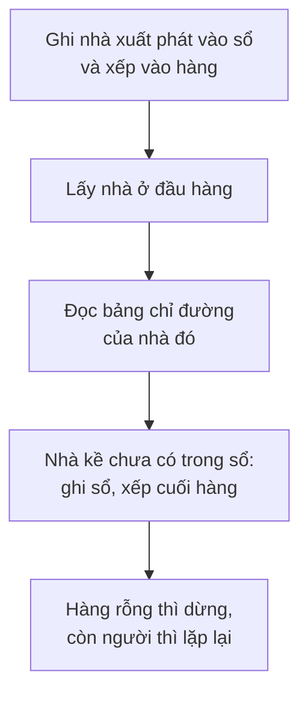
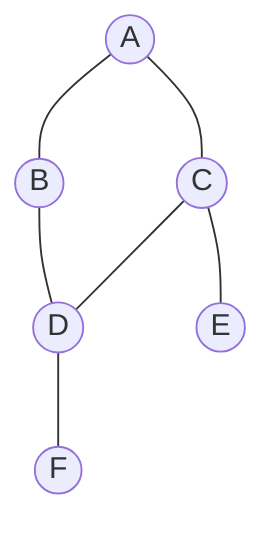

> [!tldr] Đọc nhanh
> - Một **đồ thị** là các đỉnh nối nhau bằng cạnh. Mình ghi nó thành [[concepts/adjacency-list|danh sách kề]]: mỗi đỉnh giữ danh sách các đỉnh sát bên.
> - Khuôn [[concepts/breadth-first-search|BFS]] chỉ có ba món: một hàng đợi, một sổ đã thăm, và một hàm "cho tôi hàng xóm của x". Ghi sổ ngay lúc xếp hàng thì mỗi đỉnh vào hàng đúng một lần, tổng chi phí O(V + E).
> - Bốn bài của ga này giữ nguyên khuôn, chỉ đổi một chỗ: sổ đã thăm kiêm luôn [[concepts/clone-map|bảng bản sao]] (133); xuất phát từ đích rồi [[concepts/reverse-reachability|đi ngược]] (417); xuất phát từ mép bảng (130); hàng xóm được sinh theo luật trong một [[concepts/implicit-graph|đồ thị ẩn]] (127).
> - BFS cho số bước ít nhất trên đồ thị mà mọi cạnh dài như nhau. [[concepts/bidirectional-bfs|BFS hai đầu]] cho cùng đáp án nhưng ở phép đo của mình chỉ lấy ra 102 từ thay vì 4 293.

> [!info] Bối cảnh
> Đây là ga 2 của [[series/neetcode-grph|tuyến NeetCode: Đồ thị]]. Ở [[posts/2026-11-26-neetcode-grid-traversal|ga 1]], hàng xóm của một ô được tính từ tọa độ: trên, dưới, trái, phải. Ở ga này, đỉnh có thể là một nút có con trỏ, một ô trên bản đồ độ cao, hay một từ tiếng Anh. Mình chỉ cần biết hàng đợi là gì (giải thích ngay dưới); cách đi được dựng lại từ đầu bằng một ví dụ sáu đỉnh.

> [!abstract]- Từ điển nhanh cho bài này (bấm để mở)
> - *Đỉnh* (vertex, node) là một "điểm" của đồ thị. *Cạnh* (edge) nối hai đỉnh. Trong *đồ thị vô hướng*, cạnh A–B đi được cả hai chiều.
> - *Hàng xóm* của x là các đỉnh nối thẳng với x bằng một cạnh.
> - *Hàng đợi* (queue) là hàng xếp trước ra trước (FIFO): thêm vào cuối, lấy ra ở đầu. Ở đây là cấu trúc dữ liệu trong bộ nhớ, không phải hàng đợi tin nhắn.
> - *BFS* (breadth-first search, duyệt theo chiều rộng) đi hết các đỉnh cách 1 bước, rồi tới các đỉnh cách 2 bước, và cứ thế. *DFS* (depth-first search, duyệt theo chiều sâu) đi thật sâu theo một nhánh rồi mới quay lại.
> - *Sổ đã thăm* (visited) ghi các đỉnh đã được nhận vào hàng, để không xếp một đỉnh hai lần. Ở ga 1 nó là bảng `distance = -1`.
> - *Lớp* d gồm các đỉnh cách điểm xuất phát đúng d cạnh.
> - V là số đỉnh, E là số cạnh. O(V + E) nghĩa là thời gian tỉ lệ với tổng số đỉnh và số cạnh.

## Hình dung trước: thị trấn và người đưa tin

Hình dung một thị trấn nhỏ. Mỗi **nhà** là một đỉnh, mỗi **con đường** nối hai nhà là một cạnh. Trước cửa mỗi nhà có một **bảng chỉ đường** ghi tên các nhà sát bên. Một người đưa tin xuất phát từ bưu điện. Họ cầm một **sổ** và đi theo một **hàng chờ**: nhà nào sắp ghé thì ghi vào sổ rồi xếp cuối hàng. Vì vậy họ ghé hết các nhà cách bưu điện một đoạn đường, rồi mới tới các nhà cách hai đoạn.

Bốn bài trong ga này là bốn việc khác nhau trong cùng thị trấn ấy:

| Đời thường | Khái niệm |
|---|---|
| Nhà và con đường nối hai nhà | đỉnh và cạnh của đồ thị |
| Bảng chỉ đường trước mỗi nhà, ghi các nhà sát bên | [[concepts/adjacency-list\|danh sách kề]] |
| Đưa tin theo hàng chờ: xong các nhà gần rồi mới tới nhà xa | [[concepts/breadth-first-search\|BFS]] |
| Ghi nhà vào sổ ngay lúc hẹn ghé, không đợi tới nơi | [[concepts/mark-on-enqueue\|đánh dấu khi vào hàng đợi]] |
| Dựng sa bàn của thị trấn, kèm sổ "nhà thật → nhà mô hình" | [[concepts/clone-map\|bảng bản sao]] (Clone Graph) |
| Tìm nhà thoát nước ra được cả hai con sông: đứng ở bờ sông, đi ngược lên dốc | [[concepts/reverse-reachability\|đi ngược từ đích]] (Pacific Atlantic Water Flow) |
| Lấp những sân trong không thông ra cổng thành | đi từ mép vào (Surrounded Regions) |
| Thị trấn không có bản đồ, chỉ có luật "nhà kề là nhà có biển số khác đúng một chữ" | [[concepts/implicit-graph\|đồ thị ẩn]] (Word Ladder) |
| Hai người đưa tin đi từ hai đầu, gặp nhau ở giữa | [[concepts/bidirectional-bfs\|BFS hai đầu]] |

Người đưa tin chỉ làm đi làm lại một vòng:



## Vấn đề: hết lưới thì hàng xóm ở đâu ra?

Mình từng nghĩ BFS là thứ của lưới ô vuông: cứ thử bốn hướng là xong. Hóa ra phần "thử bốn hướng" chỉ là **một cách trả lời câu hỏi "hàng xóm của x là ai"**. Trên lưới, câu trả lời tính được từ tọa độ. Trong một mạng nút có con trỏ, câu trả lời nằm sẵn trong danh sách `neighbors` của nút. Với các từ tiếng Anh, chẳng có danh sách nào cả: hai từ là hàng xóm nếu khác nhau đúng một chữ, và mình phải tự sinh ra chúng.

Phần còn lại của BFS không đổi. Nếu mình tách được hàm "hàng xóm" ra khỏi vòng lặp, cả bốn bài trong ga này dùng chung một khuôn. Khó khăn thật sự nằm ở chỗ mỗi bài hỏi một câu hơi khác, và câu hỏi ngây thơ thường tốn gấp nhiều lần:

- Sao chép một đồ thị có vòng mà không có sổ thì sao chép mãi không dừng.
- Hỏi từng ô "nước từ đây có ra biển không" là chạy một lượt duyệt cho mỗi ô.
- So từng cặp từ để tìm hàng xóm là N² phép so trên 5 000 từ.

## Cơ chế

### Bước 1: ghi đồ thị thành danh sách kề

Lấy một thị trấn sáu nhà A–F. Bưu điện ở A. Các con đường là A–B, A–C, B–D, C–D, C–E, D–F.



**Danh sách kề** ghi, cho mỗi nhà, các nhà nối thẳng với nó. Vì đường đi được hai chiều, cạnh A–B xuất hiện hai lần: trong danh sách của A và của B.

| Nhà | Nhà kề |
|---|---|
| A | B, C |
| B | A, D |
| C | A, D, E |
| D | B, C, F |
| E | C |
| F | D |

Tổng độ dài các danh sách là 2 × 6 cạnh = 12. Đây là lý do BFS tốn O(V + E): mỗi nhà được lấy ra một lần, và mỗi danh sách được đọc một lần.

### Bước 2: chạy BFS từng bước trên ví dụ nhỏ

Mình chạy BFS từ A. Cột "sổ" ghi khoảng cách từ A. Một nhà được ghi sổ **ngay lúc xếp hàng**.

| Bước | Lấy ra | Đọc bảng chỉ đường | Ghi sổ mới | Hàng sau bước |
|---|---|---|---|---|
| 0 | (chưa lấy) | | A = 0 | [A] |
| 1 | A | B, C | B = 1, C = 1 | [B, C] |
| 2 | B | A (có rồi), D | D = 2 | [C, D] |
| 3 | C | A (có rồi), D (có rồi), E | E = 2 | [D, E] |
| 4 | D | B, C (có rồi), F | F = 3 | [E, F] |
| 5 | E | C (có rồi) | | [F] |
| 6 | F | D (có rồi) | | [] |

Hai điều đáng để ý trong bảng:

- **Bước 3:** C thấy D đã có trong sổ, dù D vẫn đang chờ trong hàng. Nhờ ghi sổ lúc xếp hàng, D chỉ vào hàng một lần. Nếu đợi lấy ra mới ghi, D sẽ vào hàng hai lần, từ B và từ C.
- **Thứ tự lấy ra là A | B C | D E | F**, tức đúng theo lớp 0, 1, 2, 3. Hàng đợi FIFO bảo đảm lớp d được lấy hết trước khi lớp d+1 bắt đầu. Vì vậy lần đầu một nhà được ghi sổ cũng là lúc nó có số đoạn đường ít nhất từ A.

<figure class="figure-map" style="--ar: 3 / 4">
<div class="frame"><iframe data-archify="../diagrams/neetcode-graph-bfs/bfs-trace.html" title="BFS trên đồ thị sáu nhà, từng bước" loading="lazy"></iframe></div>
<figcaption><span><b>Hình 1.</b> Người đưa tin chỉ đọc bảng chỉ đường và ghi sổ; D được ghi từ B nên C bỏ qua, và mỗi nhà vào hàng đúng một lần.</span><a href="../diagrams/neetcode-graph-bfs/bfs-trace.html" target="_blank" rel="noopener">Mở toàn màn hình</a></figcaption>
</figure>

### Bước 3: tách "hàng xóm" ra thành một tham số

Bảng trên không dùng gì riêng của thị trấn ngoài bảng chỉ đường. Nên mình viết khuôn một lần, nhận hàm `neighbors` từ ngoài vào:

```ts
// minh họa, không chạy trực tiếp: rút từ graph-bfs.ts
function bfs<T>(starts: T[], neighbors: (x: T) => T[], key: (x: T) => string): Map<string, number> {
  const dist = new Map<string, number>()
  const queue: T[] = []
  for (const s of starts) {
    if (dist.has(key(s))) continue
    dist.set(key(s), 0) // ghi sổ ngay khi xếp hàng
    queue.push(s)
  }
  for (let head = 0; head < queue.length; head++) {
    const x = queue[head]
    for (const y of neighbors(x)) {
      if (dist.has(key(y))) continue
      dist.set(key(y), dist.get(key(x))! + 1)
      queue.push(y)
    }
  }
  return dist
}
```

- `starts` là danh sách điểm xuất phát. Một phần tử là BFS thường; nhiều phần tử là [[concepts/multi-source-bfs|BFS đa nguồn]] như bài cam thối ở ga 1.
- `key` biến một đỉnh thành khóa để ghi sổ. Ô `[r, c]` thành chuỗi `"r,c"`, vì hai mảng `[1, 2]` khác nhau trong JavaScript dù cùng nội dung.
- `head` là chỉ số đầu hàng. Mình không dùng `shift()` vì nó dịch cả mảng mỗi lần.

### BFS hay DFS?

Cả hai đều tìm được **mọi đỉnh đi tới được** từ điểm xuất phát, và cùng tốn O(V + E). Khác nhau ở thứ tự và ở bộ nhớ.

| Câu hỏi | Dùng |
|---|---|
| Cần số bước ít nhất (mọi cạnh dài như nhau) | BFS. DFS có thể tới đích qua một đường vòng dài trước. |
| Chỉ cần biết tới được hay không, hoặc tô cả vùng | BFS hoặc DFS đều được. |
| Đồ thị rất sâu (chuỗi dài hàng chục nghìn đỉnh) | BFS, hoặc DFS dùng ngăn xếp tự quản lý. DFS đệ quy dễ chạm [[concepts/recursion-depth-limit\|giới hạn độ sâu đệ quy]]. |

Ba bài đầu của ga chỉ cần "tới được hay không", nên trang của từng bài trình bày cả DFS. Word Ladder hỏi số bước ít nhất, nên phải là BFS.

### Biến tấu 1 · Clone Graph: sổ đã thăm kiêm bảng bản sao

Đề cho một nút trong một đồ thị vô hướng liên thông. Mình phải trả về một **bản sao sâu**: các nút mới, nối nhau y như các nút cũ, không dùng lại nút cũ nào.

Thử trên đồ thị bốn nút thành vòng 1–2–3–4–1. Nếu sao chép theo kiểu "gặp hàng xóm nào thì tạo bản sao nấy", mình đi 1 → 2 → 3 → 4 → 1 → 2 … mãi không dừng, và nút 1 có nhiều bản sao.

Cách sửa: dùng một **bảng `cũ → mới`** làm luôn sổ đã thăm.

- Lần đầu gặp nút cũ `u`: tạo bản sao, ghi `copyOf[u]`, xếp `u` vào hàng.
- Mỗi lần đọc cạnh `u – v`: nối `copyOf[u]` với `copyOf[v]`, dù `v` mới hay cũ.

Bảng vừa chặn vòng lặp, vừa trả lời "bản sao của v là nút nào" khi cần nối cạnh. Đó là [[concepts/clone-map|bảng bản sao]]. Trang [[problems/clone-graph|LC-0133]] giải thích kỹ thứ tự tạo nút và nối cạnh.

### Biến tấu 2 · Pacific Atlantic: xuất phát từ đích, đi ngược

Đề cho một bản đồ độ cao. Thái Bình Dương chạm mép trên và mép trái, Đại Tây Dương chạm mép dưới và mép phải. Nước chảy từ một ô sang ô kề **không cao hơn**. Câu hỏi: ô nào cho nước ra được **cả hai** đại dương?

Câu hỏi ngây thơ là chạy một lượt từ **mỗi ô** để xem nước đi tới đâu. Với R × C ô, đó là R·C lượt, mỗi lượt có thể tốn R·C bước.

Lật câu hỏi lại: "ô nào thoát được ra Thái Bình Dương?" cũng là "từ bờ Thái Bình Dương, đi **ngược dòng** thì tới được ô nào?". Đi ngược nghĩa là chỉ bước sang ô **không thấp hơn** ô đang đứng. Thế là chỉ cần hai lượt BFS đa nguồn: một lượt từ cả mép Thái Bình Dương, một lượt từ cả mép Đại Tây Dương. Đáp án là các ô có mặt trong cả hai sổ. Đó là [[concepts/reverse-reachability|đi ngược từ đích]].

Ví dụ với lưới xoắn ốc:

```text
1 2 3
8 9 4
7 6 5
```

- Từ mép Thái Bình Dương (1, 2, 3, 8, 7) leo lên: 3 → 4 → 5 → 6, và 8 → 9. Sổ Thái Bình Dương có đủ 9 ô.
- Từ mép Đại Tây Dương (3, 4, 5, 6, 7) leo lên: 7 → 8 → 9. Ô 2 thấp hơn ô 3, nên không leo sang được; ô 1 cũng vậy. Sổ Đại Tây Dương có 7 ô.
- Giao của hai sổ là 7 ô, trừ ô 1 và ô 2. Kiểm lại theo chiều xuôi: nước ở ô 2 chỉ chảy được xuống ô 1, và ô 1 chỉ chạm Thái Bình Dương.

Trang [[problems/pacific-atlantic-water-flow|LC-0417]] so cách này với cách chạy từ mỗi ô.

### Biến tấu 3 · Surrounded Regions: đi từ mép vào

Đề cho một bảng `X` và `O`. Một vùng `O` bị **bao kín** nếu không ô nào của nó nằm ở mép bảng. Mình phải lật mọi vùng bao kín thành `X`.

Câu hỏi "vùng này có bị bao kín không" khó trả lời từ bên trong. Câu hỏi ngược lại dễ hơn: "ô `O` nào **nối được ra mép**?". Xếp mọi ô `O` ở mép vào hàng, BFS qua các ô `O` kề. Các ô được ghi sổ là an toàn. Mọi ô `O` còn lại bị lật.

```text
X X X X        X X X X
X O O X   →    X X X X
X X O X        X X X X
X O X X        X O X X
```

Chỉ có ô `O` ở hàng cuối nằm trên mép. Nó không nối với vùng ba ô ở giữa, nên vùng giữa bị lật còn nó thì giữ. Đây cũng là đi ngược từ đích, với "đích" là mép bảng. Xem [[problems/surrounded-regions|LC-0130]].

### Biến tấu 4 · Word Ladder: đồ thị không có sẵn

Đề cho từ đầu, từ đích và một danh sách từ cùng độ dài. Mỗi bước được đổi **đúng một chữ**, và từ mới phải có trong danh sách. Câu hỏi: chuỗi ngắn nhất có bao nhiêu **từ** (tính cả từ đầu và từ đích), hoặc 0 nếu không đi được.

Ở đây không ai đưa mình danh sách kề. Đây là một [[concepts/implicit-graph|đồ thị ẩn]]: đỉnh là các từ, và hai từ là hàng xóm nếu khác nhau đúng một chữ. Hàm `neighbors` phải tự sinh hàng xóm. Ví dụ với danh sách `cord, card, ward, warm, word, worm, wore, core`:

```text
cold → cord → card → ward → warm      (5 từ)
cold → cord → word → worm → warm      (cũng 5 từ)
```

Có ba cách sinh hàng xóm:

1. **So từng cặp:** với mỗi từ lấy ra, quét cả danh sách và đếm số chữ khác. N từ thì có thể tới N² phép so.
2. **Xô theo mẫu:** thay lần lượt mỗi chữ bằng `*`. `cord` nằm trong các xô `*ord`, `c*rd`, `co*d`, `cor*`. Hai từ là hàng xóm khi và chỉ khi chúng chung một xô. Dựng xô một lần, sau đó mỗi từ chỉ cần đọc L xô của nó (L là độ dài từ).
3. **BFS hai đầu:** chạy BFS đồng thời từ từ đầu và từ đích, mỗi vòng mở rộng **cả một lớp** của phía đang nhỏ hơn, dừng khi một từ vừa sinh ra đã nằm ở phía bên kia. Mỗi phía chỉ cần đi khoảng nửa đường. Nếu mỗi từ có khoảng b hàng xóm và đường dài d, một phía đi hết đường phải chạm cỡ b^d từ, còn hai phía mỗi bên chỉ cỡ b^(d/2).

Phép đo trên 5 000 từ sáu chữ (dựng ngẫu nhiên từ năm chữ a–e), từ `aaaaaa` tới `eeeeee`, ở phần Ví dụ chạy được: cả ba cùng ra chuỗi 8 từ. So từng cặp lấy ra 4 234 từ và mất khoảng 474 ms; xô theo mẫu lấy ra 4 293 từ và mất khoảng 14 ms; BFS hai đầu chỉ lấy ra 102 từ và mất khoảng 2 ms. Xem [[problems/word-ladder|LC-0127]] để biết vì sao BFS hai đầu phải mở rộng trọn một lớp mỗi vòng.

### Bốn bài, một khuôn

| Bài | Điểm khác |
|---|---|
| [[problems/clone-graph\|LC-0133 · Clone Graph]] | Sổ đã thăm là bảng `cũ → mới`; mỗi cạnh đọc được thì nối hai bản sao. |
| [[problems/pacific-atlantic-water-flow\|LC-0417 · Pacific Atlantic Water Flow]] | Hai lượt BFS đa nguồn từ hai mép, bước sang ô không thấp hơn; lấy giao hai sổ. |
| [[problems/surrounded-regions\|LC-0130 · Surrounded Regions]] | BFS từ các ô `O` ở mép; ô `O` không được ghi sổ thì lật. |
| [[problems/word-ladder\|LC-0127 · Word Ladder]] | Đồ thị ẩn: sinh hàng xóm bằng xô mẫu hoặc thay từng chữ; cần số bước ít nhất nên phải là BFS. |

### Chi phí

- Khuôn chung: O(V + E) thời gian, O(V) bộ nhớ cho sổ và hàng.
- Clone Graph: O(V + E), cộng O(V) cho bảng bản sao.
- Pacific Atlantic và Surrounded Regions: lưới R × C có V = R·C và E ≤ 4·R·C, nên O(R·C).
- Word Ladder với xô mẫu: N từ dài L. Dựng xô tốn O(N·L²) vì mỗi mẫu là một chuỗi dài L. BFS đọc mỗi xô của mỗi từ, tổng cộng O(N·L²) cộng số cặp hàng xóm.

## Ví dụ chạy được

Mỗi file giải cả bốn bài bằng chung hàm `bfs` và tự kiểm 14 ca. Ngoài các ví dụ trong bài, có ba ca ngẫu nhiên: 200 lưới độ cao và 200 bảng `X/O` đối chiếu với cách vét cạn, cùng 200 cặp từ đối chiếu ba cách sinh hàng xóm. Tải [TypeScript](../code/neetcode-graph-bfs/graph-bfs.ts), [Python](../code/neetcode-graph-bfs/graph_bfs.py), [Go](../code/neetcode-graph-bfs/graph_bfs.go), [Java](../code/neetcode-graph-bfs/graph-bfs.java) hoặc [JavaScript](../code/neetcode-graph-bfs/graph-bfs.js). Chạy với `node graph-bfs.ts`, `python3 graph_bfs.py`, `go run graph_bfs.go`, `java graph-bfs.java` hoặc `node graph-bfs.js`. Dưới đây là phần lời giải; phần kiểm tra nằm cuối mỗi file.

```ts
// Ga GRPH-02: một khuôn BFS cho bốn bài đồ thị.
// Chạy: node graph-bfs.ts

// ---------- Khuôn chung: BFS từ một hoặc nhiều điểm xuất phát ----------
// neighbors(x) trả về các đỉnh kề của x. key(x) biến đỉnh thành khóa để ghi sổ.
function bfs<T>(starts: T[], neighbors: (x: T) => T[], key: (x: T) => string): Map<string, number> {
  const dist = new Map<string, number>()
  const queue: T[] = []
  for (const s of starts) {
    if (dist.has(key(s))) continue
    dist.set(key(s), 0) // ghi sổ ngay khi xếp hàng
    queue.push(s)
  }
  for (let head = 0; head < queue.length; head++) {
    const x = queue[head]
    for (const y of neighbors(x)) {
      if (dist.has(key(y))) continue
      dist.set(key(y), dist.get(key(x))! + 1)
      queue.push(y)
    }
  }
  return dist
}

// ---------- 133. Clone Graph: sổ đã thăm kiêm bảng "cũ → mới" ----------
class GraphNode {
  val: number
  neighbors: GraphNode[] = []
  constructor(val: number) { this.val = val }
}

function cloneGraph(node: GraphNode | null): GraphNode | null {
  if (!node) return null
  const copyOf = new Map<GraphNode, GraphNode>([[node, new GraphNode(node.val)]])
  const queue = [node]
  for (let head = 0; head < queue.length; head++) {
    const old = queue[head]
    for (const nb of old.neighbors) {
      if (!copyOf.has(nb)) { // lần đầu gặp: tạo bản sao rồi xếp hàng
        copyOf.set(nb, new GraphNode(nb.val))
        queue.push(nb)
      }
      copyOf.get(old)!.neighbors.push(copyOf.get(nb)!) // nối cạnh giữa hai bản sao
    }
  }
  return copyOf.get(node)!
}

// ---------- 417. Pacific Atlantic: đi ngược từ biển lên dốc ----------
type Cell = [number, number]
const DIRS: Cell[] = [[-1, 0], [1, 0], [0, -1], [0, 1]]

function pacificAtlantic(h: number[][]): Cell[] {
  const R = h.length, C = h[0].length
  const k = ([r, c]: Cell) => `${r},${c}`
  // Từ ô x, nước có thể chảy NGƯỢC lên ô y nếu y không thấp hơn x.
  const uphill = ([r, c]: Cell): Cell[] =>
    DIRS.map(([dr, dc]) => [r + dr, c + dc] as Cell)
      .filter(([nr, nc]) => nr >= 0 && nr < R && nc >= 0 && nc < C && h[nr][nc] >= h[r][c])
  const pacific: Cell[] = [], atlantic: Cell[] = []
  for (let r = 0; r < R; r++) { pacific.push([r, 0]); atlantic.push([r, C - 1]) }
  for (let c = 0; c < C; c++) { pacific.push([0, c]); atlantic.push([R - 1, c]) }
  const P = bfs(pacific, uphill, k), A = bfs(atlantic, uphill, k)
  const out: Cell[] = []
  for (let r = 0; r < R; r++) for (let c = 0; c < C; c++) {
    if (P.has(`${r},${c}`) && A.has(`${r},${c}`)) out.push([r, c])
  }
  return out
}

// Vét cạn để đối chiếu: từ mỗi ô, thả nước chảy xuống và xem nó chạm biển nào.
function pacificAtlanticBrute(h: number[][]): Cell[] {
  const R = h.length, C = h[0].length, out: Cell[] = []
  for (let r = 0; r < R; r++) for (let c = 0; c < C; c++) {
    const downhill = ([x, y]: Cell): Cell[] =>
      DIRS.map(([dx, dy]) => [x + dx, y + dy] as Cell)
        .filter(([a, b]) => a >= 0 && a < R && b >= 0 && b < C && h[a][b] <= h[x][y])
    const seen = bfs([[r, c] as Cell], downhill, ([a, b]) => `${a},${b}`)
    let pac = false, atl = false
    for (const s of seen.keys()) {
      const [a, b] = s.split(",").map(Number)
      if (a === 0 || b === 0) pac = true
      if (a === R - 1 || b === C - 1) atl = true
    }
    if (pac && atl) out.push([r, c])
  }
  return out
}

// ---------- 130. Surrounded Regions: đi từ mép vào, ô nào chạm tới là an toàn ----------
function solve(board: string[][]): void {
  const R = board.length, C = board[0].length
  const k = ([r, c]: Cell) => `${r},${c}`
  const open = ([r, c]: Cell): Cell[] =>
    DIRS.map(([dr, dc]) => [r + dr, c + dc] as Cell)
      .filter(([nr, nc]) => nr >= 0 && nr < R && nc >= 0 && nc < C && board[nr][nc] === "O")
  const border: Cell[] = []
  for (let r = 0; r < R; r++) for (let c = 0; c < C; c++) {
    if ((r === 0 || c === 0 || r === R - 1 || c === C - 1) && board[r][c] === "O") border.push([r, c])
  }
  const safe = bfs(border, open, k)
  for (let r = 0; r < R; r++) for (let c = 0; c < C; c++) {
    if (board[r][c] === "O" && !safe.has(`${r},${c}`)) board[r][c] = "X"
  }
}

// Vét cạn: một ô O bị lật khi lượt tô từ chính nó không chạm mép.
function solveBrute(board: string[][]): string[][] {
  const R = board.length, C = board[0].length
  return board.map((row, r) => row.map((v, c) => {
    if (v !== "O") return v
    const open = ([x, y]: Cell): Cell[] =>
      DIRS.map(([dx, dy]) => [x + dx, y + dy] as Cell)
        .filter(([a, b]) => a >= 0 && a < R && b >= 0 && b < C && board[a][b] === "O")
    const seen = bfs([[r, c] as Cell], open, ([a, b]) => `${a},${b}`)
    for (const s of seen.keys()) {
      const [a, b] = s.split(",").map(Number)
      if (a === 0 || b === 0 || a === R - 1 || b === C - 1) return "O"
    }
    return "X"
  }))
}

// ---------- 127. Word Ladder: đồ thị ẩn, hàng xóm sinh theo luật ----------
let expanded = 0 // đếm số từ được lấy ra khỏi hàng để so ba cách

// Cách 1: so từng cặp. Mỗi lần lấy một từ ra, quét cả danh sách.
function ladderNaive(begin: string, end: string, words: string[]): number {
  if (!words.includes(end)) return 0
  const dist = new Map<string, number>([[begin, 1]])
  const queue = [begin]
  const oneApart = (a: string, b: string) => {
    let diff = 0
    for (let i = 0; i < a.length; i++) if (a[i] !== b[i] && ++diff > 1) return false
    return diff === 1
  }
  for (let head = 0; head < queue.length; head++) {
    const w = queue[head]; expanded++
    for (const v of words) {
      if (dist.has(v) || !oneApart(w, v)) continue
      if (v === end) return dist.get(w)! + 1
      dist.set(v, dist.get(w)! + 1)
      queue.push(v)
    }
  }
  return 0
}

// Cách 2: xô theo mẫu. "hot" nằm trong các xô "*ot", "h*t", "ho*".
function ladderBuckets(begin: string, end: string, words: string[]): number {
  if (!words.includes(end)) return 0
  const buckets = new Map<string, string[]>()
  for (const w of [begin, ...words]) {
    for (let i = 0; i < w.length; i++) {
      const p = w.slice(0, i) + "*" + w.slice(i + 1)
      if (!buckets.has(p)) buckets.set(p, [])
      buckets.get(p)!.push(w)
    }
  }
  const dist = new Map<string, number>([[begin, 1]])
  const queue = [begin]
  for (let head = 0; head < queue.length; head++) {
    const w = queue[head]; expanded++
    for (let i = 0; i < w.length; i++) {
      for (const v of buckets.get(w.slice(0, i) + "*" + w.slice(i + 1))!) {
        if (dist.has(v)) continue
        if (v === end) return dist.get(w)! + 1
        dist.set(v, dist.get(w)! + 1)
        queue.push(v)
      }
    }
  }
  return 0
}

// Cách 3: BFS hai đầu. Mỗi vòng mở rộng phía có ít từ hơn, dừng khi hai phía chạm nhau.
function ladderBidirectional(begin: string, end: string, words: string[]): number {
  const dict = new Set(words)
  if (!dict.has(end)) return 0
  let front = new Set([begin]), back = new Set([end])
  const seen = new Set([begin, end])
  let length = 1
  while (front.size && back.size) {
    if (front.size > back.size) [front, back] = [back, front]
    const next = new Set<string>()
    length++
    for (const w of front) {
      expanded++
      for (let i = 0; i < w.length; i++) {
        for (let ch = 97; ch <= 122; ch++) {
          const v = w.slice(0, i) + String.fromCharCode(ch) + w.slice(i + 1)
          if (back.has(v)) return length
          if (!dict.has(v) || seen.has(v)) continue
          seen.add(v)
          next.add(v)
        }
      }
    }
    front = next
  }
  return 0
}
```
```python
# Ga GRPH-02: một khuôn BFS cho bốn bài đồ thị.
# Chạy: python3 graph_bfs.py
import random
from collections import deque

DIRS = ((-1, 0), (1, 0), (0, -1), (0, 1))


# ---------- Khuôn chung: BFS từ một hoặc nhiều điểm xuất phát ----------
def bfs(starts, neighbors):
    dist = {}
    queue = deque()
    for s in starts:
        if s in dist:
            continue
        dist[s] = 0  # ghi sổ ngay khi xếp hàng
        queue.append(s)
    while queue:
        x = queue.popleft()
        for y in neighbors(x):
            if y in dist:
                continue
            dist[y] = dist[x] + 1
            queue.append(y)
    return dist


# ---------- 133. Clone Graph: sổ đã thăm kiêm bảng "cũ → mới" ----------
class Node:
    def __init__(self, val=0, neighbors=None):
        self.val = val
        self.neighbors = neighbors if neighbors is not None else []


def clone_graph(node):
    if node is None:
        return None
    copy_of = {node: Node(node.val)}
    queue = deque([node])
    while queue:
        old = queue.popleft()
        for nb in old.neighbors:
            if nb not in copy_of:  # lần đầu gặp: tạo bản sao rồi xếp hàng
                copy_of[nb] = Node(nb.val)
                queue.append(nb)
            copy_of[old].neighbors.append(copy_of[nb])  # nối cạnh giữa hai bản sao
    return copy_of[node]


# ---------- 417. Pacific Atlantic: đi ngược từ biển lên dốc ----------
def pacific_atlantic(h):
    R, C = len(h), len(h[0])

    # Từ ô x, nước có thể chảy NGƯỢC lên ô y nếu y không thấp hơn x.
    def uphill(cell):
        r, c = cell
        return [(r + dr, c + dc) for dr, dc in DIRS
                if 0 <= r + dr < R and 0 <= c + dc < C and h[r + dr][c + dc] >= h[r][c]]

    pacific = [(r, 0) for r in range(R)] + [(0, c) for c in range(C)]
    atlantic = [(r, C - 1) for r in range(R)] + [(R - 1, c) for c in range(C)]
    P, A = bfs(pacific, uphill), bfs(atlantic, uphill)
    return [[r, c] for r in range(R) for c in range(C) if (r, c) in P and (r, c) in A]


# Vét cạn để đối chiếu: từ mỗi ô, thả nước chảy xuống và xem nó chạm biển nào.
def pacific_atlantic_brute(h):
    R, C = len(h), len(h[0])
    out = []
    for r in range(R):
        for c in range(C):
            def downhill(cell):
                x, y = cell
                return [(x + dx, y + dy) for dx, dy in DIRS
                        if 0 <= x + dx < R and 0 <= y + dy < C and h[x + dx][y + dy] <= h[x][y]]
            seen = bfs([(r, c)], downhill)
            pac = any(a == 0 or b == 0 for a, b in seen)
            atl = any(a == R - 1 or b == C - 1 for a, b in seen)
            if pac and atl:
                out.append([r, c])
    return out


# ---------- 130. Surrounded Regions: đi từ mép vào, ô nào chạm tới là an toàn ----------
def solve(board):
    R, C = len(board), len(board[0])

    def open_cells(cell):
        r, c = cell
        return [(r + dr, c + dc) for dr, dc in DIRS
                if 0 <= r + dr < R and 0 <= c + dc < C and board[r + dr][c + dc] == "O"]

    border = [(r, c) for r in range(R) for c in range(C)
              if (r in (0, R - 1) or c in (0, C - 1)) and board[r][c] == "O"]
    safe = bfs(border, open_cells)
    for r in range(R):
        for c in range(C):
            if board[r][c] == "O" and (r, c) not in safe:
                board[r][c] = "X"


# Vét cạn: một ô O bị lật khi lượt tô từ chính nó không chạm mép.
def solve_brute(board):
    R, C = len(board), len(board[0])

    def open_cells(cell):
        x, y = cell
        return [(x + dx, y + dy) for dx, dy in DIRS
                if 0 <= x + dx < R and 0 <= y + dy < C and board[x + dx][y + dy] == "O"]

    out = []
    for r in range(R):
        row = []
        for c in range(C):
            if board[r][c] != "O":
                row.append(board[r][c])
                continue
            seen = bfs([(r, c)], open_cells)
            edge = any(a in (0, R - 1) or b in (0, C - 1) for a, b in seen)
            row.append("O" if edge else "X")
        out.append(row)
    return out


# ---------- 127. Word Ladder: đồ thị ẩn, hàng xóm sinh theo luật ----------
# Cách 1: so từng cặp. Mỗi lần lấy một từ ra, quét cả danh sách.
def ladder_naive(begin, end, words):
    if end not in words:
        return 0

    def one_apart(a, b):
        return sum(x != y for x, y in zip(a, b)) == 1

    dist = {begin: 1}
    queue = deque([begin])
    while queue:
        w = queue.popleft()
        for v in words:
            if v in dist or not one_apart(w, v):
                continue
            if v == end:
                return dist[w] + 1
            dist[v] = dist[w] + 1
            queue.append(v)
    return 0


# Cách 2: xô theo mẫu. "hot" nằm trong các xô "*ot", "h*t", "ho*".
def ladder_buckets(begin, end, words):
    if end not in words:
        return 0
    buckets = {}
    for w in [begin, *words]:
        for i in range(len(w)):
            buckets.setdefault(w[:i] + "*" + w[i + 1:], []).append(w)
    dist = {begin: 1}
    queue = deque([begin])
    while queue:
        w = queue.popleft()
        for i in range(len(w)):
            for v in buckets[w[:i] + "*" + w[i + 1:]]:
                if v in dist:
                    continue
                if v == end:
                    return dist[w] + 1
                dist[v] = dist[w] + 1
                queue.append(v)
    return 0


# Cách 3: BFS hai đầu. Mỗi vòng mở rộng phía có ít từ hơn, dừng khi hai phía chạm nhau.
def ladder_bidirectional(begin, end, words):
    words = set(words)
    if end not in words:
        return 0
    front, back = {begin}, {end}
    seen = {begin, end}
    length = 1
    while front and back:
        if len(front) > len(back):
            front, back = back, front
        nxt = set()
        length += 1
        for w in front:
            for i in range(len(w)):
                for ch in "abcdefghijklmnopqrstuvwxyz":
                    v = w[:i] + ch + w[i + 1:]
                    if v in back:
                        return length
                    if v not in words or v in seen:
                        continue
                    seen.add(v)
                    nxt.add(v)
        front = nxt
    return 0
```
```go
// Ga GRPH-02: một khuôn BFS cho bốn bài đồ thị.
// Chạy: go run graph_bfs.go
package main

import (
	"fmt"
	"math/rand"
	"reflect"
	"slices"
)

// ---------- Khuôn chung: BFS từ một hoặc nhiều điểm xuất phát ----------
func bfs[T comparable](starts []T, neighbors func(T) []T) map[T]int {
	dist := map[T]int{}
	queue := []T{}
	for _, s := range starts {
		if _, ok := dist[s]; ok {
			continue
		}
		dist[s] = 0 // ghi sổ ngay khi xếp hàng
		queue = append(queue, s)
	}
	for head := 0; head < len(queue); head++ {
		x := queue[head]
		for _, y := range neighbors(x) {
			if _, ok := dist[y]; ok {
				continue
			}
			dist[y] = dist[x] + 1
			queue = append(queue, y)
		}
	}
	return dist
}

// ---------- 133. Clone Graph: sổ đã thăm kiêm bảng "cũ → mới" ----------
type Node struct {
	Val       int
	Neighbors []*Node
}

func cloneGraph(node *Node) *Node {
	if node == nil {
		return nil
	}
	copyOf := map[*Node]*Node{node: {Val: node.Val}}
	queue := []*Node{node}
	for head := 0; head < len(queue); head++ {
		old := queue[head]
		for _, nb := range old.Neighbors {
			if _, ok := copyOf[nb]; !ok { // lần đầu gặp: tạo bản sao rồi xếp hàng
				copyOf[nb] = &Node{Val: nb.Val}
				queue = append(queue, nb)
			}
			copyOf[old].Neighbors = append(copyOf[old].Neighbors, copyOf[nb]) // nối cạnh giữa hai bản sao
		}
	}
	return copyOf[node]
}

// ---------- 417. Pacific Atlantic: đi ngược từ biển lên dốc ----------
type cell struct{ r, c int }

var dirs = []cell{{-1, 0}, {1, 0}, {0, -1}, {0, 1}}

// near trả về các ô kề trong lưới thỏa ok(từ, tới).
func near(R, C int, ok func(a, b cell) bool) func(cell) []cell {
	return func(x cell) []cell {
		var out []cell
		for _, d := range dirs {
			y := cell{x.r + d.r, x.c + d.c}
			if y.r >= 0 && y.r < R && y.c >= 0 && y.c < C && ok(x, y) {
				out = append(out, y)
			}
		}
		return out
	}
}

func pacificAtlantic(h [][]int) [][]int {
	R, C := len(h), len(h[0])
	// Từ ô x, nước có thể chảy NGƯỢC lên ô y nếu y không thấp hơn x.
	uphill := near(R, C, func(a, b cell) bool { return h[b.r][b.c] >= h[a.r][a.c] })
	var pacific, atlantic []cell
	for r := 0; r < R; r++ {
		pacific = append(pacific, cell{r, 0})
		atlantic = append(atlantic, cell{r, C - 1})
	}
	for c := 0; c < C; c++ {
		pacific = append(pacific, cell{0, c})
		atlantic = append(atlantic, cell{R - 1, c})
	}
	P, A := bfs(pacific, uphill), bfs(atlantic, uphill)
	out := [][]int{}
	for r := 0; r < R; r++ {
		for c := 0; c < C; c++ {
			_, p := P[cell{r, c}]
			_, a := A[cell{r, c}]
			if p && a {
				out = append(out, []int{r, c})
			}
		}
	}
	return out
}

// Vét cạn để đối chiếu: từ mỗi ô, thả nước chảy xuống và xem nó chạm biển nào.
func pacificAtlanticBrute(h [][]int) [][]int {
	R, C := len(h), len(h[0])
	downhill := near(R, C, func(a, b cell) bool { return h[b.r][b.c] <= h[a.r][a.c] })
	out := [][]int{}
	for r := 0; r < R; r++ {
		for c := 0; c < C; c++ {
			pac, atl := false, false
			for x := range bfs([]cell{{r, c}}, downhill) {
				pac = pac || x.r == 0 || x.c == 0
				atl = atl || x.r == R-1 || x.c == C-1
			}
			if pac && atl {
				out = append(out, []int{r, c})
			}
		}
	}
	return out
}

// ---------- 130. Surrounded Regions: đi từ mép vào, ô nào chạm tới là an toàn ----------
func solve(board [][]byte) {
	R, C := len(board), len(board[0])
	open := near(R, C, func(_, b cell) bool { return board[b.r][b.c] == 'O' })
	var border []cell
	for r := 0; r < R; r++ {
		for c := 0; c < C; c++ {
			if (r == 0 || c == 0 || r == R-1 || c == C-1) && board[r][c] == 'O' {
				border = append(border, cell{r, c})
			}
		}
	}
	safe := bfs(border, open)
	for r := 0; r < R; r++ {
		for c := 0; c < C; c++ {
			if _, ok := safe[cell{r, c}]; board[r][c] == 'O' && !ok {
				board[r][c] = 'X'
			}
		}
	}
}

// Vét cạn: một ô O bị lật khi lượt tô từ chính nó không chạm mép.
func solveBrute(board [][]byte) [][]byte {
	R, C := len(board), len(board[0])
	open := near(R, C, func(_, b cell) bool { return board[b.r][b.c] == 'O' })
	out := make([][]byte, R)
	for r := range board {
		out[r] = slices.Clone(board[r])
		for c := range board[r] {
			if board[r][c] != 'O' {
				continue
			}
			edge := false
			for x := range bfs([]cell{{r, c}}, open) {
				edge = edge || x.r == 0 || x.c == 0 || x.r == R-1 || x.c == C-1
			}
			if !edge {
				out[r][c] = 'X'
			}
		}
	}
	return out
}

// ---------- 127. Word Ladder: đồ thị ẩn, hàng xóm sinh theo luật ----------
// Cách 1: so từng cặp. Mỗi lần lấy một từ ra, quét cả danh sách.
func ladderNaive(begin, end string, words []string) int {
	if !slices.Contains(words, end) {
		return 0
	}
	oneApart := func(a, b string) bool {
		diff := 0
		for i := range a {
			if a[i] != b[i] {
				diff++
			}
		}
		return diff == 1
	}
	dist := map[string]int{begin: 1}
	queue := []string{begin}
	for head := 0; head < len(queue); head++ {
		w := queue[head]
		for _, v := range words {
			if _, ok := dist[v]; ok || !oneApart(w, v) {
				continue
			}
			if v == end {
				return dist[w] + 1
			}
			dist[v] = dist[w] + 1
			queue = append(queue, v)
		}
	}
	return 0
}

// Cách 2: xô theo mẫu. "hot" nằm trong các xô "*ot", "h*t", "ho*".
func ladderBuckets(begin, end string, words []string) int {
	if !slices.Contains(words, end) {
		return 0
	}
	buckets := map[string][]string{}
	for _, w := range append([]string{begin}, words...) {
		for i := range w {
			p := w[:i] + "*" + w[i+1:]
			buckets[p] = append(buckets[p], w)
		}
	}
	dist := map[string]int{begin: 1}
	queue := []string{begin}
	for head := 0; head < len(queue); head++ {
		w := queue[head]
		for i := range w {
			for _, v := range buckets[w[:i]+"*"+w[i+1:]] {
				if _, ok := dist[v]; ok {
					continue
				}
				if v == end {
					return dist[w] + 1
				}
				dist[v] = dist[w] + 1
				queue = append(queue, v)
			}
		}
	}
	return 0
}

// Cách 3: BFS hai đầu. Mỗi vòng mở rộng phía có ít từ hơn, dừng khi hai phía chạm nhau.
func ladderBidirectional(begin, end string, words []string) int {
	dict := map[string]bool{}
	for _, w := range words {
		dict[w] = true
	}
	if !dict[end] {
		return 0
	}
	front, back := map[string]bool{begin: true}, map[string]bool{end: true}
	seen := map[string]bool{begin: true, end: true}
	length := 1
	for len(front) > 0 && len(back) > 0 {
		if len(front) > len(back) {
			front, back = back, front
		}
		next := map[string]bool{}
		length++
		for w := range front {
			b := []byte(w)
			for i := range b {
				orig := b[i]
				for ch := byte('a'); ch <= 'z'; ch++ {
					b[i] = ch
					v := string(b)
					if back[v] {
						return length
					}
					if !dict[v] || seen[v] {
						continue
					}
					seen[v] = true
					next[v] = true
				}
				b[i] = orig
			}
		}
		front = next
	}
	return 0
}
```
```java
// Ga GRPH-02: một khuôn BFS cho bốn bài đồ thị.
// Chạy: java graph-bfs.java
import java.util.*;
import java.util.function.Function;

class GraphBfs {
    // ---------- Khuôn chung: BFS từ một hoặc nhiều điểm xuất phát ----------
    static <T> Map<T, Integer> bfs(List<T> starts, Function<T, List<T>> neighbors) {
        Map<T, Integer> dist = new HashMap<>();
        ArrayDeque<T> queue = new ArrayDeque<>();
        for (T s : starts) {
            if (dist.containsKey(s)) continue;
            dist.put(s, 0); // ghi sổ ngay khi xếp hàng
            queue.add(s);
        }
        while (!queue.isEmpty()) {
            T x = queue.poll();
            for (T y : neighbors.apply(x)) {
                if (dist.containsKey(y)) continue;
                dist.put(y, dist.get(x) + 1);
                queue.add(y);
            }
        }
        return dist;
    }

    // ---------- 133. Clone Graph: sổ đã thăm kiêm bảng "cũ → mới" ----------
    static class Node {
        int val;
        List<Node> neighbors = new ArrayList<>();
        Node(int val) { this.val = val; }
    }

    static Node cloneGraph(Node node) {
        if (node == null) return null;
        // IdentityHashMap: so theo đúng đối tượng, không theo equals()
        Map<Node, Node> copyOf = new IdentityHashMap<>();
        copyOf.put(node, new Node(node.val));
        ArrayDeque<Node> queue = new ArrayDeque<>(List.of(node));
        while (!queue.isEmpty()) {
            Node old = queue.poll();
            for (Node nb : old.neighbors) {
                if (!copyOf.containsKey(nb)) { // lần đầu gặp: tạo bản sao rồi xếp hàng
                    copyOf.put(nb, new Node(nb.val));
                    queue.add(nb);
                }
                copyOf.get(old).neighbors.add(copyOf.get(nb)); // nối cạnh giữa hai bản sao
            }
        }
        return copyOf.get(node);
    }

    // ---------- 417. Pacific Atlantic: đi ngược từ biển lên dốc ----------
    record Cell(int r, int c) {}
    static final int[][] DIRS = {{-1, 0}, {1, 0}, {0, -1}, {0, 1}};

    interface Edge { boolean ok(Cell from, Cell to); }

    // near trả về các ô kề trong lưới thỏa ok(từ, tới).
    static Function<Cell, List<Cell>> near(int R, int C, Edge edge) {
        return x -> {
            List<Cell> out = new ArrayList<>();
            for (int[] d : DIRS) {
                Cell y = new Cell(x.r() + d[0], x.c() + d[1]);
                if (y.r() >= 0 && y.r() < R && y.c() >= 0 && y.c() < C && edge.ok(x, y)) out.add(y);
            }
            return out;
        };
    }

    static List<List<Integer>> pacificAtlantic(int[][] h) {
        int R = h.length, C = h[0].length;
        // Từ ô x, nước có thể chảy NGƯỢC lên ô y nếu y không thấp hơn x.
        var uphill = near(R, C, (a, b) -> h[b.r()][b.c()] >= h[a.r()][a.c()]);
        List<Cell> pacific = new ArrayList<>(), atlantic = new ArrayList<>();
        for (int r = 0; r < R; r++) { pacific.add(new Cell(r, 0)); atlantic.add(new Cell(r, C - 1)); }
        for (int c = 0; c < C; c++) { pacific.add(new Cell(0, c)); atlantic.add(new Cell(R - 1, c)); }
        var P = bfs(pacific, uphill);
        var A = bfs(atlantic, uphill);
        List<List<Integer>> out = new ArrayList<>();
        for (int r = 0; r < R; r++)
            for (int c = 0; c < C; c++)
                if (P.containsKey(new Cell(r, c)) && A.containsKey(new Cell(r, c))) out.add(List.of(r, c));
        return out;
    }

    // Vét cạn để đối chiếu: từ mỗi ô, thả nước chảy xuống và xem nó chạm biển nào.
    static List<List<Integer>> pacificAtlanticBrute(int[][] h) {
        int R = h.length, C = h[0].length;
        var downhill = near(R, C, (a, b) -> h[b.r()][b.c()] <= h[a.r()][a.c()]);
        List<List<Integer>> out = new ArrayList<>();
        for (int r = 0; r < R; r++)
            for (int c = 0; c < C; c++) {
                boolean pac = false, atl = false;
                for (Cell x : bfs(List.of(new Cell(r, c)), downhill).keySet()) {
                    pac |= x.r() == 0 || x.c() == 0;
                    atl |= x.r() == R - 1 || x.c() == C - 1;
                }
                if (pac && atl) out.add(List.of(r, c));
            }
        return out;
    }

    // ---------- 130. Surrounded Regions: đi từ mép vào, ô nào chạm tới là an toàn ----------
    static void solve(char[][] board) {
        int R = board.length, C = board[0].length;
        var open = near(R, C, (a, b) -> board[b.r()][b.c()] == 'O');
        List<Cell> border = new ArrayList<>();
        for (int r = 0; r < R; r++)
            for (int c = 0; c < C; c++)
                if ((r == 0 || c == 0 || r == R - 1 || c == C - 1) && board[r][c] == 'O') border.add(new Cell(r, c));
        var safe = bfs(border, open);
        for (int r = 0; r < R; r++)
            for (int c = 0; c < C; c++)
                if (board[r][c] == 'O' && !safe.containsKey(new Cell(r, c))) board[r][c] = 'X';
    }

    // Vét cạn: một ô O bị lật khi lượt tô từ chính nó không chạm mép.
    static char[][] solveBrute(char[][] board) {
        int R = board.length, C = board[0].length;
        var open = near(R, C, (a, b) -> board[b.r()][b.c()] == 'O');
        char[][] out = new char[R][];
        for (int r = 0; r < R; r++) {
            out[r] = board[r].clone();
            for (int c = 0; c < C; c++) {
                if (board[r][c] != 'O') continue;
                boolean edge = false;
                for (Cell x : bfs(List.of(new Cell(r, c)), open).keySet())
                    edge |= x.r() == 0 || x.c() == 0 || x.r() == R - 1 || x.c() == C - 1;
                if (!edge) out[r][c] = 'X';
            }
        }
        return out;
    }

    // ---------- 127. Word Ladder: đồ thị ẩn, hàng xóm sinh theo luật ----------
    // Cách 1: so từng cặp. Mỗi lần lấy một từ ra, quét cả danh sách.
    static int ladderNaive(String begin, String end, List<String> words) {
        if (!words.contains(end)) return 0;
        Map<String, Integer> dist = new HashMap<>(Map.of(begin, 1));
        ArrayDeque<String> queue = new ArrayDeque<>(List.of(begin));
        while (!queue.isEmpty()) {
            String w = queue.poll();
            for (String v : words) {
                if (dist.containsKey(v)) continue;
                int diff = 0;
                for (int i = 0; i < w.length(); i++) if (w.charAt(i) != v.charAt(i)) diff++;
                if (diff != 1) continue;
                if (v.equals(end)) return dist.get(w) + 1;
                dist.put(v, dist.get(w) + 1);
                queue.add(v);
            }
        }
        return 0;
    }

    // Cách 2: xô theo mẫu. "hot" nằm trong các xô "*ot", "h*t", "ho*".
    static int ladderBuckets(String begin, String end, List<String> words) {
        if (!words.contains(end)) return 0;
        Map<String, List<String>> buckets = new HashMap<>();
        List<String> all = new ArrayList<>(words);
        all.add(0, begin);
        for (String w : all)
            for (int i = 0; i < w.length(); i++)
                buckets.computeIfAbsent(w.substring(0, i) + "*" + w.substring(i + 1), p -> new ArrayList<>()).add(w);
        Map<String, Integer> dist = new HashMap<>(Map.of(begin, 1));
        ArrayDeque<String> queue = new ArrayDeque<>(List.of(begin));
        while (!queue.isEmpty()) {
            String w = queue.poll();
            for (int i = 0; i < w.length(); i++)
                for (String v : buckets.get(w.substring(0, i) + "*" + w.substring(i + 1))) {
                    if (dist.containsKey(v)) continue;
                    if (v.equals(end)) return dist.get(w) + 1;
                    dist.put(v, dist.get(w) + 1);
                    queue.add(v);
                }
        }
        return 0;
    }

    // Cách 3: BFS hai đầu. Mỗi vòng mở rộng phía có ít từ hơn, dừng khi hai phía chạm nhau.
    static int ladderBidirectional(String begin, String end, List<String> words) {
        Set<String> dict = new HashSet<>(words);
        if (!dict.contains(end)) return 0;
        Set<String> front = new HashSet<>(Set.of(begin)), back = new HashSet<>(Set.of(end));
        Set<String> seen = new HashSet<>(Set.of(begin, end));
        int length = 1;
        while (!front.isEmpty() && !back.isEmpty()) {
            if (front.size() > back.size()) { Set<String> t = front; front = back; back = t; }
            Set<String> next = new HashSet<>();
            length++;
            for (String w : front) {
                char[] b = w.toCharArray();
                for (int i = 0; i < b.length; i++) {
                    char orig = b[i];
                    for (char ch = 'a'; ch <= 'z'; ch++) {
                        b[i] = ch;
                        String v = new String(b);
                        if (back.contains(v)) return length;
                        if (!dict.contains(v) || !seen.add(v)) continue;
                        next.add(v);
                    }
                    b[i] = orig;
                }
            }
            front = next;
        }
        return 0;
    }
```
```js
// Ga GRPH-02: một khuôn BFS cho bốn bài đồ thị.
// Chạy: node graph-bfs.js

// ---------- Khuôn chung: BFS từ một hoặc nhiều điểm xuất phát ----------
// neighbors(x) trả về các đỉnh kề của x. key(x) biến đỉnh thành khóa để ghi sổ.

function bfs(starts, neighbors, key) {
  const dist = new Map()
  const queue = []
  for (const s of starts) {
    if (dist.has(key(s))) continue
    dist.set(key(s), 0) // ghi sổ ngay khi xếp hàng
    queue.push(s)
  }
  for (let head = 0; head < queue.length; head++) {
    const x = queue[head]
    for (const y of neighbors(x)) {
      if (dist.has(key(y))) continue
      dist.set(key(y), dist.get(key(x)) + 1)
      queue.push(y)
    }
  }
  return dist
}

// ---------- 133. Clone Graph: sổ đã thăm kiêm bảng "cũ → mới" ----------

class GraphNode {
  val
  neighbors = []
  constructor(val) {
    this.val = val
  }
}

function cloneGraph(node) {
  if (!node) return null
  const copyOf = new Map([[node, new GraphNode(node.val)]])
  const queue = [node]
  for (let head = 0; head < queue.length; head++) {
    const old = queue[head]
    for (const nb of old.neighbors) {
      if (!copyOf.has(nb)) {
        // lần đầu gặp: tạo bản sao rồi xếp hàng
        copyOf.set(nb, new GraphNode(nb.val))
        queue.push(nb)
      }
      copyOf.get(old).neighbors.push(copyOf.get(nb)) // nối cạnh giữa hai bản sao
    }
  }
  return copyOf.get(node)
}

// ---------- 417. Pacific Atlantic: đi ngược từ biển lên dốc ----------
const DIRS = [
  [-1, 0],
  [1, 0],
  [0, -1],
  [0, 1],
]

function pacificAtlantic(h) {
  const R = h.length,
    C = h[0].length
  const k = ([r, c]) => `${r},${c}`
  // Từ ô x, nước có thể chảy NGƯỢC lên ô y nếu y không thấp hơn x.
  const uphill = ([r, c]) =>
    DIRS.map(([dr, dc]) => [r + dr, c + dc]).filter(
      ([nr, nc]) => nr >= 0 && nr < R && nc >= 0 && nc < C && h[nr][nc] >= h[r][c],
    )
  const pacific = [],
    atlantic = []
  for (let r = 0; r < R; r++) {
    pacific.push([r, 0])
    atlantic.push([r, C - 1])
  }
  for (let c = 0; c < C; c++) {
    pacific.push([0, c])
    atlantic.push([R - 1, c])
  }
  const P = bfs(pacific, uphill, k),
    A = bfs(atlantic, uphill, k)
  const out = []
  for (let r = 0; r < R; r++)
    for (let c = 0; c < C; c++) {
      if (P.has(`${r},${c}`) && A.has(`${r},${c}`)) out.push([r, c])
    }
  return out
}
// Vét cạn để đối chiếu: từ mỗi ô, thả nước chảy xuống và xem nó chạm biển nào.

function pacificAtlanticBrute(h) {
  const R = h.length,
    C = h[0].length,
    out = []
  for (let r = 0; r < R; r++)
    for (let c = 0; c < C; c++) {
      const downhill = ([x, y]) =>
        DIRS.map(([dx, dy]) => [x + dx, y + dy]).filter(
          ([a, b]) => a >= 0 && a < R && b >= 0 && b < C && h[a][b] <= h[x][y],
        )
      const seen = bfs([[r, c]], downhill, ([a, b]) => `${a},${b}`)
      let pac = false,
        atl = false
      for (const s of seen.keys()) {
        const [a, b] = s.split(",").map(Number)
        if (a === 0 || b === 0) pac = true
        if (a === R - 1 || b === C - 1) atl = true
      }
      if (pac && atl) out.push([r, c])
    }
  return out
}

// ---------- 130. Surrounded Regions: đi từ mép vào, ô nào chạm tới là an toàn ----------

function solve(board) {
  const R = board.length,
    C = board[0].length
  const k = ([r, c]) => `${r},${c}`
  const open = ([r, c]) =>
    DIRS.map(([dr, dc]) => [r + dr, c + dc]).filter(
      ([nr, nc]) => nr >= 0 && nr < R && nc >= 0 && nc < C && board[nr][nc] === "O",
    )
  const border = []
  for (let r = 0; r < R; r++)
    for (let c = 0; c < C; c++) {
      if ((r === 0 || c === 0 || r === R - 1 || c === C - 1) && board[r][c] === "O") border.push([r, c])
    }
  const safe = bfs(border, open, k)
  for (let r = 0; r < R; r++)
    for (let c = 0; c < C; c++) {
      if (board[r][c] === "O" && !safe.has(`${r},${c}`)) board[r][c] = "X"
    }
}
// Vét cạn: một ô O bị lật khi lượt tô từ chính nó không chạm mép.

function solveBrute(board) {
  const R = board.length,
    C = board[0].length
  return board.map((row, r) =>
    row.map((v, c) => {
      if (v !== "O") return v
      const open = ([x, y]) =>
        DIRS.map(([dx, dy]) => [x + dx, y + dy]).filter(
          ([a, b]) => a >= 0 && a < R && b >= 0 && b < C && board[a][b] === "O",
        )
      const seen = bfs([[r, c]], open, ([a, b]) => `${a},${b}`)
      for (const s of seen.keys()) {
        const [a, b] = s.split(",").map(Number)
        if (a === 0 || b === 0 || a === R - 1 || b === C - 1) return "O"
      }
      return "X"
    }),
  )
}

// ---------- 127. Word Ladder: đồ thị ẩn, hàng xóm sinh theo luật ----------
let expanded = 0 // đếm số từ được lấy ra khỏi hàng để so ba cách
// Cách 1: so từng cặp. Mỗi lần lấy một từ ra, quét cả danh sách.

function ladderNaive(begin, end, words) {
  if (!words.includes(end)) return 0
  const dist = new Map([[begin, 1]])
  const queue = [begin]
  const oneApart = (a, b) => {
    let diff = 0
    for (let i = 0; i < a.length; i++) if (a[i] !== b[i] && ++diff > 1) return false
    return diff === 1
  }
  for (let head = 0; head < queue.length; head++) {
    const w = queue[head]
    expanded++
    for (const v of words) {
      if (dist.has(v) || !oneApart(w, v)) continue
      if (v === end) return dist.get(w) + 1
      dist.set(v, dist.get(w) + 1)
      queue.push(v)
    }
  }
  return 0
}
// Cách 2: xô theo mẫu. "hot" nằm trong các xô "*ot", "h*t", "ho*".

function ladderBuckets(begin, end, words) {
  if (!words.includes(end)) return 0
  const buckets = new Map()
  for (const w of [begin, ...words]) {
    for (let i = 0; i < w.length; i++) {
      const p = w.slice(0, i) + "*" + w.slice(i + 1)
      if (!buckets.has(p)) buckets.set(p, [])
      buckets.get(p).push(w)
    }
  }
  const dist = new Map([[begin, 1]])
  const queue = [begin]
  for (let head = 0; head < queue.length; head++) {
    const w = queue[head]
    expanded++
    for (let i = 0; i < w.length; i++) {
      for (const v of buckets.get(w.slice(0, i) + "*" + w.slice(i + 1))) {
        if (dist.has(v)) continue
        if (v === end) return dist.get(w) + 1
        dist.set(v, dist.get(w) + 1)
        queue.push(v)
      }
    }
  }
  return 0
}
// Cách 3: BFS hai đầu. Mỗi vòng mở rộng phía có ít từ hơn, dừng khi hai phía chạm nhau.

function ladderBidirectional(begin, end, words) {
  const dict = new Set(words)
  if (!dict.has(end)) return 0
  let front = new Set([begin]),
    back = new Set([end])
  const seen = new Set([begin, end])
  let length = 1
  while (front.size && back.size) {
    if (front.size > back.size) [front, back] = [back, front]
    const next = new Set()
    length++
    for (const w of front) {
      expanded++
      for (let i = 0; i < w.length; i++) {
        for (let ch = 97; ch <= 122; ch++) {
          const v = w.slice(0, i) + String.fromCharCode(ch) + w.slice(i + 1)
          if (back.has(v)) return length
          if (!dict.has(v) || seen.has(v)) continue
          seen.add(v)
          next.add(v)
        }
      }
    }
    front = next
  }
  return 0
}
```

Kết quả chạy bản TypeScript. Bản JavaScript in cả bốn dòng như vậy; bản Python, Go và Java chỉ in dòng đầu, cũng `14/14 ca đúng`.

```text
graph-bfs 14/14 ca đúng
127 so từng cặp: dài 8, lấy ra 4234 từ, 473.9 ms
127 xô theo mẫu: dài 8, lấy ra 4293 từ, 13.9 ms
127 BFS hai đầu: dài 8, lấy ra 102 từ, 1.9 ms
```

Số mili giây đổi theo máy và theo lần chạy (ba lần chạy liền cho so từng cặp từ 474 đến 533 ms). Số từ lấy ra thì không đổi. Hãy đọc tỉ lệ giữa ba cách.

## Hiểu lầm và bẫy hay gặp

- **"Đợi lấy ra mới ghi sổ cũng được."** Kết quả vẫn đúng, nhưng một đỉnh có thể vào hàng nhiều lần. Trong ví dụ sáu nhà, D vào hàng hai lần. Trên đồ thị dày, hàng có thể phình tới cỡ E thay vì V.
- **Sao chép đồ thị mà không có bảng bản sao.** Trên đồ thị có vòng, vòng lặp không dừng. Trong Java, nếu lớp `Node` tự định nghĩa `equals` theo `val`, `HashMap` sẽ coi hai nút khác nhau cùng giá trị là một; `IdentityHashMap` so theo đúng đối tượng.
- **Pacific Atlantic: leo dốc bằng so ngặt.** Nước chảy sang ô **bằng** độ cao, nên khi đi ngược phải bước sang ô `>=`, không phải `>`. Bản dùng `>` bỏ sót các bậc phẳng.
- **Pacific Atlantic: chạy từ mỗi ô rồi nhớ kết quả.** Các ô cùng độ cao tạo thành vòng, nên "kết quả của hàng xóm" có thể chưa tính xong khi mình cần. Đi ngược từ biển tránh hẳn chuyện này.
- **Surrounded Regions bằng DFS đệ quy.** Bảng 200 × 200 có thể có một vùng `O` uốn dài 40 000 ô. Python mặc định chỉ cho khoảng 1 000 tầng đệ quy. BFS hoặc ngăn xếp tự quản lý thì không gặp giới hạn này.
- **Word Ladder: đếm cạnh thay vì đếm từ.** Đề đếm số từ, nên `cold → cord` là 2, không phải 1. Từ đích không có trong danh sách thì trả 0 ngay. Từ đầu thì không cần có trong danh sách.
- **BFS hai đầu dừng sớm giữa một lớp.** Phải mở rộng trọn một lớp rồi mới đổi phía. Nếu mỗi vòng chỉ lấy một từ và xen kẽ hai phía, lần chạm đầu tiên chưa chắc là đường ngắn nhất.

## Câu hỏi tự kiểm tra

> [!question]- Trong ví dụ sáu nhà, nếu bỏ cạnh C–D thì khoảng cách từ A tới F là bao nhiêu?
> Vẫn là 3: A → B → D → F. Cạnh C–D chỉ cho thêm một đường cũng dài 2 tới D. E vẫn là 2 qua C.

> [!question]- Vì sao Clone Graph cần bảng `cũ → mới` thay vì chỉ một tập đã thăm?
> Tập đã thăm cho biết đã gặp nút cũ hay chưa. Khi nối cạnh, mình còn cần biết **bản sao** của nút đó là nút nào. Bảng trả lời cả hai câu.

> [!question]- Trong Pacific Atlantic, khi đi ngược từ biển, từ ô cao 5 bước sang được ô cao 5 không? Sang ô cao 4 không?
> Sang ô cao 5 được, vì nước từ ô đó chảy được sang ô đang đứng. Ô cao 4 thì không: nước từ đó không thể chảy lên ô cao 5.

> [!question]- Một vùng `O` có một ô nằm ở mép phải của bảng. Vùng đó có bị lật không?
> Không. BFS từ mép ghi ô đó vào sổ, rồi lan ra cả vùng. Mọi ô của vùng đều an toàn.

> [!question]- Word Ladder có 5 000 từ dài 10 chữ. Cách xô theo mẫu tạo ra bao nhiêu mẫu, nhiều nhất?
> Mỗi từ tạo 10 mẫu, nên nhiều nhất 50 000 mẫu (tính cả từ đầu thì thêm 10). Nhiều từ chung mẫu thì số mẫu thật ít hơn.

## Tham khảo

- [Princeton Algorithms · Undirected Graphs](https://algs4.cs.princeton.edu/41graph/) trình bày danh sách kề và vì sao BFS, DFS tốn thời gian tỉ lệ với V + E.
- [Princeton Algorithms · BreadthFirstPaths](https://algs4.cs.princeton.edu/41graph/BreadthFirstPaths.java.html) đánh dấu đỉnh trước khi xếp hàng và nhận nhiều nguồn cùng lúc.
- [Wikipedia · Bidirectional search](https://en.wikipedia.org/wiki/Bidirectional_search) giải thích vì sao tìm từ hai đầu giảm số đỉnh phải mở rộng.
- Đề gốc: [LeetCode 133](https://leetcode.com/problems/clone-graph/), [417](https://leetcode.com/problems/pacific-atlantic-water-flow/), [130](https://leetcode.com/problems/surrounded-regions/), [127](https://leetcode.com/problems/word-ladder/). Giới hạn đề mình đọc qua LeetCode ngày 26/11/2026: 133 có 0–100 nút; 417 và 130 có lưới 1–200 cạnh; 127 có từ dài 1–10 và tối đa 5 000 từ.
