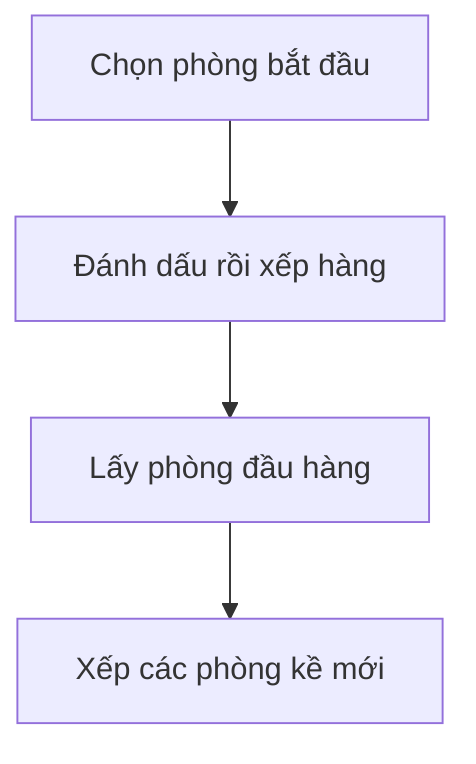

> [!tldr] Đọc nhanh
> - Mỗi ô đi được là một đỉnh của đồ thị lưới bốn hướng. Tạo hàng xóm khi cần và kiểm tra biên trước khi đọc ô.
> - Quét đất chưa thăm và mở một lượt tô cho mỗi đảo. Số lượt tô là số đảo, số ô thăm trong một lượt là diện tích.
> - Đánh dấu ô ngay khi đưa vào hàng đợi để hai đường chạm cùng một ô chỉ tạo một lượt xử lý.
> - Khi hỏi khoảng cách tới nguồn gần nhất, đưa mọi nguồn vào lớp 0. BFS tới một ô lần đầu ở khoảng cách ngắn nhất.

> [!info] Bối cảnh
> Đây là ga 1 của [[series/neetcode-grph|tuyến NeetCode: Đồ thị]]. Ở tuyến Cấu trúc liên kết, cây đã cho sẵn đường nối tới con. Trên bản đồ ô vuông, chỉ cần biết tọa độ và quy tắc đi bốn hướng là tự tính được hàng xóm. Mình sẽ dùng một hàng đợi để đếm vùng liền nhau và đo tốc độ lan từ nhiều nguồn.

> [!abstract]- Từ điển nhanh cho bài này (bấm để mở)
> - *Kề bốn hướng* là cùng hàng và sát cột, hoặc cùng cột và sát hàng. Hai ô chỉ chạm góc thì tách rời.
> - [[concepts/breadth-first-search|BFS]] lấy ô theo thứ tự vào hàng đợi. *Lớp* d gồm các ô cách nguồn d bước.
> - *Mầm* là ô bắt đầu của một lượt duyệt. *Ô đã thăm* là ô đã được ghi nhận, kể cả khi nó còn nằm trong hàng.
> - `INF` là giá trị 2147483647 trong Walls and Gates, đánh dấu phòng chưa có khoảng cách hữu hạn.

## Hình dung trước: bản đồ hành lang

Tưởng tượng một tầng nhà vẽ bằng ô vuông. Để tìm mỗi cụm phòng thông nhau, mình chọn một phòng chưa đánh dấu, đi qua các cửa kề và dán nhãn tất cả phòng tới được. Để tìm cổng gần nhất, mình cho các đội xuất phát cùng lúc từ mọi cổng. Mỗi phút họ đi được một ô, nên đội đến đầu tiên cho biết số bước ít nhất.

| Đời thường | Khái niệm |
|---|---|
| Phòng là ô và cửa nối hai ô sát nhau | [[concepts/grid-graph|Đồ thị lưới]] |
| Dán nhãn lan qua các phòng đi được | [[concepts/flood-fill|Tô vùng]] |
| Một cụm phòng mà từ phòng nào cũng tới được các phòng còn lại | [[concepts/connected-component|Thành phần liên thông]] |
| Dán nhãn khi hẹn ghé phòng, trước khi thật sự đến | [[concepts/mark-on-enqueue|Đánh dấu khi vào hàng đợi]] |
| Mọi đội rời cổng ở phút 0 | [[concepts/multi-source-bfs|BFS đa nguồn]] |



## Vấn đề: cùng một lưới, hai câu hỏi

Mình có thể quét lưới theo hàng để gặp mọi ô, nhưng một dải đất liền có thể uốn qua nhiều hàng. Đếm số ô đất cho ra diện tích tổng, còn đếm số cụm cần nhớ ô nào đã thuộc lượt tô trước. Với khoảng cách, bài toán đổi mục tiêu. Nếu hai cổng cùng tới một phòng, mình cần số bước của cổng nhanh nhất. Chạy lần lượt từ từng cổng cho câu trả lời nhưng lặp lại nhiều đường đi.

## Cơ chế

### Sinh hàng xóm từ tọa độ

Từ `(r,c)`, thử `(r-1,c)`, `(r+1,c)`, `(r,c-1)`, `(r,c+1)`. Kiểm tra ba điều theo thứ tự: tọa độ trong lưới, loại ô được phép đi, và ô chưa được đánh dấu. Mẫu dùng `distance = -1` làm dấu chưa thăm trên một bảng phụ, tách khỏi dữ liệu gốc. Khi tới ô mới, ghi `distance[next] = distance[current] + 1` rồi mới xếp hàng. Từ lúc này các ô kề khác đều thấy ô đã được nhận.

### Một lượt tô cho một thành phần

Dùng lưới đất là 1 và nước là 0:

```text
1 0 0 1 1
0 0 0 1 1
0 1 0 1 0
1 1 0 0 0
```

Lần quét đầu gặp mầm `(0,0)`. Lượt tô này kết thúc sau một ô. Lượt tiếp gặp `(0,3)` và thăm năm ô. Ô `(1,4)` cạnh cả `(1,3)` và `(0,4)`; cạnh thứ hai thấy dấu đã có và bỏ qua. Cuối cùng `(2,1)` mở lượt tô ba ô. Kết quả là ba đảo, đảo lớn nhất có năm ô.

Mỗi lượt tô chỉ đi theo cạnh hợp lệ nên chỉ nhận ô thuộc cùng thành phần với mầm. Nếu còn ô thuộc thành phần chưa thăm lúc hàng rỗng, lấy một đường từ mầm tới ô đó. Ô chưa thăm đầu tiên trên đường phải có một ô liền trước đã xử lý, và ô liền trước lẽ ra đã xếp nó vào hàng. Vì vậy lượt tô đã phủ cả thành phần. DFS cũng có thể làm lượt tô này khi chỉ cần tập ô tới được.

<figure class="figure-map" style="--ar: 3 / 4">
<div class="frame"><iframe data-archify="../diagrams/neetcode-grid-traversal/worked-example.html" title="Đánh dấu khi cho ô vào hàng" loading="lazy"></iframe></div>
<figcaption><span><b>Hình 1.</b> Đánh dấu khi cho ô vào hàng.</span><a href="../diagrams/neetcode-grid-traversal/worked-example.html" target="_blank" rel="noopener">Mở toàn màn hình</a></figcaption>
</figure>

<details>
<summary>Đọc từng bước</summary>
<ol>
<li>Bắt đầu đảo thứ hai và ghi dấu. <code>Q = [(0,3)]</code></li>
<li>Lấy (0,3) và thêm hai ô mới. <code>Q = [(1,3), (0,4)]</code></li>
<li>Lấy (1,3) rồi đánh dấu hai ô. <code>Q = [(0,4), (2,3), (1,4)]</code></li>
<li>Từ (0,4) gặp lại (1,4) đã đánh dấu. <code>dist[1][4] = 2</code></li>
<li>Duyệt đủ năm ô, mỗi ô đúng một lượt. <code>area = 5</code></li>
</ol>
</details>

### Nhiều nguồn, một hàng đợi

Trong bài cam, đưa cả cam thối ban đầu vào cùng hàng với khoảng cách 0. Một ô tươi kề nguồn nhận khoảng cách 1. Ô chỉ tới được qua một lượt lây nữa nhận khoảng cách 2. Hàng FIFO xử lý xong phần còn lại của lớp d trước khi xử lý lớp d+1. Nếu một ô lần đầu được gán d mà có một đường ngắn hơn, ô trước nó trên đường đó đã được xử lý sớm hơn và phải gán nó trước. Vì các bước đều có chi phí một, lần gán đầu tiên là khoảng cách nhỏ nhất từ bất kỳ nguồn nào.

Trong ví dụ `[[2,1,1,0,2],[0,1,1,1,1]]`, hai nguồn ở `(0,0)` và `(0,4)`. Phút 1 nhận `(0,1)` và `(1,4)`. Phút 2 nhận thêm ba ô. Phút 3, ba hướng có thể cùng gặp `(1,2)`, nhưng nó chỉ được xếp hàng một lần. Phút cuối là 3. Nếu còn cam tươi chưa nhận khoảng cách, trả `-1`. Nếu ban đầu không có cam tươi, trả 0.

Với cổng, nguồn là mọi ô 0; tường là -1 và chỉ các phòng `INF` được nhận khoảng cách mới. Phòng bị cô lập giữ nguyên `INF`. Mã chung trả một bản lưới mới để nhìn rõ dữ liệu vào và ra; trang bài LC-0286 có bản cập nhật tại chỗ theo đề.

### Chi phí của khuôn chung

Với R hàng và C cột, quét toàn lưới tốn O(RC). Mỗi ô hợp lệ được đưa vào hàng nhiều nhất một lần, mỗi lượt lấy ra kiểm tối đa bốn cạnh. Kể cả nhiều mầm của bài đảo, tổng thời gian vẫn O(RC) vì dùng lại bảng dấu giữa các lượt tô. Mã minh họa dùng O(RC) bộ nhớ phụ cho bảng khoảng cách, danh sách các ô đã lọc và hàng đợi. Chỉ số đầu hàng tránh dịch cả mảng như khi dùng `shift()` trong JavaScript hay `pop(0)` trong Python.

| Bài | Điểm khác |
|---|---|
| [[problems/number-of-islands|LC-0200 · Number of Islands]] | Đếm lần gặp đất chưa thăm và bắt đầu tô. |
| [[problems/max-area-of-island|LC-0695 · Max Area of Island]] | Giữ số ô lớn nhất của một lượt tô. |
| [[problems/rotting-oranges|LC-0994 · Rotting Oranges]] | Lấy phút lớn nhất của cam tươi, kiểm tra ô còn kẹt. |
| [[problems/walls-and-gates|LC-0286 · Walls and Gates]] | Ghi riêng khoảng cách ngắn nhất của từng phòng tới cổng. |

## Ví dụ chạy được

Năm bản chạy chung 10 ca. Ngoài lưới ba đảo và lưới cam hai nguồn, có ca hai ô đất chạm góc, cam bị ngăn, phòng bị tường cô lập và phòng không có cổng. Tải [TypeScript](../code/neetcode-grid-traversal/grid-demo.ts), [Python](../code/neetcode-grid-traversal/grid_demo.py), [Go](../code/neetcode-grid-traversal/grid_demo.go), [Java](../code/neetcode-grid-traversal/grid-demo.java) hoặc [JavaScript](../code/neetcode-grid-traversal/grid-demo.js). Chạy với `node grid-demo.ts`, `python3 grid_demo.py`, `go run grid_demo.go`, `java grid-demo.java` hoặc `node grid-demo.js`.

```ts
type Cell = [number, number]
const directions: Cell[] = [[-1, 0], [1, 0], [0, -1], [0, 1]]
const INF = 2147483647

function blankDistances(grid: number[][]) {
  return grid.map(row => row.map(() => -1))
}

function cellsWith(grid: number[][], value: number): Cell[] {
  const cells: Cell[] = []
  grid.forEach((row, r) => row.forEach((cell, c) => {
    if (cell === value) cells.push([r, c])
  }))
  return cells
}

function flood(grid: number[][], distance: number[][], queue: Cell[], enter: number) {
  for (const [r, c] of queue) distance[r][c] = 0
  for (let head = 0; head < queue.length; head++) {
    const [r, c] = queue[head]
    for (const [dr, dc] of directions) {
      const nr = r + dr
      const nc = c + dc
      if (grid[nr]?.[nc] !== enter || distance[nr][nc] !== -1) continue
      distance[nr][nc] = distance[r][c] + 1
      queue.push([nr, nc])
    }
  }
  return queue.length
}

function islands(grid: number[][]) {
  const distance = blankDistances(grid)
  let count = 0
  let largest = 0
  for (const [r, c] of cellsWith(grid, 1)) {
    if (distance[r][c] !== -1) continue
    count++
    largest = Math.max(largest, flood(grid, distance, [[r, c]], 1))
  }
  return [count, largest]
}

function minutes(grid: number[][]) {
  const distance = blankDistances(grid)
  flood(grid, distance, cellsWith(grid, 2), 1)
  let last = 0
  for (const [r, c] of cellsWith(grid, 1)) {
    if (distance[r][c] === -1) return -1
    last = Math.max(last, distance[r][c])
  }
  return last
}

function nearestGates(grid: number[][]) {
  const distance = blankDistances(grid)
  flood(grid, distance, cellsWith(grid, 0), INF)
  return grid.map((row, r) => row.map((value, c) =>
    value === INF && distance[r][c] !== -1 ? distance[r][c] : value,
  ))
}

const land = [[1, 0, 0, 1, 1], [0, 0, 0, 1, 1], [0, 1, 0, 1, 0], [1, 1, 0, 0, 0]]
const oranges = [[2, 1, 1, 0, 2], [0, 1, 1, 1, 1]]
const rooms = [[INF, -1, 0], [INF, INF, INF], [0, -1, INF]]
const cases = [
  islands(land).join() === "3,5",
  islands([[1, 0], [0, 1]]).join() === "2,1",
  islands([[0]]).join() === "0,0",
  minutes(oranges) === 3,
  minutes([[2, 0, 1]]) === -1,
  minutes([[0, 2]]) === 0,
  minutes([[1]]) === -1,
  JSON.stringify(nearestGates(rooms)) === "[[2,-1,0],[1,2,1],[0,-1,2]]",
  nearestGates([[0, -1, INF]])[0][2] === INF,
  nearestGates([[INF]])[0][0] === INF,
]
if (!cases.every(Boolean)) throw new Error("Có ca sai")
console.log(`${cases.length}/${cases.length} ca đúng`)
```
```python
DIRECTIONS = ((-1, 0), (1, 0), (0, -1), (0, 1))
INF = 2147483647


def blank_distances(grid):
    return [[-1] * len(row) for row in grid]


def cells_with(grid, value):
    return [(r, c) for r, row in enumerate(grid) for c, cell in enumerate(row) if cell == value]


def flood(grid, distance, queue, enter):
    for r, c in queue:
        distance[r][c] = 0
    head = 0
    while head < len(queue):
        r, c = queue[head]
        head += 1
        for dr, dc in DIRECTIONS:
            nr, nc = r + dr, c + dc
            if not (0 <= nr < len(grid) and 0 <= nc < len(grid[nr])):
                continue
            if grid[nr][nc] != enter or distance[nr][nc] != -1:
                continue
            distance[nr][nc] = distance[r][c] + 1
            queue.append((nr, nc))
    return len(queue)


def islands(grid):
    distance = blank_distances(grid)
    count, largest = 0, 0
    for r, c in cells_with(grid, 1):
        if distance[r][c] == -1:
            count += 1
            largest = max(largest, flood(grid, distance, [(r, c)], 1))
    return count, largest


def minutes(grid):
    distance = blank_distances(grid)
    flood(grid, distance, cells_with(grid, 2), 1)
    last = 0
    for r, c in cells_with(grid, 1):
        if distance[r][c] == -1:
            return -1
        last = max(last, distance[r][c])
    return last


def nearest_gates(grid):
    distance = blank_distances(grid)
    flood(grid, distance, cells_with(grid, 0), INF)
    return [
        [distance[r][c] if value == INF and distance[r][c] != -1 else value
         for c, value in enumerate(row)]
        for r, row in enumerate(grid)
    ]


land = [[1, 0, 0, 1, 1], [0, 0, 0, 1, 1], [0, 1, 0, 1, 0], [1, 1, 0, 0, 0]]
oranges = [[2, 1, 1, 0, 2], [0, 1, 1, 1, 1]]
rooms = [[INF, -1, 0], [INF, INF, INF], [0, -1, INF]]
cases = [
    islands(land) == (3, 5),
    islands([[1, 0], [0, 1]]) == (2, 1),
    islands([[0]]) == (0, 0),
    minutes(oranges) == 3,
    minutes([[2, 0, 1]]) == -1,
    minutes([[0, 2]]) == 0,
    minutes([[1]]) == -1,
    nearest_gates(rooms) == [[2, -1, 0], [1, 2, 1], [0, -1, 2]],
    nearest_gates([[0, -1, INF]])[0][2] == INF,
    nearest_gates([[INF]])[0][0] == INF,
]
if not all(cases):
    raise AssertionError("Có ca sai")
print(f"{len(cases)}/{len(cases)} ca đúng")
```
```go
package main

import (
	"fmt"
	"reflect"
	"slices"
)

type cell struct{ r, c int }

var directions = [...]cell{{-1, 0}, {1, 0}, {0, -1}, {0, 1}}

const INF = 2147483647

func blankDistances(grid [][]int) [][]int {
	distance := make([][]int, len(grid))
	for r, row := range grid {
		distance[r] = make([]int, len(row))
		for c := range row {
			distance[r][c] = -1
		}
	}
	return distance
}

func cellsWith(grid [][]int, value int) []cell {
	var cells []cell
	for r, row := range grid {
		for c, item := range row {
			if item == value {
				cells = append(cells, cell{r, c})
			}
		}
	}
	return cells
}

func flood(grid, distance [][]int, queue []cell, enter int) int {
	for _, p := range queue {
		distance[p.r][p.c] = 0
	}
	for head := 0; head < len(queue); head++ {
		p := queue[head]
		for _, step := range directions {
			r, c := p.r+step.r, p.c+step.c
			if r < 0 || r >= len(grid) || c < 0 || c >= len(grid[r]) {
				continue
			}
			if grid[r][c] != enter || distance[r][c] != -1 {
				continue
			}
			distance[r][c] = distance[p.r][p.c] + 1
			queue = append(queue, cell{r, c})
		}
	}
	return len(queue)
}

func islands(grid [][]int) [2]int {
	distance := blankDistances(grid)
	count, largest := 0, 0
	for _, p := range cellsWith(grid, 1) {
		if distance[p.r][p.c] == -1 {
			count++
			largest = max(largest, flood(grid, distance, []cell{p}, 1))
		}
	}
	return [2]int{count, largest}
}

func minutes(grid [][]int) int {
	distance := blankDistances(grid)
	flood(grid, distance, cellsWith(grid, 2), 1)
	last := 0
	for _, p := range cellsWith(grid, 1) {
		d := distance[p.r][p.c]
		if d == -1 {
			return -1
		}
		last = max(last, d)
	}
	return last
}

func nearestGates(grid [][]int) [][]int {
	distance := blankDistances(grid)
	flood(grid, distance, cellsWith(grid, 0), INF)
	result := make([][]int, len(grid))
	for r, row := range grid {
		result[r] = slices.Clone(row)
		for c, value := range row {
			if value == INF && distance[r][c] != -1 {
				result[r][c] = distance[r][c]
			}
		}
	}
	return result
}

func main() {
	land := [][]int{{1, 0, 0, 1, 1}, {0, 0, 0, 1, 1}, {0, 1, 0, 1, 0}, {1, 1, 0, 0, 0}}
	oranges := [][]int{{2, 1, 1, 0, 2}, {0, 1, 1, 1, 1}}
	rooms := [][]int{{INF, -1, 0}, {INF, INF, INF}, {0, -1, INF}}
	cases := []bool{
		islands(land) == [2]int{3, 5},
		islands([][]int{{1, 0}, {0, 1}}) == [2]int{2, 1},
		islands([][]int{{0}}) == [2]int{0, 0},
		minutes(oranges) == 3,
		minutes([][]int{{2, 0, 1}}) == -1,
		minutes([][]int{{0, 2}}) == 0,
		minutes([][]int{{1}}) == -1,
		reflect.DeepEqual(nearestGates(rooms), [][]int{{2, -1, 0}, {1, 2, 1}, {0, -1, 2}}),
		nearestGates([][]int{{0, -1, INF}})[0][2] == INF,
		nearestGates([][]int{{INF}})[0][0] == INF,
	}
	for _, pass := range cases {
		if !pass {
			panic("Có ca sai")
		}
	}
	fmt.Printf("%d/%d ca đúng\n", len(cases), len(cases))
}
```
```java
import java.util.ArrayList;
import java.util.Arrays;
import java.util.List;

class GridDemo {
    record Cell(int r, int c) {}

    static final int INF = Integer.MAX_VALUE;
    static final int[][] DIRECTIONS = {{-1, 0}, {1, 0}, {0, -1}, {0, 1}};

    static int[][] blankDistances(int[][] grid) {
        int[][] distance = new int[grid.length][];
        for (int r = 0; r < grid.length; r++) {
            distance[r] = new int[grid[r].length];
            Arrays.fill(distance[r], -1);
        }
        return distance;
    }

    static List<Cell> cellsWith(int[][] grid, int value) {
        List<Cell> cells = new ArrayList<>();
        for (int r = 0; r < grid.length; r++) {
            for (int c = 0; c < grid[r].length; c++) {
                if (grid[r][c] == value) cells.add(new Cell(r, c));
            }
        }
        return cells;
    }

    static int flood(int[][] grid, int[][] distance, List<Cell> queue, int enter) {
        for (Cell p : queue) distance[p.r()][p.c()] = 0;
        for (int head = 0; head < queue.size(); head++) {
            Cell p = queue.get(head);
            for (int[] step : DIRECTIONS) {
                int r = p.r() + step[0], c = p.c() + step[1];
                if (r < 0 || r >= grid.length || c < 0 || c >= grid[r].length) continue;
                if (grid[r][c] != enter || distance[r][c] != -1) continue;
                distance[r][c] = distance[p.r()][p.c()] + 1;
                queue.add(new Cell(r, c));
            }
        }
        return queue.size();
    }

    static int[] islands(int[][] grid) {
        int[][] distance = blankDistances(grid);
        int count = 0, largest = 0;
        for (Cell p : cellsWith(grid, 1)) {
            if (distance[p.r()][p.c()] == -1) {
                count++;
                largest = Math.max(largest, flood(grid, distance, new ArrayList<>(List.of(p)), 1));
            }
        }
        return new int[] {count, largest};
    }

    static int minutes(int[][] grid) {
        int[][] distance = blankDistances(grid);
        flood(grid, distance, cellsWith(grid, 2), 1);
        int last = 0;
        for (Cell p : cellsWith(grid, 1)) {
            int d = distance[p.r()][p.c()];
            if (d == -1) return -1;
            last = Math.max(last, d);
        }
        return last;
    }

    static int[][] nearestGates(int[][] grid) {
        int[][] distance = blankDistances(grid);
        flood(grid, distance, cellsWith(grid, 0), INF);
        int[][] result = new int[grid.length][];
        for (int r = 0; r < grid.length; r++) {
            result[r] = grid[r].clone();
            for (int c = 0; c < grid[r].length; c++) {
                if (grid[r][c] == INF && distance[r][c] != -1) result[r][c] = distance[r][c];
            }
        }
        return result;
    }

    public static void main(String[] args) {
        int[][] land = {{1, 0, 0, 1, 1}, {0, 0, 0, 1, 1}, {0, 1, 0, 1, 0}, {1, 1, 0, 0, 0}};
        int[][] oranges = {{2, 1, 1, 0, 2}, {0, 1, 1, 1, 1}};
        int[][] rooms = {{INF, -1, 0}, {INF, INF, INF}, {0, -1, INF}};
        boolean[] cases = {
            Arrays.equals(islands(land), new int[] {3, 5}),
            Arrays.equals(islands(new int[][] {{1, 0}, {0, 1}}), new int[] {2, 1}),
            Arrays.equals(islands(new int[][] {{0}}), new int[] {0, 0}),
            minutes(oranges) == 3,
            minutes(new int[][] {{2, 0, 1}}) == -1,
            minutes(new int[][] {{0, 2}}) == 0,
            minutes(new int[][] {{1}}) == -1,
            Arrays.deepEquals(nearestGates(rooms), new int[][] {{2, -1, 0}, {1, 2, 1}, {0, -1, 2}}),
            nearestGates(new int[][] {{0, -1, INF}})[0][2] == INF,
            nearestGates(new int[][] {{INF}})[0][0] == INF,
        };
        for (boolean pass : cases) {
            if (!pass) throw new AssertionError("Có ca sai");
        }
        System.out.printf("%d/%d ca đúng%n", cases.length, cases.length);
    }
}
```
```js
const directions = [[-1, 0], [1, 0], [0, -1], [0, 1]]
const INF = 2147483647

function blankDistances(grid) {
  return grid.map(row => row.map(() => -1))
}

function cellsWith(grid, value) {
  const cells = []
  grid.forEach((row, r) => row.forEach((cell, c) => {
    if (cell === value) cells.push([r, c])
  }))
  return cells
}

function flood(grid, distance, queue, enter) {
  for (const [r, c] of queue) distance[r][c] = 0
  for (let head = 0; head < queue.length; head++) {
    const [r, c] = queue[head]
    for (const [dr, dc] of directions) {
      const nr = r + dr
      const nc = c + dc
      if (grid[nr]?.[nc] !== enter || distance[nr][nc] !== -1) continue
      distance[nr][nc] = distance[r][c] + 1
      queue.push([nr, nc])
    }
  }
  return queue.length
}

function islands(grid) {
  const distance = blankDistances(grid)
  let count = 0
  let largest = 0
  for (const [r, c] of cellsWith(grid, 1)) {
    if (distance[r][c] !== -1) continue
    count++
    largest = Math.max(largest, flood(grid, distance, [[r, c]], 1))
  }
  return [count, largest]
}

function minutes(grid) {
  const distance = blankDistances(grid)
  flood(grid, distance, cellsWith(grid, 2), 1)
  let last = 0
  for (const [r, c] of cellsWith(grid, 1)) {
    if (distance[r][c] === -1) return -1
    last = Math.max(last, distance[r][c])
  }
  return last
}

function nearestGates(grid) {
  const distance = blankDistances(grid)
  flood(grid, distance, cellsWith(grid, 0), INF)
  return grid.map((row, r) => row.map((value, c) =>
    value === INF && distance[r][c] !== -1 ? distance[r][c] : value,
  ))
}

const land = [[1, 0, 0, 1, 1], [0, 0, 0, 1, 1], [0, 1, 0, 1, 0], [1, 1, 0, 0, 0]]
const oranges = [[2, 1, 1, 0, 2], [0, 1, 1, 1, 1]]
const rooms = [[INF, -1, 0], [INF, INF, INF], [0, -1, INF]]
const cases = [
  islands(land).join() === "3,5",
  islands([[1, 0], [0, 1]]).join() === "2,1",
  islands([[0]]).join() === "0,0",
  minutes(oranges) === 3,
  minutes([[2, 0, 1]]) === -1,
  minutes([[0, 2]]) === 0,
  minutes([[1]]) === -1,
  JSON.stringify(nearestGates(rooms)) === "[[2,-1,0],[1,2,1],[0,-1,2]]",
  nearestGates([[0, -1, INF]])[0][2] === INF,
  nearestGates([[INF]])[0][0] === INF,
]
if (!cases.every(Boolean)) throw new Error("Có ca sai")
console.log(`${cases.length}/${cases.length} ca đúng`)
```

```text
10/10 ca đúng
```

## Hiểu lầm và bẫy hay gặp

- **Chạm góc cũng tính là một đảo.** Trên lưới bốn hướng, `[[1,0],[0,1]]` có hai đảo.
- **Mỗi lượt tô cần đặt lại dấu đã thăm.** Quét lưới dựa vào các dấu từ lượt trước để mỗi thành phần chỉ được đếm một lần.
- **Đợi lấy ô ra mới đánh dấu.** Khi hai ô cùng lớp có chung hàng xóm, cả hai có thể xếp nó vào hàng. Đánh dấu sớm giữ bất biến mỗi ô vào đúng một lần.
- **Đếm phút theo số cam lấy ra.** Nhiều cam đổi trạng thái cùng phút. Đọc khoảng cách lớn nhất, hoặc đếm theo lớp chứa một bước lây thật sự.
- **Xử lý lần lượt từng nguồn và giữ lần chạm đầu.** Nguồn đầu tiên có thể tới một ô bằng đường dài. Đưa mọi nguồn vào lớp 0 trước khi mở rộng.

## Câu hỏi tự kiểm tra

> [!question]- Hai ô đất chỉ chạm góc thuộc mấy đảo trong đề này?
> Hai đảo. Phải có một chuỗi cạnh bốn hướng để nối chúng.

> [!question]- Một lượt tô chạy từ mầm và tìm được năm ô. Hai số đếm thay đổi thế nào?
> Số đảo tăng một vì mở một lượt. Diện tích ứng viên là năm vì đã nhận năm ô.

> [!question]- Hai ô ở lớp 1 cùng nhìn thấy một ô chưa thăm. Ô đó được thêm mấy lần và ở lớp nào?
> Một lần ở lớp 2. Ô đầu kiểm tra ghi khoảng cách 2 trước khi thêm.

> [!question]- Một phòng cách cổng A ba bước, cổng B hai bước. BFS đa nguồn gán bao nhiêu?
> Gán 2. Mọi đường dài hai bước được xét trước các đường dài ba bước.

## Tham khảo

- [Princeton Algorithms · BreadthFirstPaths](https://algs4.cs.princeton.edu/41graph/BreadthFirstPaths.java.html) minh họa đánh dấu trước khi xếp hàng và nạp tất cả nguồn với khoảng cách 0.
- [Princeton Algorithms · CC](https://github.com/kevin-wayne/algs4/blob/master/src/main/java/edu/princeton/cs/algs4/CC.java) bắt đầu một lượt duyệt từ mỗi đỉnh chưa được gán thành phần.
- [LeetCode 200](https://leetcode.com/problems/number-of-islands/), [695](https://leetcode.com/problems/max-area-of-island/), [994](https://leetcode.com/problems/rotting-oranges/) và [286](https://leetcode.com/problems/walls-and-gates/) là đề gốc. [Islands and Treasure](https://neetcode.io/problems/islands-and-treasure/question) là đề công khai tương ứng với bài cổng.
