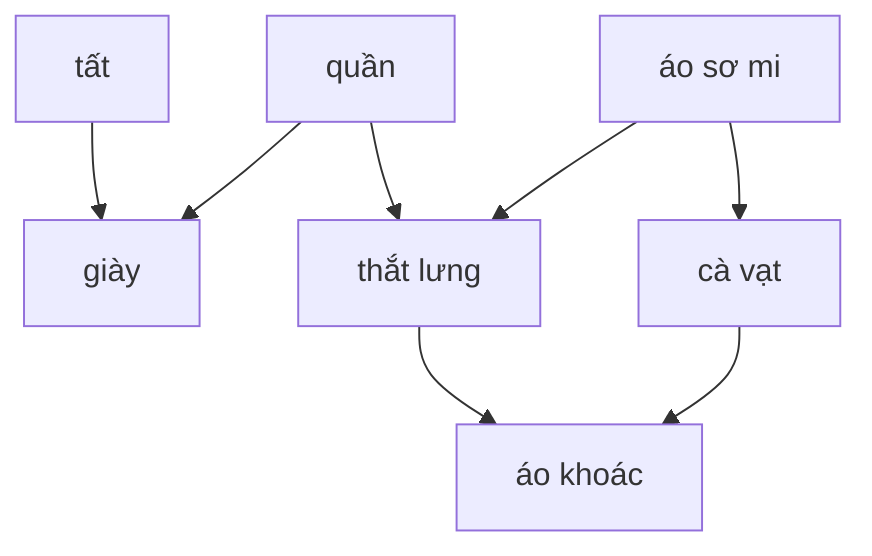
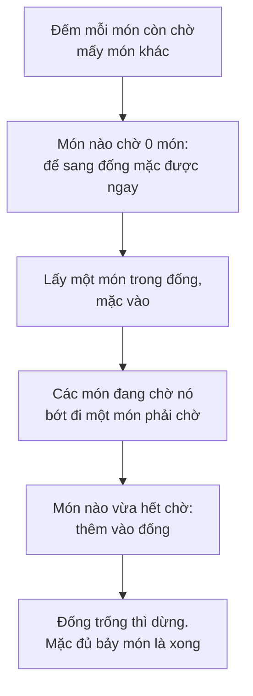
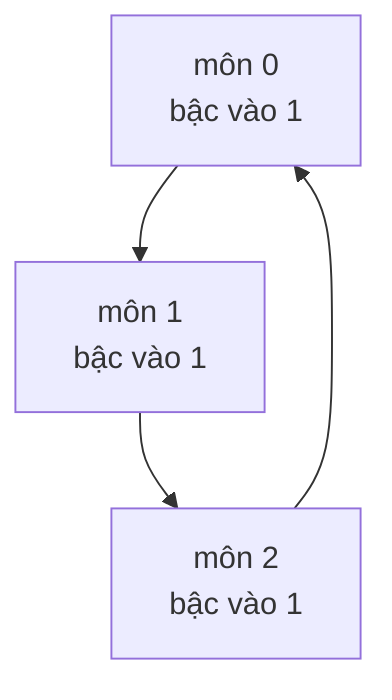

> [!tldr] Đọc nhanh
> - Nhiều bài toán thật ra chỉ hỏi một câu: có các việc, và vài luật "việc X phải xong trước việc Y". Hãy xếp chúng thành một hàng sao cho không luật nào bị phạm. Hàng đó gọi là [[concepts/topological-sort|thứ tự topo]].
> - Ghi mỗi luật thành một mũi tên X → Y. Ta được một đồ thị có hướng. Xếp được khi và chỉ khi đồ thị **không có vòng**, tức là một [[concepts/directed-acyclic-graph|DAG]].
> - Cách dễ hiểu nhất là thuật toán Kahn. Đếm xem mỗi việc còn chờ mấy việc khác (đó là [[concepts/in-degree|bậc vào]]). Việc nào chờ 0 thì làm trước, xong thì gạch nó khỏi danh sách chờ của các việc sau. Nếu cuối cùng làm được ít hơn n việc thì có vòng.
> - Cách thứ hai là DFS tô ba màu: trắng là chưa đụng tới, xám là đang đi dở, đen là đã xong. Gặp lại một đỉnh **xám** nghĩa là có vòng. Gặp một đỉnh **đen** thì không sao. Đây là chỗ [[concepts/three-color-dfs|DFS ba màu]] khác DFS thường.
> - Ba bài trong ga dùng chung một khuôn. 207 chỉ hỏi "xếp được không". 210 đòi chính cái hàng. 269 không cho sẵn luật, mình phải tự rút [[concepts/precedence-constraint|ràng buộc thứ tự]] từ một danh sách từ đã xếp.

> [!info] Bối cảnh
> Đây là ga 3 của [[series/neetcode-grph|tuyến NeetCode: Đồ thị]]. Ở [[posts/2026-11-26-neetcode-graph-bfs|ga 2]], cạnh đi được cả hai chiều và câu hỏi là "đi tới được đâu". Ở ga này, cạnh có **hướng** và nghĩa là "trước–sau". Bạn chỉ cần biết mảng, vòng lặp và hàng đợi. Mọi thứ khác được dựng lại từ một ví dụ bảy món đồ.

> [!abstract]- Từ điển nhanh cho bài này (bấm để mở)
> - *Đỉnh* là một việc (một môn học, một món đồ, một chữ cái). *Cạnh có hướng* X → Y nghĩa là "X phải đứng trước Y".
> - *Đồ thị có hướng* là đồ thị mà mọi cạnh đều có mũi tên. Đi theo cạnh chỉ được đi xuôi mũi tên.
> - *Chu trình* (vòng) là một đường đi theo mũi tên rồi quay về chỗ cũ, ví dụ A → B → C → A.
> - [[concepts/directed-acyclic-graph|DAG]] (directed acyclic graph) là đồ thị có hướng không có chu trình nào.
> - [[concepts/topological-sort|Thứ tự topo]] là cách xếp mọi đỉnh thành một hàng sao cho mọi mũi tên đều chỉ từ trái sang phải.
> - [[concepts/in-degree|Bậc vào]] của một đỉnh là số mũi tên đi **vào** nó, tức số việc nó còn phải chờ.
> - [[concepts/adjacency-list|Danh sách kề]]: mỗi đỉnh giữ danh sách các đỉnh mà nó chỉ mũi tên tới.
> - *Hàng đợi* (queue): vào trước ra trước. Ở đây là cấu trúc dữ liệu trong bộ nhớ.
> - *DFS* (depth-first search, duyệt theo chiều sâu) đi thật sâu theo một nhánh rồi mới quay lại. *Đệ quy* là hàm tự gọi lại chính nó, cách viết DFS gọn nhất.
> - V là số đỉnh, E là số cạnh. O(V + E) nghĩa là thời gian tỉ lệ với tổng hai số đó.

## Hình dung trước: mặc đồ buổi sáng

Sáng nào mình cũng mặc bảy món: tất, quần, áo sơ mi, giày, thắt lưng, cà vạt, áo khoác. Thứ tự không tùy ý. Tất phải trước giày, vì mang giày rồi thì không xỏ tất được. Quần cũng phải trước giày. Thắt lưng cần có quần và áo trước. Cà vạt cần áo. Áo khoác mặc sau cùng, sau thắt lưng và cà vạt.

Bảy món, bảy luật. Mình muốn một thứ tự mặc không phạm luật nào. Có nhiều thứ tự đúng: tất trước quần hay quần trước tất đều được.

| Đời thường | Khái niệm |
|---|---|
| Mỗi món đồ | một đỉnh |
| Luật "phải mặc X trước Y" | cạnh có hướng X → Y |
| Bộ luật không có kiểu "tất trước giày, giày trước tất" | [[concepts/directed-acyclic-graph\|DAG]] |
| Một cách mặc hết bảy món mà không phạm luật | [[concepts/topological-sort\|thứ tự topo]] |
| Số món còn phải mặc trước món này | [[concepts/in-degree\|bậc vào]] |
| Đống đồ "mặc được ngay", chẳng phải chờ gì | hàng đợi của thuật toán Kahn |
| Món đang mặc dở (xám) và món đã mặc xong (đen) | [[concepts/three-color-dfs\|DFS ba màu]] |
| Không ai đưa tờ luật, phải tự suy luật từ dấu vết | [[concepts/precedence-constraint\|ràng buộc thứ tự]] (Alien Dictionary) |

Đây là bảy món và bảy luật, vẽ thành mũi tên:



Mỗi sáng, mình làm đúng một vòng lặp:



## Vấn đề: xếp n việc có điều kiện trước–sau

Đề của Course Schedule nói thế này. Có `n` môn học, đánh số 0 tới n−1. Có một danh sách điều kiện, mỗi điều kiện `[a, b]` nghĩa là "muốn học `a` thì phải học xong `b`". Hỏi: có học hết được không? Bài sau, Course Schedule II, hỏi thêm: nếu được thì học theo thứ tự nào?

Ý đầu tiên của mình là **thử mọi thứ tự**. Với 7 món đồ thì có 7! = 5 040 thứ tự. Với 2 000 môn học thì số thứ tự có hơn 5 700 chữ số. Không thử nổi.

Ý thứ hai là "cứ DFS là thấy vòng". Mình viết DFS với một tập `visited` như ở ga 1 và ga 2, rồi coi "gặp lại đỉnh đã thăm" là có vòng. Hóa ra sai ngay trên ví dụ mặc đồ:

- DFS đi từ **tất** sang **giày**, đánh dấu cả hai.
- Sau đó DFS đi từ **quần** sang **giày**. Giày đã có trong `visited`, nên code báo "có vòng".
- Nhưng tủ đồ không có vòng nào. Giày chỉ đơn giản là có **hai** món phải mặc trước nó.

Gặp lại một đỉnh không có nghĩa là có vòng. Có vòng khi mình gặp lại một đỉnh **vẫn đang nằm trên đường mình đang đi**. Phần Cơ chế xử lý chuyện này theo hai cách.

## Cơ chế

### Bước 1: luật thành mũi tên, và chiều của mũi tên

Mỗi luật "X trước Y" thành một mũi tên X → Y. Mình ghi đồ thị thành [[concepts/adjacency-list|danh sách kề]]: mỗi món giữ danh sách các món đang chờ nó. Đồng thời mình đếm [[concepts/in-degree|bậc vào]], tức số mũi tên đi vào mỗi món.

| Món | Mũi tên đi ra (các món chờ nó) | Bậc vào (số món nó còn chờ) |
|---|---|---|
| tất | giày | 0 |
| quần | giày, thắt lưng | 0 |
| áo sơ mi | thắt lưng, cà vạt | 0 |
| giày | | 2 (tất, quần) |
| thắt lưng | áo khoác | 2 (quần, áo) |
| cà vạt | áo khoác | 1 (áo) |
| áo khoác | | 2 (thắt lưng, cà vạt) |

> [!warning] Chiều của cạnh trong đề
> Trong Course Schedule, cặp `[a, b]` nghĩa là **học `b` trước `a`**. Mũi tên vì vậy là `b → a`, ngược với thứ tự chữ trong cặp. Viết nhầm chiều thì Course Schedule I vẫn ra đúng, vì đảo hết mũi tên không tạo hay xóa vòng nào. Nhưng Course Schedule II sẽ trả về thứ tự **ngược**.

### Bước 2: thuật toán Kahn, từng bước

Ý tưởng chỉ có một câu: **việc nào không còn phải chờ ai thì làm được ngay**. Làm xong một việc thì các việc đang chờ nó bớt đi một việc phải chờ. Thuật toán do Arthur Kahn công bố năm 1962.

Mình chạy trên bảy món. Hàng đợi bắt đầu với ba món có bậc vào 0, theo thứ tự đánh số.

| Bước | Lấy ra và mặc | Bậc vào thay đổi | Hàng đợi sau bước |
|---|---|---|---|
| 0 | | | [tất, quần, áo] |
| 1 | tất | giày 2 → 1 | [quần, áo] |
| 2 | quần | giày 1 → **0**, thắt lưng 2 → 1 | [áo, giày] |
| 3 | áo | thắt lưng 1 → **0**, cà vạt 1 → **0** | [giày, thắt lưng, cà vạt] |
| 4 | giày | (không món nào chờ giày) | [thắt lưng, cà vạt] |
| 5 | thắt lưng | áo khoác 2 → 1 | [cà vạt] |
| 6 | cà vạt | áo khoác 1 → **0** | [áo khoác] |
| 7 | áo khoác | | [] |

Thứ tự mặc là **tất, quần, áo, giày, thắt lưng, cà vạt, áo khoác**. Mặc được 7/7 món, nên không có vòng.

<figure class="figure-map" style="--ar: 3 / 4">
<div class="frame"><iframe data-archify="../diagrams/neetcode-topological-sort/kahn-trace.html" title="Thuật toán Kahn trên bảy món đồ buổi sáng" loading="lazy"></iframe></div>
<figcaption><span><b>Hình 1.</b> Người mặc đồ chỉ làm hai việc: lấy một món hết chờ ra mặc, rồi trừ một ở mọi món đang chờ nó. Mỗi món vào hàng đúng một lần, nên mặc đủ 7/7 món chứng tỏ không có vòng.</span><a href="../diagrams/neetcode-topological-sort/kahn-trace.html" target="_blank" rel="noopener">Mở toàn màn hình</a></figcaption>
</figure>

Ba điều đáng để ý trong bảng:

- **Một món vào hàng đúng lúc bậc vào của nó về 0.** Ở bước 2, giày chưa vào hàng dù tất đã xong, vì giày còn chờ quần. Vì vậy không món nào bị mặc trước món nó cần.
- **Mỗi món vào hàng đúng một lần**, vì bậc vào chỉ giảm và chỉ chạm 0 một lần. Mỗi mũi tên được đọc một lần, lúc món ở gốc mũi tên được lấy ra. Tổng chi phí là O(V + E).
- **Thứ tự không duy nhất.** Nếu hàng đợi bắt đầu bằng [quần, tất, áo] thì ra một thứ tự khác, cũng đúng. Course Schedule II chấp nhận mọi thứ tự đúng.

### Bước 3: khi có vòng, Kahn kẹt lại

Giờ thử ba môn học chờ nhau thành vòng: môn 0 cần môn 1, môn 1 cần môn 2, môn 2 cần môn 0.



Mũi tên ở đây vẽ theo chiều "học trước → học sau". Môn nào cũng còn chờ một môn. Không môn nào có bậc vào 0, nên hàng đợi rỗng ngay từ đầu và Kahn lấy ra **0/3** môn.

Tổng quát hơn: mọi đỉnh nằm trên một vòng (và mọi đỉnh đứng sau vòng đó) **không bao giờ** về bậc vào 0. Lý do là mỗi đỉnh trên vòng còn chờ đỉnh đứng trước nó trên vòng, và đỉnh đó cũng không bao giờ được lấy ra. Ngược lại, nếu đồ thị không có vòng thì lúc nào cũng còn ít nhất một đỉnh bậc vào 0. Đi ngược mũi tên từ một đỉnh bất kỳ, vì không có vòng nên phải dừng ở một đỉnh không có mũi tên nào đi vào.

Vậy để biết có vòng hay không, **không cần tìm ra vòng**. Chỉ cần đếm: lấy ra được đủ n đỉnh thì không có vòng, thiếu thì có.

### Bước 4: cách thứ hai, DFS tô ba màu

DFS đi sâu theo mũi tên. Để phân biệt "gặp lại món đã xong" với "gặp lại món đang dở", mình tô mỗi đỉnh một trong ba màu:

| Màu | Nghĩa | Gặp đỉnh màu này khi đi theo mũi tên thì sao |
|---|---|---|
| Trắng | chưa đụng tới | đi vào nó |
| Xám | đang trên đường đi, chưa xong | **có vòng**: mình đi một vòng rồi quay về |
| Đen | đã xong, mọi món sau nó đã xét hết | bỏ qua, không phải vòng |

Một đỉnh thành **xám** khi DFS bước vào nó. Nó thành **đen** khi DFS đã đi hết các mũi tên của nó và quay ra. Ghi lại thứ tự các đỉnh thành đen, rồi **đảo ngược**, là được một thứ tự topo. Lý do: một đỉnh chỉ thành đen sau khi mọi đỉnh đứng sau nó đã đen trước rồi.

Chạy trên bảy món, đi từ món số nhỏ nhất:

| Bước | DFS làm gì | Danh sách "đã xong" (đen) |
|---|---|---|
| 1 | vào **tất** (xám) → vào **giày** (xám). Giày không có mũi tên ra: giày đen | giày |
| 2 | quay về tất, hết mũi tên: tất đen | giày, tất |
| 3 | vào **quần** (xám). Quần → giày: giày **đen**, bỏ qua, không phải vòng | giày, tất |
| 4 | quần → **thắt lưng** (xám) → **áo khoác** (xám). Áo khoác đen, rồi thắt lưng đen | giày, tất, áo khoác, thắt lưng |
| 5 | quần hết mũi tên: quần đen | …, thắt lưng, quần |
| 6 | vào **áo** (xám). Áo → thắt lưng: đen, bỏ qua. Áo → **cà vạt** (xám) → áo khoác: đen, bỏ qua. Cà vạt đen, áo đen | …, quần, cà vạt, áo |

Danh sách đen là giày, tất, áo khoác, thắt lưng, quần, cà vạt, áo. Đảo ngược thì được **áo, cà vạt, quần, thắt lưng, áo khoác, tất, giày**. Thứ tự này khác thứ tự của Kahn nhưng cũng đúng: mọi mũi tên vẫn chỉ từ trái sang phải.

Bước 3 là chỗ DFS với một tập `visited` báo nhầm. Giày đã được thăm, nhưng nó **đen**, không xám. Ba màu sửa đúng lỗi đó.

Hai cách so với nhau:

| | Kahn (theo hàng đợi) | DFS ba màu |
|---|---|---|
| Ý tưởng | làm việc hết chờ trước | đi sâu, xong thì ghi lại, cuối cùng đảo ngược |
| Phát hiện vòng | đếm số đỉnh lấy ra < n | gặp một đỉnh xám |
| Bộ nhớ thêm | mảng bậc vào + hàng đợi | mảng màu + ngăn xếp đệ quy |
| Bẫy | quên chiều cạnh | đệ quy quá sâu trên chuỗi dài (Python mặc định khoảng 1 000 tầng) |
| Thời gian | O(V + E) | O(V + E) |

Ba trang bài đều trình bày cả hai cách. Khi cần tự viết nhanh, mình chọn Kahn: không có đệ quy, và cách phát hiện vòng chỉ là một phép so.

### Ba bài, một khuôn

| Bài | Điểm khác |
|---|---|
| [[problems/course-schedule\|LC-0207 · Course Schedule]] | Chỉ hỏi có/không. Chạy Kahn và so số môn lấy ra được với `numCourses`. Nhớ đảo cặp `[a, b]` thành cạnh `b → a`. |
| [[problems/course-schedule-ii\|LC-0210 · Course Schedule II]] | Trả về chính thứ tự Kahn lấy ra. Có vòng thì trả mảng rỗng. Mọi thứ tự đúng đều được chấp nhận. |
| [[problems/alien-dictionary\|LC-0269 · Alien Dictionary]] | Luật không cho sẵn. So từng **cặp từ kề nhau**, chữ khác nhau đầu tiên cho một cạnh. Đỉnh là các chữ có xuất hiện. Từ dài đứng trước chính phần đầu của nó (`abc` trước `ab`) thì danh sách vô lý, trả `""`. |

### Alien Dictionary: tự rút luật từ danh sách đã xếp

Hình dung bạn nhặt được một cuốn từ điển của một ngôn ngữ lạ. Các chữ trông như chữ Latin, nhưng thứ tự bảng chữ thì khác. Các từ trong từ điển **đã được xếp đúng** theo bảng chữ đó. Hỏi: bảng chữ xếp thế nào?

Lấy bốn từ `ba`, `bc`, `ac`, `cab`, theo đúng thứ tự trong từ điển.

| Cặp kề nhau | Chữ khác nhau đầu tiên | Luật rút ra |
|---|---|---|
| `ba` / `bc` | vị trí 2: `a` và `c` | a → c |
| `bc` / `ac` | vị trí 1: `b` và `a` | b → a |
| `ac` / `cab` | vị trí 1: `a` và `c` | a → c (đã có) |

Các chữ xuất hiện là b, a, c. Chạy Kahn trên hai cạnh b → a và a → c được **`bac`**.

Mấy điều mình phải nghĩ kỹ:

- **Chỉ so cặp kề nhau.** Từ đầu và từ cuối cũng cho ra một luật, nhưng luật đó đã suy được từ các cặp kề. Các cặp kề đủ để giữ đúng thứ tự cả danh sách.
- **Chỉ lấy chữ khác nhau đầu tiên.** `ba` < `bc` chỉ cho biết `a` < `c`. Các chữ phía sau vị trí đó không nói gì.
- **Một từ là phần đầu của từ kia.** `ab` trước `abc` là bình thường và không cho luật nào. Nhưng `abc` trước `ab` thì không bảng chữ nào xếp được, nên trả `""`.
- **Chữ không có cạnh vẫn phải có mặt** trong đáp án. Với `za`, `zb`, chữ `z` không dính mũi tên nào, nhưng đáp án phải có đủ `z`, `a`, `b`.

Đây là ý của [[concepts/precedence-constraint|ràng buộc thứ tự]]: dữ liệu đã xếp sẵn chứa các luật "trước–sau", và việc của mình là rút chúng ra thành cạnh.

### Chi phí

- Kahn và DFS ba màu: O(V + E) thời gian, O(V + E) bộ nhớ cho danh sách kề.
- Course Schedule I và II: V = `numCourses` ≤ 2 000. Bài 207 có tối đa 5 000 điều kiện. Bài 210 cho tới `numCourses × (numCourses − 1)` điều kiện, nên E có thể lên gần 4 triệu.
- Alien Dictionary: dựng cạnh tốn O(C), với C là tổng số chữ của mọi từ, vì mỗi cặp kề chỉ so tới chữ khác đầu tiên. V ≤ 26 chữ, E ≤ số từ − 1.

## Ví dụ chạy được

Mỗi file giải cả ba bài bằng chung hàm `kahn`, kèm cách DFS ba màu cho 207 và 210, rồi tự kiểm 14 ca:

- ví dụ bảy món đồ, vòng ba môn, chuỗi 2 000 môn, ví dụ bốn từ, bẫy tiền tố;
- 300 đồ thị ngẫu nhiên đối chiếu Kahn với DFS. Trong đó có 205 đồ thị có vòng. Mọi thứ tự trả về đều được kiểm là đúng luật;
- 200 danh sách từ ngẫu nhiên, xếp theo một bảng chữ đảo ngược. Bảng chữ tìm ra phải xếp lại đúng được danh sách.

Tải [TypeScript](../code/neetcode-topological-sort/topological-sort.ts), [Python](../code/neetcode-topological-sort/topological_sort.py), [Go](../code/neetcode-topological-sort/topological_sort.go), [Java](../code/neetcode-topological-sort/topological-sort.java) hoặc [JavaScript](../code/neetcode-topological-sort/topological-sort.js). Chạy với `node topological-sort.ts`, `python3 topological_sort.py`, `go run topological_sort.go`, `java topological-sort.java` hoặc `node topological-sort.js`. Dưới đây là phần lời giải; phần kiểm tra nằm cuối mỗi file.

```ts
// Ga GRPH-03: sắp xếp topo cho ba bài Course Schedule, Course Schedule II, Alien Dictionary.
// Chạy: node topological-sort.ts

// ---------- Khuôn chung: thuật toán Kahn ----------
// n đỉnh 0..n-1, edges là các cặp [trước, sau]. Trả về thứ tự lấy ra được.
// Nếu thứ tự ngắn hơn n thì đồ thị có chu trình.
function kahn(n: number, edges: [number, number][]): number[] {
  const adj: number[][] = Array.from({ length: n }, () => [])
  const indeg = new Array<number>(n).fill(0)
  for (const [before, after] of edges) {
    adj[before].push(after)
    indeg[after]++ // "after" còn chờ thêm một việc
  }
  const queue: number[] = []
  for (let v = 0; v < n; v++) if (indeg[v] === 0) queue.push(v)
  const order: number[] = []
  for (let head = 0; head < queue.length; head++) {
    const v = queue[head]
    order.push(v)
    for (const w of adj[v]) {
      indeg[w]--
      if (indeg[w] === 0) queue.push(w) // hết việc phải chờ: sẵn sàng
    }
  }
  return order
}

// Đề cho [a, b] nghĩa là "học b trước a", tức cạnh b → a.
function toEdges(prerequisites: number[][]): [number, number][] {
  return prerequisites.map(([a, b]) => [b, a] as [number, number])
}

// ---------- 207. Course Schedule: chỉ hỏi có học hết được không ----------
function canFinish(numCourses: number, prerequisites: number[][]): boolean {
  return kahn(numCourses, toEdges(prerequisites)).length === numCourses
}

// Cách thứ hai: DFS ba màu. Trắng = chưa thăm, xám = đang trên đường đi, đen = đã xong.
const WHITE = 0, GRAY = 1, BLACK = 2

function canFinishDfs(numCourses: number, prerequisites: number[][]): boolean {
  const adj: number[][] = Array.from({ length: numCourses }, () => [])
  for (const [b, a] of toEdges(prerequisites)) adj[b].push(a)
  const color = new Array<number>(numCourses).fill(WHITE)
  const hasCycleFrom = (v: number): boolean => {
    color[v] = GRAY
    for (const w of adj[v]) {
      if (color[w] === GRAY) return true // quay lại một đỉnh còn trên đường: chu trình
      if (color[w] === WHITE && hasCycleFrom(w)) return true
    }
    color[v] = BLACK
    return false
  }
  for (let v = 0; v < numCourses; v++) {
    if (color[v] === WHITE && hasCycleFrom(v)) return false
  }
  return true
}

// ---------- 210. Course Schedule II: trả về một thứ tự học ----------
function findOrder(numCourses: number, prerequisites: number[][]): number[] {
  const order = kahn(numCourses, toEdges(prerequisites))
  return order.length === numCourses ? order : []
}

// DFS: một môn "xong" (tô đen) sau mọi môn đứng sau nó. Đảo ngược thứ tự xong là thứ tự topo.
function findOrderDfs(numCourses: number, prerequisites: number[][]): number[] {
  const adj: number[][] = Array.from({ length: numCourses }, () => [])
  for (const [b, a] of toEdges(prerequisites)) adj[b].push(a)
  const color = new Array<number>(numCourses).fill(WHITE)
  const finished: number[] = []
  const visit = (v: number): boolean => {
    color[v] = GRAY
    for (const w of adj[v]) {
      if (color[w] === GRAY) return false
      if (color[w] === WHITE && !visit(w)) return false
    }
    color[v] = BLACK
    finished.push(v)
    return true
  }
  for (let v = 0; v < numCourses; v++) {
    if (color[v] === WHITE && !visit(v)) return []
  }
  return finished.reverse()
}

// ---------- 269. Alien Dictionary: tự dựng cạnh từ các cặp từ kề nhau ----------
function alienOrder(words: string[]): string {
  const letters: string[] = [] // theo thứ tự xuất hiện đầu tiên
  const id = new Map<string, number>()
  for (const word of words) {
    for (const ch of word) {
      if (!id.has(ch)) {
        id.set(ch, letters.length)
        letters.push(ch)
      }
    }
  }
  const edges: [number, number][] = []
  const seenEdge = new Set<string>()
  for (let i = 0; i + 1 < words.length; i++) {
    const a = words[i], b = words[i + 1]
    const len = Math.min(a.length, b.length)
    let j = 0
    while (j < len && a[j] === b[j]) j++
    if (j === len) {
      if (a.length > b.length) return "" // "abc" đứng trước "ab": danh sách sai
      continue // một từ là đầu của từ kia: không cho biết gì
    }
    const key = a[j] + b[j]
    if (!seenEdge.has(key)) { // mỗi cạnh chỉ thêm một lần, để danh sách kề và bậc vào khớp nhau
      seenEdge.add(key)
      edges.push([id.get(a[j])!, id.get(b[j])!])
    }
  }
  const order = kahn(letters.length, edges)
  return order.length === letters.length ? order.map((v) => letters[v]).join("") : ""
}
```
```python
# Ga GRPH-03: sắp xếp topo cho ba bài Course Schedule, Course Schedule II, Alien Dictionary.
# Chạy: python3 topological_sort.py
import sys
from collections import deque

# DFS đệ quy trên chuỗi 2 000 môn sâu 2 000 tầng; Python mặc định chỉ cho khoảng 1 000.
sys.setrecursionlimit(10_000)


# ---------- Khuôn chung: thuật toán Kahn ----------
# n đỉnh 0..n-1, edges là các cặp (trước, sau). Trả về thứ tự lấy ra được.
# Nếu thứ tự ngắn hơn n thì đồ thị có chu trình.
def kahn(n, edges):
    adj = [[] for _ in range(n)]
    indeg = [0] * n
    for before, after in edges:
        adj[before].append(after)
        indeg[after] += 1  # "after" còn chờ thêm một việc
    queue = deque(v for v in range(n) if indeg[v] == 0)
    order = []
    while queue:
        v = queue.popleft()
        order.append(v)
        for w in adj[v]:
            indeg[w] -= 1
            if indeg[w] == 0:  # hết việc phải chờ: sẵn sàng
                queue.append(w)
    return order


# Đề cho [a, b] nghĩa là "học b trước a", tức cạnh b → a.
def to_edges(prerequisites):
    return [(b, a) for a, b in prerequisites]


# ---------- 207. Course Schedule: chỉ hỏi có học hết được không ----------
def can_finish(num_courses, prerequisites):
    return len(kahn(num_courses, to_edges(prerequisites))) == num_courses


# Cách thứ hai: DFS ba màu. Trắng = chưa thăm, xám = đang trên đường đi, đen = đã xong.
WHITE, GRAY, BLACK = 0, 1, 2


def can_finish_dfs(num_courses, prerequisites):
    adj = [[] for _ in range(num_courses)]
    for b, a in to_edges(prerequisites):
        adj[b].append(a)
    color = [WHITE] * num_courses

    def has_cycle_from(v):
        color[v] = GRAY
        for w in adj[v]:
            if color[w] == GRAY:  # quay lại một đỉnh còn trên đường: chu trình
                return True
            if color[w] == WHITE and has_cycle_from(w):
                return True
        color[v] = BLACK
        return False

    return not any(color[v] == WHITE and has_cycle_from(v) for v in range(num_courses))


# ---------- 210. Course Schedule II: trả về một thứ tự học ----------
def find_order(num_courses, prerequisites):
    order = kahn(num_courses, to_edges(prerequisites))
    return order if len(order) == num_courses else []


# DFS: một môn "xong" (tô đen) sau mọi môn đứng sau nó. Đảo ngược thứ tự xong là thứ tự topo.
def find_order_dfs(num_courses, prerequisites):
    adj = [[] for _ in range(num_courses)]
    for b, a in to_edges(prerequisites):
        adj[b].append(a)
    color = [WHITE] * num_courses
    finished = []

    def visit(v):
        color[v] = GRAY
        for w in adj[v]:
            if color[w] == GRAY:
                return False
            if color[w] == WHITE and not visit(w):
                return False
        color[v] = BLACK
        finished.append(v)
        return True

    for v in range(num_courses):
        if color[v] == WHITE and not visit(v):
            return []
    return finished[::-1]


# ---------- 269. Alien Dictionary: tự dựng cạnh từ các cặp từ kề nhau ----------
def alien_order(words):
    letters = []  # theo thứ tự xuất hiện đầu tiên
    ids = {}
    for word in words:
        for ch in word:
            if ch not in ids:
                ids[ch] = len(letters)
                letters.append(ch)
    edges = []
    seen_edge = set()
    for a, b in zip(words, words[1:]):
        n = min(len(a), len(b))
        j = 0
        while j < n and a[j] == b[j]:
            j += 1
        if j == n:
            if len(a) > len(b):
                return ""  # "abc" đứng trước "ab": danh sách sai
            continue  # một từ là đầu của từ kia: không cho biết gì
        if (a[j], b[j]) not in seen_edge:  # mỗi cạnh chỉ thêm một lần, để danh sách kề và bậc vào khớp nhau
            seen_edge.add((a[j], b[j]))
            edges.append((ids[a[j]], ids[b[j]]))
    order = kahn(len(letters), edges)
    return "".join(letters[v] for v in order) if len(order) == len(letters) else ""
```
```go
// Ga GRPH-03: sắp xếp topo cho ba bài Course Schedule, Course Schedule II, Alien Dictionary.
// Chạy: go run topological_sort.go
package main

import (
	"fmt"
	"sort"
	"strings"
)

// ---------- Khuôn chung: thuật toán Kahn ----------
// n đỉnh 0..n-1, edges là các cặp {trước, sau}. Trả về thứ tự lấy ra được.
// Nếu thứ tự ngắn hơn n thì đồ thị có chu trình.
func kahn(n int, edges [][2]int) []int {
	adj := make([][]int, n)
	indeg := make([]int, n)
	for _, e := range edges {
		before, after := e[0], e[1]
		adj[before] = append(adj[before], after)
		indeg[after]++ // "after" còn chờ thêm một việc
	}
	queue := []int{}
	for v := 0; v < n; v++ {
		if indeg[v] == 0 {
			queue = append(queue, v)
		}
	}
	order := []int{}
	for head := 0; head < len(queue); head++ {
		v := queue[head]
		order = append(order, v)
		for _, w := range adj[v] {
			indeg[w]--
			if indeg[w] == 0 { // hết việc phải chờ: sẵn sàng
				queue = append(queue, w)
			}
		}
	}
	return order
}

// Đề cho [a, b] nghĩa là "học b trước a", tức cạnh b → a.
func toEdges(prerequisites [][]int) [][2]int {
	edges := make([][2]int, len(prerequisites))
	for i, p := range prerequisites {
		edges[i] = [2]int{p[1], p[0]}
	}
	return edges
}

func buildAdj(n int, prerequisites [][]int) [][]int {
	adj := make([][]int, n)
	for _, e := range toEdges(prerequisites) {
		adj[e[0]] = append(adj[e[0]], e[1])
	}
	return adj
}

// ---------- 207. Course Schedule: chỉ hỏi có học hết được không ----------
func canFinish(numCourses int, prerequisites [][]int) bool {
	return len(kahn(numCourses, toEdges(prerequisites))) == numCourses
}

// Cách thứ hai: DFS ba màu. Trắng = chưa thăm, xám = đang trên đường đi, đen = đã xong.
const (
	white = 0
	gray  = 1
	black = 2
)

func canFinishDfs(numCourses int, prerequisites [][]int) bool {
	adj := buildAdj(numCourses, prerequisites)
	color := make([]int, numCourses)
	var hasCycleFrom func(v int) bool
	hasCycleFrom = func(v int) bool {
		color[v] = gray
		for _, w := range adj[v] {
			if color[w] == gray { // quay lại một đỉnh còn trên đường: chu trình
				return true
			}
			if color[w] == white && hasCycleFrom(w) {
				return true
			}
		}
		color[v] = black
		return false
	}
	for v := 0; v < numCourses; v++ {
		if color[v] == white && hasCycleFrom(v) {
			return false
		}
	}
	return true
}

// ---------- 210. Course Schedule II: trả về một thứ tự học ----------
func findOrder(numCourses int, prerequisites [][]int) []int {
	order := kahn(numCourses, toEdges(prerequisites))
	if len(order) != numCourses {
		return []int{}
	}
	return order
}

// DFS: một môn "xong" (tô đen) sau mọi môn đứng sau nó. Đảo ngược thứ tự xong là thứ tự topo.
func findOrderDfs(numCourses int, prerequisites [][]int) []int {
	adj := buildAdj(numCourses, prerequisites)
	color := make([]int, numCourses)
	finished := []int{}
	var visit func(v int) bool
	visit = func(v int) bool {
		color[v] = gray
		for _, w := range adj[v] {
			if color[w] == gray {
				return false
			}
			if color[w] == white && !visit(w) {
				return false
			}
		}
		color[v] = black
		finished = append(finished, v)
		return true
	}
	for v := 0; v < numCourses; v++ {
		if color[v] == white && !visit(v) {
			return []int{}
		}
	}
	for i, j := 0, len(finished)-1; i < j; i, j = i+1, j-1 {
		finished[i], finished[j] = finished[j], finished[i]
	}
	return finished
}

// ---------- 269. Alien Dictionary: tự dựng cạnh từ các cặp từ kề nhau ----------
// Đề chỉ dùng chữ thường a-z, nên mình đi theo byte.
func alienOrder(words []string) string {
	letters := []byte{} // theo thứ tự xuất hiện đầu tiên
	id := map[byte]int{}
	for _, word := range words {
		for i := 0; i < len(word); i++ {
			if _, ok := id[word[i]]; !ok {
				id[word[i]] = len(letters)
				letters = append(letters, word[i])
			}
		}
	}
	edges := [][2]int{}
	seenEdge := map[[2]byte]bool{}
	for i := 0; i+1 < len(words); i++ {
		a, b := words[i], words[i+1]
		n := min(len(a), len(b))
		j := 0
		for j < n && a[j] == b[j] {
			j++
		}
		if j == n {
			if len(a) > len(b) {
				return "" // "abc" đứng trước "ab": danh sách sai
			}
			continue // một từ là đầu của từ kia: không cho biết gì
		}
		key := [2]byte{a[j], b[j]}
		if !seenEdge[key] { // mỗi cạnh chỉ thêm một lần, để danh sách kề và bậc vào khớp nhau
			seenEdge[key] = true
			edges = append(edges, [2]int{id[a[j]], id[b[j]]})
		}
	}
	order := kahn(len(letters), edges)
	if len(order) != len(letters) {
		return ""
	}
	var sb strings.Builder
	for _, v := range order {
		sb.WriteByte(letters[v])
	}
	return sb.String()
}
```
```java
// Ga GRPH-03: sắp xếp topo cho ba bài Course Schedule, Course Schedule II, Alien Dictionary.
// Chạy: java topological-sort.java
import java.util.*;

public class Main {
    // ---------- Khuôn chung: thuật toán Kahn ----------
    // n đỉnh 0..n-1, edges là các cặp {trước, sau}. Trả về thứ tự lấy ra được.
    // Nếu thứ tự ngắn hơn n thì đồ thị có chu trình.
    static List<Integer> kahn(int n, List<int[]> edges) {
        List<List<Integer>> adj = new ArrayList<>();
        for (int i = 0; i < n; i++) adj.add(new ArrayList<>());
        int[] indeg = new int[n];
        for (int[] e : edges) {
            adj.get(e[0]).add(e[1]);
            indeg[e[1]]++; // "sau" còn chờ thêm một việc
        }
        ArrayDeque<Integer> queue = new ArrayDeque<>();
        for (int v = 0; v < n; v++) if (indeg[v] == 0) queue.add(v);
        List<Integer> order = new ArrayList<>();
        while (!queue.isEmpty()) {
            int v = queue.poll();
            order.add(v);
            for (int w : adj.get(v)) {
                if (--indeg[w] == 0) queue.add(w); // hết việc phải chờ: sẵn sàng
            }
        }
        return order;
    }

    // Đề cho [a, b] nghĩa là "học b trước a", tức cạnh b → a.
    static List<int[]> toEdges(int[][] prerequisites) {
        List<int[]> edges = new ArrayList<>();
        for (int[] p : prerequisites) edges.add(new int[] {p[1], p[0]});
        return edges;
    }

    static List<List<Integer>> buildAdj(int n, int[][] prerequisites) {
        List<List<Integer>> adj = new ArrayList<>();
        for (int i = 0; i < n; i++) adj.add(new ArrayList<>());
        for (int[] e : toEdges(prerequisites)) adj.get(e[0]).add(e[1]);
        return adj;
    }

    // ---------- 207. Course Schedule: chỉ hỏi có học hết được không ----------
    static boolean canFinish(int numCourses, int[][] prerequisites) {
        return kahn(numCourses, toEdges(prerequisites)).size() == numCourses;
    }

    // Cách thứ hai: DFS ba màu. Trắng = chưa thăm, xám = đang trên đường đi, đen = đã xong.
    static final int WHITE = 0, GRAY = 1, BLACK = 2;

    static boolean canFinishDfs(int numCourses, int[][] prerequisites) {
        List<List<Integer>> adj = buildAdj(numCourses, prerequisites);
        int[] color = new int[numCourses];
        for (int v = 0; v < numCourses; v++) {
            if (color[v] == WHITE && hasCycleFrom(v, adj, color)) return false;
        }
        return true;
    }

    static boolean hasCycleFrom(int v, List<List<Integer>> adj, int[] color) {
        color[v] = GRAY;
        for (int w : adj.get(v)) {
            if (color[w] == GRAY) return true; // quay lại một đỉnh còn trên đường: chu trình
            if (color[w] == WHITE && hasCycleFrom(w, adj, color)) return true;
        }
        color[v] = BLACK;
        return false;
    }

    // ---------- 210. Course Schedule II: trả về một thứ tự học ----------
    static int[] findOrder(int numCourses, int[][] prerequisites) {
        List<Integer> order = kahn(numCourses, toEdges(prerequisites));
        if (order.size() != numCourses) return new int[0];
        return order.stream().mapToInt(Integer::intValue).toArray();
    }

    // DFS: một môn "xong" (tô đen) sau mọi môn đứng sau nó. Đảo ngược thứ tự xong là thứ tự topo.
    static int[] findOrderDfs(int numCourses, int[][] prerequisites) {
        List<List<Integer>> adj = buildAdj(numCourses, prerequisites);
        int[] color = new int[numCourses];
        List<Integer> finished = new ArrayList<>();
        for (int v = 0; v < numCourses; v++) {
            if (color[v] == WHITE && !visit(v, adj, color, finished)) return new int[0];
        }
        Collections.reverse(finished);
        return finished.stream().mapToInt(Integer::intValue).toArray();
    }

    static boolean visit(int v, List<List<Integer>> adj, int[] color, List<Integer> finished) {
        color[v] = GRAY;
        for (int w : adj.get(v)) {
            if (color[w] == GRAY) return false;
            if (color[w] == WHITE && !visit(w, adj, color, finished)) return false;
        }
        color[v] = BLACK;
        finished.add(v);
        return true;
    }

    // ---------- 269. Alien Dictionary: tự dựng cạnh từ các cặp từ kề nhau ----------
    static String alienOrder(String[] words) {
        List<Character> letters = new ArrayList<>(); // theo thứ tự xuất hiện đầu tiên
        Map<Character, Integer> id = new HashMap<>();
        for (String word : words) {
            for (char ch : word.toCharArray()) {
                if (!id.containsKey(ch)) {
                    id.put(ch, letters.size());
                    letters.add(ch);
                }
            }
        }
        List<int[]> edges = new ArrayList<>();
        Set<String> seenEdge = new HashSet<>();
        for (int i = 0; i + 1 < words.length; i++) {
            String a = words[i], b = words[i + 1];
            int len = Math.min(a.length(), b.length());
            int j = 0;
            while (j < len && a.charAt(j) == b.charAt(j)) j++;
            if (j == len) {
                if (a.length() > b.length()) return ""; // "abc" đứng trước "ab": danh sách sai
                continue; // một từ là đầu của từ kia: không cho biết gì
            }
            String key = "" + a.charAt(j) + b.charAt(j);
            if (seenEdge.add(key)) { // mỗi cạnh chỉ thêm một lần, để danh sách kề và bậc vào khớp nhau
                edges.add(new int[] {id.get(a.charAt(j)), id.get(b.charAt(j))});
            }
        }
        List<Integer> order = kahn(letters.size(), edges);
        if (order.size() != letters.size()) return "";
        StringBuilder sb = new StringBuilder();
        for (int v : order) sb.append(letters.get(v));
        return sb.toString();
    }
```
```js
// Ga GRPH-03: sắp xếp topo cho ba bài Course Schedule, Course Schedule II, Alien Dictionary.
// Chạy: node topological-sort.js

// ---------- Khuôn chung: thuật toán Kahn ----------
// n đỉnh 0..n-1, edges là các cặp [trước, sau]. Trả về thứ tự lấy ra được.
// Nếu thứ tự ngắn hơn n thì đồ thị có chu trình.
function kahn(n, edges) {
  const adj = Array.from({ length: n }, () => [])
  const indeg = new Array(n).fill(0)
  for (const [before, after] of edges) {
    adj[before].push(after)
    indeg[after]++ // "after" còn chờ thêm một việc
  }
  const queue = []
  for (let v = 0; v < n; v++) if (indeg[v] === 0) queue.push(v)
  const order = []
  for (let head = 0; head < queue.length; head++) {
    const v = queue[head]
    order.push(v)
    for (const w of adj[v]) {
      indeg[w]--
      if (indeg[w] === 0) queue.push(w) // hết việc phải chờ: sẵn sàng
    }
  }
  return order
}

// Đề cho [a, b] nghĩa là "học b trước a", tức cạnh b → a.
function toEdges(prerequisites) {
  return prerequisites.map(([a, b]) => [b, a])
}

// ---------- 207. Course Schedule: chỉ hỏi có học hết được không ----------
function canFinish(numCourses, prerequisites) {
  return kahn(numCourses, toEdges(prerequisites)).length === numCourses
}

// Cách thứ hai: DFS ba màu. Trắng = chưa thăm, xám = đang trên đường đi, đen = đã xong.
const WHITE = 0, GRAY = 1, BLACK = 2

function canFinishDfs(numCourses, prerequisites) {
  const adj = Array.from({ length: numCourses }, () => [])
  for (const [b, a] of toEdges(prerequisites)) adj[b].push(a)
  const color = new Array(numCourses).fill(WHITE)
  const hasCycleFrom = (v) => {
    color[v] = GRAY
    for (const w of adj[v]) {
      if (color[w] === GRAY) return true // quay lại một đỉnh còn trên đường: chu trình
      if (color[w] === WHITE && hasCycleFrom(w)) return true
    }
    color[v] = BLACK
    return false
  }
  for (let v = 0; v < numCourses; v++) {
    if (color[v] === WHITE && hasCycleFrom(v)) return false
  }
  return true
}

// ---------- 210. Course Schedule II: trả về một thứ tự học ----------
function findOrder(numCourses, prerequisites) {
  const order = kahn(numCourses, toEdges(prerequisites))
  return order.length === numCourses ? order : []
}

// DFS: một môn "xong" (tô đen) sau mọi môn đứng sau nó. Đảo ngược thứ tự xong là thứ tự topo.
function findOrderDfs(numCourses, prerequisites) {
  const adj = Array.from({ length: numCourses }, () => [])
  for (const [b, a] of toEdges(prerequisites)) adj[b].push(a)
  const color = new Array(numCourses).fill(WHITE)
  const finished = []
  const visit = (v) => {
    color[v] = GRAY
    for (const w of adj[v]) {
      if (color[w] === GRAY) return false
      if (color[w] === WHITE && !visit(w)) return false
    }
    color[v] = BLACK
    finished.push(v)
    return true
  }
  for (let v = 0; v < numCourses; v++) {
    if (color[v] === WHITE && !visit(v)) return []
  }
  return finished.reverse()
}

// ---------- 269. Alien Dictionary: tự dựng cạnh từ các cặp từ kề nhau ----------
function alienOrder(words) {
  const letters = [] // theo thứ tự xuất hiện đầu tiên
  const id = new Map()
  for (const word of words) {
    for (const ch of word) {
      if (!id.has(ch)) {
        id.set(ch, letters.length)
        letters.push(ch)
      }
    }
  }
  const edges = []
  const seenEdge = new Set()
  for (let i = 0; i + 1 < words.length; i++) {
    const a = words[i], b = words[i + 1]
    const len = Math.min(a.length, b.length)
    let j = 0
    while (j < len && a[j] === b[j]) j++
    if (j === len) {
      if (a.length > b.length) return "" // "abc" đứng trước "ab": danh sách sai
      continue // một từ là đầu của từ kia: không cho biết gì
    }
    const key = a[j] + b[j]
    if (!seenEdge.has(key)) { // mỗi cạnh chỉ thêm một lần, để danh sách kề và bậc vào khớp nhau
      seenEdge.add(key)
      edges.push([id.get(a[j]), id.get(b[j])])
    }
  }
  const order = kahn(letters.length, edges)
  return order.length === letters.length ? order.map((v) => letters[v]).join("") : ""
}
```

Kết quả chạy cả năm bản:

```text
topological-sort 14/14 ca đúng      (TypeScript)
topological_sort 14/14 ca đúng      (Python)
topological_sort 14/14 ca đúng      (Go)
topological-sort 14/14 ca đúng      (Java)
topological-sort 14/14 ca đúng      (JavaScript)
```

## Hiểu lầm và bẫy hay gặp

- **"Gặp lại đỉnh đã thăm là có vòng."** Chỉ đúng khi đỉnh đó còn **xám**, tức còn trên đường đang đi. Giày được thăm từ tất rồi gặp lại từ quần, nhưng tủ đồ không có vòng nào. Một tập `visited` không phân biệt được hai trường hợp này.
- **"Có vòng thì phải tìm ra vòng."** Course Schedule chỉ hỏi có hay không. Kahn trả lời bằng một phép đếm: lấy ra ít hơn n đỉnh là có vòng.
- **Viết nhầm chiều cạnh.** `[a, b]` là "học `b` trước `a`", nên cạnh là `b → a`. Bài 207 vẫn ra đúng khi viết ngược, nên lỗi này dễ lọt sang bài 210 và trả về thứ tự đảo ngược.
- **Quên các đỉnh không dính cạnh nào.** Môn không có điều kiện nào vẫn phải có trong thứ tự học. Hàng đợi ban đầu phải xét **mọi** đỉnh từ 0 tới n−1, không chỉ các đỉnh có trong danh sách điều kiện.
- **"Thứ tự topo là duy nhất."** Chỉ duy nhất khi mọi cặp đỉnh kề nhau trong thứ tự đều nối bằng một cạnh. Đừng viết test so đúng từng phần tử với một đáp án khác. Hãy kiểm từng luật.
- **DFS đệ quy trên chuỗi dài.** Chuỗi 2 000 môn nối nhau làm đệ quy sâu 2 000 tầng. Python mặc định dừng ở khoảng 1 000 tầng, nên bản Python của mình phải nâng giới hạn. Kahn không có vấn đề này.
- **Alien Dictionary so mọi cặp từ, hoặc lấy mọi chữ khác nhau.** Chỉ cặp kề và chỉ chữ khác nhau đầu tiên mới mang thông tin. Lấy thêm chữ phía sau là tự bịa ra luật sai.

## Câu hỏi tự kiểm tra

> [!question]- Trong ví dụ mặc đồ, thêm luật "giày trước quần". Kahn lấy ra được những món nào?
> Ba món: tất, áo, cà vạt. Luật mới tạo vòng quần → giày → quần, nên quần và giày không bao giờ hết chờ. Thắt lưng chờ quần, áo khoác chờ thắt lưng, nên hai món này cũng kẹt dù không nằm trên vòng. Lấy ra 3/7 món, vậy có vòng.

> [!question]- Vì sao Kahn lấy ra ít hơn n đỉnh thì chắc chắn có vòng?
> Khi Kahn dừng, mỗi đỉnh còn lại đều có bậc vào lớn hơn 0. Mũi tên từ các đỉnh đã lấy ra đều đã được trừ, nên mỗi đỉnh còn lại có ít nhất một mũi tên đi vào từ một đỉnh **cũng còn lại**. Cứ đi ngược những mũi tên đó mãi. Số đỉnh có hạn, nên sớm muộn phải quay về một đỉnh đã đi qua, và đó là một vòng.

> [!question]- Trong DFS ba màu, gặp một đỉnh đen thì sao? Gặp một đỉnh xám thì sao?
> Đỉnh đen đã xong, mọi đỉnh sau nó đã xét hết, nên bỏ qua. Đỉnh xám còn đang trên đường đi, nghĩa là có đường từ nó tới đỉnh hiện tại và giờ lại có mũi tên quay về nó: đó là vòng.

> [!question]- Course Schedule cho cặp `[1, 0]`. Cạnh trong đồ thị là `0 → 1` hay `1 → 0`?
> `0 → 1`. Cặp `[1, 0]` nghĩa là muốn học 1 phải học 0 trước, nên 0 đứng trước 1.

> [!question]- Danh sách từ `x`, `xy`, `y` cho bảng chữ nào?
> Cặp `x`/`xy`: `x` là phần đầu của `xy`, không cho luật. Cặp `xy`/`y`: chữ khác đầu tiên ở vị trí 1, cho `x → y`. Đáp án là `xy`.

## Tham khảo

- [Princeton Algorithms · Directed Graphs](https://algs4.cs.princeton.edu/42digraph/) trình bày đồ thị có hướng, DAG và vì sao thứ tự hậu tố đảo ngược của DFS là một thứ tự topo.
- [Princeton Algorithms · Topological.java](https://algs4.cs.princeton.edu/42digraph/Topological.java.html) và [DirectedCycle.java](https://algs4.cs.princeton.edu/42digraph/DirectedCycle.java.html): cài đặt thứ tự topo và cách tìm vòng bằng mảng "đang trên ngăn xếp".
- [Wikipedia · Topological sorting](https://en.wikipedia.org/wiki/Topological_sorting) mô tả thuật toán Kahn, cách DFS, và khi nào thứ tự là duy nhất.
- A. B. Kahn, [Topological sorting of large networks](https://doi.org/10.1145/368996.369025), Communications of the ACM, 1962: bài báo gốc của cách đếm bậc vào.
- Đề gốc: [LeetCode 207](https://leetcode.com/problems/course-schedule/), [210](https://leetcode.com/problems/course-schedule-ii/), [269](https://leetcode.com/problems/alien-dictionary/) (269 là bài Premium). Giới hạn mình đọc ngày 26/11/2026: 207 và 210 có 1–2 000 môn, mọi cặp điều kiện khác nhau, 207 có tối đa 5 000 cặp; 269 có 1–100 từ, mỗi từ dài 1–100 chữ thường.
