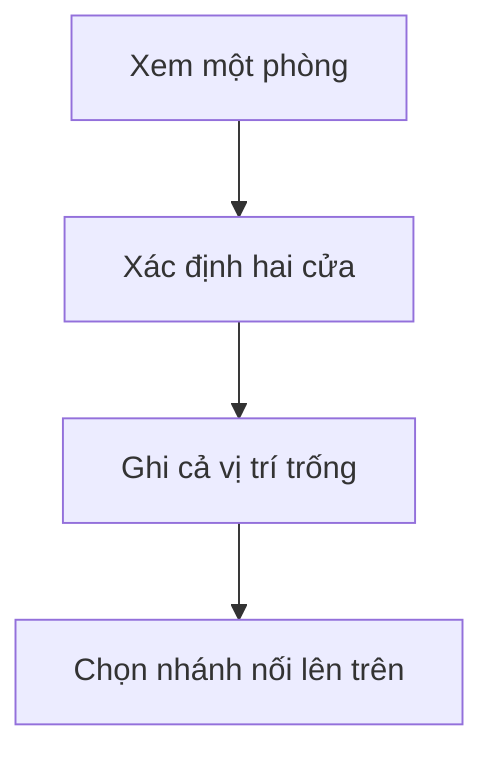

> [!tldr] Đọc nhanh
> - Để dựng cây từ hai dãy duyệt, lấy gốc tiếp theo trong preorder rồi tra vị trí của gốc trong inorder để chia trái và phải.
> - Để ghi cây thành chuỗi bằng preorder, ghi thêm một token cho mỗi con trống. Một con bên trái và một con bên phải có thể cho cùng dãy giá trị.
> - Để tính đường có tổng lớn nhất, một nút có thể thử ghép hai nhánh vào đáp án, nhưng chỉ trả một nhánh lên cha.

> [!info] Bối cảnh
> Đây là ga 6 của [[series/neetcode-link|tuyến NeetCode: Cấu trúc liên kết]]. Ở [[posts/2026-11-25-neetcode-tree-recursion|ga 3]], mình đã dùng kết quả từ hai con để tính đường kính. Ga này dùng cùng cách nghĩ về cây con, lần lượt để tạo lại cây từ hai danh sách, ghi nó ra chuỗi và tính một đường đi có trọng số. Chỉ cần biết cây nhị phân có hai vị trí con, trái và phải.

> [!abstract]- Từ điển nhanh cho bài này (bấm để mở)
> - [[concepts/pre-order-traversal|Tiền thứ tự]] (preorder) đọc gốc, rồi cả nhánh trái, rồi cả nhánh phải.
> - [[concepts/in-order-traversal|Trung thứ tự]] (inorder) đọc cả nhánh trái, rồi gốc, rồi cả nhánh phải.
> - [[concepts/post-order-traversal|Hậu thứ tự]] (postorder) xử lý gốc sau khi đã xử lý cả hai nhánh.
> - Token là một mẩu của chuỗi, ở đây là số nguyên hoặc ký hiệu `#` giữa các dấu phẩy.
> - `[lo, hi)` là khoảng chỉ số tính từ `lo` và dừng ngay trước `hi`.

## Hình dung trước: sơ đồ phòng lưu trữ

Tưởng tượng mỗi phòng có biển số, hai cửa xuống phòng con ghi Trái và Phải, và một cầu thang lên cha. Hai người kiểm kê đi qua cùng dãy phòng nhưng chọn thời điểm đọc biển khác nhau. Nếu chỉ còn sổ, mình muốn dựng lại sơ đồ phòng, in nó ra giấy hoặc tìm lộ trình cho tổng điểm cao nhất.

| Đời thường | Khái niệm |
|---|---|
| Sổ A luôn ghi biển phòng trước các phòng con, sổ B ghi biển ở giữa hai nhánh | [[concepts/tree-reconstruction|Dựng lại cây]] từ preorder và inorder |
| Đánh dấu ranh giới trong sổ B ở đúng biển phòng | [[concepts/inorder-interval|Khoảng inorder]] cho mỗi cây con |
| Ghi một dấu gạch ứng với cửa không có phòng | [[concepts/null-marker|Dấu con trống]] giữ bên trái và phải |
| Gói cả sổ, gồm số phòng và dấu gạch, thành một dòng | [[concepts/tree-serialization|Mã hóa cây]] để đọc lại |
| Hành trình có thể bẻ qua hai cửa ở một phòng, nhưng khi nối với cầu thang chỉ đi qua một cửa | [[concepts/downward-path-gain|Tổng nhánh đi xuống]] trả lên cha |



## Vấn đề: thứ gì phải đi theo cây con?

Mình từng nghĩ cứ biết thứ tự đã ghé các nút là đủ để dựng lại cây. Thử gốc 8 có một con 3: đặt 3 vào trái hay phải thì preorder đều là `[8, 3]`. Cùng một dãy có thể xuất phát từ hai hình dạng. Bên cạnh thứ tự, mình cần một cách xác định mỗi nút thuộc nhánh nào.

Cũng có một kiểu mất thông tin theo chiều ngược lại. Nếu mỗi cây con chỉ báo “đường tốt nhất của tôi có tổng 9”, cha chưa biết đường ấy có chạm gốc cây con để nối tiếp không. Dữ liệu cần truyền phụ thuộc vào việc bên nhận phải làm gì với nó.

## Cơ chế

### Dựng lại từ hai dãy

Cho `preorder = [8, 3, 6, 11, -2]` và `inorder = [3, 6, 8, -2, 11]`. Hàm `visit(lo, hi)` sở hữu đúng khoảng `[lo, hi)` của inorder. Khi khoảng rỗng, nó trả `null` và giữ nguyên vị trí đọc. Khi khoảng còn nút, phần tử preorder kế tiếp là gốc của khoảng đó. Vì các giá trị phân biệt, bảng vị trí cho đúng một điểm tách.

1. Lấy 8 từ preorder, tra được chỉ số 2 trong inorder. Hai khoảng mới là `[0, 2)` và `[3, 5)`.
2. Đi trái trước. Gốc 3 ở đầu khoảng trái nên không có con trái, còn 6 nằm ở nhánh phải của nó.
3. Sau khi nhánh trái đọc xong, lấy 11 làm gốc cho khoảng phải. Giá trị -2 đứng trước 11 trong khoảng đó nên nằm ở bên trái của 11.

Giả sử mỗi lời gọi con giữ đúng khoảng của mình. Nhánh trái sẽ đọc đúng số nút bên trái của gốc, do đó con trỏ preorder đến đúng gốc bên phải khi nhánh phải bắt đầu. Cây con rỗng khép phép quy nạp mà không lấy thêm token. Cả hai phân đoạn thu nhỏ sau mỗi lần dựng nút, nên quá trình kết thúc. Bảng vị trí tốn O(n) bộ nhớ và cho O(n) thời gian trung bình với tra cứu hash. Ngăn xếp lời gọi thêm O(h) với h là chiều cao. Quét tìm điểm tách ở từng cây con có thể tốn O(n²) trên cây lệch.

<figure class="figure-map" style="--ar: 3 / 4">
<div class="frame"><iframe data-archify="../diagrams/neetcode-tree-reconstruction/split-at-root.html" title="Dựng cây bằng cách tách tại gốc" loading="lazy"></iframe></div>
<figcaption><span><b>Hình 1.</b> Vị trí của 8 chia inorder thành đúng hai khoảng, còn preorder cung cấp các gốc theo thứ tự cần dựng.</span><a href="../diagrams/neetcode-tree-reconstruction/split-at-root.html" target="_blank" rel="noopener">Mở toàn màn hình</a></figcaption>
</figure>

### Ghi đủ chỗ trống để đọc lại

Mình dùng quy tắc `Tree := # | số Tree Tree`, với dấu phẩy ngăn các token. Gặp `#` thì điền một chỗ trống và dừng lời gọi đó. Gặp số thì dựng nút, đọc trọn cây con trái rồi đến cây con phải. Ví dụ `8,3,#,#,#` đặt 3 ở trái, còn `8,#,3,#,#` đặt 3 ở phải.

Một cây có n nút thật có 2n vị trí con và n−1 cạnh nối tới các con thật. Vì thế nó có n+1 vị trí trống. Cây rỗng cũng dùng một token `#` cho gốc trống. Tổng cộng định dạng dùng 2n+1 token, với các giá trị có thể trùng. Bộ mã hóa và bộ đọc đi qua dãy token tuyến tính. Tách cả chuỗi và gom token trước khi nối đều dùng bộ nhớ tuyến tính theo kích thước biểu diễn. Đo bằng ký tự thì gọi độ dài chuỗi là L, thời gian là O(L).

### Tính đường có tổng lớn nhất

Với cùng cây, nhánh từ 3 đi xuống 6 có tổng 9. Nhánh từ 11 có thể bỏ con -2 nên tổng là 11. Qua nút 8 mình thử `9 + 8 + 11 = 28`. Nếu 8 là con của một nút khác, tổng mà nó được gửi lên là `8 + max(9, 11) = 19`. Khi đi từ cha xuống, đường đơn chỉ còn một hướng để rời 8.

Tại mỗi nút, dùng `max(0, gain(con))` để có quyền bỏ nhánh làm giảm tổng. Mỗi đường có đúng một nút cao nhất theo chiều sâu. Thử ghép hai nhánh tại từng nút sẽ xét được trường hợp tốt nhất cho mọi nút cao nhất có thể. Khởi tạo đáp án bằng giá trị gốc để cây toàn số âm vẫn chọn một nút thật. Hàm duyệt O(n) nút và dùng O(h) ngăn xếp.

| Bài | Điểm khác |
|---|---|
| [[problems/construct-binary-tree-from-preorder-and-inorder-traversal|LC-0105 · Construct Binary Tree]] | Đọc gốc theo preorder và dùng vị trí trong inorder để chia hai lời gọi. |
| [[problems/binary-tree-maximum-path-sum|LC-0124 · Binary Tree Maximum Path Sum]] | Đi theo hậu thứ tự, trả một nhánh và thử ghép hai nhánh vào đáp án. |
| [[problems/serialize-and-deserialize-binary-tree|LC-0297 · Serialize and Deserialize Binary Tree]] | Dùng dấu con trống để mỗi lời gọi bộ đọc biết lúc nào cây con kết thúc. |

## Ví dụ chạy được

Năm bản cùng dựng cây trên, xác nhận chuỗi biểu diễn chính xác và kiểm tra tổng 28. Các ca khác tách con trái với con phải, giữ giá trị trùng, đọc cây rỗng và tránh đáp án 0 trên cây toàn số âm.

Tải bản [TypeScript](../code/neetcode-tree-reconstruction/tree-station.ts), [Python](../code/neetcode-tree-reconstruction/tree_station.py), [Go](../code/neetcode-tree-reconstruction/tree_station.go), [Java](../code/neetcode-tree-reconstruction/tree-station.java) hoặc [JavaScript](../code/neetcode-tree-reconstruction/tree-station.js). Chạy bằng `node tree-station.ts`, `python3 tree_station.py`, `go run tree_station.go`, `java tree-station.java` hoặc `node tree-station.js`.

```ts
type Tree = { value: number; left: Tree; right: Tree } | null

function rebuild(preorder: number[], inorder: number[]): Tree {
  const position = new Map(inorder.map((value, index) => [value, index]))
  let next = 0
  function visit(lo: number, hi: number): Tree {
    if (lo === hi) return null
    const value = preorder[next++]
    const split = position.get(value)!
    return { value, left: visit(lo, split), right: visit(split + 1, hi) }
  }
  return visit(0, inorder.length)
}

function maxPath(root: NonNullable<Tree>): number {
  let best = root.value
  function gain(node: Tree): number {
    if (!node) return 0
    const left = Math.max(0, gain(node.left))
    const right = Math.max(0, gain(node.right))
    best = Math.max(best, node.value + left + right)
    return node.value + Math.max(left, right)
  }
  gain(root)
  return best
}

function encode(root: Tree): string {
  const tokens: string[] = []
  function visit(node: Tree) {
    if (!node) {
      tokens.push("#")
      return
    }
    tokens.push(String(node.value))
    visit(node.left)
    visit(node.right)
  }
  visit(root)
  return tokens.join(",")
}

function decode(data: string): Tree {
  const tokens = data.split(",")
  let next = 0
  function visit(): Tree {
    const token = tokens[next++]
    return token === "#" ? null : { value: Number(token), left: visit(), right: visit() }
  }
  return visit()
}

const wire = "8,3,#,6,#,#,11,-2,#,#,#"
const rebuilt = rebuild([8, 3, 6, 11, -2], [3, 6, 8, -2, 11])
const cases = [
  encode(rebuilt) === wire,
  encode(rebuild([8, 3], [3, 8])) === "8,3,#,#,#",
  encode(rebuild([8, 3], [8, 3])) === "8,#,3,#,#",
  maxPath(rebuilt!) === 28,
  maxPath(decode("-8,-3,#,#,-5,#,#")!) === -3,
  encode(decode(wire)) === wire,
  encode(decode("4,#,4,#,#")) === "4,#,4,#,#",
  decode("#") === null,
]
if (!cases.every(Boolean)) throw new Error("Có ca sai")
console.log(`${cases.length}/${cases.length} ca đúng`)
```
```python
from dataclasses import dataclass


@dataclass
class Tree:
    value: int
    left: "Tree | None" = None
    right: "Tree | None" = None


def rebuild(preorder, inorder):
    position = {value: index for index, value in enumerate(inorder)}
    values = iter(preorder)

    def visit(lo, hi):
        if lo == hi:
            return None
        value = next(values)
        split = position[value]
        return Tree(value, visit(lo, split), visit(split + 1, hi))

    return visit(0, len(inorder))


def max_path(root):
    best = root.value

    def gain(node):
        nonlocal best
        if node is None:
            return 0
        left = max(0, gain(node.left))
        right = max(0, gain(node.right))
        best = max(best, node.value + left + right)
        return node.value + max(left, right)

    gain(root)
    return best


def encode(root):
    tokens = []

    def visit(node):
        if node is None:
            tokens.append("#")
            return
        tokens.append(str(node.value))
        visit(node.left)
        visit(node.right)

    visit(root)
    return ",".join(tokens)


def decode(data):
    tokens = iter(data.split(","))

    def visit():
        token = next(tokens)
        return None if token == "#" else Tree(int(token), visit(), visit())

    return visit()


wire = "8,3,#,6,#,#,11,-2,#,#,#"
rebuilt = rebuild([8, 3, 6, 11, -2], [3, 6, 8, -2, 11])
cases = [
    encode(rebuilt) == wire,
    encode(rebuild([8, 3], [3, 8])) == "8,3,#,#,#",
    encode(rebuild([8, 3], [8, 3])) == "8,#,3,#,#",
    max_path(rebuilt) == 28,
    max_path(decode("-8,-3,#,#,-5,#,#")) == -3,
    encode(decode(wire)) == wire,
    encode(decode("4,#,4,#,#")) == "4,#,4,#,#",
    decode("#") is None,
]
if not all(cases):
    raise AssertionError("Có ca sai")
print(f"{len(cases)}/{len(cases)} ca đúng")
```
```go
package main

import (
	"fmt"
	"strconv"
	"strings"
)

type Tree struct {
	value       int
	left, right *Tree
}

func rebuild(preorder, inorder []int) *Tree {
	position := make(map[int]int, len(inorder))
	for index, value := range inorder {
		position[value] = index
	}
	next := 0
	var visit func(int, int) *Tree
	visit = func(lo, hi int) *Tree {
		if lo == hi {
			return nil
		}
		value := preorder[next]
		next++
		split := position[value]
		return &Tree{value, visit(lo, split), visit(split+1, hi)}
	}
	return visit(0, len(inorder))
}

func maxPath(root *Tree) int {
	best := root.value
	var gain func(*Tree) int
	gain = func(node *Tree) int {
		if node == nil {
			return 0
		}
		left := max(0, gain(node.left))
		right := max(0, gain(node.right))
		best = max(best, node.value+left+right)
		return node.value + max(left, right)
	}
	gain(root)
	return best
}

func encode(root *Tree) string {
	var tokens []string
	var visit func(*Tree)
	visit = func(node *Tree) {
		if node == nil {
			tokens = append(tokens, "#")
			return
		}
		tokens = append(tokens, strconv.Itoa(node.value))
		visit(node.left)
		visit(node.right)
	}
	visit(root)
	return strings.Join(tokens, ",")
}

func decode(data string) *Tree {
	tokens := strings.Split(data, ",")
	next := 0
	var visit func() *Tree
	visit = func() *Tree {
		token := tokens[next]
		next++
		if token == "#" {
			return nil
		}
		value, err := strconv.Atoi(token)
		if err != nil {
			panic(err)
		}
		return &Tree{value, visit(), visit()}
	}
	return visit()
}

func main() {
	wire := "8,3,#,6,#,#,11,-2,#,#,#"
	rebuilt := rebuild([]int{8, 3, 6, 11, -2}, []int{3, 6, 8, -2, 11})
	cases := []bool{
		encode(rebuilt) == wire,
		encode(rebuild([]int{8, 3}, []int{3, 8})) == "8,3,#,#,#",
		encode(rebuild([]int{8, 3}, []int{8, 3})) == "8,#,3,#,#",
		maxPath(rebuilt) == 28,
		maxPath(decode("-8,-3,#,#,-5,#,#")) == -3,
		encode(decode(wire)) == wire,
		encode(decode("4,#,4,#,#")) == "4,#,4,#,#",
		decode("#") == nil,
	}
	for _, pass := range cases {
		if !pass {
			panic("Có ca sai")
		}
	}
	fmt.Printf("%d/%d ca đúng\n", len(cases), len(cases))
}
```
```java
import java.util.ArrayList;
import java.util.HashMap;
import java.util.List;
import java.util.Map;

class TreeStation {
    record Tree(int value, Tree left, Tree right) {}

    static Tree rebuild(int[] preorder, int[] inorder) {
        Map<Integer, Integer> position = new HashMap<>();
        for (int index = 0; index < inorder.length; index++) {
            position.put(inorder[index], index);
        }
        class Builder {
            int next;

            Tree visit(int lo, int hi) {
                if (lo == hi) return null;
                int value = preorder[next++];
                int split = position.get(value);
                return new Tree(value, visit(lo, split), visit(split + 1, hi));
            }
        }
        return new Builder().visit(0, inorder.length);
    }

    static int maxPath(Tree root) {
        class Path {
            int best = root.value();

            int gain(Tree node) {
                if (node == null) return 0;
                int left = Math.max(0, gain(node.left()));
                int right = Math.max(0, gain(node.right()));
                best = Math.max(best, node.value() + left + right);
                return node.value() + Math.max(left, right);
            }
        }
        Path path = new Path();
        path.gain(root);
        return path.best;
    }

    static String encode(Tree root) {
        List<String> tokens = new ArrayList<>();
        class Encoder {
            void visit(Tree node) {
                if (node == null) {
                    tokens.add("#");
                    return;
                }
                tokens.add(Integer.toString(node.value()));
                visit(node.left());
                visit(node.right());
            }
        }
        new Encoder().visit(root);
        return String.join(",", tokens);
    }

    static Tree decode(String data) {
        String[] tokens = data.split(",");
        class Decoder {
            int next;

            Tree visit() {
                String token = tokens[next++];
                if (token.equals("#")) return null;
                return new Tree(Integer.parseInt(token), visit(), visit());
            }
        }
        return new Decoder().visit();
    }

    public static void main(String[] args) {
        String wire = "8,3,#,6,#,#,11,-2,#,#,#";
        Tree rebuilt = rebuild(new int[]{8, 3, 6, 11, -2}, new int[]{3, 6, 8, -2, 11});
        boolean[] cases = {
            encode(rebuilt).equals(wire),
            encode(rebuild(new int[]{8, 3}, new int[]{3, 8})).equals("8,3,#,#,#"),
            encode(rebuild(new int[]{8, 3}, new int[]{8, 3})).equals("8,#,3,#,#"),
            maxPath(rebuilt) == 28,
            maxPath(decode("-8,-3,#,#,-5,#,#")) == -3,
            encode(decode(wire)).equals(wire),
            encode(decode("4,#,4,#,#")).equals("4,#,4,#,#"),
            decode("#") == null,
        };
        for (boolean pass : cases) {
            if (!pass) throw new AssertionError("Có ca sai");
        }
        System.out.printf("%d/%d ca đúng%n", cases.length, cases.length);
    }
}
```
```js
function rebuild(preorder, inorder) {
  const position = new Map(inorder.map((value, index) => [value, index]))
  let next = 0
  function visit(lo, hi) {
    if (lo === hi) return null
    const value = preorder[next++]
    const split = position.get(value)
    return { value, left: visit(lo, split), right: visit(split + 1, hi) }
  }
  return visit(0, inorder.length)
}

function maxPath(root) {
  let best = root.value
  function gain(node) {
    if (!node) return 0
    const left = Math.max(0, gain(node.left))
    const right = Math.max(0, gain(node.right))
    best = Math.max(best, node.value + left + right)
    return node.value + Math.max(left, right)
  }
  gain(root)
  return best
}

function encode(root) {
  const tokens = []
  function visit(node) {
    if (!node) {
      tokens.push("#")
      return
    }
    tokens.push(String(node.value))
    visit(node.left)
    visit(node.right)
  }
  visit(root)
  return tokens.join(",")
}

function decode(data) {
  const tokens = data.split(",")
  let next = 0
  function visit() {
    const token = tokens[next++]
    return token === "#" ? null : { value: Number(token), left: visit(), right: visit() }
  }
  return visit()
}

const wire = "8,3,#,6,#,#,11,-2,#,#,#"
const rebuilt = rebuild([8, 3, 6, 11, -2], [3, 6, 8, -2, 11])
const cases = [
  encode(rebuilt) === wire,
  encode(rebuild([8, 3], [3, 8])) === "8,3,#,#,#",
  encode(rebuild([8, 3], [8, 3])) === "8,#,3,#,#",
  maxPath(rebuilt) === 28,
  maxPath(decode("-8,-3,#,#,-5,#,#")) === -3,
  encode(decode(wire)) === wire,
  encode(decode("4,#,4,#,#")) === "4,#,4,#,#",
  decode("#") === null,
]
if (!cases.every(Boolean)) throw new Error("Có ca sai")
console.log(`${cases.length}/${cases.length} ca đúng`)
```

```text
8/8 ca đúng
```

## Hiểu lầm và bẫy hay gặp

- **Hai thứ tự duyệt bất kỳ là đủ.** Với gốc 8 và một con 3 ở bất kỳ bên nào, preorder vẫn là `[8, 3]` và postorder vẫn là `[3, 8]`. Inorder đổi vì nó thăm gốc giữa hai nhánh.
- **Bảng vị trí hoạt động với giá trị trùng.** Hai nút có giá trị 4 có thể chiếm hai chỉ số, nhưng bảng theo giá trị chỉ giữ một vị trí. Bài dựng cây bảo đảm giá trị phân biệt. Định dạng dùng `#` vẫn đọc lại được cây có giá trị trùng vì vị trí do cấu trúc token quyết định.
- **Thấy nhánh âm thì trả 0 làm đáp án.** Số 0 cho phép bỏ nhánh con. Đường hợp lệ vẫn phải chứa nút đang xét, kể cả khi nó âm.
- **Cây nhỏ chạy được thì cây dây cũng vậy.** Bản minh họa đệ quy giả định hai dãy hợp lệ hoặc chuỗi do chính bộ mã hóa tạo ra. Với cây lệch, h có thể bằng n. Dùng ngăn xếp tự quản lý khi cần dự đoán bộ nhớ và tránh giới hạn lời gọi của runtime, như các bản lặp ở trang bài. Khi đọc dữ liệu bên ngoài cần kiểm tra token lỗi, thiếu và thừa.

## Câu hỏi tự kiểm tra

> [!question]- Preorder `[4, 2]` và inorder `[4, 2]` đặt 2 ở bên nào?
> Bên phải. Trong inorder, 2 nằm sau gốc 4.

> [!question]- Xóa hai dấu `#` cuối khỏi chuỗi `4,#,9,#,#` có được không?
> Theo định dạng này, không. Nút 9 cần hai chỗ con. Bộ đọc sẽ gặp hết dữ liệu trước khi hoàn thành cây.

> [!question]- Một nút giá trị 5 có hai nhánh đóng góp 4 và 7. Nó ghi nhận và trả gì?
> Tổng đường qua nút là 16. Hàm chỉ trả 12 để cha có thể nối 5 với nhánh 7.

## Tham khảo

- [MIT 6.046 · Problem Set 4 Solutions](https://courses.csail.mit.edu/6.046/fall03/handouts/pset4-sol.pdf) giải thích cách tách bằng inorder và đưa phản ví dụ cho cặp preorder–postorder.
- [OpenDSA · Binary Tree Traversals](https://opendsa.cs.vt.edu/ODSA/Books/Catalog/html/BinaryTreeTraversal.html) định nghĩa ba thứ tự duyệt.
- [LeetCode 105](https://leetcode.com/problems/construct-binary-tree-from-preorder-and-inorder-traversal/), [124](https://leetcode.com/problems/binary-tree-maximum-path-sum/) và [297](https://leetcode.com/problems/serialize-and-deserialize-binary-tree/) là đề gốc, dùng để đối chiếu các điều kiện của từng bài.
- [Python · sys.getrecursionlimit](https://docs.python.org/3/library/sys.html#sys.getrecursionlimit) mô tả giới hạn của ngăn xếp trình thông dịch.
