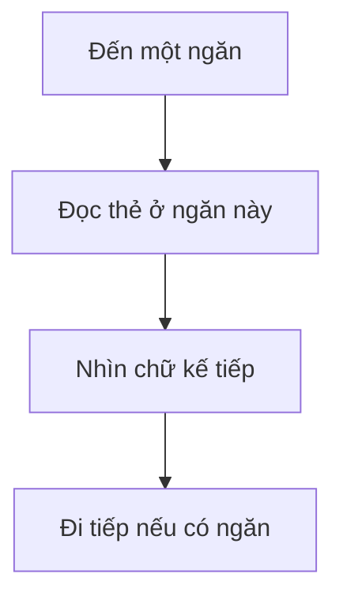

> [!tldr] Đọc nhanh
> - Trie lưu mỗi tiền tố một lần. Tìm được đường đi cho `car` mới trả lời câu hỏi tiền tố. Để khớp một từ, nút cuối còn phải có dấu hết từ.
> - Mỗi dấu `.` tiêu thụ đúng một ký tự. Chỉ thử những cạnh thực sự có ở nút hiện tại.
> - Khi dò bảng chữ, mang nút trie cùng đường đi. Thiếu cạnh thì dừng ngay, có từ thì ghi nhận và vẫn thử tìm từ dài hơn.
> - Bảng ký tự nhỏ hợp với mảng con. Khi đa số nút ít con, map chỉ lưu cạnh đang dùng.

> [!info] Bối cảnh
> Đây là ga 7, ga cuối của [[series/neetcode-link|tuyến NeetCode: Cấu trúc liên kết]]. Ở [[posts/2026-11-26-neetcode-tree-reconstruction|ga 6]], trái và phải xác định hình dạng cây. Ở đây, mỗi cạnh mang một ký tự nên đường từ gốc tự nói lên tiền tố mình đã đọc. Mình dùng cùng cấu trúc đó cho danh mục từ và một bảng chữ nhỏ.

> [!abstract]- Từ điển nhanh cho bài này (bấm để mở)
> - Tiền tố là đoạn bắt đầu ở ký tự đầu tiên. `car` là tiền tố của `cart` và cũng là tiền tố của chính nó.
> - DFS đi sâu hết một nhánh trước khi thử nhánh khác.
> - [[concepts/backtracking|Quay lui]] đánh dấu lựa chọn cho đường đang thử, rồi hoàn tác khi về.
> - Ký tự đại diện `.` trong bài 211 khớp đúng một chữ cái.

## Hình dung trước: tủ thẻ theo chữ cái

Hình dung một tủ danh mục có ngăn theo từng chữ cái. Khi đi qua ngăn `c` rồi ngăn `a`, mình đã chọn tiền tố `ca`. Một ngăn có thể chứa thẻ ghi từ đã đăng ký và đồng thời dẫn tới các ngăn sâu hơn.

| Đời thường | Khái niệm |
|---|---|
| Các thẻ bắt đầu giống nhau dùng chung ngăn đầu | [[concepts/trie|Trie]] dùng chung đường đi của tiền tố |
| Tờ phiếu ghi “đã đăng ký” nằm ngay trong một ngăn | [[concepts/terminal-marker|Dấu hết từ]] tách truy vấn từ và truy vấn tiền tố |
| Ký tự bị nhòe thì thử từng ngăn con đang có | [[concepts/wildcard-branching|Phân nhánh theo ký tự đại diện]] |
| Không có ngăn cho chữ tiếp theo thì bỏ lối đang thử | [[concepts/trie-prefix-pruning|Cắt theo tiền tố]] |
| Có thể đóng sẵn 26 ngăn hoặc chỉ lắp các ngăn đang dùng | [[concepts/sparse-trie-children|Lưu cạnh thưa]] và mảng con cố định |



## Vấn đề: đường đi cho mình biết gì?

Mình đã thêm `cart` và `cat`. Hỏi có tiền tố `car` hay không, mình có thể lần lượt đi qua `c`, `a`, `r` và trả lời có. Hỏi đã thêm từ `car` hay chưa thì đáp án là chưa. Một nút biểu diễn phần đã đọc. Nó chỉ xác nhận một từ khi đã được đánh dấu.

Nếu lưu từng từ trong một [[concepts/hash-map|bảng băm]], mình kiểm tra từ đầy đủ nhanh sau khi băm chuỗi. Để hỏi bất kỳ tiền tố nào trong cùng bảng, cách trực tiếp phải thử các từ cho tới khi gặp một từ khớp. Trie đổi chi phí xây và lưu cây lấy khả năng xử lý tiền tố từng ký tự. Trên bảng chữ, khả năng ấy giúp dùng chung công việc giữa các từ có cùng đoạn đầu.

## Cơ chế

### Dùng hai điều kiện kết thúc

Gốc đại diện cho chuỗi rỗng. Mỗi cạnh thêm một chữ vào cuối tiền tố. Để thêm từ, đi từ gốc và tạo nút ở các cạnh còn thiếu. Đánh dấu hết từ khi đọc xong. Trong ví dụ chạy bên dưới, `word` chứa từ gốc tại nút đã đánh dấu. Truy vấn tiền tố chỉ cần tới được nút cuối. Truy vấn từ còn kiểm tra `word`. Khi thêm `car` sau `cart`, mình chỉ cập nhật nút `car` và giữ cạnh tới `cart`.

Mỗi bước đọc qua một cạnh, nên chèn và tra chuỗi dài L tốn L lượt đi cạnh trong trường hợp đi hết chuỗi. Mảng 26 phần tử cho một lần truy cập theo chỉ số mỗi bước, với 26 ô con cho mỗi nút. Bản map chỉ lưu những cạnh đang có và dùng tra cứu hash theo ký tự. Với bảng chữ thường tiếng Anh và giả thiết tra cứu map hằng số trung bình, cả hai có thời gian O(L). Nếu từ điển có P tiền tố khác nhau kể cả gốc, số nút là P và số cạnh là P−1. Tính cả chi phí mỗi map và mỗi đối tượng nút khi quyết định cài đặt nào ít bộ nhớ hơn.

<figure class="figure-map" style="--ar: 3 / 4">
<div class="frame"><iframe data-archify="../diagrams/neetcode-trie/prefix-and-word.html" title="Đường đi tới car và dấu hết từ tại cart" loading="lazy"></iframe></div>
<figcaption><span><b>Hình 1.</b> Đường tới car trả lời câu hỏi tiền tố. Dấu hết từ ở cart và cat chỉ rõ hai từ đã được thêm.</span><a href="../diagrams/neetcode-trie/prefix-and-word.html" target="_blank" rel="noopener">Mở toàn màn hình</a></figcaption>
</figure>

### Giữ vị trí mẫu khi ký tự tạo nhiều nhánh

Để khớp `ca.`, hai chữ đầu định tuyến tới `ca`. Dấu chấm chọn một trong các con thực sự có và tiến một vị trí trong mẫu. Nhánh đi qua `r` dừng tại `car`: khi `car` chưa là từ, dấu hết từ ở đó chưa bật. Nhánh `t` đến `cat` và thành công. `c..t` khớp `cart` vì nó kết thúc ở độ sâu bốn. Có thể dừng ngay khi một nhánh khớp hết mẫu và đến một từ.

Với mẫu dài L và d dấu chấm, ở mỗi độ sâu có tối đa 26^d trạng thái với bảng chữ này. Do đó O(L·26^d) là cận trên thô. Số nút thực sự đã thử thường nhỏ hơn nhờ thiếu cạnh và dừng sớm. Ngăn xếp sâu O(L). Bài 211 giới hạn d không quá hai, nên đừng lấy số nhánh của một mẫu toàn dấu chấm để mô tả đầu vào của đề.

### Dò bảng cùng nút trie

Bảng ví dụ có hai hàng `c a t` và `d r e`. Khi bắt đầu tại `c` rồi đi sang `a`, nút trie đang giữ đúng trạng thái `ca`. Từ đó, đi sang phải thấy `t` và ghi `cat`. Thử đi xuống thì gặp `r`, ghi được `car` nếu nó có trong từ điển rồi tiếp tục qua `e` để tìm `care`. Từ `r` sang `t` là đường chéo, vì vậy `cart` không xuất hiện trên bảng này. `cata` đòi dùng lại ô `a` trên cùng một đường nên bị loại.

Mỗi lần xuống một ô, kiểm tra biên, dấu đã thăm và cạnh ký tự từ nút trie hiện tại. Thiếu cạnh thì mọi phần nối dài của đường đang thử đều có cùng tiền tố không tồn tại, nên dừng ở đó. Có cạnh thì ghi kết quả nếu có từ, đánh dấu ô, thử bốn hàng xóm rồi khôi phục ô. Bộ kết quả chỉ giữ mỗi từ một lần dù nhiều đường tìm ra nó.

Xây trie cần O(S) lượt xử lý ký tự, với S là tổng độ dài từ. Với bảng R × C, đặt H là số nhỏ hơn giữa số ô và độ dài từ tối đa. Bỏ qua chi phí ghi và sắp xếp kết quả, một cận trên cho số bước dò là O(RC·3^H). Bước đầu có tối đa 4 hướng, sau đó ô vừa đi qua bị khóa nên tối đa còn 3. Cắt tiền tố giảm số bước đã thử theo dữ liệu. Đường đi có độ sâu tối đa O(H), và ví dụ khôi phục bảng để tránh cần cả bảng đánh dấu riêng.

| Bài | Điểm khác |
|---|---|
| [[problems/implement-trie-prefix-tree|LC-0208 · Implement Trie]] | Đi theo một chuỗi ký tự và chọn điều kiện hết từ hoặc còn đường. |
| [[problems/design-add-and-search-words-data-structure|LC-0211 · Design Add and Search Words]] | Khi gặp dấu chấm, thử các con đang tồn tại và giữ vị trí trong mẫu. |
| [[problems/word-search-ii|LC-0212 · Word Search II]] | Dò đường trên bảng, mang nút trie và khôi phục ô đã dùng lúc quay lui. |

## Ví dụ chạy được

Năm bản kiểm tra cùng 13 ca. Các ca gồm tiền tố tồn tại nhưng chưa là từ, thêm từ ngắn khi từ dài đã có, mẫu có dấu chấm, từ nằm chéo và từ đòi dùng lại ô. Bản bảng chữ dùng các chữ thường ASCII, giữ từ ở nút cuối và sắp xếp kết quả để dễ kiểm thử.

Tải [TypeScript](../code/neetcode-trie/trie-station.ts), [Python](../code/neetcode-trie/trie_station.py), [Go](../code/neetcode-trie/trie_station.go), [Java](../code/neetcode-trie/trie-station.java) hoặc [JavaScript](../code/neetcode-trie/trie-station.js). Chạy bằng `node trie-station.ts`, `python3 trie_station.py`, `go run trie_station.go`, `java trie-station.java` hoặc `node trie-station.js`.

```ts
type TrieNode = { children: Map<string, TrieNode>; word: string | null }
const makeNode = (): TrieNode => ({ children: new Map(), word: null })

function insert(root: TrieNode, word: string) {
  let node = root
  for (const letter of word) {
    let child = node.children.get(letter)
    if (!child) {
      child = makeNode()
      node.children.set(letter, child)
    }
    node = child
  }
  node.word = word
}

function walk(root: TrieNode, text: string): TrieNode | undefined {
  let node = root
  for (const letter of text) {
    const child = node.children.get(letter)
    if (!child) return undefined
    node = child
  }
  return node
}

function matches(node: TrieNode, pattern: string, i = 0): boolean {
  if (i === pattern.length) return node.word !== null
  if (pattern[i] === ".") {
    for (const child of node.children.values()) {
      if (matches(child, pattern, i + 1)) return true
    }
    return false
  }
  const child = node.children.get(pattern[i])
  return child !== undefined && matches(child, pattern, i + 1)
}

function findWords(board: string[][], words: string[]): string[] {
  const root = makeNode()
  for (const word of words) insert(root, word)
  const found = new Set<string>()
  function visit(row: number, col: number, parent: TrieNode) {
    const letter = board[row]?.[col]
    if (letter === undefined || letter === "#") return
    const node = parent.children.get(letter)
    if (!node) return
    if (node.word !== null) found.add(node.word)
    board[row][col] = "#"
    visit(row - 1, col, node)
    visit(row + 1, col, node)
    visit(row, col - 1, node)
    visit(row, col + 1, node)
    board[row][col] = letter
  }
  board.forEach((row, r) => row.forEach((_, c) => visit(r, c, root)))
  return [...found].sort()
}

const root = makeNode()
for (const word of ["cart", "cat", "dog"]) insert(root, word)
const board = [["c", "a", "t"], ["d", "r", "e"]]
const cases = [
  walk(root, "car") !== undefined,
  walk(root, "car")?.word === null,
  walk(root, "cart")?.word === "cart",
  walk(root, "cab") === undefined,
  matches(root, "ca."),
  matches(root, "c..t"),
  matches(root, ".og"),
  !matches(root, "c.t."),
  !matches(root, "do"),
  findWords(board, ["car", "care", "cat", "cart", "cata"]).join(",") === "car,care,cat",
  board.map(row => row.join("")).join(",") === "cat,dre",
  findWords([["a", "a"]], ["a", "aa", "aaa"]).join(",") === "a,aa",
]
insert(root, "car")
cases.push(walk(root, "car")?.word === "car" && walk(root, "cart")?.word === "cart")
if (!cases.every(Boolean)) throw new Error("Có ca sai")
console.log(`${cases.length}/${cases.length} ca đúng`)
```
```python
class TrieNode:
    def __init__(self):
        self.children = {}
        self.word = None


def insert(root, word):
    node = root
    for letter in word:
        if letter not in node.children:
            node.children[letter] = TrieNode()
        node = node.children[letter]
    node.word = word


def walk(root, text):
    node = root
    for letter in text:
        node = node.children.get(letter)
        if node is None:
            break
    return node


def matches(node, pattern, i=0):
    if i == len(pattern):
        return node.word is not None
    if pattern[i] == ".":
        return any(matches(child, pattern, i + 1) for child in node.children.values())
    child = node.children.get(pattern[i])
    return child is not None and matches(child, pattern, i + 1)


def find_words(board, words):
    root = TrieNode()
    for word in words:
        insert(root, word)
    found = set()

    def visit(row, col, parent):
        if not (0 <= row < len(board) and 0 <= col < len(board[row])):
            return
        letter = board[row][col]
        if letter == "#":
            return
        node = parent.children.get(letter)
        if node is None:
            return
        if node.word is not None:
            found.add(node.word)
        board[row][col] = "#"
        visit(row - 1, col, node)
        visit(row + 1, col, node)
        visit(row, col - 1, node)
        visit(row, col + 1, node)
        board[row][col] = letter

    for r, row in enumerate(board):
        for c in range(len(row)):
            visit(r, c, root)
    return sorted(found)


root = TrieNode()
for word in ("cart", "cat", "dog"):
    insert(root, word)
board = [list("cat"), list("dre")]
cases = [
    walk(root, "car") is not None,
    walk(root, "car").word is None,
    walk(root, "cart").word == "cart",
    walk(root, "cab") is None,
    matches(root, "ca."),
    matches(root, "c..t"),
    matches(root, ".og"),
    not matches(root, "c.t."),
    not matches(root, "do"),
    find_words(board, ["car", "care", "cat", "cart", "cata"]) == ["car", "care", "cat"],
    board == [list("cat"), list("dre")],
    find_words([list("aa")], ["a", "aa", "aaa"]) == ["a", "aa"],
]
insert(root, "car")
cases.append(walk(root, "car").word == "car" and walk(root, "cart").word == "cart")
if not all(cases):
    raise AssertionError("Có ca sai")
print(f"{len(cases)}/{len(cases)} ca đúng")
```
```go
package main

import (
	"fmt"
	"sort"
	"strings"
)

type trieNode struct {
	children map[byte]*trieNode
	word     string
}

func makeNode() *trieNode {
	return &trieNode{children: make(map[byte]*trieNode)}
}

func insert(node *trieNode, word string) {
	for i := range len(word) {
		letter := word[i]
		if node.children[letter] == nil {
			node.children[letter] = makeNode()
		}
		node = node.children[letter]
	}
	node.word = word
}

func walk(node *trieNode, text string) *trieNode {
	for i := range len(text) {
		node = node.children[text[i]]
		if node == nil {
			return nil
		}
	}
	return node
}

func matches(node *trieNode, pattern string, i int) bool {
	if i == len(pattern) {
		return node.word != ""
	}
	if pattern[i] == '.' {
		for _, child := range node.children {
			if matches(child, pattern, i+1) {
				return true
			}
		}
		return false
	}
	child := node.children[pattern[i]]
	return child != nil && matches(child, pattern, i+1)
}

func findWords(board [][]byte, words []string) []string {
	root := makeNode()
	for _, word := range words {
		insert(root, word)
	}
	found := make(map[string]bool)
	var visit func(int, int, *trieNode)
	visit = func(row, col int, parent *trieNode) {
		if row < 0 || row >= len(board) || col < 0 || col >= len(board[row]) {
			return
		}
		letter := board[row][col]
		node := parent.children[letter]
		if letter == '#' || node == nil {
			return
		}
		if node.word != "" {
			found[node.word] = true
		}
		board[row][col] = '#'
		visit(row-1, col, node)
		visit(row+1, col, node)
		visit(row, col-1, node)
		visit(row, col+1, node)
		board[row][col] = letter
	}
	for r, row := range board {
		for c := range row {
			visit(r, c, root)
		}
	}
	result := make([]string, 0, len(found))
	for word := range found {
		result = append(result, word)
	}
	sort.Strings(result)
	return result
}

func main() {
	root := makeNode()
	for _, word := range []string{"cart", "cat", "dog"} {
		insert(root, word)
	}
	board := [][]byte{[]byte("cat"), []byte("dre")}
	cases := []bool{
		walk(root, "car") != nil,
		walk(root, "car").word == "",
		walk(root, "cart").word == "cart",
		walk(root, "cab") == nil,
		matches(root, "ca.", 0),
		matches(root, "c..t", 0),
		matches(root, ".og", 0),
		!matches(root, "c.t.", 0),
		!matches(root, "do", 0),
		strings.Join(findWords(board, []string{"car", "care", "cat", "cart", "cata"}), ",") == "car,care,cat",
		string(board[0]) == "cat" && string(board[1]) == "dre",
		strings.Join(findWords([][]byte{[]byte("aa")}, []string{"a", "aa", "aaa"}), ",") == "a,aa",
	}
	insert(root, "car")
	cases = append(cases, walk(root, "car").word == "car" && walk(root, "cart").word == "cart")
	for _, pass := range cases {
		if !pass {
			panic("Có ca sai")
		}
	}
	fmt.Printf("%d/%d ca đúng\n", len(cases), len(cases))
}
```
```java
import java.util.Arrays;
import java.util.HashMap;
import java.util.HashSet;
import java.util.List;
import java.util.Map;
import java.util.Set;

class TrieStation {
    static class TrieNode {
        final Map<Character, TrieNode> children = new HashMap<>();
        String word;
    }

    static void insert(TrieNode node, String word) {
        for (int i = 0; i < word.length(); i++) {
            node = node.children.computeIfAbsent(word.charAt(i), ignored -> new TrieNode());
        }
        node.word = word;
    }

    static TrieNode walk(TrieNode node, String text) {
        for (int i = 0; i < text.length(); i++) {
            node = node.children.get(text.charAt(i));
            if (node == null) return null;
        }
        return node;
    }

    static boolean matches(TrieNode node, String pattern, int i) {
        if (i == pattern.length()) return node.word != null;
        if (pattern.charAt(i) == '.') {
            for (TrieNode child : node.children.values()) {
                if (matches(child, pattern, i + 1)) return true;
            }
            return false;
        }
        TrieNode child = node.children.get(pattern.charAt(i));
        return child != null && matches(child, pattern, i + 1);
    }

    static void visit(char[][] board, int row, int col, TrieNode parent, Set<String> found) {
        if (row < 0 || row >= board.length || col < 0 || col >= board[row].length) return;
        char letter = board[row][col];
        TrieNode node = parent.children.get(letter);
        if (letter == '#' || node == null) return;
        if (node.word != null) found.add(node.word);
        board[row][col] = '#';
        visit(board, row - 1, col, node, found);
        visit(board, row + 1, col, node, found);
        visit(board, row, col - 1, node, found);
        visit(board, row, col + 1, node, found);
        board[row][col] = letter;
    }

    static List<String> findWords(char[][] board, String... words) {
        TrieNode root = new TrieNode();
        for (String word : words) insert(root, word);
        Set<String> found = new HashSet<>();
        for (int row = 0; row < board.length; row++) {
            for (int col = 0; col < board[row].length; col++) {
                visit(board, row, col, root, found);
            }
        }
        return found.stream().sorted().toList();
    }

    public static void main(String[] args) {
        TrieNode root = new TrieNode();
        for (String word : List.of("cart", "cat", "dog")) insert(root, word);
        char[][] board = {"cat".toCharArray(), "dre".toCharArray()};
        boolean[] cases = {
            walk(root, "car") != null,
            walk(root, "car").word == null,
            "cart".equals(walk(root, "cart").word),
            walk(root, "cab") == null,
            matches(root, "ca.", 0),
            matches(root, "c..t", 0),
            matches(root, ".og", 0),
            !matches(root, "c.t.", 0),
            !matches(root, "do", 0),
            findWords(board, "car", "care", "cat", "cart", "cata").equals(List.of("car", "care", "cat")),
            Arrays.deepEquals(board, new char[][]{"cat".toCharArray(), "dre".toCharArray()}),
            findWords(new char[][]{"aa".toCharArray()}, "a", "aa", "aaa").equals(List.of("a", "aa")),
        };
        insert(root, "car");
        if (!"car".equals(walk(root, "car").word) || !"cart".equals(walk(root, "cart").word)) {
            throw new AssertionError("Có ca sai");
        }
        for (boolean pass : cases) {
            if (!pass) throw new AssertionError("Có ca sai");
        }
        System.out.printf("%d/%d ca đúng%n", cases.length + 1, cases.length + 1);
    }
}
```
```js
const makeNode = () => ({ children: new Map(), word: null })

function insert(root, word) {
  let node = root
  for (const letter of word) {
    let child = node.children.get(letter)
    if (!child) {
      child = makeNode()
      node.children.set(letter, child)
    }
    node = child
  }
  node.word = word
}

function walk(root, text) {
  let node = root
  for (const letter of text) {
    const child = node.children.get(letter)
    if (!child) return undefined
    node = child
  }
  return node
}

function matches(node, pattern, i = 0) {
  if (i === pattern.length) return node.word !== null
  if (pattern[i] === ".") {
    for (const child of node.children.values()) {
      if (matches(child, pattern, i + 1)) return true
    }
    return false
  }
  const child = node.children.get(pattern[i])
  return child !== undefined && matches(child, pattern, i + 1)
}

function findWords(board, words) {
  const root = makeNode()
  for (const word of words) insert(root, word)
  const found = new Set()
  function visit(row, col, parent) {
    const letter = board[row]?.[col]
    if (letter === undefined || letter === "#") return
    const node = parent.children.get(letter)
    if (!node) return
    if (node.word !== null) found.add(node.word)
    board[row][col] = "#"
    visit(row - 1, col, node)
    visit(row + 1, col, node)
    visit(row, col - 1, node)
    visit(row, col + 1, node)
    board[row][col] = letter
  }
  board.forEach((row, r) => row.forEach((_, c) => visit(r, c, root)))
  return [...found].sort()
}

const root = makeNode()
for (const word of ["cart", "cat", "dog"]) insert(root, word)
const board = [["c", "a", "t"], ["d", "r", "e"]]
const cases = [
  walk(root, "car") !== undefined,
  walk(root, "car")?.word === null,
  walk(root, "cart")?.word === "cart",
  walk(root, "cab") === undefined,
  matches(root, "ca."),
  matches(root, "c..t"),
  matches(root, ".og"),
  !matches(root, "c.t."),
  !matches(root, "do"),
  findWords(board, ["car", "care", "cat", "cart", "cata"]).join(",") === "car,care,cat",
  board.map(row => row.join("")).join(",") === "cat,dre",
  findWords([["a", "a"]], ["a", "aa", "aaa"]).join(",") === "a,aa",
]
insert(root, "car")
cases.push(walk(root, "car")?.word === "car" && walk(root, "cart")?.word === "cart")
if (!cases.every(Boolean)) throw new Error("Có ca sai")
console.log(`${cases.length}/${cases.length} ca đúng`)
```

```text
13/13 ca đúng
```

## Hiểu lầm và bẫy hay gặp

- **Một từ chỉ có thể nằm ở lá.** `car` và `cart` có thể cùng là từ. Đánh dấu ở cả hai nút; không cần xóa cạnh khi đánh dấu nút cha.
- **Dấu chấm có thể bỏ qua chữ hoặc khớp nhiều chữ.** Mỗi dấu chấm dùng đúng một cạnh. Khi mẫu kết thúc, vẫn cần kiểm tra dấu hết từ.
- **Thấy một từ thì dừng cả nhánh.** Trên bảng, đường tìm thấy `car` có thể còn đi tiếp để tìm `care`.
- **Mỗi ô chỉ dùng được một lần cho cả lượt tìm.** Giới hạn áp dụng trên một đường. Khôi phục ô khi quay lui để đường khác có thể dùng nó.
- **Mảng 26 ô xử lý mọi bảng chữ.** Phần mã này theo giả thiết chữ thường tiếng Anh của đề. Với từ điển Unicode, cần chọn đơn vị ký tự và chính sách chuẩn hóa trước khi xây cây.

## Câu hỏi tự kiểm tra

> [!question]- Khi chỉ thêm `cart` và `cat`, hỏi `car` theo hai cách trả gì?
> Tiền tố đúng, từ đầy đủ sai. Sau khi thêm `car`, cả hai đều đúng.

> [!question]- Mẫu `c...` có khớp `cat` không?
> Không. Mẫu dùng bốn ký tự còn `cat` có ba.

> [!question]- Vì sao dừng được ở `cad` nếu trie thiếu cạnh `d` sau `ca`?
> Mọi từ bắt đầu bằng `cad` phải có cạnh ấy. Đi thêm trên bảng không thể làm tiền tố thiếu xuất hiện trong trie.

> [!question]- Khi chỉ một phần nhỏ bảng chữ xuất hiện ở mỗi nút, nên đo gì trước khi chọn mảng hoặc map?
> Đo số cạnh thực sự dùng và kích thước của biểu diễn trong runtime. Mảng giữ chỗ cho cả bảng chữ, còn map có chi phí riêng cho mỗi nút và mỗi mục.

## Tham khảo

- [Princeton Algorithms · TrieST](https://github.com/kevin-wayne/algs4/blob/master/src/main/java/edu/princeton/cs/algs4/TrieST.java) minh họa trie nhiều nhánh, dấu hết từ và truy vấn mẫu.
- [Princeton · Boggle FAQ](https://coursera.cs.princeton.edu/algs4/assignments/boggle/faq.php) giải thích cắt tiền tố trên bảng. Luật kề ô của Boggle khác với đề 212.
- [LeetCode 208](https://leetcode.com/problems/implement-trie-prefix-tree/), [211](https://leetcode.com/problems/design-add-and-search-words-data-structure/) và [212](https://leetcode.com/problems/word-search-ii/) là đề gốc.
