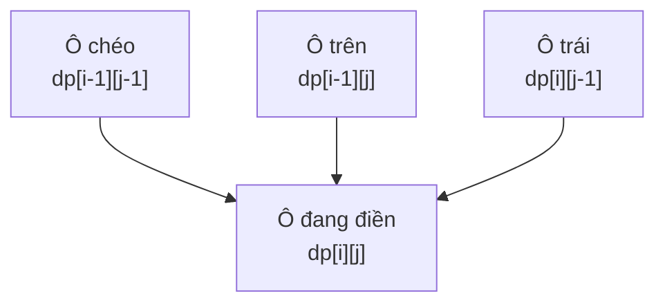

> [!tldr] Đọc nhanh
> - Cả năm bài dùng một bảng `dp[i][j]`. Ô là một góc của lưới, hoặc là đáp án cho cặp tiền tố `a[:i]` và `b[:j]`.
> - Mỗi ô chỉ đọc tối đa ba ô đã điền: ô trên, ô trái và ô chéo trên trái. Điền theo hàng từ trên xuống, trong hàng từ trái sang phải là đủ.
> - Hàng 0 và cột 0 ứng với một tiền tố rỗng. Đặt sai giá trị ở đây thì cả bảng sai theo.
> - Năm bài khác nhau ở phép gộp (cộng, max, OR, min) và ở việc hai ký tự khớp thì được đi chéo ra sao.
> - Chỉ cần độ dài hoặc số đếm thì giữ một hàng là đủ. Muốn in lại lời giải thì phải giữ cả bảng để lần ngược.

> [!info] Bối cảnh
> Đây là ga thứ năm trên [[series/neetcode-dp|tuyến NeetCode: Quy hoạch động]]. Bốn ga trước dùng mảng một chiều: một chỉ số đủ mô tả phần đã đọc. Ở ga này, phần đã đọc có hai chiều, vì mình đang đi trên một lưới hoặc đang đọc song song hai chuỗi. Bạn chỉ cần biết mảng hai chiều, vòng lặp lồng nhau và ý tưởng [[concepts/dp-state|trạng thái DP]] từ ga 1.

> [!abstract]- Từ điển nhanh cho bài này (bấm để mở)
> - **Tiền tố** `a[:i]` là i ký tự đầu của chuỗi a. `a[:0]` là chuỗi rỗng.
> - **Dãy con** giữ thứ tự ký tự và được bỏ ký tự ở giữa. `ace` là dãy con của `abcde`. **Chuỗi con** thì phải liền nhau.
> - [[concepts/grid-path-dp|Grid Path DP]] đếm hoặc tối ưu đường đi trên lưới chỉ được đi xuống và sang phải.
> - [[concepts/two-sequence-dp|Two-Sequence DP]] đặt `dp[i][j]` là đáp án cho hai tiền tố, một của mỗi chuỗi.
> - [[concepts/lcs-table|LCS Table]] là bảng độ dài dãy con chung dài nhất của mọi cặp tiền tố.
> - [[concepts/edit-operations|Edit Operations]] là ba phép chèn, xóa, thay một ký tự, mỗi phép tốn 1.
> - [[concepts/recurrence-relation|Công thức truy hồi]] cho biết ô hiện tại tính từ những ô nào.
> - [[concepts/rolling-state|Trạng thái cuộn]] tái dùng chỗ chứa của hàng cũ khi không còn ai đọc nó.

## Hình dung trước: giấy kẻ ô có chữ ở hai mép

Mình lấy một tờ giấy kẻ ô. Mép trên viết từng chữ của `mop`, mép trái viết từng chữ của `map`. Trước chữ đầu tiên của mỗi mép có một hàng và một cột trống, ứng với "chưa đọc chữ nào". Mình điền từng ô bằng bút chì, và mỗi ô chỉ nhìn ba ô kề đã điền: ô ngay trên, ô ngay trái và ô chéo trên trái. Với Unique Paths, tờ giấy chính là bản đồ khu phố ô bàn cờ và không có chữ ở mép.

| Đời thường | Khái niệm |
|---|---|
| Hàng trống và cột trống ở hai mép | Hàng 0, cột 0: một tiền tố rỗng |
| Ô ở hàng i, cột j | `dp[i][j]`: đáp án cho `a[:i]` và `b[:j]` |
| Ba ô kề đã điền: trên, trái, chéo | Ba ô mà công thức truy hồi đọc |
| Điền hết hàng này rồi xuống hàng dưới | Thứ tự điền theo hàng |
| Tẩy dòng cũ để viết dòng mới | Giữ một hàng (trạng thái cuộn) |
| Dò ngược từ ô cuối về góc trên trái | Dựng lại lời giải, cần cả bảng |



## Vấn đề: đệ quy hai chỉ số gọi lại chính nó quá nhiều lần

Mình từng giải LCS bằng đệ quy thẳng: so ký tự cuối của hai chuỗi, khớp thì bỏ cả hai, không khớp thì thử bỏ ký tự cuối của chuỗi này hoặc chuỗi kia. Mỗi lần không khớp sinh hai nhánh, nên số lời gọi có thể tăng theo hàm mũ của tổng độ dài.

Nhưng mọi lời gọi chỉ hỏi về một cặp `(i, j)`: đã đọc i ký tự đầu của a và j ký tự đầu của b. Chỉ có `(m+1)·(n+1)` cặp như vậy. Ga này là bài học về việc nhận ra trạng thái có hai chỉ số, rồi trải nó ra thành một bảng thay vì để đệ quy đi lại các nhánh cũ.

## Cơ chế

<figure class="figure-map" style="--ar: 3 / 4">
<div class="frame"><iframe data-archify="../diagrams/neetcode-grid-two-strings/lcs-table.html" title="Điền bảng LCS cho map và mop" loading="lazy"></iframe></div>
<figcaption><span><b>Hình 1.</b> Với <code>map</code> và <code>mop</code>, hai lần khớp đi chéo cộng 1, lần lệch <code>a</code>/<code>o</code> chỉ chép số lớn hơn, nên ô góc ra 2.</span><a href="../diagrams/neetcode-grid-two-strings/lcs-table.html" target="_blank" rel="noopener">Mở toàn màn hình</a></figcaption>
</figure>

### Khuôn chung: định nghĩa ô, viền, thứ tự

Với hai chuỗi, mình đặt `dp[i][j]` là đáp án cho `a[:i]` và `b[:j]`. Bảng có `(m+1)` hàng và `(n+1)` cột, vì tính cả tiền tố rỗng. Ký tự đang xét ở ô `(i, j)` là `a[i-1]` và `b[j-1]`. Lệch một chỉ số ở đây là lỗi hay gặp nhất của ga.

Ba ô kề mang ba nghĩa:
- **Ô chéo** `dp[i-1][j-1]`: dùng cả hai ký tự cuối cùng một lúc, thường là khi chúng khớp.
- **Ô trên** `dp[i-1][j]`: bỏ qua (hoặc đã dùng xong) ký tự cuối của a.
- **Ô trái** `dp[i][j-1]`: bỏ qua ký tự cuối của b.

Cả ba ô đều nằm ở hàng trên, hoặc bên trái trong cùng hàng. Vì vậy hai vòng lặp `for i` rồi `for j` tăng dần luôn điền ô phụ thuộc trước ô cần nó. Viền là chỗ mỗi bài tự quyết: hàng 0 và cột 0 trả lời câu hỏi khi một bên rỗng.

Với LCS, khi một bên rỗng thì không có ký tự chung, nên viền toàn 0. Khi `a[i-1] == b[j-1]`, một dãy con chung dài nhất có thể kết thúc bằng ký tự này ở cả hai chuỗi, nên `dp[i][j] = dp[i-1][j-1] + 1`. Khi hai ký tự khác nhau, ít nhất một trong hai không nằm cuối dãy chung, nên lấy `max(dp[i-1][j], dp[i][j-1])`. Thời gian O(m·n), bộ nhớ O(m·n) cho cả bảng.

### Giữ một hàng, và biến tạm cho ô chéo

Hàng i chỉ đọc hàng i-1 và chính nó, nên có thể giữ một mảng `row` dài n+1. Trước khi ghi `row[j]`, ô đó vẫn chứa giá trị hàng trên, còn `row[j-1]` đã là giá trị hàng hiện tại. Ô trên và ô trái vì thế có sẵn.

Ô chéo thì không: `row[j-1]` của hàng trên đã bị ghi đè ngay ở bước trước. Edit Distance và LCS bản một hàng giữ thêm biến `diag`: đọc `top = row[j]` trước khi ghi, rồi gán `diag = top` sau khi ghi. Distinct Subsequences chỉ đọc ô trên và ô chéo, nên có thể duyệt j **giảm dần**: khi đó `row[j-1]` chưa bị ghi và vẫn là ô chéo. Bộ nhớ còn O(n) (chọn chuỗi ngắn hơn làm cột để còn O(min(m, n))).

Cái giá là mất bảng. Muốn in ra dãy chung hoặc dãy phép sửa, mình cần đi ngược từ `dp[m][n]`: ô chéo nếu khớp, nếu không thì đi về ô kề đã cho ra giá trị. Việc đó cần cả bảng, hoặc ít nhất một bảng ghi lựa chọn.

### Năm bài trên cùng một khuôn

| Bài | Điểm khác |
|---|---|
| [[problems/unique-paths|Unique Paths]] | Lưới m×n, không có chuỗi. Viền toàn 1, mỗi ô bằng ô trên cộng ô trái. |
| [[problems/longest-common-subsequence|Longest Common Subsequence]] | Bài neo. Khớp thì ô chéo + 1, lệch thì `max(trên, trái)`, viền 0. |
| [[problems/interleaving-string|Interleaving String]] | Ô là đúng/sai: `s3[:i+j]` có trộn được từ `s1[:i]` và `s2[:j]` không. Ô trên dùng `s1[i-1]`, ô trái dùng `s2[j-1]`, cả hai phải bằng `s3[i+j-1]`, gộp bằng OR. Phải kiểm tra tổng độ dài trước. |
| [[problems/distinct-subsequences|Distinct Subsequences]] | Đếm số cách `t[:j]` xuất hiện là dãy con của `s[:i]`. Luôn có ô trên (bỏ `s[i-1]`), cộng thêm ô chéo khi `s[i-1] == t[j-1]`. Cột 0 bằng 1, hàng 0 từ cột 1 bằng 0. |
| [[problems/edit-distance|Edit Distance]] | Số phép sửa ít nhất. Khớp thì lấy ô chéo, không tốn gì. Lệch thì 1 + min của chéo (thay), trên (xóa), trái (chèn). Hàng 0 là j, cột 0 là i. |

## Ví dụ chạy được

[TypeScript](../code/neetcode-grid-two-strings/tables.ts) · [Python](../code/neetcode-grid-two-strings/tables.py) · [Go](../code/neetcode-grid-two-strings/tables.go) · [Java](../code/neetcode-grid-two-strings/tables.java) · [JavaScript](../code/neetcode-grid-two-strings/tables.js) · [PHP](../code/neetcode-grid-two-strings/tables.php) · [Rust](../code/neetcode-grid-two-strings/tables.rs)

```ts
function longestCommonSubsequence(a: string, b: string): number {
    const dp = Array.from({length: a.length + 1}, () => Array(b.length + 1).fill(0))
    for (let i = 1; i <= a.length; i++) {
        for (let j = 1; j <= b.length; j++) {
            dp[i][j] = a[i - 1] === b[j - 1]
                ? dp[i - 1][j - 1] + 1
                : Math.max(dp[i - 1][j], dp[i][j - 1])
        }
    }
    return dp[a.length][b.length]
}
```

```python
def longest_common_subsequence(a, b):
    dp = [[0] * (len(b) + 1) for _ in range(len(a) + 1)]
    for i in range(1, len(a) + 1):
        for j in range(1, len(b) + 1):
            if a[i - 1] == b[j - 1]:
                dp[i][j] = dp[i - 1][j - 1] + 1
            else:
                dp[i][j] = max(dp[i - 1][j], dp[i][j - 1])
    return dp[len(a)][len(b)]
```

```go
func longestCommonSubsequence(a, b string) int {
	dp := make([][]int, len(a)+1)
	for i := range dp {
		dp[i] = make([]int, len(b)+1)
	}
	for i := 1; i <= len(a); i++ {
		for j := 1; j <= len(b); j++ {
			if a[i-1] == b[j-1] {
				dp[i][j] = dp[i-1][j-1] + 1
			} else {
				dp[i][j] = max(dp[i-1][j], dp[i][j-1])
			}
		}
	}
	return dp[len(a)][len(b)]
}
```

```java
static int longestCommonSubsequence(String a, String b) {
    int[][] dp = new int[a.length() + 1][b.length() + 1];
    for (int i = 1; i <= a.length(); i++) {
        for (int j = 1; j <= b.length(); j++) {
            dp[i][j] = a.charAt(i - 1) == b.charAt(j - 1)
                ? dp[i - 1][j - 1] + 1
                : Math.max(dp[i - 1][j], dp[i][j - 1]);
        }
    }
    return dp[a.length()][b.length()];
}
```

```js
function longestCommonSubsequence(a, b) {
    const dp = Array.from({length: a.length + 1}, () => Array(b.length + 1).fill(0))
    for (let i = 1; i <= a.length; i++) {
        for (let j = 1; j <= b.length; j++) {
            dp[i][j] = a[i - 1] === b[j - 1]
                ? dp[i - 1][j - 1] + 1
                : Math.max(dp[i - 1][j], dp[i][j - 1])
        }
    }
    return dp[a.length][b.length]
}
```

```php
function longestCommonSubsequence(string $a, string $b): int {
    $n = strlen($a);
    $m = strlen($b);
    $dp = array_fill(0, $n + 1, array_fill(0, $m + 1, 0));
    for ($i = 1; $i <= $n; $i++) {
        for ($j = 1; $j <= $m; $j++) {
            $dp[$i][$j] = $a[$i - 1] === $b[$j - 1]
                ? $dp[$i - 1][$j - 1] + 1
                : max($dp[$i - 1][$j], $dp[$i][$j - 1]);
        }
    }
    return $dp[$n][$m];
}
```

```rust
fn longest_common_subsequence(a: &str, b: &str) -> usize {
    let (a, b) = (a.as_bytes(), b.as_bytes());
    let mut dp = vec![vec![0usize; b.len() + 1]; a.len() + 1];
    for i in 1..=a.len() {
        for j in 1..=b.len() {
            dp[i][j] = if a[i - 1] == b[j - 1] {
                dp[i - 1][j - 1] + 1
            } else {
                dp[i - 1][j].max(dp[i][j - 1])
            };
        }
    }
    dp[a.len()][b.len()]
}
```

Các tab trích bảng LCS đầy đủ. Mỗi file tải về giải cả năm bài của ga: Unique Paths, Interleaving String, Distinct Subsequences và Edit Distance viết theo kiểu giữ một hàng, để thấy rõ ô nào bị ghi đè lúc nào. 17 ca gồm các ví dụ quen thuộc, chuỗi rỗng, tổng độ dài lệch ở Interleaving String và lưới 23×12.

```text
17/17 ca đúng
```

Chạy bằng `node tables.ts`, `python3 tables.py`, `go run tables.go`, `java tables.java`, `node tables.js`, `php tables.php` hoặc `rustc --edition 2021 -O tables.rs -o /tmp/tables && /tmp/tables`.

## Hiểu lầm và bẫy hay gặp

- Cấp bảng m×n thay vì (m+1)×(n+1). Không còn chỗ cho tiền tố rỗng, viền phải tính tay và dễ sai. Với bảng có viền, ký tự của ô `(i, j)` là `a[i-1]`, không phải `a[i]`.
- Lấy dãy con thành chuỗi con. LCS của `abcde` và `ace` là 3 dù không có đoạn liền nào dài hơn 1 trùng nhau. Bài chuỗi con chung dài nhất có công thức khác: lệch thì ô về 0.
- Giữ một hàng rồi duyệt sai chiều. Edit Distance đọc cả ô trái mới lẫn ô chéo cũ, nên duyệt tăng và giữ `diag`. Distinct Subsequences không đọc ô trái, duyệt giảm thì khỏi cần biến tạm. Duyệt tăng ở đây sẽ dùng một ký tự của s hai lần.
- Quên kiểm tra `len(s1) + len(s2) == len(s3)` ở Interleaving String. Khi tổng lệch, bảng vẫn có thể ra true ở một ô giữa và chỉ số `i+j-1` có thể vượt độ dài s3.
- Đặt viền Distinct Subsequences toàn 0. Chuỗi rỗng là dãy con của mọi chuỗi đúng một cách, nên cột 0 phải là 1. Ở bài này các ô trung gian còn có thể lớn hơn đáp án cuối, xem trang bài về kiểu số của từng ngôn ngữ.
- Nghĩ rằng bảng một hàng vẫn in lại được dãy chung. Bản một hàng chỉ còn hàng cuối, nên không đủ để đi ngược.

## Câu hỏi tự kiểm tra

> [!question]- Vì sao điền theo hàng từ trên xuống, trái sang phải là thứ tự hợp lệ cho cả năm bài?
> Mọi ô chỉ đọc ô trên, ô trái và ô chéo trên trái. Cả ba đều có chỉ số hàng nhỏ hơn, hoặc cùng hàng mà cột nhỏ hơn, nên đã được điền trước.

> [!question]- Trong LCS, khi hai ký tự cuối khớp, sao không cần xét ô trên và ô trái?
> Ô trên và ô trái không lớn hơn ô chéo cộng 1, vì bỏ một ký tự chỉ làm LCS giảm tối đa 1. Nên ô chéo + 1 đã là lớn nhất.

> [!question]- Edit Distance bản một hàng cần biến `diag` để làm gì?
> Để giữ `dp[i-1][j-1]`. Khi tính ô j, `row[j-1]` đã bị ghi giá trị hàng i, nên ô chéo của hàng i-1 chỉ còn trong biến tạm.

> [!question]- Unique Paths có thể thay bảng bằng công thức không?
> Có. Mỗi đường là một cách xếp m-1 bước xuống giữa m+n-2 bước, nên đáp án là tổ hợp C(m+n-2, m-1). Bảng DP vẫn cần khi lưới có ô cấm hoặc có chi phí.

## Tham khảo

- [Unique Paths](https://leetcode.com/problems/unique-paths/) · [Longest Common Subsequence](https://leetcode.com/problems/longest-common-subsequence/) · [Interleaving String](https://leetcode.com/problems/interleaving-string/) · [Distinct Subsequences](https://leetcode.com/problems/distinct-subsequences/) · [Edit Distance](https://leetcode.com/problems/edit-distance/)
- [MIT 6.006, bài giảng 21: edit distance và trạng thái theo cặp hậu tố](https://ocw.mit.edu/courses/6-006-introduction-to-algorithms-fall-2011/3484e876d81aba07911a1109f5b5e81e_MIT6_006F11_lec21.pdf)
- [Jeff Erickson, Algorithms, chương quy hoạch động (edit distance)](https://jeffe.cs.illinois.edu/teaching/algorithms/book/Algorithms-JeffE.pdf)
- [Wagner và Fischer (1974), The String-to-String Correction Problem](https://doi.org/10.1145/321796.321811)
