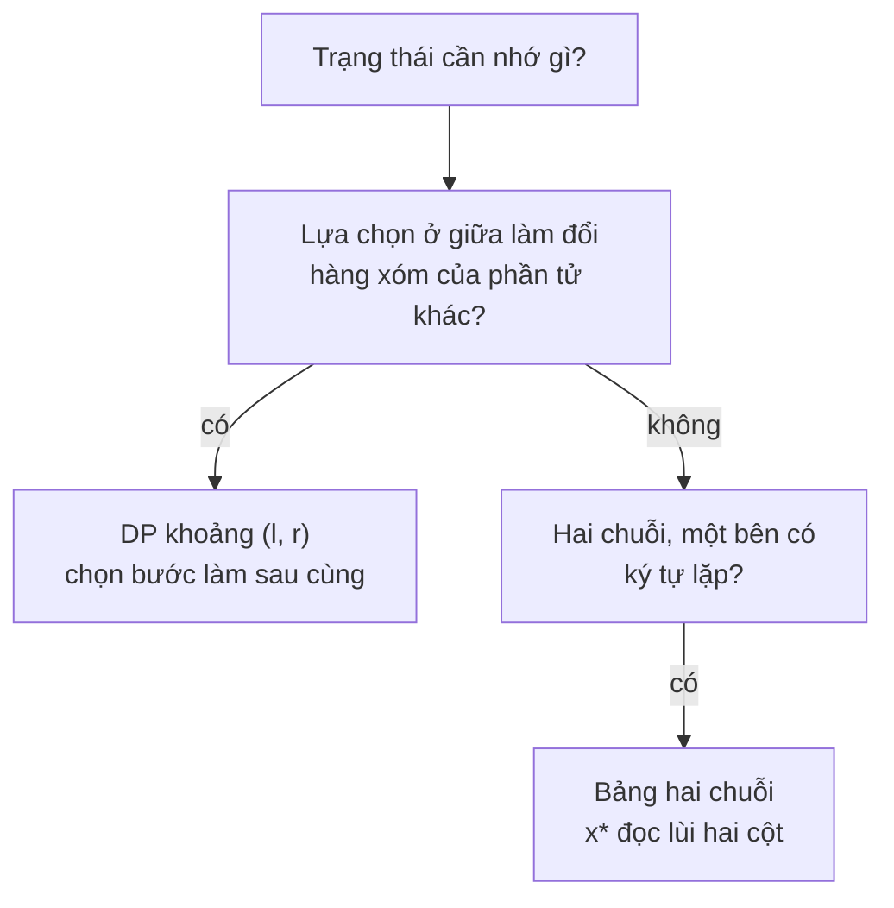
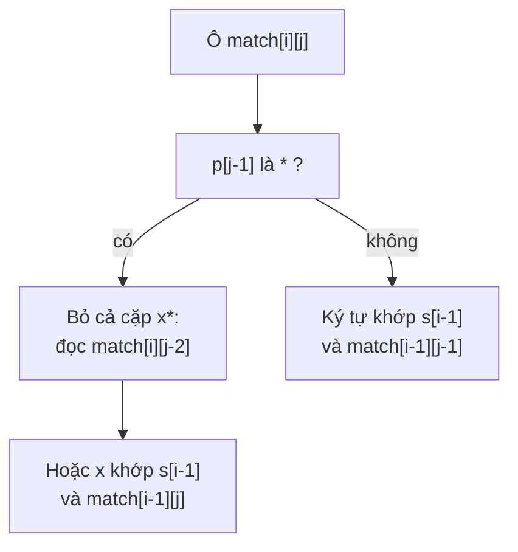

> [!tldr] Đọc nhanh
> - Khi lựa chọn ở giữa dãy làm thay đổi hàng xóm của các phần tử khác, trạng thái không còn là tiền tố mà là một **khoảng** (l, r). Bảng được điền theo độ dài khoảng, ngắn trước dài sau.
> - Mẹo của Burst Balloons: đừng hỏi quả nào nổ **đầu tiên**, hãy hỏi quả nào nổ **sau cùng** trong khoảng. Quả đó đứng nguyên tới phút chót, nên hai bên của nó là hai bài toán độc lập.
> - Regular Expression Matching vẫn là bảng hai chuỗi như ga DP-05, chỉ thêm một luật: cặp `x*` có thể dùng không lần nào (đọc lùi hai cột) hoặc ăn thêm một ký tự (đọc ô ngay trên).
> - Cả hai đều có công thức truy hồi gọn, nhưng thứ tự điền bảng mới là chỗ dễ sai: ô cần đọc phải được tính xong trước.

> [!info] Bối cảnh
> Đây là ga thứ bảy, cũng là ga cuối của [[series/neetcode-dp|tuyến NeetCode: Quy hoạch động]]. Ở [[posts/2026-11-27-neetcode-grid-two-strings|ga DP-05]], ô (i, j) ứng với hai tiền tố và chỉ đọc ba ô kề. Ga này giữ bảng hai chiều nhưng đổi nghĩa của hai chỉ số: ở bài bóng bay, (l, r) là hai đầu của một đoạn liên tiếp; ở bài khớp mẫu, một ô có thể đọc xa hơn một bước. Bạn chỉ cần biết vòng lặp lồng nhau và mảng hai chiều.

> [!abstract]- Từ điển nhanh cho bài này (bấm để mở)
> - [[concepts/interval-dp|Interval DP]] (DP khoảng) đặt trạng thái là một đoạn liên tiếp (l, r) của dãy và ghép đáp án của các đoạn ngắn hơn.
> - [[concepts/last-split-choice|Last Split Choice]] chọn bước làm sau cùng trong đoạn làm điểm chia, để hai nửa không ảnh hưởng nhau.
> - [[concepts/pattern-matching-dp|Pattern Matching DP]] là bảng hai chuỗi giữa văn bản và mẫu, có ký tự đại diện và ký tự lặp.
> - [[concepts/two-sequence-dp|Two-Sequence DP]] là bảng trên cặp tiền tố của hai chuỗi, từ ga DP-05.
> - **Khoảng mở (l, r)** gồm các vị trí nằm giữa l và r, không tính chính l và r.
> - **Ký tự đệm** là phần tử giả thêm vào hai đầu để vị trí biên không cần xử lý riêng; ở đây là hai quả bóng giá 1.
> - Trong mẫu, `.` khớp đúng một ký tự bất kỳ; `x*` khớp không, một hoặc nhiều ký tự `x` liên tiếp.
> - [[concepts/dp-state|Trạng thái DP]] và [[concepts/memoization|ghi nhớ kết quả]] là hai ý từ ga 1.

## Hình dung trước: thợ làm biển hiệu

Mình tưởng tượng một người thợ làm biển hiệu đèn. Việc thứ nhất là tháo một dải bóng đèn cũ. Mỗi lần tháo một bóng, chủ quán trả tiền công bằng tích số ghi trên bóng đó với hai bóng còn sáng ngay cạnh nó; ở hai đầu dải có hai bóng giả số 1 được bắt vít chết. Thứ tự tháo quyết định tổng tiền công.

Người thợ làm từng đoạn: cố định hai bóng ở hai đầu đoạn, rồi tự hỏi "trong đoạn này, bóng nào để tháo sau cùng?". Bóng đó đứng tới phút chót, nên phần bên trái và phần bên phải của nó được tháo hoàn toàn riêng rẽ.

Việc thứ hai là kiểm tra chữ trên biển mới có khớp khuôn mẫu của chuỗi cửa hàng không. Khuôn có ô "bất kỳ chữ nào" và ô co giãn: "chữ này, lặp bao nhiêu lần cũng được, kể cả không lần nào".

| Đời thường | Khái niệm |
|---|---|
| Một đoạn bóng nằm giữa hai bóng đang giữ | Khoảng mở (l, r) |
| Hai bóng giả số 1 bắt vít ở hai đầu | Đệm `vals = [1, …, 1]` |
| Bóng để tháo sau cùng trong đoạn | Điểm chia k, chọn theo [[concepts/last-split-choice\|bước làm sau cùng]] |
| Tiền công của bóng đó: tích với hai bóng đầu đoạn | `vals[l] · vals[k] · vals[r]` |
| Làm xong mọi đoạn ngắn rồi mới ghép đoạn dài | Điền bảng theo độ dài khoảng |
| Ô khuôn "bất kỳ chữ nào" | Ký tự `.` |
| Ô khuôn co giãn | Cặp `x*`: bỏ qua cả cặp hoặc ăn thêm một chữ |
| Đã khớp i chữ của biển với j ô của khuôn | Ô `match[i][j]` |



## Vấn đề: chia đôi thì hai nửa vẫn dính nhau

Với bài bóng bay, mình từng nghĩ: chọn quả nổ **đầu tiên**, rồi đệ quy hai bên. Cách đó hỏng ngay. Nổ quả k xong, hai quả k − 1 và k + 1 trở thành hàng xóm của nhau. Tiền công của chúng về sau phụ thuộc vào cả hai phía, nên "bên trái" và "bên phải" không còn là hai bài toán riêng. Thử mọi thứ tự thì có n! cách; với n = 300 là con số không thể đếm hết.

Với bài khớp mẫu, cách ngây thơ là cho `x*` ăn càng nhiều càng tốt. Chuỗi `aaab` với mẫu `a*ab`: `a*` nuốt cả ba chữ `a`, phần còn lại `b` không khớp được `ab`, và cách tham lam trả lời sai. Đúng ra `a*` chỉ nên ăn hai chữ. Không biết trước nên ăn bao nhiêu, mình phải thử mọi khả năng, và các nhánh thử lặp lại cùng một cặp vị trí.

## Cơ chế

<figure class="figure-map" style="--ar: 3 / 4">
<div class="frame"><iframe data-archify="../diagrams/neetcode-interval-dp/last-balloon.html" title="Chọn quả bóng nổ cuối cùng trong mỗi khoảng" loading="lazy"></iframe></div>
<figcaption><span><b>Hình 1.</b> Với dãy <code>[2, 4, 3]</code> đã đệm thành <code>[1, 2, 4, 3, 1]</code>, bảng được điền từ khoảng ngắn tới khoảng dài. Ở khoảng cả dãy, giữ quả 3 tới cuối cho 1·3·1 + 30 = 33 xu, nhiều nhất trong ba cách chọn.</span><a href="../diagrams/neetcode-interval-dp/last-balloon.html" target="_blank" rel="noopener">Mở toàn màn hình</a></figcaption>
</figure>

### Khoảng làm trạng thái, quả nổ sau cùng làm điểm chia

Mình thêm hai quả giá 1 vào hai đầu: `vals = [1, nums…, 1]`, dài n + 2. Đặt `best[l][r]` là số xu nhiều nhất khi nổ hết các quả **nằm giữa** l và r, trong lúc l và r vẫn còn nguyên. Đáp án là `best[0][n + 1]`.

Trong khoảng (l, r), giả sử quả k nổ sau cùng. Trước đó, mọi quả giữa l và k đã nổ, mà k và l vẫn đứng đó, nên hàng xóm của chúng chỉ có thể nằm trong [l, k]. Phía bên phải cũng vậy với [k, r]. Hai phía không chạm nhau, và tới lượt k nổ thì hàng xóm của nó đúng là l và r:

`best[l][r] = max over l < k < r của vals[l]·vals[k]·vals[r] + best[l][k] + best[k][r]`

Khoảng không có quả nào ở giữa (r = l + 1) cho 0 xu. Đây chính là chỗ đổi câu hỏi từ "đầu tiên" sang "sau cùng": quả nổ đầu tiên làm hai phía dính vào nhau, quả nổ sau cùng tách chúng ra.

Ô `best[l][r]` đọc `best[l][k]` và `best[k][r]`, cả hai đều là khoảng ngắn hơn. Vì vậy mình điền theo độ dài khoảng `gap = r − l` từ 2 trở lên. Có O(n²) ô, mỗi ô thử O(n) điểm chia: thời gian O(n³), bộ nhớ O(n²). Với n ≤ 300, khoảng 4,5 triệu phép thử.

Với `[2, 4, 3]` (đệm thành `[1, 2, 4, 3, 1]`), các ô điền như sau:

| Khoảng | Quả nổ sau cùng tốt nhất | Tính | best |
|---|---|---|---|
| (0, 2) | 2 | 1·2·4 | 8 |
| (1, 3) | 4 | 2·4·3 | 24 |
| (2, 4) | 3 | 4·3·1 | 12 |
| (0, 3) | 2 | 1·2·3 + best(1, 3) = 6 + 24 | 30 |
| (1, 4) | 3 | 2·3·1 + best(1, 3) = 6 + 24 | 30 |
| (0, 4) | 3 | 1·3·1 + best(0, 3) + best(3, 4) = 3 + 30 + 0 | 33 |

Đọc ngược bảng ra thứ tự nổ: 4 trước (24 xu), rồi 2 (6 xu), cuối cùng 3 (3 xu).

### Khớp mẫu: bảng hai chuỗi có ô co giãn

Đặt `match[i][j]` là "i ký tự đầu của chuỗi `s` khớp trọn j ký tự đầu của mẫu `p`". Đây là [[concepts/two-sequence-dp|bảng trên hai tiền tố]] quen thuộc từ ga DP-05, kích thước (m + 1) × (n + 1), và `match[0][0] = true`. Một ô xét ký tự cuối của mẫu, `p[j − 1]`:

- Nếu nó là chữ thường hoặc `.`: ô khớp khi ký tự cuối của `s` khớp nó **và** ô chéo `match[i − 1][j − 1]` đúng, giống đi chéo trong LCS.
- Nếu nó là `*`: cặp `x*` là một đơn vị gồm hai ký tự, với `x = p[j − 2]`. Có hai cách dùng:
  - **Không lần nào:** bỏ qua cả cặp, đọc `match[i][j − 2]`, tức là lùi **hai** cột.
  - **Thêm một lần nữa:** nếu `x` khớp `s[i − 1]`, thì `x*` ăn ký tự đó mà vẫn còn nguyên để ăn tiếp, nên đọc ô ngay trên `match[i − 1][j]`.



Hàng 0 không phải toàn `false` như hàng 0 của LCS: chuỗi rỗng vẫn khớp `a*b*`, vì mỗi cặp có thể dùng không lần nào. Luật "lùi hai cột" lo phần đó tự nhiên. Vòng ngoài vì thế chạy từ `i = 0`. Thời gian và bộ nhớ đều O(m·n). Cách tham lam ở phần Vấn đề sai vì nó chỉ đi một nhánh; bảng giữ đồng thời cả hai nhánh "dừng ăn" và "ăn tiếp" cho mọi cặp vị trí.

### Hai bài trên cùng một ga

| Bài | Điểm khác |
|---|---|
| [[problems/burst-balloons\|Burst Balloons]] | Bài neo. Trạng thái là khoảng mở (l, r) trên dãy đã đệm hai quả 1. Chọn quả nổ **sau cùng** k để hai phía độc lập; điền theo độ dài khoảng, O(n³). |
| [[problems/regular-expression-matching\|Regular Expression Matching]] | Bảng hai chuỗi như DP-05. Chữ và `.` đi chéo; `x*` đọc lùi hai cột (không lần nào) hoặc ô ngay trên (ăn thêm một ký tự). Hàng 0 có thể đúng nhờ các cặp `x*`. |

### Nhìn lại tuyến Quy hoạch động

Đây là ga cuối, nên mình ghi lại câu hỏi chính của từng ga:

| Ga | Trạng thái là gì |
|---|---|
| [[posts/2026-11-27-neetcode-linear-dp\|DP-01]] | Một chỉ số trên dãy, đọc vài ô liền trước |
| [[posts/2026-11-27-neetcode-palindrome-centers\|DP-02]] | Một tâm và một bán kính, mở rộng ra hai phía |
| [[posts/2026-11-27-neetcode-knapsack\|DP-03]] | Số lượng đã dùng cộng sức chứa còn lại |
| [[posts/2026-11-27-neetcode-word-break-lis\|DP-04]] | Một mốc tiền tố, hoặc một đuôi cho mỗi độ dài |
| [[posts/2026-11-27-neetcode-grid-two-strings\|DP-05]] | Một ô lưới, hoặc một cặp tiền tố của hai chuỗi |
| [[posts/2026-11-27-neetcode-state-machine-dp\|DP-06]] | Chỉ số cộng một nhãn nhỏ, hoặc một đỉnh trên DAG |
| DP-07 | Một khoảng liên tiếp (l, r), hoặc cặp tiền tố có ký tự lặp |

Bảy ga có chung một câu hỏi: "phần đã đi qua cần nhớ gì để quyết định phần còn lại?". Trả lời đúng câu đó thì công thức và thứ tự điền bảng đi theo sau.

## Ví dụ chạy được

[TypeScript](../code/neetcode-interval-dp/intervals.ts) · [Python](../code/neetcode-interval-dp/intervals.py) · [Go](../code/neetcode-interval-dp/intervals.go) · [Java](../code/neetcode-interval-dp/intervals.java) · [JavaScript](../code/neetcode-interval-dp/intervals.js) · [PHP](../code/neetcode-interval-dp/intervals.php) · [Rust](../code/neetcode-interval-dp/intervals.rs)

```ts
function maxCoins(nums: number[]): number {
    const vals = [1, ...nums, 1] // thêm hai quả bóng giá 1 ở hai đầu
    const size = vals.length
    const best = Array.from({ length: size }, () => Array(size).fill(0))
    for (let gap = 2; gap < size; gap++) { // khoảng ngắn trước, dài sau
        for (let l = 0; l + gap < size; l++) {
            const r = l + gap
            for (let k = l + 1; k < r; k++) {
                const coins = vals[l] * vals[k] * vals[r] + best[l][k] + best[k][r]
                if (coins > best[l][r]) best[l][r] = coins
            }
        }
    }
    return best[0][size - 1]
}
```

```python
def max_coins(nums):
    """best[l][r] = số xu nhiều nhất khi nổ hết bóng nằm giữa l và r (không tính l, r).
    Chọn k là quả nổ CUỐI CÙNG trong khoảng: lúc đó hai bên của k là l và r."""
    vals = [1] + nums + [1]  # thêm hai quả bóng giá 1 ở hai đầu
    size = len(vals)
    best = [[0] * size for _ in range(size)]
    for gap in range(2, size):  # khoảng ngắn trước, dài sau
        for l in range(size - gap):
            r = l + gap
            for k in range(l + 1, r):
                coins = vals[l] * vals[k] * vals[r] + best[l][k] + best[k][r]
                if coins > best[l][r]:
                    best[l][r] = coins
    return best[0][size - 1]
```

```go
func maxCoins(nums []int) int {
	vals := append(append([]int{1}, nums...), 1) // thêm hai quả bóng giá 1 ở hai đầu
	size := len(vals)
	best := make([][]int, size)
	for i := range best {
		best[i] = make([]int, size)
	}
	for gap := 2; gap < size; gap++ { // khoảng ngắn trước, dài sau
		for l := 0; l+gap < size; l++ {
			r := l + gap
			for k := l + 1; k < r; k++ {
				coins := vals[l]*vals[k]*vals[r] + best[l][k] + best[k][r]
				best[l][r] = max(best[l][r], coins)
			}
		}
	}
	return best[0][size-1]
}
```

```java
static int maxCoins(int[] nums) {
    int size = nums.length + 2;
    int[] vals = new int[size]; // thêm hai quả bóng giá 1 ở hai đầu
    vals[0] = 1;
    vals[size - 1] = 1;
    System.arraycopy(nums, 0, vals, 1, nums.length);
    int[][] best = new int[size][size];
    for (int gap = 2; gap < size; gap++) { // khoảng ngắn trước, dài sau
        for (int l = 0; l + gap < size; l++) {
            int r = l + gap;
            for (int k = l + 1; k < r; k++) {
                int coins = vals[l] * vals[k] * vals[r] + best[l][k] + best[k][r];
                best[l][r] = Math.max(best[l][r], coins);
            }
        }
    }
    return best[0][size - 1];
}
```

```js
function maxCoins(nums) {
    const vals = [1, ...nums, 1] // thêm hai quả bóng giá 1 ở hai đầu
    const size = vals.length
    const best = Array.from({ length: size }, () => Array(size).fill(0))
    for (let gap = 2; gap < size; gap++) { // khoảng ngắn trước, dài sau
        for (let l = 0; l + gap < size; l++) {
            const r = l + gap
            for (let k = l + 1; k < r; k++) {
                const coins = vals[l] * vals[k] * vals[r] + best[l][k] + best[k][r]
                if (coins > best[l][r]) best[l][r] = coins
            }
        }
    }
    return best[0][size - 1]
}
```

```php
function maxCoins(array $nums): int {
    $vals = array_merge([1], $nums, [1]); // thêm hai quả bóng giá 1 ở hai đầu
    $size = count($vals);
    $best = array_fill(0, $size, array_fill(0, $size, 0));
    for ($gap = 2; $gap < $size; $gap++) { // khoảng ngắn trước, dài sau
        for ($l = 0; $l + $gap < $size; $l++) {
            $r = $l + $gap;
            for ($k = $l + 1; $k < $r; $k++) {
                $coins = $vals[$l] * $vals[$k] * $vals[$r] + $best[$l][$k] + $best[$k][$r];
                if ($coins > $best[$l][$r]) $best[$l][$r] = $coins;
            }
        }
    }
    return $best[0][$size - 1];
}
```

```rust
fn max_coins(nums: &[i32]) -> i32 {
    let mut vals = vec![1]; // thêm hai quả bóng giá 1 ở hai đầu
    vals.extend_from_slice(nums);
    vals.push(1);
    let size = vals.len();
    let mut best = vec![vec![0i32; size]; size];
    for gap in 2..size { // khoảng ngắn trước, dài sau
        for l in 0..size - gap {
            let r = l + gap;
            for k in l + 1..r {
                let coins = vals[l] * vals[k] * vals[r] + best[l][k] + best[k][r];
                best[l][r] = best[l][r].max(coins);
            }
        }
    }
    best[0][size - 1]
}
```

Các tab trích hàm DP khoảng của bài bóng bay. Mỗi file còn có bảng khớp mẫu và chạy 7 ca bóng bay cùng 16 ca khớp mẫu, trong đó có chuỗi rỗng với mẫu toàn cặp `x*` và ca tham lam thất bại `aaab` với `a*ab`.

```text
23/23 ca đúng
```

Chạy bằng `node intervals.ts`, `python3 intervals.py`, `go run intervals.go`, `java intervals.java`, `node intervals.js`, `php intervals.php` hoặc `rustc --edition 2021 -O intervals.rs -o /tmp/intervals && /tmp/intervals`.

## Hiểu lầm và bẫy hay gặp

- Chọn quả nổ **đầu tiên** làm điểm chia. Sau khi nó nổ, hai quả kề nó thành hàng xóm của nhau và hai phía không còn độc lập. Điểm chia phải là quả nổ sau cùng.
- Quên đệm hai quả 1, hoặc dùng khoảng đóng [l, r] mà không xử lý biên. Quả ở đầu dãy khi nổ nhân với 1, và bản không đệm phải viết riêng nhánh đó ở khắp nơi.
- Điền bảng bóng bay theo l tăng dần với r tùy ý. Ô (l, r) cần `best[k][r]` với k > l, chưa được tính nếu l đi lên. Điền theo độ dài khoảng, hoặc cho l đi **xuống** và r đi lên.
- Cho `x*` ăn tham lam nhiều nhất có thể. Ca `aaab` với `a*ab` cho thấy cách đó sai; bảng phải giữ cả hai nhánh.
- Nhầm `*` của bài này với `*` của Wildcard Matching (LeetCode 44). Ở đây `*` không đứng một mình mà lặp ký tự ngay trước nó, nên luôn đọc lùi hai cột.
- Bắt đầu vòng ngoài từ `i = 1` và bỏ hàng 0. Khi đó `""` với `a*` trả `false`, sai.
- Đọc `p[j − 2]` khi `j = 1`. Đề bảo đảm mỗi `*` có một ký tự đứng trước, nên điều này không xảy ra với dữ liệu hợp lệ. Với dữ liệu hỏng, Python lặng lẽ đọc `p[-1]` ở cuối mẫu, còn Go, Java và Rust dừng chương trình vì chỉ số ngoài mảng.
- Lo tràn số ở bài bóng bay. Với n ≤ 300 và giá trị ≤ 100, đáp án nhỏ hơn 100³·300 = 3·10⁸, vẫn vừa số nguyên 32 bit.

## Câu hỏi tự kiểm tra

> [!question]- Vì sao chọn quả nổ sau cùng làm hai phía độc lập, còn quả nổ đầu tiên thì không?
> Quả nổ sau cùng đứng nguyên trong suốt lúc hai phía bị nổ, nên nó là bức tường ngăn hai phía. Quả nổ đầu tiên biến mất ngay, và hai quả kề nó trở thành hàng xóm của nhau.

> [!question]- Ô `best[l][r]` đọc những ô nào, và vì sao điền theo độ dài khoảng là đủ?
> Nó đọc `best[l][k]` và `best[k][r]` với l < k < r. Cả hai khoảng đều ngắn hơn (l, r), nên khi mình điền mọi khoảng ngắn trước thì chúng đã có sẵn.

> [!question]- Trong bảng khớp mẫu, vì sao luật "ăn thêm một ký tự" đọc ô ngay trên chứ không phải ô chéo?
> Ăn thêm một ký tự của `s` làm i giảm 1, nhưng cặp `x*` vẫn còn đó để ăn tiếp, nên j giữ nguyên. Đi chéo sẽ vứt luôn cặp `x*`.

> [!question]- Chuỗi rỗng có khớp mẫu `.*` không? Ô nào trả lời câu đó?
> Có. `match[0][2]` đọc `match[0][0] = true` theo luật "không lần nào", lùi hai cột.

## Tham khảo

- [Burst Balloons](https://leetcode.com/problems/burst-balloons/) · [Regular Expression Matching](https://leetcode.com/problems/regular-expression-matching/)
- [MIT 6.006 (2020), bài giảng 16: chọn bài toán con, có LCS trên hai chuỗi](https://ocw.mit.edu/courses/6-006-introduction-to-algorithms-spring-2020/resources/mit6_006s20_lec16/)
- [Jeff Erickson, Algorithms, chương quy hoạch động](https://jeffe.cs.illinois.edu/teaching/algorithms/book/Algorithms-JeffE.pdf)
- [Russ Cox, Regular Expression Matching Can Be Simple And Fast](https://swtch.com/~rsc/regexp/regexp1.html)
