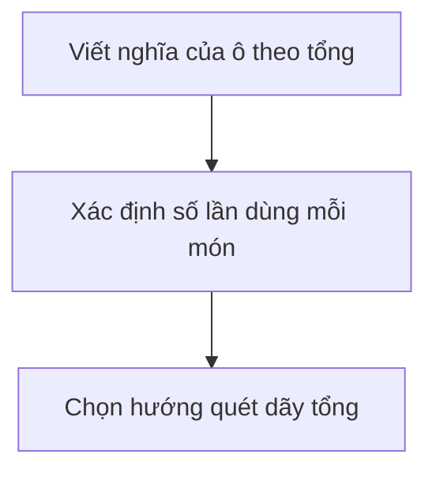

> [!tldr] Đọc nhanh
> - Viết rõ ô DP hỏi gì về **đúng tổng s**. Bốn bài cùng đánh chỉ số theo tổng, nhưng dùng phép OR, min hoặc cộng để gộp.
> - Khi một món chỉ dùng một lần, quét s giảm dần để đọc hàng cũ. Khi một loại dùng lại được, quét tăng để đọc cả kết quả của loại hiện tại.
> - Khi đếm tổ hợp tiền, đặt vòng lặp mệnh giá bên ngoài. Mỗi tổ hợp được tạo theo đúng một thứ tự loại.
> - Target Sum đổi tổng có dấu thành đếm tập con vị trí. Số 0 vẫn có hai lựa chọn độc lập.

> [!info] Bối cảnh
> Đây là ga thứ ba của [[series/neetcode-dp|tuyến NeetCode: Quy hoạch động]]. Mình dùng một cân trong kho và một ngăn tiền để đọc cùng một bảng theo hai cách. Bạn chỉ cần hiểu mảng và vòng lặp. [[posts/2026-11-27-neetcode-linear-dp|Ga DP-01]] đã giới thiệu vì sao có thể giữ ít hàng hơn khi biết lần đọc cuối.

> [!abstract]- Từ điển nhanh cho bài này (bấm để mở)
> - [[concepts/knapsack-state|Knapsack State]] ghi câu hỏi chính xác theo số loại đã xử lý và một tổng.
> - [[concepts/zero-one-knapsack|0/1 Knapsack]] có một lựa chọn lấy hoặc bỏ cho mỗi món.
> - [[concepts/unbounded-knapsack|Unbounded Knapsack]] cho phép dùng nhiều bản của cùng một loại.
> - [[concepts/knapsack-update-order|Knapsack Update Order]] giữ đúng hàng nguồn khi ghi đè bảng một chiều.
> - [[concepts/coin-combinations|Coin Combinations]] phân biệt các túi tiền bằng số lượng theo từng mệnh giá.
> - [[concepts/signed-subset-sum|Signed Subset-Sum Reduction]] biến tổng có dấu thành tổng của các vị trí được chọn.

## Hình dung trước: cân kho và két tiền

Một túi có thẻ trọng lượng 2. Nếu trong kho chỉ có một thẻ, mình tạo được tổng 2 nhưng chưa có 4. Nếu thẻ 2 đại diện cho một loại hàng có nhiều bản, sau khi ghi tổng 2, mình có thể thêm bản thứ hai để ghi tổng 4. Bảng cùng hình dạng, còn hướng quét quyết định cách đọc thẻ.

| Đời thường | Khái niệm |
|---|---|
| Mỗi ô ghi câu hỏi về đúng một mức cân | Trạng thái theo tổng s |
| Một thẻ vật lý chỉ cất được một lần | 0/1 |
| Cả ngăn chứa nhiều bản cùng mệnh giá | Unbounded |
| Duyệt ô lớn trước để ô nguồn còn cũ | Quét giảm |
| Duyệt ô nhỏ trước để dùng kết quả vừa ghi | Quét tăng |
| Chỉ ghi số lượng tiền theo loại | Đếm tổ hợp |



## Vấn đề: giữ đúng bất biến khi nén bảng

Mình viết một hàng riêng cho mỗi tiền tố món hoặc loại. Ô s trả lời về **đúng s**, nên chỉ tổng 0 có trạng thái xuất phát. Với bài đếm, `dp[0]=1` vì có một lựa chọn rỗng. Với bài có thể tới tổng, ô đó là true. Với bài tối thiểu, đó là chi phí 0, còn các ô chưa tới được mang giá trị lính canh. Gộp các hàng vào cùng mảng tiết kiệm bộ nhớ với điều kiện mọi lần đọc vẫn nhìn đúng phiên bản của ô.

## Cơ chế

<figure class="figure-map" style="--ar: 3 / 4">
<div class="frame"><iframe data-archify="../diagrams/neetcode-knapsack/sweep-order.html" title="Quét giảm và quét tăng với món giá trị hai" loading="lazy"></iframe></div>
<figcaption><span><b>Hình 1.</b> Ô tổng 4 có dùng được trạng thái tổng 2 vừa ghi hay không phụ thuộc hướng quét.</span><a href="../diagrams/neetcode-knapsack/sweep-order.html" target="_blank" rel="noopener">Mở toàn màn hình</a></figcaption>
</figure>

### Hàng nào cung cấp ô s − x?

Với món x dùng một lần, trạng thái lấy món đọc `old[s−x]`. Khi quét s giảm dần, ô nhỏ hơn chưa được cập nhật trong lượt này. Với loại x dùng lại được, trạng thái lấy một bản đọc `current[s−x]`, nơi có thể đã dùng chính x. Quét tăng để chuẩn bị ô này trước. Chuyển trạng thái cũng giữ phương án bỏ món bằng cách bắt đầu từ giá trị `dp[s]` đã có.

Với một món x = 2 và mục tiêu 4, quét giảm xét ô 4 trước ô 2. Nguồn cho ô 4 vẫn bằng 0 trong bảng đếm. Quét tăng ghi số 1 vào ô 2 trước, sau đó đọc ô này để ghi số 1 vào ô 4. Số 0 là ca đặc biệt của bài đếm 0/1. Chính ô đó đọc giá trị cũ một lần ở cả nhánh lấy lẫn bỏ, nên số cách tăng gấp đôi.

### Vòng ngoài đặt ra thứ tự tạo đáp án

Với tiền `[2,3]` và đích 5 có một tổ hợp. Xử lý hết loại 2 rồi mới xử lý loại 3, mình có đúng một thứ tự xây túi đó. Nếu xếp tổng ngoài, 2 rồi 3 và 3 rồi 2 là hai đường tới ô 5 và đều được cộng. Với bài tối thiểu số đồng, cả hai đường có cùng chi phí, nên phép min có thể dùng cả hai cách tổ chức vòng lặp.

| Bài | Điểm khác |
|---|---|
| [[problems/coin-change|Coin Change]] | Tối thiểu số đồng. Cho phép lặp loại, gộp bằng min. |
| [[problems/partition-equal-subset-sum|Partition Equal Subset Sum]] | Tìm đúng một nửa tổng. Dùng mỗi vị trí một lần, gộp bằng OR. |
| [[problems/coin-change-ii|Coin Change II]] | Đếm tổ hợp. Mệnh giá ngoài, tổng tăng ở vòng trong. |
| [[problems/target-sum|Target Sum]] | Đổi dấu thành chọn vị trí. Tổng giảm và gộp bằng cộng. |

### Chi phí và biên số nguyên

Mỗi món hoặc loại quét tối đa W + 1 ô, với W là đích thích hợp của bài. Mảng cuộn dùng O(W+1) bộ nhớ và thời gian O(n(W+1)). Cận phụ thuộc giá trị số W thay vì số bit để biểu diễn W, nên gọi là giả đa thức.

Coin Change II chỉ bảo đảm **kết quả ở đích** vừa số nguyên có dấu 32 bit. Các ô không góp vào đích có thể rất lớn. Mình chặn mỗi tổng đếm ở C = 2³¹−1. Với a, b không âm, `min(C, min(C,a)+min(C,b)) = min(C,a+b)`. Vì truy hồi chỉ cộng các số không âm, giá trị cuối đã được bảo đảm nằm trong C vẫn giữ chính xác. Java mở rộng trước khi cộng. Rust dùng phép cộng bão hòa. TypeScript và JavaScript giữ tổng trước khi chặn dưới 2³² nên không mất độ chính xác.

## Ví dụ chạy được

[TypeScript](../code/neetcode-knapsack/capacity.ts) · [Python](../code/neetcode-knapsack/capacity.py) · [Go](../code/neetcode-knapsack/capacity.go) · [Java](../code/neetcode-knapsack/capacity.java) · [JavaScript](../code/neetcode-knapsack/capacity.js) · [PHP](../code/neetcode-knapsack/capacity.php) · [Rust](../code/neetcode-knapsack/capacity.rs)

```ts
function canPartition(nums: number[]) {
    const sum = nums.reduce((a, b) => a+b, 0)
    if (sum % 2 !== 0) return false
    const goal = sum/2
    const reachable = Array(goal+1).fill(false)
    reachable[0] = true
    for (const x of nums) {
        for (let s = goal; s >= x; s--) {
            reachable[s] ||= reachable[s-x]
        }
    }
    return reachable[goal]
}
```

```python
def can_partition(nums):
    total = sum(nums)
    if total % 2:
        return False
    goal = total // 2
    reachable = [True] + [False] * goal
    for x in nums:
        for s in range(goal, x-1, -1):
            reachable[s] = reachable[s] or reachable[s-x]
    return reachable[goal]
```

```go
func canPartition(nums []int) bool {
	sum := 0
	for _, x := range nums {
		sum += x
	}
	if sum%2 != 0 {
		return false
	}
	goal := sum / 2
	reachable := make([]bool, goal+1)
	reachable[0] = true
	for _, x := range nums {
		for s := goal; s >= x; s-- {
			reachable[s] = reachable[s] || reachable[s-x]
		}
	}
	return reachable[goal]
}
```

```java
static boolean canPartition(int[] nums) {
    int sum = Arrays.stream(nums).sum();
    if (sum%2!=0) return false;
    int goal = sum/2;
    boolean[] reachable = new boolean[goal+1];
    reachable[0] = true;
    for (int x : nums) {
        for (int s=goal;s>=x;s--) reachable[s] |= reachable[s-x];
    }
    return reachable[goal];
}
```

```js
function canPartition(nums) {
    const sum = nums.reduce((a, b) => a+b, 0)
    if (sum % 2 !== 0) return false
    const goal = sum/2
    const reachable = Array(goal+1).fill(false)
    reachable[0] = true
    for (const x of nums) {
        for (let s = goal; s >= x; s--) {
            reachable[s] ||= reachable[s-x]
        }
    }
    return reachable[goal]
}
```

```php
function canPartition(array $nums): bool {
    $sum = array_sum($nums);
    if ($sum % 2 !== 0) return false;
    $goal = intdiv($sum,2);
    $reachable = array_fill(0,$goal+1,false);
    $reachable[0] = true;
    foreach ($nums as $x) {
        for ($s=$goal;$s >= $x;$s--) $reachable[$s] = $reachable[$s] || $reachable[$s-$x];
    }
    return $reachable[$goal];
}
```

```rust
fn can_partition(nums: &[usize]) -> bool {
    let sum: usize = nums.iter().sum();
    if sum % 2 != 0 {
        return false;
    }
    let goal = sum / 2;
    let mut reachable = vec![false; goal + 1];
    reachable[0] = true;
    for &x in nums {
        for s in (x..=goal).rev() {
            reachable[s] |= reachable[s - x];
        }
    }
    reachable[goal]
}
```

Các tab lấy phần tìm nửa tổng trong file của ga. Mỗi bản tải về chạy cả bốn bài và 10 ca. Ca khó gồm 299 mệnh giá chẵn từ 2 tới 598 cùng một đồng 4.999, đích 4.999. Chỉ đồng lẻ đạt đích, trong khi nhiều ô chẵn vượt giới hạn đếm 32 bit.

```text
10/10 ca đúng
```

Chạy bằng `node capacity.ts`, `python3 capacity.py`, `go run capacity.go`, `java capacity.java`, `node capacity.js`, `php capacity.php` hoặc `rustc --edition 2021 -O capacity.rs -o /tmp/capacity && /tmp/capacity`.

## Hiểu lầm và bẫy hay gặp

- Quét tăng cho món dùng một lần khiến một vị trí tự tạo lại chính nó. Với `[2,3,7]`, đích là 6 và không có tập con đúng. Chỉ riêng giá trị 2 quét sai đã có thể ghi 2, 4, 6.
- Bắt đầu tất cả các ô bằng 1 đưa cả tổng chưa đạt được vào đếm. Khởi tạo một cách cho tổng 0.
- Đặt vòng lặp tổng bên ngoài để đếm túi tiền đưa thứ tự lấy đồng vào đáp án. Dùng thứ tự mệnh giá cố định.
- Dùng kiểu rộng hơn vẫn có thể gặp ô trung gian lớn hơn kiểu đó. Chặn theo giới hạn đích có chứng minh khi mọi phép gộp là cộng không âm.

## Câu hỏi tự kiểm tra

> [!question]- Vì sao một thẻ 2 quét tăng ghi được tổng 4?
> Ô 2 được ghi trước trong cùng lượt. Ô 4 đọc ô 2 đã có thẻ đó rồi lấy thêm một bản.

> [!question]- Vì sao Coin Change II có một cách cho đích 0?
> Chọn không đồng nào tạo đúng tổng 0, và đây là điểm xuất phát của mọi cách ghép tiếp.

> [!question]- Khi nào bài toán tổng có dấu trở thành bài 0/1?
> Sau khi chọn tập vị trí mang dấu trừ, mỗi vị trí chỉ có thể nằm trong hoặc ngoài tập ấy.

## Tham khảo

- [MIT 6.006, Subset Sum và thời gian giả đa thức](https://ocw.mit.edu/courses/6-006-introduction-to-algorithms-spring-2020/resources/lecture-18-dynamic-programming-part-4-rods-subset-sum-pseudopolynomial/)
- [Coin Change](https://leetcode.com/problems/coin-change/) · [Partition Equal Subset Sum](https://leetcode.com/problems/partition-equal-subset-sum/) · [Coin Change II](https://leetcode.com/problems/coin-change-ii/) · [Target Sum](https://leetcode.com/problems/target-sum/)
