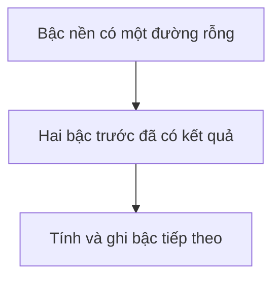

> [!tldr] Đọc nhanh
> - Trước khi viết vòng lặp, mình ghi thành câu giá trị ở chỉ số i trả lời câu hỏi nào. Câu đó quyết định điểm bắt đầu, công thức và kết quả cuối.
> - Từ lựa chọn cuối, mô tả đáp án lớn hơn bằng những đáp án nhỏ hơn. Có thể tính mỗi chỉ số một lần bằng memoization hoặc bảng điền theo thứ tự.
> - Chỉ xóa giá trị khi lượt sau đã dùng nó lần cuối. Climbing Stairs giữ hai số đi liền nhau, còn Maximum Product Subarray giữ cả cực đại lẫn cực tiểu kết thúc ở cùng một chỉ số.
> - Sáu bài trong ga dùng ba phép gộp. Cộng để đếm nhóm tách nhau, lấy min để chọn đường rẻ, lấy max để chọn kết quả lớn.

> [!info] Bối cảnh
> Đây là ga đầu của [[series/neetcode-dp|tuyến NeetCode: Quy hoạch động]]. Mình hình dung một nhân viên kho leo cầu thang và ghi sổ ở từng bậc. Bạn chỉ cần biết mảng, vòng lặp và cách một hàm đệ quy gọi lại chính nó.

> [!abstract]- Từ điển nhanh cho bài này (bấm để mở)
> - [[concepts/dp-state|DP State]] là ý nghĩa của một ô trong bảng. Với cầu thang, ô i đếm dãy bước kết thúc đúng i.
> - [[concepts/recurrence-relation|Recurrence Relation]] cho biết ô mới lấy thông tin từ ô nào.
> - [[concepts/memoization|Memoization]] ghi đáp án lần đầu gặp một đối số để lần sau đọc lại.
> - [[concepts/rolling-state|Rolling State]] dùng lại bộ nhớ của những ô đã có lần đọc cuối.

## Hình dung trước: ghi sổ ở từng bậc

Có một sổ ở cầu thang kho. Trang của bậc 4 ghi được 5 dãy bước vì bậc 3 có 3 dãy và bậc 2 có 2 dãy. Mỗi dãy nối thêm cú bước đúng độ dài để tới 4. Nếu câu hỏi chuyển sang phí ở từng bậc thì vẫn đọc hai trang trước, nhưng giờ chọn tổng chi phí nhỏ hơn sau khi cộng phí.

| Đời thường | Khái niệm |
|---|---|
| Câu hỏi viết trên mỗi trang | Trạng thái |
| Hai trang dùng để ghi thêm một trang | Truy hồi |
| Gặp ô đã ghi thì đọc lại ngay | Memoization |
| Giữ hai trang vừa ghi trong tay | Trạng thái cuộn |



## Vấn đề: một vòng lặp cần nhớ điều gì?

Khi mới thấy các bài này, mình thường hỏi nên dùng bảng hay hai biến. Câu hỏi đi trước đó là mình phải biết gì về đoạn đã đi qua để giải phần còn lại. Số cách tới một bậc đủ cho bài đếm. Với một đoạn tích, riêng tích dương lớn nhất có thể bỏ lỡ tích âm sẽ đổi dấu ở bước sau.

## Cơ chế

<figure class="figure-map" style="--ar: 3 / 4">
<div class="frame"><iframe data-archify="../diagrams/neetcode-linear-dp/stair-count.html" title="Hai giá trị cuộn trong Climbing Stairs" loading="lazy"></iframe></div>
<figcaption><span><b>Hình 1.</b> Mỗi bậc đọc đúng hai số, rồi bỏ số cũ nhất.</span><a href="../diagrams/neetcode-linear-dp/stair-count.html" target="_blank" rel="noopener">Mở toàn màn hình</a></figcaption>
</figure>

### Chốt trạng thái và cú đi cuối

Gọi `f(i)` là số dãy bước từ nền tới đúng i. Bước cuối dài một hoặc hai bậc. Xóa bước cuối khỏi một dãy, mình được đường tới `i−1` hoặc `i−2`. Hai tập dãy tách nhau, cho phép viết `f(i) = f(i−1) + f(i−2)`. Ở bậc 0 có một dãy rỗng, ở bậc 1 có một dãy một bước.

Mỗi lời gọi chỉ đọc chỉ số bé hơn. Vét cạn gặp lại `f(2)` khi tính `f(4)` qua cả `f(3)` và nhánh còn lại. Memo lưu kết quả theo chỉ số, còn bảng điền từ 0 đến n. Cả hai chỉ tính mỗi ô một lần. Nếu cần in một lộ trình tối ưu, giữ thêm lựa chọn trước đó trong bảng. Nếu chỉ trả giá trị cuối ở đây, qua lượt i có thể bỏ `f(i−2)`.

### Khuôn dùng chung

1. Viết một câu cho ô ở i. Phân biệt tiền tố dài i với phần tử ở chỉ số i.
2. Chia theo lựa chọn cuối. Đếm các nhóm tách nhau bằng phép cộng. Với giá trị tối ưu, so các phương án bằng min hoặc max.
3. Viết ca nhỏ nhất theo đúng ý nghĩa trạng thái. Cho thứ tự mà mỗi ô chỉ đọc kết quả đã có.
4. Vẽ riêng các phụ thuộc của một lượt. Giữ những ô vẫn còn được đọc, rồi chọn bảng hoặc vài biến.

| Bài | Điểm khác |
|---|---|
| [[problems/climbing-stairs|Climbing Stairs]] | Cộng số dãy theo bước cuối. |
| [[problems/min-cost-climbing-stairs|Min Cost Climbing Stairs]] | Chọn chi phí nhỏ nhất, phí thuộc bậc vừa rời. |
| [[problems/house-robber|House Robber]] | Bỏ nhà i hoặc lấy nhà i và bỏ nhà kề. |
| [[problems/house-robber-ii|House Robber II]] | Nhà đầu và cuối kề nhau. Chạy hai khoảng nửa mở, mỗi khoảng bỏ một đầu. |
| [[problems/decode-ways|Decode Ways]] | Chỉ cộng nhánh nếu chữ số đơn hoặc cặp cuối hợp lệ. |
| [[problems/maximum-product-subarray|Maximum Product Subarray]] | Giữ hai cực trị kết thúc ở i. Nhân số âm có thể đảo thứ tự. |

## Ví dụ chạy được

[TypeScript](../code/neetcode-linear-dp/recurrences.ts) · [Python](../code/neetcode-linear-dp/recurrences.py) · [Go](../code/neetcode-linear-dp/recurrences.go) · [Java](../code/neetcode-linear-dp/recurrences.java) · [JavaScript](../code/neetcode-linear-dp/recurrences.js) · [PHP](../code/neetcode-linear-dp/recurrences.php) · [Rust](../code/neetcode-linear-dp/recurrences.rs)

```ts
function countStairs(n: number) {
    let older = 1, latest = 1
    for (let i = 2; i <= n; i++) {
        ;[older, latest] = [latest, older + latest]
    }
    return latest
}
```

```python
def count_stairs(n):
    older = latest = 1
    for _ in range(2, n + 1):
        older, latest = latest, older + latest
    return latest
```

```go
func countStairs(n int) int {
	older, latest := 1, 1
	for i := 2; i <= n; i++ {
		older, latest = latest, older+latest
	}
	return latest
}
```

```java
static int countStairs(int n) {
    int older = 1, latest = 1;
    for (int i = 2; i <= n; i++) {
        int next = older + latest;
        older = latest;
        latest = next;
    }
    return latest;
}
```

```js
function countStairs(n) {
    let older = 1, latest = 1
    for (let i = 2; i <= n; i++) {
        ;[older, latest] = [latest, older + latest]
    }
    return latest
}
```

```php
function countStairs(int $n): int {
    $older = $latest = 1;
    for ($i = 2; $i <= $n; $i++) {
        [$older, $latest] = [$latest, $older + $latest];
    }
    return $latest;
}
```

```rust
fn count_stairs(n: usize) -> i32 {
    let (mut older, mut latest) = (1, 1);
    for _ in 2..=n {
        (older, latest) = (latest, older + latest);
    }
    latest
}
```

Đoạn tab là bài neo đếm cầu thang. Mỗi file tải về chạy cả sáu bài trên 10 ca, gồm nhà đơn, đoạn có 0 và chuỗi dài có đuôi không giải mã được. Ở bản kiểu số hữu hạn, phép cộng đếm giải mã được chặn ở giới hạn số nguyên có dấu 32 bit. Các phép cộng của bài chỉ gộp các số không âm. Giá trị cuối đã được đề bảo đảm nằm trong giới hạn, nên việc chặn các tiền tố quá lớn vẫn giữ đúng giá trị cuối. Python dùng số nguyên không giới hạn theo 32 bit.

```text
10/10 ca đúng
```

Mỗi lời giải trong file đi qua dữ liệu tối đa hai lần. Bộ nhớ phụ của các vòng lặp là O(1), gồm các chỉ số ở House Robber II. Chạy bằng `node recurrences.ts`, `python3 recurrences.py`, `go run recurrences.go`, `java recurrences.java`, `node recurrences.js`, `php recurrences.php` hoặc `rustc --edition 2021 -O recurrences.rs -o /tmp/recurrences && /tmp/recurrences`.

## Hiểu lầm và bẫy hay gặp

- Điền cơ sở theo thói quen. `f(0) = 1` khi đếm đường rỗng, nhưng chi phí đã trả trước khi rời bậc 0 lại bằng 0.
- Lưu mỗi một kết quả tốt nhất toàn tiền tố khi bài cần đoạn liên tục kết thúc ở i. Kéo dài đoạn phải nhân đúng với kết quả kết thúc ở i−1.
- Đổi biến quá sớm. Tính đủ giá trị mới từ cặp cũ trước, rồi mới dịch.
- Dùng `slice` để tách hai lượt trên một vòng nhà có thể cấp phát mảng mới tùy ngôn ngữ. Hai chỉ số bắt đầu và kết thúc cho phép đọc trực tiếp cùng mảng.

## Câu hỏi tự kiểm tra

> [!question]- Cơ sở nào cho cú nhảy 0 → 2?
> Dãy bước rỗng ở bậc 0 đóng góp một cách, rồi nối cú nhảy dài hai bậc.

> [!question]- Tại sao phải giữ tích nhỏ nhất khi cần tích lớn nhất?
> Nếu số tiếp theo âm, nó nhân tích âm nhỏ nhất thành tích dương có thể lớn nhất.

> [!question]- Lúc nào chọn bảng thay vì biến cuộn?
> Khi còn cần đọc các ô cũ hoặc lần theo các lựa chọn để dựng lại đáp án.

## Tham khảo

- [MIT 6.006, bài giảng về memoization và thứ tự điền bảng](https://ocw.mit.edu/courses/6-006-introduction-to-algorithms-fall-2011/resources/mit6_006f11_lec19/)
- [LeetCode 70, Climbing Stairs](https://leetcode.com/problems/climbing-stairs/)
