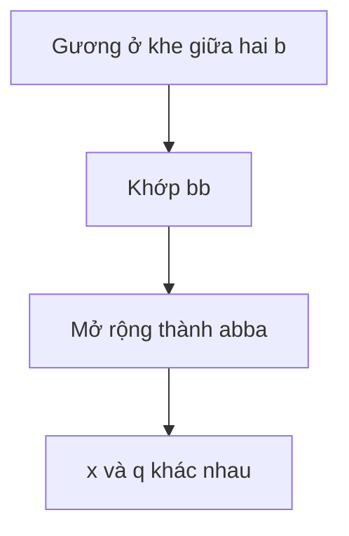

> [!tldr] Đọc nhanh
> - Một đoạn đối xứng có [[concepts/palindrome-center|tâm]] tại ký tự hoặc tại khe.
> - Mở cặp đối diện tại từng tâm là khuôn chung. Bài tìm đoạn dài nhất giữ giá trị lớn nhất. Bài đếm cộng số đoạn xuất hiện.
> - [[concepts/palindrome-radius|Bán kính ảo]] mô tả đoạn lớn nhất và suy ra số đoạn lồng nhau.
> - Manacher tái dùng phần đã khớp trong cửa sổ phải xa nhất để đạt O(n).

> [!info] Bối cảnh
> Đây là ga 2 của [[series/neetcode-dp|tuyến NeetCode: Quy hoạch động]]. Bảng DP là một hướng giải quen thuộc, nhưng ở đây hình học của đoạn đối xứng giúp mình giảm bộ nhớ. Bạn chỉ cần biết cách đọc một xâu bằng chỉ số và phép chia nguyên.

> [!abstract]- Từ điển nhanh cho bài này (bấm để mở)
> - **Đoạn con** là khoảng liên tiếp trong xâu.
> - **Tâm chẵn** nằm giữa hai chữ. **Tâm lẻ** trùng với một chữ.
> - **Phản chiếu** đổi một vị trí ở bên trái tâm sang vị trí cùng khoảng cách ở bên phải.

## Hình dung trước: đặt gương lên dải chữ

Mình đặt một chiếc gương giữa hai b của `xabbaq`. Đi hai phía một bước thấy cặp b, mở tiếp thấy cặp a. Cặp x và q không giống nhau nên dừng. Đo đoạn dài nhất ở đây được 4. Đếm các đoạn nảy sinh tại đây được 2.

| Đời thường | Khái niệm |
|---|---|
| Vị trí đặt gương | Tâm ký tự hoặc tâm khe |
| Đi một cặp sang hai phía | Một lượt mở |
| Mở đến trước cặp sai | Bán kính lớn nhất |
| Khoanh từng đoạn nhìn thấy trong gương | Số đoạn đối xứng tại tâm |



## Vấn đề: cùng vết đối xứng, hai kiểu kết quả

Có n(n+1)/2 đoạn liên tiếp. Kiểm từng đoạn tốn O(n³) nếu mỗi đoạn phải đọc lại từ hai đầu. Bảng DP cho biết đoạn nhỏ bên trong đã đúng chưa và giảm xuống O(n²) thời gian, nhưng vẫn giữ O(n²) ô. Với hai câu hỏi của ga, mỗi đoạn chỉ cần được tính nhờ tâm riêng của nó.

## Cơ chế

<figure class="figure-map" style="--ar: 3 / 4">
<div class="frame"><iframe data-archify="../diagrams/neetcode-palindrome-centers/center-trace.html" title="Mở từ khe giữa hai chữ b" loading="lazy"></iframe></div>
<figcaption><span><b>Hình 1.</b> Chỉ một tâm chẵn đã cho hai đoạn lồng nhau. Cách cộng kết quả quyết định mình giải bài nào.</span><a href="../diagrams/neetcode-palindrome-centers/center-trace.html" target="_blank" rel="noopener">Mở toàn màn hình</a></figcaption>
</figure>

### Mở từng tâm độc lập

Ở mỗi tâm, bắt đầu tại chữ hoặc khe. Dò hai phía song song cho đến khi lệch hoặc hết xâu. Tất cả đoạn về cùng tâm lồng nhau. Một sai khác loại luôn những đoạn lớn hơn ở tâm đó. Khuôn này tốn O(n²) thời gian trong chuỗi lặp và O(1) bộ nhớ phụ.

Dùng tọa độ ảo để áp dụng cùng vòng lặp cho hai loại tâm. Ký tự thật ở vị trí lẻ, khe ở vị trí chẵn. Hai khe khớp mặc định. Bán kính lớn nhất r là độ dài trong xâu thật và tâm ở i cho điểm bắt đầu `(i-r)/2`.

### Bắt đầu từ miền đã biết

Manacher lưu bán kính mỗi tâm. Trong palindrome có biên phải xa nhất R, ứng viên tại i lấy phần đã biết của tâm phản chiếu, giới hạn bởi `R-i`. Thử mở tại biên để cập nhật R khi có thể. Mỗi bước mở thành công cần kiểm mới sẽ mở rộng biên phải, và mỗi tâm có nhiều nhất một lần dừng do lệch. Do đó thời gian O(n), bộ nhớ O(n).

| Bài | Điểm khác |
|---|---|
| [[problems/longest-palindromic-substring|LC-0005]] | Giữ tâm của bán kính lớn nhất rồi cắt đúng một đoạn. |
| [[problems/palindromic-substrings|LC-0647]] | Mỗi tâm góp `⌊(r+1)/2⌋` đoạn. Cộng qua tất cả các tâm. |

## Ví dụ chạy được

Các file của ga kiểm cả đoạn dài nhất `abba` và tổng 8 đoạn của `xabbaq`, với cả mở độc lập và Manacher. Các tab trích phần chạy hai phép kiểm. [Bản đo số lượt dò](../code/neetcode-palindrome-centers/compare.ts) dùng 1.000 chữ a.

[TypeScript](../code/neetcode-palindrome-centers/station.ts) · [Python](../code/neetcode-palindrome-centers/station.py) · [Go](../code/neetcode-palindrome-centers/station.go) · [Java](../code/neetcode-palindrome-centers/station.java) · [JavaScript](../code/neetcode-palindrome-centers/station.js) · [PHP](../code/neetcode-palindrome-centers/station.php) · [Rust](../code/neetcode-palindrome-centers/station.rs)

```typescript
const text = "xabbaq";
for (const reuseMirror of [false, true]) {
  if (longestPalindrome(text, reuseMirror) !== "abba") throw new Error("Sai đoạn dài nhất");
  if (countSubstrings(text, reuseMirror) !== 8) throw new Error("Sai số đoạn");
}
console.log("2/2 ca đúng");
```

```python
text = "xabbaq"
for reuse_mirror in (False, True):
    assert longest_palindrome(text, reuse_mirror) == "abba"
    assert count_substrings(text, reuse_mirror) == 8
print("2/2 ca đúng")
```

```go
func main() {
	text := "xabbaq"
	for _, reuseMirror := range []bool{false, true} {
		if longestPalindrome(text, reuseMirror) != "abba" {
			panic("Sai đoạn dài nhất")
		}
		if countSubstrings(text, reuseMirror) != 8 {
			panic("Sai số đoạn")
		}
	}
	fmt.Println("2/2 ca đúng")
}
```

```java
class Station {
    public static void main(String[] args) {
        String text = "xabbaq";
        for (boolean reuseMirror : new boolean[]{false, true}) {
            if (!Centers.longestPalindrome(text, reuseMirror).equals("abba")) {
                throw new AssertionError("Sai đoạn dài nhất");
            }
            if (Centers.countSubstrings(text, reuseMirror) != 8) {
                throw new AssertionError("Sai số đoạn");
            }
        }
        System.out.println("2/2 ca đúng");
    }
}
```

```javascript
const text = "xabbaq";
for (const reuseMirror of [
    false,
    true
]){
    if (longestPalindrome(text, reuseMirror) !== "abba") throw new Error("Sai đoạn dài nhất");
    if (countSubstrings(text, reuseMirror) !== 8) throw new Error("Sai số đoạn");
}
console.log("2/2 ca đúng");
```

```php
$text = 'xabbaq';
foreach ([false, true] as $reuseMirror) {
    if (longestPalindrome($text, $reuseMirror) !== 'abba') {
        throw new RuntimeException('Sai đoạn dài nhất');
    }
    if (countSubstrings($text, $reuseMirror) !== 8) {
        throw new RuntimeException('Sai số đoạn');
    }
}
echo "2/2 ca đúng\n";
```

```rust
fn main() {
    let text = "xabbaq";
    for reuse_mirror in [false, true] {
        assert_eq!(longest_palindrome(text, reuse_mirror), "abba");
        assert_eq!(count_substrings(text, reuse_mirror), 8);
    }
    println!("2/2 ca đúng");
}
```

Cả bảy file của ga in `2/2 ca đúng`. Kết quả của bản đo TypeScript.

```text
Mở từ tâm: 1000000 lượt dò, 500500 đoạn
Manacher: 1999 lượt dò, 500500 đoạn
2/2 ca đúng
```

## Hiểu lầm và bẫy hay gặp

- Một lập trình viên chỉ thử tâm ở chữ sẽ không thấy đoạn chẵn. Dò cả khe.
- Đếm tổng bán kính ảo làm lẫn lượt khớp khe và số đoạn thật.
- Một đoạn có nội dung giống đoạn ở chỗ khác vẫn có đóng góp riêng. Giữ đầu mút, không gom theo chữ.

## Câu hỏi tự kiểm tra

> [!question]- Vì sao dùng được công thức đóng góp giống nhau cho hai loại tâm?
> r chẵn cho các độ dài 2, 4, …, r. r lẻ cho 1, 3, …, r. Cả hai đều có `⌊(r+1)/2⌋` hạng.

> [!question]- Có phải Manacher không còn so từng ký tự?
> Vẫn so ở rìa vùng đã biết. Khác biệt là không cần so lại phần đã chứng minh khớp.

## Tham khảo

- [Princeton Algorithms, Manacher](https://algs4.cs.princeton.edu/53substring/Manacher.java.html)
- [Bài báo gốc của Manacher](https://doi.org/10.1145/321892.321896)
- [Đề LC-0005](https://leetcode.com/problems/longest-palindromic-substring/) và [đề LC-0647](https://leetcode.com/problems/palindromic-substrings/)
