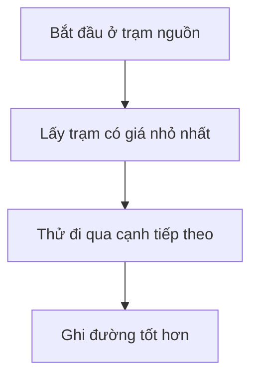

> [!tldr] Đọc nhanh
> - Mình hỏi chi phí của một đường được tính bằng phép gì trước khi chọn cách duyệt. Cộng thời gian và lấy độ cao lớn nhất đều cho một chi phí trên mỗi đường.
> - [[concepts/dijkstra|Dijkstra]] lấy mục rẻ nhất còn khớp với sổ. Với cạnh không âm, phần đường chưa đi không thể làm chi phí giảm.
> - [[concepts/minimax-path|Đường đi minimax]] thay phép cộng bằng `max`. Chi phí nguồn là độ cao ô xuất phát.
> - Giới hạn số chặng làm thay đổi trạng thái. [[concepts/edge-layer-relaxation|Relaxation theo lớp cạnh]] chỉ nối thêm một cạnh ở mỗi lượt.

> [!info] Bối cảnh
> Đây là ga 5 trên [[series/neetcode-grph|tuyến NeetCode Đồ thị]]. [[posts/2026-11-26-neetcode-graph-bfs|Ga duyệt đồ thị và BFS]] đã cho cách đo đường theo số cạnh. Lần này mỗi cạnh có con số riêng. Chỉ cần biết vòng lặp và mảng để bắt đầu.

> [!abstract]- Từ điển nhanh cho bài này (bấm để mở)
> - Trọng số là thời gian, độ cao hoặc giá gắn với một cạnh đi tới đích.
> - [[concepts/adjacency-list|Danh sách kề]] cho mình biết những bước đi tiếp được từ một đỉnh.
> - [[concepts/heap|Min-heap]] cho mình lấy bản ghi đang chờ có giá nhỏ nhất.
> - Relaxation nghĩa là thử thay chi phí ghi trong sổ bằng một chi phí tốt hơn qua cạnh vừa xét.

## Hình dung trước: bản đồ trạm tiếp sóng

Mình theo dấu một cảnh báo mưa qua bốn trạm. Trạm 1 gửi sang 3 mất 2 phút, trạm 3 sang 2 mất 1 phút, rồi trạm 2 sang 4 mất 4 phút. Kênh thẳng 1 → 2 mất 9 phút. Khi không hạn chế chuyển tiếp, tin đến trạm 4 ở phút 7. Nếu mạng cấm chuyển quá hai lần truyền, tuyến ba cạnh này không được dùng.

| Đời thường | Khái niệm |
| --- | --- |
| Trạm và kênh truyền | Đỉnh và cạnh có hướng |
| Sổ ghi lúc nghe sớm nhất | Khoảng cách tạm thời |
| Trạm có mốc giờ nhỏ nhất còn chờ | Bản ghi lấy từ min-heap |
| Mốc cao nhất trên một đường | Chi phí minimax |
| Số lần chuyển tiếp còn được phép | Giới hạn cạnh trong trạng thái |



## Vấn đề: trọng số thay đổi thứ tự cần duyệt

BFS lấy đỉnh theo lớp của số bước. Với trọng số không đều, đường đi hai cạnh ngắn có thể nhanh hơn một cạnh dài. Mình cần ghi rõ ba thứ. Giá bắt đầu là bao nhiêu, việc nối một cạnh đổi giá thế nào, và hai đường tới cùng đỉnh có thực sự thay thế được nhau không.

## Cơ chế

### Cùng một vòng lặp cho hai quy tắc chi phí

Khởi tạo `best` với giá nguồn và vô cực ở đỉnh còn lại. Lấy cặp `(d, u)` có giá nhỏ nhất. Nếu `d` khác `best[u]`, bản ghi đó đã cũ. Nếu còn hiệu lực, thử đi tiếp qua từng cạnh `u → v`. Cập nhật `best[v]` và đẩy một bản ghi khi tìm thấy giá tốt hơn.

Trong bài tín hiệu, việc nối cạnh có dạng `d + weight`. Trong bài bơi qua nước dâng, giá ban đầu là độ cao ở nguồn và bước nối là `max(d, elevation)`. Cả hai quy tắc đều giữ hoặc tăng giá và bảo toàn thứ tự khi mở rộng hai đường qua cùng một cạnh. Khi giả sử có giá thấp hơn cho đỉnh chuẩn bị lấy, đỉnh chưa chốt đầu tiên trên đường tốt hơn phải đang có giá thấp hơn trong hàng chờ. Mâu thuẫn đó cho phép mình chốt.

<figure class="figure-map" style="--ar: 2 / 3">
<div class="frame"><iframe data-archify="../diagrams/neetcode-shortest-path/dijkstra-trace.html" title="Các bản ghi đi qua min-heap" loading="lazy"></iframe></div>
<figcaption><span><b>Hình 1.</b> Mốc 9 vẫn nằm trong heap sau khi mốc 3 được ghi cho trạm 2. Vòng lặp bỏ mốc cũ lúc lấy ra.</span><a href="../diagrams/neetcode-shortest-path/dijkstra-trace.html" target="_blank" rel="noopener">Mở toàn màn hình</a></figcaption>
</figure>

### Khi giới hạn cạnh làm thay đổi trạng thái

Trong bài chuyến bay, đặt một giá duy nhất cho mỗi thành phố có thể làm mất đường đắt hơn nhưng chưa dùng hết chặng. Cố định một lớp `i` cho các đường dùng tối đa i chặng. Đọc `best` của lớp cũ và ghi sang bản sao. Sau `k + 1` lượt, lớp cuối đáp ứng giới hạn k điểm dừng trung gian.

Nếu giá được phép giảm khi thêm cạnh, chẳng hạn cạnh có trọng số âm trong bài cộng chi phí, chứng minh chốt của Dijkstra không còn áp dụng. Theo lớp số cạnh vẫn cho phép cộng giá mà phân biệt đúng hai phiên bản của trạng thái.

| Bài | Điểm khác |
| --- | --- |
| [[problems/network-delay-time\|Network Delay Time]] | Cộng thời gian. Lấy `max` các khoảng cách ngắn nhất sau khi đã loại trạm không tới được. |
| [[problems/swim-in-rising-water\|Swim in Rising Water]] | Lấy độ cao lớn nhất trên đường. Giá bắt đầu là độ cao của ô nguồn. |
| [[problems/cheapest-flights-within-k-stops\|Cheapest Flights Within K Stops]] | Cộng giá vé với ngân sách `k + 1` cạnh. Tách hai lớp khi cập nhật. |

## Ví dụ chạy được

[TypeScript](../code/neetcode-shortest-path/weighted-route.ts) · [Python](../code/neetcode-shortest-path/weighted_route.py) · [Go](../code/neetcode-shortest-path/weighted_route.go) · [Java](../code/neetcode-shortest-path/weighted-route.java) · [JavaScript](../code/neetcode-shortest-path/weighted-route.js) · [PHP](../code/neetcode-shortest-path/weighted-route.php) · [Rust](../code/neetcode-shortest-path/weighted_route.rs)

Tab hiển thị vòng lặp Dijkstra chung. Mỗi file tải về cũng có bộ nạp lưới, vòng lặp theo ngân sách cạnh và năm ca cho mỗi bài. Chạy trực tiếp bằng runtime tương ứng. Rust dùng `rustc --edition 2021 -O` rồi chạy file nhị phân.

```ts
function leastCosts(
  graph: Neighbor[][],
  start: number,
  initial: number,
  extend: (cost: number, weight: number) => number,
): number[] {
  const best = Array<number>(graph.length).fill(Infinity)
  best[start] = initial
  const pending = new MinHeap()
  pending.push([initial, start])
  while (pending.items.length > 0) {
    const [cost, from] = pending.pop()
    if (cost !== best[from]) continue
    for (const [to, weight] of graph[from]) {
      const candidate = extend(cost, weight)
      if (candidate >= best[to]) continue
      best[to] = candidate
      pending.push([candidate, to])
    }
  }
  return best
}
```

```python
def least_costs(graph, start, initial, extend):
    best = [float("inf")] * len(graph)
    best[start] = initial
    pending = [(initial, start)]
    while pending:
        cost, source = heappop(pending)
        if cost != best[source]:
            continue
        for target, weight in graph[source]:
            candidate = extend(cost, weight)
            if candidate < best[target]:
                best[target] = candidate
                heappush(pending, (candidate, target))
    return best
```

```go
func leastCosts(graph [][]neighbor, start, initial int, extend func(int, int) int) []int {
	best := make([]int, len(graph))
	for i := range best {
		best[i] = infinity
	}
	best[start] = initial
	pending := &frontier{{initial, start}}
	for pending.Len() > 0 {
		current := heap.Pop(pending).(entry)
		if current.cost != best[current.node] {
			continue
		}
		for _, edge := range graph[current.node] {
			candidate := extend(current.cost, edge.weight)
			if candidate < best[edge.node] {
				best[edge.node] = candidate
				heap.Push(pending, entry{candidate, edge.node})
			}
		}
	}
	return best
}
```

```java
static int[] leastCosts(List<List<int[]>> graph, int start, int initial, IntBinaryOperator extend) {
    int[] best = new int[graph.size()];
    Arrays.fill(best, Integer.MAX_VALUE);
    best[start] = initial;
    var queue = new PriorityQueue<int[]>(Comparator.comparingInt(entry -> entry[0]));
    queue.add(new int[]{initial, start});
    while (!queue.isEmpty()) {
        int[] entry = queue.remove();
        int cost = entry[0], source = entry[1];
        if (cost != best[source]) continue;
        for (int[] edge : graph.get(source)) {
            int target = edge[0];
            int candidate = extend.applyAsInt(cost, edge[1]);
            if (candidate < best[target]) {
                best[target] = candidate;
                queue.add(new int[]{candidate, target});
            }
        }
    }
    return best;
}
```

```js
function leastCosts(
  graph,
  start,
  initial,
  extend,
) {
  const best = Array(graph.length).fill(Infinity)
  best[start] = initial
  const pending = new MinHeap()
  pending.push([initial, start])
  while (pending.items.length > 0) {
    const [cost, from] = pending.pop()
    if (cost !== best[from]) continue
    for (const [to, weight] of graph[from]) {
      const candidate = extend(cost, weight)
      if (candidate >= best[to]) continue
      best[to] = candidate
      pending.push([candidate, to])
    }
  }
  return best
}
```

```php
function leastCosts(array $graph, int $start, int $initial, callable $extend): array {
    $best = array_fill(0, count($graph), PHP_INT_MAX);
    $best[$start] = $initial;
    $pending = new SplPriorityQueue();
    $pending->insert([$initial, $start], -$initial);
    while (!$pending->isEmpty()) {
        [$cost, $source] = $pending->extract();
        if ($cost !== $best[$source]) {
            continue;
        }
        foreach ($graph[$source] as [$target, $weight]) {
            $candidate = $extend($cost, $weight);
            if ($candidate < $best[$target]) {
                $best[$target] = $candidate;
                $pending->insert([$candidate, $target], -$candidate);
            }
        }
    }
    return $best;
}
```

```rust
fn least_costs(
    graph: &[Vec<(usize, i32)>],
    start: usize,
    initial: i32,
    extend: impl Fn(i32, i32) -> i32,
) -> Vec<i32> {
    let mut best = vec![i32::MAX; graph.len()];
    best[start] = initial;
    let mut pending = BinaryHeap::from([Reverse((initial, start))]);
    while let Some(Reverse((cost, source))) = pending.pop() {
        if cost != best[source] {
            continue;
        }
        for &(target, weight) in &graph[source] {
            let candidate = extend(cost, weight);
            if candidate < best[target] {
                best[target] = candidate;
                pending.push(Reverse((candidate, target)));
            }
        }
    }
    best
}
```

```text
15/15 ca đúng
```

## Hiểu lầm và bẫy hay gặp

- **Lấy bản ghi lần đầu đưa vào heap là kết quả.** Trạm 2 đã từng có giá 9, nhưng giá còn giảm.
- **Đo độ dài đường bằng số bước.** Trọng số của từng cạnh mới quyết định giá của bài tín hiệu.
- **Áp dụng cùng một phép cộng cho cả ba bài.** Đường nước dâng chỉ cần vượt bậc cao nhất, còn chuyến bay cần theo dõi cả chặng.

## Câu hỏi tự kiểm tra

> [!question]- Tại sao dấu bằng khi cập nhật không cần thêm mục vào heap?
> Giá cạnh tranh là như nhau và quy tắc mở rộng giữ thứ tự. Thêm một bản ghi bằng giá chỉ lặp việc.

> [!question]- Khi nào cùng một đỉnh cần hai trạng thái?
> Khi đường tới đó còn các lựa chọn khác nhau, chẳng hạn hai mức ngân sách chặng.

> [!question]- Dijkstra xử lý cạnh thời gian bằng 0 được không?
> Có. Phép cộng 0 không làm giá giảm.

## Tham khảo

- [LeetCode · Network Delay Time](https://leetcode.com/problems/network-delay-time/)
- [LeetCode · Swim in Rising Water](https://leetcode.com/problems/swim-in-rising-water/)
- [LeetCode · Cheapest Flights Within K Stops](https://leetcode.com/problems/cheapest-flights-within-k-stops/)
- [Dijkstra (1959)](https://doi.org/10.1007/BF01386390)
- [MIT 6.006 · Bellman–Ford](https://ocw.mit.edu/courses/6-006-introduction-to-algorithms-spring-2020/resources/mit6_006s20_lec12/)
