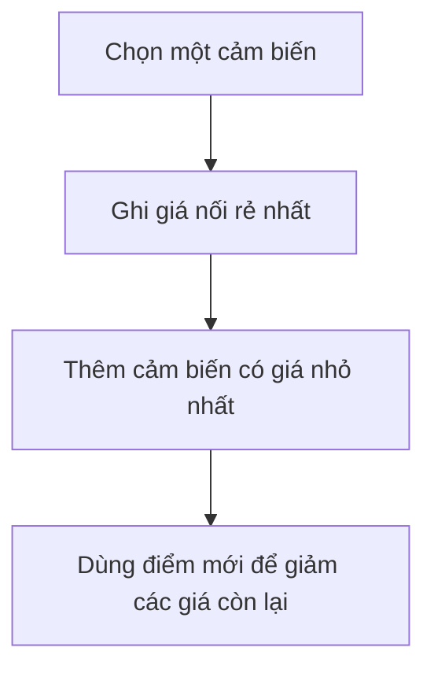

> [!tldr] Đọc nhanh
> - [[concepts/minimum-spanning-tree|Cây khung nhỏ nhất]] chọn một tập cạnh vừa đủ nối tất cả đỉnh và có tổng giá thấp nhất.
> - Prim dùng [[concepts/cut-property|tính chất lát cắt]] để mở rộng từ một cây. Kruskal nối nhiều thành phần thành một cây.
> - Một [[concepts/eulerian-trail|đường đi Euler]] đi qua tất cả cạnh đã cho đúng một lần và có thể thăm lại đỉnh.
> - [[concepts/hierholzers-algorithm|Hierholzer]] chốt hậu tố trước để các vòng quay về đỉnh được ghép trước lần rời đỉnh cuối cùng.

> [!info] Bối cảnh
> Đây là ga 6 của [[series/neetcode-grph|tuyến NeetCode: Đồ thị]]. Ở ga này mình vừa phải thiết kế mạng dây tối giản, vừa xếp một tuyến giao hàng sao cho dùng hết các chặng được đặt trước. Bạn cần nắm mảng, ngăn xếp và nghĩa của một cạnh. Phần Kruskal dùng lại [[concepts/disjoint-set-union|Union-Find]].

> [!abstract]- Từ điển nhanh cho bài này (bấm để mở)
> - **Cây** là một đồ thị vô hướng liên thông không có vòng.
> - **Đồ thị đầy đủ** có một cạnh giữa mọi cặp đỉnh khác nhau. Có thể tính cạnh khi cần thay vì ghi sẵn.
> - **Cạnh song song** là nhiều cạnh có cùng hai đầu. Mỗi vé bay vẫn đại diện cho một cạnh riêng.
> - **Hậu tố** là đoạn cuối của một dãy.

## Hình dung trước: kéo dây và giao trên cùng khu phố

Mình có bốn cảm biến cần nối vào một mạng. Sau khi chọn một cảm biến làm điểm bắt đầu, sổ tay ghi cho từng cảm biến còn ngoài giá dây rẻ nhất để nối vào nhóm. Cứ thêm cảm biến có giá thấp nhất rồi cập nhật sổ. Khi tới phần giao hàng, mỗi vé đã đặt là một chặng phải đi. Một chặng đến ngõ cụt chỉ dùng được ở cuối, dù mã điểm đến nhỏ hơn những mã khác.

| Đời thường | Khái niệm |
|---|---|
| Hệ thống dây nhẹ nhất vẫn nối mọi cảm biến | Cây khung nhỏ nhất |
| Đường ranh giữa nhóm đã nối và chưa nối | Lát cắt của Prim |
| Từng tờ vé bắt buộc được dùng | Cạnh trong đường đi Euler |
| Ghi ngõ cụt vào cuối và dành chỗ ghép vòng giao | Hierholzer |



## Vấn đề: xác định vai trò của cạnh

Khi lắp mạng dây, mình được tự chọn cạnh và chỉ cần n−1 dây. Khi xếp hành trình, cạnh là vé đã mua và mỗi vé phải xuất hiện một lần. Một cây tối ưu giá dây không thể thay cho hành trình, và đi hết các cạnh không tối ưu hóa chi phí mạng.

## Cơ chế

<figure class="figure-map" style="--ar: 3 / 4">
<div class="frame"><iframe data-archify="../diagrams/neetcode-spanning-tree-itinerary/prim-trace.html" title="Sổ chi phí của Prim" loading="lazy"></iframe></div>
<figcaption><span><b>Hình 1.</b> Mỗi điểm mới chỉ mở thêm các cạnh đi từ nó, nên mình cập nhật được sổ giá mà không dựng toàn bộ đồ thị.</span><a href="../diagrams/neetcode-spanning-tree-itinerary/prim-trace.html" target="_blank" rel="noopener">Mở toàn màn hình</a></figcaption>
</figure>

### Khuôn Prim

Giữ một tập điểm trong cây và một khóa `best[i]` cho mỗi điểm bên ngoài. Khóa là giá **một cạnh** rẻ nhất từ cây tới điểm đó. Chọn khóa nhỏ nhất rồi dùng cạnh từ điểm vừa nhận để giảm các khóa khác. Kết quả có n−1 cạnh thực vì điểm bắt đầu có khóa 0. Tính chất lát cắt cho phép chọn cạnh bắc qua ranh với giá nhỏ nhất. Nếu cây tối ưu chưa chọn cạnh ấy, đổi nó với một cạnh bắc qua trên vòng vừa tạo mà không tăng tổng.

Mỗi tọa độ trong bài neo có thể nối vào mọi điểm khác. Quét mảng n lần dùng O(n²) thời gian và O(n) bộ nhớ. Kruskal xây mọi cạnh, sắp theo giá và bỏ cạnh có hai đầu đã thông, dùng O(n² log n) thời gian và O(n²) bộ nhớ trên đồ thị đầy đủ.

### Khuôn Hierholzer

Đi theo một cạnh chưa dùng và lưu đường đi tạm trong ngăn xếp. Khi đầu ngăn xếp hết cạnh đi, đưa nó sang kết quả ngược. Duyệt hết rồi đảo một lần. Nếu đề muốn hành trình nhỏ nhất theo thứ tự từ điển, sắp điểm đến giảm dần để ưu tiên lấy điểm nhỏ từ cuối. Vé được lấy ra một lần nhưng một đỉnh có thể được đẩy nhiều lần. Với E vé, việc sắp xếp chi phối cận trên O(E log E), còn bộ nhớ là O(E).

| Bài | Điểm khác |
|---|---|
| [[problems/min-cost-to-connect-all-points|LC-1584]] | Giá cạnh là khoảng cách Manhattan. Chọn cạnh theo trọng số. |
| [[problems/reconstruct-itinerary|LC-0332]] | Mỗi vé là một cạnh có hướng. Dùng tất cả và ưu tiên mã nhỏ khi có thể. |

## Ví dụ chạy được

Các file của ga kiểm giá 7 bằng Prim và Kruskal, rồi kiểm hành trình `JFK → BBB → JFK → AAA`. Các tab trích phần chạy hai phép kiểm. [Bản đo TypeScript](../code/neetcode-spanning-tree-itinerary/compare.ts) đếm cạnh lưu và lượt lấy vé.

[TypeScript](../code/neetcode-spanning-tree-itinerary/station.ts) · [Python](../code/neetcode-spanning-tree-itinerary/station.py) · [Go](../code/neetcode-spanning-tree-itinerary/station.go) · [Java](../code/neetcode-spanning-tree-itinerary/station.java) · [JavaScript](../code/neetcode-spanning-tree-itinerary/station.js) · [PHP](../code/neetcode-spanning-tree-itinerary/station.php) · [Rust](../code/neetcode-spanning-tree-itinerary/station.rs)

```typescript
const points: Point[] = [[0, 0], [4, 0], [5, 0], [5, 2]];
const tickets: [string, string][] = [["JFK", "AAA"], ["JFK", "BBB"], ["BBB", "JFK"]];
if (prim(points) !== 7 || kruskal(points) !== 7) throw new Error("Sai giá nối");
if (findItinerary(tickets).join(" ") !== "JFK BBB JFK AAA") throw new Error("Sai hành trình");
console.log("2/2 ca đúng");
```

```python
points = [(0, 0), (4, 0), (5, 0), (5, 2)]
tickets = [("JFK", "AAA"), ("JFK", "BBB"), ("BBB", "JFK")]
assert prim(points) == kruskal(points) == 7
assert find_itinerary(tickets) == ["JFK", "BBB", "JFK", "AAA"]
print("2/2 ca đúng")
```

```go
func main() {
	points := []point{{0, 0}, {4, 0}, {5, 0}, {5, 2}}
	tickets := [][2]string{{"JFK", "AAA"}, {"JFK", "BBB"}, {"BBB", "JFK"}}
	if prim(points) != 7 || kruskal(points) != 7 {
		panic("Sai giá nối")
	}
	if strings.Join(findItinerary(tickets), " ") != "JFK BBB JFK AAA" {
		panic("Sai hành trình")
	}
	fmt.Println("2/2 ca đúng")
}
```

```java
class Station {
    public static void main(String[] args) {
        int[][] points = {{0, 0}, {4, 0}, {5, 0}, {5, 2}};
        String[][] tickets = {{"JFK", "AAA"}, {"JFK", "BBB"}, {"BBB", "JFK"}};
        if (Connect.prim(points) != 7 || Connect.kruskal(points) != 7) {
            throw new AssertionError("Sai giá nối");
        }
        if (!String.join(" ", Itinerary.findItinerary(tickets)).equals("JFK BBB JFK AAA")) {
            throw new AssertionError("Sai hành trình");
        }
        System.out.println("2/2 ca đúng");
    }
}
```

```javascript
const points = [
    [
        0,
        0
    ],
    [
        4,
        0
    ],
    [
        5,
        0
    ],
    [
        5,
        2
    ]
];
const tickets = [
    [
        "JFK",
        "AAA"
    ],
    [
        "JFK",
        "BBB"
    ],
    [
        "BBB",
        "JFK"
    ]
];
if (prim(points) !== 7 || kruskal(points) !== 7) throw new Error("Sai giá nối");
if (findItinerary(tickets).join(" ") !== "JFK BBB JFK AAA") throw new Error("Sai hành trình");
console.log("2/2 ca đúng");
```

```php
$points = [[0, 0], [4, 0], [5, 0], [5, 2]];
$tickets = [['JFK', 'AAA'], ['JFK', 'BBB'], ['BBB', 'JFK']];
if (prim($points) !== 7 || kruskal($points) !== 7) {
    throw new RuntimeException('Sai giá nối');
}
if (findItinerary($tickets) !== ['JFK', 'BBB', 'JFK', 'AAA']) {
    throw new RuntimeException('Sai hành trình');
}
echo "2/2 ca đúng\n";
```

```rust
fn main() {
    let points = [(0, 0), (4, 0), (5, 0), (5, 2)];
    let tickets = [("JFK", "AAA"), ("JFK", "BBB"), ("BBB", "JFK")];
    assert_eq!(prim(&points), 7);
    assert_eq!(kruskal(&points), 7);
    assert_eq!(find_itinerary(&tickets), ["JFK", "BBB", "JFK", "AAA"]);
    println!("2/2 ca đúng");
}
```

Cả bảy file của ga in `2/2 ca đúng`. Kết quả của bản đo TypeScript.

```text
Quay lui thử 3928 vé, Hierholzer lấy 15 vé
Với n=1000: Kruskal lưu 499500 cạnh, Prim lưu 1000 khóa best
2/2 ca đúng
```

## Hiểu lầm và bẫy hay gặp

- Giá Prim chỉ là trọng số cạnh đi vào cây. Cộng dồn từ đỉnh gốc đổi mục tiêu sang đường đi ngắn.
- Giữ tập sân bay đã thăm sẽ bỏ mất vòng cần thiết. Hãy đánh dấu từng cạnh bằng cách lấy vé khỏi danh sách.
- Tạo chương trình quay lui cho vé nhỏ có thể đi vào ngõ cụt và phải mở lại rất nhiều nhánh. Hierholzer ghi ngõ cụt một lần vào hậu tố.

## Câu hỏi tự kiểm tra

> [!question]- Vì sao hai cây khác nhau vẫn có thể đều tối ưu?
> Khi nhiều cạnh cùng nhẹ nhất cắt qua hai phía, có thể chọn những cạnh khác nhau mà tổng giá vẫn bằng nhau.

> [!question]- Tại sao sắp vé theo chiều giảm?
> Lấy cuối mảng có chi phí nhỏ và vẫn lấy được mã nhỏ nhất trước.

## Tham khảo

- [Princeton Algorithms, minimum spanning trees](https://algs4.cs.princeton.edu/43mst/)
- [Princeton Algorithms, đường đi Euler có hướng](https://algs4.cs.princeton.edu/42digraph/DirectedEulerianPath.java.html)
- [Đề LC-1584](https://leetcode.com/problems/min-cost-to-connect-all-points/) và [đề LC-0332](https://leetcode.com/problems/reconstruct-itinerary/)
