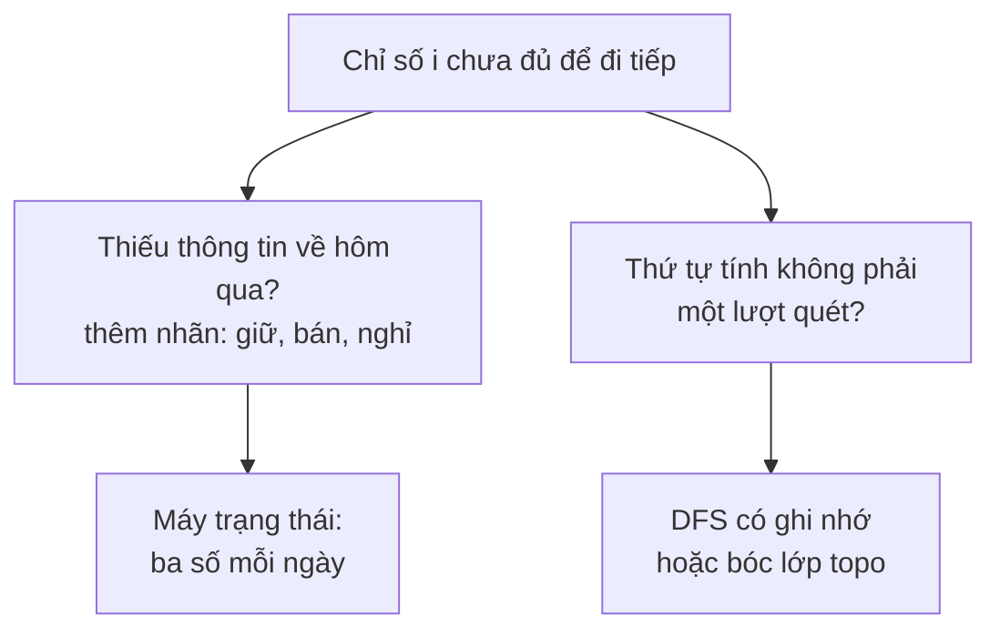
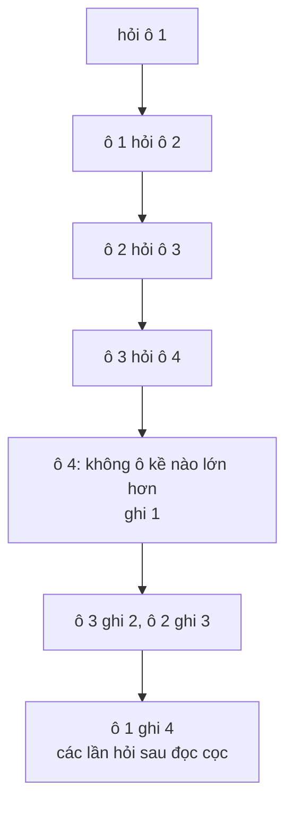

> [!tldr] Đọc nhanh
> - Có bài mà biết "đang ở ngày i" vẫn chưa đủ để chọn bước tiếp theo. Với bài mua bán có ngày nghỉ, mình phải biết thêm là đang giữ hàng, vừa bán hay đang tay không.
> - Gắn nhãn đó vào trạng thái: mỗi ngày có ba con số, và một bảng luật chuyển nói con số nào của hôm nay tính từ con số nào của hôm qua. Đó là một máy trạng thái.
> - Ngày nghỉ bắt buộc chỉ là một mũi tên bị thiếu: từ "vừa bán" không có đường thẳng sang "đang giữ".
> - Có bài mà thứ tự tính không phải một lượt quét trái sang phải. Ở lưới tìm đường tăng dài nhất, đệ quy có ghi nhớ tự đi tới ô cần tính trước, vì đường tăng nghiêm ngặt không bao giờ quay vòng.
> - Không muốn đệ quy sâu thì bóc dần các ô theo thứ tự topo, cho cùng đáp án.

> [!info] Bối cảnh
> Đây là ga thứ sáu trên [[series/neetcode-dp|tuyến NeetCode: Quy hoạch động]]. Ở [[posts/2026-11-27-neetcode-grid-two-strings|ga DP-05]], một hoặc hai chỉ số là đủ mô tả phần đã đọc, và thứ tự điền bảng hiển nhiên là theo hàng. Ga này bỏ cả hai giả định đó. Bạn chỉ cần biết vòng lặp, mảng hai chiều, đệ quy và ý tưởng [[concepts/memoization|ghi nhớ kết quả]] từ ga 1.

> [!abstract]- Từ điển nhanh cho bài này (bấm để mở)
> - [[concepts/dp-state|Trạng thái DP]] là những gì cần biết về phần đã đi qua để quyết định phần còn lại.
> - [[concepts/state-machine-dp|State Machine DP]] thêm vào chỉ số một nhãn nhỏ (giữ, bán, nghỉ) và viết luật chuyển giữa các nhãn.
> - [[concepts/memoized-dfs|Memoized DFS]] là duyệt sâu có ghi nhớ: hỏi đáp án của hàng xóm bằng đệ quy, rồi ghi lại để lần sau đọc ngay.
> - [[concepts/directed-acyclic-graph|DAG]] (đồ thị có hướng không chu trình) là đồ thị mà đi theo mũi tên không bao giờ quay về chỗ cũ.
> - [[concepts/topological-sort|Thứ tự topo]] xếp các đỉnh của DAG sao cho mọi mũi tên đi từ trước ra sau.
> - **−∞** (âm vô cùng) là giá trị "không thể có", dùng cho trạng thái chưa đạt được.
> - [[concepts/rolling-state|Trạng thái cuộn]] chỉ giữ các con số của bước trước, vì bước sau không đọc xa hơn.

## Hình dung trước: sổ tay của người buôn đồ cũ

Mình tưởng tượng một người buôn đồ cũ ghi sổ mỗi tối. Chợ có luật: ai bán xong hôm nay thì mai phải nghỉ, không được nhập hàng. Mỗi tối, người đó không ghi một dòng mà ghi ba dòng: lời nhiều nhất nếu tối nay đang ôm hàng, nếu hôm nay vừa bán, và nếu đang tay không. Sáng mai chỉ cần ba dòng đó là tính được ba dòng mới, không cần lật lại cả cuốn sổ.

Ngoài giờ chợ, người đó đi tìm đường leo dài nhất trên một bãi đất có các mô cao thấp khác nhau, mỗi bước chỉ được leo lên mô cao hơn ngay cạnh. Đo xong mô nào thì cắm cọc ghi số lên mô đó, lần sau đi ngang chỉ việc đọc cọc.

| Đời thường | Khái niệm |
|---|---|
| Ba dòng ghi mỗi tối: ôm hàng, vừa bán, tay không | Ba trạng thái `hold`, `sold`, `rest` của một ngày |
| Luật "bán xong mai phải nghỉ" | Mũi tên bị thiếu trong máy trạng thái |
| Tính ba dòng mới chỉ từ ba dòng tối qua | Luật chuyển, và trạng thái cuộn O(1) bộ nhớ |
| Chưa từng nhập hàng thì không thể "đang ôm hàng" | Khởi tạo `hold = −∞` |
| Chỉ leo lên mô cao hơn | Cạnh từ ô thấp sang ô cao, đồ thị không có chu trình |
| Cọc ghi số trên mỗi mô đã đo | Ghi nhớ kết quả của DFS |
| Đo từ các mô cao nhất trước rồi lùi dần xuống | Thứ tự topo, bóc lớp không cần đệ quy |



## Vấn đề: một chỉ số không còn kể đủ câu chuyện

Ở [[problems/best-time-to-buy-and-sell-stock|bài mua bán một lần]], mình chỉ cần nhớ giá thấp nhất từ trước tới nay. Khi được mua bán nhiều lần nhưng bán xong phải nghỉ một ngày, mình từng thử đặt `best[i]` là lời nhiều nhất sau ngày i. Công thức không viết ra được: hôm nay mua được hay không còn tùy hôm qua có vừa bán không, và bán được hay không tùy đang giữ hàng không. Hai lịch sử có cùng `best[i]` có thể dẫn tới hai tương lai khác nhau.

Bài thứ hai gặp vấn đề khác. Ở lưới tìm đường tăng dài nhất, đáp án của một ô phụ thuộc vào các ô hàng xóm cao hơn, mà ô cao hơn có thể nằm ở bất kỳ hướng nào. Không có thứ tự quét theo hàng nào bảo đảm hàng xóm cao hơn đã được tính trước.

## Cơ chế

<figure class="figure-map" style="--ar: 3 / 4">
<div class="frame"><iframe data-archify="../diagrams/neetcode-state-machine-dp/cooldown-states.html" title="Ba trạng thái cuối mỗi ngày của bài mua bán có ngày nghỉ" loading="lazy"></iframe></div>
<figcaption><span><b>Hình 1.</b> Một vòng: mua đi từ Tay không sang Đang giữ, bán sang Vừa bán, rồi hôm sau bắt buộc nghỉ trước khi được mua lại. Ngày nghỉ nằm ở chỗ Vừa bán không có đường đi thẳng sang Đang giữ.</span><a href="../diagrams/neetcode-state-machine-dp/cooldown-states.html" target="_blank" rel="noopener">Mở toàn màn hình</a></figcaption>
</figure>

### Thêm nhãn vào trạng thái: ba con số mỗi ngày

Mình đặt ba con số cho cuối mỗi ngày, đều là lời nhiều nhất có thể (tính bằng tiền mặt, giá mua đã trừ vào):
- `hold`: cuối ngày đang giữ một cổ phiếu.
- `sold`: hôm nay vừa bán, nên ngày mai bắt buộc nghỉ.
- `rest`: cuối ngày tay không và không bị cấm mua ngày mai.

Mỗi con số mới chỉ đọc ba con số của hôm qua:

| Trạng thái hôm nay | Đến từ | Công thức |
|---|---|---|
| `hold` | giữ tiếp, hoặc tay không rồi mua hôm nay | `max(hold, rest − giá)` |
| `sold` | đang giữ rồi bán hôm nay | `hold + giá` |
| `rest` | nghỉ tiếp, hoặc hôm qua vừa bán nên hôm nay nghỉ | `max(rest, sold)` |

Chỗ quan trọng nằm ở ô `hold`: nó chỉ đọc `rest` của hôm qua, không đọc `sold`. Bán hôm qua thì hôm nay chưa mua được. Đó chính là ngày nghỉ, và nó không cần một biến đếm riêng.

Trước ngày đầu tiên, mình chưa thể đang giữ hàng hay vừa bán, nên `hold = sold = −∞` và `rest = 0`. Đáp án là `max(rest, sold)` của ngày cuối: không ai muốn kết thúc mà còn ôm hàng. Thời gian O(n), bộ nhớ O(1) vì chỉ giữ ba con số.

Với giá `[1, 4, 2, 7]`, bảng chạy như sau:

| Ngày | Giá | hold | sold | rest |
|---|---|---|---|---|
| 0 | 1 | −1 | −∞ | 0 |
| 1 | 4 | −1 | 3 | 0 |
| 2 | 2 | −1 | 1 | 3 |
| 3 | 7 | −1 | 6 | 3 |

Đáp án là 6: mua ngày 0, bán ngày 3. Nếu không có ngày nghỉ, mình bán ở giá 4, mua lại ở giá 2 rồi bán ở 7 để lời 8. Nhưng mua ở ngày 2 phải đọc `rest` của ngày 1, mà lúc đó `rest` vẫn là 0, chưa nhận lời 3 từ lần bán. Lời 3 chỉ chảy vào `rest` ở ngày 2, quá muộn để mua ở giá 2.

### Để đệ quy tự tìm thứ tự: DFS có ghi nhớ trên DAG

Ở lưới số nguyên, đặt `best(r, c)` là độ dài đường tăng dài nhất bắt đầu từ ô `(r, c)`. Từ một ô, mình chỉ được đi sang ô kề (trên, dưới, trái, phải) có giá trị lớn hơn hẳn, nên:

`best(r, c) = 1 + max(best của các ô kề lớn hơn)`, hoặc 1 nếu không có ô nào như vậy.

Mỗi bước đi lên một giá trị lớn hơn hẳn, nên không đường nào quay lại ô cũ. Các ô và các bước đi tạo thành một DAG. Nhờ vậy, đệ quy không cần tập "đã thăm" như khi tìm từ trong lưới: nó không thể chạy vòng. Gọi `best` trên một ô mà các ô cao hơn chưa có đáp án thì đệ quy đi tính chúng trước, rồi ghi lại. Ở ví dụ `[[1, 2], [4, 3]]`:



Mỗi ô được tính đúng một lần và nhìn bốn ô kề, nên thời gian O(m·n) và bộ nhớ O(m·n). Cái giá là độ sâu đệ quy: một đường tăng có thể dài hàng chục nghìn ô. Mình dựng một lưới 199×199 hình rắn có tường, đường tăng dài nhất dài 20.000 ô. Python với giới hạn đệ quy mặc định 1.000 tầng báo `RecursionError`, nâng giới hạn lên thì ra 20.000.

### Không đệ quy: bóc lớp theo thứ tự topo

Thứ tự mà đệ quy tìm ra cũng có thể dựng bằng vòng lặp. Mình đếm cho mỗi ô số ô kề lớn hơn nó. Ô nào đếm được 0 là "đỉnh mô": đường đi từ đó dài 1. Bóc cả lớp đỉnh mô, giảm số đếm của các ô kề thấp hơn, ô nào về 0 thành lớp tiếp theo. Số lớp bóc được chính là độ dài đường tăng dài nhất. Đây là thuật toán Kahn ở [[posts/2026-11-26-neetcode-topological-sort|ga Sắp xếp topo]], đi ngược chiều mũi tên. Cùng O(m·n), nhưng không phụ thuộc độ sâu ngăn xếp.

### Hai bài trên cùng một ý

| Bài | Điểm khác |
|---|---|
| [[problems/best-time-to-buy-and-sell-stock-with-cooldown|Best Time to Buy and Sell Stock with Cooldown]] | Bài neo. Chỉ số ngày cộng ba nhãn `hold`, `sold`, `rest`, mỗi ngày cập nhật cả ba từ ba số của hôm qua. Ngày nghỉ là việc `hold` chỉ đọc `rest`, không đọc `sold`. |
| [[problems/longest-increasing-path-in-a-matrix|Longest Increasing Path in a Matrix]] | Trạng thái là ô, nhưng thứ tự tính không theo hàng. DFS có ghi nhớ đi tới ô cao hơn trước; giá trị tăng nghiêm ngặt nên không cần tập đã thăm. Bóc lớp topo cho cùng đáp án mà không đệ quy. |

## Ví dụ chạy được

[TypeScript](../code/neetcode-state-machine-dp/states.ts) · [Python](../code/neetcode-state-machine-dp/states.py) · [Go](../code/neetcode-state-machine-dp/states.go) · [Java](../code/neetcode-state-machine-dp/states.java) · [JavaScript](../code/neetcode-state-machine-dp/states.js) · [PHP](../code/neetcode-state-machine-dp/states.php) · [Rust](../code/neetcode-state-machine-dp/states.rs)

```ts
function maxProfitCooldown(prices: number[]): number {
    let hold = -Infinity // đang giữ một cổ phiếu
    let sold = -Infinity // vừa bán hôm nay, mai phải nghỉ
    let rest = 0         // tay không, được mua
    for (const price of prices) {
        const prevSold = sold
        sold = hold + price
        hold = Math.max(hold, rest - price)
        rest = Math.max(rest, prevSold)
    }
    return Math.max(rest, sold)
}
```

```python
def max_profit_cooldown(prices):
    hold = float("-inf")  # đang giữ một cổ phiếu
    sold = float("-inf")  # vừa bán hôm nay, mai phải nghỉ
    rest = 0              # tay không, được mua
    for price in prices:
        hold, sold, rest = max(hold, rest - price), hold + price, max(rest, sold)
    return max(rest, sold)
```

```go
const negInf = -1 << 30 // như −∞, còn chỗ trừ thêm mà không tràn int

func maxProfitCooldown(prices []int) int {
	hold, sold, rest := negInf, negInf, 0 // đang giữ, vừa bán, tay không
	for _, price := range prices {
		hold, sold, rest = max(hold, rest-price), hold+price, max(rest, sold)
	}
	return max(rest, sold)
}
```

```java
static final int NEG_INF = -(1 << 30); // như −∞, còn chỗ trừ thêm mà không tràn int

static int maxProfitCooldown(int[] prices) {
    int hold = NEG_INF; // đang giữ một cổ phiếu
    int sold = NEG_INF; // vừa bán hôm nay, mai phải nghỉ
    int rest = 0;       // tay không, được mua
    for (int price : prices) {
        int prevSold = sold;
        sold = hold + price;
        hold = Math.max(hold, rest - price);
        rest = Math.max(rest, prevSold);
    }
    return Math.max(rest, sold);
}
```

```js
function maxProfitCooldown(prices) {
    let hold = -Infinity // đang giữ một cổ phiếu
    let sold = -Infinity // vừa bán hôm nay, mai phải nghỉ
    let rest = 0         // tay không, được mua
    for (const price of prices) {
        const prevSold = sold
        sold = hold + price
        hold = Math.max(hold, rest - price)
        rest = Math.max(rest, prevSold)
    }
    return Math.max(rest, sold)
}
```

```php
function maxProfitCooldown(array $prices): int {
    $hold = PHP_INT_MIN >> 1; // đang giữ một cổ phiếu
    $sold = PHP_INT_MIN >> 1; // vừa bán hôm nay, mai phải nghỉ
    $rest = 0;                // tay không, được mua
    foreach ($prices as $price) {
        $prevSold = $sold;
        $sold = $hold + $price;
        $hold = max($hold, $rest - $price);
        $rest = max($rest, $prevSold);
    }
    return max($rest, $sold);
}
```

```rust
const NEG_INF: i32 = -(1 << 30); // như −∞, còn chỗ trừ thêm mà không tràn i32

fn max_profit_cooldown(prices: &[i32]) -> i32 {
    let (mut hold, mut sold, mut rest) = (NEG_INF, NEG_INF, 0); // đang giữ, vừa bán, tay không
    for &price in prices {
        let prev_sold = sold;
        sold = hold + price;
        hold = hold.max(rest - price);
        rest = rest.max(prev_sold);
    }
    rest.max(sold)
}
```

Các tab trích hàm máy trạng thái của bài mua bán. Mỗi file còn có DFS có ghi nhớ và bản bóc lớp cho bài lưới, chạy 9 ca mua bán và 6 ca lưới (mỗi ca lưới kiểm cả hai cách).

```text
15/15 ca đúng
```

Chạy bằng `node states.ts`, `python3 states.py`, `go run states.go`, `java states.java`, `node states.js`, `php states.php` hoặc `rustc --edition 2021 -O states.rs -o /tmp/states && /tmp/states`.

## Hiểu lầm và bẫy hay gặp

- Khởi tạo `hold = 0`. Như vậy là coi như được tặng một cổ phiếu miễn phí trước ngày đầu, và bán nó ở ngày 0 cho lời bằng giá. Trạng thái chưa thể có phải là −∞, hoặc một số âm đủ lớn trong ngôn ngữ dùng số nguyên cố định.
- Cập nhật tại chỗ rồi đọc nhầm giá trị mới. Nếu `rest` đọc `sold` vừa tính của hôm nay, thì ngày mai `hold` có thể mua ngay sau khi bán, và ngày nghỉ biến mất. Python và Go gán cả ba cùng lúc; các ngôn ngữ còn lại giữ `prevSold`.
- Đặt −∞ bằng `Integer.MIN_VALUE` hay `i32::MIN`. Bài này chỉ cộng giá dương vào nên vẫn chạy, nhưng biến thể có phí giao dịch trừ thêm vào `hold + giá` và tràn thành số dương khổng lồ. Mình dùng `-(1 << 30)` để còn chỗ dư.
- Thêm tập "đã thăm" và bỏ đánh dấu khi quay lui như bài tìm từ trong lưới. Ở đây đường tăng nghiêm ngặt không có vòng, nên tập đó thừa. Tệ hơn, nếu bỏ ghi nhớ để giữ quay lui, thời gian tăng theo hàm mũ.
- Đi sang ô kề bằng giá trị. Đề yêu cầu tăng nghiêm ngặt. Cho phép bằng thì hai ô bằng nhau tạo vòng và DFS có ghi nhớ trả sai hoặc chạy mãi.
- Quên độ sâu đệ quy. Đường tăng có thể dài tới m·n ô. Python mặc định dừng ở 1.000 tầng; dùng `sys.setrecursionlimit` hoặc bản bóc lớp.

## Câu hỏi tự kiểm tra

> [!question]- Vì sao `hold` hôm nay đọc `rest` hôm qua mà không đọc `sold` hôm qua?
> Vì bán hôm qua thì hôm nay là ngày nghỉ bắt buộc, chưa được mua. Chỉ trạng thái tay không và không bị cấm mới được chuyển sang đang giữ.

> [!question]- Nếu bỏ ngày nghỉ, máy trạng thái thay đổi ra sao?
> Không cần nhãn `sold` riêng nữa: bán xong là tay không ngay. Còn hai trạng thái, `hold = max(hold, rest − giá)` và `rest = max(rest, hold + giá)`.

> [!question]- Vì sao DFS trên lưới tăng nghiêm ngặt không cần tập đã thăm?
> Mỗi bước đi lên một giá trị lớn hơn hẳn, nên không đường nào quay lại ô đã đi. Đồ thị không có chu trình, và mỗi ô có một đáp án cố định để ghi nhớ.

> [!question]- Bóc lớp topo bắt đầu từ ô nào, và vì sao số lớp bằng đáp án?
> Từ các ô không có ô kề lớn hơn, nơi mọi đường tăng phải dừng. Một ô nằm ở lớp k thì đường tăng dài nhất bắt đầu từ nó dài đúng k, nên lớp cuối cùng cho đáp án.

## Tham khảo

- [Best Time to Buy and Sell Stock with Cooldown](https://leetcode.com/problems/best-time-to-buy-and-sell-stock-with-cooldown/) · [Longest Increasing Path in a Matrix](https://leetcode.com/problems/longest-increasing-path-in-a-matrix/)
- [MIT 6.006, bài giảng 19: ghi nhớ kết quả và DP trên DAG](https://ocw.mit.edu/courses/6-006-introduction-to-algorithms-fall-2011/resources/mit6_006f11_lec19/)
- [Jeff Erickson, Algorithms, chương quy hoạch động và DAG](https://jeffe.cs.illinois.edu/teaching/algorithms/book/Algorithms-JeffE.pdf)
- [Python sys.setrecursionlimit](https://docs.python.org/3/library/sys.html#sys.setrecursionlimit)
