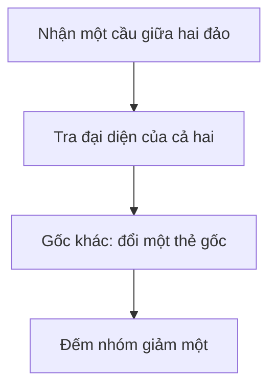

> [!tldr] Đọc nhanh
> - [[concepts/disjoint-set-union|Disjoint Set Union]] đặt mỗi đỉnh vào đúng một nhóm. `find` tìm đại diện, `union` gộp hai nhóm khác nhau.
> - [[concepts/union-by-size|Union by Size]] gắn cây nhỏ dưới gốc cây lớn. [[concepts/path-compression|Path Compression]] rút ngắn đường lên gốc khi tra.
> - Gộp thành công làm giảm một thành phần. Gộp thất bại nói rằng cạnh mới sẽ khép vòng.
> - Cùng một thao tác giải ba câu hỏi trên đồ thị vô hướng. DFS vẫn phù hợp khi đồ thị đã có đủ cạnh và mình chỉ cần duyệt một lần.

> [!info] Bối cảnh
> Đây là ga 4 của [[series/neetcode-grph|tuyến NeetCode: Đồ thị]]. Ở [[posts/2026-11-26-neetcode-graph-bfs|ga 2]], mình đã dùng danh sách kề để đi tới các đỉnh. Ga này theo dõi đường hai chiều đến dần, với một cấu trúc gọn để trả lời hai đỉnh đã nối với nhau hay chưa. Bạn cần mảng, vòng lặp và khái niệm cạnh vô hướng.

> [!abstract]- Từ điển nhanh cho bài này (bấm để mở)
> - [[concepts/connected-component|Thành phần liên thông]] là một nhóm tối đa các đỉnh có đường đi tới nhau.
> - [[concepts/disjoint-set-union|DSU]] giữ các nhóm rời nhau, mỗi phần tử ở đúng một nhóm.
> - `parent[x]` là con trỏ lên cây đại diện; ở gốc thì `parent[x]=x`.
> - [[concepts/union-by-size|Gộp theo kích thước]] ưu tiên giữ đại diện của nhóm đông hơn.
> - [[concepts/path-compression|Nén đường]] sửa các con trỏ đã đi qua để lần sau lên gốc ít bước hơn.

## Hình dung trước: sổ nhóm của các đảo

Hình dung mỗi đảo có một mã. Ban đầu chưa có cầu, ai cũng đứng riêng. Người ghi sổ tạo cho mỗi đảo một thẻ chỉ tới chính nó. Khi xây cầu nối hai nhóm, sổ chỉ cần đổi hướng thẻ ở đại diện của một nhóm. Thẻ của những đảo khác vẫn tìm được đúng đại diện mới khi đi theo chuỗi.

| Đời thường | Khái niệm |
|---|---|
| Thẻ chỉ tới đại diện kế tiếp | `parent` |
| Đi lần lượt theo thẻ tới thẻ tự chỉ | `find` |
| Tìm được hai đại diện khác nhau | Có hai thành phần |
| Gắn gốc nhóm nhỏ vào gốc nhóm lớn | Union by Size |
| Dời thẻ lên ông của nó khi tra | Một bước path halving |
| Hai đại diện đã trùng nhau | Cầu mới sẽ khép vòng |



## Vấn đề: từ duyệt lại sang giữ câu trả lời hiện tại

Mình nhận các cạnh vô hướng theo thứ tự. Sau mỗi cạnh, có thể dựng lại danh sách kề rồi chạy DFS để biết các cụm, nhưng nhiều cạnh chỉ làm hai cụm sáp nhập. Thông tin cần duy trì là mỗi đỉnh thuộc cụm nào. Khi một cạnh mới tới, có hai khả năng. Hai đỉnh khác cụm, nên sáp nhập hai cụm. Hoặc chúng đã cùng cụm, nên các cụm vẫn như cũ. Mô hình thêm cạnh này cho phép mình cập nhật mà không đọc lại mọi cạnh.

## Cơ chế

### Bất biến của rừng cha

Mình biểu diễn mỗi nhóm bằng một cây con trỏ cha. Ban đầu mọi đỉnh tự làm gốc. Sau mỗi thao tác, `find(u) === find(v)` đúng khi và chỉ khi hai đỉnh có đường đi qua các cạnh đã nhận. Điều này đúng lúc chưa có cạnh. Khi một cạnh nối hai cây, trỏ **gốc** của cây này vào gốc của cây kia hợp tất cả phần tử ở cả hai phía. Khi hai gốc đã trùng, không sửa cấu trúc nhóm. Con trỏ cha trong DSU là cấu trúc lưu đại diện; nó có thể trỏ qua một cặp đỉnh không có cạnh trực tiếp trong đồ thị đầu vào.

### Hai tối ưu giữ đường tới gốc ngắn

- **Union by Size.** Khi đính cây nhỏ hơn dưới cây lớn, các đỉnh của cây nhỏ sâu thêm một mức. Mỗi lần như vậy, nhóm chứa chúng ít nhất tăng gấp đôi. Có tối đa O(log V) lần tăng trên mỗi đỉnh, ngay cả khi chưa nén đường.
- **Path Compression.** Trong `find`, bản `path halving` nối nút đang đứng trực tiếp lên ông của nó. Cả cha và ông đều nằm cùng cây, nên gốc không đổi. Trên chuỗi `7 → 5 → 4 → 0`, một bước ghi `parent[7]=4` thay đường của 7 bằng `7 → 4 → 0` rồi vòng lặp tiếp tục từ 4. Kích thước chỉ cần đúng tại các gốc; nén đường không đổi số đỉnh trong nhóm.

Kết hợp hai tối ưu, việc khởi tạo tốn O(V) và một dãy E thao tác gộp tốn O(E α(V)) thời gian khấu hao, với O(V) bộ nhớ. `α` là hàm nghịch đảo Ackermann, tăng rất chậm. Cận khấu hao tính trên cả dãy, nên mình không hứa mọi lần `find` đều đi một bước.

<figure class="figure-map" style="--ar: 3 / 4">
<div class="frame"><iframe data-archify="../diagrams/neetcode-union-find/edge-trace.html" title="Hai đường trong cùng một nhóm" loading="lazy"></iframe></div>
<figcaption><span><b>Hình 1.</b> Sau hai lần gộp, hai đầu cạnh thứ ba có chung gốc, nên cạnh đó khép chu trình.</span><a href="../diagrams/neetcode-union-find/edge-trace.html" target="_blank" rel="noopener">Mở toàn màn hình</a></figcaption>
</figure>

### Cùng một khuôn, ba đáp án

| Bài | Quyết định riêng |
|---|---|
| [[problems/redundant-connection\|684. Redundant Connection]] | Đọc đúng thứ tự và trả cạnh đầu tiên có hai đầu cùng gốc. Nhãn đỉnh bắt đầu từ 1. |
| [[problems/number-of-connected-components-in-an-undirected-graph\|323. Number of Connected Components]] | Bắt đầu với n nhóm, mỗi gộp thành công giảm đếm một lần. |
| [[problems/graph-valid-tree\|261. Graph Valid Tree]] | Có đúng n−1 cạnh và mọi lần gộp thành công. Lúc đó còn đúng một thành phần. |

Để so với cách đọc lại, mình chạy mẫu 1.000 đỉnh thành một đường dài rồi nối hai đầu. DFS thăm đỉnh 500.500 lần cộng dồn; DSU thử gộp 1.000 lần. DFS một lần vẫn hữu ích cho đồ thị cố định khi danh sách kề đã sẵn hoặc cần lấy đường đi. DSU thông thường chỉ duy trì phân hoạch, nên việc xóa một cạnh có thể tách cụm là bài toán khác.

## Ví dụ chạy được

[TypeScript](../code/neetcode-union-find/solve.ts) · [Python](../code/neetcode-union-find/solve.py) · [Go](../code/neetcode-union-find/solve.go) · [Java](../code/neetcode-union-find/solve.java) · [JavaScript](../code/neetcode-union-find/solve.js) · [PHP](../code/neetcode-union-find/solve.php) · [Rust](../code/neetcode-union-find/solve.rs)

Mỗi file đứng riêng, chạy cả ba bài bằng DSU và DFS để đối chiếu. Đoạn dưới giữ phần DSU để dễ đối chiếu cách gọi ở ba bài.

```ts
import assert from "node:assert/strict";

type Edge = readonly [number, number];

class DisjointSet {
  private parent: number[];
  private size: number[];
  count: number;

  constructor(n: number) {
    this.parent = Array.from({ length: n }, (_, i) => i);
    this.size = new Array<number>(n).fill(1);
    this.count = n;
  }

  find(node: number): number {
    while (node !== this.parent[node]) {
      this.parent[node] = this.parent[this.parent[node]];
      node = this.parent[node];
    }
    return node;
  }

  union(a: number, b: number): boolean {
    let ra = this.find(a);
    let rb = this.find(b);
    if (ra === rb) return false;
    if (this.size[ra] < this.size[rb]) [ra, rb] = [rb, ra];
    this.parent[rb] = ra;
    this.size[ra] += this.size[rb];
    this.count--;
    return true;
  }
}

function redundantByDsu(n: number, edges: readonly Edge[]): Edge {
  const ds = new DisjointSet(n + 1);
  for (const edge of edges) {
    if (!ds.union(...edge)) return edge;
  }
  throw new Error("Cần đúng một cạnh dư");
}

function componentsByDsu(n: number, edges: readonly Edge[]): number {
  const ds = new DisjointSet(n);
  for (const [a, b] of edges) ds.union(a, b);
  return ds.count;
}

function treeByDsu(n: number, edges: readonly Edge[]): boolean {
  if (edges.length !== n - 1) return false;
  const ds = new DisjointSet(n);
  return edges.every(([a, b]) => ds.union(a, b));
}
```

```python
class DisjointSet:
    def __init__(self, n):
        self.parent = list(range(n))
        self.size = [1] * n
        self.count = n

    def find(self, node):
        while node != self.parent[node]:
            self.parent[node] = self.parent[self.parent[node]]
            node = self.parent[node]
        return node

    def union(self, a, b):
        ra, rb = self.find(a), self.find(b)
        if ra == rb:
            return False
        if self.size[ra] < self.size[rb]:
            ra, rb = rb, ra
        self.parent[rb] = ra
        self.size[ra] += self.size[rb]
        self.count -= 1
        return True


def redundant_by_dsu(n, edges):
    ds = DisjointSet(n + 1)
    for edge in edges:
        if not ds.union(*edge):
            return edge
    raise ValueError("Cần đúng một cạnh dư")

def components_by_dsu(n, edges):
    ds = DisjointSet(n)
    for a, b in edges:
        ds.union(a, b)
    return ds.count

def tree_by_dsu(n, edges):
    if len(edges) != n - 1:
        return False
    ds = DisjointSet(n)
    return all(ds.union(a, b) for a, b in edges)
```

```go
package main

import "fmt"

type edge [2]int

type disjointSet struct {
	parent, size []int
	count        int
}

func newDisjointSet(n int) *disjointSet {
	ds := &disjointSet{make([]int, n), make([]int, n), n}
	for i := range ds.parent {
		ds.parent[i], ds.size[i] = i, 1
	}
	return ds
}

func (ds *disjointSet) find(node int) int {
	for node != ds.parent[node] {
		ds.parent[node] = ds.parent[ds.parent[node]]
		node = ds.parent[node]
	}
	return node
}

func (ds *disjointSet) union(a, b int) bool {
	ra, rb := ds.find(a), ds.find(b)
	if ra == rb {
		return false
	}
	if ds.size[ra] < ds.size[rb] {
		ra, rb = rb, ra
	}
	ds.parent[rb] = ra
	ds.size[ra] += ds.size[rb]
	ds.count--
	return true
}

func redundantByDsu(n int, edges []edge) edge {
	ds := newDisjointSet(n + 1)
	for _, e := range edges {
		if !ds.union(e[0], e[1]) {
			return e
		}
	}
	panic("Cần đúng một cạnh dư")
}

func componentsByDsu(n int, edges []edge) int {
	ds := newDisjointSet(n)
	for _, e := range edges {
		ds.union(e[0], e[1])
	}
	return ds.count
}

func treeByDsu(n int, edges []edge) bool {
	if len(edges) != n-1 {
		return false
	}
	ds := newDisjointSet(n)
	for _, e := range edges {
		if !ds.union(e[0], e[1]) {
			return false
		}
	}
	return true
}
```

```java
class Solve {
    static final class DisjointSet {
        private final int[] parent;
        private final int[] size;
        int count;

        DisjointSet(int n) {
            parent = new int[n];
            size = new int[n];
            count = n;
            for (int i = 0; i < n; i++) {
                parent[i] = i;
                size[i] = 1;
            }
        }

        int find(int node) {
            while (node != parent[node]) {
                parent[node] = parent[parent[node]];
                node = parent[node];
            }
            return node;
        }

        boolean union(int a, int b) {
            int ra = find(a), rb = find(b);
            if (ra == rb) return false;
            if (size[ra] < size[rb]) {
                int swap = ra;
                ra = rb;
                rb = swap;
            }
            parent[rb] = ra;
            size[ra] += size[rb];
            count--;
            return true;
        }
    }

    static int[] redundantByDsu(int n, int[][] edges) {
        var ds = new DisjointSet(n + 1);
        for (int[] e : edges) {
            if (!ds.union(e[0], e[1])) return e;
        }
        throw new IllegalArgumentException("Cần đúng một cạnh dư");
    }

    static int componentsByDsu(int n, int[][] edges) {
        var ds = new DisjointSet(n);
        for (int[] e : edges) ds.union(e[0], e[1]);
        return ds.count;
    }

    static boolean treeByDsu(int n, int[][] edges) {
        if (edges.length != n - 1) return false;
        var ds = new DisjointSet(n);
        for (int[] e : edges) {
            if (!ds.union(e[0], e[1])) return false;
        }
        return true;
    }
}
```

```javascript
import assert from "node:assert/strict";

class DisjointSet {
  parent;
  size;
  count;

  constructor(n) {
    this.parent = Array.from({ length: n }, (_, i) => i);
    this.size = new Array(n).fill(1);
    this.count = n;
  }

  find(node) {
    while (node !== this.parent[node]) {
      this.parent[node] = this.parent[this.parent[node]];
      node = this.parent[node];
    }
    return node;
  }

  union(a, b) {
    let ra = this.find(a);
    let rb = this.find(b);
    if (ra === rb) return false;
    if (this.size[ra] < this.size[rb]) [ra, rb] = [rb, ra];
    this.parent[rb] = ra;
    this.size[ra] += this.size[rb];
    this.count--;
    return true;
  }
}

function redundantByDsu(n, edges) {
  const ds = new DisjointSet(n + 1);
  for (const edge of edges) {
    if (!ds.union(...edge)) return edge;
  }
  throw new Error("Cần đúng một cạnh dư");
}

function componentsByDsu(n, edges) {
  const ds = new DisjointSet(n);
  for (const [a, b] of edges) ds.union(a, b);
  return ds.count;
}

function treeByDsu(n, edges) {
  if (edges.length !== n - 1) return false;
  const ds = new DisjointSet(n);
  return edges.every(([a, b]) => ds.union(a, b));
}
```

```php
<?php
declare(strict_types=1);

final class DisjointSet
{
    private array $parent;
    private array $size;
    public int $count;

    public function __construct(int $n)
    {
        $this->parent = range(0, $n - 1);
        $this->size = array_fill(0, $n, 1);
        $this->count = $n;
    }

    public function find(int $node): int
    {
        while ($node !== $this->parent[$node]) {
            $this->parent[$node] = $this->parent[$this->parent[$node]];
            $node = $this->parent[$node];
        }
        return $node;
    }

    public function union(int $a, int $b): bool
    {
        [$ra, $rb] = [$this->find($a), $this->find($b)];
        if ($ra === $rb) {
            return false;
        }
        if ($this->size[$ra] < $this->size[$rb]) {
            [$ra, $rb] = [$rb, $ra];
        }
        $this->parent[$rb] = $ra;
        $this->size[$ra] += $this->size[$rb];
        $this->count--;
        return true;
    }
}

function redundantByDsu(int $n, array $edges): array
{
    $ds = new DisjointSet($n + 1);
    foreach ($edges as [$a, $b]) {
        if (!$ds->union($a, $b)) {
            return [$a, $b];
        }
    }
    throw new InvalidArgumentException('Cần đúng một cạnh dư');
}

function componentsByDsu(int $n, array $edges): int
{
    $ds = new DisjointSet($n);
    foreach ($edges as [$a, $b]) {
        $ds->union($a, $b);
    }
    return $ds->count;
}

function treeByDsu(int $n, array $edges): bool
{
    if (count($edges) !== $n - 1) {
        return false;
    }
    $ds = new DisjointSet($n);
    foreach ($edges as [$a, $b]) {
        if (!$ds->union($a, $b)) {
            return false;
        }
    }
    return true;
}
```

```rust
type Edge = [usize; 2];

struct DisjointSet {
    parent: Vec<usize>,
    size: Vec<usize>,
    count: usize,
}

impl DisjointSet {
    fn new(n: usize) -> Self {
        Self {
            parent: (0..n).collect(),
            size: vec![1; n],
            count: n,
        }
    }

    fn find(&mut self, mut node: usize) -> usize {
        while node != self.parent[node] {
            self.parent[node] = self.parent[self.parent[node]];
            node = self.parent[node];
        }
        node
    }

    fn union(&mut self, a: usize, b: usize) -> bool {
        let mut ra = self.find(a);
        let mut rb = self.find(b);
        if ra == rb {
            return false;
        }
        if self.size[ra] < self.size[rb] {
            std::mem::swap(&mut ra, &mut rb);
        }
        self.parent[rb] = ra;
        self.size[ra] += self.size[rb];
        self.count -= 1;
        true
    }
}

fn redundant_by_dsu(n: usize, edges: &[Edge]) -> Edge {
    let mut ds = DisjointSet::new(n + 1);
    for &[a, b] in edges {
        if !ds.union(a, b) {
            return [a, b];
        }
    }
    panic!("Cần đúng một cạnh dư");
}

fn components_by_dsu(n: usize, edges: &[Edge]) -> usize {
    let mut ds = DisjointSet::new(n);
    for &[a, b] in edges {
        ds.union(a, b);
    }
    ds.count
}

fn tree_by_dsu(n: usize, edges: &[Edge]) -> bool {
    if edges.len() != n - 1 {
        return false;
    }
    let mut ds = DisjointSet::new(n);
    edges.iter().all(|&[a, b]| ds.union(a, b))
}
```

TypeScript và JavaScript kiểm thêm đường dài, nên in hai dòng dưới. Năm file còn lại đều in `26/26 ca đúng`.

```text
28/28 ca đúng
1000 cạnh: DFS thăm 500500 đỉnh; DSU thử 1000 lần gộp
```

## Hiểu lầm và bẫy hay gặp

- `size[b]` sau khi `b` thôi làm gốc không còn được đọc để quyết định gộp. Luôn đo tại gốc do `find` trả về.
- Gộp cạnh vô hướng bằng DSU chỉ nói về khả năng đi qua cạnh hai chiều. Không dùng kết quả này để suy ra khả năng đi theo mũi tên.
- Không so `parent[u]` và `parent[v]` để kết luận ngay. Hai nhánh có thể chung gốc nhưng có cha trực tiếp khác nhau.

## Câu hỏi tự kiểm tra

> [!question]- Hai gốc bằng nhau thì giảm số thành phần không?
> Không. Cạnh này chỉ chạy bên trong nhóm đã có, nên số thành phần giữ nguyên.

> [!question]- Vì sao gắn thẳng một nút lên ông của nó là hợp lệ?
> Cả nút và ông đã cùng một cây, và đường mới vẫn dẫn tới gốc cũ.

> [!question]- Cần lấy danh sách đỉnh trên đường từ u sang v thì DSU có đủ?
> Không. Sổ cha của DSU chỉ biết đại diện nhóm, còn đường đi cần đọc cạnh thật qua DFS, BFS hoặc cấu trúc thích hợp khác.

## Tham khảo

- [LeetCode](https://leetcode.com/problems/redundant-connection/)
- [NeetCode](https://neetcode.io/problems/count-connected-components/question)
- [NeetCode](https://neetcode.io/problems/valid-tree/question)
- [Sedgewick and Wayne, Weighted Quick Union](https://github.com/kevin-wayne/algs4/blob/master/src/main/java/edu/princeton/cs/algs4/WeightedQuickUnionUF.java)
- [Robert Tarjan, Efficiency of a Good But Not Linear Set Union Algorithm](https://doi.org/10.1145/321879.321884)
