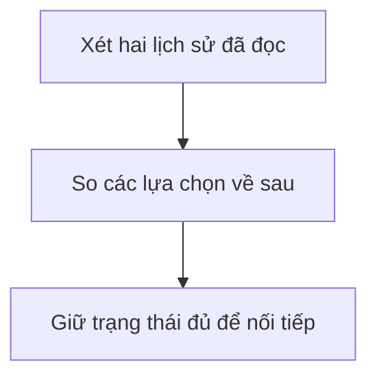

> [!tldr] Đọc nhanh
> - Word Break chỉ cần biết mốc i đã tới được chưa. Hai cách cắt dẫn tới cùng mốc có chung phần đuôi và cùng các lựa chọn tiếp theo.
> - LIS có thể dùng trạng thái kết thúc tại vị trí i, sau đó chỉ nối từ vị trí j < i có giá trị nhỏ hơn.
> - Với cùng độ dài, đuôi nhỏ nhất giữ được mọi cơ hội nối của đuôi lớn hơn. Lưu một đuôi cho mỗi độ dài và sửa bằng Lower Bound.
> - Mảng đuôi trả lời được độ dài; muốn dựng lại đúng dãy theo chỉ số thì còn cần dấu vết của các lần nối.

> [!info] Bối cảnh
> Đây là ga thứ tư trên [[series/neetcode-dp|tuyến NeetCode: Quy hoạch động]]. Mình có một băng nhãn cần cắt theo danh mục và một dãy gói hàng muốn chọn theo thứ tự tăng trọng lượng. Bạn chỉ cần biết mảng, vòng lặp và [[concepts/lower-bound|Lower Bound]] từ tuyến tìm kiếm.

> [!abstract]- Từ điển nhanh cho bài này (bấm để mở)
> - [[concepts/prefix-reachability|Prefix Reachability]] hỏi phần trước một mốc có thể phủ hết bằng các đoạn hợp lệ không.
> - [[concepts/increasing-subsequence|Increasing Subsequence]] giữ thứ tự chỉ số và tăng nghiêm ngặt, được bỏ qua vị trí ở giữa.
> - [[concepts/lis-minimum-tail|LIS Minimum Tail]] ghi giá trị cuối nhỏ nhất cho từng độ dài đã đạt.
> - [[concepts/dp-state|DP State]] nói rõ thông tin nào từ phần đã đọc ảnh hưởng tới quyết định sau.

## Hình dung trước: cắt nhãn và chọn gói

Khi cắt một băng chữ, mình đánh dấu mốc nào đã cắt ổn để biết có thể dán tiếp từ đâu. Với một dãy gói, mình chỉ lấy các gói theo thứ tự xuất hiện. Hai nhóm có cùng số gói nhưng nặng khác nhau ở gói cuối. Nhóm kết thúc nhẹ hơn cho phép mình tìm gói tiếp theo dễ hơn.

| Đời thường | Khái niệm |
|---|---|
| Vạch nằm sau một phần nhãn đã cắt hợp lệ | Mốc tiền tố tới được |
| Bỏ qua một gói mà giữ thứ tự các gói còn lại | Dãy con |
| Gói cuối nhẹ nhất trong các nhóm cùng cỡ | Đuôi nhỏ nhất |
| Nhóm đầu tiên có gói cuối nặng bằng hoặc hơn gói mới | Lower Bound |



## Vấn đề: cần nhớ gì để đi tiếp?

Với Word Break, biết mốc i đủ để tiếp tục thử các từ ở `s[i:]`. Với LIS, biết độ dài tốt nhất của tiền tố chưa đủ. Một dãy dài có thể kết thúc quá lớn so với số mới, trong khi một dãy cùng độ dài có đuôi nhỏ vẫn nối được. Mình cần đặt một bất biến phù hợp với từng mục tiêu.

## Cơ chế

<figure class="figure-map" style="--ar: 3 / 4">
<div class="frame"><iframe data-archify="../diagrams/neetcode-word-break-lis/prefix-cuts.html" title="Hai điểm cắt của sunrise" loading="lazy"></iframe></div>
<figcaption><span><b>Hình 1.</b> Giữ mốc 3 và 4 để thấy nhánh <code>sunr</code> kẹt, còn <code>sun</code> nối được với <code>rise</code>.</span><a href="../diagrams/neetcode-word-break-lis/prefix-cuts.html" target="_blank" rel="noopener">Mở toàn màn hình</a></figcaption>
</figure>

### Word Break gộp các đường đi theo mốc

Xét các mốc từ 0 đến n. Có cạnh i → j nếu `s[i:j]` là một từ, với i < j. Chọn cách cắt tương đương tìm đường từ 0 đến n. Do các cạnh đi tới mốc lớn hơn, quét từ trái sang phải thăm mọi tiền nhiệm trước mốc đích. Đặt `reachable[0] = true`, rồi từ một mốc đã tới, thử tất cả từ khớp tại đó và đánh dấu đích.

Hai đường tới cùng i chỉ khác phần đã cắt. Chúng dùng lại cùng từ điển và đều còn `s[i:]`, nên gộp bằng OR. Với `sunrise` và `[sun,sunr,rise]`, mốc 4 không tiến được, còn mốc 3 tới mốc 7. Chọn từ dài nhất trước bỏ lỡ đường sau. Sơ đồ đối chiếu hai nhánh, còn vòng lặp xử lý các mốc theo thứ tự tăng.

Nếu có D từ, độ dài từ lớn nhất L và chuỗi dài n, cách thử từ tại từng mốc tốn O(n·D·L) trong trường hợp xấu nhất và O(n) bộ nhớ phụ, chưa kể đầu vào. So khớp theo chỉ số tránh tạo một bản sao phần đuôi cho mỗi lần thử.

### LIS giữ đại diện cho cùng độ dài

Đầu tiên, cho `bestAt[i]` là độ dài lớn nhất của dãy kết thúc tại i. Để tính nó, mình có thể bắt đầu bằng một mình `nums[i]` hoặc nối sau mọi j < i với `nums[j] < nums[i]`. Chi phí là O(n²) thời gian và O(n) bộ nhớ phụ.

Để giảm số nguồn cần xét, giữ `tails[k]` là đuôi nhỏ nhất mà dãy dài k + 1 có thể đạt sau tiền tố hiện tại. Trong các dãy cùng độ dài, bất kỳ số nào nối được sau đuôi lớn đều nối được sau đuôi nhỏ. Các đuôi tăng nghiêm ngặt vì bỏ phần tử cuối của một dãy dài cho ta một dãy ngắn hơn có đuôi nhỏ hơn. Với x mới, tìm ô đầu tiên có đuôi ≥ x. Ô ngay trước nó, nếu có, có đuôi < x và có thể nối với x. Một dãy dài hơn kết thúc tại x sẽ đòi một đuôi < x ở ô vừa tìm hoặc xa hơn, trái với bất biến. Ghi x vào ô tìm được hoặc nối cuối nếu mọi đuôi nhỏ hơn x.

Với `[4,8,1,6,9,2]`, mảng đuôi cuối là `[1,2,9]`, nhưng giá trị 2 đến sau 9. Các ô ghi đại diện cho các độ dài riêng. Độ dài 3 đúng và `[1,6,9]` là một dãy con hợp lệ. Lower Bound xử lý một lần mỗi số với O(log n) so sánh, cho tổng O(n log n) thời gian và O(n) bộ nhớ phụ.

| Bài | Điểm khác |
|---|---|
| [[problems/word-break|Word Break]] | Một cờ cho mỗi mốc vì mọi đường tới cùng mốc có chung phần tiếp theo. |
| [[problems/longest-increasing-subsequence|Longest Increasing Subsequence]] | Khi cùng độ dài, giữ đuôi nhỏ nhất vì nó nối được với ít nhất mọi số mà đuôi lớn có thể nối. |

## Ví dụ chạy được

[TypeScript](../code/neetcode-word-break-lis/states.ts) · [Python](../code/neetcode-word-break-lis/states.py) · [Go](../code/neetcode-word-break-lis/states.go) · [Java](../code/neetcode-word-break-lis/states.java) · [JavaScript](../code/neetcode-word-break-lis/states.js) · [PHP](../code/neetcode-word-break-lis/states.php) · [Rust](../code/neetcode-word-break-lis/states.rs)

```ts
function wordBreak(s: string, words: string[]): boolean {
    const reachable = Array(s.length + 1).fill(false)
    reachable[0] = true
    for (let start = 0; start < s.length; start++) {
        if (!reachable[start]) continue
        for (const word of words) {
            if (s.startsWith(word, start)) reachable[start + word.length] = true
        }
    }
    return reachable[s.length]
}
```

```python
def word_break(s, words):
    reachable = [True] + [False] * len(s)
    for start in range(len(s)):
        if not reachable[start]:
            continue
        for word in words:
            if s.startswith(word, start):
                reachable[start + len(word)] = True
    return reachable[len(s)]
```

```go
func wordBreak(s string, words []string) bool {
	reachable := make([]bool, len(s)+1)
	reachable[0] = true
	for start := 0; start < len(s); start++ {
		if !reachable[start] {
			continue
		}
		for _, word := range words {
			if strings.HasPrefix(s[start:], word) {
				reachable[start+len(word)] = true
			}
		}
	}
	return reachable[len(s)]
}
```

```java
static boolean wordBreak(String s, String[] words) {
    boolean[] reachable = new boolean[s.length() + 1];
    reachable[0] = true;
    for (int start = 0; start < s.length(); start++) {
        if (!reachable[start]) continue;
        for (String word : words) {
            if (s.startsWith(word, start)) reachable[start + word.length()] = true;
        }
    }
    return reachable[s.length()];
}
```

```js
function wordBreak(s, words) {
    const reachable = Array(s.length + 1).fill(false)
    reachable[0] = true
    for (let start = 0; start < s.length; start++) {
        if (!reachable[start]) continue
        for (const word of words) {
            if (s.startsWith(word, start)) reachable[start + word.length] = true
        }
    }
    return reachable[s.length]
}
```

```php
function wordBreak(string $s, array $words): bool {
    $length = strlen($s);
    $reachable = array_fill(0, $length + 1, false);
    $reachable[0] = true;
    for ($start = 0; $start < $length; $start++) {
        if (!$reachable[$start]) continue;
        foreach ($words as $word) {
            $end = $start + strlen($word);
            if ($end <= $length && substr_compare($s, $word, $start, strlen($word)) === 0) {
                $reachable[$end] = true;
            }
        }
    }
    return $reachable[$length];
}
```

```rust
fn word_break(s: &str, words: &[&str]) -> bool {
    let bytes = s.as_bytes();
    let mut reachable = vec![false; bytes.len() + 1];
    reachable[0] = true;
    for start in 0..bytes.len() {
        if !reachable[start] {
            continue;
        }
        for word in words {
            if bytes[start..].starts_with(word.as_bytes()) {
                reachable[start + word.len()] = true;
            }
        }
    }
    reachable[bytes.len()]
}
```

Mỗi file chạy cả Word Break và LIS. Các tab trích vòng lặp đánh dấu mốc của Word Break. Tải file để chạy cả bản Lower Bound của LIS cùng các ca kiểm tra.

```text
16/16 ca đúng
```

Chạy bằng `node states.ts`, `python3 states.py`, `go run states.go`, `java states.java`, `node states.js`, `php states.php` hoặc `rustc --edition 2021 -O states.rs -o /tmp/states && /tmp/states`.

## Hiểu lầm và bẫy hay gặp

- Hễ thấy một từ khớp thì chỉ đánh dấu đúng đích của từ đó. Mỗi mốc có thể mở nhiều cạnh và một cạnh đúng cục bộ có thể kẹt về sau.
- Chọn số tăng liên tiếp rồi ngừng khi gặp số giảm. Dãy con có thể bỏ vị trí. Dãy `[2,6,3,4]` có dãy tăng dài 3 là `[2,3,4]`.
- Tìm ô đầu tiên lớn hơn x thay vì lớn hơn hoặc bằng. Nếu tăng nghiêm ngặt, số bằng nhau chỉ thay ô cũ. Dãy `[2,2,2]` có LIS dài 1.
- Dùng trực tiếp giá trị đuôi để in dãy. Cần lưu chỉ số của các đầu mút và liên kết truy vết nếu bài yêu cầu trả phần tử.

## Câu hỏi tự kiểm tra

> [!question]- Hai cách cắt cùng tới mốc 3 có cần giữ riêng không?
> Không khi bài chỉ hỏi có hay không. Hai cách có chung hậu tố và cùng các từ để thử tiếp.

> [!question]- Vì sao thay đuôi lớn bằng đuôi nhỏ không làm mất lựa chọn nối tiếp?
> Một số lớn hơn đuôi cũ cũng lớn hơn đuôi mới nhỏ hơn, và ở lần đọc sau nó đứng sau cả hai về chỉ số.

> [!question]- Vì sao Lower Bound gặp đuôi bằng x thì không tạo thêm độ dài?
> Dãy tăng nghiêm ngặt cần đuôi trước nhỏ hơn x. Có thể giữ nguyên giá trị ở ô bằng x.

## Tham khảo

- [Word Break](https://leetcode.com/problems/word-break/) · [Longest Increasing Subsequence](https://leetcode.com/problems/longest-increasing-subsequence/)
- [Jeff Erickson, Algorithms, phần cắt chuỗi và LIS](https://jeffe.cs.illinois.edu/teaching/algorithms/book/Algorithms-JeffE.pdf)
- [MIT 6.006, bài toán con và thứ tự bottom-up](https://ocw.mit.edu/courses/6-006-introduction-to-algorithms-fall-2011/resources/mit6_006f11_lec19/)
- [Stanford CS103, LIS và patience sorting](https://web.stanford.edu/class/archive/cs/cs103/cs103.1254/lectures/25/Lecture%20Slides.pdf)
