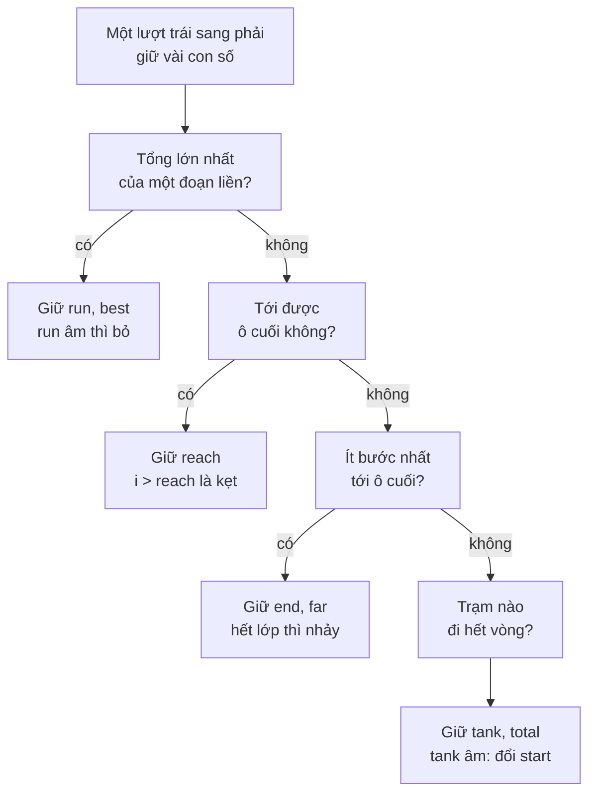
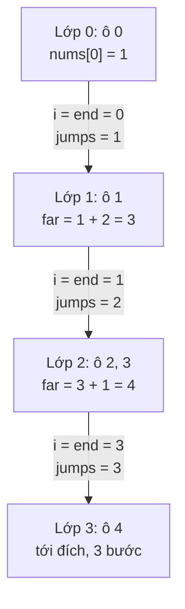
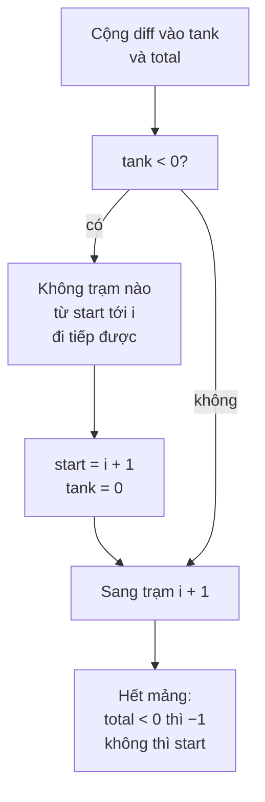

> [!tldr] Đọc nhanh
> - Hai ga trước ([[posts/2026-11-28-neetcode-subsets-combinations|MISC-01]], [[posts/2026-11-28-neetcode-permutations-search|MISC-02]]) thử mọi lựa chọn rồi gỡ ra. Ga này làm ngược lại: **đi mảng một lượt từ trái sang phải, giữ một hai con số, và ở mỗi ô quyết ngay theo một luật cục bộ**, không bao giờ quay lại.
> - Bốn bài chỉ khác nhau ở con số được giữ: tổng chạy `run` (Maximum Subarray), chỗ xa nhất `reach` (Jump Game), cuối lớp `end` cùng `far` (Jump Game II), bình xăng `tank` (Gas Station).
> - Luật cục bộ chỉ đáng tin khi có lý do. Ở cả bốn bài, lý do có cùng một dạng: **thứ bị bỏ đi (một tiền tố âm, một trạm xuất phát) chắc chắn không chứa đáp án tốt hơn**.
> - Tham lam không phải lúc nào cũng đúng. Đổi tiền `6` bằng xu `{1, 3, 4}` theo kiểu "lấy xu to nhất trước" ra 3 xu, trong khi `3 + 3` chỉ cần 2.

> [!info] Bối cảnh
> Đây là ga thứ ba của [[series/neetcode-misc|tuyến NeetCode: Kỹ thuật tổng hợp]]. Hai ga quay lui trước liệt kê mọi lựa chọn; ga này mở phần tham lam: chọn một lần, không thử lại. Bạn chỉ cần biết mảng, vòng lặp `for` và hàm `max`. Không cần đọc hai ga trước.

> [!abstract]- Từ điển nhanh cho bài này (bấm để mở)
> - [[concepts/greedy-choice|Greedy Choice]] (lựa chọn tham lam) là chọn cái tốt nhất *ở bước hiện tại* rồi không xét lại, kèm một lý lẽ rằng lựa chọn đó không làm mất đáp án tối ưu.
> - [[concepts/kadane-algorithm|Kadane's Algorithm]] là cách tìm tổng lớn nhất của một đoạn liên tiếp trong một lượt: giữ tổng của đoạn đang chạy, và bỏ nó đi khi nó âm.
> - [[concepts/farthest-reach|Farthest Reach]] (chỗ xa nhất) là một con số duy nhất mô tả mọi ô tới được: mọi ô từ 0 tới `reach` đều tới được.
> - [[concepts/jump-layers|Jump Layers]] (lớp bước nhảy) là chia các ô theo số bước nhảy ít nhất để tới; mỗi lớp là một khoảng liên tiếp.
> - [[concepts/restart-argument|Restart Argument]] (lý lẽ khởi động lại) là chứng minh rằng khi đoạn đang xét hỏng ở ô i, mọi điểm bắt đầu nằm giữa cũng hỏng, nên bắt đầu lại ngay sau i.
> - **Đoạn con** (subarray) là một khúc liền nhau của mảng, như `[4, −1, 3]` trong `[2, −5, 4, −1, 3, −7, 2]`; khác với dãy con, không được nhảy cóc.
> - **Tiền tố** (prefix) của một đoạn là khúc đầu của nó.
> - **Chứng minh đổi chỗ** (exchange argument) là lấy một đáp án tối ưu bất kỳ, đổi một phần của nó cho giống lựa chọn tham lam, và chỉ ra nó không tệ đi.

## Hình dung trước: một chuyến xe dọc quốc lộ

Mình lái xe một mạch dọc một quốc lộ có nhiều trạm dừng, không bao giờ quay đầu, trong túi chỉ có một cuốn sổ nhỏ ghi một hai con số. Việc thứ nhất là chấm điểm phong cảnh từng chặng (đẹp thì cộng, xấu thì trừ) để tìm quãng đường liền nhau đáng nhớ nhất: nếu quãng vừa đi qua có tổng điểm âm, mình quên nó đi và bắt đầu đếm lại từ đây. Việc thứ hai là đi nhờ xe đò: mỗi trạm có biển "xe từ đây chạy tối đa k trạm", và mình ghi cột mốc xa nhất mà mọi tấm biển đã thấy có thể đưa tới. Việc thứ ba là đếm số chuyến xe ít nhất: các trạm đi một chuyến là tới, các trạm cần hai chuyến, và cứ thế. Việc cuối là chọn trạm xăng để xuất phát đi hết một vòng tròn: hễ bình cạn ở trạm i thì mọi trạm xuất phát từ chỗ cũ tới i đều không xong, nên mình thử lại từ trạm i + 1.

| Đời thường | Khái niệm |
|---|---|
| Lái một mạch, không quay đầu, chỉ nhìn cuốn sổ nhỏ | Một lượt trái sang phải, trạng thái O(1) |
| Quyết ngay ở mỗi trạm theo một luật có lý do chắc chắn | [[concepts/greedy-choice\|Greedy Choice]] |
| Quãng vừa qua tổng điểm âm thì quên, đếm lại từ đây | [[concepts/kadane-algorithm\|Kadane's Algorithm]]: `run < 0` thì bỏ |
| Kỷ lục quãng đẹp nhất ghi ở góc sổ | `best` |
| Cột mốc xa nhất mà các biển đã thấy đưa tới được | [[concepts/farthest-reach\|Farthest Reach]]: `reach` |
| Đứng ở trạm vượt quá cột mốc đó là kẹt | `i > reach` thì trả `false` |
| Nhóm trạm tới được bằng một chuyến, hai chuyến | [[concepts/jump-layers\|Jump Layers]]: `end` và `far` |
| Bình cạn ở trạm i: thử lại từ trạm i + 1 | [[concepts/restart-argument\|Restart Argument]]: `tank < 0` thì đổi `start` |



Bốn hộp kết quả là bốn bài của ga. Thứ thay đổi giữa chúng chỉ là con số nằm trong cuốn sổ.

## Vấn đề: chọn cục bộ mà không biết phía sau

Mình từng nghĩ "tham lam" là một mẹo ăn may: cứ chọn cái trông tốt nhất, hy vọng nó đúng. Với Maximum Subarray, cách chắc ăn là thử mọi đoạn `[i, j]`, mất O(n²) đoạn. Một lượt O(n) thì nhanh hơn nhiều, nhưng ở ô thứ i mình chưa thấy phần mảng phía sau. Làm sao dám bỏ cái gì đi khi chưa biết tương lai?

Câu hỏi đó có câu trả lời, và nó không phải là "hy vọng". Đổi tiền là phản ví dụ rõ nhất. Với xu `{1, 3, 4}` và số tiền 6, luật "lấy xu to nhất còn vừa" chọn 4, rồi 1, rồi 1: ba xu. Đáp án đúng là 3 + 3, hai xu. Vì vậy [[problems/coin-change|Coin Change]] phải giải bằng quy hoạch động. Một luật tham lam chỉ được dùng khi có lý lẽ chứng minh nó không bao giờ bỏ sót đáp án tốt hơn. Ga này là bốn bài có lý lẽ như vậy.

## Cơ chế

<figure class="figure-map" style="--ar: 3 / 5">
<div class="frame"><iframe data-archify="../diagrams/neetcode-greedy-array/kadane.html" title="Kadane trên [2, −5, 4, −1, 3, −7, 2]" loading="lazy"></iframe></div>
<figcaption><span><b>Hình 1.</b> Kadane đi qua <code>[2, −5, 4, −1, 3, −7, 2]</code> một lượt: tổng chạy âm hai lần và bị bỏ cả hai lần, còn kỷ lục 6 của đoạn <code>[4, −1, 3]</code> được giữ ở góc sổ tới cuối.</span><a href="../diagrams/neetcode-greedy-array/kadane.html" target="_blank" rel="noopener">Mở toàn màn hình</a></figcaption>
</figure>

### Khuôn chung: một lượt, một trạng thái nhỏ, một luật

Cả bốn lời giải có cùng một hình dạng:

1. Khởi tạo một hai biến trạng thái (tổng, chỗ xa nhất, bình xăng).
2. Đi `i` từ trái sang phải đúng một lần.
3. Ở mỗi ô, áp **một luật cục bộ**: cập nhật trạng thái, và nếu trạng thái "hỏng" thì bỏ phần cũ đi.
4. Đáp án nằm sẵn trong trạng thái khi vòng lặp kết thúc.

Thời gian O(n), bộ nhớ O(1). Phần khó không nằm ở code, vốn chỉ dăm dòng, mà ở câu hỏi: **vì sao luật ở bước 3 an toàn?** Đó là phần [[concepts/greedy-choice|Greedy Choice]] đòi hỏi. Có hai kiểu lý lẽ hay gặp. Kiểu *đổi chỗ*: lấy một đáp án tối ưu bất kỳ, sửa nó cho giống lựa chọn tham lam, và chỉ ra nó không tệ đi. Kiểu *luôn dẫn trước* (stays ahead): sau mỗi bước, lời giải tham lam luôn ít nhất tốt bằng mọi cách khác.

### Kadane: vì sao bỏ tiền tố âm là an toàn

Gọi `run` là tổng lớn nhất của một đoạn **kết thúc đúng tại ô i**. Mọi đoạn kết thúc tại i chỉ có hai dạng: chính `[x]`, hoặc một đoạn kết thúc tại i − 1 rồi nối thêm x. Dạng thứ hai tốt nhất là `run_cũ + x`. Nếu `run_cũ < 0` thì `run_cũ + x < x`, nên nối thêm chỉ làm tệ đi: bỏ tiền tố, bắt đầu lại từ x. Đó là cả thuật toán [[concepts/kadane-algorithm|Kadane]]:

```text
run  = run < 0 ? x : run + x
best = max(best, run)
```

Đáp án là một đoạn nào đó, và đoạn đó kết thúc ở một ô nào đó, nên `best` (giá trị lớn nhất của `run` qua mọi ô) chắc chắn bắt được nó. Hình 1 cho thấy hai lần bỏ: −3 trước số 4, và −1 trước số 2 ở cuối. Lần thứ hai không đổi kỷ lục, nhưng nếu số cuối là 9 thì đoạn mới `[9]` sẽ thắng.

Đây cũng chính là quy hoạch động một chiều với `dp[i] = max(x, dp[i − 1] + x)`, chỉ là mình chỉ giữ ô cuối của bảng. Vì vậy Kadane hay được xếp vào cả hai nhóm.

### Jump Game: một con số mô tả cả tập ô tới được

Ở mỗi ô i, `nums[i]` là bước nhảy **tối đa**. Nếu nhảy được tới ô j thì cũng nhảy được tới mọi ô giữa i và j. Vì vậy tập ô tới được luôn là một khoảng liền `[0, reach]`, và một số nguyên duy nhất mô tả nó: [[concepts/farthest-reach|Farthest Reach]].

Đi từ trái sang phải: nếu `i > reach` thì không ô nào phía trước đưa tới được i, nên trả về `false`. Ngược lại, cập nhật `reach = max(reach, i + nums[i])`. Đi hết mảng mà không kẹt thì ô cuối tới được. Mảng `[2, 0, 1, 0, 3]` kẹt ở ô 4: `reach` dừng ở 3 vì cả ô 1 và ô 3 đều là số 0.

### Jump Game II: đếm lớp thay vì đếm bước

Giờ đề hỏi số bước ít nhất. Ô 0 cần 0 bước. Các ô tới được bằng một bước tạo thành lớp 1, các ô cần đúng hai bước tạo thành lớp 2, và cứ thế. Đây là tìm kiếm theo chiều rộng (BFS), nhưng mỗi lớp lại là một khoảng liên tiếp, nên không cần hàng đợi: chỉ cần biết lớp hiện tại kết thúc ở `end`, và trong lúc quét lớp đó, ghi `far` là chỗ xa nhất mà lớp kế tiếp tới được. Đó là [[concepts/jump-layers|Jump Layers]].



Sơ đồ trên chạy cho `[1, 2, 0, 1, 0]`. Lý lẽ an toàn là kiểu luôn dẫn trước: sau t bước, không cách nhảy nào đi xa hơn `end` của lớp t, vì `end` đã là chỗ xa nhất từ mọi ô của lớp trước. Vòng lặp dừng ở `n − 2`: khi đã đứng trên ô cuối, không cần nhảy thêm.

### Gas Station: bình cạn thì bắt đầu lại sau chỗ cạn

Trạm i cho `gas[i]` lít và chặng tới trạm kế tốn `cost[i]`. Đặt `diff = gas[i] − cost[i]`. Cách thử mọi trạm xuất phát mất O(n²). Lượt tham lam dựa vào [[concepts/restart-argument|Restart Argument]]:

> Xuất phát ở `start`, bình lần đầu âm khi rời trạm i. Với mọi trạm k nằm giữa `start` và i, lúc đi từ `start` tới k bình còn ≥ 0. Xuất phát thẳng ở k thì bình rỗng, tức là ít xăng hơn hoặc bằng, nên cũng cạn ở i hoặc sớm hơn. Vậy bỏ hết các trạm đó, thử lại từ i + 1.

Nếu tổng mọi `diff` âm thì không trạm nào đi hết vòng, trả −1. Nếu tổng ≥ 0 thì trạm `start` cuối cùng đi được: từ `start` tới cuối mảng, bình không bao giờ âm, và phần dư đó đủ bù cho các khúc đã bỏ ở đầu mảng, vì tổng cả vòng không âm. Với `gas = [3, 1, 2, 5]`, `cost = [2, 4, 3, 1]`, các `diff` là `[1, −3, −1, 4]`: bình cạn ở trạm 1 rồi ở trạm 2, và trạm 3 là đáp án.

Bỏ tiền tố âm trong Kadane cũng là một lần khởi động lại theo đúng lý lẽ này: đoạn từ chỗ cũ tới đây có tổng âm, nên bắt đầu từ bất kỳ đâu bên trong nó cũng không hơn bắt đầu lại.



### Bốn bài trên cùng một ga

| Bài | Điểm khác |
|---|---|
| [[problems/maximum-subarray\|Maximum Subarray]] | Bài neo. Giữ `run` và `best`; `run` âm thì bắt đầu lại từ phần tử hiện tại. Khởi tạo bằng `nums[0]`, không phải 0, để mảng toàn âm vẫn đúng. |
| [[problems/jump-game\|Jump Game]] | Giữ `reach`; ô nào nằm ngoài `reach` là kẹt. Trả về đúng/sai, không đếm bước. |
| [[problems/jump-game-ii\|Jump Game II]] | Giữ `end` (cuối lớp đang quét) và `far` (chỗ xa nhất của lớp kế). Chạm `end` thì tăng `jumps`. Đề bảo đảm luôn tới được đích. |
| [[problems/gas-station\|Gas Station]] | Mảng là một vòng tròn, nhưng vẫn đi một lượt thẳng. Giữ `tank` và `total`; `tank` âm thì `start = i + 1`. Kiểm tra `total` ở cuối. |

## Ví dụ chạy được

[TypeScript](../code/neetcode-greedy-array/greedy.ts) · [Python](../code/neetcode-greedy-array/greedy.py) · [Go](../code/neetcode-greedy-array/greedy.go) · [Java](../code/neetcode-greedy-array/greedy.java) · [JavaScript](../code/neetcode-greedy-array/greedy.js) · [PHP](../code/neetcode-greedy-array/greedy.php) · [Rust](../code/neetcode-greedy-array/greedy.rs)

```ts
// Maximum Subarray (Kadane): tổng chạy âm thì bỏ, bắt đầu lại từ phần tử hiện tại.
function maxSubArray(nums: number[]): number {
    let run = nums[0] // tổng của đoạn tốt nhất kết thúc tại i
    let best = nums[0] // tốt nhất từ trước tới giờ
    for (let i = 1; i < nums.length; i++) {
        run = run < 0 ? nums[i] : run + nums[i] // tiền tố âm chỉ kéo tổng xuống: bỏ nó
        best = Math.max(best, run)
    }
    return best
}

// Jump Game: giữ chỗ xa nhất có thể tới; đứng ở ô ngoài tầm là kẹt.
function canJump(nums: number[]): boolean {
    let reach = 0
    for (let i = 0; i < nums.length; i++) {
        if (i > reach) return false // không ô nào trước đó nhảy tới được i
        reach = Math.max(reach, i + nums[i])
    }
    return true
}

// Jump Game II: quét theo lớp; hết lớp hiện tại thì nhảy thêm một bước.
function jump(nums: number[]): number {
    let jumps = 0
    let end = 0 // ô cuối của lớp đang quét
    let far = 0 // chỗ xa nhất mà lớp kế tiếp tới được
    for (let i = 0; i < nums.length - 1; i++) {
        far = Math.max(far, i + nums[i])
        if (i === end) { // đã quét hết lớp này
            jumps++
            end = far
        }
    }
    return jumps
}

// Gas Station: bình hụt ở trạm i thì không điểm nào từ start tới i xuất phát được.
function canCompleteCircuit(gas: number[], cost: number[]): number {
    let total = 0
    let tank = 0
    let start = 0
    for (let i = 0; i < gas.length; i++) {
        const diff = gas[i] - cost[i]
        total += diff
        tank += diff
        if (tank < 0) { // xuất phát lại từ trạm kế tiếp
            start = i + 1
            tank = 0
        }
    }
    return total < 0 ? -1 : start
}
```

```python
def max_sub_array(nums):
    """Kadane: tổng chạy âm thì bỏ, bắt đầu lại từ phần tử hiện tại."""
    run = best = nums[0]  # run: đoạn tốt nhất kết thúc tại i; best: tốt nhất tới giờ
    for x in nums[1:]:
        run = x if run < 0 else run + x  # tiền tố âm chỉ kéo tổng xuống: bỏ nó
        best = max(best, run)
    return best


def can_jump(nums):
    """Giữ chỗ xa nhất có thể tới; đứng ở ô ngoài tầm là kẹt."""
    reach = 0
    for i, x in enumerate(nums):
        if i > reach:
            return False  # không ô nào trước đó nhảy tới được i
        reach = max(reach, i + x)
    return True


def jump(nums):
    """Quét theo lớp; hết lớp hiện tại thì nhảy thêm một bước."""
    jumps = end = far = 0  # end: ô cuối của lớp đang quét; far: chỗ xa nhất của lớp kế
    for i in range(len(nums) - 1):
        far = max(far, i + nums[i])
        if i == end:  # đã quét hết lớp này
            jumps += 1
            end = far
    return jumps


def can_complete_circuit(gas, cost):
    """Bình hụt ở trạm i thì không điểm nào từ start tới i xuất phát được."""
    total = tank = start = 0
    for i in range(len(gas)):
        diff = gas[i] - cost[i]
        total += diff
        tank += diff
        if tank < 0:  # xuất phát lại từ trạm kế tiếp
            start = i + 1
            tank = 0
    return -1 if total < 0 else start
```

```go
// Maximum Subarray (Kadane): tổng chạy âm thì bỏ, bắt đầu lại từ phần tử hiện tại.
func maxSubArray(nums []int) int {
	run := nums[0]  // tổng của đoạn tốt nhất kết thúc tại i
	best := nums[0] // tốt nhất từ trước tới giờ
	for _, x := range nums[1:] {
		if run < 0 {
			run = x // tiền tố âm chỉ kéo tổng xuống: bỏ nó
		} else {
			run += x
		}
		best = max(best, run)
	}
	return best
}

// Jump Game: giữ chỗ xa nhất có thể tới; đứng ở ô ngoài tầm là kẹt.
func canJump(nums []int) bool {
	reach := 0
	for i, x := range nums {
		if i > reach {
			return false // không ô nào trước đó nhảy tới được i
		}
		reach = max(reach, i+x)
	}
	return true
}

// Jump Game II: quét theo lớp; hết lớp hiện tại thì nhảy thêm một bước.
func jump(nums []int) int {
	jumps, end, far := 0, 0, 0 // end: ô cuối của lớp đang quét; far: chỗ xa nhất của lớp kế
	for i := 0; i < len(nums)-1; i++ {
		far = max(far, i+nums[i])
		if i == end { // đã quét hết lớp này
			jumps++
			end = far
		}
	}
	return jumps
}

// Gas Station: bình hụt ở trạm i thì không điểm nào từ start tới i xuất phát được.
func canCompleteCircuit(gas, cost []int) int {
	total, tank, start := 0, 0, 0
	for i := range gas {
		diff := gas[i] - cost[i]
		total += diff
		tank += diff
		if tank < 0 { // xuất phát lại từ trạm kế tiếp
			start = i + 1
			tank = 0
		}
	}
	if total < 0 {
		return -1
	}
	return start
}
```

```java
// Maximum Subarray (Kadane): tổng chạy âm thì bỏ, bắt đầu lại từ phần tử hiện tại.
static int maxSubArray(int[] nums) {
    int run = nums[0]; // tổng của đoạn tốt nhất kết thúc tại i
    int best = nums[0]; // tốt nhất từ trước tới giờ
    for (int i = 1; i < nums.length; i++) {
        run = run < 0 ? nums[i] : run + nums[i]; // tiền tố âm chỉ kéo tổng xuống: bỏ nó
        best = Math.max(best, run);
    }
    return best;
}

// Jump Game: giữ chỗ xa nhất có thể tới; đứng ở ô ngoài tầm là kẹt.
static boolean canJump(int[] nums) {
    int reach = 0;
    for (int i = 0; i < nums.length; i++) {
        if (i > reach) return false; // không ô nào trước đó nhảy tới được i
        reach = Math.max(reach, i + nums[i]);
    }
    return true;
}

// Jump Game II: quét theo lớp; hết lớp hiện tại thì nhảy thêm một bước.
static int jump(int[] nums) {
    int jumps = 0;
    int end = 0; // ô cuối của lớp đang quét
    int far = 0; // chỗ xa nhất mà lớp kế tiếp tới được
    for (int i = 0; i < nums.length - 1; i++) {
        far = Math.max(far, i + nums[i]);
        if (i == end) { // đã quét hết lớp này
            jumps++;
            end = far;
        }
    }
    return jumps;
}

// Gas Station: bình hụt ở trạm i thì không điểm nào từ start tới i xuất phát được.
static int canCompleteCircuit(int[] gas, int[] cost) {
    int total = 0, tank = 0, start = 0;
    for (int i = 0; i < gas.length; i++) {
        int diff = gas[i] - cost[i];
        total += diff;
        tank += diff;
        if (tank < 0) { // xuất phát lại từ trạm kế tiếp
            start = i + 1;
            tank = 0;
        }
    }
    return total < 0 ? -1 : start;
}
```

```js
// Maximum Subarray (Kadane): tổng chạy âm thì bỏ, bắt đầu lại từ phần tử hiện tại.
function maxSubArray(nums) {
    let run = nums[0] // tổng của đoạn tốt nhất kết thúc tại i
    let best = nums[0] // tốt nhất từ trước tới giờ
    for (let i = 1; i < nums.length; i++) {
        run = run < 0 ? nums[i] : run + nums[i] // tiền tố âm chỉ kéo tổng xuống: bỏ nó
        best = Math.max(best, run)
    }
    return best
}

// Jump Game: giữ chỗ xa nhất có thể tới; đứng ở ô ngoài tầm là kẹt.
function canJump(nums) {
    let reach = 0
    for (let i = 0; i < nums.length; i++) {
        if (i > reach) return false // không ô nào trước đó nhảy tới được i
        reach = Math.max(reach, i + nums[i])
    }
    return true
}

// Jump Game II: quét theo lớp; hết lớp hiện tại thì nhảy thêm một bước.
function jump(nums) {
    let jumps = 0
    let end = 0 // ô cuối của lớp đang quét
    let far = 0 // chỗ xa nhất mà lớp kế tiếp tới được
    for (let i = 0; i < nums.length - 1; i++) {
        far = Math.max(far, i + nums[i])
        if (i === end) { // đã quét hết lớp này
            jumps++
            end = far
        }
    }
    return jumps
}

// Gas Station: bình hụt ở trạm i thì không điểm nào từ start tới i xuất phát được.
function canCompleteCircuit(gas, cost) {
    let total = 0
    let tank = 0
    let start = 0
    for (let i = 0; i < gas.length; i++) {
        const diff = gas[i] - cost[i]
        total += diff
        tank += diff
        if (tank < 0) { // xuất phát lại từ trạm kế tiếp
            start = i + 1
            tank = 0
        }
    }
    return total < 0 ? -1 : start
}
```

```php
// Maximum Subarray (Kadane): tổng chạy âm thì bỏ, bắt đầu lại từ phần tử hiện tại.
function maxSubArray(array $nums): int {
    $run = $nums[0]; // tổng của đoạn tốt nhất kết thúc tại i
    $best = $nums[0]; // tốt nhất từ trước tới giờ
    for ($i = 1; $i < count($nums); $i++) {
        $run = $run < 0 ? $nums[$i] : $run + $nums[$i]; // tiền tố âm chỉ kéo tổng xuống: bỏ nó
        $best = max($best, $run);
    }
    return $best;
}

// Jump Game: giữ chỗ xa nhất có thể tới; đứng ở ô ngoài tầm là kẹt.
function canJump(array $nums): bool {
    $reach = 0;
    foreach ($nums as $i => $x) {
        if ($i > $reach) return false; // không ô nào trước đó nhảy tới được i
        $reach = max($reach, $i + $x);
    }
    return true;
}

// Jump Game II: quét theo lớp; hết lớp hiện tại thì nhảy thêm một bước.
function jump(array $nums): int {
    $jumps = 0;
    $end = 0; // ô cuối của lớp đang quét
    $far = 0; // chỗ xa nhất mà lớp kế tiếp tới được
    for ($i = 0; $i < count($nums) - 1; $i++) {
        $far = max($far, $i + $nums[$i]);
        if ($i === $end) { // đã quét hết lớp này
            $jumps++;
            $end = $far;
        }
    }
    return $jumps;
}

// Gas Station: bình hụt ở trạm i thì không điểm nào từ start tới i xuất phát được.
function canCompleteCircuit(array $gas, array $cost): int {
    $total = 0;
    $tank = 0;
    $start = 0;
    foreach ($gas as $i => $g) {
        $diff = $g - $cost[$i];
        $total += $diff;
        $tank += $diff;
        if ($tank < 0) { // xuất phát lại từ trạm kế tiếp
            $start = $i + 1;
            $tank = 0;
        }
    }
    return $total < 0 ? -1 : $start;
}
```

```rust
// Maximum Subarray (Kadane): tổng chạy âm thì bỏ, bắt đầu lại từ phần tử hiện tại.
fn max_sub_array(nums: &[i32]) -> i32 {
    let mut run = nums[0]; // tổng của đoạn tốt nhất kết thúc tại i
    let mut best = nums[0]; // tốt nhất từ trước tới giờ
    for &x in &nums[1..] {
        run = if run < 0 { x } else { run + x }; // tiền tố âm chỉ kéo tổng xuống: bỏ nó
        best = best.max(run);
    }
    best
}

// Jump Game: giữ chỗ xa nhất có thể tới; đứng ở ô ngoài tầm là kẹt.
fn can_jump(nums: &[i32]) -> bool {
    let mut reach = 0usize;
    for (i, &x) in nums.iter().enumerate() {
        if i > reach {
            return false; // không ô nào trước đó nhảy tới được i
        }
        reach = reach.max(i + x as usize);
    }
    true
}

// Jump Game II: quét theo lớp; hết lớp hiện tại thì nhảy thêm một bước.
fn jump(nums: &[i32]) -> i32 {
    let (mut jumps, mut end, mut far) = (0, 0usize, 0usize); // end: ô cuối của lớp; far: chỗ xa nhất của lớp kế
    for i in 0..nums.len() - 1 {
        far = far.max(i + nums[i] as usize);
        if i == end {
            // đã quét hết lớp này
            jumps += 1;
            end = far;
        }
    }
    jumps
}

// Gas Station: bình hụt ở trạm i thì không điểm nào từ start tới i xuất phát được.
fn can_complete_circuit(gas: &[i32], cost: &[i32]) -> i32 {
    let (mut total, mut tank, mut start) = (0, 0, 0usize);
    for i in 0..gas.len() {
        let diff = gas[i] - cost[i];
        total += diff;
        tank += diff;
        if tank < 0 {
            // xuất phát lại từ trạm kế tiếp
            start = i + 1;
            tank = 0;
        }
    }
    if total < 0 { -1 } else { start as i32 }
}
```

Các tab trích cả bốn hàm của file. Mỗi file còn chạy 19 ca: năm cho Maximum Subarray (có mảng toàn âm và mảng một phần tử), năm cho Jump Game, năm cho Jump Game II và bốn cho Gas Station (có ca tổng xăng thiếu và ca tổng đúng bằng 0). Đáp án mong đợi được tính trước bằng vét cạn độc lập: thử mọi đoạn, tìm kiếm trên đồ thị các ô, quy hoạch động cho số bước, và thử mọi trạm xuất phát.

```text
19/19 ca đúng
```

Chạy bằng `node greedy.ts`, `python3 greedy.py`, `go run greedy.go`, `java greedy.java`, `node greedy.js`, `php greedy.php` hoặc `rustc --edition 2021 -O greedy.rs -o /tmp/greedy && /tmp/greedy`. Cả bảy bản in cùng một dòng trên.

## Hiểu lầm và bẫy hay gặp

- Nghĩ tham lam là "chọn cái trông tốt nhất rồi hy vọng". Không có lý lẽ thì luật cục bộ có thể sai, như đổi tiền 6 bằng xu `{1, 3, 4}`. Trước khi viết, mình hỏi: thứ mình bỏ đi có chắc không chứa đáp án tốt hơn không?
- Khởi tạo `best = 0` trong Kadane. Với `[-3, -1, -2]` hàm trả 0, tức là một đoạn rỗng mà đề không cho phép. Khởi tạo bằng `nums[0]`.
- Bỏ tiền tố khi phần tử hiện tại âm, thay vì khi **tổng chạy** âm. Ở `[4, −1, 3]`, số −1 âm nhưng tổng chạy 3 vẫn dương, và đoạn tốt nhất cần giữ nó.
- Trong Jump Game, kiểm `nums[i] == 0` thay vì `i > reach`. Số 0 chỉ là vấn đề khi không ô nào trước đó vượt qua được nó; `[3, 0, 0, 1, 0, 2]` kẹt ở ô 4, còn `[1, 2, 0, 1, 0]` đi qua số 0 ở ô 2 bình thường.
- Trong Jump Game II, cho vòng lặp chạy tới `n − 1`. Khi `end` vừa chạm ô cuối, vòng lặp đếm thêm một bước thừa; với `[0]` nó trả 1 thay vì 0.
- Trong Jump Game II, tăng `jumps` mỗi khi `far` tăng. `far` có thể tăng nhiều lần trong một lớp; một bước nhảy chỉ được tính khi đi hết lớp, tức khi `i == end`.
- Trong Gas Station, chạy hai vòng để mô phỏng đường tròn. Không cần: lý lẽ khởi động lại cộng với kiểm tra `total` đã đủ, nên một lượt thẳng là xong.
- Trong Rust, `i + nums[i] as usize` chỉ an toàn vì đề cho `nums[i] ≥ 0`; với số âm, ép sang `usize` sẽ ra một số rất lớn.

## Câu hỏi tự kiểm tra

> [!question]- Vì sao bỏ tiền tố khi tổng chạy âm không làm mất đáp án?
> Mọi đoạn kết thúc tại i mà dài hơn `[x]` đều bằng một đoạn kết thúc tại i − 1 cộng x, và tốt nhất trong số đó là `run + x`. Khi `run < 0`, `run + x < x`, nên giữ tiền tố luôn thua bắt đầu lại từ x.

> [!question]- Kadane chạy trên `[−1, 4, −2, 4, −10, 3]` cho `run` lần lượt bằng bao nhiêu?
> −1, 4 (bỏ −1), 2, 6, −4, 3 (bỏ −4). `best` là 6, của đoạn `[4, −2, 4]`.

> [!question]- Vì sao trong Jump Game một con số `reach` là đủ, không cần tập các ô tới được?
> Vì bước nhảy là tối đa chứ không cố định: tới được ô j từ ô i thì cũng tới được mọi ô giữa i và j. Tập ô tới được luôn là khoảng `[0, reach]`.

> [!question]- Gas Station: bình cạn lần đầu ở trạm 5 khi xuất phát ở trạm 2. Vì sao không cần thử trạm 3 và 4?
> Khi đi từ trạm 2 tới trạm 3 hay 4, bình còn ≥ 0. Xuất phát thẳng ở đó thì bình rỗng, ít hơn hoặc bằng, nên cũng cạn ở trạm 5 hoặc sớm hơn.

> [!question]- Đổi tiền 6 bằng xu `{1, 3, 4}`: luật "lấy xu lớn nhất" cho mấy xu, và đáp án đúng là gì?
> Tham lam lấy 4 + 1 + 1, ba xu. Đáp án đúng là 3 + 3, hai xu. Không có lý lẽ đổi chỗ nào cứu được luật đó, nên bài này cần quy hoạch động.

## Tham khảo

- [Maximum Subarray](https://leetcode.com/problems/maximum-subarray/) · [Jump Game](https://leetcode.com/problems/jump-game/) · [Jump Game II](https://leetcode.com/problems/jump-game-ii/) · [Gas Station](https://leetcode.com/problems/gas-station/)
- [Jeff Erickson, Algorithms, chương 4: Greedy Algorithms](https://jeffe.cs.illinois.edu/teaching/algorithms/book/04-greedy.pdf), về lý lẽ đổi chỗ và vì sao tham lam cần chứng minh
- [Maximum subarray problem (Wikipedia)](https://en.wikipedia.org/wiki/Maximum_subarray_problem), lịch sử và các biến thể của thuật toán Kadane
