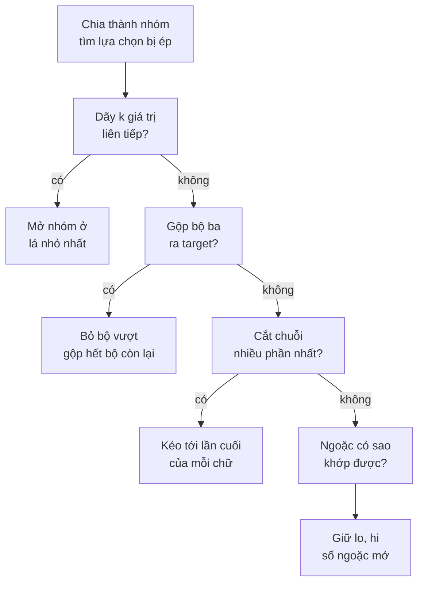
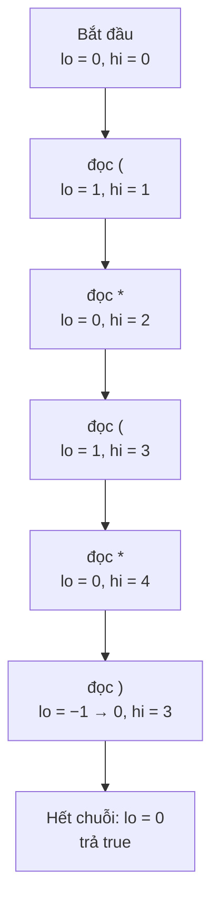

> [!tldr] Đọc nhanh
> - Ga trước ([[posts/2026-11-28-neetcode-greedy-array|MISC-03]]) đi mảng một lượt và bỏ đi thứ chắc chắn vô dụng. Ga này hỏi một câu khác: **phần tử nào phải đi chung nhóm với phần tử nào?** Mẹo là tìm phần tử mà lựa chọn của nó **bị ép**, chứ không phải lựa chọn trông tốt nhất.
> - Bốn luật bị ép: lá nhỏ nhất còn lại chỉ có thể *mở* một nhóm (Hand of Straights); bộ ba vượt target ở bất kỳ vị trí nào thì không bao giờ dùng được (Merge Triplets); một phần phải kéo tới lần xuất hiện cuối của mọi chữ trong nó (Partition Labels); số ngoặc mở có thể có luôn là một khoảng `[lo, hi]` (Valid Parenthesis String).
> - Lý lẽ an toàn ở đây mạnh hơn đổi chỗ: **mọi đáp án hợp lệ đều phải làm đúng điều tham lam làm**, nên làm trước không mất gì; và khi tham lam báo "không được" thì đúng là không cách chia nào được.
> - Mở nhóm ở một lá tùy ý thì sai: với `[1, 2, 3, 4]` và nhóm cỡ 2, mở ở lá 2 thành `{2, 3}` bỏ lại 1 và 4 lẻ loi, trong khi `{1, 2}, {3, 4}` chia được.

> [!info] Bối cảnh
> Đây là ga thứ tư của [[series/neetcode-misc|tuyến NeetCode: Kỹ thuật tổng hợp]], ga tham lam thứ hai sau [[posts/2026-11-28-neetcode-greedy-array|ga MISC-03: Tham lam trên mảng]]. Bạn chỉ cần biết mảng, sắp xếp và một bảng đếm (map từ giá trị sang số lần). Không cần đọc ga trước.

> [!abstract]- Từ điển nhanh cho bài này (bấm để mở)
> - [[concepts/greedy-choice|Greedy Choice]] (lựa chọn tham lam) là chọn ngay ở bước hiện tại rồi không xét lại, kèm một lý lẽ rằng lựa chọn đó không làm mất đáp án. Ở ga này lý lẽ thường là "lựa chọn này bị ép".
> - [[concepts/smallest-first-grouping|Smallest-First Grouping]] (mở nhóm từ lá nhỏ nhất) là luật: lá nhỏ nhất còn lại không có lá nào nhỏ hơn đứng trước nó, nên nó phải là lá đầu của nhóm chứa nó.
> - [[concepts/last-occurrence-boundary|Last Occurrence Boundary]] (mốc lần xuất hiện cuối) là luật: một phần chứa chữ c thì phải kéo tới lần cuối c xuất hiện; cắt khi chỉ số chạm mốc xa nhất đó.
> - [[concepts/safe-candidate-filter|Safe Candidate Filter]] (lọc ứng viên an toàn) là luật: bỏ mọi ứng viên làm vượt target ở bất kỳ thành phần nào; các ứng viên còn lại gộp hết cũng chỉ có lợi.
> - [[concepts/open-count-range|Open Count Range]] (khoảng số ngoặc mở) là giữ số ngoặc mở chưa đóng ít nhất và nhiều nhất có thể, thay vì giữ từng cách đọc dấu `*`.
> - **Bảng đếm** ([[concepts/frequency-counting|Frequency Counting]]) là một [[concepts/hash-map|hash map]] từ giá trị sang số lần nó xuất hiện.
> - **Dãy liên tiếp** (straight) là k giá trị liền nhau như `4, 5, 6`, mỗi giá trị đúng một lá.
> - **Bộ ba** (triplet) là ba số `[a, b, c]`. Gộp hai bộ ba là lấy số lớn hơn ở từng vị trí: gộp `[1, 4, 2]` với `[3, 1, 5]` ra `[3, 4, 5]`.

## Hình dung trước: một ngày ở hiệu sách

Mình làm ở một hiệu sách nhỏ, và cả ngày chỉ có việc chia đồ thành nhóm. Buổi sáng, trên bàn có một đống sách lẻ của cùng một bộ truyện, cần gói thành các bó k tập liên tiếp: cuốn có số tập nhỏ nhất trên bàn không có tập nào nhỏ hơn để đứng trước nó, nên nó chắc chắn là tập mở đầu của một bó. Buổi trưa, sách chạy trên băng chuyền vào thùng, và sách của cùng một tác giả phải nằm trọn trong một thùng: thùng đang mở phải chờ tới cuốn cuối cùng của mọi tác giả đã vào thùng rồi mới đóng. Buổi chiều, mình nhận các phiếu đề xuất chiều cao cho ba chồng sách trưng bày; gộp phiếu thì mỗi chồng lấy mức cao nhất, và chồng chỉ cao lên chứ không thấp xuống, nên phiếu nào đòi một chồng cao quá mục tiêu là bỏ ngay. Cuối ngày, mình dò sổ cho mượn: mỗi dòng ghi "mượn" hoặc "trả", nhưng vài dòng bị nhòe, có thể là mượn, là trả, hoặc chẳng ghi gì. Thay vì thử mọi cách đọc, mình chỉ ghi số sách đang cho mượn ít nhất và nhiều nhất có thể.

| Đời thường | Khái niệm |
|---|---|
| Đống sách lẻ gói thành bó k tập liên tiếp | Hand of Straights, nhóm cỡ `groupSize` |
| Cuốn có số tập nhỏ nhất chỉ có thể là tập mở đầu bó | [[concepts/smallest-first-grouping\|Smallest-First Grouping]] |
| Thiếu một tập ở giữa bó thì không gói được | Gặp chỗ hở thì trả `false` |
| Thùng đang mở chờ tới cuốn cuối của mọi tác giả trong thùng | [[concepts/last-occurrence-boundary\|Last Occurrence Boundary]]: `end` |
| Phiếu đòi một chồng cao quá mục tiêu: bỏ, vì chồng không thấp xuống được | [[concepts/safe-candidate-filter\|Safe Candidate Filter]] |
| Gộp mọi phiếu còn lại: mỗi chồng cao lên nhưng không vượt mục tiêu | Gộp hết ứng viên an toàn |
| Dòng sổ nhòe: mượn, trả hay không gì | Dấu `*`: `(`, `)` hoặc rỗng |
| Số sách đang cho mượn ít nhất và nhiều nhất | [[concepts/open-count-range\|Open Count Range]]: `lo`, `hi` |



Bốn hộp kết quả là bốn bài của ga. Ở mỗi hộp, luật không phải "chọn cái trông tốt nhất" mà là "làm điều mà mọi đáp án đều phải làm".

## Vấn đề: chia nhóm mà không thử mọi cách chia

Mình từng nghĩ bài chia nhóm nào cũng phải quay lui: thử lá này vào nhóm này, không được thì gỡ ra thử nhóm khác. Số cách chia bùng nổ theo số phần tử, và với `hand` dài tới 10⁴ lá thì không có cửa. Nhưng một luật tham lam tùy tiện lại sai. Với `[1, 2, 3, 4]` và nhóm cỡ 2, nếu mình mở nhóm ở lá 2 thì được `{2, 3}`, còn lại 1 và 4 không ghép được với nhau. Đáp án là có chia được: `{1, 2}` và `{3, 4}`.

Ở Valid Parenthesis String cũng vậy. Đọc mọi dấu `*` thành chuỗi rỗng thì `(*))` thành `())`, sai, trong khi đọc `*` thành `(` thì ra `(())`, đúng. Thử mọi cách đọc thì mất 3 mũ số dấu sao. Vậy câu hỏi của ga là: có phần tử nào mà **chỉ có một lựa chọn hợp lệ** không? Nếu có, làm lựa chọn đó ngay là an toàn, và phần còn lại là một bài nhỏ hơn cùng dạng.

## Cơ chế

<figure class="figure-map" style="--ar: 3 / 5">
<div class="frame"><iframe data-archify="../diagrams/neetcode-greedy-grouping/straights.html" title="Hand of Straights trên [3, 1, 5, 8, 2, 6, 4, 5, 3], k = 3" loading="lazy"></iframe></div>
<figcaption><span><b>Hình 1.</b> Hand of Straights với <code>[3, 1, 5, 8, 2, 6, 4, 5, 3]</code> và nhóm cỡ 3: mỗi lần, lá nhỏ nhất còn lại mở một nhóm và lấy hai giá trị kế tiếp. Nhóm thứ ba mở ở lá 5 nhưng không có lá 7, nên đáp án là <code>false</code>.</span><a href="../diagrams/neetcode-greedy-grouping/straights.html" target="_blank" rel="noopener">Mở toàn màn hình</a></figcaption>
</figure>

### Khuôn chung: tìm phần tử không có đường lùi

Cả bốn lời giải đi theo cùng một hình dạng:

1. Sắp xếp hoặc đếm để nhìn thấy phần tử "ở rìa": giá trị nhỏ nhất, lần xuất hiện cuối, ứng viên vượt ngưỡng.
2. Hỏi: phần tử đó có bao nhiêu lựa chọn hợp lệ? Nếu chỉ có một, làm ngay.
3. Ứng viên nào chắc chắn làm hỏng đáp án thì bỏ ngay. Ứng viên nào không bao giờ gây hại thì lấy hết.
4. Phần còn lại là một bài nhỏ hơn cùng dạng; lặp lại.

Ở ga trước, [[concepts/greedy-choice|Greedy Choice]] cần một lý lẽ đổi chỗ hay luôn dẫn trước. Ở ga này lý lẽ đơn giản hơn và mạnh hơn: **mọi đáp án hợp lệ đều phải chứa đúng lựa chọn tham lam vừa làm**. Vì vậy làm nó trước không mất gì, và khi tham lam kẹt thì mọi cách chia khác cũng kẹt ở đúng chỗ đó.

### Hand of Straights: lá nhỏ nhất chỉ có một chỗ đứng

Gọi x là giá trị nhỏ nhất còn lại. Nhóm chứa một lá x là k giá trị liên tiếp. Nếu x không đứng đầu nhóm thì nhóm đó phải chứa x − 1, nhưng không còn lá nào nhỏ hơn x. Vậy nhóm chứa x là đúng `{x, x + 1, …, x + k − 1}`: đó là [[concepts/smallest-first-grouping|Smallest-First Grouping]]. Nếu còn c lá x, cả c lá đều phải mở nhóm riêng, vì một nhóm không chứa hai lá cùng giá trị. Lời giải trừ c ở mỗi giá trị từ x tới x + k − 1; giá trị nào còn ít hơn c lá thì trả `false`.

Hình 1 chạy đúng luật đó: lá 1 mở nhóm `{1, 2, 3}`; giá trị 2 đã hết nên bỏ qua; lá 3 mở `{3, 4, 5}`; lá 5 mở nhóm cần 5, 6, 7, và không có lá 7. Câu trả lời `false` này là thật: cách chia nào cũng phải tạo ra hai nhóm đầu như vậy, rồi cũng phải mở một nhóm ở lá 5 còn lại.

Sắp các giá trị khác nhau tốn O(n log n). Vòng trong chỉ chạy cho giá trị nào thật sự mở nhóm, và mỗi lần như vậy lấy đi ít nhất k lá, nên tổng số bước của vòng trong không quá n. Đề trên LeetCode ghi bài này giống hệt bài 1296.

### Merge Triplets: ứng viên vượt target là chết, ứng viên an toàn thì gộp hết

Gộp là lấy max ở từng vị trí, và max chỉ tăng chứ không giảm. Một bộ ba có `t[i] > target[i]` ở bất kỳ vị trí i nào thì hễ dùng nó, vị trí i sẽ vĩnh viễn lớn hơn target. Bỏ nó: đó là [[concepts/safe-candidate-filter|Safe Candidate Filter]].

Mọi bộ còn lại đều an toàn: mỗi vị trí của nó ≤ target. Gộp tất cả các bộ an toàn cho ra một bộ mà mỗi vị trí vẫn ≤ target. Nếu có một tập bộ ba nào đó gộp ra đúng target, tập đó chỉ gồm bộ an toàn, và gộp thêm bộ an toàn khác không đẩy vị trí nào vượt target. Vậy "gộp hết bộ an toàn" ra target khi và chỉ khi có đáp án. Lời giải chỉ cần kiểm: ở mỗi vị trí i, có bộ an toàn nào chạm đúng `target[i]` không.

Với các bộ `[1, 4, 2]`, `[3, 1, 5]`, `[2, 6, 9]`, `[3, 4, 1]` và target `[3, 4, 5]`: bộ `[2, 6, 9]` vượt nên bị bỏ; `[3, 1, 5]` chạm vị trí đầu và vị trí cuối, `[1, 4, 2]` chạm vị trí giữa, nên đáp án là `true`. Một lượt O(n), bộ nhớ O(1).

### Partition Labels: phần phải chạm lần xuất hiện cuối

Đề muốn cắt chuỗi thành nhiều phần nhất, sao cho mỗi chữ chỉ nằm trong một phần. Ghi trước `last[c]` là chỉ số cuối cùng của chữ c. Phần đầu tiên chứa `s[0]`, nên phải kéo ít nhất tới `last[s[0]]`; mọi chữ nằm trong khoảng đó lại có thể kéo mốc ra xa hơn. Mình giữ `end` là mốc xa nhất đã bị ép, và khi `i == end` thì không chữ nào của phần này còn xuất hiện phía sau: cắt. Đó là [[concepts/last-occurrence-boundary|Last Occurrence Boundary]].

Cắt ngay ở `end` là an toàn vì mọi cách chia hợp lệ đều phải có phần đầu kéo tới ít nhất `end`, và cắt ở đó là sớm nhất có thể. Phần còn lại không chung chữ nào với phần đã cắt, nên nó là một bài độc lập. Với `abacdcbe`: chữ a kéo `end` tới 2, chữ b kéo tới 6, còn c (cuối ở 5) và d (cuối ở 4) không kéo xa hơn; tới i = 6 thì cắt phần dài 7, và `e` là phần dài 1. Một lượt O(n), bảng `last` chỉ 26 ô.

### Valid Parenthesis String: giữ một khoảng thay vì mọi cách đọc

Bỏ dấu `*` đi thì đây là [[problems/valid-parentheses|Valid Parentheses]] với một loại ngoặc: giữ số ngoặc mở chưa đóng, không bao giờ để nó âm, và cuối chuỗi phải bằng 0. Mỗi dấu `*` có ba cách đọc, nên sau mỗi tiền tố, số ngoặc mở có thể là nhiều giá trị. Điều đáng chú ý là các giá trị đó **luôn tạo thành một khoảng liền** `[lo, hi]`: `(` dời cả khoảng lên 1, `)` dời xuống 1, còn `*` hợp ba bản dời −1, 0, +1 của một khoảng liền, vẫn ra một khoảng liền. Đó là [[concepts/open-count-range|Open Count Range]].

Giá trị âm nghĩa là cách đọc đó đã đóng nhiều hơn mở, nên bị loại: cắt `lo` về 0. Nếu `hi < 0` thì kể cả cách đọc mở nhiều nhất cũng đã âm: trả `false`. Cuối chuỗi, đáp án là `true` khi 0 nằm trong khoảng, tức `lo == 0`. Sơ đồ dưới chạy cho `(*(*)`:



Ở bước `)`, giá trị −1 bị loại vì cách đọc "cả hai sao đều là `)`" đã đóng quá tay. Một lượt O(n), bộ nhớ O(1). Một cách khác là quy hoạch động trên các đoạn con ([[concepts/interval-dp|Interval DP]]), tốn O(n³) thời gian và O(n²) bộ nhớ.

### Bốn bài trên cùng một ga

| Bài | Điểm khác |
|---|---|
| [[problems/hand-of-straights\|Hand of Straights]] | Bài neo. Đếm, sắp các giá trị, lá nhỏ nhất còn lại mở c nhóm cùng lúc; thiếu giá trị nào ở giữa thì trả `false`. Kiểm `n % k` trước để thoát sớm. |
| [[problems/merge-triplets-to-form-target-triplet\|Merge Triplets to Form Target Triplet]] | Không cần sắp. Lọc bỏ bộ vượt target, rồi chỉ cần ba cờ: mỗi vị trí có bộ an toàn chạm đúng target chưa. |
| [[problems/partition-labels\|Partition Labels]] | Trả về độ dài các phần, không phải đúng/sai. Giữ `end` là max của `last` trên phần đang mở; `i == end` thì cắt. |
| [[problems/valid-parenthesis-string\|Valid Parenthesis String]] | Nhóm ở đây là các cặp ngoặc. Giữ khoảng `[lo, hi]`; `hi < 0` thì sai ngay, `lo` cắt về 0, cuối chuỗi cần `lo == 0`. |

## Ví dụ chạy được

[TypeScript](../code/neetcode-greedy-grouping/grouping.ts) · [Python](../code/neetcode-greedy-grouping/grouping.py) · [Go](../code/neetcode-greedy-grouping/grouping.go) · [Java](../code/neetcode-greedy-grouping/grouping.java) · [JavaScript](../code/neetcode-greedy-grouping/grouping.js) · [PHP](../code/neetcode-greedy-grouping/grouping.php) · [Rust](../code/neetcode-greedy-grouping/grouping.rs)

```ts
// Hand of Straights: lá nhỏ nhất còn lại chỉ có thể mở một nhóm, nên mở nhóm ở đó.
function isNStraightHand(hand: number[], groupSize: number): boolean {
    if (hand.length % groupSize !== 0) return false
    const count = new Map<number, number>()
    for (const x of hand) count.set(x, (count.get(x) ?? 0) + 1)
    const keys = [...count.keys()].sort((a, b) => a - b) // so sánh số, không phải chuỗi
    for (const x of keys) {
        const c = count.get(x)! // c lá x còn lại: cả c lá đều phải mở nhóm
        if (c === 0) continue
        for (let v = x; v < x + groupSize; v++) {
            const have = count.get(v) ?? 0
            if (have < c) return false // thiếu lá v: có nhóm không đi tiếp được
            count.set(v, have - c)
        }
    }
    return true
}

// Merge Triplets: bỏ bộ ba nào vượt target ở bất kỳ vị trí nào; các bộ còn lại gộp hết cũng không hại.
function mergeTriplets(triplets: number[][], target: number[]): boolean {
    const good = [false, false, false] // vị trí i đã có bộ an toàn chạm đúng target[i] chưa
    for (const t of triplets) {
        if (t[0] > target[0] || t[1] > target[1] || t[2] > target[2]) continue // dùng là hỏng vĩnh viễn
        for (let i = 0; i < 3; i++) if (t[i] === target[i]) good[i] = true
    }
    return good[0] && good[1] && good[2]
}

// Partition Labels: phần phải kéo tới lần xuất hiện cuối của mọi chữ trong nó.
function partitionLabels(s: string): number[] {
    const last = new Map<string, number>()
    for (let i = 0; i < s.length; i++) last.set(s[i], i)
    const sizes: number[] = []
    let start = 0
    let end = 0 // mốc xa nhất mà phần hiện tại buộc phải chạm
    for (let i = 0; i < s.length; i++) {
        end = Math.max(end, last.get(s[i])!)
        if (i === end) { // không chữ nào của phần này còn ở phía sau: cắt
            sizes.push(end - start + 1)
            start = i + 1
        }
    }
    return sizes
}

// Valid Parenthesis String: giữ khoảng [lo, hi] số ngoặc mở chưa đóng có thể có.
function checkValidString(s: string): boolean {
    let lo = 0 // ít nhất (mọi '*' nghiêng về ')')
    let hi = 0 // nhiều nhất (mọi '*' nghiêng về '(')
    for (const c of s) {
        if (c === '(') { lo++; hi++ }
        else if (c === ')') { lo--; hi-- }
        else { lo--; hi++ }
        if (hi < 0) return false // kể cả khi mọi '*' là '(' vẫn thừa ')'
        lo = Math.max(lo, 0) // số ngoặc mở không âm: bỏ các cách đọc vô nghĩa
    }
    return lo === 0
}
```

```python
from collections import Counter


def is_n_straight_hand(hand, group_size):
    """Lá nhỏ nhất còn lại chỉ có thể mở một nhóm, nên mở nhóm ở đó."""
    if len(hand) % group_size:
        return False
    count = Counter(hand)
    for x in sorted(count):
        c = count[x]  # c lá x còn lại: cả c lá đều phải mở nhóm
        if c == 0:
            continue
        for v in range(x, x + group_size):
            if count[v] < c:
                return False  # thiếu lá v: có nhóm không đi tiếp được
            count[v] -= c
    return True


def merge_triplets(triplets, target):
    """Bỏ bộ ba nào vượt target ở bất kỳ vị trí nào; các bộ còn lại gộp hết cũng không hại."""
    good = [False, False, False]  # vị trí i đã có bộ an toàn chạm đúng target[i] chưa
    for t in triplets:
        if any(t[i] > target[i] for i in range(3)):
            continue  # dùng là hỏng vĩnh viễn
        for i in range(3):
            if t[i] == target[i]:
                good[i] = True
    return all(good)


def partition_labels(s):
    """Phần phải kéo tới lần xuất hiện cuối của mọi chữ trong nó."""
    last = {c: i for i, c in enumerate(s)}
    sizes = []
    start = end = 0  # end: mốc xa nhất mà phần hiện tại buộc phải chạm
    for i, c in enumerate(s):
        end = max(end, last[c])
        if i == end:  # không chữ nào của phần này còn ở phía sau: cắt
            sizes.append(end - start + 1)
            start = i + 1
    return sizes


def check_valid_string(s):
    """Giữ khoảng [lo, hi] số ngoặc mở chưa đóng có thể có."""
    lo = hi = 0  # lo: mọi '*' nghiêng về ')'; hi: mọi '*' nghiêng về '('
    for c in s:
        if c == "(":
            lo, hi = lo + 1, hi + 1
        elif c == ")":
            lo, hi = lo - 1, hi - 1
        else:
            lo, hi = lo - 1, hi + 1
        if hi < 0:
            return False  # kể cả khi mọi '*' là '(' vẫn thừa ')'
        lo = max(lo, 0)  # số ngoặc mở không âm: bỏ các cách đọc vô nghĩa
    return lo == 0
```

```go
// Hand of Straights: lá nhỏ nhất còn lại chỉ có thể mở một nhóm, nên mở nhóm ở đó.
func isNStraightHand(hand []int, groupSize int) bool {
	if len(hand)%groupSize != 0 {
		return false
	}
	count := map[int]int{}
	for _, x := range hand {
		count[x]++
	}
	keys := make([]int, 0, len(count))
	for x := range count {
		keys = append(keys, x)
	}
	slices.Sort(keys) // map trong Go không có thứ tự: phải sắp
	for _, x := range keys {
		c := count[x] // c lá x còn lại: cả c lá đều phải mở nhóm
		if c == 0 {
			continue
		}
		for v := x; v < x+groupSize; v++ {
			if count[v] < c {
				return false // thiếu lá v: có nhóm không đi tiếp được
			}
			count[v] -= c
		}
	}
	return true
}

// Merge Triplets: bỏ bộ ba nào vượt target ở bất kỳ vị trí nào; các bộ còn lại gộp hết cũng không hại.
func mergeTriplets(triplets [][]int, target []int) bool {
	var good [3]bool // vị trí i đã có bộ an toàn chạm đúng target[i] chưa
	for _, t := range triplets {
		if t[0] > target[0] || t[1] > target[1] || t[2] > target[2] {
			continue // dùng là hỏng vĩnh viễn
		}
		for i := 0; i < 3; i++ {
			if t[i] == target[i] {
				good[i] = true
			}
		}
	}
	return good[0] && good[1] && good[2]
}

// Partition Labels: phần phải kéo tới lần xuất hiện cuối của mọi chữ trong nó.
func partitionLabels(s string) []int {
	var last [26]int
	for i := 0; i < len(s); i++ {
		last[s[i]-'a'] = i
	}
	sizes := []int{}
	start, end := 0, 0 // end: mốc xa nhất mà phần hiện tại buộc phải chạm
	for i := 0; i < len(s); i++ {
		end = max(end, last[s[i]-'a'])
		if i == end { // không chữ nào của phần này còn ở phía sau: cắt
			sizes = append(sizes, end-start+1)
			start = i + 1
		}
	}
	return sizes
}

// Valid Parenthesis String: giữ khoảng [lo, hi] số ngoặc mở chưa đóng có thể có.
func checkValidString(s string) bool {
	lo, hi := 0, 0 // lo: mọi '*' nghiêng về ')'; hi: mọi '*' nghiêng về '('
	for _, c := range s {
		switch c {
		case '(':
			lo, hi = lo+1, hi+1
		case ')':
			lo, hi = lo-1, hi-1
		default:
			lo, hi = lo-1, hi+1
		}
		if hi < 0 {
			return false // kể cả khi mọi '*' là '(' vẫn thừa ')'
		}
		lo = max(lo, 0) // số ngoặc mở không âm: bỏ các cách đọc vô nghĩa
	}
	return lo == 0
}
```

```java
// Hand of Straights: lá nhỏ nhất còn lại chỉ có thể mở một nhóm, nên mở nhóm ở đó.
static boolean isNStraightHand(int[] hand, int groupSize) {
    if (hand.length % groupSize != 0) return false;
    TreeMap<Integer, Integer> count = new TreeMap<>(); // khóa luôn được giữ theo thứ tự tăng
    for (int x : hand) count.merge(x, 1, Integer::sum);
    for (int x : count.keySet()) {
        int c = count.get(x); // c lá x còn lại: cả c lá đều phải mở nhóm
        if (c == 0) continue;
        for (int v = x; v < x + groupSize; v++) {
            int have = count.getOrDefault(v, 0);
            if (have < c) return false; // thiếu lá v: có nhóm không đi tiếp được
            count.put(v, have - c);
        }
    }
    return true;
}

// Merge Triplets: bỏ bộ ba nào vượt target ở bất kỳ vị trí nào; các bộ còn lại gộp hết cũng không hại.
static boolean mergeTriplets(int[][] triplets, int[] target) {
    boolean[] good = new boolean[3]; // vị trí i đã có bộ an toàn chạm đúng target[i] chưa
    for (int[] t : triplets) {
        if (t[0] > target[0] || t[1] > target[1] || t[2] > target[2]) continue; // dùng là hỏng vĩnh viễn
        for (int i = 0; i < 3; i++) if (t[i] == target[i]) good[i] = true;
    }
    return good[0] && good[1] && good[2];
}

// Partition Labels: phần phải kéo tới lần xuất hiện cuối của mọi chữ trong nó.
static List<Integer> partitionLabels(String s) {
    int[] last = new int[26];
    for (int i = 0; i < s.length(); i++) last[s.charAt(i) - 'a'] = i;
    List<Integer> sizes = new ArrayList<>();
    int start = 0, end = 0; // end: mốc xa nhất mà phần hiện tại buộc phải chạm
    for (int i = 0; i < s.length(); i++) {
        end = Math.max(end, last[s.charAt(i) - 'a']);
        if (i == end) { // không chữ nào của phần này còn ở phía sau: cắt
            sizes.add(end - start + 1);
            start = i + 1;
        }
    }
    return sizes;
}

// Valid Parenthesis String: giữ khoảng [lo, hi] số ngoặc mở chưa đóng có thể có.
static boolean checkValidString(String s) {
    int lo = 0, hi = 0; // lo: mọi '*' nghiêng về ')'; hi: mọi '*' nghiêng về '('
    for (char c : s.toCharArray()) {
        if (c == '(') { lo++; hi++; }
        else if (c == ')') { lo--; hi--; }
        else { lo--; hi++; }
        if (hi < 0) return false; // kể cả khi mọi '*' là '(' vẫn thừa ')'
        lo = Math.max(lo, 0); // số ngoặc mở không âm: bỏ các cách đọc vô nghĩa
    }
    return lo == 0;
}
```

```js
// Hand of Straights: lá nhỏ nhất còn lại chỉ có thể mở một nhóm, nên mở nhóm ở đó.
function isNStraightHand(hand, groupSize) {
    if (hand.length % groupSize !== 0) return false
    const count = new Map()
    for (const x of hand) count.set(x, (count.get(x) ?? 0) + 1)
    const keys = [...count.keys()].sort((a, b) => a - b) // so sánh số, không phải chuỗi
    for (const x of keys) {
        const c = count.get(x) // c lá x còn lại: cả c lá đều phải mở nhóm
        if (c === 0) continue
        for (let v = x; v < x + groupSize; v++) {
            const have = count.get(v) ?? 0
            if (have < c) return false // thiếu lá v: có nhóm không đi tiếp được
            count.set(v, have - c)
        }
    }
    return true
}

// Merge Triplets: bỏ bộ ba nào vượt target ở bất kỳ vị trí nào; các bộ còn lại gộp hết cũng không hại.
function mergeTriplets(triplets, target) {
    const good = [false, false, false] // vị trí i đã có bộ an toàn chạm đúng target[i] chưa
    for (const t of triplets) {
        if (t[0] > target[0] || t[1] > target[1] || t[2] > target[2]) continue // dùng là hỏng vĩnh viễn
        for (let i = 0; i < 3; i++) if (t[i] === target[i]) good[i] = true
    }
    return good[0] && good[1] && good[2]
}

// Partition Labels: phần phải kéo tới lần xuất hiện cuối của mọi chữ trong nó.
function partitionLabels(s) {
    const last = new Map()
    for (let i = 0; i < s.length; i++) last.set(s[i], i)
    const sizes = []
    let start = 0
    let end = 0 // mốc xa nhất mà phần hiện tại buộc phải chạm
    for (let i = 0; i < s.length; i++) {
        end = Math.max(end, last.get(s[i]))
        if (i === end) { // không chữ nào của phần này còn ở phía sau: cắt
            sizes.push(end - start + 1)
            start = i + 1
        }
    }
    return sizes
}

// Valid Parenthesis String: giữ khoảng [lo, hi] số ngoặc mở chưa đóng có thể có.
function checkValidString(s) {
    let lo = 0 // ít nhất (mọi '*' nghiêng về ')')
    let hi = 0 // nhiều nhất (mọi '*' nghiêng về '(')
    for (const c of s) {
        if (c === '(') { lo++; hi++ }
        else if (c === ')') { lo--; hi-- }
        else { lo--; hi++ }
        if (hi < 0) return false // kể cả khi mọi '*' là '(' vẫn thừa ')'
        lo = Math.max(lo, 0) // số ngoặc mở không âm: bỏ các cách đọc vô nghĩa
    }
    return lo === 0
}
```

```php
// Hand of Straights: lá nhỏ nhất còn lại chỉ có thể mở một nhóm, nên mở nhóm ở đó.
function isNStraightHand(array $hand, int $groupSize): bool {
    if (count($hand) % $groupSize !== 0) return false;
    $count = array_count_values($hand);
    ksort($count); // mảng PHP giữ thứ tự chèn: phải sắp theo khóa
    foreach (array_keys($count) as $x) {
        $c = $count[$x]; // c lá x còn lại: cả c lá đều phải mở nhóm
        if ($c === 0) continue;
        for ($v = $x; $v < $x + $groupSize; $v++) {
            $have = $count[$v] ?? 0;
            if ($have < $c) return false; // thiếu lá v: có nhóm không đi tiếp được
            $count[$v] = $have - $c;
        }
    }
    return true;
}

// Merge Triplets: bỏ bộ ba nào vượt target ở bất kỳ vị trí nào; các bộ còn lại gộp hết cũng không hại.
function mergeTriplets(array $triplets, array $target): bool {
    $good = [false, false, false]; // vị trí i đã có bộ an toàn chạm đúng target[i] chưa
    foreach ($triplets as $t) {
        if ($t[0] > $target[0] || $t[1] > $target[1] || $t[2] > $target[2]) continue; // dùng là hỏng vĩnh viễn
        for ($i = 0; $i < 3; $i++) if ($t[$i] === $target[$i]) $good[$i] = true;
    }
    return $good[0] && $good[1] && $good[2];
}

// Partition Labels: phần phải kéo tới lần xuất hiện cuối của mọi chữ trong nó.
function partitionLabels(string $s): array {
    $last = [];
    for ($i = 0; $i < strlen($s); $i++) $last[$s[$i]] = $i;
    $sizes = [];
    $start = 0;
    $end = 0; // mốc xa nhất mà phần hiện tại buộc phải chạm
    for ($i = 0; $i < strlen($s); $i++) {
        $end = max($end, $last[$s[$i]]);
        if ($i === $end) { // không chữ nào của phần này còn ở phía sau: cắt
            $sizes[] = $end - $start + 1;
            $start = $i + 1;
        }
    }
    return $sizes;
}

// Valid Parenthesis String: giữ khoảng [lo, hi] số ngoặc mở chưa đóng có thể có.
function checkValidString(string $s): bool {
    $lo = 0; // ít nhất (mọi '*' nghiêng về ')')
    $hi = 0; // nhiều nhất (mọi '*' nghiêng về '(')
    foreach (str_split($s) as $c) {
        if ($c === '(') { $lo++; $hi++; }
        elseif ($c === ')') { $lo--; $hi--; }
        else { $lo--; $hi++; }
        if ($hi < 0) return false; // kể cả khi mọi '*' là '(' vẫn thừa ')'
        $lo = max($lo, 0); // số ngoặc mở không âm: bỏ các cách đọc vô nghĩa
    }
    return $lo === 0;
}
```

```rust
use std::collections::BTreeMap;

// Hand of Straights: lá nhỏ nhất còn lại chỉ có thể mở một nhóm, nên mở nhóm ở đó.
fn is_n_straight_hand(hand: &[i32], group_size: i32) -> bool {
    if hand.len() % group_size as usize != 0 {
        return false;
    }
    let mut count: BTreeMap<i32, i32> = BTreeMap::new(); // khóa luôn được giữ theo thứ tự tăng
    for &x in hand {
        *count.entry(x).or_insert(0) += 1;
    }
    let keys: Vec<i32> = count.keys().copied().collect(); // chụp khóa trước, vì vòng trong sửa map
    for x in keys {
        let c = count[&x]; // c lá x còn lại: cả c lá đều phải mở nhóm
        if c == 0 {
            continue;
        }
        for v in x..x + group_size {
            match count.get_mut(&v) {
                Some(have) if *have >= c => *have -= c,
                _ => return false, // thiếu lá v: có nhóm không đi tiếp được
            }
        }
    }
    true
}

// Merge Triplets: bỏ bộ ba nào vượt target ở bất kỳ vị trí nào; các bộ còn lại gộp hết cũng không hại.
fn merge_triplets(triplets: &[[i32; 3]], target: [i32; 3]) -> bool {
    let mut good = [false; 3]; // vị trí i đã có bộ an toàn chạm đúng target[i] chưa
    for t in triplets {
        if (0..3).any(|i| t[i] > target[i]) {
            continue; // dùng là hỏng vĩnh viễn
        }
        for i in 0..3 {
            if t[i] == target[i] {
                good[i] = true;
            }
        }
    }
    good.iter().all(|&g| g)
}

// Partition Labels: phần phải kéo tới lần xuất hiện cuối của mọi chữ trong nó.
fn partition_labels(s: &str) -> Vec<i32> {
    let b = s.as_bytes();
    let mut last = [0usize; 26];
    for (i, &c) in b.iter().enumerate() {
        last[(c - b'a') as usize] = i;
    }
    let mut sizes = Vec::new();
    let (mut start, mut end) = (0usize, 0usize); // end: mốc xa nhất mà phần hiện tại buộc phải chạm
    for (i, &c) in b.iter().enumerate() {
        end = end.max(last[(c - b'a') as usize]);
        if i == end {
            // không chữ nào của phần này còn ở phía sau: cắt
            sizes.push((end - start + 1) as i32);
            start = i + 1;
        }
    }
    sizes
}

// Valid Parenthesis String: giữ khoảng [lo, hi] số ngoặc mở chưa đóng có thể có.
fn check_valid_string(s: &str) -> bool {
    let (mut lo, mut hi) = (0i32, 0i32); // lo: mọi '*' nghiêng về ')'; hi: mọi '*' nghiêng về '('
    for c in s.chars() {
        match c {
            '(' => { lo += 1; hi += 1; }
            ')' => { lo -= 1; hi -= 1; }
            _ => { lo -= 1; hi += 1; }
        }
        if hi < 0 {
            return false; // kể cả khi mọi '*' là '(' vẫn thừa ')'
        }
        lo = lo.max(0); // số ngoặc mở không âm: bỏ các cách đọc vô nghĩa
    }
    lo == 0
}
```

Các tab trích cả bốn hàm của file. Mỗi file còn chạy 26 ca: bảy cho Hand of Straights (có ca không chia hết và ca chỗ hở), năm cho Merge Triplets (có ca bộ duy nhất chạm target lại vượt ở vị trí khác), năm cho Partition Labels và chín cho Valid Parenthesis String. Đáp án mong đợi được tính trước bằng vét cạn độc lập: thử mọi cách tách một dãy liên tiếp ra khỏi bộ bài (có nhớ), thử mọi tập con bộ ba, thử mọi cách đặt vết cắt, và thử mọi cách đọc dấu `*`. Ngoài ra, mình chạy một script nháp đối chiếu bốn hàm tham lam với các vét cạn đó trên 12 000 input ngẫu nhiên nhỏ (3 000 mỗi bài), và không lệch ca nào.

```text
26/26 ca đúng
```

Chạy bằng `node grouping.ts`, `python3 grouping.py`, `go run grouping.go`, `java grouping.java`, `node grouping.js`, `php grouping.php` hoặc `rustc --edition 2021 -O grouping.rs -o /tmp/grouping && /tmp/grouping`. Cả bảy bản in cùng một dòng trên.

## Hiểu lầm và bẫy hay gặp

- Nghĩ tham lam ở đây là "chọn nhóm trông đẹp nhất". Luật đúng là luật bị ép: mở nhóm ở một lá tùy ý, như lá 2 trong `[1, 2, 3, 4]` với nhóm cỡ 2, làm hỏng một bộ bài chia được.
- Trong Hand of Straights, sắp các giá trị theo chuỗi. Trong JavaScript và TypeScript, `[9, 10, 11].sort()` ra `[10, 11, 9]`, nên lá 10 mở nhóm trước lá 9 và hàm trả `false` cho một bộ chia được. Luôn truyền `(a, b) => a - b`.
- Trong Merge Triplets, quên bước lọc và bật cờ cho mọi bộ chạm target ở một vị trí. Với `[2, 9, 1]`, `[1, 2, 3]` và target `[2, 2, 3]`, hàm trả `true`, nhưng mọi cách gộp có `[2, 9, 1]` đều có số 9 ở giữa.
- Trong Partition Labels, cắt khi `last[s[i]] == i`, tức chỉ nhìn chữ hiện tại thay vì max của cả phần. Với `abab`, hàm cắt sau `aba` vì a xuất hiện lần cuối ở đó, trong khi b còn ở phía sau; đáp án đúng là một phần dài 4.
- Trong Valid Parenthesis String, quên cắt `lo` về 0. Với `(*)`, khoảng đi `[1, 1]`, `[0, 2]`, `[−1, 1]`, và hàm trả `false` vì `lo = −1`, trong khi đọc `*` thành rỗng là khớp.
- Trong Valid Parenthesis String, trả `false` khi `lo < 0` thay vì khi `hi < 0`. `lo` âm chỉ nghĩa là cách đọc thấp nhất đã hỏng, các cách đọc khác vẫn còn.
- Trong Go, đi thẳng qua `map` để tìm giá trị nhỏ nhất. Thứ tự duyệt `map` trong Go cố tình ngẫu nhiên, nên phải gom khóa ra rồi sắp. PHP cũng vậy: `array_count_values` giữ thứ tự xuất hiện, phải `ksort`.
- Trong Rust, không thể duyệt `count.keys()` trong khi sửa `count`; borrow checker chặn lại. Chụp khóa ra một `Vec` trước. Trong Java, `TreeMap` cho đổi giá trị của khóa đã có trong lúc duyệt `keySet()`, nhưng thêm khóa mới thì ném `ConcurrentModificationException`; lời giải chỉ `put` khi giá trị đã có ít nhất c lá, nên không bao giờ thêm khóa mới.

## Câu hỏi tự kiểm tra

> [!question]- Vì sao lá nhỏ nhất còn lại phải là lá đầu của nhóm chứa nó?
> Nếu nó không đứng đầu thì nhóm của nó chứa giá trị nhỏ hơn 1 đơn vị, nhưng không còn lá nào nhỏ hơn. Vậy nhóm của nó bị ép là đúng k giá trị bắt đầu từ chính nó.

> [!question]- Chạy luật tham lam cho `[1, 2, 3, 4]` với nhóm cỡ 2. Các nhóm được mở là gì?
> Lá 1 mở `{1, 2}`; giá trị 2 đã hết nên bỏ qua; lá 3 mở `{3, 4}`. Trả `true`. Tham lam không bao giờ mở nhóm ở lá 2 khi lá 1 còn đó.

> [!question]- Merge Triplets: vì sao gộp tất cả bộ an toàn không bao giờ làm hỏng đáp án?
> Mỗi bộ an toàn có mọi vị trí ≤ target, và max của các số ≤ target vẫn ≤ target. Nếu một tập con đã gộp ra target thì gộp thêm bộ an toàn không đẩy vị trí nào vượt lên, nên kết quả vẫn là target.

> [!question]- Partition Labels trên `abcbad` cho các phần dài bao nhiêu?
> Lần cuối của a, b, c, d là 4, 3, 2, 5. `end` lên 4 ngay từ chữ a, và tới i = 4 thì cắt phần `abcba` dài 5. Phần còn lại là `d`, dài 1: đáp án `[5, 1]`.

> [!question]- Vì sao các số ngoặc mở có thể có luôn là một khoảng liền, không có lỗ?
> Ban đầu khoảng là `{0}`. `(` và `)` dời cả khoảng lên hoặc xuống 1. `*` hợp ba bản dời −1, 0, +1 của một khoảng liền, các bản này chồng lên nhau nên hợp vẫn liền. Cắt bỏ phần âm cũng giữ nó liền.

## Tham khảo

- [Hand of Straights](https://leetcode.com/problems/hand-of-straights/) · [Merge Triplets to Form Target Triplet](https://leetcode.com/problems/merge-triplets-to-form-target-triplet/) · [Partition Labels](https://leetcode.com/problems/partition-labels/) · [Valid Parenthesis String](https://leetcode.com/problems/valid-parenthesis-string/), đề gốc và giới hạn đầu vào
