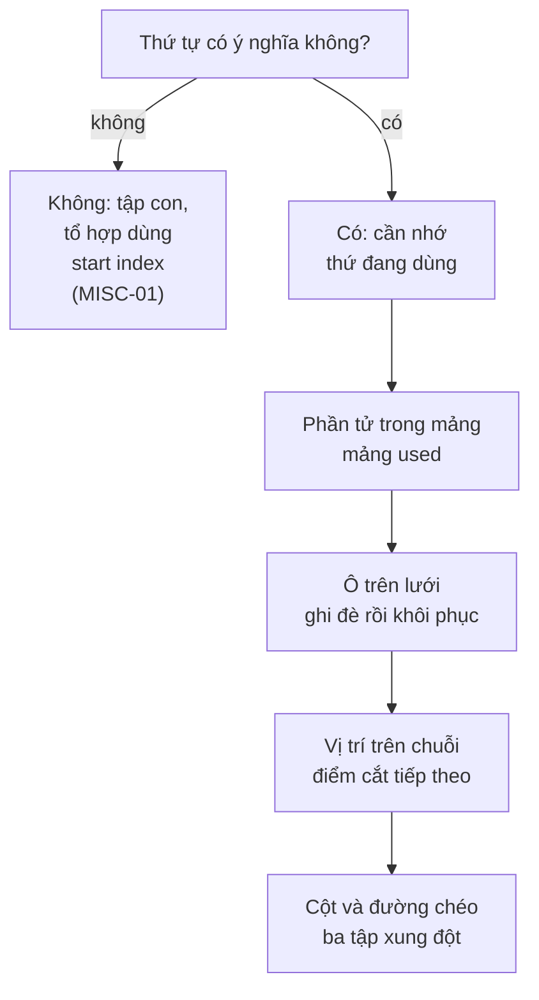
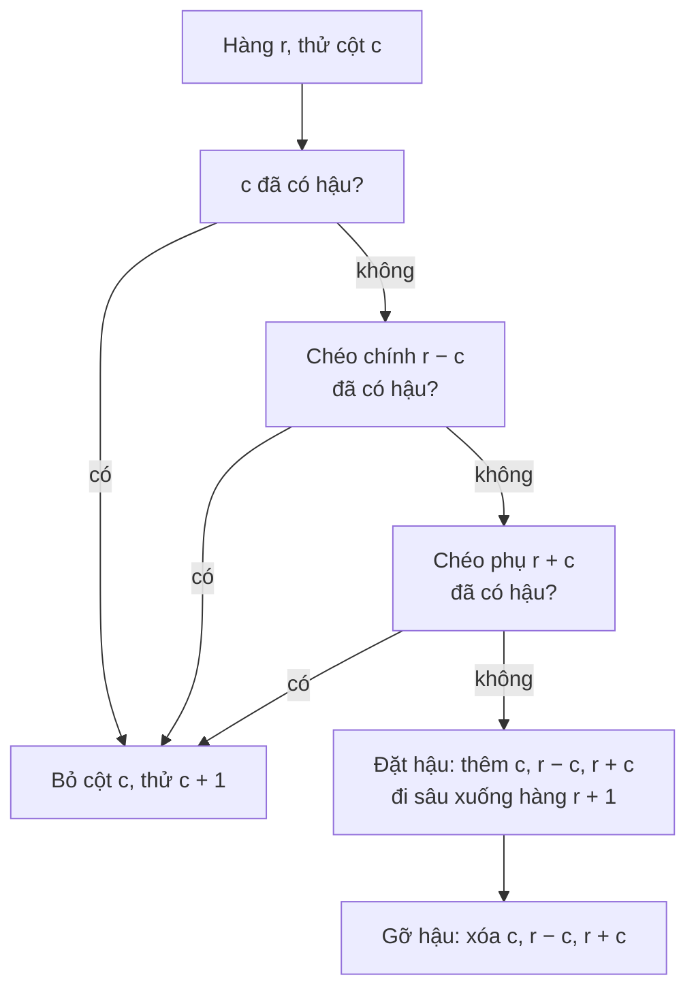

> [!tldr] Đọc nhanh
> - Ở [[posts/2026-11-28-neetcode-subsets-combinations|ga MISC-01]], `[2, 5]` và `[5, 2]` là một, nên chỉ số bắt đầu chặn việc quay lại phía trước. Ở ga này chúng là hai đáp án khác nhau, nên mọi nút đều được xét lại mọi phần tử, và thứ chặn lặp là một **dấu "đang dùng"**.
> - Khuôn vẫn là chọn, đi sâu, gỡ lựa chọn. Cái mới là **trạng thái phải gỡ**: mảng `used` khi hoán vị, ô lưới bị ghi đè khi dò chữ, vị trí cắt khi chia palindrome, ba tập cột và đường chéo khi đặt hậu.
> - Kiểm tra càng sớm càng tốt. Một mảnh không phải palindrome hay một ô hậu bị chiếu thì bỏ ngay, không đi sâu rồi mới lọc.
> - Đếm nút của cây để biết giá: hoán vị 8 số có 109.601 lần gọi, còn 8 quân hậu nhờ cắt nhánh chỉ có 2.057.

> [!info] Bối cảnh
> Đây là ga thứ hai của [[series/neetcode-misc|tuyến NeetCode: Kỹ thuật tổng hợp]]. Ga trước dựng khuôn quay lui và ba núm vặn (ghi ở đâu, bắt đầu từ đâu, bỏ trùng thế nào) cho tập con và tổ hợp. Ga này giữ khuôn đó nhưng bỏ núm "bắt đầu từ đâu", vì thứ tự giờ có ý nghĩa. Bạn chỉ cần biết mảng, lưới hai chiều, tập hợp và hàm đệ quy.

> [!abstract]- Từ điển nhanh cho bài này (bấm để mở)
> - [[concepts/backtracking|Backtracking]] (quay lui) là thử một lựa chọn, đi tiếp, rồi gỡ nó ra để thử lựa chọn khác.
> - [[concepts/choice-tree|Choice Tree]] (cây lựa chọn) là cây mà mỗi nút là một lời giải dở dang và mỗi cạnh là một lựa chọn thêm vào.
> - [[concepts/start-index|Start Index]] là chỉ số mà vòng lặp ở một nút bắt đầu xét; ga trước dùng nó, ga này thì không.
> - [[concepts/used-marker|Used Marker]] là mảng đánh dấu phần tử nào đang nằm trong `path`, bật khi chọn và tắt khi gỡ.
> - [[concepts/visit-and-restore|Visit-and-Restore]] là ghi đè ô đang đi qua bằng một ký hiệu, rồi trả lại giá trị cũ khi quay lui.
> - [[concepts/conflict-sets|Conflict Sets]] là các tập ghi lại cột và đường chéo đã có hậu, để biết một ô có bị chiếu không trong O(1).
> - **Hoán vị** là một cách xếp tất cả phần tử theo một thứ tự; n phần tử phân biệt có n! hoán vị.
> - **Palindrome** là chuỗi đọc xuôi và ngược như nhau, như `noon` hay `racecar`. Ga [[posts/2026-11-27-neetcode-palindrome-centers|DP-02]] đã kiểm palindrome bằng cách mở từ tâm.
> - **Cắt nhánh** (pruning) là dừng một nhánh khi chắc chắn nó không thể dẫn tới đáp án.

## Hình dung trước: chuẩn bị một bữa tiệc

Mình là người tổ chức một bữa tiệc. Việc đầu tiên là xếp khách vào một hàng ghế: ghế trái nhất trước, rồi ghế kế tiếp. Ai đã ngồi thì đeo thẻ "đã ngồi", để không xếp một người vào hai ghế; khi đổi phương án, mình mời người đó đứng dậy và tháo thẻ ra. Việc thứ hai là dò một dòng chữ trên sàn lát gạch có in chữ: mỗi bước sang một viên gạch kề bên, và mình dán băng keo lên viên đang đứng để không bước lại; lùi về thì bóc băng keo ra. Việc thứ ba là cắt một băng rôn thành nhiều khúc, mỗi khúc đọc xuôi ngược như nhau. Việc cuối là xếp những vị khách khó tính lên bàn cờ: không hai người nào chung cột hay chung đường chéo.

| Đời thường | Khái niệm |
|---|---|
| Hàng ghế xếp từ trái sang phải | Mỗi tầng của cây chọn phần tử cho một vị trí |
| Thẻ "đã ngồi" đeo trên khách | [[concepts/used-marker\|Used Marker]]: `used[i] = true` |
| Mời khách đứng dậy, tháo thẻ | Gỡ lựa chọn và gỡ dấu |
| Hai cách xếp khác thứ tự là hai phương án | Hoán vị: không có chỉ số bắt đầu |
| Băng keo dán trên viên gạch đang đứng | [[concepts/visit-and-restore\|Visit-and-Restore]]: ghi đè ô bằng `#` |
| Bóc băng keo khi lùi lại | Trả lại giá trị cũ của ô |
| Vị trí kéo cắt tiếp theo trên băng rôn | Chọn điểm cắt `end`, đi sâu từ `end + 1` |
| Khúc băng rôn đọc ngược không giống thì bỏ ngay | Cắt nhánh sớm khi mảnh không phải palindrome |
| Sổ ghi cột và đường chéo đã có người | [[concepts/conflict-sets\|Conflict Sets]] cho N-Queens |



Bốn hộp cuối là bốn bài của ga, xếp theo độ khó: cái phải gỡ càng nhiều thì càng dễ quên gỡ.

## Vấn đề: không có thứ tự chuẩn để chặn lặp

Mình từng nghĩ hoán vị chỉ là tập con "đủ n phần tử", nên cứ dùng lại khuôn ga trước. Nhưng khuôn đó truyền `i + 1` cho nhánh con, tức là sau khi chọn 7 không bao giờ quay lại 4. Với `[4, 7, 9]`, nó chỉ sinh được đúng một dãy đủ dài là `[4, 7, 9]`, mất năm hoán vị còn lại.

Nếu bỏ chỉ số bắt đầu và cho mọi nút xét lại từ đầu mảng, mình lại sinh ra `[4, 4, 4]`, vì không gì ngăn chọn lại số đã nằm trong `path`. Dò `path.includes(x)` thì đúng nhưng tốn O(n) mỗi lần. Câu hỏi thật là: làm sao biết trong O(1) cái gì đang được dùng, và nhớ trả nó lại khi quay lui?

## Cơ chế

<figure class="figure-map" style="--ar: 3 / 4">
<div class="frame"><iframe data-archify="../diagrams/neetcode-permutations-search/used-marker.html" title="Đánh dấu và gỡ dấu khi sinh hoán vị của [1, 2, 3]" loading="lazy"></iframe></div>
<figcaption><span><b>Hình 1.</b> Sinh hoán vị của <code>[1, 2, 3]</code>: mỗi lần chọn bật một dấu, mỗi lần quay lui tắt nó, nên số 2 lại trống để đứng sau số 3. Cây có 16 nút và đúng 3! = 6 lá.</span><a href="../diagrams/neetcode-permutations-search/used-marker.html" target="_blank" rel="noopener">Mở toàn màn hình</a></figcaption>
</figure>

### Khuôn hoán vị: đánh dấu thay cho chỉ số bắt đầu

Hàm đệ quy không nhận `start`. Ở mỗi nút, vòng lặp đi qua **mọi** chỉ số `i`:

1. Nếu `path` đã đủ n phần tử, ghi một bản chép và quay về.
2. Với mỗi `i` mà `used[i]` còn tắt: bật `used[i]`, thêm `nums[i]` vào `path`, gọi đệ quy, rồi bỏ `nums[i]` ra và tắt `used[i]`.

Bước gỡ có hai phần và phải đi theo thứ tự ngược với bước chọn. Quên tắt `used[i]` thì số đó bị khóa vĩnh viễn: mọi nhánh anh em phía sau sẽ thiếu nó, và kết quả chỉ còn một hoán vị.

Tầng đầu có n lựa chọn, tầng hai còn n − 1, và cứ thế. Cây có n! lá, và số nút là n! nhân với 1 + 1/1! + 1/2! + …, tức khoảng e · n!. Mỗi lá chép một `path` dài n, nên tổng là O(n · n!).

### Bốn dạng của trạng thái phải gỡ

Ba bài còn lại giữ nguyên khuôn chọn, đi sâu, gỡ. Chúng chỉ khác nhau ở thứ cần nhớ để không đi vòng hay không vi phạm luật.

**Dò chữ trên lưới (Word Search).** Đường đi phải qua các ô kề nhau và không dùng lại ô nào. Thay vì một mảng `visited` riêng, mình ghi đè ô đang đứng bằng `#`, một ký hiệu không bao giờ trùng chữ cái trong từ, rồi trả lại chữ cũ khi quay lui. Đó là [[concepts/visit-and-restore|Visit-and-Restore]]. Mỗi bước có tối đa ba hướng mới (hướng thứ tư là ô vừa đi qua), nên với từ dài L, mỗi ô xuất phát mở tối đa 4 · 3^(L−1) đường. Kiểm tra chữ ở đầu hàm đệ quy cắt gần hết số đường đó ngay bước đầu.

**Cắt palindrome (Palindrome Partitioning).** Trạng thái là vị trí `start` mà mảnh tiếp theo bắt đầu. Lựa chọn là điểm kết thúc `end` của mảnh đó. Chỉ đi sâu khi `s[start..end]` là palindrome, nên mọi lá đều là một cách cắt hợp lệ. Chuỗi dài n có n − 1 khe, mỗi khe cắt hoặc không, nên có tối đa 2^(n−1) cách cắt; chuỗi toàn một chữ như `aaaaaaaa` đạt đúng cận đó, 128 cách.

**Đặt N quân hậu (N-Queens).** Mỗi hàng đúng một hậu, nên tầng thứ r chọn cột cho hàng r. Hai hậu chiếu nhau khi chung cột, chung chéo chính (cùng `r − c`) hoặc chung chéo phụ (cùng `r + c`). Ba tập [[concepts/conflict-sets|Conflict Sets]] trả lời "ô này có bị chiếu không" trong O(1). Đặt hậu thì thêm vào cả ba tập, gỡ hậu thì xóa khỏi cả ba.



### Cắt nhánh càng sớm càng rẻ

Ba bài sau đều kiểm tra luật **trước** khi đi sâu, không sinh xong rồi lọc. Sự khác biệt đo được. Mỗi file in hai dòng đếm: số lần gọi hàm đệ quy khi sinh mọi hoán vị của 8 số, và khi đặt 8 quân hậu.

| Cây | Lần gọi | Kết quả |
|---|---|---|
| Hoán vị 8 số, không cắt gì | 109.601 | 40.320 hoán vị |
| 8 quân hậu, cắt bằng ba tập | 2.057 | 92 lời giải |

Một cách đặt 8 hậu hợp lệ cũng là một hoán vị của 8 cột (mỗi hàng một cột khác nhau). Nếu sinh đủ 40.320 hoán vị rồi lọc đường chéo, mình đi qua hơn 109 nghìn nút. Kiểm tra đường chéo ngay khi đặt làm cây nhỏ đi hơn 50 lần.

### Bốn bài trên cùng một ga

| Bài | Điểm khác |
|---|---|
| [[problems/permutations\|Permutations]] | Bài neo. Không có chỉ số bắt đầu; mảng `used` chặn chọn lại; ghi ở lá khi `path` đủ n phần tử. n! lá. |
| [[problems/word-search\|Word Search]] | Bắt đầu thử ở mọi ô; đi sang bốn ô kề; ghi đè ô đang đi bằng `#` rồi khôi phục. Trả về `true` ngay khi tìm thấy, không liệt kê. |
| [[problems/palindrome-partitioning\|Palindrome Partitioning]] | Trạng thái là vị trí bắt đầu mảnh kế tiếp; chỉ đi sâu khi mảnh vừa cắt là palindrome; ghi khi đã cắt tới cuối chuỗi. |
| [[problems/n-queens\|N-Queens]] | Mỗi tầng là một hàng; ba tập cho cột, `r − c` và `r + c`; đặt và gỡ phải cập nhật cả ba. Ghi bàn cờ khi đã đặt đủ n hàng. |

## Ví dụ chạy được

[TypeScript](../code/neetcode-permutations-search/search.ts) · [Python](../code/neetcode-permutations-search/search.py) · [Go](../code/neetcode-permutations-search/search.go) · [Java](../code/neetcode-permutations-search/search.java) · [JavaScript](../code/neetcode-permutations-search/search.js) · [PHP](../code/neetcode-permutations-search/search.php) · [Rust](../code/neetcode-permutations-search/search.rs)

```ts
function permute(nums: number[]): number[][] {
    const result: number[][] = []
    const path: number[] = []
    const used: boolean[] = Array(nums.length).fill(false)
    function walk() {
        permuteCalls++
        if (path.length === nums.length) {
            result.push([...path]) // chép path, vì path còn đổi tiếp
            return
        }
        for (let i = 0; i < nums.length; i++) {
            if (used[i]) continue // đã nằm trong path
            used[i] = true // đánh dấu
            path.push(nums[i]) // chọn
            walk() // đi sâu
            path.pop() // gỡ lựa chọn
            used[i] = false // gỡ dấu
        }
    }
    walk()
    return result
}
```

```python
def permute(nums):
    """Không có start; đánh dấu phần tử đã nằm trong path."""
    result, path = [], []
    used = [False] * len(nums)

    def walk():
        calls["permute"] += 1
        if len(path) == len(nums):
            result.append(path[:])  # chép path, vì path còn đổi tiếp
            return
        for i in range(len(nums)):
            if used[i]:
                continue  # đã nằm trong path
            used[i] = True  # đánh dấu
            path.append(nums[i])  # chọn
            walk()  # đi sâu
            path.pop()  # gỡ lựa chọn
            used[i] = False  # gỡ dấu

    walk()
    return result
```

```go
func permute(nums []int) [][]int {
	result := [][]int{}
	path := []int{}
	used := make([]bool, len(nums))
	var walk func()
	walk = func() {
		permuteCalls++
		if len(path) == len(nums) {
			result = append(result, append([]int(nil), path...)) // chép path, vì path còn đổi tiếp
			return
		}
		for i := range nums {
			if used[i] {
				continue // đã nằm trong path
			}
			used[i] = true               // đánh dấu
			path = append(path, nums[i]) // chọn
			walk()                       // đi sâu
			path = path[:len(path)-1]    // gỡ lựa chọn
			used[i] = false              // gỡ dấu
		}
	}
	walk()
	return result
}
```

```java
static List<List<Integer>> permute(int[] nums) {
    List<List<Integer>> result = new ArrayList<>();
    walkPermute(nums, new boolean[nums.length], new ArrayList<>(), result);
    return result;
}

static void walkPermute(int[] nums, boolean[] used, List<Integer> path, List<List<Integer>> result) {
    permuteCalls++;
    if (path.size() == nums.length) {
        result.add(new ArrayList<>(path)); // chép path, vì path còn đổi tiếp
        return;
    }
    for (int i = 0; i < nums.length; i++) {
        if (used[i]) continue; // đã nằm trong path
        used[i] = true; // đánh dấu
        path.add(nums[i]); // chọn
        walkPermute(nums, used, path, result); // đi sâu
        path.remove(path.size() - 1); // gỡ lựa chọn
        used[i] = false; // gỡ dấu
    }
}
```

```js
function permute(nums) {
    const result = []
    const path = []
    const used = Array(nums.length).fill(false)
    function walk() {
        permuteCalls++
        if (path.length === nums.length) {
            result.push([...path]) // chép path, vì path còn đổi tiếp
            return
        }
        for (let i = 0; i < nums.length; i++) {
            if (used[i]) continue // đã nằm trong path
            used[i] = true // đánh dấu
            path.push(nums[i]) // chọn
            walk() // đi sâu
            path.pop() // gỡ lựa chọn
            used[i] = false // gỡ dấu
        }
    }
    walk()
    return result
}
```

```php
function permute(array $nums): array {
    global $permuteCalls;
    $result = [];
    $path = [];
    $used = array_fill(0, count($nums), false);
    $walk = function () use (&$walk, &$result, &$path, &$used, $nums, &$permuteCalls) {
        $permuteCalls++;
        if (count($path) === count($nums)) {
            $result[] = $path; // mảng PHP được chép khi gán, nên đây là một bản chụp
            return;
        }
        foreach ($nums as $i => $value) {
            if ($used[$i]) continue; // đã nằm trong path
            $used[$i] = true; // đánh dấu
            $path[] = $value; // chọn
            $walk(); // đi sâu
            array_pop($path); // gỡ lựa chọn
            $used[$i] = false; // gỡ dấu
        }
    };
    $walk();
    return $result;
}
```

```rust
fn permute(nums: &[i32], calls: &mut usize) -> Vec<Vec<i32>> {
    fn walk(nums: &[i32], used: &mut Vec<bool>, path: &mut Vec<i32>, result: &mut Vec<Vec<i32>>, calls: &mut usize) {
        *calls += 1;
        if path.len() == nums.len() {
            result.push(path.clone()); // chép path, vì path còn đổi tiếp
            return;
        }
        for i in 0..nums.len() {
            if used[i] {
                continue; // đã nằm trong path
            }
            used[i] = true; // đánh dấu
            path.push(nums[i]); // chọn
            walk(nums, used, path, result, calls); // đi sâu
            path.pop(); // gỡ lựa chọn
            used[i] = false; // gỡ dấu
        }
    }
    let mut result = Vec::new();
    walk(nums, &mut vec![false; nums.len()], &mut Vec::new(), &mut result, calls);
    result
}
```

Các tab trích hàm hoán vị, kể cả dòng đếm số lần gọi. Mỗi file còn có Word Search, Palindrome Partitioning và N-Queens, và chạy 19 ca. Danh sách kết quả được so không phụ thuộc thứ tự: mỗi phần tử biến thành một chuỗi rồi cả danh sách được sắp xếp. Thứ tự **bên trong** một hoán vị thì giữ nguyên, vì `[4, 7, 9]` và `[9, 7, 4]` là hai đáp án khác nhau. Lưới dò chữ là `TOP / ARE / NED`; đáp án mong đợi được tính trước bằng vét cạn độc lập (DFS giữ tập ô đã đi, vét mọi tập khe cắt, vét mọi hoán vị cột cho hậu).

```text
19/19 ca đúng
Hoán vị 8 số: 109601 lần gọi, 40320 kết quả
8 hậu: 2057 lần gọi, 92 lời giải
```

Chạy bằng `node search.ts`, `python3 search.py`, `go run search.go`, `java search.java`, `node search.js`, `php search.php` hoặc `rustc --edition 2021 -O search.rs -o /tmp/search && /tmp/search`. Cả bảy bản in cùng ba dòng trên.

## Hiểu lầm và bẫy hay gặp

- Dùng lại khuôn tập con với `i + 1` để sinh hoán vị. Nó chỉ cho các dãy theo thứ tự chỉ số tăng, nên với `[4, 7, 9]` chỉ ra đúng một hoán vị.
- Gỡ `path` nhưng quên tắt `used[i]`. Số đó bị khóa cho mọi nhánh anh em phía sau, và cây cụt dần.
- Dò `path.includes(x)` thay cho mảng `used`. Kết quả đúng, nhưng mỗi lần kiểm tốn O(n), và cách này hỏng ngay khi mảng có giá trị trùng.
- Trong Word Search, đánh dấu ô rồi `return true` sớm mà không khôi phục. Với một lần hỏi thì vô hại, nhưng nếu dùng lại lưới cho từ khác, các ô `#` còn sót làm lần sau sai. Các file kiểm bảy từ trên bảy bản chép riêng của lưới.
- Quên điều kiện "không dùng lại ô". Từ `TOT` trên lưới `TOP / ARE / NED` sẽ thành `true` vì đường đi T → O → T quay về ô đầu.
- Kiểm palindrome sau khi đã cắt xong cả chuỗi. Vẫn đúng, nhưng duyệt hết 2^(n−1) cách cắt thay vì bỏ mỗi nhánh ngay ở mảnh hỏng đầu tiên.
- Đánh dấu chéo chính bằng `r − c` trong ngôn ngữ dùng mảng thay cho tập. Chỉ số có thể âm (tới −(n − 1)), nên phải dùng `r − c + n − 1` làm chỉ số mảng; chéo phụ `r + c` thì không âm. Các file ở đây dùng tập, nên không gặp lỗi này.
- PHP có hàm có sẵn tên `key()`, nên đặt hàm phụ trùng tên sẽ báo "Cannot redeclare". File PHP gọi hàm so sánh là `canon()`.

## Câu hỏi tự kiểm tra

> [!question]- Vì sao hoán vị không dùng chỉ số bắt đầu như tập con?
> Chỉ số bắt đầu ép mọi đáp án đi theo thứ tự chỉ số tăng, nên mỗi tập chỉ xuất hiện một lần. Với hoán vị, các thứ tự khác nhau chính là các đáp án khác nhau, nên mỗi nút phải được xét lại mọi phần tử chưa dùng.

> [!question]- Với `[1, 2, 3]`, hàm đệ quy được gọi bao nhiêu lần, và vì sao?
> 16 lần: 1 ở gốc, 3 ở tầng một, 3 · 2 = 6 ở tầng hai và 6 ở tầng ba (các lá). Tổng là 1 + 3 + 6 + 6.

> [!question]- Word Search đi sang bốn hướng. Vì sao số đường mỗi bước tính là 3 chứ không phải 4?
> Một trong bốn ô kề là ô vừa đi qua, đang bị ghi đè bằng `#`, nên không bao giờ khớp chữ. Chỉ còn tối đa ba hướng mới.

> [!question]- Hai ô (1, 3) và (3, 1) có chung đường chéo nào không?
> Có. Chúng có cùng `r + c = 4`, tức cùng một chéo phụ. Còn `r − c` của chúng là −2 và 2, nên khác chéo chính.

## Tham khảo

- [Permutations](https://leetcode.com/problems/permutations/) · [Word Search](https://leetcode.com/problems/word-search/) · [Palindrome Partitioning](https://leetcode.com/problems/palindrome-partitioning/) · [N-Queens](https://leetcode.com/problems/n-queens/)
- [Jeff Erickson, Algorithms, chương 2: Backtracking](https://jeffe.cs.illinois.edu/teaching/algorithms/book/02-backtracking.pdf), mở đầu bằng bài N quân hậu
- [OEIS A000170](https://oeis.org/A000170), số lời giải của bài N quân hậu theo n (92 với n = 8)
