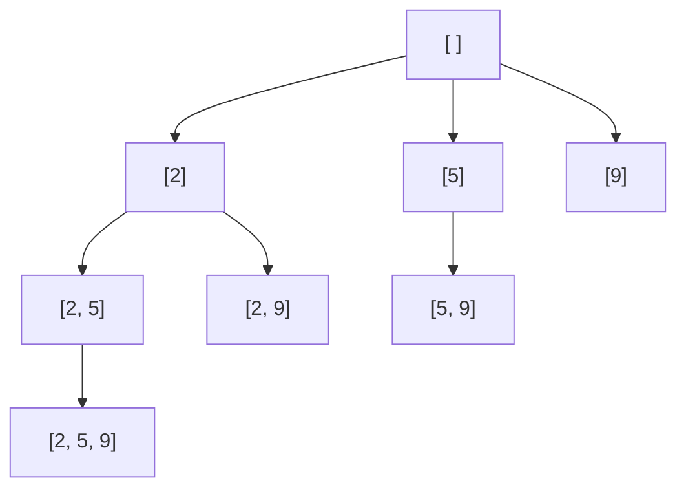
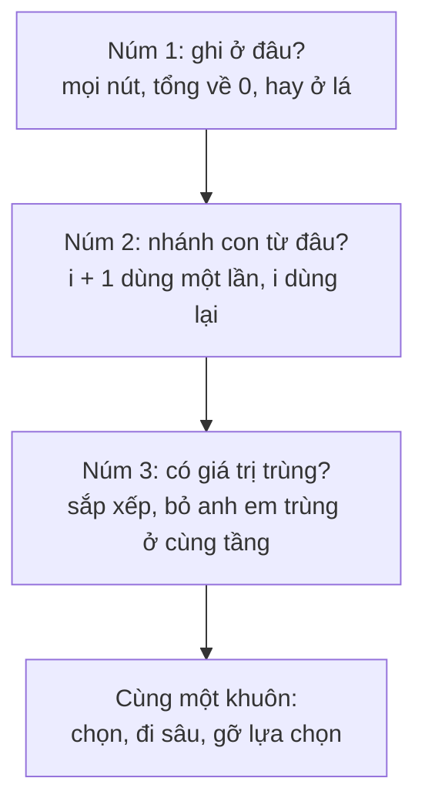

> [!tldr] Đọc nhanh
> - Mọi bài trong ga này là đi hết một **cây lựa chọn**: mỗi nút là một lời giải dở dang, mỗi cạnh là "lấy thêm phần tử này". Khuôn duy nhất là chọn, đi sâu, gỡ lựa chọn.
> - Núm thứ nhất: **ghi ở đâu**. Tập con ghi ở mọi nút; tổ hợp có tổng ghi khi phần còn lại bằng 0; tổ hợp chữ ghi ở lá.
> - Núm thứ hai: **nhánh con bắt đầu từ đâu**. Từ `i + 1` thì mỗi phần tử dùng một lần; từ `i` thì được dùng lại. Không bao giờ quay về trước `i`, nên `[2, 5]` và `[5, 2]` không bị sinh hai lần.
> - Núm thứ ba: **bỏ trùng**. Sắp xếp, rồi ở cùng một tầng bỏ qua giá trị bằng anh em đứng ngay trước. Đã sắp xếp thì còn cắt được cả nhánh khi số đang xét vượt quá phần còn lại.

> [!info] Bối cảnh
> Đây là ga đầu tiên của [[series/neetcode-misc|tuyến NeetCode: Kỹ thuật tổng hợp]], tuyến gom các nhóm bài còn lại của NeetCode 150: quay lui, tham lam, khoảng, ma trận, số học và thao tác bit. Mình đã gặp quay lui một lần ở bài Generate Parentheses trong [[posts/2026-11-23-neetcode-stack|ga ARR-06: Ngăn xếp]]. Ga này biến nó thành một khuôn dùng lại được cho năm bài. Bạn chỉ cần biết mảng, vòng lặp và hàm đệ quy.

> [!abstract]- Từ điển nhanh cho bài này (bấm để mở)
> - [[concepts/backtracking|Backtracking]] (quay lui) là thử một lựa chọn, đi tiếp, rồi gỡ nó ra để thử lựa chọn khác.
> - [[concepts/choice-tree|Choice Tree]] (cây lựa chọn) là cây mà mỗi nút là một lời giải dở dang và mỗi cạnh là một lựa chọn thêm vào.
> - [[concepts/start-index|Start Index]] là chỉ số mà vòng lặp ở một nút bắt đầu xét; nó ngăn cùng một tổ hợp bị sinh theo nhiều thứ tự.
> - [[concepts/duplicate-skipping|Duplicate Skipping]] là bỏ qua giá trị bằng giá trị đứng ngay trước trên mảng đã sắp xếp.
> - **path** là danh sách các lựa chọn đang được giữ trên đường từ gốc tới nút hiện tại.
> - **Tập con** là một cách chọn ra vài phần tử, không quan tâm thứ tự; mảng n phần tử phân biệt có 2ⁿ tập con, kể cả tập rỗng.
> - **Tổ hợp** ở đây là một tập (hoặc đa tập, khi được dùng lại) các số có tổng bằng mục tiêu.
> - **Cắt nhánh** (pruning) là dừng một nhánh khi chắc chắn nó không thể dẫn tới đáp án.

## Hình dung trước: đi chợ dọc một dãy kệ

Mình đi dọc một dãy kệ hàng theo một chiều, không bao giờ quay lại kệ đã qua. Ở mỗi kệ, mình có thể bỏ một món vào giỏ rồi đi tiếp, hoặc bỏ qua. Khi một nhánh đi hết, mình lấy món vừa bỏ vào ra khỏi giỏ, lùi về và thử món khác. Có ngày mình chụp ảnh giỏ ở mỗi bước (mọi tập con); có ngày chỉ chụp khi tổng tiền đúng bằng số tiền mang theo (tổ hợp có tổng). Có loại hàng mua bao nhiêu gói cũng được, nên mình đứng nguyên ở kệ đó. Hai gói giống hệt nhau nằm cạnh nhau thì ở mỗi lượt chọn chỉ cần thử gói đầu.

| Đời thường | Khái niệm |
|---|---|
| Giỏ hàng đang cầm | `path`, lời giải dở dang |
| Bỏ một món vào giỏ, đi tiếp, rồi lấy ra | Chọn, đi sâu, gỡ lựa chọn |
| Chỉ đi về phía trước dọc dãy kệ | [[concepts/start-index\|Start Index]]: nhánh con bắt đầu từ `i + 1` |
| Hàng mua nhiều gói cũng được, đứng nguyên ở kệ | Nhánh con bắt đầu lại từ `i` |
| Chụp ảnh giỏ ở mọi bước | Ghi ở mọi nút (Subsets) |
| Chỉ chụp khi tổng tiền vừa đủ | Ghi khi phần còn lại bằng 0 (Combination Sum) |
| Hai gói giống hệt nhau cạnh nhau, chỉ thử gói đầu | [[concepts/duplicate-skipping\|Duplicate Skipping]] ở cùng tầng |
| Kệ xếp từ rẻ tới đắt, gói này đã quá túi tiền thì bỏ cả phần còn lại của kệ | Cắt nhánh bằng `break` trên mảng đã sắp xếp |
| Mỗi phím điện thoại là một kệ, phải lấy đúng một món ở mỗi kệ | Tầng thứ k chọn một chữ của chữ số thứ k |

Cây lựa chọn của `[2, 5, 9]` khi tìm mọi tập con:



Nút `[5]` không có con `[5, 2]`, vì sau khi đi qua kệ 2 mình không quay lại nó. Đó là lý do cây có đúng 8 nút, mỗi nút một tập con.

## Vấn đề: sinh hết mà không sót, không trùng

Mình từng nghĩ "tìm mọi tập con" thì cứ sinh mọi hoán vị rồi lọc trùng bằng một Set. Cách đó đúng nhưng phí: `[2, 5, 9]` có 6 hoán vị đầy đủ và còn nhiều dãy con có thứ tự hơn nữa, trong khi chỉ có 8 tập con. Với mảng có giá trị trùng như `[6, 6, 6]`, cách sinh ngây thơ cho 8 tập nhưng chỉ có 4 tập khác nhau: rỗng, `[6]`, `[6, 6]` và `[6, 6, 6]`.

Chỗ khó thật nằm ở hai câu hỏi. Làm sao để mỗi tập chỉ được sinh **một lần**, theo đúng một thứ tự? Và khi đã chắc một nhánh không thể ra đáp án, làm sao để **không đi vào** nhánh đó? Quay lui có khuôn trả lời cả hai.

## Cơ chế

<figure class="figure-map" style="--ar: 3 / 4">
<div class="frame"><iframe data-archify="../diagrams/neetcode-subsets-combinations/choice-tree.html" title="Đi qua cây lựa chọn của [2, 5, 9]" loading="lazy"></iframe></div>
<figcaption><span><b>Hình 1.</b> Đi qua cây lựa chọn của <code>[2, 5, 9]</code>: mỗi lần chọn là một <code>push</code>, mỗi lần quay lui là một <code>pop</code>. Ghi ở mọi nút cho đúng 8 tập con, và không nhánh nào quay lại phần tử đứng trước.</span><a href="../diagrams/neetcode-subsets-combinations/choice-tree.html" target="_blank" rel="noopener">Mở toàn màn hình</a></figcaption>
</figure>

### Một khuôn: chọn, đi sâu, gỡ lựa chọn

Hàm đệ quy nhận `start`, chỉ số đầu tiên còn được xét. Nó dùng chung một danh sách `path`:

1. Nếu nút này là một đáp án, ghi lại một **bản chép** của `path`.
2. Với mỗi `i` từ `start` tới hết: thêm `nums[i]` vào `path` (chọn), gọi đệ quy với `start` mới (đi sâu), rồi bỏ `nums[i]` ra (gỡ lựa chọn).

Bước 1 phải chép. `path` là một danh sách duy nhất mà cả cây dùng chung; nếu ghi thẳng tham chiếu của nó, mọi đáp án sẽ trỏ về cùng một danh sách, và khi đệ quy kết thúc danh sách đó rỗng.

Bước gỡ lựa chọn là thứ làm cho cách này rẻ: thay vì tạo một danh sách mới cho mỗi nút, mình sửa đúng một danh sách và trả nó về trạng thái cũ trước khi thử anh em kế tiếp. Độ sâu đệ quy bằng độ dài lớn nhất của `path`, nên ngăn xếp chỉ tốn O(n) ngoài phần kết quả.

### Ba núm vặn



**Ghi ở đâu.** Subsets ghi ở mọi nút, vì mọi giỏ dở dang đều là một tập con hợp lệ. Combination Sum chỉ ghi khi phần còn lại bằng 0. Letter Combinations ghi khi `path` dài bằng số chữ số, tức ở lá.

**Bắt đầu từ đâu.** Đây là [[concepts/start-index|Start Index]]. Nhánh con của lựa chọn `nums[i]` chỉ xét các chỉ số từ `i` trở đi, nên mỗi tổ hợp được sinh đúng theo thứ tự chỉ số tăng dần. Truyền `i + 1` khi mỗi phần tử chỉ được dùng một lần (Subsets, Combination Sum II). Truyền `i` khi được dùng lại (Combination Sum): nhánh con vẫn có thể lấy `nums[i]` lần nữa, nhưng không bao giờ quay về số nhỏ hơn chỉ số.

**Bỏ trùng.** Khi mảng có giá trị lặp, hai phần tử bằng nhau ở hai chỉ số khác nhau sinh ra hai nhánh giống hệt nhau. Sau khi sắp xếp, chúng nằm cạnh nhau, và quy tắc là: ở **cùng một tầng** (cùng một vòng lặp), bỏ `nums[i]` nếu `i > start` và `nums[i] == nums[i − 1]`. Điều kiện `i > start` quan trọng: nó vẫn cho phép đi **sâu** vào bản sao thứ hai (`[6, 6]` là một tập hợp lệ), chỉ cấm việc **bắt đầu lại** một nhánh anh em bằng cùng giá trị.

### Cắt nhánh nhờ sắp xếp

Với hai bài có tổng, mảng đã sắp xếp cho thêm một quyền: nếu `nums[i]` đã lớn hơn phần còn lại, mọi số sau nó còn lớn hơn, nên `break` khỏi cả vòng lặp thay vì `continue`. Với `[2, 3, 5, 7]` và mục tiêu 20, nhánh đang cần 1 không bao giờ thử 2, 3, 5 hay 7.

Số nút của cây là thước đo chi phí. Subsets có 2ⁿ nút, mỗi nút chép một `path` dài tối đa n, nên O(n·2ⁿ). Letter Combinations có tối đa 4ⁿ lá với n chữ số (phím 7 và 9 có bốn chữ). Combination Sum không có công thức gọn theo n; cây sâu tối đa `target / min` tầng, và cắt nhánh làm nó nhỏ hơn nhiều so với cận đó.

### Năm bài trên cùng một ga

| Bài | Điểm khác |
|---|---|
| [[problems/subsets\|Subsets]] | Bài neo. Ghi ở mọi nút; nhánh con bắt đầu từ `i + 1`. Cây có đúng 2ⁿ nút. |
| [[problems/subsets-ii\|Subsets II]] | Như Subsets, cộng thêm sắp xếp và bỏ anh em trùng ở cùng tầng (`i > start`). |
| [[problems/combination-sum\|Combination Sum]] | Ghi khi phần còn lại bằng 0; nhánh con bắt đầu lại từ `i` vì được dùng lại; `break` khi số vượt phần còn lại. |
| [[problems/combination-sum-ii\|Combination Sum II]] | Mỗi số dùng một lần (`i + 1`) và mảng có trùng, nên cần cả bỏ trùng ở cùng tầng lẫn `break`. |
| [[problems/letter-combinations-of-a-phone-number\|Letter Combinations of a Phone Number]] | Tầng là vị trí chữ số, không có `start`; mỗi tầng chọn một chữ của phím đó và ghi ở lá. Chuỗi rỗng cho danh sách rỗng. |

## Ví dụ chạy được

[TypeScript](../code/neetcode-subsets-combinations/choices.ts) · [Python](../code/neetcode-subsets-combinations/choices.py) · [Go](../code/neetcode-subsets-combinations/choices.go) · [Java](../code/neetcode-subsets-combinations/choices.java) · [JavaScript](../code/neetcode-subsets-combinations/choices.js) · [PHP](../code/neetcode-subsets-combinations/choices.php) · [Rust](../code/neetcode-subsets-combinations/choices.rs)

```ts
function subsets(nums: number[]): number[][] {
    const result: number[][] = []
    const path: number[] = []
    function walk(start: number) {
        result.push([...path]) // chép path, vì path còn đổi tiếp
        for (let i = start; i < nums.length; i++) {
            path.push(nums[i]) // chọn
            walk(i + 1) // đi sâu, mỗi phần tử dùng một lần
            path.pop() // gỡ lựa chọn
        }
    }
    walk(0)
    return result
}
```

```python
def subsets(nums):
    """Ghi lại ở MỌI nút, nhánh con chỉ xét phần tử sau i."""
    result, path = [], []

    def walk(start):
        result.append(path[:])  # chép path, vì path còn đổi tiếp
        for i in range(start, len(nums)):
            path.append(nums[i])  # chọn
            walk(i + 1)  # đi sâu, mỗi phần tử dùng một lần
            path.pop()  # gỡ lựa chọn

    walk(0)
    return result
```

```go
func subsets(nums []int) [][]int {
	result := [][]int{}
	path := []int{}
	var walk func(start int)
	walk = func(start int) {
		result = append(result, append([]int(nil), path...)) // chép path, vì path còn đổi tiếp
		for i := start; i < len(nums); i++ {
			path = append(path, nums[i]) // chọn
			walk(i + 1)                  // đi sâu, mỗi phần tử dùng một lần
			path = path[:len(path)-1]    // gỡ lựa chọn
		}
	}
	walk(0)
	return result
}
```

```java
static List<List<Integer>> subsets(int[] nums) {
    List<List<Integer>> result = new ArrayList<>();
    walkSubsets(nums, 0, new ArrayList<>(), result);
    return result;
}

static void walkSubsets(int[] nums, int start, List<Integer> path, List<List<Integer>> result) {
    result.add(new ArrayList<>(path)); // chép path, vì path còn đổi tiếp
    for (int i = start; i < nums.length; i++) {
        path.add(nums[i]); // chọn
        walkSubsets(nums, i + 1, path, result); // đi sâu, mỗi phần tử dùng một lần
        path.remove(path.size() - 1); // gỡ lựa chọn
    }
}
```

```js
function subsets(nums) {
    const result = []
    const path = []
    function walk(start) {
        result.push([...path]) // chép path, vì path còn đổi tiếp
        for (let i = start; i < nums.length; i++) {
            path.push(nums[i]) // chọn
            walk(i + 1) // đi sâu, mỗi phần tử dùng một lần
            path.pop() // gỡ lựa chọn
        }
    }
    walk(0)
    return result
}
```

```php
function subsets(array $nums): array {
    $result = [];
    $path = [];
    $walk = function (int $start) use (&$walk, &$result, &$path, $nums) {
        $result[] = $path; // mảng PHP được chép khi gán, nên đây là một bản chụp
        for ($i = $start; $i < count($nums); $i++) {
            $path[] = $nums[$i]; // chọn
            $walk($i + 1); // đi sâu, mỗi phần tử dùng một lần
            array_pop($path); // gỡ lựa chọn
        }
    };
    $walk(0);
    return $result;
}
```

```rust
fn subsets(nums: &[i32]) -> Vec<Vec<i32>> {
    fn walk(nums: &[i32], start: usize, path: &mut Vec<i32>, result: &mut Vec<Vec<i32>>) {
        result.push(path.clone()); // chép path, vì path còn đổi tiếp
        for i in start..nums.len() {
            path.push(nums[i]); // chọn
            walk(nums, i + 1, path, result); // đi sâu, mỗi phần tử dùng một lần
            path.pop(); // gỡ lựa chọn
        }
    }
    let mut result = Vec::new();
    walk(nums, 0, &mut Vec::new(), &mut result);
    result
}
```

Các tab trích khuôn Subsets. Mỗi file còn có bốn hàm còn lại và chạy 17 ca, so sánh không phụ thuộc thứ tự: sắp xếp bên trong từng tổ hợp, rồi sắp xếp cả danh sách. Bốn ca lớn chỉ kiểm số lượng và việc không có tổ hợp trùng: 1024 tập con của 10 số, 16 tập con khác nhau của `[4, 4, 1, 4, 2]`, 18 tổ hợp của `[2, 3, 5, 7]` có tổng 20, và 256 chuỗi cho `7979`. Đáp án mong đợi được tính trước bằng vét cạn độc lập với `itertools`.

```text
17/17 ca đúng
```

Chạy bằng `node choices.ts`, `python3 choices.py`, `go run choices.go`, `java choices.java`, `node choices.js`, `php choices.php` hoặc `rustc --edition 2021 -O choices.rs -o /tmp/choices && /tmp/choices`.

## Hiểu lầm và bẫy hay gặp

- Ghi thẳng `path` thay vì một bản chép. Trong TypeScript, JavaScript, Python, Java và Go, kết quả sẽ toàn danh sách rỗng hoặc toàn cùng một danh sách. PHP thì khác: mảng được chép khi gán, nên `$result[] = $path` đã là bản chụp. Rust bắt buộc `clone()`, vì không thể đẩy một `&mut` vào kết quả.
- Trong Go, `append(result, path)` giữ cùng mảng nền với `path`, nên các lần `append` sau ghi đè lên đáp án cũ. Phải chép bằng `append([]int(nil), path...)`.
- Quên bước gỡ lựa chọn. Nhánh anh em kế tiếp sẽ bắt đầu với một `path` thừa phần tử của nhánh trước.
- Bỏ trùng bằng `i > 0` thay vì `i > start`. Điều kiện đó cấm cả việc đi sâu vào bản sao thứ hai, nên `[6, 6]` và `[6, 6, 6]` biến mất.
- Bỏ trùng mà quên sắp xếp. Giá trị bằng nhau không nằm cạnh nhau thì so với phần tử ngay trước không bắt được chúng.
- Dùng `continue` thay vì `break` khi số vượt phần còn lại. Vẫn đúng, nhưng phí công thử mọi số lớn hơn phía sau.
- Sắp xếp số trong JavaScript và TypeScript bằng `sort()` không có hàm so sánh. Mặc định nó so chuỗi, nên `[10, 9, 2]` thành `[10, 2, 9]` và `break` cắt nhầm nhánh còn hợp lệ.
- Letter Combinations với chuỗi rỗng phải trả danh sách rỗng, không phải `[""]`. Khuôn sẽ ghi một chuỗi rỗng ở gốc nếu không chặn trước.

## Câu hỏi tự kiểm tra

> [!question]- Vì sao nhánh con bắt đầu từ `i + 1` thì không sinh `[5, 2]` sau khi đã sinh `[2, 5]`?
> Ở nhánh bắt đầu bằng 5, vòng lặp chỉ xét các chỉ số sau 5. Số 2 đứng trước nên không bao giờ được thêm vào. Mỗi tổ hợp chỉ xuất hiện theo thứ tự chỉ số tăng dần.

> [!question]- Combination Sum truyền `i` cho nhánh con. Có nguy cơ đệ quy vô hạn không?
> Không, vì mọi số dương và mỗi lần chọn làm phần còn lại giảm ít nhất bằng số nhỏ nhất. Khi phần còn lại về 0 thì ghi, khi số vượt phần còn lại thì `break`.

> [!question]- Với `[6, 6, 6]`, điều kiện `i > start && nums[i] == nums[i - 1]` cấm những nhánh nào?
> Ở gốc, nó cấm bắt đầu bằng con 6 thứ hai và thứ ba, chỉ giữ con đầu. Ở nút `[6]`, nó cho đi tiếp vào con 6 thứ hai (vì đó là `i == start`) nhưng cấm con thứ ba. Kết quả là đúng bốn tập: rỗng, `[6]`, `[6, 6]`, `[6, 6, 6]`.

> [!question]- Vì sao Letter Combinations không cần `start`?
> Mỗi tầng ứng với đúng một chữ số theo thứ tự, và phải chọn đúng một chữ ở mỗi tầng. Thứ tự đã do vị trí chữ số quyết định, nên không có nguy cơ sinh cùng một chuỗi theo hai thứ tự.

## Tham khảo

- [Subsets](https://leetcode.com/problems/subsets/) · [Subsets II](https://leetcode.com/problems/subsets-ii/) · [Combination Sum](https://leetcode.com/problems/combination-sum/) · [Combination Sum II](https://leetcode.com/problems/combination-sum-ii/) · [Letter Combinations of a Phone Number](https://leetcode.com/problems/letter-combinations-of-a-phone-number/)
- [Jeff Erickson, Algorithms, chương 2: Backtracking](https://jeffe.cs.illinois.edu/teaching/algorithms/book/02-backtracking.pdf)
- [Python itertools.combinations](https://docs.python.org/3/library/itertools.html#itertools.combinations), dùng để tính đáp án mong đợi
