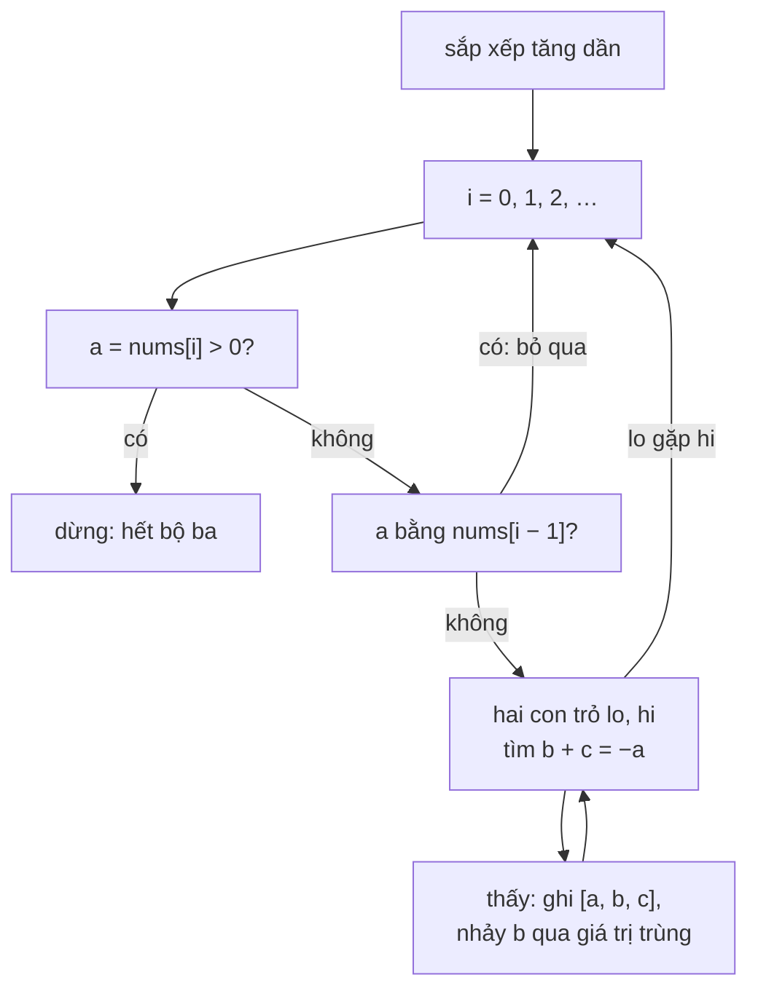

> [!tldr] Đọc nhanh
> - Đề: tìm **mọi** bộ ba `[a, b, c]` có tổng 0, không trả hai bộ ba giống nhau (cùng giá trị, khác thứ tự vẫn là giống).
> - [[concepts/k-sum-reduction|Giảm k-Sum]]: sắp xếp, cố định `a = nums[i]`, rồi tìm `b + c = −a` trên đoạn bên phải bằng [[problems/two-sum-ii-input-array-is-sorted|hai con trỏ của Two Sum II]]. O(n²), O(1) bộ nhớ ngoài phần sắp xếp.
> - [[concepts/duplicate-skipping|Bỏ trùng]] nhờ thứ tự: bỏ qua `a` trùng với `a` trước đó, và sau khi tìm thấy một bộ, nhảy `b` qua các giá trị bằng nhau. Không cần Set.
> - Đo ở n = 1000: vét cạn 316,6 ms, hash theo neo 22,7 ms, sắp xếp + hai con trỏ 1,65 ms.
> - Bẫy: không bỏ trùng thì `[0, 0, 0, 0]` ra `[[0,0,0],[0,0,0]]`; JS `sort()` thiếu hàm so sánh xếp `-1` trước `-4`.

> [!info] Bối cảnh
> Bài LeetCode 15, thuộc [[posts/2026-11-23-neetcode-two-pointers|ga 4: Hai con trỏ]] trên **tuyến NeetCode: Mảng và chuỗi**. Trang này dùng lại khuôn của [[problems/two-sum-ii-input-array-is-sorted|Two Sum II]], nên đọc trang đó trước sẽ dễ hơn. Lời giải có đủ TypeScript, Python, Go, Java và JavaScript.

> [!abstract]- Từ điển nhanh cho bài này (bấm để mở)
> - **Bộ ba (triplet)**: ba phần tử ở ba vị trí khác nhau. Giá trị có thể trùng nếu mảng có số trùng.
> - **Neo (anchor)**: số được cố định ở vòng ngoài, ở đây `a = nums[i]`.
> - **Bỏ trùng**: không đưa cùng một bộ giá trị vào kết quả hai lần.
> - **Khóa chuẩn**: cách biến một bộ ba thành một khóa so sánh được, như chuỗi `"-1,0,1"`. Xem [[concepts/canonical-key|Canonical Key]].

## Hình dung trước: chia ba người một bàn

Một nhà hàng ghi cho mỗi khách một con số: số âm là đang nợ tiền, số dương là đang dư. Cần tìm mọi nhóm ba người mà ngồi chung một bàn thì tổng vừa bằng 0. Hai nhóm cùng thành phần (cùng ba mức tiền) chỉ tính một lần.

| Đời thường | Khái niệm |
|---|---|
| Xếp hàng khách theo số tiền tăng dần | sắp xếp |
| Mời một người làm trưởng bàn, rồi tìm hai người còn lại | cố định `a`, giải Two Sum II với `−a` |
| Trưởng bàn nghèo nhất phải là người có số tiền ≤ 0 | dừng khi `a > 0` |
| Hai người cùng mức tiền lần lượt làm trưởng bàn sẽ ra cùng các bàn | bỏ qua `a` trùng |
| Tìm được một bàn rồi, người kế tiếp cùng mức tiền với `b` sẽ cho bàn y hệt | nhảy `b` qua giá trị trùng |



## Vấn đề

**Đề (tóm tắt bằng lời của mình):** cho mảng `nums` (3 ≤ n ≤ 3000, giá trị trong ±10⁵). Trả mọi bộ ba `[nums[i], nums[j], nums[k]]` với `i, j, k` đôi một khác nhau và tổng bằng 0. Kết quả không được có hai bộ ba trùng giá trị. Thứ tự các bộ ba và thứ tự trong mỗi bộ không quan trọng. Đề gốc: [LeetCode 15](https://leetcode.com/problems/3sum/).

| Input | Output |
|---|---|
| `[-1, 0, 1, 2, -1, -4]` | `[[-1, -1, 2], [-1, 0, 1]]` |
| `[0, 1, 1]` | `[]` |
| `[0, 0, 0]` | `[[0, 0, 0]]` |

Mình từng nghĩ phần khó là tìm bộ ba. Hóa ra tìm thì dễ (Two Sum II lặp n lần); phần dễ sai là **bỏ trùng** đúng cách.

## Cơ chế

### Ba cách

| Cách | Thời gian | Bỏ trùng bằng |
|---|---|---|
| vét cạn mọi bộ ba | O(n³) | Set các khóa chuỗi |
| cố định `a`, tìm `c = −a − b` bằng hash set (khuôn ga 1) | O(n²) | Set các khóa chuỗi |
| sắp xếp, cố định `a`, hai con trỏ | O(n²) | thứ tự: nhảy qua giá trị trùng |

Hai cách đầu phải chuẩn hóa mỗi bộ ba (sắp xếp ba số) rồi ghép thành khóa so sánh được, vì Set của JS và HashSet của Java so mảng theo tham chiếu. Cách thứ ba tránh hẳn chuyện đó: sau khi sắp xếp, mọi bộ ba được sinh ra theo thứ tự `a ≤ b ≤ c`, và các bản trùng luôn đứng cạnh nhau.

### Bỏ trùng bằng thứ tự

Hai chỗ có thể sinh bộ trùng:

1. **Neo trùng.** Nếu `a[i] = a[i − 1]`, mọi bộ ba neo ở `a[i]` đã được tìm khi neo ở `a[i − 1]` (đoạn bên phải của `i − 1` chứa cả đoạn bên phải của `i`). Bỏ qua.
2. **`b` trùng sau khi tìm thấy.** Ghi `[a, b, c]`, dời `lo` và `hi` vào trong, rồi nhảy `lo` qua mọi giá trị bằng `b` vừa ghi. Với `a` và `b` cố định thì `c = −a − b` cũng cố định, nên không cần nhảy `hi` riêng: vòng lặp sẽ tự giảm `hi` khi tổng quá lớn.

Thêm một cắt sớm: mảng đã sắp xếp, nên nếu `a > 0` thì `b, c ≥ a > 0` và tổng không thể bằng 0. Dừng vòng ngoài.

### Đo

TypeScript, n số ngẫu nhiên trong ±10⁵, trung vị:

| n | vét cạn | hash theo neo | sắp xếp + hai con trỏ |
|---|---|---|---|
| 250 | 7,7 ms | 1,4 ms | 0,12 ms |
| 500 | 38,5 ms | 5,7 ms | 0,49 ms |
| 1 000 | 316,6 ms | 22,7 ms | 1,65 ms |
| 3 000 | (không chạy) | 222,5 ms | 13,06 ms |

Hash theo neo và hai con trỏ cùng O(n²), nhưng hash chậm hơn khoảng 15 lần: mỗi vòng trong tạo Set mới, băm và ghi. Hai con trỏ chỉ đọc mảng liền mạch.

### Bên dưới năm ngôn ngữ

| | Sắp xếp số | Khóa cho bộ ba (nếu dùng Set) |
|---|---|---|
| TypeScript / JavaScript | `sort((x, y) => x − y)`; thiếu hàm so sánh thì so như chuỗi | chuỗi `"a,b,c"` (Set so mảng theo tham chiếu) |
| Python | `sorted(nums)` | `tuple` (list không hash được) |
| Go | `slices.Sort` | mảng cố định `[3]int` (slice không làm khóa map được) |
| Java | `Arrays.sort(int[])` | `List.of(a, b, c)`: `List.equals` so nội dung |

## Ví dụ chạy được

[TypeScript](../code/neetcode-3sum/three-sum.ts) · [Python](../code/neetcode-3sum/three_sum.py) · [Go](../code/neetcode-3sum/three_sum.go) · [Java](../code/neetcode-3sum/three-sum.java) · [JavaScript](../code/neetcode-3sum/three-sum.js)

Mỗi file có cả ba cách và chạy 7 ca, gồm `[0, 0, 0, 0]` và một mảng nhiều số trùng. Dưới đây là cách sắp xếp + hai con trỏ.

```ts
// Sắp xếp + hai con trỏ: cố định a = nums[i], tìm b + c = −a trên đoạn bên phải. Bỏ trùng bằng cách nhảy qua giá trị lặp.
function sortTwoPointers(nums: number[]): number[][] {
  const a = [...nums].sort((x, y) => x - y), out: number[][] = [];
  for (let i = 0; i < a.length - 2; i++) {
    if (a[i] > 0) break; // số nhỏ nhất đã dương thì tổng ba số không thể bằng 0
    if (i > 0 && a[i] === a[i - 1]) continue; // cùng giá trị neo: mọi bộ ba đã được tìm ở lần trước
    let lo = i + 1, hi = a.length - 1;
    while (lo < hi) {
      const s = a[i] + a[lo] + a[hi];
      if (s < 0) lo++;
      else if (s > 0) hi--;
      else {
        out.push([a[i], a[lo], a[hi]]);
        lo++; hi--;
        while (lo < hi && a[lo] === a[lo - 1]) lo++; // nhảy qua b trùng
      }
    }
  }
  return out;
}
```

```python
def sort_two_pointers(nums: list[int]) -> list[list[int]]:
    a, out = sorted(nums), []
    for i in range(len(a) - 2):
        if a[i] > 0:
            break
        if i > 0 and a[i] == a[i - 1]:
            continue
        lo, hi = i + 1, len(a) - 1
        while lo < hi:
            s = a[i] + a[lo] + a[hi]
            if s < 0:
                lo += 1
            elif s > 0:
                hi -= 1
            else:
                out.append([a[i], a[lo], a[hi]])
                lo, hi = lo + 1, hi - 1
                while lo < hi and a[lo] == a[lo - 1]:
                    lo += 1
    return out
```

```go
func sortTwoPointers(nums []int) [][]int {
	a := slices.Clone(nums)
	slices.Sort(a)
	out := [][]int{}
	for i := 0; i < len(a)-2; i++ {
		if a[i] > 0 {
			break
		}
		if i > 0 && a[i] == a[i-1] {
			continue
		}
		for lo, hi := i+1, len(a)-1; lo < hi; {
			switch s := a[i] + a[lo] + a[hi]; {
			case s < 0:
				lo++
			case s > 0:
				hi--
			default:
				out = append(out, []int{a[i], a[lo], a[hi]})
				lo, hi = lo+1, hi-1
				for lo < hi && a[lo] == a[lo-1] {
					lo++
				}
			}
		}
	}
	return out
}
```

```java
static List<List<Integer>> sortTwoPointers(int[] nums) {
    int[] a = nums.clone();
    Arrays.sort(a);
    List<List<Integer>> out = new ArrayList<>();
    for (int i = 0; i < a.length - 2; i++) {
        if (a[i] > 0) break;
        if (i > 0 && a[i] == a[i - 1]) continue; // int nguyên thủy: == so giá trị
        int lo = i + 1, hi = a.length - 1;
        while (lo < hi) {
            int s = a[i] + a[lo] + a[hi];
            if (s < 0) lo++;
            else if (s > 0) hi--;
            else {
                out.add(List.of(a[i], a[lo], a[hi]));
                lo++; hi--;
                while (lo < hi && a[lo] == a[lo - 1]) lo++;
            }
        }
    }
    return out;
}
```

```js
function sortTwoPointers(nums) {
  const a = [...nums].sort((x, y) => x - y), out = [];
  for (let i = 0; i < a.length - 2; i++) {
    if (a[i] > 0) break;
    if (i > 0 && a[i] === a[i - 1]) continue;
    let lo = i + 1, hi = a.length - 1;
    while (lo < hi) {
      const s = a[i] + a[lo] + a[hi];
      if (s < 0) lo++;
      else if (s > 0) hi--;
      else {
        out.push([a[i], a[lo], a[hi]]);
        lo++; hi--;
        while (lo < hi && a[lo] === a[lo - 1]) lo++;
      }
    }
  }
  return out;
}
```


File TypeScript chạy thêm hai bản sai rồi đo:

```text
$ node three-sum.ts
bruteForce       7/7 ca đúng
hashPerAnchor    7/7 ca đúng
sortTwoPointers  7/7 ca đúng
noDuplicateSkip  4/7 ca đúng; sai ở [-1,0,1,2,-1,-4] [0,0,0,0] [-4,-2,-2,-2,0,1,2,2,2,3,3,4,4,6,6]
noComparator     5/7 ca đúng; sai ở [-4,-2,-2,-2,0,1,2,2,2,3,3,4,4,6,6] [-10,5,5,-1,11,-1]

noDuplicateSkip([0, 0, 0, 0]) = [[0,0,0],[0,0,0]]
[-1, -4, 2, 10].sort() = [-1,-4,10,2]

n        vét cạn  hash theo neo  sắp xếp + hai con trỏ   (ms, trung vị)
250          7.7            1.4                   0.12
500         38.5            5.7                   0.49
1000       316.6           22.7                   1.65
3000           —          222.5                  13.06
```

Bản không bỏ trùng sai ngay ở ví dụ đầu tiên của đề (hai số `-1` cùng làm neo). Bản thiếu hàm so sánh qua được 5/7 ca: nó chỉ hỏng khi thứ tự chuỗi và thứ tự số khác nhau đủ để hai con trỏ đi sai hướng. Python, Go, Java và JavaScript in `7/7 ca đúng` cho cả ba cách.

## Hiểu lầm và bẫy hay gặp

- **Bỏ trùng bằng `a[i] = a[i + 1]` thay vì `a[i] = a[i − 1]`.** So với phần tử **sau** sẽ bỏ luôn neo đầu tiên của nhóm, và mất các bộ như `[-1, -1, 2]` cần hai số `-1`.
- **Nhảy `b` trùng trước khi ghi.** Phải ghi bộ ba rồi mới nhảy; nhảy trước thì mất bộ có `b = c` như `[-4, 2, 2]`.
- **Thêm Set "cho chắc" ở cách hai con trỏ.** Đúng nhưng thừa, và che mất lỗi bỏ trùng.
- **JS: `sort()` không có hàm so sánh.** `[-1, -4, 2, 10]` thành `[-1, -4, 10, 2]`. Hai con trỏ trên mảng không thật sự tăng dần thì lập luận cắt bỏ sụp.
- **Trả chỉ số thay vì giá trị.** Đề 3Sum trả giá trị; Two Sum mới trả chỉ số.

## Câu hỏi tự kiểm tra

> [!question]- Vì sao bỏ qua neo `a[i]` khi `a[i] = a[i − 1]` không làm mất bộ ba nào?
> Đoạn tìm kiếm của `i − 1` là `(i − 1, n)`, chứa trọn đoạn `(i, n)` của `i`. Mọi cặp `(b, c)` neo ở `a[i]` đều đã được xét khi neo ở `a[i − 1]` cùng giá trị.

> [!question]- Sau khi ghi `[a, b, c]`, vì sao chỉ cần nhảy `lo` qua giá trị trùng mà không cần nhảy `hi`?
> Với `a` và `b` mới khác `b` cũ, `c` cần tìm cũng khác. Nếu `a[hi]` vẫn bằng `c` cũ thì tổng sẽ khác 0, và vòng lặp tự dời `hi` hoặc `lo`. Nhảy cả hai cũng đúng, chỉ là không bắt buộc.

> [!question]- Vì sao dừng được khi `a > 0`?
> Mảng tăng dần nên `b, c ≥ a > 0`, tổng dương. Mọi neo sau còn lớn hơn.

> [!question]- Mở rộng sang 4Sum (tổng bằng target). Độ phức tạp là bao nhiêu?
> Thêm một vòng neo: cố định hai số, chạy hai con trỏ cho hai số còn lại. O(n³). Tổng quát, k-Sum giảm về (k − 2) vòng neo cộng một lần hai con trỏ: O(n^(k−1)).

## Tham khảo

- [LeetCode 15: 3Sum](https://leetcode.com/problems/3sum/) (đề gốc)
- [ECMAScript 2025: SortCompare](https://tc39.es/ecma262/2025/#sec-sortcompare) (không có hàm so sánh thì đổi sang chuỗi rồi so)
- [Python glossary: hashable](https://docs.python.org/3/glossary.html#term-hashable) (tuple hash được, list thì không)
- [Go spec: Map types](https://go.dev/ref/spec#Map_types) (khóa phải so sánh được bằng `==`; slice thì không)
- [Java 21 `List.equals`](https://docs.oracle.com/en/java/javase/21/docs/api/java.base/java/util/List.html#equals(java.lang.Object)) (hai list bằng nhau khi cùng phần tử, cùng thứ tự)
