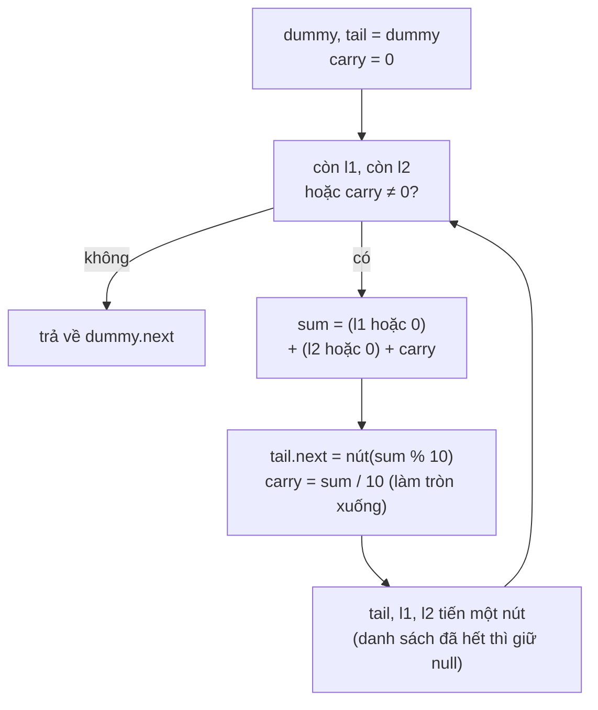

> [!tldr] Đọc nhanh
> - Đề: hai số không âm, mỗi số là một danh sách liên kết lưu chữ số **ngược** (hàng đơn vị ở đầu): `2 → 4 → 3` là 342. Trả về tổng, cũng dưới dạng danh sách ngược.
> - Chữ số xếp ngược là món quà: cộng tay cũng bắt đầu từ hàng đơn vị. Đi song song hai danh sách, mỗi bước cộng hai chữ số với [[concepts/carry-propagation|số nhớ]], ghi `tổng % 10`, mang `tổng / 10` sang bước sau. Một [[concepts/dummy-node|nút giả]] giữ đầu kết quả. O(max(m, n)).
> - Điều kiện dừng phải là "còn chữ số ở **một trong hai** danh sách **hoặc còn nhớ**". Bỏ vế "còn nhớ" thì `[9,9] + [1]` ra `[0,0]` thay vì `[0,0,1]`.
> - Đổi mỗi danh sách ra số rồi cộng là sai: đề cho tới 100 chữ số. `Number` của JavaScript sai từ 2⁵³ (16 chữ số), `long` của Java và `uint64` của Go tràn im lặng ở 19 đến 20 chữ số. Trên 10 000 cặp ngẫu nhiên, bản `Number` chỉ đúng 245.
> - Số nguyên lớn (BigInt, `math/big`, `BigInteger`, `int` của Python) thì đúng, nhưng chậm hơn hẳn: ở 10⁶ chữ số, `BigInteger` mất 23,4 giây so với 3,5 ms của cộng từng chữ số, vì đổi chuỗi ↔ số lớn là phép bậc hai.

> [!info] Bối cảnh
> Bài LeetCode số 2 của [[posts/2026-11-24-neetcode-advanced-linked-list|ga 2: Danh sách liên kết nâng cao]] trên **tuyến NeetCode: Cấu trúc liên kết**. Bài này dựng một danh sách mới từ hai danh sách vào, cùng kiểu nút giả với [[problems/merge-two-sorted-lists|Merge Two Sorted Lists]], nhưng mỗi bước phải mang theo một trạng thái nhỏ (số nhớ). Lời giải có đủ TypeScript, Python, Go, Java và JavaScript. Bạn chỉ cần biết phép cộng tay ở tiểu học và vòng lặp.

> [!abstract]- Từ điển nhanh cho bài này (bấm để mở)
> - **Danh sách liên kết**: chuỗi nút, mỗi nút giữ giá trị và mũi tên `next`. Xem [[concepts/linked-list|Danh sách liên kết]].
> - **Số nhớ (carry)**: phần vượt quá 9 khi cộng một hàng, chuyển sang hàng kế tiếp. Xem [[concepts/carry-propagation|Lan truyền số nhớ]].
> - **Nút giả (dummy node)**: một nút tạm đứng trước đầu kết quả để mọi lần nối đều là "nối vào đuôi". Xem [[concepts/dummy-node|Nút giả]].
> - **Tràn số (overflow)**: kết quả vượt phạm vi kiểu số nguyên cố định (64 bit), quay vòng thành một giá trị sai mà không báo lỗi.
> - **Số thực dấu phẩy động (`Number` của JavaScript)**: chỉ biểu diễn chính xác mọi số nguyên tới 2⁵³ = 9 007 199 254 740 992.
> - **Số nguyên lớn (BigInt, BigInteger)**: kiểu số nguyên không giới hạn độ dài, lưu thành mảng các "chữ số" lớn.

## Hình dung trước: cộng hai số trên giấy, đọc từ phải sang trái

Hồi tiểu học ta đặt hai số thẳng hàng phải rồi cộng từ cột đơn vị: 2 + 5 = 7 viết 7; 4 + 6 = 10 viết 0 nhớ 1; 3 + 4 + 1 = 8 viết 8. Kết quả 807. Danh sách của đề đã xếp sẵn chữ số theo đúng thứ tự ta cộng, nên ta chỉ việc đi từ đầu hai danh sách. Hai thứ dễ quên trên giấy cũng là hai bẫy của bài: số này ngắn hơn số kia (coi như có chữ số 0), và cột cuối cùng còn nhớ thì phải **viết thêm một chữ số 1** ra bên trái.

| Đời thường | Khái niệm |
|---|---|
| Một cột chữ số | một cặp nút cùng vị trí |
| Cột đơn vị đứng đầu | danh sách lưu chữ số ngược |
| "Viết 0 nhớ 1" | `digit = sum % 10`, `carry = sum / 10` |
| Số ngắn hơn: coi chỗ trống là 0 | `l1 ? l1.val : 0` |
| Cột cuối còn nhớ: viết thêm số 1 | vòng lặp chạy tiếp khi `carry ≠ 0` |
| Tờ giấy nháp trống để bắt đầu viết | nút giả |
| Bấm máy tính cầm tay | đổi ra số rồi cộng: máy chỉ hiện được vài chục chữ số |



## Vấn đề

Số có tới 100 chữ số, lớn hơn mọi kiểu số nguyên có sẵn 64 bit. Nên ý "đọc ra số, cộng, rồi tách chữ số" chỉ đúng với ví dụ nhỏ. Ta cần cộng **trên chính các chữ số**, như cộng tay, và dựng danh sách kết quả từng nút một. Không có gì phải tìm hay sắp xếp: cái khó nằm hết ở các ca biên (độ dài lệch nhau, số nhớ ở cột cuối, số 0).

## Cơ chế

<figure class="figure-map" style="--ar: 3 / 4">
<div class="frame"><iframe data-archify="../diagrams/neetcode-add-two-numbers/worked-example.html" title="Chuyển số nhớ sang chữ số kế tiếp" loading="lazy"></iframe></div>
<figcaption><span><b>Hình 1.</b> Chuyển số nhớ sang chữ số kế tiếp.</span><a href="../diagrams/neetcode-add-two-numbers/worked-example.html" target="_blank" rel="noopener">Mở toàn màn hình</a></figcaption>
</figure>

<details>
<summary>Đọc từng bước</summary>
<ol>
<li>Đọc từ hàng đơn vị. <code>[8, 1] + [7, 2]</code></li>
<li>Cộng 8 và 7 rồi lấy chữ số 5. <code>15 → digit 5, carry 1</code></li>
<li>Cộng 1, 2 và số nhớ. <code>4 → digit 4, carry 0</code></li>
<li>Trả danh sách theo thứ tự đảo. <code>[5, 4] → 45</code></li>
</ol>
</details>

```ts
// Cách chuẩn: cộng từng cặp chữ số từ hàng đơn vị, mang số nhớ sang nút sau. Nút giả giữ đầu kết quả.
function addDigits(l1: ListNode | null, l2: ListNode | null): ListNode | null {
  const dummy = new ListNode(0);
  let tail = dummy, carry = 0;
  // chạy tiếp khi còn chữ số ở một bên HOẶC còn nhớ
  while (l1 !== null || l2 !== null || carry !== 0) {
    const sum = (l1?.val ?? 0) + (l2?.val ?? 0) + carry;
    carry = Math.floor(sum / 10);
    tail.next = new ListNode(sum % 10);
    tail = tail.next;
    l1 = l1?.next ?? null;
    l2 = l2?.next ?? null;
  }
  return dummy.next;
}
```


- **Tổng mỗi bước không quá 19**: 9 + 9 + 1 nhớ. Nên số nhớ luôn là 0 hoặc 1, và `sum % 10`, `Math.floor(sum / 10)` đủ dùng.
- **Danh sách hết thì coi như 0.** `l1?.val ?? 0` và `l1?.next ?? null` cho phép đi tiếp dù một danh sách đã hết, không cần một vòng riêng để chép phần dư.
- **Ba vế của điều kiện.** Vòng lặp chạy khi còn chữ số ở `l1`, **hoặc** ở `l2`, **hoặc** còn nhớ. Vế cuối lo chữ số mới ở đầu số (999 + 1 = 1000).
- **Nút giả** giúp nút đầu tiên của kết quả không cần xử lý riêng; trả về `dummy.next`.
- Mỗi chữ số vào tạo đúng một chữ số ra, cộng thêm tối đa một nút cho số nhớ cuối. O(max(m, n)) thời gian; bộ nhớ thêm O(1) ngoài chính danh sách kết quả.

### Bản sai 1: quên số nhớ cuối

```ts
// SAI: dừng khi cả hai danh sách hết, quên số nhớ cuối cùng. [9,9] + [1] ra [0,0] thay vì [0,0,1].
function wrongNoFinalCarry(l1: ListNode | null, l2: ListNode | null): ListNode | null {
  const dummy = new ListNode(0);
  let tail = dummy, carry = 0;
  while (l1 !== null || l2 !== null) {
    const sum = (l1?.val ?? 0) + (l2?.val ?? 0) + carry;
    carry = Math.floor(sum / 10);
    tail.next = new ListNode(sum % 10);
    tail = tail.next;
    l1 = l1?.next ?? null;
    l2 = l2?.next ?? null;
  }
  return dummy.next;
}
```


Đúng ở ví dụ 1 và ví dụ 2 của đề, và ở mọi phép cộng mà cột cuối không nhớ. Sai ở `[9,9] + [1]` (ra `[0,0]`, tức 0 thay vì 100) và ở ví dụ 3 của đề (`9999999 + 9999` ra `[8,9,9,9,0,0,0]`, thiếu chữ số 1 cuối). Bản Python còn sai thêm ở ca 100 chữ số ngẫu nhiên, vì hai chữ số đầu cộng lại vượt 9.

### Bản sai 2: đổi ra số rồi cộng

```ts
// SAI: đổi mỗi danh sách ra Number, cộng, rồi tách chữ số. Number chỉ chính xác tới 2^53, và quá 1e21 thì String() ra dạng mũ.
function wrongViaNumber(l1: ListNode | null, l2: ListNode | null): ListNode | null {
  const toNum = (l: ListNode | null) => { let n = 0, p = 1; for (; l !== null; l = l.next, p *= 10) n += l.val * p; return n; };
  const s = String(toNum(l1) + toNum(l2));
  return build([...s].reverse().map(Number));
}
```


Bản này đúng ở mọi ví dụ của đề, vì chúng đều nhỏ. Với số lớn, nó sai theo ba kiểu khác nhau, đều đã chạy:

| Đầu vào | Kết quả qua `Number` | Vì sao |
|---|---|---|
| 9007199254740992 + 1 (2⁵³ + 1) | 9007199254740992 | `Number` là số thực 64 bit, chỉ có 53 bit phần định trị; 2⁵³ + 1 làm tròn về 2⁵³ |
| 12345678901234567 + 0 | 12345678901234568 | 17 chữ số đã vượt 2⁵³, số được làm tròn ngay lúc đọc vào |
| 1234567890123456789012 + 0 | `1NaN2345678901234568NaNNaN21` | từ 10²¹, `String()` in dạng mũ `1.2345678901234568e+21`; tách ký tự `.`, `e`, `+` ra thành `NaN` |

Trên 10 000 cặp ngẫu nhiên dài 1..100 chữ số, bản này chỉ đúng 245 cặp: những cặp mà cả hai số đều đủ ngắn.

Các ngôn ngữ có số nguyên 64 bit thì sai kiểu khác: **tràn im lặng**. Java `Long.MAX_VALUE + 1` ra `-9223372036854775808`; Go `uint64` có 18446744073709551615 + 1 ra `[0]`. Đổi qua `Long.parseLong` thì ít nhất còn ném `NumberFormatException`.

### Biến thể LC 445: chữ số xếp xuôi

[LC 445](https://leetcode.com/problems/add-two-numbers-ii/) cho chữ số **xuôi** (hàng cao nhất ở đầu): `7 → 2 → 4 → 3` là 7243. Giờ cột đơn vị nằm ở cuối, nơi danh sách đơn không đi ngược tới được. Hai cách: [[problems/reverse-linked-list|đảo]] cả hai danh sách, cộng như bài 2, rồi đảo kết quả; hoặc đẩy chữ số vào hai ngăn xếp, lấy ra từ đỉnh (tức từ hàng đơn vị), và **chèn mỗi chữ số kết quả vào đầu** danh sách, nên kết quả tự ra đúng thứ tự xuôi:

```ts
// LC 445: chữ số xếp xuôi (hàng cao nhất ở đầu). Đẩy chữ số vào hai ngăn xếp rồi cộng từ đỉnh, chèn kết quả vào ĐẦU.
function addForward(l1: ListNode | null, l2: ListNode | null): ListNode | null {
  const s1 = toArray(l1), s2 = toArray(l2);
  let head: ListNode | null = null, carry = 0;
  while (s1.length > 0 || s2.length > 0 || carry !== 0) {
    const sum = (s1.pop() ?? 0) + (s2.pop() ?? 0) + carry;
    carry = Math.floor(sum / 10);
    head = new ListNode(sum % 10, head);
  }
  return head;
}
```


`[7,2,4,3] + [5,6,4]` cho `[7,8,0,7]`, tức 7243 + 564 = 7807.

### Bên dưới năm ngôn ngữ

| | Chia lấy nhớ | Bẫy riêng (đã chạy) |
|---|---|---|
| TypeScript / JavaScript | `Math.floor(sum / 10)`, vì `/` ra số thực | đổi ra `Number`: sai từ 2⁵³, ra `NaN` từ 10²¹. Chữ số đọc từ chuỗi mà quên `Number(...)`: `"4" + "6"` là nối chuỗi `"46"`, sai 4/5 ca |
| Python | `carry, digit = divmod(sum, 10)` | `int` không giới hạn nên đổi ra số cho kết quả đúng, nhưng từ Python 3.11 `int(chuỗi)` có hơn 4300 chữ số ném `ValueError` |
| Go | `sum / 10` (số nguyên) | đổi ra `uint64`: quá 20 chữ số thì nhân và cộng quay vòng theo 2⁶⁴, không báo gì |
| Java | `sum / 10` (số nguyên) | tự cộng dồn vào `long`: tràn im lặng; `Long.parseLong`: ném `NumberFormatException` khi số vượt `Long.MAX_VALUE` (19 chữ số) |

Bẫy chuỗi của JavaScript đáng nói vì nó không cần ai "đổi ra số": chỉ cần chữ số đến từ một chuỗi input (`"342"` tách thành `["2","4","3"]`). Cùng hàm `addDigits` không đổi gì, lần đầu đưa vào số thì đúng 5/5, lần sau đưa vào chuỗi thì `"2" + "5" + 0` là chuỗi `"250"`, `Math.floor("250" / 10)` lại tự ép về số 25, và kết quả ra những chữ số vô nghĩa như `[0,5,2,6,4,4,3]`. Không có lỗi nào được ném.

### Đo

Cộng hai số n chữ số, trung vị 5 lần chạy, không tính thời gian dựng danh sách vào. "Qua số lớn" là đọc danh sách ra chuỗi, đổi sang kiểu số nguyên lớn, cộng, đổi ngược ra chuỗi, dựng danh sách:

| n chữ số | TS từng chữ số | TS BigInt | Java từng chữ số | Java BigInteger | Go từng chữ số | Go `math/big` | Python từng chữ số | Python `int` |
|---|---|---|---|---|---|---|---|---|
| 10³ | 0,01 ms | 0,08 ms | 0,06 ms | 0,46 ms | 0,03 ms | 0,10 ms | 0,17 ms | 0,32 ms |
| 10⁵ | 2,27 ms | 35,03 ms | 0,79 ms | 251,54 ms | 1,97 ms | 42,79 ms | 32,22 ms | 95,62 ms |
| 10⁶ | 38,42 ms | 558,67 ms | 3,46 ms | 23 431 ms | 22,61 ms | 2 339 ms | – | – |

- Cộng từng chữ số tăng tuyến tính: 10 lần chữ số, khoảng 10 lần thời gian.
- Số lớn tăng nhanh hơn hẳn vì bước **đổi chuỗi thập phân ↔ số nhị phân** tốn gần bậc hai; phép cộng thì rẻ. `BigInteger` của Java: 10⁵ → 10⁶ chữ số chậm hơn 93 lần.
- Python đổi chuỗi ↔ `int` cũng bậc hai, đó là lý do giới hạn 4300 chữ số ra đời (chống tấn công từ chối dịch vụ bằng chuỗi số dài). File gọi `sys.set_int_max_str_digits(0)` để bỏ giới hạn khi đo.

Đề chỉ cho 100 chữ số nên trên LeetCode cách nào cũng dưới 1 ms. Bài học ở đây là đúng sai, không phải tốc độ: cách số lớn đúng, nhưng là đi đường vòng qua một thư viện để làm lại đúng việc cộng tay mà vòng lặp 8 dòng đã làm.

## Ví dụ chạy được

[TypeScript](../code/neetcode-add-two-numbers/add-two-numbers.ts) · [Python](../code/neetcode-add-two-numbers/add_two_numbers.py) · [Go](../code/neetcode-add-two-numbers/add_two_numbers.go) · [Java](../code/neetcode-add-two-numbers/add-two-numbers.java) · [JavaScript](../code/neetcode-add-two-numbers/add-two-numbers.js)

Các file chạy chung các ca: ba ví dụ của đề, `[9,9] + [1]`, hai số dài lệch nhau (`1 + 899999`), và hai số 100 chữ số ngẫu nhiên (giới hạn của đề). TypeScript thêm ca 16 chữ số và 10 000 cặp ngẫu nhiên (mulberry32); Python thêm ca 5000 chữ số. Đáp án được tính bằng một hàm cộng mảng chữ số riêng.

Cộng từng chữ số có nhớ:

```ts
// Cách chuẩn: cộng từng cặp chữ số từ hàng đơn vị, mang số nhớ sang nút sau. Nút giả giữ đầu kết quả.
function addDigits(l1: ListNode | null, l2: ListNode | null): ListNode | null {
  const dummy = new ListNode(0);
  let tail = dummy, carry = 0;
  // chạy tiếp khi còn chữ số ở một bên HOẶC còn nhớ
  while (l1 !== null || l2 !== null || carry !== 0) {
    const sum = (l1?.val ?? 0) + (l2?.val ?? 0) + carry;
    carry = Math.floor(sum / 10);
    tail.next = new ListNode(sum % 10);
    tail = tail.next;
    l1 = l1?.next ?? null;
    l2 = l2?.next ?? null;
  }
  return dummy.next;
}
```

```python
# Cách chuẩn: cộng từng cặp chữ số, mang số nhớ sang nút sau. divmod trả cả thương (nhớ) lẫn dư (chữ số).
def add_digits(l1, l2):
    dummy = tail = ListNode()
    carry = 0
    while l1 or l2 or carry:
        carry, digit = divmod((l1.val if l1 else 0) + (l2.val if l2 else 0) + carry, 10)
        tail.next = tail = ListNode(digit)
        l1 = l1.next if l1 else None
        l2 = l2.next if l2 else None
    return dummy.next
```

```go
// Cách chuẩn: cộng từng cặp chữ số, mang số nhớ sang nút sau, nút giả giữ đầu kết quả.
func addDigits(l1, l2 *ListNode) *ListNode {
	dummy := &ListNode{}
	tail, carry := dummy, 0
	for l1 != nil || l2 != nil || carry != 0 {
		sum := carry
		if l1 != nil {
			sum += l1.Val
			l1 = l1.Next
		}
		if l2 != nil {
			sum += l2.Val
			l2 = l2.Next
		}
		carry = sum / 10
		tail.Next = &ListNode{Val: sum % 10}
		tail = tail.Next
	}
	return dummy.Next
}
```

```java
// Cách chuẩn: cộng từng cặp chữ số, mang số nhớ sang nút sau, nút giả giữ đầu kết quả.
static ListNode addDigits(ListNode l1, ListNode l2) {
    ListNode dummy = new ListNode(0, null), tail = dummy;
    int carry = 0;
    while (l1 != null || l2 != null || carry != 0) {
        int sum = carry;
        if (l1 != null) { sum += l1.val; l1 = l1.next; }
        if (l2 != null) { sum += l2.val; l2 = l2.next; }
        carry = sum / 10;
        tail.next = new ListNode(sum % 10, null);
        tail = tail.next;
    }
    return dummy.next;
}
```

```js
// Cách chuẩn: cộng từng cặp chữ số, mang số nhớ sang nút sau, nút giả giữ đầu kết quả.
function addDigits(l1, l2) {
  const dummy = new ListNode(0);
  let tail = dummy, carry = 0;
  while (l1 !== null || l2 !== null || carry !== 0) {
    const sum = (l1?.val ?? 0) + (l2?.val ?? 0) + carry;
    carry = Math.floor(sum / 10);
    tail.next = new ListNode(sum % 10);
    tail = tail.next;
    l1 = l1?.next ?? null;
    l2 = l2?.next ?? null;
  }
  return dummy.next;
}
```


Đường vòng qua số nguyên lớn:

```ts
// Đúng nhưng vòng vèo: đổi ra BigInt (số nguyên không giới hạn), cộng, đổi lại.
function viaBigInt(l1: ListNode | null, l2: ListNode | null): ListNode | null {
  const toBig = (l: ListNode | null) => BigInt(toArray(l).reverse().join("") || "0");
  const s = (toBig(l1) + toBig(l2)).toString();
  return build([...s].reverse().map(Number));
}
```

```python
# Đúng nhưng vòng vèo: int của Python không giới hạn độ lớn. Đổi chuỗi ↔ int thì bị giới hạn 4300 chữ số (từ 3.11).
def via_int(l1, l2):
    to_int = lambda l: int("".join(map(str, reversed(to_list(l)))) or "0")
    return build([int(c) for c in reversed(str(to_int(l1) + to_int(l2)))])
```

```go
// Đúng nhưng vòng vèo: math/big (số nguyên không giới hạn).
func viaBig(l1, l2 *ListNode) *ListNode {
	toBig := func(l *ListNode) *big.Int {
		d := toSlice(l)
		var sb strings.Builder
		for i := len(d) - 1; i >= 0; i-- {
			sb.WriteByte(byte('0' + d[i]))
		}
		n, _ := new(big.Int).SetString(sb.String(), 10)
		return n
	}
	s := new(big.Int).Add(toBig(l1), toBig(l2)).String()
	d := make([]int, len(s))
	for i := range s {
		d[len(s)-1-i] = int(s[i] - '0')
	}
	return build(d)
}
```

```java
// Đúng nhưng vòng vèo: BigInteger.
static ListNode viaBigInteger(ListNode l1, ListNode l2) {
    return fromString(new BigInteger(digitsForward(l1)).add(new BigInteger(digitsForward(l2))).toString());
}
```


Đổi ra số nguyên 64 bit:

```go
// SAI: đổi ra uint64. Quá 20 chữ số thì phép nhân và cộng tràn, quay vòng theo 2^64 mà không báo lỗi.
func wrongViaUint64(l1, l2 *ListNode) *ListNode {
	toNum := func(l *ListNode) uint64 {
		var n, p uint64 = 0, 1
		for ; l != nil; l = l.Next {
			n += uint64(l.Val) * p
			p *= 10
		}
		return n
	}
	s := fmt.Sprint(toNum(l1) + toNum(l2))
	d := make([]int, len(s))
	for i := range s {
		d[len(s)-1-i] = int(s[i] - '0')
	}
	return build(d)
}
```

```java
// SAI: tự cộng dồn vào long. Quá 19 chữ số thì tràn, quay vòng không báo lỗi.
static ListNode wrongViaLong(ListNode l1, ListNode l2) {
    long a = 0, b = 0, p = 1;
    for (ListNode c = l1; c != null; c = c.next, p *= 10) a += c.val * p;
    p = 1;
    for (ListNode c = l2; c != null; c = c.next, p *= 10) b += c.val * p;
    return fromString(Long.toString(a + b).replace("-", ""));
}

// SAI: Long.parseLong. Quá phạm vi long thì ném NumberFormatException.
static ListNode wrongParseLong(ListNode l1, ListNode l2) {
    return fromString(Long.toString(Long.parseLong(digitsForward(l1)) + Long.parseLong(digitsForward(l2))));
}
```


Kết quả `node add-two-numbers.ts`:

```text
addDigits         7/7 ca đúng
wrongNoFinalCarry 5/7 ca đúng; sai ở ví dụ 3 → [8,9,9,9,0,0,0], [9,9] + [1] → [0,0]
wrongViaNumber    6/7 ca đúng; sai ở 100 chữ số (giới hạn đề) → [9,9,NaN,NaN,5,…] (21 chữ số)
viaBigInt         7/7 ca đúng

ngẫu nhiên, 10000 cặp 1..100 chữ số: addDigits và viaBigInt đúng 10000/10000; wrongViaNumber đúng 245/10000
9007199254740992 + 1 qua Number: 9007199254740992 (đúng: 9007199254740993)
12345678901234567 + 0 qua Number: 12345678901234568 (đúng: 12345678901234567)
1234567890123456789012 + 0 qua Number: 1NaN2345678901234568NaNNaN21 (đúng: 1234567890123456789012)

LC 445, [7,2,4,3] + [5,6,4] (chữ số xuôi): [7,8,0,7]

n chữ số   từng chữ số     qua BigInt
1000           0.01 ms        0.08 ms
10000          0.20 ms        1.80 ms
100000         2.27 ms       35.03 ms
1000000       38.42 ms      558.67 ms
```

Kết quả `python3 add_two_numbers.py`:

```text
add_digits           7/7 ca đúng
via_int              6/7 ca đúng; sai ở 5000 chữ số → ném ValueError
wrong_no_final_carry 4/7 ca đúng; sai ở ví dụ 3 → [8, 9, 9, 9, 0, 0, 0], [9,9] + [1] → [0, 0], 100 chữ số (giới hạn đề) → 100 chữ số

int('9' * 4301): ValueError: Exceeds the limit (4300 digits) for integer string conversion: value has 4301 digits
sys.get_int_max_str_digits() = 4300

n chữ số   từng chữ số     qua int (đã bỏ giới hạn)
1000           0.17 ms        0.32 ms
10000          2.09 ms        5.46 ms
100000        32.22 ms       95.62 ms
```

Kết quả `go run add_two_numbers.go`:

```text
addDigits       6/6 ca đúng
wrongViaUint64  5/6 ca đúng; sai ở 100 chữ số (giới hạn đề) → 19 chữ số
viaBig          6/6 ca đúng

18446744073709551615 + 1 qua uint64: [0] (đúng: [6 1 6 1 5 5 9 0 7 3 7 0 4 4 7 6 4 4 8 1])

n chữ số   từng chữ số     qua math/big
1000            0.03 ms        0.10 ms
10000           0.27 ms        1.22 ms
100000          1.97 ms       42.79 ms
1000000        22.61 ms     2338.93 ms
```

Kết quả `java add-two-numbers.java`:

```text
addDigits       6/6 ca đúng
wrongViaLong    5/6 ca đúng; sai ở 100 chữ số (giới hạn đề) → 19 chữ số
wrongParseLong  5/6 ca đúng; sai ở 100 chữ số (giới hạn đề) → ném NumberFormatException
viaBigInteger   6/6 ca đúng

Long.MAX_VALUE + 1 = -9223372036854775808

n chữ số   từng chữ số     qua BigInteger
1000            0.06 ms         0.46 ms
10000           0.44 ms         4.62 ms
100000          0.79 ms       251.54 ms
1000000         3.46 ms     23431.46 ms
```

Kết quả `node add-two-numbers.js`:

```text
addDigits (số)     5/5 ca đúng
addDigits (chuỗi)  1/5 ca đúng; sai ở ví dụ 1 của đề → [0,5,2,6,4,4,3], ví dụ 3 → [0,9,9,9,9,9,9,9,9,0,9,0,9,0,9], [9,9] + [1] → [0,1,9,0,9], dài lệch nhau → [0,9,1,9,9,9,9,8]

"4" + "6" + 0 = "460"; Math.floor("460" / 10) = 46
```

## Hiểu lầm và bẫy hay gặp

- **"Đổi ra số cho nhanh."** Đề cho 100 chữ số; không kiểu số nguyên 64 bit nào chứa nổi, và `Number` của JavaScript sai từ 16 chữ số. Lỗi không ném ra: kết quả chỉ lặng lẽ sai.
- **Quên số nhớ cuối.** Vòng lặp phải chạy tiếp khi còn nhớ, dù cả hai danh sách đã hết.
- **Viết ba vòng lặp** (một vòng khi cả hai còn, rồi hai vòng chép phần dư). Đúng nhưng dài và dễ quên nhớ ở vòng chép phần dư. Coi danh sách đã hết là chữ số 0 thì một vòng là đủ.
- **Đảo ngược kết quả.** Đề đã cho chữ số ngược và muốn kết quả cũng ngược; kết quả dựng từ đầu tới cuối là đúng thứ tự, không cần đảo. Chỉ LC 445 mới cần đảo hoặc ngăn xếp.
- **Chia số thực trong JavaScript.** `sum / 10` ra `1.3`, không phải `1`; phải `Math.floor` (hoặc `sum >= 10 ? 1 : 0`).
- **Chữ số là chuỗi.** `"4" + "6"` là `"46"`. Chữ số đọc từ input dạng chuỗi phải đổi sang số trước khi cộng.
- **Sửa danh sách vào để tiết kiệm nút.** Ghi tổng đè lên `l1` có thể đúng, nhưng làm hỏng dữ liệu của người gọi và vẫn phải xử lý khi `l1` ngắn hơn `l2`.

## Câu hỏi tự kiểm tra

> [!question]- Số nhớ có bao giờ là 2 không?
> Không. Tổng lớn nhất mỗi bước là 9 + 9 + 1 = 19, nên số nhớ là 0 hoặc 1. Nếu cộng ba số cùng lúc thì số nhớ có thể lên 2.

> [!question]- Kết quả dài nhất là bao nhiêu nút, với hai số m và n chữ số?
> max(m, n) + 1. Nút thêm chỉ xuất hiện khi cột cuối còn nhớ, ví dụ 99 + 1 = 100 (2 chữ số và 1 chữ số ra 3 chữ số).

> [!question]- Vì sao `[9,9] + [1]` bắt được bản quên số nhớ cuối, còn ví dụ 1 của đề thì không?
> Ví dụ 1 (342 + 465 = 807) có nhớ ở cột giữa nhưng cột cuối 3 + 4 + 1 = 8 không nhớ, nên không cần chữ số mới. 99 + 1 nhớ tới tận cột cuối, sinh ra chữ số 1 mới mà bản sai bỏ mất.

> [!question]- Đề cho chữ số ngược. Nếu chữ số xếp xuôi (LC 445) thì vì sao không cộng thẳng từ đầu được?
> Cộng phải bắt đầu từ hàng đơn vị, vì số nhớ đi từ phải sang trái. Với chữ số xuôi, hàng đơn vị nằm ở cuối danh sách, và danh sách đơn không đi ngược được. Phải đảo danh sách hoặc dùng ngăn xếp để lấy chữ số theo thứ tự ngược.

> [!question]- Python có `int` không giới hạn, vậy đổi ra số rồi cộng có sao không?
> Với giới hạn của đề (100 chữ số) thì đúng. Nhưng đó là O(n²) cho bước đổi chuỗi ↔ số, chậm hơn cộng từng chữ số, và từ 3.11 `int()` ném `ValueError` với chuỗi trên 4300 chữ số. Người phỏng vấn hỏi bài này để xem bạn cộng được trên danh sách.

## Tham khảo

- [LeetCode 2: Add Two Numbers](https://leetcode.com/problems/add-two-numbers/) (đề gốc: mỗi danh sách 1..100 nút, chữ số 0..9, không có số 0 ở đầu trừ chính số 0)
- [LeetCode 445: Add Two Numbers II](https://leetcode.com/problems/add-two-numbers-ii/) (chữ số xếp xuôi)
- [ECMAScript: The Number Type](https://tc39.es/ecma262/#sec-ecmascript-language-types-number-type) (số thực 64 bit IEEE 754; số nguyên chính xác tới 2⁵³)
- [Python: Integer string conversion length limitation](https://docs.python.org/3/library/stdtypes.html#int-max-str-digits) (giới hạn mặc định 4300 chữ số từ 3.11, và lý do)
- [Java Language Specification §15.18.2](https://docs.oracle.com/javase/specs/jls/se21/html/jls-15.html#jls-15.18.2) (cộng số nguyên tràn thì lấy các bit thấp, không ném lỗi)
- [Go `math/big`](https://pkg.go.dev/math/big)
