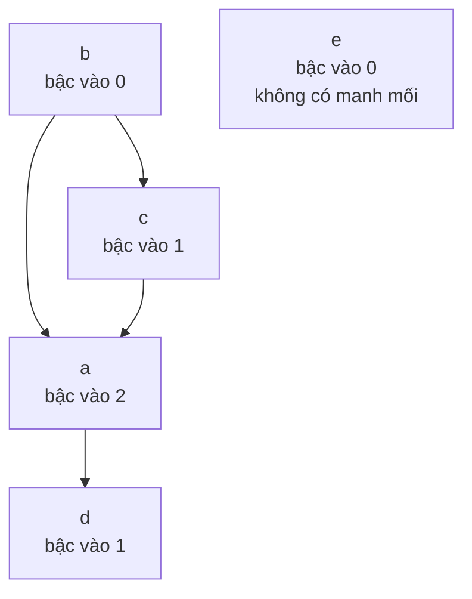

> [!tldr] Đọc nhanh
> - Danh sách từ đã được xếp theo một bảng chữ lạ. Mỗi **cặp từ kề nhau** cho tối đa một manh mối: ở **chữ khác nhau đầu tiên**, chữ của từ trên đứng trước chữ của từ dưới. Mỗi manh mối là một [[concepts/precedence-constraint|ràng buộc thứ tự]], tức một cạnh có hướng.
> - Có các cạnh rồi thì bài này chính là [[concepts/topological-sort|sắp xếp topo]]: viết ra chữ nào có [[concepts/in-degree|bậc vào]] bằng 0, gỡ các cạnh của nó, lặp lại (thuật toán Kahn).
> - Trả chuỗi rỗng trong hai trường hợp: các manh mối tạo thành **vòng**, hoặc một từ đứng trước chính phần đầu của nó (`abc` trước `ab`).
> - Ba cái bẫy làm sai nhiều nhất: lấy cả những chữ khác **sau** chữ khác đầu tiên, quên những chữ không có manh mối nào, và đếm bậc vào hai lần cho một cạnh trùng.
> - LeetCode nhận **mọi** thứ tự hợp lệ. Vét cạn mọi hoán vị mất 774 ms với 9 chữ trong Python; Kahn mất khoảng 54 µs, và với 26 chữ thì vét cạn không bao giờ chạy xong.

> [!info] Bối cảnh
> Bài LeetCode 269 (Hard, cần tài khoản LeetCode Premium), thuộc [[posts/2026-11-26-neetcode-topological-sort|ga 3: Sắp xếp topo]] trên **tuyến NeetCode: Đồ thị**. Nếu không có Premium, bạn có thể nộp thử miễn phí ở [LintCode 892](https://www.lintcode.com/problem/892/) hoặc ở bản [Foreign Dictionary](https://neetcode.io/problems/foreign-dictionary) của NeetCode. Hai bài trước của ga, [[problems/course-schedule|Course Schedule]] và [[problems/course-schedule-ii|Course Schedule II]], đưa sẵn các cạnh; bài này bắt mình tự đi tìm chúng. Bạn chỉ cần biết vòng lặp, mảng và hàng đợi.

> [!abstract]- Từ điển nhanh cho bài này (bấm để mở)
> - **Thứ tự từ điển**: cách xếp từ trong từ điển. So hai từ từ trái sang phải; chữ khác nhau đầu tiên quyết định từ nào đứng trước. Nếu một từ là phần đầu của từ kia (`ab` và `abc`), từ ngắn đứng trước.
> - **Đồ thị có hướng**: các đỉnh nối nhau bằng mũi tên. Ở đây mỗi đỉnh là một chữ cái, mũi tên `x → y` nghĩa là "x đứng trước y".
> - [[concepts/precedence-constraint|Ràng buộc thứ tự]]: một câu "việc này phải trước việc kia". Ở bài này mỗi manh mối là một ràng buộc như vậy.
> - [[concepts/in-degree|Bậc vào]]: số mũi tên chĩa vào một đỉnh, tức số chữ còn phải đứng trước nó.
> - [[concepts/topological-sort|Sắp xếp topo]]: xếp các đỉnh thành một hàng sao cho mọi mũi tên đều chỉ từ trái sang phải.
> - [[concepts/directed-acyclic-graph|DAG]]: đồ thị có hướng không có vòng. Chỉ DAG mới sắp xếp topo được.
> - [[concepts/queue|Hàng đợi]]: danh sách vào trước ra trước. [[concepts/priority-queue|Hàng đợi ưu tiên]] (min-heap) thì luôn cho ra phần tử nhỏ nhất trước.
> - [[concepts/three-color-dfs|DFS ba màu]]: duyệt theo chiều sâu, tô mỗi đỉnh trắng (chưa thăm), xám (đang đi) hoặc đen (xong) để bắt được vòng.

## Hình dung trước: cuốn danh bạ của người ngoài hành tinh

Bạn nhặt được một cuốn danh bạ của người ngoài hành tinh. Họ dùng đúng 26 chữ cái Latin, nhưng xếp theo một bảng chữ khác hẳn của mình. Bạn không biết bảng chữ đó. Bạn chỉ biết cuốn danh bạ **đã được xếp đúng** theo nó.

Vậy thì lật hai tên liền nhau: `bcd` đứng ngay trên `cb`. Chữ đầu đã khác nhau, `b` với `c`. Tên `bcd` đứng trên, nên với họ, `b` đứng trước `c`. Đó là một manh mối. Gom đủ manh mối rồi xếp các chữ sao cho không manh mối nào bị phạm, bạn có bảng chữ.

| Đời thường | Khái niệm |
|---|---|
| Cuốn danh bạ đã xếp theo bảng chữ của họ | Danh sách `words` đã xếp theo thứ tự lạ |
| Lật hai tên liền nhau, tìm chữ khác nhau đầu tiên | So cặp từ kề nhau, lấy chữ khác đầu tiên |
| Một manh mối "x đứng trước y" | Một cạnh có hướng `x → y`, tức một [[concepts/precedence-constraint\|ràng buộc thứ tự]] |
| Đếm xem mỗi chữ còn bao nhiêu chữ phải đứng trước nó | [[concepts/in-degree\|Bậc vào]] của mỗi đỉnh |
| Chữ không còn chữ nào phải đứng trước thì viết ra được | Đỉnh bậc vào 0 vào hàng đợi (Kahn) |
| Viết hết các chữ theo cách đó | [[concepts/topological-sort\|Sắp xếp topo]] |
| Hai manh mối cãi nhau vòng tròn: x trước y, y trước x | Đồ thị có vòng, không phải [[concepts/directed-acyclic-graph\|DAG]]: trả `""` |
| Tên `abc` đứng ngay trên `ab` | Danh bạ tự mâu thuẫn: trả `""` |
| Chữ có trong danh bạ nhưng không có manh mối nào | Đỉnh không có cạnh: vẫn phải viết ra, ở đâu cũng được |
| Có nhiều cách viết đều không phạm manh mối nào | Nhiều thứ tự topo; LeetCode nhận bất kỳ cách nào |

Với danh bạ `bcae, bcd, cb, cab, ad` (ví dụ dùng suốt trang này), các manh mối vẽ ra thành đồ thị sau:



Mũi tên `b → c` đọc là "b đứng trước c". Chữ `e` đứng một mình: nó có trong danh bạ nhưng không cặp nào nói gì về nó.

## Vấn đề: từ danh sách đã xếp, đoán ra bảng chữ

Đề cho một danh sách `words` gồm các từ chữ thường, đã được xếp tăng dần theo bảng chữ của một ngôn ngữ lạ. Hãy trả về một chuỗi chứa **mỗi chữ có mặt trong danh sách đúng một lần**, xếp theo bảng chữ đó. Nếu danh sách không thể đúng với bất kỳ bảng chữ nào, trả `""`. Nếu có nhiều đáp án, trả cái nào cũng được. [Đề LC-0269](https://leetcode.com/problems/alien-dictionary/)

Giới hạn theo đề LeetCode: từ 1 tới 100 từ, mỗi từ dài từ 1 tới 100 chữ, chỉ gồm chữ thường `a`…`z`. Vậy đồ thị có nhiều nhất 26 đỉnh.

Bốn điểm dễ trượt ngay từ đề:

| Câu hỏi | Trả lời | Ví dụ |
|---|---|---|
| So những cặp nào? | Chỉ cặp **kề nhau**. | `bcd, cb, cab` cho hai cặp: `bcd/cb` và `cb/cab` |
| Mỗi cặp cho mấy manh mối? | Nhiều nhất **một**, ở chữ khác đầu tiên. | `ab, ba` chỉ nói `a` trước `b` |
| Một từ là phần đầu của từ kia? | Ngắn trước dài thì hợp lệ, dài trước ngắn thì trả `""`. | `ab, abc` hợp lệ; `abc, ab` trả `""` |
| Chữ không có manh mối thì sao? | Vẫn phải có trong đáp án. | `zx` cho `xz` hoặc `zx`, không phải `""` |

**Biến thể LintCode.** Bản LintCode 892 thêm một luật: khi có nhiều đáp án, phải trả chuỗi **nhỏ nhất theo thứ tự a…z thông thường**. Cách giải giữ nguyên, chỉ thay hàng đợi bằng một [[concepts/priority-queue|hàng đợi ưu tiên]] (min-heap) để mỗi lượt lấy chữ nhỏ nhất đang sẵn sàng. Mục Cách 4 bên dưới nói kỹ hơn.

## Cơ chế

<figure class="figure-map" style="--ar: 3 / 4">
<div class="frame"><iframe data-archify="../diagrams/neetcode-alien-dictionary/worked-example.html" title="Alien Dictionary: rút cạnh từ cặp từ kề nhau rồi chạy Kahn" loading="lazy"></iframe></div>
<figcaption><span><b>Hình 1.</b> Bốn cặp từ kề nhau cho bốn cạnh; Kahn viết ra từng chữ có bậc vào 0 và viết đủ cả 5 chữ, nên danh bạ không có vòng.</span><a href="../diagrams/neetcode-alien-dictionary/worked-example.html" target="_blank" rel="noopener">Mở toàn màn hình</a></figcaption>
</figure>

<details>
<summary>Đọc từng bước</summary>
<ol>
<li>So bcae với bcd: hai chữ đầu giống nhau, chữ thứ ba khác (a, d). <code>cạnh a → d</code></li>
<li>So bcd với cb: chữ đầu đã khác (b, c). <code>cạnh b → c</code></li>
<li>So cb với cab: chữ thứ hai khác (b, a). <code>cạnh b → a</code></li>
<li>So cab với ad: chữ đầu khác (c, a). <code>cạnh c → a</code></li>
<li>Đếm bậc vào: a có 2, c có 1, d có 1, b và e có 0. <code>hàng đợi [b, e]</code></li>
<li>Viết b, gỡ hai cạnh của nó: c về 0, a còn 1. <code>hàng đợi [e, c]</code></li>
<li>Viết e. e không có cạnh nào. <code>đã viết: be</code></li>
<li>Viết c, a về 0. <code>hàng đợi [a]</code></li>
<li>Viết a, d về 0. <code>hàng đợi [d]</code></li>
<li>Viết d. Đã viết 5 chữ, đúng bằng số chữ có mặt. <code>đáp án: becad</code></li>
</ol>
</details>

### Bước 1: rút manh mối từ các cặp kề nhau

Bảng dưới làm bước này bằng tay trên ví dụ. Vị trí đếm từ 1.

| Cặp kề nhau | Chữ khác đầu tiên | Manh mối (cạnh) |
|---|---|---|
| `bcae` / `bcd` | vị trí 3: `a` và `d` | `a → d` |
| `bcd` / `cb` | vị trí 1: `b` và `c` | `b → c` |
| `cb` / `cab` | vị trí 2: `b` và `a` | `b → a` |
| `cab` / `ad` | vị trí 1: `c` và `a` | `c → a` |

Chữ `e` chỉ xuất hiện ở cuối `bcae`, sau chỗ khác nhau, nên không cho manh mối nào. Nó vẫn phải có trong đáp án.

**Vì sao chỉ cần cặp kề nhau?** Một danh sách xếp đúng khi và chỉ khi **mọi cặp kề nhau** xếp đúng, vì thứ tự từ điển có tính bắc cầu: `w₁ ≤ w₂` và `w₂ ≤ w₃` kéo theo `w₁ ≤ w₃`. So thêm `bcae` với `cab` chỉ cho ra `b → c`, một manh mối đã suy ra được từ các cặp kề nhau. Với n từ, mình so `n − 1` cặp thay vì `n(n − 1)/2` cặp.

**Vì sao chỉ lấy chữ khác đầu tiên?** Vì thứ tự từ điển được quyết định ngay ở đó. Sau chỗ khác nhau, các chữ còn lại không nói gì cả. Với `ab, ba`, chữ đầu cho `a → b`. Nếu lấy luôn chữ thứ hai, mình thêm nhầm `b → a`, tạo ra một vòng giả và trả `""` cho một danh sách hoàn toàn hợp lệ.

**Ca phần đầu.** Nếu hai từ giống nhau tới hết từ ngắn hơn, cặp đó không cho manh mối. Nhưng nếu từ **dài hơn** đứng trên (`abc` trên `ab`), không bảng chữ nào xếp được như vậy, nên trả `""` ngay.

**Cạnh trùng.** Hai cặp khác nhau có thể cho cùng một manh mối (`ac/ab` và `zc/zb` đều cho `c → b`). Mình lưu cạnh trong một bảng 26 × 26 ô đúng/sai, và chỉ tăng bậc vào khi ô đó **chưa** được bật.

### Cách 1: vét cạn mọi hoán vị, O(k!·C)

Cách đơn giản nhất để chắc chắn đúng: thử mọi cách xếp k chữ có mặt, với mỗi cách thì kiểm tra cả danh sách có xếp đúng không. Gọi C là tổng số chữ của mọi từ; kiểm tra một cách xếp tốn O(C), và có k! cách xếp. Thử theo thứ tự a…z thì cách xếp hợp lệ **đầu tiên** tìm được cũng là cách nhỏ nhất theo a…z, nên vét cạn là thước đo tốt cho mọi cách khác. File chạy thử dùng nó để đối chiếu, nhưng nó chỉ chạy nổi khi k nhỏ: 26! là khoảng 4·10²⁶ cách xếp.

### Cách 2: dựng đồ thị rồi chạy Kahn, O(C)

Đây là cách mình chọn. Sau Bước 1, mình có một đồ thị tối đa 26 đỉnh. Thuật toán Kahn làm đúng như đã kể ở phần hình dung:

1. Cho mọi chữ có mặt mà bậc vào bằng 0 vào hàng đợi.
2. Lấy một chữ ra, viết nó vào đáp án, rồi giảm bậc vào của mọi chữ nó chỉ tới. Chữ nào vừa về 0 thì vào hàng đợi.
3. Hàng đợi rỗng thì dừng. Nếu đã viết đủ k chữ, đó là đáp án. Nếu thiếu, những chữ còn lại đang chờ nhau trong một vòng: trả `""`.

| Bước | Lấy ra | Giảm bậc vào | Hàng đợi sau bước | Đã viết |
|---|---|---|---|---|
| Đầu | | a: 2, c: 1, d: 1, b: 0, e: 0 | `[b, e]` | |
| 1 | `b` | c → 0, a → 1 | `[e, c]` | `b` |
| 2 | `e` | không có | `[c]` | `be` |
| 3 | `c` | a → 0 | `[a]` | `bec` |
| 4 | `a` | d → 0 | `[d]` | `beca` |
| 5 | `d` | không có | `[]` | `becad` |

Vì sao đếm số chữ đã viết là đủ để phát hiện vòng? Trong một vòng, mỗi chữ luôn còn ít nhất một chữ trong vòng phải đứng trước nó, nên bậc vào của nó không bao giờ về 0 và nó không bao giờ vào hàng đợi. Không cần tìm ra vòng, chỉ cần thấy thiếu chữ.

**Chi phí.** Bước 1 so `n − 1` cặp, mỗi cặp tốn tối đa độ dài từ ngắn hơn, tổng cộng O(C). Kahn trên bảng 26 × 26 quét 26 ô cho mỗi chữ, tức tối đa 676 phép, là hằng số. Tổng thời gian O(C), bộ nhớ O(1) ngoài đầu vào (bảng 26 × 26 cố định).

### Cách 3: DFS ba màu

Cùng đồ thị đó, có thể dùng [[concepts/three-color-dfs|DFS ba màu]] thay cho Kahn. Mỗi chữ có ba màu: **trắng** là chưa thăm, **xám** là đang trên đường đi hiện tại, **đen** là đã thăm xong mọi chữ phía sau nó.

- Từ một chữ, đi theo từng mũi tên. Gặp chữ trắng thì đi tiếp vào nó.
- Gặp chữ **xám** nghĩa là mũi tên quay về một chữ đang trên chính đường đi này: có vòng, trả `""`.
- Khi đi hết mọi mũi tên của một chữ, tô nó đen và ghi nó vào danh sách "đã xong".

Một chữ chỉ "xong" sau khi mọi chữ phải đứng sau nó đã xong. Vì vậy **đảo ngược** danh sách "đã xong" là một thứ tự hợp lệ. Trên ví dụ, DFS cho `ebcad`, khác `becad` của Kahn nhưng cũng đúng.

Vì sao cần màu xám mà không chỉ một tập "đã thăm"? Với `b → c → a` và `b → a`, khi đi tới `a` lần thứ hai qua mũi tên `b → a`, `a` đã thăm rồi nhưng đó **không** phải vòng. Chỉ chữ đang xám mới báo vòng. Đồ thị ở đây sâu nhiều nhất 26 tầng, nên đệ quy không chạm giới hạn của ngôn ngữ nào.

### Cách 4: biến thể LintCode, chuỗi nhỏ nhất

Nếu đề đòi chuỗi nhỏ nhất theo a…z trong số mọi đáp án đúng, mình giữ nguyên Kahn và đổi đúng một chỗ: thay hàng đợi bằng **min-heap**, để mỗi lượt lấy chữ nhỏ nhất đang có bậc vào 0. Trên ví dụ, lượt đầu có `b` và `e`, chọn `b`; sau đó có `c` và `e`, chọn `c`; cứ thế ra `bcade`. Chọn chữ nhỏ nhất ở mỗi lượt cho ra chuỗi nhỏ nhất, vì chữ ở vị trí đầu tiên quyết định thứ tự từ điển và mình luôn đặt chữ nhỏ nhất có thể vào đó. File chạy thử so kết quả này với vét cạn trên 2 000 danh sách ngẫu nhiên. Với chỉ 26 chữ, quét 26 ô mỗi lượt cũng nhanh như heap; bản Python và Java dùng heap có sẵn (`heapq`, `PriorityQueue`), bản TS, JS và Go quét mảng.

### Kiểm tra một đáp án khi đề nhận nhiều đáp án

Vì LeetCode nhận mọi thứ tự hợp lệ, so đáp án với một chuỗi cố định là sai cách: trên ví dụ, Kahn ra `becad`, DFS ra `ebcad`, cả hai đều đúng. File chạy thử kiểm tra **tính chất** thay vì so chuỗi:

- danh sách mâu thuẫn thì đáp án phải là `""`;
- còn lại thì đáp án phải chứa đúng mỗi chữ có mặt một lần, và khi dùng nó làm bảng chữ thì danh sách phải xếp đúng.

### Đo: vét cạn và Kahn

File chạy thử dựng 100 từ ngẫu nhiên dài 1–10 chữ trên k chữ cái, xếp theo bảng chữ ngược (`ihgfedcba` khi k = 9). Bảng chữ ngược là hoán vị **cuối cùng** vét cạn gặp, nên nó phải thử đủ k! cách.

| k chữ | Vét cạn thử | TS | Python | Go | Java |
|---:|---:|---:|---:|---:|---:|
| 7 | 5 040 cách | 0,5 ms | 9,4 ms | 0,3 ms | 0,8 ms |
| 8 | 40 320 cách | 4,8 ms | 84 ms | 1,7 ms | 6,9 ms |
| 9 | 362 880 cách | 43 ms | 774 ms | 12 ms | 17 ms |
| Kahn, k = 9 | 1 lần | 8 µs | 54 µs | 1 µs | 3,6 µs |

Số đo thời gian đổi theo máy và theo lần chạy; cột số cách thử thì giống hệt nhau ở cả năm ngôn ngữ. Thêm một chữ là vét cạn chậm đi khoảng k lần, trong khi Kahn gần như không đổi. Với 26 chữ, vét cạn không bao giờ chạy xong.

## Ví dụ chạy được

Mỗi file chạy cùng 8 ca: ví dụ trong trang, một từ duy nhất, ca phần đầu `abc, ab`, một vòng `a, b, a`, hai từ giống nhau, ca phần đầu hợp lệ `ab, abc`, cạnh trùng `ac, ab, zc, zb`, và `ab, ba` (chỉ chữ khác đầu tiên mới tính). Mỗi ca chạy cả bốn cách và kiểm tra bằng tính chất ở trên. File còn chạy bốn bản sai, đối chiếu với vét cạn trên 2 000 danh sách ngẫu nhiên, và đo như bảng trên. Bên dưới là Bước 1 và Cách 2; vét cạn, DFS, bản min-heap và các bản sai nằm trong file đầy đủ.

[TypeScript](../code/neetcode-alien-dictionary/alien-dictionary.ts) · [Python](../code/neetcode-alien-dictionary/alien_dictionary.py) · [Go](../code/neetcode-alien-dictionary/alien_dictionary.go) · [Java](../code/neetcode-alien-dictionary/alien-dictionary.java) · [JavaScript](../code/neetcode-alien-dictionary/alien-dictionary.js)

```ts
// Bước chung: so từng cặp từ KỀ NHAU, lấy chữ khác ĐẦU TIÊN làm một cạnh u → v.
// Trả null khi danh sách tự mâu thuẫn: một từ đứng trước phần đầu của chính nó.
function buildGraph(words: string[]): Graph | null {
  const present: boolean[] = Array(26).fill(false)
  for (const w of words) for (const ch of w) present[code(ch)] = true // chữ nào có mặt cũng phải ra
  const adj = Array.from({ length: 26 }, () => Array(26).fill(false) as boolean[])
  const indeg: number[] = Array(26).fill(0)
  for (let i = 0; i + 1 < words.length; i++) {
    const a = words[i]
    const b = words[i + 1]
    const len = Math.min(a.length, b.length)
    let j = 0
    while (j < len && a[j] === b[j]) j++
    if (j === len) {
      if (a.length > b.length) return null // "abc" đứng trước "ab": danh bạ sai
      continue // "ab" trước "abc": hợp lệ, không có manh mối
    }
    const u = code(a[j])
    const v = code(b[j])
    if (!adj[u][v]) {
      adj[u][v] = true
      indeg[v]++ // cạnh trùng chỉ đếm một lần
    }
  }
  return { present, adj, indeg }
}

// Kahn trên một đồ thị đã dựng: chữ nào không còn chữ nào phải đứng trước (bậc vào 0) thì viết ra.
function kahnOrder(g: Graph): string {
  const indeg = g.indeg.slice()
  const queue: number[] = []
  for (let c = 0; c < 26; c++) if (g.present[c] && indeg[c] === 0) queue.push(c)
  let out = ""
  for (let head = 0; head < queue.length; head++) {
    const u = queue[head]
    out += chr(u)
    for (let v = 0; v < 26; v++) {
      if (g.adj[u][v] && --indeg[v] === 0) queue.push(v)
    }
  }
  const total = g.present.filter(Boolean).length
  return out.length === total ? out : "" // thiếu chữ nghĩa là có vòng
}

// Cách 2: dựng đồ thị rồi chạy Kahn.
function alienOrderKahn(words: string[]): string {
  const g = buildGraph(words)
  return g ? kahnOrder(g) : ""
}
```

```python
# Bước chung: so từng cặp từ KỀ NHAU, lấy chữ khác ĐẦU TIÊN làm một cạnh u → v.
# Trả None khi danh sách tự mâu thuẫn: một từ đứng trước phần đầu của chính nó.
def build_graph(words):
    present = [False] * 26
    for w in words:
        for ch in w:
            present[code(ch)] = True  # chữ nào có mặt cũng phải ra
    adj = [[False] * 26 for _ in range(26)]
    indeg = [0] * 26
    for a, b in zip(words, words[1:]):
        n = min(len(a), len(b))
        j = 0
        while j < n and a[j] == b[j]:
            j += 1
        if j == n:
            if len(a) > len(b):
                return None  # "abc" đứng trước "ab": danh bạ sai
            continue  # "ab" trước "abc": hợp lệ, không có manh mối
        u, v = code(a[j]), code(b[j])
        if not adj[u][v]:
            adj[u][v] = True
            indeg[v] += 1  # cạnh trùng chỉ đếm một lần
    return present, adj, indeg


# Kahn trên một đồ thị đã dựng: chữ nào không còn chữ nào phải đứng trước (bậc vào 0) thì viết ra.
def kahn_order(g):
    present, adj, indeg = g
    indeg = indeg[:]
    queue = deque(c for c in range(26) if present[c] and indeg[c] == 0)
    out = []
    while queue:
        u = queue.popleft()
        out.append(chr_(u))
        for v in range(26):
            if adj[u][v]:
                indeg[v] -= 1
                if indeg[v] == 0:
                    queue.append(v)
    return "".join(out) if len(out) == sum(present) else ""  # thiếu chữ nghĩa là có vòng


# Cách 2: dựng đồ thị rồi chạy Kahn.
def alien_order_kahn(words):
    g = build_graph(words)
    return kahn_order(g) if g is not None else ""
```

```go
// Bước chung: so từng cặp từ KỀ NHAU, lấy chữ khác ĐẦU TIÊN làm một cạnh u → v.
// Trả nil khi danh sách tự mâu thuẫn: một từ đứng trước phần đầu của chính nó.
func buildGraph(words []string) *graph {
	g := &graph{}
	for _, w := range words {
		for i := 0; i < len(w); i++ {
			g.present[w[i]-'a'] = true // chữ nào có mặt cũng phải ra
		}
	}
	for i := 0; i+1 < len(words); i++ {
		a, b := words[i], words[i+1]
		n := min(len(a), len(b))
		j := 0
		for j < n && a[j] == b[j] {
			j++
		}
		if j == n {
			if len(a) > len(b) {
				return nil // "abc" đứng trước "ab": danh bạ sai
			}
			continue // "ab" trước "abc": hợp lệ, không có manh mối
		}
		u, v := a[j]-'a', b[j]-'a'
		if !g.adj[u][v] {
			g.adj[u][v] = true
			g.indeg[v]++ // cạnh trùng chỉ đếm một lần
		}
	}
	return g
}

func countPresent(p [26]bool) int {
	n := 0
	for _, x := range p {
		if x {
			n++
		}
	}
	return n
}

// Kahn trên một đồ thị đã dựng: chữ nào không còn chữ nào phải đứng trước (bậc vào 0) thì viết ra.
func kahnOrder(g *graph) string {
	indeg := g.indeg // mảng trong Go được chép khi gán, g.indeg giữ nguyên
	queue := []int{}
	for c := 0; c < 26; c++ {
		if g.present[c] && indeg[c] == 0 {
			queue = append(queue, c)
		}
	}
	out := make([]byte, 0, 26)
	for head := 0; head < len(queue); head++ {
		u := queue[head]
		out = append(out, byte('a'+u))
		for v := 0; v < 26; v++ {
			if g.adj[u][v] {
				indeg[v]--
				if indeg[v] == 0 {
					queue = append(queue, v)
				}
			}
		}
	}
	if len(out) != countPresent(g.present) {
		return "" // thiếu chữ nghĩa là có vòng
	}
	return string(out)
}

// Cách 2: dựng đồ thị rồi chạy Kahn.
func alienOrderKahn(words []string) string {
	g := buildGraph(words)
	if g == nil {
		return ""
	}
	return kahnOrder(g)
}
```

```java
// Bước chung: so từng cặp từ KỀ NHAU, lấy chữ khác ĐẦU TIÊN làm một cạnh u → v.
// Trả null khi danh sách tự mâu thuẫn: một từ đứng trước phần đầu của chính nó.
static Graph buildGraph(String[] words) {
    boolean[] present = new boolean[26];
    for (String w : words) for (char ch : w.toCharArray()) present[ch - 'a'] = true; // chữ nào có mặt cũng phải ra
    boolean[][] adj = new boolean[26][26];
    int[] indeg = new int[26];
    for (int i = 0; i + 1 < words.length; i++) {
        String a = words[i], b = words[i + 1];
        int n = Math.min(a.length(), b.length());
        int j = 0;
        while (j < n && a.charAt(j) == b.charAt(j)) j++;
        if (j == n) {
            if (a.length() > b.length()) return null; // "abc" đứng trước "ab": danh bạ sai
            continue; // "ab" trước "abc": hợp lệ, không có manh mối
        }
        int u = a.charAt(j) - 'a', v = b.charAt(j) - 'a';
        if (!adj[u][v]) {
            adj[u][v] = true;
            indeg[v]++; // cạnh trùng chỉ đếm một lần
        }
    }
    return new Graph(present, adj, indeg);
}

static int countPresent(boolean[] p) {
    int n = 0;
    for (boolean x : p) if (x) n++;
    return n;
}

// Kahn trên một đồ thị đã dựng: chữ nào không còn chữ nào phải đứng trước (bậc vào 0) thì viết ra.
static String kahnOrder(Graph g) {
    int[] indeg = g.indeg().clone();
    ArrayDeque<Integer> queue = new ArrayDeque<>();
    for (int c = 0; c < 26; c++) if (g.present()[c] && indeg[c] == 0) queue.add(c);
    StringBuilder out = new StringBuilder();
    while (!queue.isEmpty()) {
        int u = queue.poll();
        out.append((char) ('a' + u));
        for (int v = 0; v < 26; v++) {
            if (g.adj()[u][v] && --indeg[v] == 0) queue.add(v);
        }
    }
    return out.length() == countPresent(g.present()) ? out.toString() : ""; // thiếu chữ nghĩa là có vòng
}

// Cách 2: dựng đồ thị rồi chạy Kahn.
static String alienOrderKahn(String[] words) {
    Graph g = buildGraph(words);
    return g == null ? "" : kahnOrder(g);
}
```

```js
// Bước chung: so từng cặp từ KỀ NHAU, lấy chữ khác ĐẦU TIÊN làm một cạnh u → v.
// Trả null khi danh sách tự mâu thuẫn: một từ đứng trước phần đầu của chính nó.
function buildGraph(words) {
  const present = Array(26).fill(false)
  for (const w of words) for (const ch of w) present[code(ch)] = true // chữ nào có mặt cũng phải ra
  const adj = Array.from({ length: 26 }, () => Array(26).fill(false))
  const indeg = Array(26).fill(0)
  for (let i = 0; i + 1 < words.length; i++) {
    const a = words[i]
    const b = words[i + 1]
    const len = Math.min(a.length, b.length)
    let j = 0
    while (j < len && a[j] === b[j]) j++
    if (j === len) {
      if (a.length > b.length) return null // "abc" đứng trước "ab": danh bạ sai
      continue // "ab" trước "abc": hợp lệ, không có manh mối
    }
    const u = code(a[j])
    const v = code(b[j])
    if (!adj[u][v]) {
      adj[u][v] = true
      indeg[v]++ // cạnh trùng chỉ đếm một lần
    }
  }
  return { present, adj, indeg }
}

// Kahn trên một đồ thị đã dựng: chữ nào không còn chữ nào phải đứng trước (bậc vào 0) thì viết ra.
function kahnOrder(g) {
  const indeg = g.indeg.slice()
  const queue = []
  for (let c = 0; c < 26; c++) if (g.present[c] && indeg[c] === 0) queue.push(c)
  let out = ""
  for (let head = 0; head < queue.length; head++) {
    const u = queue[head]
    out += chr(u)
    for (let v = 0; v < 26; v++) {
      if (g.adj[u][v] && --indeg[v] === 0) queue.push(v)
    }
  }
  const total = g.present.filter(Boolean).length
  return out.length === total ? out : "" // thiếu chữ nghĩa là có vòng
}

// Cách 2: dựng đồ thị rồi chạy Kahn.
function alienOrderKahn(words) {
  const g = buildGraph(words)
  return g ? kahnOrder(g) : ""
}
```

Kết quả chạy `node alien-dictionary.ts` (bốn ngôn ngữ còn lại in giống hệt, trừ số đo thời gian):

```text
ca 1 [bcae bcd cb cab ad]: Kahn becad, DFS ebcad, nhỏ nhất bcade, vét cạn bcade (31 hoán vị) đúng
ca 2 [zx]: Kahn xz, DFS zx, nhỏ nhất xz, vét cạn xz (1 hoán vị) đúng
ca 3 [abc ab]: Kahn "", DFS "", nhỏ nhất "", vét cạn "" (6 hoán vị) đúng
ca 4 [a b a]: Kahn "", DFS "", nhỏ nhất "", vét cạn "" (2 hoán vị) đúng
ca 5 [ab ab]: Kahn ab, DFS ba, nhỏ nhất ab, vét cạn ab (1 hoán vị) đúng
ca 6 [ab abc]: Kahn abc, DFS cba, nhỏ nhất abc, vét cạn abc (1 hoán vị) đúng
ca 7 [ac ab zc zb]: Kahn aczb, DFS cbaz, nhỏ nhất acbz, vét cạn acbz (3 hoán vị) đúng
ca 8 [ab ba]: Kahn ab, DFS ab, nhỏ nhất ab, vét cạn ab (1 hoán vị) đúng
8/8 ca đúng
bản sai allDiffs: đúng 5/8 ca
bản sai noPrefix: đúng 7/8 ca
bản sai edgeLettersOnly: đúng 4/8 ca
bản sai dupIndeg: đúng 7/8 ca
đối chiếu 2000 danh sách ngẫu nhiên (1508 hợp lệ): khớp vét cạn 2000/2000
đo 7 chữ, 100 từ: vét cạn ra gfedcba sau 5040 hoán vị, 0.5 ms; Kahn ra gfedcba, 8.4 µs
đo 8 chữ, 100 từ: vét cạn ra hgfedcba sau 40320 hoán vị, 4.8 ms; Kahn ra hgfedcba, 8.0 µs
đo 9 chữ, 100 từ: vét cạn ra ihgfedcba sau 362880 hoán vị, 42.9 ms; Kahn ra ihgfedcba, 7.6 µs
```

## Hiểu lầm và bẫy hay gặp

- **Lấy mọi chữ khác nhau làm manh mối.** Chỉ chữ khác **đầu tiên** có nghĩa. Bản sai `allDiffs` biến `ab, ba` thành một vòng giả và chỉ đúng 5/8 ca.
- **So mọi cặp từ, không chỉ cặp kề nhau.** Vẫn đúng, vì các manh mối thêm vào đều suy ra được từ cặp kề nhau, nhưng tốn `n(n − 1)/2` phép so thay vì `n − 1`.
- **Quên ca phần đầu.** `abc` đứng trên `ab` không cho manh mối nào, nên một bản không kiểm tra sẽ vui vẻ trả một bảng chữ. Bản sai `noPrefix` trả `abc` cho ca này, đáp án đúng là `""`.
- **Chỉ viết những chữ có cạnh.** Chữ không có manh mối (`e` trong ví dụ, cả hai chữ của `zx`) vẫn phải có trong đáp án. Bản sai `edgeLettersOnly` chỉ đúng 4/8 ca: nó trả `""` cho `zx` và cho `ab, ab`.
- **Đếm bậc vào hai lần cho một cạnh trùng.** Nếu lưu cạnh trong một tập (không trùng) nhưng tăng bậc vào mỗi lần thấy manh mối, chữ `b` của `ac, ab, zc, zb` có bậc vào 2 mà chỉ được giảm 1 lần, nên không bao giờ về 0. Kahn tưởng có vòng và trả `""`. Bản sai `dupIndeg` sai đúng ca đó. Cách sửa: chỉ tăng bậc vào khi cạnh mới thật sự được thêm. (Lưu cạnh trong một danh sách có trùng và giảm bậc vào theo từng phần tử cũng đúng, vì tăng và giảm khớp nhau.)
- **So đáp án với một chuỗi cố định.** Nhiều thứ tự đều đúng. Test phải kiểm tra tính chất, không so chuỗi.
- **DFS chỉ dùng một tập "đã thăm".** Hình kim cương `b → c → a`, `b → a` sẽ bị báo nhầm là có vòng. Cần phân biệt xám (đang đi) và đen (xong).
- **TypeScript và JavaScript: lưu cạnh bằng `Map<string, Set<string>>`.** Chạy đúng, nhưng thứ tự đáp án phụ thuộc thứ tự chèn vào `Map`. Đó là lý do hai lời giải đúng có thể in ra hai chuỗi khác nhau. Bảng 26 × 26 trong file cho thứ tự cố định theo a…z.
- **Python: dùng `set` cho cạnh rồi `indeg[v] += 1` vô điều kiện.** Đó chính là bẫy cạnh trùng ở trên. Kiểm tra `if v not in adj[u]` trước khi tăng.
- **Go: mảng và slice chép khác nhau.** `indeg := g.indeg` chép cả mảng `[26]int`, nên Kahn sửa bản chép mà đồ thị gốc giữ nguyên. Nếu đổi sang slice `[]int`, phép gán chỉ chép con trỏ và lần chạy thứ hai sẽ thấy bậc vào đã bị trừ. Khi đó phải dùng `copy`.
- **Java: dùng `String.compareTo` để kiểm tra.** `compareTo` so theo bảng chữ thông thường, không theo bảng chữ lạ. Phải tự viết phép so dùng mảng thứ hạng `rank`.

## Câu hỏi tự kiểm tra

> [!question]- Danh sách `xa, xb, ya` cho những manh mối nào?
> `xa/xb` khác ở chữ thứ hai: `a → b`. `xb/ya` khác ngay chữ đầu: `x → y`. Chữ `b` và `a` ở cặp thứ hai nằm sau chỗ khác nhau nên không tính.

> [!question]- Vì sao chỉ so các cặp kề nhau mà không bỏ sót manh mối nào?
> Thứ tự từ điển có tính bắc cầu. Nếu mọi cặp kề nhau đều xếp đúng theo một bảng chữ, cả danh sách xếp đúng theo bảng chữ đó. Manh mối từ một cặp không kề nhau luôn suy ra được từ các cặp kề nhau.

> [!question]- `abc, ab` trả gì, và vì sao không có manh mối nào cũng không cứu được?
> Trả `""`. Trong mọi bảng chữ, một từ đứng trước mọi từ dài hơn bắt đầu bằng nó. `abc` đứng trên `ab` là sai với mọi bảng chữ, dù cặp này không cho manh mối nào.

> [!question]- Kahn biết có vòng bằng cách nào, khi nó không hề đi tìm vòng?
> Nó đếm số chữ đã viết. Mọi chữ trong một vòng luôn còn ít nhất một chữ phải đứng trước nó, nên không bao giờ có bậc vào 0. Viết thiếu chữ nghĩa là có vòng.

> [!question]- Đề LintCode muốn đáp án nhỏ nhất theo a…z. Bạn sửa Cách 2 ở đâu?
> Thay hàng đợi bằng min-heap (hoặc quét 26 chữ để chọn chữ nhỏ nhất có bậc vào 0). Mọi thứ khác giữ nguyên. Trên ví dụ, đáp án đổi từ `becad` thành `bcade`.

## Tham khảo

- [LeetCode · Alien Dictionary](https://leetcode.com/problems/alien-dictionary/): đề gốc và giới hạn (cần Premium).
- [LintCode · 892 Alien Dictionary](https://www.lintcode.com/problem/892/): bản miễn phí, đòi đáp án nhỏ nhất theo a…z.
- [NeetCode · Foreign Dictionary](https://neetcode.io/problems/foreign-dictionary): bản miễn phí khác của cùng bài.
- [Kahn (1962) · Topological sorting of large networks](https://doi.org/10.1145/368996.369025): bài báo gốc của thuật toán Kahn.
- [Princeton · Topological.java](https://algs4.cs.princeton.edu/42digraph/Topological.java.html) và [DirectedCycle.java](https://algs4.cs.princeton.edu/42digraph/DirectedCycle.java.html): thứ tự topo bằng DFS hậu thứ tự đảo ngược, và bắt vòng bằng các đỉnh đang trên đường đi.
- [Python · heapq](https://docs.python.org/3/library/heapq.html): min-heap có sẵn.
- [Java · PriorityQueue](https://docs.oracle.com/en/java/javase/21/docs/api/java.base/java/util/PriorityQueue.html): hàng đợi ưu tiên, mặc định lấy phần tử nhỏ nhất.
