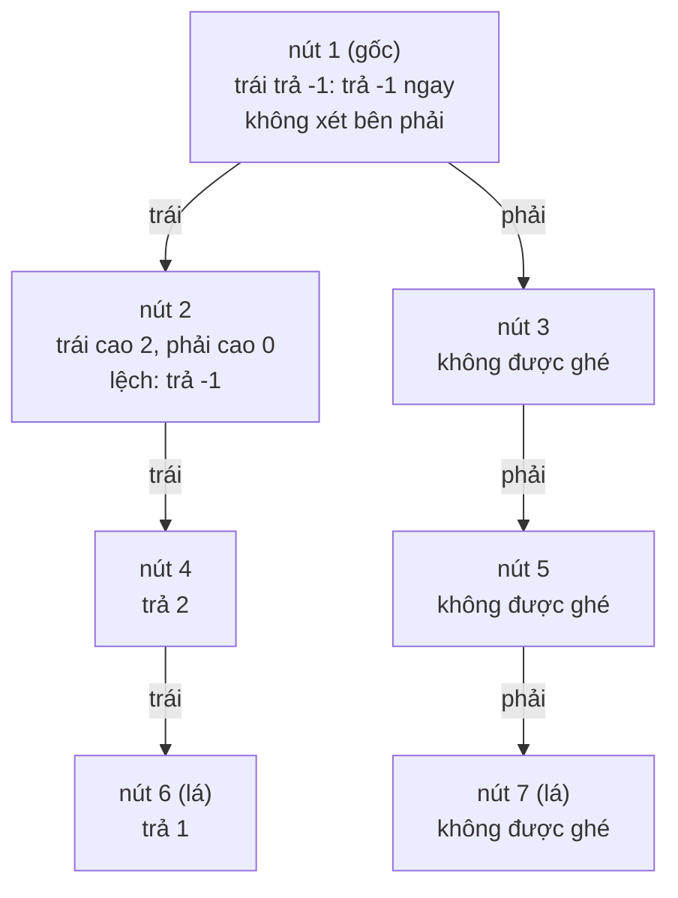
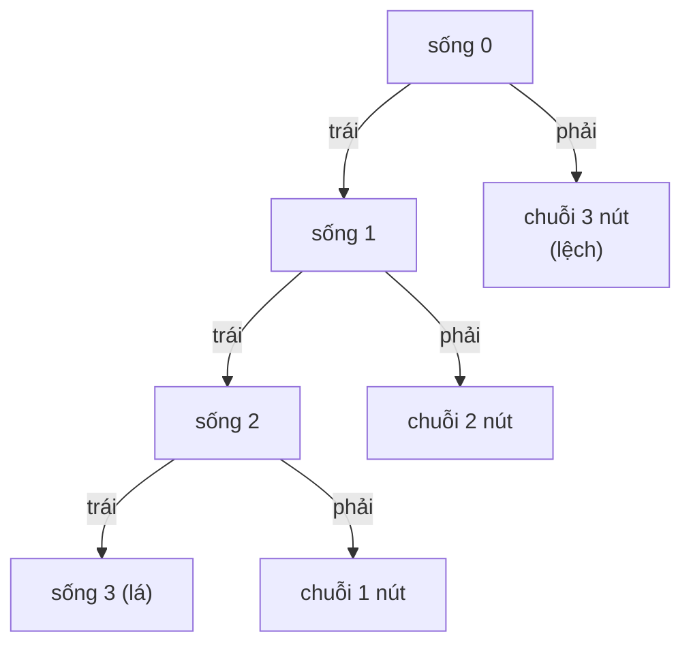
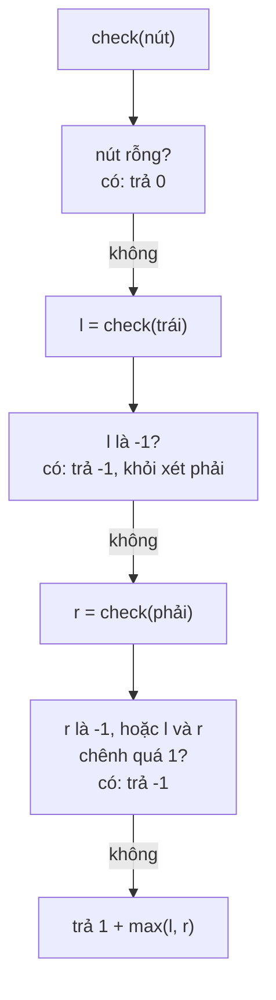

> [!tldr] Đọc nhanh
> - Đề: một cây nhị phân là **cân** khi ở **mọi** nút, chiều cao cây con trái và cây con phải chênh nhau không quá 1. Trả `true` hoặc `false`.
> - Cách O(n): một lượt [[concepts/post-order-traversal|hậu thứ tự]] trả chiều cao lên cha, nhưng trả **-1** ngay khi thấy một nút lệch. -1 không bao giờ là chiều cao thật, nên nó là một [[concepts/sentinel-value|giá trị canh]] mang được tin "đã hỏng" lên tới gốc, và mọi nút phía trên dừng ngay mà không xét nhánh còn lại.
> - Cách từ trên xuống (ở mỗi nút gọi lại hàm chiều cao) đúng nhưng chậm: cây hoàn hảo 10⁶ nút tốn 18,9 triệu lần ghé nút (146 ms) so với 10⁶ (9,8 ms). Trường hợp xấu nhất không phải O(n²) như hay ghi mà là Θ(n√n): cây răng lược 500 500 nút cần 167 triệu lần ghé.
> - Ba cách hiểu sai chạy thật: chỉ so hai cây con của gốc; so lá nông nhất với lá sâu nhất (sai cả hai chiều); quên kiểm tra -1 từ con, nên -1 cạnh 0 lọt qua phép so `|l − r| ≤ 1`.
> - Đề cho tới 5 000 nút. Chuỗi lệch 5 000 nút làm bản đệ quy Python ném `RecursionError`; bản lặp thì không.

> [!info] Bối cảnh
> Bài LeetCode 110 (Easy), thuộc [[posts/2026-11-25-neetcode-tree-recursion|ga 3: Đệ quy trên cây]] trên **tuyến NeetCode: Cấu trúc liên kết**. Bài này dùng đúng khung của [[problems/diameter-of-binary-tree|Diameter of Binary Tree]]: hàm đệ quy trả chiều cao lên cha, và ở mỗi nút còn một thông tin thứ hai. Ở bài đường kính, thông tin thứ hai (đường dài nhất) được ghi ra một biến ngoài; ở bài này nó (cây đã lệch chưa) được **gói vào chính giá trị trả về**. Chiều cao là hàm của [[problems/maximum-depth-of-binary-tree|Maximum Depth of Binary Tree]]. Lời giải có đủ TypeScript, Python, Go, Java và JavaScript. Bạn cần biết đệ quy là gì; cây nhị phân được giải thích ngay dưới.

> [!abstract]- Từ điển nhanh cho bài này (bấm để mở)
> - **Cây nhị phân**: mỗi nút có tối đa hai con, trái và phải. Xem [[concepts/binary-tree|Binary Tree]].
> - **Chiều cao** (trong trang này): số nút trên đường dài nhất từ một nút đi thẳng xuống một lá. Cây rỗng cao 0.
> - **Cân (height-balanced)**: ở mọi nút, |cao(trái) − cao(phải)| ≤ 1. Cây rỗng là cân.
> - **Hậu thứ tự (post-order)**: xử lý hai cây con trước, rồi mới tới nút. Xem [[concepts/post-order-traversal|Post-order Traversal]].
> - **Giá trị canh (sentinel value)**: một giá trị không bao giờ là kết quả hợp lệ, dùng để báo một trạng thái đặc biệt. Ở đây là -1. Xem [[concepts/sentinel-value|Sentinel Value]].
> - **Cây hoàn hảo**: mọi tầng đều đầy, 2ᵏ − 1 nút. **Chuỗi lệch**: mọi nút chỉ có con trái. **Cây răng lược**: định nghĩa ở phần Cơ chế.
> - **Ngăn xếp gọi hàm** và giới hạn độ sâu: xem [[concepts/recursion-depth-limit|Recursion Depth Limit]].

## Hình dung trước: kiểm tra đồ chơi treo nôi

Đồ chơi treo nôi là những thanh ngang treo lồng vào nhau: mỗi thanh có hai đầu, mỗi đầu treo một thanh nhỏ hơn hoặc để trống. Người kiểm tra muốn biết ở **mọi** thanh, hai bên có thòng xuống dài gần bằng nhau không (chênh không quá một tầng).

- **Từ trên xuống:** người kiểm tra đứng ở thanh trên cùng, lần theo từng bên xuống tận đáy để đo độ dài, so hai số. Rồi bước xuống thanh bên dưới và lại đo từ đầu, dù vừa đo qua đoạn đó.
- **Từ dưới lên:** mỗi thanh ở đáy báo lên "bên tôi dài 1 tầng". Thanh nào nhận được hai con số thì tự so: lệch quá thì hô "hỏng" lên trên, không thì báo "bên tôi dài thêm một tầng". Nghe "hỏng" từ bên trái thì thanh phía trên chuyền "hỏng" lên luôn, khỏi đo bên phải.

| Đời thường | Khái niệm |
|---|---|
| Thanh ngang có hai đầu | nút có con trái, con phải |
| Bên này thòng xuống bao nhiêu tầng | chiều cao cây con |
| Đứng trên cùng đo lại từng bên ở mỗi thanh | từ trên xuống, gọi lại `height` |
| Mỗi thanh báo độ dài của mình lên | từ dưới lên, trả chiều cao |
| Hô "hỏng" | trả -1 (giá trị canh) |
| Nghe "hỏng" thì chuyền lên, khỏi đo nữa | `if (l === -1) return -1` |
| Chỉ ngắm thanh trên cùng | hiểu sai: chỉ xét gốc |

Cây dưới đây là ca "gốc cân, con lệch" trong file chạy thử. Hai cây con của gốc cao bằng nhau (3 và 3), nhưng nút 2 và nút 3 đều lệch. Mỗi ô ghi giá trị bản từ dưới lên trả về:



## Vấn đề

Đầu vào là gốc của một cây nhị phân có từ 0 tới 5 000 nút, giá trị trong [−10⁴, 10⁴] (giá trị không ảnh hưởng đáp án). Trả về cây có cân theo nghĩa trên hay không. Đề gốc: [LeetCode 110](https://leetcode.com/problems/balanced-binary-tree/).

Chữ "cân" ở đây có nghĩa hẹp và cụ thể: chênh lệch chiều cao **tại từng nút**. Mình từng hiểu nó là "các lá nằm ở độ sâu gần bằng nhau", và đó là một định nghĩa khác: có cây cân theo đề mà lá chênh nhau hai tầng (phần bẫy chạy thử).

## Cơ chế

<figure class="figure-map" style="--ar: 3 / 4">
<div class="frame"><iframe data-archify="../diagrams/neetcode-balanced-binary-tree/worked-example.html" title="Dùng lại chiều cao để kiểm cân bằng" loading="lazy"></iframe></div>
<figcaption><span><b>Hình 1.</b> Dùng lại chiều cao để kiểm cân bằng.</span><a href="../diagrams/neetcode-balanced-binary-tree/worked-example.html" target="_blank" rel="noopener">Mở toàn màn hình</a></figcaption>
</figure>

<details>
<summary>Đọc từng bước</summary>
<ol>
<li>Hai con của nút X trả 0 và 1. <code>difference = 1</code></li>
<li>Nút X cân bằng và trả 2. <code>height = 1 + max(0, 1)</code></li>
<li>Cha của X có nhánh còn lại rỗng. <code>left = 2; right = 0</code></li>
<li>Hiệu bằng 2 nên cây mất cân bằng. <code>2 &gt; 1 → false</code></li>
</ol>
</details>

### Cách 1: từ trên xuống

Viết đúng theo định nghĩa: gốc cân, và cây con trái cân, và cây con phải cân.

```ts
// Cách 1: từ trên xuống. Ở mỗi nút tính lại chiều cao hai cây con rồi mới xét hai cây con.
function balancedTopDown(root: TreeNode | null): boolean {
  if (root === null) return true;
  return Math.abs(height(root.left) - height(root.right)) <= 1 && balancedTopDown(root.left) && balancedTopDown(root.right);
}
```

Mỗi nút được xét gọi `height` trên hai cây con, tức đi hết cây con của mình. Với cây cân (cao khoảng log₂ n), tổng là O(n log n): cây hoàn hảo 2²⁰ − 1 nút tốn 18 874 370 lần ghé, khoảng 18 lần n.

**Trường hợp xấu nhất là bao nhiêu?** Nhiều lời giải ghi O(n²), và đó là một cận trên đúng nhưng lỏng. Trên chuỗi lệch, bản này dừng ngay ở gốc (hai bên cao n − 1 và 0), nên chỉ tốn O(n). Để tốn nhiều, nó phải đi sâu xuống một đường dài mà **mọi** nút trên đường đều qua phép kiểm tra. Mà mỗi nút trên đường muốn qua thì cây con bên kia phải cao gần bằng phần đường còn lại, nên đường dài d cần ít nhất khoảng d²/2 nút. Vậy d ≤ √(2n), và tổng chi phí không quá n · √(2n): **O(n√n)**. Cận này đạt được, với cây "răng lược": một sống dài L, nút sống thứ i treo bên phải một chuỗi L − 1 − i nút. Mọi nút sống đều cân (hai bên cao bằng nhau), còn các chuỗi từ 3 nút trở lên thì lệch.



Bản từ trên xuống đi dọc sống, ở mỗi nút sống đo lại cả phần cây bên dưới, rồi mới tới chuỗi lệch đầu tiên ở gần đáy. Với L = 1 000 (500 500 nút): 167 166 003 lần ghé, đúng 0,472 · n^1.5 ở cả ba cỡ đo. Bản từ dưới lên đi xuống đáy sống, gặp chuỗi lệch đầu tiên và dừng: 1 006 lần ghé.

### Cách 2: từ dưới lên, trả -1 khi đã lệch

Đổi chiều: tính chiều cao từ dưới lên như [[problems/maximum-depth-of-binary-tree|Maximum Depth]], và kiểm tra luôn ở mỗi nút. Hàm cần báo cho cha hai điều, chiều cao và đã lệch hay chưa. Chiều cao không bao giờ âm, nên -1 dùng làm tín hiệu "đã lệch" mà không lẫn với chiều cao nào:

```ts
// Cách 2: từ dưới lên. check trả chiều cao, hoặc -1 nếu cây con đã lệch ở đâu đó. -1 không bao giờ là chiều cao thật.
function balancedBottomUp(root: TreeNode | null): boolean {
  const check = (node: TreeNode | null): number => {
    if (node === null) return 0;
    const l = check(node.left);
    if (l === -1) return -1; // bên trái đã lệch: khỏi xét bên phải
    const r = check(node.right);
    if (r === -1 || Math.abs(l - r) > 1) return -1;
    return 1 + Math.max(l, r);
  };
  return check(root) !== -1;
}
```

Mỗi nút được ghé tối đa một lần: O(n) thời gian, O(h) bộ nhớ cho ngăn xếp gọi hàm. Hai lần kiểm tra -1 là phần dễ quên nhất. Thiếu chúng, -1 bị coi như một chiều cao bình thường: một con trả -1, con kia trả 0 thì |−1 − 0| = 1, qua phép so, và nút trả về 1 + max(−1, 0) = 1 như thể cây đẹp.



Thay cho giá trị canh, có thể trả một cặp `(cân, chiều cao)`: rõ nghĩa hơn, nhưng mỗi lời gọi tạo một đối tượng hoặc bộ (trừ Go trả được hai giá trị). Giá trị canh gọn và nhanh hơn, đổi lại người đọc phải biết quy ước.

### Cách 3: bản lặp

Cùng mẹo của bài đường kính: duyệt tiền thứ tự bằng [[concepts/stack|ngăn xếp]], xử lý theo thứ tự ngược để con luôn xong trước cha, chiều cao giữ trong bảng. Gặp nút lệch thì trả `false` ngay.

```ts
// Cách 3: cùng phép tính từ dưới lên, không đệ quy: tiền thứ tự bằng ngăn xếp, xử lý ngược.
function balancedIterative(root: TreeNode | null): boolean {
  if (root === null) return true;
  const order: TreeNode[] = [];
  const stack: TreeNode[] = [root];
  while (stack.length > 0) {
    const node = stack.pop()!;
    order.push(node);
    if (node.left !== null) stack.push(node.left);
    if (node.right !== null) stack.push(node.right);
  }
  const h = new Map<TreeNode | null, number>([[null, 0]]);
  for (let i = order.length - 1; i >= 0; i--) {
    const node = order[i];
    const l = h.get(node.left)!, r = h.get(node.right)!;
    if (Math.abs(l - r) > 1) return false;
    h.set(node, 1 + Math.max(l, r));
  }
  return true;
}
```

Không giới hạn độ sâu, nhưng mất phần dừng sớm của bản đệ quy: bước tiền thứ tự luôn đi hết cây trước khi kiểm tra nút nào. Trên cây răng lược L = 1 000, bản lặp Go mất 18,8 ms còn bản đệ quy từ dưới lên 0,01 ms.

| Cách | Thời gian | Bộ nhớ thêm | Dừng sớm khi lệch |
|---|---|---|---|
| Từ trên xuống | O(n log n) cây cân, Θ(n√n) xấu nhất | O(h) | có, nhưng chỉ sau khi đã đo cả cây con |
| Từ dưới lên, -1 | O(n) | O(h) | có, ngay chỗ lệch đầu tiên |
| Bản lặp | O(n) | O(n) | chỉ ở bước thứ hai, sau khi đã đi hết cây |

### Đo

TypeScript, Node 24, trung vị 5 lần (răng lược: 3 lần):

| Cây | n | Trên xuống: ghé | Trên xuống | Dưới lên: ghé | Dưới lên |
|---|---|---|---|---|---|
| hoàn hảo | 1 023 | 8 194 | 0,08 ms | 1 023 | 0,01 ms |
| hoàn hảo | 16 383 | 196 610 | 1,52 ms | 16 383 | 0,14 ms |
| hoàn hảo | 131 071 | 1 966 082 | 14,3 ms | 131 071 | 1,04 ms |
| hoàn hảo | 1 048 575 | 18 874 370 | 146 ms | 1 048 575 | 9,78 ms |
| răng lược L = 250 | 31 375 | 2 635 253 | 38,3 ms | 256 | 0,01 ms |
| răng lược L = 500 | 125 250 | 20 958 003 | 337 ms | 506 | 0,01 ms |
| răng lược L = 1 000 | 500 500 | 167 166 003 | 3 149 ms | 1 006 | 0,02 ms |

- Cây hoàn hảo: số lần ghé của bản từ trên xuống chia n tăng từ 8 lên 18 khi n tăng 1 000 lần, đúng dáng n log n.
- Răng lược: n gấp 4 thì số lần ghé gấp 8, tức n^1.5. Tỉ số ghé / n^1.5 đứng yên ở 0,474, 0,473, 0,472.

Các ngôn ngữ khác, trung vị 5 lần (ms):

| | Hoàn hảo 2²⁰ − 1: trên xuống | dưới lên | bản lặp | Răng lược L = 1 000: trên xuống | dưới lên | bản lặp |
|---|---|---|---|---|---|---|
| Go | 72,5 | 5,27 | 144 | 2 243 | 0,01 | 18,8 |
| Java | 65,3 | 5,44 | 174 | 1 553 | 0,02 | 8,56 |

Python, cây hoàn hảo 2¹⁷ − 1 nút: từ trên xuống 270 ms, từ dưới lên 22,3 ms, bản lặp 37,0 ms. Ở mọi ngôn ngữ, bản lặp chậm hơn bản đệ quy từ dưới lên vì mỗi nút phải ghi và đọc một bảng băm.

### Bên dưới năm ngôn ngữ

| | Trả "chiều cao hoặc đã lệch" | Bẫy riêng |
|---|---|---|
| TypeScript / JavaScript | `number`, -1 là giá trị canh | chuỗi lệch 10⁶ nút làm bản đệ quy ném `RangeError`; bản lặp xong trong 23 ms |
| Python | `int`, -1; hoặc trả bộ `(cân, cao)` | chuỗi 5 000 nút (giới hạn đề) ném `RecursionError` ở cả hai bản đệ quy; dùng bản lặp hoặc `sys.setrecursionlimit` |
| Go | `int`, -1; hoặc trả hai giá trị `(int, bool)` không tốn cấp phát | bản lặp dùng `map[*TreeNode]int` chậm hơn đệ quy tới 27 lần trên cây hoàn hảo |
| Java | `int`, -1; một record `(boolean, int)` thì mỗi nút có thể tạo một đối tượng | `IdentityHashMap` trong bản lặp: 174 ms so với 5,44 ms đệ quy |

## Ví dụ chạy được

[TypeScript](../code/neetcode-balanced-binary-tree/balanced.ts) · [Python](../code/neetcode-balanced-binary-tree/balanced.py) · [Go](../code/neetcode-balanced-binary-tree/balanced.go) · [Java](../code/neetcode-balanced-binary-tree/balanced.java) · [JavaScript](../code/neetcode-balanced-binary-tree/balanced.js) · [PHP](../code/neetcode-balanced-binary-tree/balanced.php) · [Rust](../code/neetcode-balanced-binary-tree/balanced.rs)

Mỗi file trong năm bản đầu dựng cây từ mảng theo tầng kiểu LeetCode và chạy 9 ca chung: cây rỗng, một nút, cây đầy 7 nút, lệch ngay ở gốc, gốc cân nhưng con lệch (cây ở hình trên), chuỗi 4 nút (nơi -1 nằm cạnh 0), cây Fibonacci bậc 5 (con trái bậc h − 1, con phải bậc h − 2: cân ở mọi nút nhưng lá chênh hai tầng), cây đủ 5 000 nút, và chuỗi lệch 5 000 nút (giới hạn đề). File TypeScript đối chiếu thêm ba cách trên 3 000 cây ngẫu nhiên (sinh bằng mulberry32).

Từ dưới lên, trả -1 khi đã lệch:

```ts
function balancedBottomUp(root: TreeNode | null): boolean {
  const check = (node: TreeNode | null): number => {
    if (node === null) return 0;
    const l = check(node.left);
    if (l === -1) return -1; // bên trái đã lệch: khỏi xét bên phải
    const r = check(node.right);
    if (r === -1 || Math.abs(l - r) > 1) return -1;
    return 1 + Math.max(l, r);
  };
  return check(root) !== -1;
}
```

```python
def balanced_bottom_up(root):
    """Cách 2: check trả chiều cao, hoặc -1 khi cây con đã lệch. O(n)."""
    def check(node):
        if node is None:
            return 0
        l = check(node.left)
        if l == -1:
            return -1
        r = check(node.right)
        if r == -1 or abs(l - r) > 1:
            return -1
        return 1 + max(l, r)

    return check(root) != -1
```

```go
// Cách 2: từ dưới lên, -1 nghĩa là "đã lệch".
func check(node *TreeNode) int {
	if node == nil {
		return 0
	}
	l := check(node.Left)
	if l == -1 {
		return -1
	}
	r := check(node.Right)
	if r == -1 || abs(l-r) > 1 {
		return -1
	}
	return 1 + max(l, r)
}

func balancedBottomUp(root *TreeNode) bool { return check(root) != -1 }
```

```java
// Cách 2: từ dưới lên; -1 nghĩa là "đã lệch", nên một int mang được cả hai thông tin.
static int check(TreeNode node) {
    if (node == null) return 0;
    int l = check(node.left);
    if (l == -1) return -1;
    int r = check(node.right);
    if (r == -1 || Math.abs(l - r) > 1) return -1;
    return 1 + Math.max(l, r);
}

static boolean balancedBottomUp(TreeNode root) { return check(root) != -1; }
```

```js
// Cách 2: từ dưới lên; -1 nghĩa là "đã lệch".
function balancedBottomUp(root) {
  const check = (node) => {
    if (node === null) return 0;
    const l = check(node.left);
    if (l === -1) return -1;
    const r = check(node.right);
    if (r === -1 || Math.abs(l - r) > 1) return -1;
    return 1 + Math.max(l, r);
  };
  return check(root) !== -1;
}
```

```php
<?php
declare(strict_types=1);

final class TreeNode {
    public function __construct(
        public int $val,
        public ?TreeNode $left = null,
        public ?TreeNode $right = null,
    ) {}
}

function isBalanced(?TreeNode $root): bool {
    return balancedHeight($root) !== -1;
}

function balancedHeight(?TreeNode $node): int {
    if ($node === null) return 0;
    $left = balancedHeight($node->left);
    if ($left === -1) return -1;
    $right = balancedHeight($node->right);
    return $right === -1 || abs($left - $right) > 1 ? -1 : 1 + max($left, $right);
}
```

```rust
use std::{cell::RefCell, rc::Rc};

type Node = Option<Rc<RefCell<TreeNode>>>;

struct TreeNode {
    _val: i32,
    left: Node,
    right: Node,
}

fn node(val: i32, left: Node, right: Node) -> Node {
    Some(Rc::new(RefCell::new(TreeNode {
        _val: val,
        left,
        right,
    })))
}

fn is_balanced(root: &Node) -> bool {
    fn height(root: &Node) -> Option<i32> {
        let Some(root) = root else { return Some(0) };
        let root = root.borrow();
        let left = height(&root.left)?;
        let right = height(&root.right)?;
        (left.abs_diff(right) <= 1).then_some(1 + left.max(right))
    }
    height(root).is_some()
}
```

Bản lặp, an toàn với chuỗi 5 000 nút ở mọi ngôn ngữ:

```ts
function balancedIterative(root: TreeNode | null): boolean {
  if (root === null) return true;
  const order: TreeNode[] = [];
  const stack: TreeNode[] = [root];
  while (stack.length > 0) {
    const node = stack.pop()!;
    order.push(node);
    if (node.left !== null) stack.push(node.left);
    if (node.right !== null) stack.push(node.right);
  }
  const h = new Map<TreeNode | null, number>([[null, 0]]);
  for (let i = order.length - 1; i >= 0; i--) {
    const node = order[i];
    const l = h.get(node.left)!, r = h.get(node.right)!;
    if (Math.abs(l - r) > 1) return false;
    h.set(node, 1 + Math.max(l, r));
  }
  return true;
}
```

```python
def balanced_iterative(root):
    """Cách 3: tiền thứ tự bằng ngăn xếp, xử lý ngược; không giới hạn độ sâu."""
    if root is None:
        return True
    order, stack = [], [root]
    while stack:
        node = stack.pop()
        order.append(node)
        if node.left:
            stack.append(node.left)
        if node.right:
            stack.append(node.right)
    h = {None: 0}
    for node in reversed(order):
        l, r = h[node.left], h[node.right]
        if abs(l - r) > 1:
            return False
        h[node] = 1 + max(l, r)
    return True
```

```go
// Cách 3: tiền thứ tự bằng ngăn xếp, xử lý ngược; h[nil] đọc ra 0.
func balancedIterative(root *TreeNode) bool {
	if root == nil {
		return true
	}
	order := []*TreeNode{}
	stack := []*TreeNode{root}
	for len(stack) > 0 {
		node := stack[len(stack)-1]
		stack = stack[:len(stack)-1]
		order = append(order, node)
		if node.Left != nil {
			stack = append(stack, node.Left)
		}
		if node.Right != nil {
			stack = append(stack, node.Right)
		}
	}
	h := make(map[*TreeNode]int, len(order))
	for i := len(order) - 1; i >= 0; i-- {
		node := order[i]
		l, r := h[node.Left], h[node.Right]
		if abs(l-r) > 1 {
			return false
		}
		h[node] = 1 + max(l, r)
	}
	return true
}
```

```java
// Cách 3: tiền thứ tự bằng ngăn xếp, xử lý ngược.
static boolean balancedIterative(TreeNode root) {
    if (root == null) return true;
    List<TreeNode> order = new ArrayList<>();
    Deque<TreeNode> stack = new ArrayDeque<>();
    stack.push(root);
    while (!stack.isEmpty()) {
        TreeNode node = stack.pop();
        order.add(node);
        if (node.left != null) stack.push(node.left);
        if (node.right != null) stack.push(node.right);
    }
    Map<TreeNode, Integer> h = new IdentityHashMap<>();
    for (int i = order.size() - 1; i >= 0; i--) {
        TreeNode node = order.get(i);
        int l = node.left == null ? 0 : h.get(node.left);
        int r = node.right == null ? 0 : h.get(node.right);
        if (Math.abs(l - r) > 1) return false;
        h.put(node, 1 + Math.max(l, r));
    }
    return true;
}
```

```js
// Cách 3: tiền thứ tự bằng ngăn xếp, xử lý ngược.
function balancedIterative(root) {
  if (root === null) return true;
  const order = [], stack = [root];
  while (stack.length > 0) {
    const node = stack.pop();
    order.push(node);
    if (node.left !== null) stack.push(node.left);
    if (node.right !== null) stack.push(node.right);
  }
  const h = new Map([[null, 0]]);
  for (let i = order.length - 1; i >= 0; i--) {
    const node = order[i];
    const l = h.get(node.left), r = h.get(node.right);
    if (Math.abs(l - r) > 1) return false;
    h.set(node, 1 + Math.max(l, r));
  }
  return true;
}
```

Kết quả `node balanced.ts`:

```text
balancedTopDown     9/9 ca đúng
balancedBottomUp    9/9 ca đúng
balancedIterative   9/9 ca đúng
wrongRootOnly       8/9 ca đúng; sai ở gốc cân, con lệch → true
wrongMinMaxDepth    4/9 ca đúng; sai ở lệch ngay ở gốc → true, gốc cân, con lệch → true, chuỗi 4 nút (-1 cạnh 0) → true, cây Fibonacci bậc 5 → false, chuỗi lệch 5000 nút (giới hạn đề) → true
wrongIgnoreSentinel 6/9 ca đúng; sai ở gốc cân, con lệch → true, chuỗi 4 nút (-1 cạnh 0) → true, chuỗi lệch 5000 nút (giới hạn đề) → true

đối chiếu 3000 cây ngẫu nhiên 0..15 nút: ba cách khớp nhau 3000/3000 (846 cây cân)

cây hoàn hảo (cân, đáp án true): số lần ghé nút và thời gian trung vị (ms)
n          trên xuống: ghé       ms   dưới lên: ghé      ms
1023                   8194     0.08           1023    0.01
16383                196610     1.52          16383    0.14
131071              1966082    14.28         131071    1.04
1048575            18874370   146.42        1048575    9.78

cây răng lược sống L (đáp án false): số lần ghé nút
L      n            trên xuống: ghé   ghé / n^1.5        ms   dưới lên: ghé      ms
250    31375                 2635253         0.474     38.27            256    0.01
500    125250               20958003         0.473    337.13            506    0.01
1000   500500              167166003         0.472   3148.66           1006    0.02

chuỗi lệch 10⁶ nút: bản lặp → false (23.05 ms), đệ quy dưới lên → ném RangeError
```

`wrongMinMaxDepth` sai cả hai chiều: nó nhận cả bốn cây lệch có hai lá gần nhau về độ sâu (một chuỗi chỉ có một lá), và từ chối cây Fibonacci, vốn cân ở mọi nút nhưng có lá ở độ sâu 3 và 5. `wrongIgnoreSentinel` đúng hay sai ở chuỗi lệch tùy số nút chia 3 dư mấy: tính từ đáy, các nút trả 1, 2, -1, rồi -1 cạnh 0 lại thành 1, 2, -1, … Chỉ chuỗi có số nút chia hết cho 3 mới ra -1 ở gốc; chuỗi 4 nút và 5 000 nút thì không.

`python3 balanced.py`:

```text
balanced_top_down    8/9 ca đúng; sai ở chuỗi lệch 5000 nút (giới hạn đề) → ném RecursionError
balanced_bottom_up   8/9 ca đúng; sai ở chuỗi lệch 5000 nút (giới hạn đề) → ném RecursionError
balanced_iterative   9/9 ca đúng
wrong_min_max_depth  4/9 ca đúng; sai ở lệch ngay ở gốc → True, gốc cân, con lệch → True, chuỗi 4 nút (-1 cạnh 0) → True, cây Fibonacci bậc 5 → False, chuỗi lệch 5000 nút (giới hạn đề) → True

cây hoàn hảo 2^17 - 1 nút, trung vị 5 lần (ms)
balanced_top_down       270.0
balanced_bottom_up       22.3
balanced_iterative       37.0
```

`go run balanced.go`:

```text
balancedTopDown      9/9 ca đúng
balancedBottomUp     9/9 ca đúng
balancedIterative    9/9 ca đúng
wrongIgnoreSentinel  6/9 ca đúng; sai ở gốc cân, con lệch → true, chuỗi 4 nút (-1 cạnh 0) → true, chuỗi lệch 5000 nút (giới hạn đề) → true

trung vị 5 lần (ms)
cây                        trên xuống   dưới lên    bản lặp
hoàn hảo 2^20 - 1 nút           72.53       5.27     144.48
răng lược L = 1000            2242.93       0.01      18.77
```

`java balanced.java`:

```text
balancedTopDown    9/9 ca đúng
balancedBottomUp   9/9 ca đúng
balancedIterative  9/9 ca đúng
wrongRootOnly      8/9 ca đúng; sai ở gốc cân, con lệch → true

trung vị 5 lần (ms)
cây                        trên xuống   dưới lên    bản lặp
hoàn hảo 2^20 - 1 nút           65.31       5.44     173.66
răng lược L = 1000            1553.20       0.02       8.56
```

`node balanced.js`:

```text
balancedTopDown     9/9 ca đúng
balancedBottomUp    9/9 ca đúng
balancedIterative   9/9 ca đúng
wrongMinMaxDepth    4/9 ca đúng; sai ở lệch ngay ở gốc → true, gốc cân, con lệch → true, chuỗi 4 nút (-1 cạnh 0) → true, cây Fibonacci bậc 5 → false, chuỗi lệch 5000 nút (giới hạn đề) → true
wrongIgnoreSentinel 6/9 ca đúng; sai ở gốc cân, con lệch → true, chuỗi 4 nút (-1 cạnh 0) → true, chuỗi lệch 5000 nút (giới hạn đề) → true
```

PHP dùng `-1` báo nhánh lệch; Rust dùng `None` và toán tử `?` để trả kết quả đó lên ngay. PHP `5/5 ca đúng` · Rust `5/5 ca đúng`.

## Hiểu lầm và bẫy hay gặp

- **"Chỉ cần gốc cân."** Đề đòi **mọi** nút. Cây "gốc cân, con lệch" có hai cây con của gốc cao bằng nhau mà vẫn không cân.
- **"Cân là lá nông nhất và lá sâu nhất chênh không quá 1."** Đó là một định nghĩa khác. Nó nhận chuỗi lệch (chỉ có một lá) và từ chối cây Fibonacci (cân ở mọi nút, lá chênh hai tầng).
- **Quên chuyền -1 lên.** Nếu không kiểm tra `l === -1` và `r === -1`, giá trị canh bị coi là chiều cao: -1 cạnh 0 qua được phép so `|l − r| ≤ 1`, và tin "đã lệch" mất giữa đường.
- **"Từ trên xuống là O(n²)."** Đúng là không quá O(n²), nhưng chặt hơn là Θ(n√n), đạt ở cây răng lược. Với cây cân, nó là O(n log n). Trên chuỗi lệch nó lại dừng ngay ở gốc.
- **"Bản lặp luôn tốt hơn vì không tràn ngăn xếp."** Nó không tràn, nhưng đi hết cây trước khi kiểm tra, nên mất phần dừng sớm, và bảng băm làm nó chậm hơn bản đệ quy 1,7 tới 32 lần ở các phép đo trên.
- **Giới hạn đề không an toàn cho đệ quy Python.** 5 000 nút xếp thành chuỗi vượt giới hạn 1 000 tầng mặc định.

## Câu hỏi tự kiểm tra

> [!question]- Vì sao -1 dùng được làm tín hiệu "đã lệch", còn 0 thì không?
> Chiều cao thật luôn ≥ 0, và 0 là chiều cao của cây rỗng, một đáp án hợp lệ. -1 không bao giờ là chiều cao, nên khi thấy -1, hàm biết chắc đó là tín hiệu chứ không phải số đo.

> [!question]- Ở bản từ dưới lên, nếu con trái đã trả -1, vì sao không cần gọi `check` bên phải?
> Một nút lệch ở bất kỳ đâu là đủ để cả cây không cân, nên đáp án đã chắc chắn là `false`. Xét bên phải chỉ tốn thời gian; bỏ qua nó là phần dừng sớm làm bản này chỉ tốn 1 006 lần ghé trên cây răng lược 500 500 nút.

> [!question]- Vẽ một cây cân theo đề mà lá nông nhất và lá sâu nhất chênh hai tầng.
> Cây Fibonacci bậc 5: gốc có con trái là cây Fibonacci bậc 4 và con phải là cây bậc 3, cứ thế xuống. Ở mọi nút hai bên cao chênh đúng 1, nhưng lá sâu nhất ở độ sâu 5 (đếm gốc là 1) còn lá nông nhất ở độ sâu 3.

> [!question]- Trên chuỗi lệch n nút, bản từ trên xuống tốn bao nhiêu lần ghé?
> Ở gốc, nó đo chiều cao cây con trái (n − 1 nút) và cây con phải (rỗng), thấy chênh n − 1 > 1 và trả `false` ngay nhờ `&&` dừng sớm. Tổng khoảng n lần ghé, tức O(n), dù chuỗi lệch là trường hợp xấu nhất của nhiều bài cây khác.

> [!question]- Bài Diameter of Binary Tree và bài này cùng trả chiều cao lên cha. Thông tin thứ hai của mỗi bài đi đâu, và vì sao khác nhau?
> Ở bài đường kính, thông tin thứ hai là một số (đường rẽ dài nhất) mà cha không dùng để tính gì, nên nó ra một biến ngoài. Ở bài này, thông tin thứ hai là một cờ (đã lệch), và cha **cần** nó để quyết định có dừng hay không, nên nó đi cùng giá trị trả về, gói vào -1.

## Tham khảo

- [LeetCode 110: Balanced Binary Tree](https://leetcode.com/problems/balanced-binary-tree/) (đề gốc: 0 tới 5 000 nút, giá trị trong [−10⁴, 10⁴])
- [Python `sys.setrecursionlimit`](https://docs.python.org/3/library/sys.html#sys.setrecursionlimit)
- G. M. Adelson-Velsky, E. M. Landis, "An algorithm for the organization of information" (1962): cây AVL, nơi định nghĩa "cân theo chiều cao" này ra đời; cây Fibonacci là cây AVL ít nút nhất ở mỗi chiều cao
- Donald Knuth, *The Art of Computer Programming*, tập 3, §6.2.3 (cây cân bằng; chiều cao của cây AVL n nút không quá khoảng 1,44 log₂ n)
