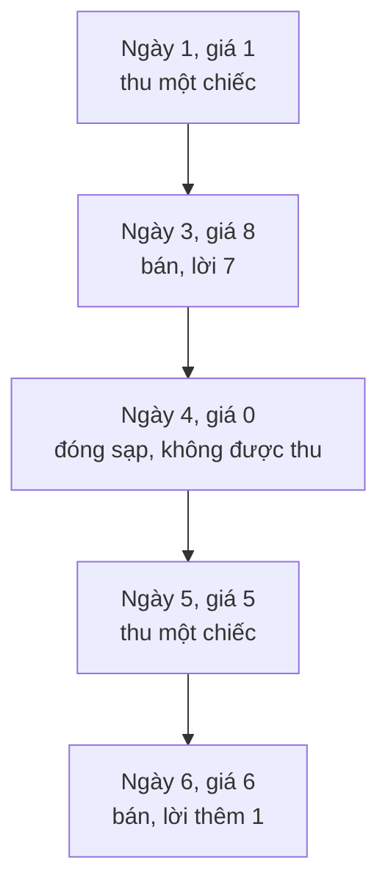
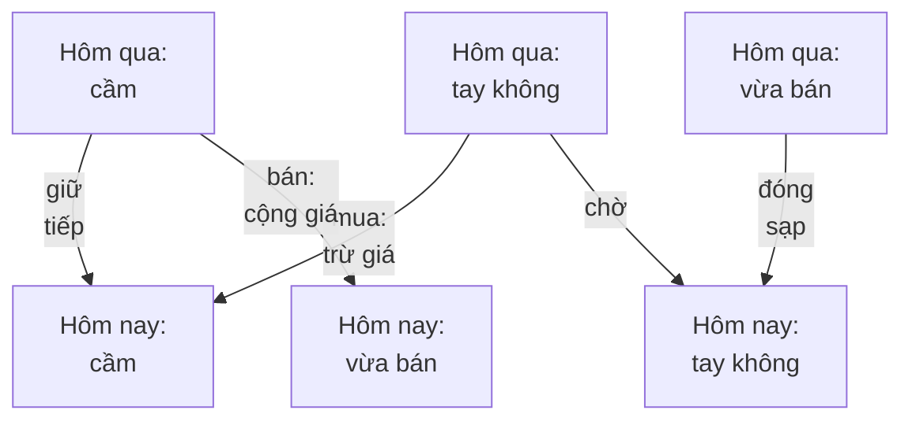

> [!tldr] Đọc nhanh
> - Mỗi tối chỉ cần ba con số: lời tốt nhất nếu đang **cầm** cổ phiếu, nếu **vừa bán** hôm nay, và nếu đang **tay không**. Đó là một [[concepts/state-machine-dp|DP theo máy trạng thái]].
> - Ngày nghỉ sau khi bán nằm trong luật chuyển: chỉ được mua từ trạng thái tay không của hôm qua, mà ngày vừa bán thì chưa tính là tay không.
> - Cách đệ quy trên cặp (ngày, đang cầm) cho cùng đáp án: bán ở ngày d thì nhảy thẳng tới d + 2.
> - Mỗi ngày chỉ đọc ba số của hôm trước, nên ba biến là đủ. Phải giữ giá trị cũ trước khi ghi đè, nếu không ngày nghỉ biến mất.

> [!info] Bối cảnh
> Đây là bài LeetCode 309 tại [[posts/2026-11-27-neetcode-state-machine-dp|ga DP-06: DP có trạng thái]] trên **tuyến NeetCode: Quy hoạch động**. Bài là anh em của [[problems/best-time-to-buy-and-sell-stock|Best Time to Buy and Sell Stock]], nhưng được mua bán nhiều lần và có thêm một ngày nghỉ. Bạn chỉ cần biết mảng, vòng lặp và hàm `max`.

> [!abstract]- Từ điển nhanh cho bài này (bấm để mở)
> - [[concepts/dp-state|Trạng thái DP]] nói rõ một ô của bảng lưu điều gì. Ở đây trạng thái là "ngày i, đang ở tình huống nào".
> - [[concepts/recurrence-relation|Công thức truy hồi]] cho biết ô hôm nay đọc những ô nào của hôm qua.
> - [[concepts/memoization|Ghi nhớ kết quả]] (memoization) lưu đáp án của một trạng thái ngay lần đầu tính.
> - [[concepts/rolling-state|Rolling State]] tái dùng chỗ chứa khi lượt sau không còn đọc giá trị cũ.
> - Ngày nghỉ (cooldown) là ngày ngay sau một lần bán, khi chưa được mua lại.
> - Lời ở đây là tổng tiền bán trừ tổng tiền mua. Mua làm lời tạm thời âm, bán cộng giá vào.

## Hình dung trước: buôn đồng hồ cũ ở chợ phiên

Mình buôn đồng hồ cũ, mỗi lúc chỉ ôm được một chiếc. Giá thu mua và giá bán ra trong ngày là như nhau và đổi theo từng ngày. Bán xong một chiếc, hôm sau mình phải đóng sạp để kiểm kê, chưa được thu chiếc mới. Mỗi tối mình ghi vào sổ ba dòng: tiền tốt nhất nếu tối nay đang giữ hàng, nếu hôm nay vừa bán, và nếu tay không mà sạp vẫn mở.

| Đời thường | Khái niệm |
|---|---|
| Tối nay đang giữ một chiếc đồng hồ | Trạng thái cầm (`hold[i]`) |
| Hôm nay vừa bán chiếc đang giữ | Trạng thái vừa bán (`sold[i]`) |
| Tay không, ngày mai được thu hàng | Trạng thái tay không (`rest[i]`) |
| Hôm đóng sạp sau khi bán | Ngày nghỉ: vừa bán chỉ đi được sang tay không |
| Ba dòng ghi sổ mỗi tối | Ba ô của ngày i trong bảng |
| Chỉ cần sổ của tối qua | Ba biến cuộn thay cho ba mảng |

Với giá `[4, 1, 2, 8, 0, 5, 6]` (ngày đếm từ 0), cách tốt nhất lời 8. Nếu không có ngày nghỉ, thu ở giá 0 ngay sau khi bán ở giá 8 sẽ lời 13, nhưng ngày 4 là ngày đóng sạp.



## Vấn đề: lời nhiều nhất khi bán xong phải nghỉ một ngày

Cho mảng `prices` dài 1–5.000, mỗi giá từ 0 đến 1.000, `prices[i]` là giá cổ phiếu ngày i. Mình được mua và bán bao nhiêu lần tùy ý, nhưng mỗi lúc chỉ giữ tối đa một cổ phiếu, phải bán trước khi mua lại, và ngày ngay sau một lần bán thì không được mua. Trả về tổng lời lớn nhất, hoặc 0 nếu không nên giao dịch. [Đề gốc LeetCode 309](https://leetcode.com/problems/best-time-to-buy-and-sell-stock-with-cooldown/)

Mình từng nghĩ có thể làm như bài mua bán không giới hạn: cộng mọi đoạn giá tăng. Với `[4, 1, 2, 8, 0, 5, 6]`, cách đó cộng ra 13. Nó bán ở ngày 3 rồi mua ở ngày 4, đúng ngày phải nghỉ. Ngày nghỉ làm một lần bán ảnh hưởng tới lựa chọn của ngày sau, nên mình cần nhớ thêm "hôm qua có vừa bán không".

## Cơ chế

### Vét cạn trên cặp (ngày, đang cầm)

Gọi `go(day, holding)` là lời tốt nhất từ ngày `day` trở đi, khi đang cầm (`holding = true`) hoặc không. Hết ngày thì trả 0. Mỗi ngày có hai lựa chọn:

| Đang ở | Chờ | Hành động |
|---|---|---|
| Không cầm | `go(day + 1, false)` | mua: `-prices[day] + go(day + 1, true)` |
| Đang cầm | `go(day + 1, true)` | bán: `prices[day] + go(day + 2, false)` |

Ngày nghỉ nằm ở chữ `day + 2`: bán xong thì nhảy qua ngày kế tiếp. Mỗi lời gọi tách hai nhánh và độ sâu tối đa n, nên thời gian là O(2ⁿ), ngăn xếp O(n). Với 20 ngày giá, hàm được gọi 194.457 lần.

### Ghi nhớ: chỉ có 2n trạng thái

Đáp án của `go(day, holding)` chỉ phụ thuộc vào hai tham số đó, không phụ thuộc mình đã tới đây bằng đường nào. Có n ngày và hai giá trị `holding`, nên chỉ có 2n trạng thái. Lưu mỗi kết quả ngay lần đầu tính, cùng 20 ngày ấy chỉ còn 79 lần gọi, tính cả lần trả từ bộ nhớ. Thời gian và bộ nhớ đều O(n).

Đáp án 0 là một kết quả hợp lệ. Vì vậy bảng ghi nhớ phải phân biệt "chưa tính" với "đã tính ra 0": `undefined`, `None`, `null` hoặc `isset`, không dùng kiểm tra truthy. Đệ quy còn sâu tới n = 5.000 tầng, đủ để chạm giới hạn của vài ngôn ngữ (xem phần bẫy).

### Bảng ba trạng thái theo ngày

Bản lặp tách "không cầm" thành hai tình huống để ngày nghỉ hiện ra trong bảng. Sau khi xử lý ngày i:

- `hold[i]`: lời tốt nhất khi tối nay đang cầm;
- `sold[i]`: lời tốt nhất khi hôm nay vừa bán;
- `rest[i]`: lời tốt nhất khi tay không và hôm nay không bán.



Từ sơ đồ ra ba công thức:

```text
hold[i] = max(hold[i-1], rest[i-1] - prices[i])
sold[i] = hold[i-1] + prices[i]
rest[i] = max(rest[i-1], sold[i-1])
```

Không có mũi tên nào từ "hôm qua vừa bán" sang "hôm nay cầm". Đó chính là ngày nghỉ. Ngày 0: `hold[0] = -prices[0]`, `rest[0] = 0`, còn `sold[0]` là một số rất âm vì chưa có gì để bán. Đáp án là `max(sold[n-1], rest[n-1])`: kết thúc mà vẫn cầm cổ phiếu thì đã trả tiền mua mà không thu lại.

Chạy tay với `[4, 1, 2, 8, 0, 5, 6]`:

| Ngày | Giá | hold | sold | rest |
|---|---|---|---|---|
| 0 | 4 | −4 | rất âm | 0 |
| 1 | 1 | −1 | −3 | 0 |
| 2 | 2 | −1 | 1 | 0 |
| 3 | 8 | −1 | 7 | 1 |
| 4 | 0 | 1 | −1 | 7 |
| 5 | 5 | 2 | 6 | 7 |
| 6 | 6 | 2 | 8 | 7 |

Ở ngày 4, `hold` chỉ lên 1 (mua giá 0 từ `rest[3] = 1`), chứ không phải 7. Lời 7 của lần bán ngày 3 nằm ở `sold[3]` và chỉ chảy vào `rest[4]`, nên phải tới ngày 5 nó mới được dùng để mua. Mỗi ngày tốn O(1), tổng O(n) thời gian và O(n) bộ nhớ.

### Ba biến cuộn

Ngày i chỉ đọc ba ô của ngày i − 1, nên thay ba mảng bằng ba biến `hold`, `sold`, `rest`. Bộ nhớ còn O(1). Điều cần cẩn thận là ba phép gán đọc giá trị *cũ*. Bản dưới đây giữ `prevSold` trước khi ghi `sold`, tính `sold` trước khi ghi `hold`, và tính `hold` trước khi ghi `rest`. Python và Go có phép gán song song, vế phải được tính xong trước khi gán, nên không cần biến tạm.

## Ví dụ chạy được

[TypeScript](../code/neetcode-best-time-to-buy-and-sell-stock-with-cooldown/cooldown.ts) · [Python](../code/neetcode-best-time-to-buy-and-sell-stock-with-cooldown/cooldown.py) · [Go](../code/neetcode-best-time-to-buy-and-sell-stock-with-cooldown/cooldown.go) · [Java](../code/neetcode-best-time-to-buy-and-sell-stock-with-cooldown/cooldown.java) · [JavaScript](../code/neetcode-best-time-to-buy-and-sell-stock-with-cooldown/cooldown.js) · [PHP](../code/neetcode-best-time-to-buy-and-sell-stock-with-cooldown/cooldown.php) · [Rust](../code/neetcode-best-time-to-buy-and-sell-stock-with-cooldown/stock_cooldown.rs)

```ts
function maxProfit(prices: number[]): number {
    let hold = -prices[0], sold = NEG, rest = 0
    for (let i = 1; i < prices.length; i++) {
        const prevSold = sold
        sold = hold + prices[i]
        hold = Math.max(hold, rest - prices[i])
        rest = Math.max(rest, prevSold)
    }
    return Math.max(sold, rest)
}
```

```python
def max_profit(prices):
    hold, sold, rest = -prices[0], NEG, 0
    for price in prices[1:]:
        hold, sold, rest = max(hold, rest - price), hold + price, max(rest, sold)
    return max(sold, rest)
```

```go
func maxProfit(prices []int) int {
	hold, sold, rest := -prices[0], NEG, 0
	for _, price := range prices[1:] {
		hold, sold, rest = max(hold, rest-price), hold+price, max(rest, sold)
	}
	return max(sold, rest)
}
```

```java
static int maxProfit(int[] prices) {
    int hold = -prices[0], sold = NEG, rest = 0;
    for (int i = 1; i < prices.length; i++) {
        int prevSold = sold;
        sold = hold + prices[i];
        hold = Math.max(hold, rest - prices[i]);
        rest = Math.max(rest, prevSold);
    }
    return Math.max(sold, rest);
}
```

```js
function maxProfit(prices) {
    let hold = -prices[0], sold = NEG, rest = 0
    for (let i = 1; i < prices.length; i++) {
        const prevSold = sold
        sold = hold + prices[i]
        hold = Math.max(hold, rest - prices[i])
        rest = Math.max(rest, prevSold)
    }
    return Math.max(sold, rest)
}
```

```php
function maxProfit(array $prices): int {
    [$hold, $sold, $rest] = [-$prices[0], NEG, 0];
    for ($i = 1; $i < count($prices); $i++) {
        $prevSold = $sold;
        $sold = $hold + $prices[$i];
        $hold = max($hold, $rest - $prices[$i]);
        $rest = max($rest, $prevSold);
    }
    return max($sold, $rest);
}
```

```rust
fn max_profit(prices: &[i32]) -> i32 {
    let (mut hold, mut sold, mut rest) = (-prices[0], NEG, 0);
    for &price in &prices[1..] {
        let prev_sold = sold;
        sold = hold + price;
        hold = hold.max(rest - price);
        rest = rest.max(prev_sold);
    }
    sold.max(rest)
}
```

Các tab trích bản ba biến. `NEG` là hằng `-1_000_000_000`, đánh dấu trạng thái chưa thể xảy ra. File tải về còn có vét cạn, bản ghi nhớ và bảng ba mảng. 13 ca gồm một ngày duy nhất, giá chỉ giảm, giá đứng yên, hai ca dài 5.000 ngày (răng cưa 1, 3 và năm dốc 0 → 999), và ca `[4, 1, 2, 8, 0, 5, 6]` ở trên. Dòng thứ hai đối chiếu cả bốn cách với một bộ liệt kê độc lập. Bộ này thử mọi tập giao dịch (mua ngày b, bán ngày s, lần mua sau từ s + 2) trên mọi mảng dài 1–6 với giá 0–3.

```text
13/13 ca đúng
5460/5460 ca đúng (đối chiếu liệt kê giao dịch)
20 ngày: vét cạn 194457 lượt gọi, memo 79 lượt gọi
```

Cả bảy ngôn ngữ in đúng ba dòng trên. Dòng cuối đếm số lần đi vào hàm, không phải thời gian chạy.

## Hiểu lầm và bẫy hay gặp

- **Cộng mọi đoạn giá tăng.** Đó là lời giải của bài không có ngày nghỉ. Với `[1, 3, 1, 5]` nó ra 6, đáp án đúng là 4: bán ở giá 3 thì ngày sau không được mua ở giá 1.
- **Cập nhật ba biến sai thứ tự.** Nếu ghi `rest` trước rồi mới tính `hold` từ `rest` mới, lời của lần bán hôm qua được dùng để mua ngay hôm nay. Mình chạy thử thứ tự sai đó: `[1, 3, 1, 5]` ra 6 và `[4, 1, 2, 8, 0, 5, 6]` ra 13, đúng bằng lời của bài không có ngày nghỉ. Giữ giá trị cũ trong biến tạm, hoặc dùng phép gán song song.
- **Lấy `hold[n-1]` làm đáp án.** Kết thúc mà còn cầm cổ phiếu nghĩa là đã trả tiền mua mà chưa thu lại. Đáp án là `max(sold, rest)`.
- **Bảng ghi nhớ coi 0 là "chưa tính".** Lời 0 là đáp án thường gặp, ví dụ giá chỉ giảm. TypeScript và JavaScript so với `undefined`, Python so `is not None`, Java dùng `Integer` có `null`, PHP dùng `isset`, Rust dùng `Option`.
- **Đệ quy sâu 5.000 tầng.** Python mặc định chỉ cho khoảng 1.000 tầng, nên file nâng `sys.setrecursionlimit`. Với ngăn xếp luồng mặc định (1 MB trên máy mình), `java cooldown.java` ném `StackOverflowError` ở ca dài 5.000 ngày. File Java chạy phần kiểm tra trong một `Thread` có ngăn xếp 64 MB. PHP chạy với `-d xdebug.mode=off` vì Xdebug cắt đệ quy ở 512 tầng.

## Câu hỏi tự kiểm tra

> [!question]- Vì sao cần tách "không cầm" thành "vừa bán" và "tay không"?
> Cả hai tình huống đều không cầm cổ phiếu nhưng khác quyền mua ngày mai. Vừa bán thì ngày mai phải nghỉ, còn tay không thì được mua. Gộp làm một sẽ làm mất ngày nghỉ.

> [!question]- Bản đệ quy chỉ có hai trạng thái, sao vẫn đúng?
> Nó mã hóa ngày nghỉ bằng bước nhảy: bán ở ngày `day` thì gọi tiếp `go(day + 2, false)`, bỏ qua ngày nghỉ ngay trong tham số.

> [!question]- Nếu ngày nghỉ dài k ngày thì sửa gì?
> Ở bản đệ quy, bán xong nhảy tới `day + k + 1`. Ở bản lặp, lúc mua ở ngày i phải đọc trạng thái không cầm của ngày i − k − 1, nên cần giữ thêm k ngày gần nhất thay vì chỉ hôm qua.

## Tham khảo

- [LeetCode 309](https://leetcode.com/problems/best-time-to-buy-and-sell-stock-with-cooldown/)
- [Jeff Erickson, Algorithms, chương Dynamic Programming](https://jeffe.cs.illinois.edu/teaching/algorithms/book/03-dynprog.pdf)
- [Python, câu lệnh gán](https://docs.python.org/3/reference/simple_stmts.html#assignment-statements) · [Go spec, Assignment statements](https://go.dev/ref/spec#Assignment_statements) · [Java Thread với stackSize](https://docs.oracle.com/en/java/javase/21/docs/api/java.base/java/lang/Thread.html#%3Cinit%3E(java.lang.ThreadGroup,java.lang.Runnable,java.lang.String,long)) · [Python sys.setrecursionlimit](https://docs.python.org/3/library/sys.html#sys.setrecursionlimit) · [PHP isset](https://www.php.net/manual/en/function.isset.php)
