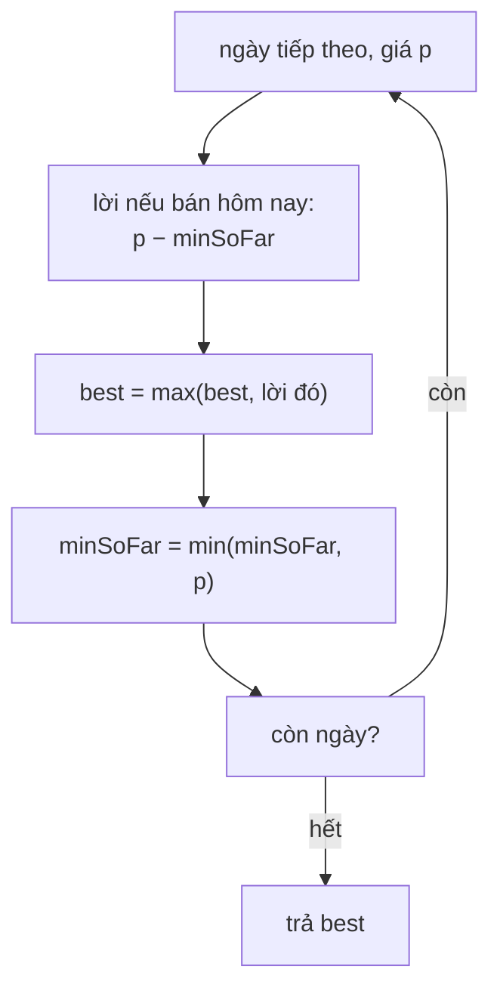

> [!tldr] Đọc nhanh
> - Đề: mảng giá theo ngày; mua một ngày, bán một ngày **sau đó**; trả số lời lớn nhất, hoặc 0 nếu không lời được.
> - Vét cạn thử mọi cặp (mua i, bán j > i): O(n²). Ở n = 40 000 đã mất 585 ms; đề cho tới 10⁵.
> - Một lượt: mỗi ngày hỏi "bán hôm nay thì lời bao nhiêu?", tức giá hôm nay trừ [[concepts/running-minimum|giá thấp nhất từ trước tới nay]]. O(n), O(1) bộ nhớ.
> - Cùng ý viết thành [[concepts/sliding-window|cửa sổ trượt]]: đầu trái là ngày mua, đầu phải là ngày bán; gặp giá thấp hơn đầu trái thì dời đầu trái tới đó.
> - Bẫy: `max − min` bỏ qua thứ tự ngày (sai 3/6 ca). Trong JS, `Math.min(...prices)` còn ném `RangeError` với mảng 10⁶ phần tử.

> [!info] Bối cảnh
> Bài LeetCode 121, bài mở đầu của [[posts/2026-11-23-neetcode-sliding-window|ga 5: Cửa sổ trượt]] trên **tuyến NeetCode: Mảng và chuỗi**. Đây là cửa sổ đơn giản nhất: không cần bảng đếm, chỉ cần nhớ một con số. Lời giải có đủ TypeScript, Python, Go, Java, JavaScript, PHP và Rust. Bạn chỉ cần biết vòng lặp và mảng.

> [!abstract]- Từ điển nhanh cho bài này (bấm để mở)
> - **Lời (profit)**: giá bán trừ giá mua. Không giao dịch thì lời 0.
> - **Giá thấp nhất từ trước tới nay (running minimum)**: một biến giữ giá nhỏ nhất trong các ngày đã đi qua. Xem [[concepts/running-minimum|Running Minimum]].
> - **Cửa sổ trượt (sliding window)**: một đoạn liên tiếp `[left, right]` mà hai đầu chỉ đi về phía trước. Xem [[concepts/sliding-window|Sliding Window]].
> - **Toán tử spread `...`**: trong JS, `f(...a)` truyền từng phần tử của mảng `a` thành một đối số riêng.

## Hình dung trước: đi chợ đồ cũ cả tuần

Bạn đi chợ đồ cũ mỗi ngày trong một tuần, thấy giá một món đồ, và chỉ được mua một lần rồi bán một lần. Bạn không biết giá tương lai, nhưng có một cuốn sổ nhỏ.

| Đời thường | Khái niệm |
|---|---|
| Mỗi tối ghi vào sổ "giá rẻ nhất mình từng thấy" | `minSoFar` |
| Mỗi ngày tự hỏi "nếu bán hôm nay, mua hôm rẻ nhất trước đó, lời bao nhiêu?" | `price − minSoFar` |
| Giữ lại con số lời lớn nhất từng tính | `best` |
| Không thể bán trước khi mua | ngày bán phải sau ngày mua: `max − min` sai |
| Hôm nay rẻ hơn mọi hôm trước: từ giờ coi đây là ngày mua | dời đầu trái của cửa sổ |



## Vấn đề

**Đề (tóm tắt bằng lời của mình):** cho mảng `prices` (1 ≤ n ≤ 10⁵, mỗi giá 0..10⁴), `prices[i]` là giá ở ngày i. Chọn một ngày mua và một ngày bán **sau** ngày mua để lời nhiều nhất. Trả số lời đó, hoặc 0 nếu giá chỉ đi xuống. Đề gốc: [LeetCode 121](https://leetcode.com/problems/best-time-to-buy-and-sell-stock/).

| Input | Output | Vì sao |
|---|---|---|
| `[7, 1, 5, 3, 6, 4]` | `5` | mua ở 1, bán ở 6 |
| `[7, 6, 4, 3, 1]` | `0` | giá chỉ giảm, không giao dịch |
| `[2, 4, 1]` | `2` | giá thấp nhất (1) đến **sau** giá cao nhất (4) |

Mình từng nghĩ chỉ cần tìm giá cao nhất và thấp nhất. Ví dụ thứ ba cho thấy sai: giá thấp nhất ở cuối, không bán được sau nó.

## Cơ chế

<figure class="figure-map" style="--ar: 3 / 4">
<div class="frame"><iframe data-archify="../diagrams/neetcode-best-time-to-buy-and-sell-stock/worked-example.html" title="Giữ giá mua thấp nhất trước hôm nay" loading="lazy"></iframe></div>
<figcaption><span><b>Hình 1.</b> Giữ giá mua thấp nhất trước hôm nay.</span><a href="../diagrams/neetcode-best-time-to-buy-and-sell-stock/worked-example.html" target="_blank" rel="noopener">Mở toàn màn hình</a></figcaption>
</figure>

<details>
<summary>Đọc từng bước</summary>
<ol>
<li>Ghi giá mua ngày đầu. <code>[8, 3, 6, 2, 7], min = 8</code></li>
<li>Hạ giá mua xuống 3 rồi thử bán 6. <code>min = 3, best = 3</code></li>
<li>Gặp giá 2 thì cập nhật giá mua. <code>min = 2</code></li>
<li>Bán ở 7 cho lãi lớn nhất. <code>7 - 2 = 5</code></li>
</ol>
</details>

### Cách 1, vét cạn: O(n²)

Hai vòng lặp, mọi cặp `(i, j)` với `j > i`. Khoảng n²/2 phép trừ.

### Cách 2, giá thấp nhất từ trước tới nay

Đổi câu hỏi: thay vì "mua ngày nào, bán ngày nào", hỏi **với mỗi ngày bán j**, ngày mua tốt nhất là gì. Câu trả lời luôn là ngày có giá thấp nhất trong `0..j−1`, và con số đó cập nhật được trong O(1) khi j tiến lên. Thứ tự hai dòng trong vòng lặp quan trọng: tính lời **trước**, cập nhật giá thấp nhất **sau**, để không mua và bán cùng một ngày (cùng ngày thì lời 0, nên ở bài này thứ tự sai vẫn ra đúng, nhưng ý thì sai).

### Cách 3, viết thành cửa sổ trượt

`left` là ngày mua, `right` là ngày bán. Đi `right` từ 1 tới cuối:
- `prices[right] < prices[left]`: ngày mua mới rẻ hơn. Mọi ngày bán sau này mua ở `right` đều lời hơn mua ở `left`, nên dời `left = right`;
- ngược lại: tính lời của cửa sổ `[left, right]`.

`left` chỉ tiến, `right` chỉ tiến: O(n). Cách 2 và cách 3 là một: `prices[left]` chính là `minSoFar`. Bài này là bài mở màn của ga vì nó cho thấy khung cửa sổ trượt mà chưa cần bảng đếm.

### Đo

TypeScript, giá ngẫu nhiên 0..10⁴, trung vị:

| n | vét cạn | giá thấp nhất | hai con trỏ |
|---|---|---|---|
| 5 000 | 9,2 ms | 0,27 ms | 0,03 ms |
| 10 000 | 36,6 ms | 0,21 ms | 0,05 ms |
| 20 000 | 145,9 ms | 0,07 ms | 0,02 ms |
| 40 000 | 584,8 ms | 0,14 ms | 0,03 ms |
| 10⁶ | (không chạy) | 3,68 ms | 0,88 ms |

Vét cạn đúng dáng n²: gấp đôi n thì gấp 4 thời gian. Ở n = 10⁵ của đề, nó cần khoảng 3,6 giây. Ở 10⁶, bản hai con trỏ nhanh hơn bản giá thấp nhất khoảng 4 lần: cả hai O(n), nhưng bản giá thấp nhất gọi `Math.max` và `Math.min` mỗi ngày, còn bản hai con trỏ chỉ so một lần ở những ngày giá giảm. Khác biệt nằm ở hằng số.

### Bên dưới bảy ngôn ngữ

| | Giá trị khởi đầu của `minSoFar` | Bẫy riêng |
|---|---|---|
| TypeScript / JavaScript | `Infinity` | `Math.min(...prices)` truyền 10⁶ đối số: `RangeError` |
| Python | `math.inf` | `max(...)` trên dãy rỗng ném `ValueError`; vét cạn phải khởi đầu `best = 0` |
| Go | `math.MaxInt` | dùng hàm có sẵn `min`, `max` (từ Go 1.21) |
| Java | `Integer.MAX_VALUE` | `p − MAX_VALUE` không tràn vì giá ≥ 0; nếu giá có thể âm thì tràn |
| PHP | `PHP_INT_MAX` | `max([])` trên mảng rỗng ném `ValueError` (PHP 8) |
| Rust | `i32::MAX` | `iter().max()` trả `Option`, mảng rỗng thì `unwrap()` panic; bản build debug panic khi tràn số |

## Ví dụ chạy được

[TypeScript](../code/neetcode-best-time-to-buy-and-sell-stock/best-time-stock.ts) · [Python](../code/neetcode-best-time-to-buy-and-sell-stock/best_time_stock.py) · [Go](../code/neetcode-best-time-to-buy-and-sell-stock/best_time_stock.go) · [Java](../code/neetcode-best-time-to-buy-and-sell-stock/best-time-stock.java) · [JavaScript](../code/neetcode-best-time-to-buy-and-sell-stock/best-time-stock.js) · [PHP](../code/neetcode-best-time-to-buy-and-sell-stock/best-time-stock.php) · [Rust](../code/neetcode-best-time-to-buy-and-sell-stock/best_time_stock.rs)

Mỗi file có vét cạn, giá thấp nhất và hai con trỏ, chạy 6 ca. Dưới đây là hai cách O(n).

```ts
// Cách 2, giá thấp nhất từ trước tới nay: mỗi ngày hỏi "nếu bán hôm nay thì lời bao nhiêu?".
function runningMin(prices: number[]): number {
  let minSoFar = Infinity, best = 0;
  for (const p of prices) {
    best = Math.max(best, p - minSoFar); // bán hôm nay, mua ở ngày rẻ nhất TRƯỚC đó
    minSoFar = Math.min(minSoFar, p);
  }
  return best;
}

// Cách 3, hai con trỏ (cửa sổ trượt): left là ngày mua, right là ngày bán; gặp giá rẻ hơn thì dời left tới đó.
function twoPointers(prices: number[]): number {
  let left = 0, best = 0;
  for (let right = 1; right < prices.length; right++) {
    if (prices[right] < prices[left]) left = right; // cửa sổ cũ không thể cho lời hơn khi mua ở đây
    else best = Math.max(best, prices[right] - prices[left]);
  }
  return best;
}
```

```python
def running_min(prices: list[int]) -> int:
    min_so_far, best = math.inf, 0
    for p in prices:
        best = max(best, p - min_so_far)  # p - inf = -inf ở ngày đầu, max với 0 vẫn là 0
        min_so_far = min(min_so_far, p)
    return best

def two_pointers(prices: list[int]) -> int:
    left, best = 0, 0
    for right in range(1, len(prices)):
        if prices[right] < prices[left]:
            left = right
        else:
            best = max(best, prices[right] - prices[left])
    return best
```

```go
func runningMin(prices []int) int {
	minSoFar, best := math.MaxInt, 0
	for _, p := range prices {
		if minSoFar != math.MaxInt { // p - MaxInt không tràn với giá ≥ 0, nhưng so trước cho rõ ý
			best = max(best, p-minSoFar)
		}
		minSoFar = min(minSoFar, p)
	}
	return best
}

func twoPointers(prices []int) int {
	left, best := 0, 0
	for right := 1; right < len(prices); right++ {
		if prices[right] < prices[left] {
			left = right
		} else {
			best = max(best, prices[right]-prices[left])
		}
	}
	return best
}
```

```java
static int runningMin(int[] prices) {
    int minSoFar = Integer.MAX_VALUE, best = 0;
    for (int p : prices) {
        // ngày đầu: p - MAX_VALUE ra số âm (không tràn vì p ≥ 0), nên best vẫn là 0
        best = Math.max(best, p - minSoFar);
        minSoFar = Math.min(minSoFar, p);
    }
    return best;
}

static int twoPointers(int[] prices) {
    int left = 0, best = 0;
    for (int right = 1; right < prices.length; right++) {
        if (prices[right] < prices[left]) left = right;
        else best = Math.max(best, prices[right] - prices[left]);
    }
    return best;
}
```

```js
function runningMin(prices) {
  let minSoFar = Infinity, best = 0;
  for (const p of prices) {
    best = Math.max(best, p - minSoFar);
    minSoFar = Math.min(minSoFar, p);
  }
  return best;
}

function twoPointers(prices) {
  let left = 0, best = 0;
  for (let right = 1; right < prices.length; right++) {
    if (prices[right] < prices[left]) left = right;
    else best = Math.max(best, prices[right] - prices[left]);
  }
  return best;
}
```

```php
function runningMin(array $prices): int {
    $minSoFar = PHP_INT_MAX;
    $best = 0;
    foreach ($prices as $p) {
        // ngày đầu: p - PHP_INT_MAX là số âm (không tràn vì p ≥ 0), nên best vẫn là 0
        $best = max($best, $p - $minSoFar);
        $minSoFar = min($minSoFar, $p);
    }
    return $best;
}

function twoPointers(array $prices): int {
    $left = 0;
    $best = 0;
    for ($right = 1; $right < count($prices); $right++) {
        if ($prices[$right] < $prices[$left]) $left = $right;
        else $best = max($best, $prices[$right] - $prices[$left]);
    }
    return $best;
}
```

```rust
fn running_min(prices: &[i32]) -> i32 {
    let (mut min_so_far, mut best) = (i32::MAX, 0);
    for &p in prices {
        // p - i32::MAX không tràn vì p ≥ 0; ngày đầu ra số âm nên best vẫn là 0
        best = best.max(p - min_so_far);
        min_so_far = min_so_far.min(p);
    }
    best
}

fn two_pointers(prices: &[i32]) -> i32 {
    let (mut left, mut best) = (0, 0);
    for right in 1..prices.len() {
        if prices[right] < prices[left] {
            left = right;
        } else {
            best = best.max(prices[right] - prices[left]);
        }
    }
    best
}
```


```text
$ node best-time-stock.ts
bruteForce   6/6 ca đúng
maxMinusMin  3/6 ca đúng; sai ở [7,1,5,3,6,4] → 6 [7,6,4,3,1] → 6 [2,4,1] → 3
runningMin   6/6 ca đúng
twoPointers  6/6 ca đúng

n          vét cạn   giá thấp nhất   hai con trỏ   (ms, trung vị)
5000            9.2            0.27          0.03
10000          36.6            0.21          0.05
20000         145.9            0.07          0.02
40000         584.8            0.14          0.03
1000000           —            3.68          0.88
```

`maxMinusMin` sai cả ở ví dụ đầu: 7 − 1 = 6, nhưng 7 đứng **trước** 1. File JavaScript thử thêm `Math.min(...mảng)`:

```text
$ node best-time-stock.js
bruteForce   6/6 ca đúng
runningMin   6/6 ca đúng
twoPointers  6/6 ca đúng
Math.min(...mảng 10000) chạy được
Math.min(...mảng 100000) chạy được
Math.min(...mảng 1000000): RangeError: Maximum call stack size exceeded
```

Spread biến mỗi phần tử thành một đối số trên ngăn xếp, và ngăn xếp có giới hạn. Ở 10⁵ phần tử (giới hạn của đề) vẫn chạy trên máy này, nhưng giới hạn khác nhau giữa các engine; vòng lặp thường thì không bao giờ gặp lỗi này. Python, Go, Java, PHP và Rust in `6/6 ca đúng` cho cả ba cách.

## Hiểu lầm và bẫy hay gặp

- **"Lời lớn nhất = giá cao nhất − giá thấp nhất."** Bỏ qua thứ tự ngày; sai ở `[2, 4, 1]` và cả ở ví dụ của đề.
- **Trả số âm khi giá chỉ giảm.** Đề cho phép không giao dịch, nên đáp án nhỏ nhất là 0. Khởi đầu `best = 0`.
- **`Math.min(...prices)` trong JS.** Gọi hàm với hàng triệu đối số làm tràn ngăn xếp. Dùng vòng lặp hoặc `reduce`.
- **Nghĩ phải tìm cả ngày mua lẫn ngày bán.** Đề chỉ hỏi số lời. Biết ngày bán thì ngày mua tốt nhất đã được xác định bởi giá thấp nhất trước đó.
- **Lẫn với bài mua bán nhiều lần (LeetCode 122).** Ở bài đó cộng mọi đoạn tăng; ở bài này chỉ một giao dịch.
- **PHP: `max()` / `min()` trên mảng rỗng.** Từ PHP 8 hai hàm này ném `ValueError` thay vì trả `false`. Đề có ít nhất một giá nên an toàn, nhưng bản sai `maxMinusMin` sẽ nổ nếu gọi với mảng rỗng.
- **Rust: trừ với `i32::MAX` khi giá có thể âm.** Ở bản build debug, phép trừ tràn số làm chương trình panic; ở bản `-O` nó lặng lẽ quay vòng. Giá của đề ≥ 0 nên không tràn, nhưng an toàn hơn là khởi đầu `min_so_far = prices[0]`.

## Câu hỏi tự kiểm tra

> [!question]- Chạy cách giá thấp nhất trên `[3, 8, 1, 4]`; ghi `minSoFar` và `best` sau mỗi ngày.
> (3, 0), (3, 5), (1, 5), (1, 5). Ngày cuối lời 4 − 1 = 3 < 5, nên đáp án là 5 (mua 3, bán 8).

> [!question]- Ở cách hai con trỏ, vì sao gặp giá thấp hơn thì bỏ hẳn `left` cũ, không cần nhớ nó?
> Với mọi ngày bán sau này, mua ở giá mới (thấp hơn) luôn lời hơn mua ở `left` cũ. `left` cũ không bao giờ là ngày mua tốt nhất nữa.

> [!question]- Vì sao lời giải O(n) không cần sắp xếp hay bảng băm?
> Câu hỏi cho mỗi ngày bán chỉ cần **một** con số về quá khứ (giá thấp nhất), và con số đó cập nhật được trong O(1).

## Tham khảo

- [LeetCode 121: Best Time to Buy and Sell Stock](https://leetcode.com/problems/best-time-to-buy-and-sell-stock/) (đề gốc)
- [MDN: `Math.min`](https://developer.mozilla.org/en-US/docs/Web/JavaScript/Reference/Global_Objects/Math/min) (dùng spread với mảng rất lớn có thể lỗi vì giới hạn số đối số)
- [Go 1.21 release notes](https://go.dev/doc/go1.21#language) (hàm có sẵn `min` và `max`)
- [Python: built-in `max`](https://docs.python.org/3/library/functions.html#max) (dãy rỗng ném `ValueError` nếu không có `default`)
