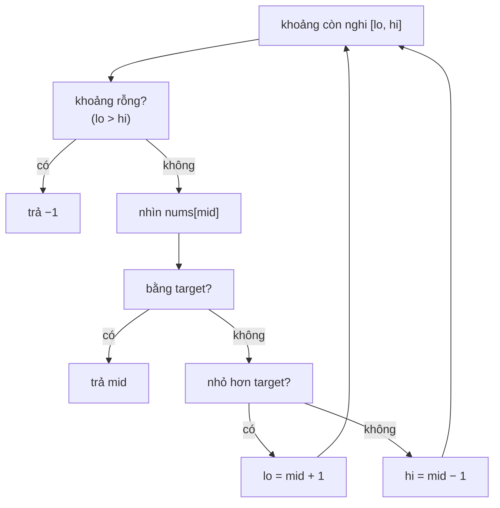

> [!tldr] Đọc nhanh
> - Đề: cho mảng số nguyên **tăng dần**, các phần tử khác nhau, tìm `target`; trả chỉ số, không có thì `-1`. Đề đòi O(log n).
> - [[concepts/binary-search|Tìm kiếm nhị phân]]: nhìn phần tử giữa khoảng còn nghi, so với `target`, bỏ hẳn một nửa. 10⁶ phần tử chỉ cần tối đa 20 lần nhìn.
> - Viết đúng nhờ một câu: "nếu `target` có mặt thì nó nằm trong khoảng còn nghi" ([[concepts/loop-invariant|bất biến vòng lặp]]). Chọn một quy ước khoảng, [lo, hi] hoặc [[concepts/half-open-interval|[lo, hi)]], rồi để quy ước đó quyết định điều kiện lặp và cách gán `hi`.
> - Hai bản sai được chạy thật: khoảng đóng mà lặp với `lo < hi` bỏ sót ô cuối (4/8 ca); gán `lo = mid` lặp mãi khi khoảng còn hai ô (4/8 ca, chặn bằng giới hạn số vòng).
> - `(lo + hi) / 2` tràn `int` 32 bit khi mảng dài hơn 2³⁰ phần tử. Lỗi này nằm trong `Arrays.binarySearch` của Java khoảng 9 năm ([[concepts/midpoint-overflow|tràn điểm giữa]]).

> [!info] Bối cảnh
> Bài LeetCode 704, bài neo của [[posts/2026-11-23-neetcode-binary-search|ga 1: Tìm kiếm nhị phân trên mảng]], ga mở đầu **tuyến NeetCode: Tìm kiếm và heap**. Tuyến trước, [[series/neetcode-arr|Mảng và chuỗi]], luôn phải đọc hết mảng ít nhất một lần; ở đây mảng đã sắp sẵn, nên có thể trả lời mà chỉ đọc khoảng log₂ n phần tử. Lời giải có đủ TypeScript, Python, Go, Java và JavaScript. Bạn chỉ cần biết vòng lặp và mảng.

> [!abstract]- Từ điển nhanh cho bài này (bấm để mở)
> - **Mảng đã sắp (sorted array)**: phần tử đứng sau không nhỏ hơn phần tử đứng trước.
> - **log₂ n**: số lần chia đôi n cho tới khi còn 1. log₂ 1 000 ≈ 10, log₂ 10⁶ ≈ 20. Xem [[concepts/big-o-notation|Big-O]].
> - **Bất biến (invariant)**: một câu luôn đúng trước và sau mỗi vòng lặp. Xem [[concepts/loop-invariant|Loop Invariant]].
> - **Khoảng nửa mở [lo, hi)**: gồm `lo`, không gồm `hi`. Xem [[concepts/half-open-interval|Half-open Interval]].
> - **Tràn số (overflow)**: kết quả phép tính vượt quá kiểu số nguyên chứa nó và quay vòng thành số sai, thường là số âm.

## Hình dung trước: đoán số từ 1 đến 100

Một người nghĩ một số từ 1 đến 100, bạn đoán, họ chỉ nói "lớn hơn" hay "nhỏ hơn". Đoán 50 trước: câu trả lời nào cũng loại 50 số. Đoán tiếp số giữa phần còn lại. Bảy lần là đủ cho mọi số, vì 2⁷ = 128 ≥ 100. Đoán lần lượt 1, 2, 3… thì có thể phải đoán 100 lần.

| Đời thường | Khái niệm |
|---|---|
| Các số còn có thể là đáp án | khoảng còn nghi `[lo, hi]` |
| Đoán số ở giữa | `mid = lo + (hi − lo) / 2` |
| "Lớn hơn": bỏ mọi số từ chỗ đoán trở xuống | `lo = mid + 1` |
| "Nhỏ hơn": bỏ mọi số từ chỗ đoán trở lên | `hi = mid − 1` |
| Không còn số nào để đoán | khoảng rỗng: `target` không có mặt |
| Luật chơi: người kia không nói dối | bất biến: `target` (nếu có) luôn trong khoảng |



## Vấn đề

Tìm tuyến tính đọc từng phần tử: n lần nhìn ở ca tệ nhất, và ca "không có mặt" luôn là ca tệ nhất. Nó không dùng tới thông tin "mảng đã sắp". Một lần so `nums[mid]` với `target` cho biết `target` không thể ở cả nửa bên kia, vì mọi phần tử bên đó đều lớn hơn (hoặc nhỏ hơn) `nums[mid]`. Đó là [[concepts/search-space-pruning|cắt tỉa không gian tìm kiếm]] ở dạng mạnh nhất: mỗi bước bỏ một nửa.

Ý tưởng dễ, viết đúng thì khó. Jon Bentley kể trong *Programming Pearls* rằng khi ông cho các lập trình viên chuyên nghiệp viết tìm kiếm nhị phân, khoảng 90% bản nộp có lỗi. Lỗi gần như luôn nằm ở ba chỗ: điều kiện lặp (`<` hay `<=`), cách gán biên (`mid` hay `mid ± 1`), và cách tính `mid`.

## Cơ chế

<figure class="figure-map" style="--ar: 3 / 4">
<div class="frame"><iframe data-archify="../diagrams/neetcode-binary-search/worked-example.html" title="Loại nửa không thể chứa đích" loading="lazy"></iframe></div>
<figcaption><span><b>Hình 1.</b> Loại nửa không thể chứa đích.</span><a href="../diagrams/neetcode-binary-search/worked-example.html" target="_blank" rel="noopener">Mở toàn màn hình</a></figcaption>
</figure>

<details>
<summary>Đọc từng bước</summary>
<ol>
<li>Chọn chỉ số giữa là 2. <code>[1, 4, 6, 9, 13], target = 9</code></li>
<li>Số 6 nhỏ hơn 9, bỏ cả nửa trái. <code>[lo, hi] = [3, 4]</code></li>
<li>Chọn giữa mới và gặp 9. <code>mid = 3</code></li>
<li>Trả chỉ số tìm được. <code>3</code></li>
</ol>
</details>

### Bất biến trước, code sau

Mình từng viết tìm kiếm nhị phân bằng cách thử đổi `<` thành `<=` cho tới khi test qua. Cách chắc hơn là viết ra câu bất biến trước:

> Nếu `target` có trong mảng thì nó nằm trong `nums[lo..hi]` (cả hai đầu).

Mọi dòng code còn lại suy ra từ câu đó:

| Câu hỏi | Suy ra từ bất biến |
|---|---|
| Khởi tạo? | Lúc đầu cả mảng đều nghi: `lo = 0`, `hi = n − 1`. |
| Lặp tới khi nào? | Khoảng `[lo, hi]` còn phần tử khi `lo <= hi`. Khi `lo = hi` vẫn còn **một** ô phải xét. |
| `nums[mid] < target`? | Mọi ô từ `lo` tới `mid` đều `< target`, kể cả `mid`. Bỏ hết: `lo = mid + 1`. |
| `nums[mid] > target`? | Bỏ từ `mid` tới `hi`: `hi = mid − 1`. |
| Ra khỏi vòng? | Khoảng rỗng, mà bất biến nói `target` (nếu có) ở trong khoảng. Vậy nó không có: trả `-1`. |

Vì sao vòng lặp chắc chắn dừng: mỗi vòng, `mid` nằm trong `[lo, hi]` và cả `mid + 1` lẫn `mid − 1` đều loại ít nhất ô `mid`, nên khoảng co lại ít nhất 1. Thực tế nó co còn một nửa.

Sơ đồ tương tác của [[posts/2026-11-23-neetcode-binary-search|post ga]] đi từng bước trên tám phần tử: tìm 15 thấy sau ba lần nhìn; tìm 4 thì khoảng còn nghi co tới rỗng, và đó là bằng chứng 4 không có mặt.

### Hai quy ước khoảng

Quy ước thứ hai, [[concepts/half-open-interval|khoảng nửa mở]] `[lo, hi)`, coi `hi` là ô **đầu tiên không còn nghi**. Đổi quy ước thì ba chỗ đổi theo, và chỉ ba chỗ đó:

| | Khoảng đóng `[lo, hi]` | Khoảng nửa mở `[lo, hi)` |
|---|---|---|
| Khởi tạo `hi` | `n − 1` | `n` |
| Còn phần tử khi | `lo <= hi` | `lo < hi` |
| Bỏ nửa phải | `hi = mid − 1` | `hi = mid` (ô `mid` đã nằm ngoài vì `hi` không thuộc khoảng) |
| Bỏ nửa trái | `lo = mid + 1` | `lo = mid + 1` |

Không quy ước nào "đúng hơn". Khoảng đóng đọc tự nhiên khi tìm một giá trị cụ thể. Khoảng nửa mở là quy ước của thư viện chuẩn (`bisect`, `sort.Search`, `std::lower_bound` của C++): độ dài là `hi − lo`, khoảng rỗng là `lo == hi`, và kết quả có thể là `n` ("chèn vào cuối") mà không cần ca riêng. Lỗi đến từ **trộn** hai quy ước: khởi tạo kiểu này, gán biên kiểu kia.

### Cận dưới: không dừng sớm

Khi mảng có phần tử trùng, hay khi cần biết "chèn `target` vào đâu", câu hỏi đổi thành: **vị trí đầu tiên có `nums[i] >= target`**. Đó là [[concepts/lower-bound|cận dưới]] (`lower_bound`, `bisect_left`). Vòng lặp bỏ nhánh "bằng thì trả về": gặp `nums[mid] >= target` thì `mid` **có thể** là đáp án, nên giữ nó lại bằng `hi = mid`. Bất biến đổi thành "mọi ô trước `lo` đều `< target`, mọi ô từ `hi` trở đi đều `>= target`". Khi `lo == hi`, đó chính là ranh giới.

`bisect_right` là vị trí đầu tiên có `nums[i] > target`. Hiệu `bisect_right − bisect_left` là số lần `target` xuất hiện: trên `[1, 2, 2, 2, 3]`, hai hàm trả 1 và 4, nên 2 xuất hiện 3 lần.

### Bản sai thứ nhất: lặp mãi khi `lo = mid`

Nếu gán `lo = mid` (quên `+ 1`) trong khoảng đóng: khi khoảng còn hai ô, `hi = lo + 1`, phép chia làm tròn xuống cho `mid = lo`. Nếu `nums[mid] < target`, `lo = mid` không đổi gì, và vòng lặp chạy mãi. Một ô cũng vậy: mảng `[5]` tìm 7 có `lo = hi = mid = 0`, `5 < 7`, `lo = 0`. File TypeScript chạy bản này với giới hạn 1000 vòng: 4 trên 8 ca "lặp mãi", đúng các ca mà khoảng co về một hay hai ô với ô `mid` nhỏ hơn `target`.

`lo = mid` chỉ an toàn khi `mid` làm tròn **lên**, `mid = lo + (hi − lo + 1) / 2`. Đó là khuôn "tìm vị trí **cuối cùng** thỏa điều kiện", sẽ gặp lại ở ga sau.

### Bản sai thứ hai: khoảng đóng với `lo < hi`

Giữ khởi tạo `hi = n − 1` nhưng lặp với `lo < hi`: khi `lo == hi`, vòng lặp thoát mà ô cuối chưa được nhìn. Bản này sai 4/8 ca, gồm `[5]` tìm 5 và cả hai đầu mảng: tìm 13 và tìm 1 trong `[1, 3, …, 13]`. Ca `[-1, 0, 3, 5, 9, 12]` tìm 9 của đề vẫn qua, nên chỉ chạy ví dụ của đề thì không thấy lỗi.

### `(lo + hi) / 2` tràn số

Năm 2006, Joshua Bloch viết trên blog nghiên cứu của Google rằng dòng `int mid = (low + high) / 2;` trong `java.util.Arrays.binarySearch`, do chính ông viết, sai khi `low + high` vượt `Integer.MAX_VALUE` (2³¹ − 1): tổng tràn thành số âm, và `nums[mid]` ném `ArrayIndexOutOfBoundsException`. Muốn vậy mảng phải dài hơn khoảng 2³⁰ phần tử, nên lỗi nằm im khoảng 9 năm, đến khi có người dùng mảng cỡ đó. Bản sửa trong JDK là `(low + high) >>> 1`. File Java in ra đúng con số:

```text
lo = 1500000000, hi = 2000000000
(lo + hi) / 2         = -397483648
(lo + hi) >>> 1       = 1750000000
lo + (hi - lo) / 2    = 1750000000
```

`>>>` là dịch phải **không dấu**: tổng tràn chỉ đổi bit dấu, và đọc 32 bit đó như số không dấu vẫn cho tổng đúng (tối đa 2³² − 2), chia 2 ra kết quả đúng. `lo + (hi − lo) / 2` tránh tràn theo cách khác: `hi − lo` không bao giờ vượt `hi`. Xem [[concepts/midpoint-overflow|Midpoint Overflow]].

### Bên dưới bảy ngôn ngữ

| | Tính `mid` | Thư viện chuẩn | Bẫy riêng |
|---|---|---|---|
| TypeScript / JavaScript | `(lo + hi) >>> 1` hoặc `Math.floor((lo + hi) / 2)` | không có hàm tìm nhị phân trong `Array` | số là `double`, `lo + hi` không tràn tới 2⁵³; nhưng `>> 1` ép về int32 **có dấu**: `(1.5e9 + 2e9) >> 1` ra `-397483648`. `>>> 1` đọc tổng như uint32, đúng khi `lo + hi < 2³²`, dư cho mảng thực tế |
| Python | `(lo + hi) // 2` | `bisect_left`, `bisect_right`, `insort` | `int` không giới hạn, không tràn. `bisect` trả **vị trí chèn**, không trả `-1`: phải tự kiểm `i < n and nums[i] == target` |
| Go | `lo + (hi-lo)/2`, hoặc `int(uint(lo+hi) >> 1)` như `sort.Search` | `sort.Search(n, f)`: `i` nhỏ nhất làm `f(i)` đúng; `slices.BinarySearch(s, x)` trả `(i, found)` | `int` 64 bit trên máy 64 bit, tràn khó xảy ra nhưng thư viện vẫn viết kiểu an toàn. `f` của `sort.Search` phải đổi từ `false` sang `true` đúng một lần |
| Java | `lo + (hi - lo) / 2` hoặc `(lo + hi) >>> 1` | `Arrays.binarySearch`, `Collections.binarySearch` | không thấy thì trả `-(vị trí chèn) − 1`, **luôn âm** nhưng không phải `-1`: `binarySearch([1, 3, 5], 4)` ra `-3`. Viết `if (i == -1)` là sai; viết `if (i < 0)`. Có trùng thì không bảo đảm trả ô nào |
| PHP | `intdiv($lo + $hi, 2)` hoặc `($lo + $hi) >> 1` | không có hàm tìm nhị phân cho mảng; `array_search` là tìm tuyến tính | `int` 64 bit nên tổng không tràn, nhưng `/` ra **float** khi chia không hết: `($lo + $hi) / 2` làm chỉ số thì PHP 8.1+ báo deprecated vì float bị cắt phần lẻ |
| Rust | `lo + (hi - lo) / 2` | `slice::binary_search` trả `Ok(i)` hoặc `Err(vị trí chèn)`; `partition_point(\|&x\| x < t)` là cận dưới | chỉ số là `usize`: `nums.len() - 1` với mảng rỗng, hay `hi = mid - 1` khi `mid = 0`, làm chương trình **panic** ở bản debug; quy ước nửa mở tránh được chuyện này. Tràn `i32` panic ở debug, cuộn vòng im lặng ở `-O` |

### Đo

TypeScript, 10⁵ lần tìm ngẫu nhiên (khoảng một nửa có mặt), trung vị 5 lần chạy:

| n | tuyến tính | chia đôi |
|---|---|---|
| 100 | 7,2 ms | 3,76 ms |
| 1 000 | 60,7 ms | 5,47 ms |
| 10 000 | 606,9 ms | 7,76 ms |
| 100 000 | (không chạy) | 9,14 ms |
| 10⁶ | (không chạy) | 14,09 ms |

Tuyến tính đi đúng dáng n: gấp 10 lần n, gấp 10 lần thời gian. Chia đôi gần như phẳng: từ 100 lên 10⁶ phần tử (gấp 10 000 lần), thời gian chỉ gấp khoảng 4 lần. Số lần nhìn tăng từ 7 lên 20 (gấp 3); phần còn lại là do mảng 10⁶ phần tử không nằm gọn trong cache, nên mỗi lần nhìn xa chậm hơn. Ở n = 100, chia đôi chỉ nhanh hơn 2 lần: với mảng nhỏ, đọc tuần tự rất rẻ.

Python, n = 10⁶, 10⁵ lần tìm: vòng lặp viết tay 224 ms, `bisect_left` 80 ms. Cùng thuật toán, nhưng `bisect` viết bằng C.

## Ví dụ chạy được

[TypeScript](../code/neetcode-binary-search-problem/binary-search.ts) · [Python](../code/neetcode-binary-search-problem/binary_search.py) · [Go](../code/neetcode-binary-search-problem/binary_search.go) · [Java](../code/neetcode-binary-search-problem/binary-search.java) · [JavaScript](../code/neetcode-binary-search-problem/binary-search.js) · [PHP](../code/neetcode-binary-search-problem/binary-search.php) · [Rust](../code/neetcode-binary-search-problem/binary_search.rs)

Mỗi file có bản khoảng đóng, bản nửa mở và bản dựa trên cận dưới hay thư viện chuẩn, chạy 8 ca: ví dụ của đề, mảng một phần tử, mảng hai phần tử, và hai đầu của mảng lẻ. Dưới đây là hai quy ước khoảng.

```ts
// Khoảng đóng [lo, hi]: bất biến "nếu target có mặt thì nó nằm trong nums[lo..hi]".
function closedInterval(nums: number[], target: number): number {
  let lo = 0, hi = nums.length - 1;
  while (lo <= hi) { // khoảng còn ít nhất một phần tử khi lo = hi
    const mid = lo + ((hi - lo) >> 1);
    if (nums[mid] === target) return mid;
    if (nums[mid] < target) lo = mid + 1; // mid đã xét: loại nó luôn
    else hi = mid - 1;
  }
  return -1;
}

// Khoảng nửa mở [lo, hi): hi là vị trí ĐẦU TIÊN không còn xét.
function halfOpen(nums: number[], target: number): number {
  let lo = 0, hi = nums.length;
  while (lo < hi) { // lo = hi nghĩa là khoảng rỗng
    const mid = lo + ((hi - lo) >> 1);
    if (nums[mid] === target) return mid;
    if (nums[mid] < target) lo = mid + 1;
    else hi = mid; // hi không thuộc khoảng, nên gán mid chứ không phải mid - 1
  }
  return -1;
}
```

```python
def closed_interval(nums: list[int], target: int) -> int:
    lo, hi = 0, len(nums) - 1
    while lo <= hi:
        mid = (lo + hi) // 2  # int Python không tràn, nên (lo + hi) // 2 an toàn
        if nums[mid] == target:
            return mid
        if nums[mid] < target:
            lo = mid + 1
        else:
            hi = mid - 1
    return -1

def half_open(nums: list[int], target: int) -> int:
    lo, hi = 0, len(nums)
    while lo < hi:
        mid = (lo + hi) // 2
        if nums[mid] == target:
            return mid
        if nums[mid] < target:
            lo = mid + 1
        else:
            hi = mid
    return -1
```

```go
func closedInterval(nums []int, target int) int {
	lo, hi := 0, len(nums)-1
	for lo <= hi {
		mid := lo + (hi-lo)/2 // int của Go là 64 bit trên máy 64 bit, nhưng cách viết này đúng ở mọi cỡ
		switch {
		case nums[mid] == target:
			return mid
		case nums[mid] < target:
			lo = mid + 1
		default:
			hi = mid - 1
		}
	}
	return -1
}

func halfOpen(nums []int, target int) int {
	lo, hi := 0, len(nums)
	for lo < hi {
		mid := int(uint(lo+hi) >> 1) // cách sort.Search viết: cộng trong uint rồi dịch, không âm
		switch {
		case nums[mid] == target:
			return mid
		case nums[mid] < target:
			lo = mid + 1
		default:
			hi = mid
		}
	}
	return -1
}
```

```java
static int closedInterval(int[] nums, int target) {
    int lo = 0, hi = nums.length - 1;
    while (lo <= hi) {
        int mid = lo + (hi - lo) / 2; // KHÔNG viết (lo + hi) / 2: tổng có thể vượt Integer.MAX_VALUE
        if (nums[mid] == target) return mid;
        if (nums[mid] < target) lo = mid + 1;
        else hi = mid - 1;
    }
    return -1;
}

static int halfOpen(int[] nums, int target) {
    int lo = 0, hi = nums.length;
    while (lo < hi) {
        int mid = (lo + hi) >>> 1; // dịch không dấu: tổng tràn thành số âm vẫn được đọc như số dương
        if (nums[mid] == target) return mid;
        if (nums[mid] < target) lo = mid + 1;
        else hi = mid;
    }
    return -1;
}
```

```js
function closedInterval(nums, target) {
  let lo = 0, hi = nums.length - 1;
  while (lo <= hi) {
    const mid = Math.floor((lo + hi) / 2); // số JS là double: tổng không tràn tới 2^53
    if (nums[mid] === target) return mid;
    if (nums[mid] < target) lo = mid + 1;
    else hi = mid - 1;
  }
  return -1;
}

function halfOpen(nums, target) {
  let lo = 0, hi = nums.length;
  while (lo < hi) {
    const mid = (lo + hi) >>> 1; // >>> đọc tổng như uint32: đúng khi lo + hi < 2^32, dư cho mảng thực tế
    if (nums[mid] === target) return mid;
    if (nums[mid] < target) lo = mid + 1;
    else hi = mid;
  }
  return -1;
}
```

```php
// Khoảng đóng [lo, hi]: bất biến "nếu target có mặt thì nó nằm trong nums[lo..hi]".
function closedInterval(array $nums, int $target): int
{
    $lo = 0;
    $hi = count($nums) - 1;
    while ($lo <= $hi) {
        $mid = $lo + (($hi - $lo) >> 1); // int PHP là 64 bit; intdiv($lo + $hi, 2) cũng an toàn
        if ($nums[$mid] === $target) return $mid;
        if ($nums[$mid] < $target) $lo = $mid + 1;
        else $hi = $mid - 1;
    }
    return -1;
}

// Khoảng nửa mở [lo, hi): hi là vị trí ĐẦU TIÊN không còn xét.
function halfOpen(array $nums, int $target): int
{
    $lo = 0;
    $hi = count($nums);
    while ($lo < $hi) {
        $mid = intdiv($lo + $hi, 2); // KHÔNG viết ($lo + $hi) / 2: phép / của PHP ra float khi chia không hết
        if ($nums[$mid] === $target) return $mid;
        if ($nums[$mid] < $target) $lo = $mid + 1;
        else $hi = $mid;
    }
    return -1;
}
```

```rust
// Khoảng đóng [lo, hi]. Chỉ số kiểu usize không âm được, nên giữ hi = "một sau ô cuối" (lo..hi)
// hoặc dùng i64. Ở đây dùng i64 để giữ đúng dáng khoảng đóng.
fn closed_interval(nums: &[i32], target: i32) -> i32 {
    let (mut lo, mut hi) = (0i64, nums.len() as i64 - 1); // usize: 0 - 1 làm chương trình panic
    while lo <= hi {
        let mid = lo + (hi - lo) / 2;
        let v = nums[mid as usize];
        if v == target {
            return mid as i32;
        }
        if v < target {
            lo = mid + 1;
        } else {
            hi = mid - 1;
        }
    }
    -1
}

// Khoảng nửa mở [lo, hi): hợp với usize, vì hi không bao giờ phải xuống dưới 0.
fn half_open(nums: &[i32], target: i32) -> i32 {
    let (mut lo, mut hi) = (0usize, nums.len());
    while lo < hi {
        let mid = lo + (hi - lo) / 2;
        match nums[mid].cmp(&target) {
            std::cmp::Ordering::Equal => return mid as i32,
            std::cmp::Ordering::Less => lo = mid + 1,
            std::cmp::Ordering::Greater => hi = mid,
        }
    }
    -1
}
```


Cận dưới, và cách thư viện chuẩn trả lời cùng câu hỏi:

```ts
// Cận dưới: vị trí đầu tiên có nums[i] >= target (giống bisect_left). Không dừng sớm.
function lowerBound(nums: number[], target: number): number {
  let lo = 0, hi = nums.length;
  while (lo < hi) {
    const mid = lo + ((hi - lo) >> 1);
    if (nums[mid] < target) lo = mid + 1;
    else hi = mid;
  }
  return lo;
}

function viaLowerBound(nums: number[], target: number): number {
  const i = lowerBound(nums, target);
  return i < nums.length && nums[i] === target ? i : -1;
}
```

```python
def via_bisect(nums: list[int], target: int) -> int:
    i = bisect_left(nums, target)  # vị trí đầu tiên có nums[i] >= target
    return i if i < len(nums) and nums[i] == target else -1
```

```go
func viaSortSearch(nums []int, target int) int {
	i := sort.Search(len(nums), func(i int) bool { return nums[i] >= target }) // i nhỏ nhất làm hàm trả true
	if i < len(nums) && nums[i] == target {
		return i
	}
	return -1
}

func viaSlices(nums []int, target int) int {
	if i, found := slices.BinarySearch(nums, target); found { // trả cả vị trí chèn lẫn cờ "tìm thấy"
		return i
	}
	return -1
}
```

```java
static int viaLibrary(int[] nums, int target) {
    int i = Arrays.binarySearch(nums, target); // không thấy thì trả -(vị trí chèn) - 1, luôn âm
    return i >= 0 ? i : -1;
}
```

```js
function lowerBound(nums, target) {
  let lo = 0, hi = nums.length;
  while (lo < hi) {
    const mid = (lo + hi) >>> 1;
    if (nums[mid] < target) lo = mid + 1;
    else hi = mid;
  }
  return lo;
}

function viaLowerBound(nums, target) {
  const i = lowerBound(nums, target);
  return i < nums.length && nums[i] === target ? i : -1;
}
```

```php
// Cận dưới: vị trí đầu tiên có nums[i] >= target. PHP không có hàm tìm nhị phân cho mảng.
function lowerBound(array $nums, int $target): int
{
    $lo = 0;
    $hi = count($nums);
    while ($lo < $hi) {
        $mid = ($lo + $hi) >> 1;
        if ($nums[$mid] < $target) $lo = $mid + 1;
        else $hi = $mid;
    }
    return $lo;
}

function viaLowerBound(array $nums, int $target): int
{
    $i = lowerBound($nums, $target);
    return $i < count($nums) && $nums[$i] === $target ? $i : -1;
}
```

```rust
// Thư viện chuẩn: binary_search trả Ok(vị trí) hoặc Err(vị trí chèn); partition_point là cận dưới.
fn via_std(nums: &[i32], target: i32) -> i32 {
    match nums.binary_search(&target) {
        Ok(i) => i as i32,
        Err(_) => -1,
    }
}

fn via_partition_point(nums: &[i32], target: i32) -> i32 {
    let i = nums.partition_point(|&x| x < target); // vị trí đầu tiên có nums[i] >= target
    if i < nums.len() && nums[i] == target { i as i32 } else { -1 }
}
```


Kết quả chạy `node binary-search.ts`, gồm cả hai bản sai:

```text
linearScan         8/8 ca đúng
closedInterval     8/8 ca đúng
halfOpen           8/8 ca đúng
viaLowerBound      8/8 ca đúng
wrongLoopCondition 4/8 ca đúng; sai ở [5] t=5 → -1, [1,3] t=3 → -1, [1,3,5,7,9,11,13] t=13 → -1, [1,3,5,7,9,11,13] t=1 → -1
wrongLoEqualsMid   4/8 ca đúng; sai ở [-1,0,3,5,9,12] t=2 → lặp mãi, [5] t=7 → lặp mãi, [1,3] t=3 → lặp mãi, [1,3,5,7,9,11,13] t=13 → lặp mãi

lo = 1500000000, hi = 2000000000
(lo + hi) >> 1       = -397483648
(lo + hi) >>> 1      = 1750000000
lo + ((hi - lo) >> 1) = 1750000000
```

Python, Go và JavaScript in `8/8 ca đúng` cho mọi bản đúng; Go in thêm `slices.BinarySearch([1 3 5], 4) = 2, false`, Java in `Arrays.binarySearch([1, 3, 5], 4) = -3`.

PHP (`php binary-search.php`) và Rust (`rustc --edition 2021 -O binary_search.rs`) in `8/8 ca đúng` cho mọi bản đúng và cùng số ca sai cho hai bản sai. PHP in thêm `(lo + hi + 1) / 2 = 1750000000.5` (phép `/` ra float); Rust in `lo.wrapping_add(hi) / 2 = -397483648` (i32 cuộn vòng), `lo.checked_add(hi) = None` và `[1, 3, 5].binary_search(&4) = Err(2)`.

## Hiểu lầm và bẫy hay gặp

- **"Chỉnh `<` thành `<=` cho tới khi qua test."** Chọn quy ước khoảng trước; điều kiện lặp và cách gán `hi` suy ra từ đó (bảng ở trên).
- **`lo = mid` với `mid` làm tròn xuống.** Lặp mãi khi khoảng còn hai ô. Trong bài này luôn là `lo = mid + 1`.
- **Chỉ thử ví dụ của đề.** Bản `lo < hi` qua ví dụ của đề nhưng sai ở mảng một phần tử và ở hai đầu mảng. Luôn thử `n = 1`, `n = 2`, phần tử đầu, phần tử cuối, và giá trị nhỏ hơn hay lớn hơn mọi phần tử.
- **"Python và JS không tràn nên `(lo + hi) / 2` là ổn."** Python ổn. JS ổn với `Math.floor` hay `>>> 1`, nhưng `>> 1` sai khi tổng vượt 2³¹. Java, C, C++, Go với `int32` thì tràn thật.
- **Java: so `Arrays.binarySearch(...) == -1`.** Giá trị trả về là `-(vị trí chèn) − 1`; chỉ bằng `-1` khi vị trí chèn là 0.
- **Dùng trên mảng chưa sắp.** Không báo lỗi, chỉ trả kết quả sai. Sắp mảng tốn O(n log n), nên chỉ đáng khi tìm nhiều lần trên cùng mảng.
- **PHP: `($lo + $hi) / 2` làm chỉ số.** Phép `/` ra float khi tổng lẻ (`1750000000.5`); dùng `intdiv` hoặc `>> 1`. So bằng `===` để `0` không bằng `"0"` hay `false`.
- **Rust: khoảng đóng với `usize`.** `hi = mid - 1` khi `mid = 0` làm chương trình panic (debug) hoặc cuộn thành số khổng lồ (`-O`). Dùng quy ước nửa mở, hoặc `i64` như file mẫu. `binary_search` không thấy thì trả `Err(vị trí chèn)`, không phải `-1`.

## Câu hỏi tự kiểm tra

> [!question]- Mảng có 1 000 000 phần tử. Tối đa bao nhiêu lần nhìn?
> ⌊log₂ 10⁶⌋ + 1 = 19 + 1 = 20. Sau k lần nhìn, khoảng còn nghi có tối đa ⌊n / 2ᵏ⌋ ô.

> [!question]- Chạy khoảng đóng trên `[2, 4, 6, 8, 10]` tìm 7, ghi `lo`, `hi`, `mid` mỗi vòng.
> (0, 4, 2): 6 < 7, `lo = 3`. (3, 4, 3): 8 > 7, `hi = 2`. `lo = 3 > hi = 2`, trả `-1`. Lúc dừng, `lo = 3` chính là vị trí chèn 7.

> [!question]- Vì sao khoảng nửa mở viết `hi = mid` mà không phải `hi = mid − 1`?
> `hi` là ô đầu tiên **không** còn nghi. Đã biết `nums[mid] > target` thì `mid` không còn nghi, nên `hi = mid` loại đúng ô `mid`. Viết `mid − 1` sẽ loại oan cả ô `mid − 1`.

> [!question]- Mảng có trùng `[1, 2, 2, 2, 3]`, tìm 2. Bản khoảng đóng trả chỉ số nào? Muốn chỉ số đầu tiên thì làm sao?
> `mid = 2`, `nums[2] = 2`, trả 2, không phải ô đầu. Muốn ô đầu thì dùng cận dưới (`bisect_left`), trả 1.

## Tham khảo

- [LeetCode 704: Binary Search](https://leetcode.com/problems/binary-search/) (đề gốc)
- Joshua Bloch, [Extra, Extra – Read All About It: Nearly All Binary Searches and Mergesorts are Broken](https://research.google/blog/extra-extra-read-all-about-it-nearly-all-binary-searches-and-mergesorts-are-broken/), Google Research blog, 2006 (lỗi `(low + high) / 2` trong JDK)
- Jon Bentley, *Programming Pearls* (2nd ed.), chương 4 "Writing Correct Programs" (tìm kiếm nhị phân và bất biến vòng lặp)
- [Python `bisect`](https://docs.python.org/3/library/bisect.html) (`bisect_left`, `bisect_right`)
- [Go `sort.Search`](https://pkg.go.dev/sort#Search) và [`slices.BinarySearch`](https://pkg.go.dev/slices#BinarySearch)
- [Java 21 `Arrays.binarySearch`](https://docs.oracle.com/en/java/javase/21/docs/api/java.base/java/util/Arrays.html#binarySearch(int%5B%5D,int)) (giá trị trả về khi không thấy)
