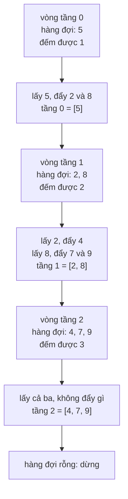
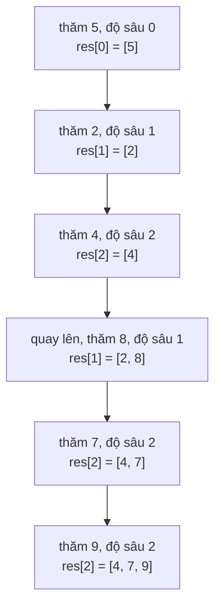

> [!tldr] Đọc nhanh
> - Đề: cho gốc một cây nhị phân, trả về danh sách các tầng, mỗi tầng là các giá trị **từ trái sang phải**. Cây rỗng thì trả danh sách rỗng.
> - [[concepts/breadth-first-search|BFS]] thường cho một dãy phẳng, mất ranh giới giữa các tầng. Mẹo chính là [[concepts/level-size-snapshot|chụp kích thước tầng]]: đầu mỗi vòng, hàng đợi chứa **đúng một tầng**, nên đếm nó trước rồi chỉ lấy ra đúng chừng ấy nút.
> - Ba cách khác cùng O(n): hai danh sách (tầng này sinh tầng sau), vạch ngăn tầng trong hàng đợi, và DFS [[concepts/pre-order-traversal|tiền thứ tự]] mang theo độ sâu, ghi vào `res[depth]`.
> - Bẫy hay gặp nhất là đọc lại độ dài hàng đợi trong điều kiện vòng `for` trong khi đang đẩy con vào: tầng bị trộn, sai 5/10 ca ở TypeScript và Java, 8/10 ở Go.
> - Đề cho tới 2000 nút, nên chuỗi lệch 2000 tầng làm bản DFS đệ quy của Python ném `RecursionError`. Ở cỡ đề, `shift()` hay `list.pop(0)` không đáng lo; trên cây rộng 16 384 nút trở lên thì `shift()` của V8 chậm hẳn.

> [!info] Bối cảnh
> Bài LeetCode 102 (Medium), thuộc [[posts/2026-11-25-neetcode-level-order|ga 5: Duyệt theo tầng và mang trạng thái]] trên **tuyến NeetCode: Cấu trúc liên kết**. Các ga trước đi cây theo chiều sâu: [[posts/2026-11-25-neetcode-tree-recursion|ga 3]] trả kết quả từ dưới lên, [[posts/2026-11-25-neetcode-binary-search-tree|ga 4]] truyền khoảng từ trên xuống. Bài này là bài đầu tiên đi cây **theo chiều rộng**, từng tầng một, bằng một hàng đợi. Lời giải có đủ TypeScript, Python, Go, Java và JavaScript. Bạn cần biết cây nhị phân là gì; hàng đợi được giải thích ngay dưới.

> [!abstract]- Từ điển nhanh cho bài này (bấm để mở)
> - **Cây nhị phân**: mỗi nút có tối đa hai con, trái và phải. Xem [[concepts/binary-tree|Binary Tree]].
> - **Tầng (level), độ sâu (depth)**: gốc ở tầng 0, con của gốc ở tầng 1, và cứ thế. Độ sâu của một nút là số cạnh từ gốc tới nó.
> - **Hàng đợi (queue)**: cấu trúc vào trước ra trước; đẩy vào cuối, lấy ra ở đầu. Ở đây là cấu trúc dữ liệu trong bộ nhớ, không phải hàng đợi tin nhắn.
> - **BFS (duyệt theo chiều rộng)**: thăm mọi nút ở độ sâu d trước khi thăm nút nào ở độ sâu d + 1, nhờ một hàng đợi. Xem [[concepts/breadth-first-search|Breadth-First Search]].
> - **DFS (duyệt theo chiều sâu)**: đi hết một nhánh rồi mới quay lại nhánh khác, thường bằng đệ quy. **Tiền thứ tự (pre-order)**: xử lý nút trước rồi mới tới hai con. Xem [[concepts/pre-order-traversal|Pre-order Traversal]].
> - **Chụp kích thước tầng**: ghi lại độ dài hàng đợi lúc bắt đầu một tầng và chỉ lấy ra đúng chừng ấy nút. Xem [[concepts/level-size-snapshot|Level Size Snapshot]].
> - **Vạch ngăn (marker)**: một phần tử đặc biệt đặt vào hàng đợi để báo "hết một tầng".
> - **Chuỗi lệch**: mọi nút chỉ có một con, cây sâu đúng bằng số nút. Giới hạn độ sâu đệ quy: xem [[concepts/recursion-depth-limit|Recursion Depth Limit]].
> - **`deque`, `ArrayDeque`**: hàng đợi hai đầu của Python và Java, lấy ra ở đầu trong O(1).

## Hình dung trước: chụp ảnh gia đình theo từng thế hệ

Một dòng họ chụp ảnh kỷ niệm, mỗi tấm là **một thế hệ**, người trong ảnh đứng theo thứ tự từ nhánh trái sang nhánh phải của gia phả. Người chụp chỉ có một hành lang để mọi người xếp hàng.

- **Xếp hàng ngoài hành lang:** ai được gọi vào chụp thì dắt con của mình ra xếp ở cuối hàng. Hàng luôn đi theo thứ tự thế hệ, vì con chỉ được xếp sau khi cha mẹ đã vào.
- **Đếm hàng trước khi gọi:** đầu mỗi tấm ảnh, người chụp đếm hàng đang có bao nhiêu người, rồi gọi đúng chừng ấy người. Đám con vừa được dắt ra trong lúc gọi đứng chờ tấm sau.
- **Quên đếm, nhìn hàng mà gọi:** hàng cứ dài thêm trong lúc gọi, nên người chụp lôi luôn mấy đứa con vào ảnh của cha mẹ. Tấm ảnh trộn hai thế hệ.
- **Chăng dây cuối thế hệ:** thay vì đếm, chăng một sợi dây sau người cuối cùng của thế hệ. Gặp sợi dây là chụp, rồi chăng sợi mới sau đám con.
- **Hai phòng:** thế hệ này đứng trong một phòng, con của họ đi sang phòng bên cạnh. Chụp xong phòng này thì phòng bên cạnh thành phòng chụp.
- **Lật sổ gia phả và đeo thẻ:** không xếp hàng, mà lật sổ theo từng nhánh, mỗi người đeo thẻ "thế hệ k" và được dán vào trang album thứ k. Nhánh trái được lật trước, nên trong mỗi trang vẫn đúng thứ tự trái sang phải.

| Đời thường | Khái niệm |
|---|---|
| Gia phả | cây nhị phân |
| Một thế hệ, một tấm ảnh | một tầng, một danh sách con trong kết quả |
| Hàng người ngoài hành lang | hàng đợi của BFS |
| Đếm hàng trước khi gọi | chụp kích thước tầng |
| Nhìn hàng mà gọi, ảnh trộn thế hệ | bẫy đọc lại độ dài hàng đợi trong điều kiện vòng |
| Sợi dây cuối thế hệ | vạch ngăn tầng trong hàng đợi |
| Hai phòng | hai danh sách: tầng này và tầng sau |
| Thẻ "thế hệ k", trang album thứ k | DFS mang độ sâu, ghi vào `res[depth]` |
| Dòng họ 2000 đời, mỗi đời một người | chuỗi lệch 2000 tầng, giới hạn độ sâu đệ quy |

Trên cây `[5, 2, 8, null, 4, 7, 9]` (2 chỉ có con phải 4; 8 có hai con 7 và 9), cách đếm hàng chạy ba vòng:



## Vấn đề

Đầu vào là gốc của một cây nhị phân có từ 0 tới 2000 nút, mỗi giá trị nằm trong [−1000, 1000]. Trả về một danh sách các tầng, từ tầng của gốc xuống tầng sâu nhất; mỗi tầng là danh sách giá trị của các nút ở độ sâu đó, đọc từ trái sang phải. Cây rỗng cho danh sách rỗng. Đề gốc: [LeetCode 102](https://leetcode.com/problems/binary-tree-level-order-traversal/).

Mình từng nghĩ BFS là đủ: lấy một nút ra, đẩy hai con vào cuối, lặp tới khi hàng rỗng. Cách đó cho đúng **thứ tự** (5, 2, 8, 4, 7, 9), nhưng ra một dãy phẳng. Phần khó của bài là biết tầng này kết thúc ở đâu, khi hàng đợi lúc nào cũng có cả nút của tầng này lẫn tầng sau.

## Cơ chế

### Cách 1: chụp kích thước tầng

Bất biến giữ cả bài: **đầu mỗi vòng ngoài, hàng đợi chứa đúng mọi nút của một tầng, theo thứ tự trái sang phải.** Lúc đầu nó chứa gốc, tức trọn tầng 0. Nếu đầu vòng hàng đợi chứa trọn tầng d, thì lấy ra đúng `size` nút đó, mỗi nút đẩy con của nó vào cuối, sẽ để lại trong hàng đúng mọi nút của tầng d + 1: không thiếu (mọi nút tầng d + 1 là con của một nút tầng d), không thừa, và theo thứ tự trái sang phải vì cha bên trái được lấy ra trước.

```ts
// Cách 1: BFS, chụp kích thước tầng trước khi lấy ra. Hàng đợi là mảng + chỉ số đầu hàng.
function levelSnapshot(root: TreeNode | null): number[][] {
  const res: number[][] = [];
  if (root === null) return res;
  const queue: TreeNode[] = [root];
  let head = 0;
  while (head < queue.length) {
    const size = queue.length - head; // số nút của tầng này, chụp lại trước khi đẩy con vào
    const level: number[] = [];
    for (let i = 0; i < size; i++) {
      const node = queue[head++];
      level.push(node.val);
      if (node.left !== null) queue.push(node.left);
      if (node.right !== null) queue.push(node.right);
    }
    res.push(level);
  }
  return res;
}
```

Mỗi nút được đẩy vào và lấy ra đúng một lần: O(n) thời gian. Bộ nhớ của hàng đợi tỉ lệ với **tầng rộng nhất**, có thể tới khoảng n/2 trên cây đầy (cây đầy 2000 nút có tầng cuối 977 nút). Riêng cách "mảng + chỉ số đầu hàng" ở trên không bao giờ xóa phần đầu mảng, nên cuối cùng mảng giữ đủ n nút. Đổi lại, nó tránh được `shift()`, xem phần đo.

**Bẫy: không chụp.** Nếu viết thẳng `queue.length - head` vào điều kiện vòng `for`, con số đó đổi ngay khi đẩy con vào:

```ts
// Sai 1: không chụp kích thước tầng. queue.length - head đổi ngay khi đẩy con vào.
function wrongLiveLength(root: TreeNode | null): number[][] {
  const res: number[][] = [];
  if (root === null) return res;
  const queue: TreeNode[] = [root];
  let head = 0;
  while (head < queue.length) {
    const level: number[] = [];
    for (let i = 0; i < queue.length - head; i++) {
      const node = queue[head++];
      level.push(node.val);
      if (node.left !== null) queue.push(node.left);
      if (node.right !== null) queue.push(node.right);
    }
    res.push(level);
  }
  return res;
}
```

Trên cây ở hình trên: lấy 5 và đẩy 2, 8, số nút còn chờ thành 2, nên vòng `for` lấy tiếp 2 vào **tầng 0**. Kết quả `[[5,2],[8,4],[7],[9]]`. Hàm này qua 5/10 ca: những cây mà mọi tầng chỉ có một nút (chuỗi), cây một nút, cây rỗng. Java viết `i < queue.size()` sai y hệt, cũng 5/10. Go viết `i < len(queue)` còn tệ hơn: vòng `for` đi luôn hết cây, cả cây thành một tầng, 2/10.

Mỗi ngôn ngữ có một cách "chụp" an toàn riêng:

| Ngôn ngữ | Chụp an toàn | Đọc lại mỗi vòng (sai) |
|---|---|---|
| TypeScript / JavaScript | `const size = queue.length - head` trước vòng `for` | `i < queue.length - head` |
| Python | `for _ in range(len(queue))`: `range` tính `len` một lần | `for node in q` khi đang `append` vào chính `q` |
| Go | `size := len(queue)` trước; hoặc `for _, node := range cur`, vì `range` đọc slice một lần | `for i := 0; i < len(queue); i++` |
| Java | `int size = queue.size()` trước vòng `for` | `i < queue.size()` |

Python có biến thể riêng: `for node in q` trong lúc `q.append(...)`. Iterator của list kiểm tra độ dài ở mỗi bước, nên nó đi luôn cả nút vừa thêm, và cả cây thành một tầng: `wrong_iterate_while_append` qua 2/10 ca.

### Cách 2: hai danh sách

Không cần hàng đợi: giữ danh sách nút của tầng hiện tại, từ nó dựng danh sách tầng sau, rồi đổi chỗ.

```ts
// Cách 2: hai danh sách. Tầng hiện tại sinh ra tầng sau; không cần hàng đợi.
function levelTwoLists(root: TreeNode | null): number[][] {
  const res: number[][] = [];
  let cur: TreeNode[] = root === null ? [] : [root];
  while (cur.length > 0) {
    res.push(cur.map((n) => n.val));
    const next: TreeNode[] = [];
    for (const node of cur) {
      if (node.left !== null) next.push(node.left);
      if (node.right !== null) next.push(node.right);
    }
    cur = next;
  }
  return res;
}
```

Ranh giới tầng nằm sẵn trong cấu trúc dữ liệu, nên không có gì để đếm sai. Bộ nhớ cùng lúc là hai tầng liền nhau, không bao giờ cả cây. Đây là cách khó viết sai nhất.

### Cách 3: vạch ngăn tầng

Đặt một phần tử đặc biệt sau nút cuối của mỗi tầng. Lấy ra gặp vạch nghĩa là tầng vừa xong; nếu hàng còn nút (tầng sau đã được đẩy đủ vào), đặt một vạch mới ở cuối.

```ts
// Cách 3: vạch ngăn tầng. null trong hàng đợi nghĩa là "hết một tầng".
function levelMarker(root: TreeNode | null): number[][] {
  const res: number[][] = [];
  if (root === null) return res;
  const queue: (TreeNode | null)[] = [root, null];
  let head = 0;
  let level: number[] = [];
  while (head < queue.length) {
    const node = queue[head++];
    if (node === null) {
      res.push(level);
      level = [];
      if (head < queue.length) queue.push(null); // còn tầng sau thì đặt vạch cho nó
    } else {
      level.push(node.val);
      if (node.left !== null) queue.push(node.left);
      if (node.right !== null) queue.push(node.right);
    }
  }
  return res;
}
```

Điều kiện `if (head < queue.length)` là chỗ dễ quên: thiếu nó, vạch cuối cùng sinh ra vạch mới mãi, vòng lặp không dừng. Ở Java, dùng `null` làm vạch trong `ArrayDeque` thì hỏng ngay từ dòng đầu: tài liệu ghi "Null elements are prohibited", và `offer(null)` ném `NullPointerException` (`wrongNullMarker` qua 1/10, chỉ ca cây rỗng). Bản Java đúng dùng một nút canh riêng và so **địa chỉ**:

```java
    // Cách 3: vạch ngăn tầng. ArrayDeque cấm null, nên vạch là một nút canh riêng.
    static final TreeNode MARK = new TreeNode(0);
```

### Cách 4: DFS tiền thứ tự mang độ sâu

Đổi hẳn sang chiều sâu: đi cây bằng đệ quy, mang theo độ sâu của nút đang đứng, và thả giá trị vào `res[depth]`. Lần đầu xuống tới một độ sâu mới thì mở thêm một danh sách. Độ sâu ở đây là một [[concepts/path-state|trạng thái đường đi]]: mỗi lời gọi nhận nó từ cha và chuyển `depth + 1` cho con.

```ts
// Cách 4: DFS tiền thứ tự mang độ sâu. Trái trước phải, nên mỗi tầng tự xếp từ trái sang.
function levelDfs(root: TreeNode | null): number[][] {
  const res: number[][] = [];
  const go = (node: TreeNode | null, depth: number): void => {
    if (node === null) return;
    if (res.length === depth) res.push([]); // lần đầu xuống tới tầng này
    res[depth].push(node.val);
    go(node.left, depth + 1);
    go(node.right, depth + 1);
  };
  go(root, 0);
  return res;
}
```

Vì sao thứ tự trong mỗi tầng vẫn đúng, khi DFS nhảy lung tung giữa các tầng? Với hai nút cùng độ sâu, nút bên trái nằm trong một cây con được thăm **trước** cây con chứa nút bên phải (ở tổ tiên chung, nhánh trái đi trước). Tiền thứ tự giữ đúng quan hệ đó, nên mỗi `res[depth]` được nối dần từ trái sang phải:



Đổi thứ tự hai lời gọi (phải trước trái) thì vẫn đủ tầng nhưng mỗi tầng bị đảo: `wrongRightFirst` cho `[[5],[8,2],[9,7,4]]`. Hậu thứ tự hay trung thứ tự cũng cho đúng kết quả, miễn trái đi trước phải; tiền thứ tự chỉ là cách tự nhiên nhất vì nút được ghi trước khi đi xuống.

Bộ nhớ của DFS là ngăn xếp gọi hàm, tỉ lệ với **chiều cao** h, không phải bề rộng: cây cân 2000 nút chỉ sâu 11 tầng, nhưng chuỗi lệch 2000 nút sâu 2000 tầng. Python mặc định cho khoảng 1 000 tầng, nên `level_dfs` ném `RecursionError` ngay ở giới hạn đề. Bản lặp dùng [[concepts/stack|ngăn xếp]] tự quản lý, đẩy con phải trước để con trái ra trước:

```python
def level_dfs_iterative(root):
    """Cách 4b: DFS bằng ngăn xếp tự quản lý; đẩy phải trước để trái ra trước."""
    res = []
    stack = [(root, 0)] if root else []
    while stack:
        node, depth = stack.pop()
        if len(res) == depth:
            res.append([])
        res[depth].append(node.val)
        if node.right:
            stack.append((node.right, depth + 1))
        if node.left:
            stack.append((node.left, depth + 1))
    return res
```

| Cách | Thời gian | Bộ nhớ thêm | Ghi chú |
|---|---|---|---|
| BFS chụp kích thước tầng | O(n) | O(w), w là tầng rộng nhất | mảng + chỉ số đầu hàng giữ cả n nút |
| BFS hai danh sách | O(n) | O(w) | khó viết sai nhất |
| BFS vạch ngăn tầng | O(n) | O(w) | nhớ điều kiện dừng; Java không dùng `null` |
| DFS mang độ sâu, đệ quy | O(n) | O(h) | chuỗi lệch 2000 tầng vượt giới hạn Python |
| DFS mang độ sâu, lặp | O(n) | O(h) | an toàn mọi ngôn ngữ |

Trên cây đầy, w ≈ n/2 còn h ≈ log₂ n, nên DFS tốn ít bộ nhớ hơn hẳn. Trên chuỗi lệch thì ngược lại: w = 1, h = n.

### Đo

TypeScript, Node 24, cây đầy, trung vị 5 lần (ms):

| n | tầng rộng nhất | chụp tầng (chỉ số đầu hàng) | chụp tầng bằng `shift()` | hai danh sách | vạch ngăn | DFS |
|---|---|---|---|---|---|---|
| 2 000 | 977 | 0,01 | 0,08 | 0,01 | 0,01 | 0,02 |
| 16 383 | 8 192 | 0,15 | 0,71 | 0,08 | 0,13 | 0,14 |
| 32 767 | 16 384 | 0,62 | 22,9 | 0,68 | 0,38 | 0,36 |
| 131 071 | 65 536 | 2,57 | 498 | 3,71 | 2,45 | 1,85 |

Ở cỡ đề (2000 nút), cách nào cũng dưới 0,1 ms. Cột `shift()` thì nhảy: n gấp đôi từ 16 383 lên 32 767 mà thời gian gấp khoảng 30 lần. Lấy hết một mảng bằng `shift()` cho thấy ngưỡng rõ hơn:

| Cỡ mảng | ns mỗi `shift()` |
|---|---|
| 4 000 | 58 |
| 16 000 | 55 |
| 16 384 | 885 |
| 65 536 | 3 696 |

Dưới 16 000 phần tử, V8 làm `shift()` gần như O(1): nó dời điểm bắt đầu của vùng lưu phần tử lên một ô thay vì chép cả mảng. Từ 16 384 phần tử (mỗi ô 8 byte, vùng lưu vượt 128 KB), mảng nằm trong vùng dành cho đối tượng lớn, nơi V8 không dời điểm bắt đầu được, nên mỗi `shift()` chép mọi phần tử còn lại và chi phí tăng theo cỡ mảng. Con số 16 384 khớp ngưỡng 128 KB cho đối tượng thường của V8; mình đo được ngưỡng, còn lý do là đọc từ mã nguồn V8 (hàm `Heap::CanMoveObjectStart` từ chối đối tượng lớn), chưa kiểm chứng sâu hơn.

Python 3.12, trung vị 5 lần (ms):

| n | tầng rộng nhất | `deque` | `list.pop(0)` | hai danh sách | vạch ngăn | DFS đệ quy |
|---|---|---|---|---|---|---|
| 2 000 | 977 | 0,09 | 0,15 | 0,13 | 0,09 | 0,16 |
| 16 383 | 8 192 | 0,71 | 6,14 | 1,02 | 0,73 | 1,29 |
| 65 535 | 32 768 | 3,04 | 126 | 4,45 | 3,06 | 5,56 |

`list.pop(0)` dời mọi phần tử còn lại lên một ô, nên mỗi lần O(độ dài hàng); n gấp bốn thì thời gian gấp khoảng 20 lần. `deque.popleft()` là O(1). Ở cỡ đề, chênh lệch chỉ 0,06 ms.

Go và Java, trung vị 5 lần (ms):

| | n | chụp tầng | biến thể | hai danh sách | vạch ngăn | DFS |
|---|---|---|---|---|---|---|
| Go | 131 071 | 4,57 | `q = q[1:]`: 2,44 | 0,78 | 4,28 | 2,36 |
| Go | 1 048 575 | 18,7 | `q = q[1:]`: 22,7 | 8,61 | 30,5 | 16,4 |
| Java | 131 071 | 1,32 (`ArrayDeque`) | `LinkedList`: 4,81 | 3,82 | 5,76 | 1,03 |
| Java | 1 048 575 | 22,3 (`ArrayDeque`) | `LinkedList`: 16,5 | 21,7 | 21,8 | 14,6 |

Ở Go, `q = q[1:]` không chép gì, chỉ dời đầu slice, nên nó cùng cỡ với cách giữ chỉ số. Ở Java, cột 10⁶ nút bị bộ dọn rác chi phối và đổi thứ tự giữa các lần chạy; đọc hàng 131 071 thôi. Máy đo đang chạy song song việc khác, nên chỉ nên đọc thứ tự và tỉ lệ, đừng đọc chữ số lẻ.

### Bên dưới năm ngôn ngữ

| | Hàng đợi nên dùng | Bẫy riêng |
|---|---|---|
| TypeScript / JavaScript | mảng + chỉ số đầu hàng, hoặc hai danh sách | `shift()` chậm hẳn khi hàng vượt khoảng 16 000 phần tử; cây rỗng trả `null` thay vì `[]` là sai (`wrongEmptyNull` 9/10) |
| Python | `collections.deque`, hoặc hai danh sách | `list.pop(0)` là O(n); `for node in q` trong lúc `append` vào `q`; `res=[]` làm giá trị mặc định dùng chung giữa các lần gọi; DFS đệ quy vượt 1 000 tầng |
| Go | slice + chỉ số, hoặc `q = q[1:]` | `i < len(queue)` đọc lại mỗi vòng; truyền `res` theo giá trị vào hàm đệ quy thì `append` bên trong mất; `var res [][]int` qua `json.Marshal` thành `null`, `[][]int{}` thành `[]` |
| Java | `ArrayDeque` | `ArrayDeque` cấm `null`; `i < queue.size()` đọc lại mỗi vòng |

Bẫy `res=[]` của Python: giá trị mặc định được tạo **một lần** khi định nghĩa hàm, nên mọi lần gọi không truyền `res` dùng chung một danh sách. Lần gọi thứ ba (cây `[5, 2, 8, …]`) nhận về `[[7,5],[2,8],[4,7,9]]`, có cả số 7 của ca trước. Bẫy truyền theo giá trị của Go: `res = append(res, []int{})` bên trong hàm con tạo một slice header mới mà hàm gọi không thấy, nên `wrongPassByValue` trả `[]` cho mọi cây.

## Ví dụ chạy được

[TypeScript](../code/neetcode-binary-tree-level-order-traversal/level-order.ts) · [Python](../code/neetcode-binary-tree-level-order-traversal/level_order.py) · [Go](../code/neetcode-binary-tree-level-order-traversal/level_order.go) · [Java](../code/neetcode-binary-tree-level-order-traversal/level-order.java) · [JavaScript](../code/neetcode-binary-tree-level-order-traversal/level-order.js)

Mỗi file dựng cây từ mảng theo tầng kiểu LeetCode (`null` là chỗ trống) và chạy 10 ca chung: cây rỗng, một nút, cây ba tầng có chỗ trống ở hình đầu trang, chỉ con trái, chỉ con phải, cây đầy 15 nút, nhánh so le `[1, 2, 3, 4, null, null, 5, 6, null, null, 7]`, giá trị âm và trùng, cây đủ 2000 nút, và chuỗi lệch trái 2000 nút. Mỗi file còn đối chiếu các cách đúng với nhau trên 2000 tới 3000 cây ngẫu nhiên 0 tới 59 nút.

BFS chụp kích thước tầng:

```ts
function levelSnapshot(root: TreeNode | null): number[][] {
  const res: number[][] = [];
  if (root === null) return res;
  const queue: TreeNode[] = [root];
  let head = 0;
  while (head < queue.length) {
    const size = queue.length - head; // số nút của tầng này, chụp lại trước khi đẩy con vào
    const level: number[] = [];
    for (let i = 0; i < size; i++) {
      const node = queue[head++];
      level.push(node.val);
      if (node.left !== null) queue.push(node.left);
      if (node.right !== null) queue.push(node.right);
    }
    res.push(level);
  }
  return res;
}
```

```python
def level_snapshot(root):
    """Cách 1: BFS bằng deque; len(queue) chụp một lần cho mỗi tầng."""
    res = []
    if root is None:
        return res
    queue = deque([root])
    while queue:
        level = []
        for _ in range(len(queue)):  # range() tính len một lần, trước vòng lặp
            node = queue.popleft()
            level.append(node.val)
            if node.left:
                queue.append(node.left)
            if node.right:
                queue.append(node.right)
        res.append(level)
    return res
```

```go
// Cách 1: BFS, chụp kích thước tầng. Hàng đợi là slice + chỉ số đầu hàng.
func levelSnapshot(root *TreeNode) [][]int {
	res := [][]int{}
	if root == nil {
		return res
	}
	queue := []*TreeNode{root}
	head := 0
	for head < len(queue) {
		size := len(queue) - head // chụp trước khi đẩy con vào
		level := make([]int, 0, size)
		for i := 0; i < size; i++ {
			node := queue[head]
			head++
			level = append(level, node.Val)
			if node.Left != nil {
				queue = append(queue, node.Left)
			}
			if node.Right != nil {
				queue = append(queue, node.Right)
			}
		}
		res = append(res, level)
	}
	return res
}
```

```java
// Cách 1: BFS với ArrayDeque, chụp size() trước khi đẩy con vào.
static List<List<Integer>> levelSnapshot(TreeNode root) {
    List<List<Integer>> res = new ArrayList<>();
    if (root == null) return res;
    Deque<TreeNode> queue = new ArrayDeque<>();
    queue.offer(root);
    while (!queue.isEmpty()) {
        int size = queue.size();
        List<Integer> level = new ArrayList<>(size);
        for (int i = 0; i < size; i++) {
            TreeNode node = queue.poll();
            level.add(node.val);
            if (node.left != null) queue.offer(node.left);
            if (node.right != null) queue.offer(node.right);
        }
        res.add(level);
    }
    return res;
}
```

```js
// Cách 1: BFS, chụp kích thước tầng trước khi lấy ra. Hàng đợi là mảng + chỉ số đầu hàng.
function levelSnapshot(root) {
  const res = [];
  if (root === null)
    return res;
  const queue = [root];
  let head = 0;
  while (head < queue.length) {
    const size = queue.length - head; // số nút của tầng này, chụp lại trước khi đẩy con vào
    const level = [];
    for (let i = 0; i < size; i++) {
      const node = queue[head++];
      level.push(node.val);
      if (node.left !== null)
        queue.push(node.left);
      if (node.right !== null)
        queue.push(node.right);
    }
    res.push(level);
  }
  return res;
}
```

DFS mang độ sâu, đệ quy (bản Python này hỏng trên chuỗi 2000 tầng; bản lặp ở phần Cơ chế thì không):

```ts
function levelDfs(root: TreeNode | null): number[][] {
  const res: number[][] = [];
  const go = (node: TreeNode | null, depth: number): void => {
    if (node === null) return;
    if (res.length === depth) res.push([]); // lần đầu xuống tới tầng này
    res[depth].push(node.val);
    go(node.left, depth + 1);
    go(node.right, depth + 1);
  };
  go(root, 0);
  return res;
}
```

```python
def level_dfs(root):
    """Cách 4: DFS tiền thứ tự mang độ sâu, đệ quy."""
    res = []

    def go(node, depth):
        if node is None:
            return
        if len(res) == depth:
            res.append([])
        res[depth].append(node.val)
        go(node.left, depth + 1)
        go(node.right, depth + 1)

    go(root, 0)
    return res
```

```go
// Cách 4: DFS tiền thứ tự mang độ sâu. Closure ghi thẳng vào res của hàm ngoài.
func levelDfs(root *TreeNode) [][]int {
	res := [][]int{}
	var walk func(node *TreeNode, depth int)
	walk = func(node *TreeNode, depth int) {
		if node == nil {
			return
		}
		if len(res) == depth {
			res = append(res, []int{})
		}
		res[depth] = append(res[depth], node.Val)
		walk(node.Left, depth+1)
		walk(node.Right, depth+1)
	}
	walk(root, 0)
	return res
}
```

```java
// Cách 4: DFS tiền thứ tự mang độ sâu.
static List<List<Integer>> levelDfs(TreeNode root) {
    List<List<Integer>> res = new ArrayList<>();
    dfs(root, 0, res);
    return res;
}

static void dfs(TreeNode node, int depth, List<List<Integer>> res) {
    if (node == null) return;
    if (res.size() == depth) res.add(new ArrayList<>());
    res.get(depth).add(node.val);
    dfs(node.left, depth + 1, res);
    dfs(node.right, depth + 1, res);
}
```

```js
// Cách 4: DFS tiền thứ tự mang độ sâu. Trái trước phải, nên mỗi tầng tự xếp từ trái sang.
function levelDfs(root) {
  const res = [];
  const go = (node, depth) => {
    if (node === null)
      return;
    if (res.length === depth)
      res.push([]); // lần đầu xuống tới tầng này
    res[depth].push(node.val);
    go(node.left, depth + 1);
    go(node.right, depth + 1);
  };
  go(root, 0);
  return res;
}
```

Kết quả `node level-order.ts`:

```text
levelSnapshot      10/10 ca đúng
levelSnapshotShift 10/10 ca đúng
levelTwoLists      10/10 ca đúng
levelMarker        10/10 ca đúng
levelDfs           10/10 ca đúng
wrongLiveLength    5/10 ca đúng; sai ở ba tầng có chỗ trống → [[5,2],[8,4],[7],[9]], cây đầy 15 nút → [[1,2,3,4,5,6,7,8],[9,10,11,12],[13,1..., nhánh so le → [[1,2],[3,4],[5,6],[7]], giá trị âm và trùng → [[0,-1000],[1000,-1000],[1000]], cây đủ 2000 nút → [[-1000,-963,-926,-889,-852,-815,-778...
wrongRightFirst    5/10 ca đúng; sai ở ba tầng có chỗ trống → [[5],[8,2],[9,7,4]], cây đầy 15 nút → [[1],[3,2],[7,6,5,4],[15,14,13,12,11,..., nhánh so le → [[1],[3,2],[5,4],[7,6]], giá trị âm và trùng → [[0],[1000,-1000],[1000,-1000]], cây đủ 2000 nút → [[-1000],[-926,-963],[-778,-815,-852,...
wrongEmptyNull     9/10 ca đúng; sai ở cây rỗng → null

đối chiếu 3000 cây ngẫu nhiên 0..59 nút: năm cách khớp nhau 3000/3000

thời gian trung vị 5 lần (ms), cây đầy
        n  rộng nhất  chụp tầng  shift()  hai danh sách  vạch ngăn     DFS
     2000        977       0.01     0.08           0.01       0.01    0.02
    16383       8192       0.15     0.71           0.08       0.13    0.14
    32767      16384       0.62    22.86           0.68       0.38    0.36
   131071      65536       2.57   497.74           3.71       2.45    1.85

lấy hết một mảng bằng shift(): ns mỗi lần
  4000 phần tử:    58 ns mỗi shift()
 16000 phần tử:    55 ns mỗi shift()
 16384 phần tử:   885 ns mỗi shift()
 65536 phần tử:  3696 ns mỗi shift()
```

`python3 level_order.py`:

```text
level_snapshot             10/10 ca đúng
level_snapshot_pop0        10/10 ca đúng
level_two_lists            10/10 ca đúng
level_marker               10/10 ca đúng
level_dfs                  9/10 ca đúng; sai ở chuỗi trái 2000 nút → ném RecursionError
level_dfs_iterative        10/10 ca đúng
wrong_iterate_while_append 2/10 ca đúng; sai ở ba tầng có chỗ trống → [[5,2,8,4,7,9]], chỉ con trái → [[1,2,3,4]], chỉ con phải → [[1,2,3]], cây đầy 15 nút → [[1,2,3,4,5,6,7,8,9,10,11,12,13,14,15]], nhánh so le → [[1,2,3,4,5,6,7]], giá trị âm và trùng → [[0,-1000,1000,-1000,1000]], cây đủ 2000 nút → [[-1000,-963,-926,-889,-852,-815,-778..., chuỗi trái 2000 nút → [[1,2,3,4,5,6,7,8,9,10,11,12,13,14,15...
wrong_right_first          4/10 ca đúng; sai ở ba tầng có chỗ trống → [[5],[8,2],[9,7,4]], cây đầy 15 nút → [[1],[3,2],[7,6,5,4],[15,14,13,12,11,..., nhánh so le → [[1],[3,2],[5,4],[7,6]], giá trị âm và trùng → [[0],[1000,-1000],[1000,-1000]], cây đủ 2000 nút → [[-1000],[-926,-963],[-778,-815,-852,..., chuỗi trái 2000 nút → ném RecursionError
wrong_mutable_default      2/10 ca đúng; sai ở ba tầng có chỗ trống → [[7,5],[2,8],[4,7,9]], chỉ con trái → [[7,5,1],[2,8,2],[4,7,9,3],[4]], chỉ con phải → [[7,5,1,1],[2,8,2,2],[4,7,9,3,3],[4]], cây đầy 15 nút → [[7,5,1,1,1],[2,8,2,2,2,3],[4,7,9,3,3..., nhánh so le → [[7,5,1,1,1,1],[2,8,2,2,2,3,2,3],[4,7..., giá trị âm và trùng → [[7,5,1,1,1,1,0],[2,8,2,2,2,3,2,3,-10..., cây đủ 2000 nút → [[7,5,1,1,1,1,0,-1000],[2,8,2,2,2,3,2..., chuỗi trái 2000 nút → ném RecursionError

đối chiếu 2000 cây ngẫu nhiên 0..59 nút: sáu cách khớp nhau 2000/2000

thời gian trung vị 5 lần (ms), cây đầy
      n  rộng nhất    deque    pop(0)  hai danh sách  vạch ngăn      DFS
   2000        977     0.09      0.15           0.13       0.09     0.16
  16383       8192     0.71      6.14           1.02       0.73     1.29
  65535      32768     3.04    125.78           4.45       3.06     5.56
```

`go run level_order.go`:

```text
levelSnapshot        10/10 ca đúng
levelSnapshotReslice 10/10 ca đúng
levelTwoLists        10/10 ca đúng
levelMarker          10/10 ca đúng
levelDfs             10/10 ca đúng
wrongLiveLen         2/10 ca đúng; sai ở ba tầng có chỗ trống → [[5,2,8,4,7,9]], chỉ con trái → [[1,2,3,4]], chỉ con phải → [[1,2,3]], cây đầy 15 nút → [[1,2,3,4,5,6,7,8,9,10,11,12,13,14,15]], nhánh so le → [[1,2,3,4,5,6,7]], giá trị âm và trùng → [[0,-1000,1000,-1000,1000]], cây đủ 2000 nút → [[-1000,-963,-926,-889,-852,-815,-778..., chuỗi trái 2000 nút → [[1,2,3,4,5,6,7,8,9,10,11,12,13,14,15...
wrongPassByValue     1/10 ca đúng; sai ở một nút → [], ba tầng có chỗ trống → [], chỉ con trái → [], chỉ con phải → [], cây đầy 15 nút → [], nhánh so le → [], giá trị âm và trùng → [], cây đủ 2000 nút → [], chuỗi trái 2000 nút → []

cây rỗng qua json.Marshal: var res [][]int → null, [][]int{} → []

đối chiếu 3000 cây ngẫu nhiên 0..59 nút: năm cách khớp nhau 3000/3000

thời gian trung vị 5 lần (ms), cây đầy
       n  rộng nhất   chụp tầng    q[1:]  hai danh sách  vạch ngăn     DFS
    2000        977        0.01     0.01           0.03       0.06    0.01
  131071      65536        4.57     2.44           0.78       4.28    2.36
 1048575     524288       18.69    22.69           8.61      30.54   16.41
```

`java level-order.java`:

```text
levelSnapshot       10/10 ca đúng
levelSnapshotLinked 10/10 ca đúng
levelTwoLists       10/10 ca đúng
levelMarker         10/10 ca đúng
levelDfs            10/10 ca đúng
wrongLiveSize       5/10 ca đúng; sai ở ba tầng có chỗ trống → [[5,2],[8,4],[7],[9]], cây đầy 15 nút → [[1,2,3,4,5,6,7,8],[9,10,11,12],[13,1..., nhánh so le → [[1,2],[3,4],[5,6],[7]], giá trị âm và trùng → [[0,-1000],[1000,-1000],[1000]], cây đủ 2000 nút → [[-1000,-963,-926,-889,-852,-815,-778...
wrongNullMarker     1/10 ca đúng; sai ở một nút → ném NullPointerException, ba tầng có chỗ trống → ném NullPointerException, chỉ con trái → ném NullPointerException, chỉ con phải → ném NullPointerException, cây đầy 15 nút → ném NullPointerException, nhánh so le → ném NullPointerException, giá trị âm và trùng → ném NullPointerException, cây đủ 2000 nút → ném NullPointerException, chuỗi trái 2000 nút → ném NullPointerException

đối chiếu 3000 cây ngẫu nhiên 0..59 nút: năm cách khớp nhau 3000/3000

thời gian trung vị 5 lần (ms), cây đầy, sau khi làm nóng
       n  rộng nhất  ArrayDeque  LinkedList  hai danh sách  vạch ngăn     DFS
    2000        977        0.04        0.06           0.03       0.05    0.03
  131071      65536        1.32        4.81           3.82       5.76    1.03
 1048575     524288       22.26       16.46          21.74      21.82   14.64
```

`node level-order.js` cho đúng các dòng chạy thử như bản TypeScript; số đo cùng cỡ (cột `shift()` ở cây 131 071 nút: 481 ms).

## Hiểu lầm và bẫy hay gặp

- **"BFS là đủ."** BFS cho đúng thứ tự nhưng ra một dãy phẳng. Đề cần ranh giới tầng, và hàng đợi lúc nào cũng trộn nút của hai tầng liền nhau. Phải chụp kích thước, dùng hai danh sách, hoặc đặt vạch ngăn.
- **Đọc lại độ dài hàng đợi trong điều kiện vòng.** `i < queue.length - head`, `i < queue.size()`, `i < len(queue)` đều đổi trong lúc đẩy con vào. TypeScript và Java sai 5/10 ca, Go sai 8/10 ca. Python `for _ in range(len(q))` thì an toàn vì `range` tính một lần, nhưng `for node in q` trong lúc `append` vào `q` thì không.
- **DFS không làm được bài theo tầng.** Làm được: mang độ sâu theo, ghi vào `res[depth]`, và đi trái trước phải. Đi phải trước thì mỗi tầng bị đảo: chỉ qua 5/10 ca ở TypeScript (cây không có tầng nào hai nút trở lên), 4/10 ở Python vì thêm ca chuỗi 2000 tầng vượt giới hạn đệ quy.
- **`shift()` và `pop(0)` luôn chậm.** Chúng O(n) theo lý thuyết, nhưng ở cỡ đề (hàng đợi tối đa 977 nút) chênh lệch dưới 0,1 ms. `shift()` của V8 còn gần O(1) tới khoảng 16 000 phần tử. Vấn đề là thật khi hàng đợi lớn, và đó là lý do dùng `deque` hay chỉ số đầu hàng từ đầu.
- **`null` làm vạch ngăn trong Java.** `ArrayDeque` cấm `null`. Dùng một nút canh, hoặc chụp kích thước.
- **Cây rỗng.** Trả danh sách rỗng, không phải `null`. Ở Go, nil slice và slice rỗng giống nhau với `len`, nhưng `json.Marshal` biến nil thành `null`.
- **Giá trị mặc định có thể đổi của Python.** `def f(root, depth=0, res=[])` dùng chung một `res` cho mọi lần gọi: ca thứ ba đã dính số của ca trước.

## Câu hỏi tự kiểm tra

> [!question]- Vì sao đầu mỗi vòng ngoài, hàng đợi chứa đúng một tầng?
> Quy nạp. Lúc đầu nó chứa gốc, tức trọn tầng 0. Nếu đầu vòng nó chứa trọn tầng d, vòng đó lấy ra đúng `size` nút ấy và đẩy vào con của chúng, tức trọn tầng d + 1 theo thứ tự trái sang phải, và không còn gì khác.

> [!question]- `for (let i = 0; i < queue.length - head; i++)` cho gì trên cây `[5, 2, 8, null, 4, 7, 9]`?
> `[[5,2],[8,4],[7],[9]]`. Sau khi lấy 5 và đẩy 2, 8, số nút còn chờ là 2 và `i` là 1, nên vòng lấy tiếp 2 vào tầng 0. Mỗi vòng `i` tăng còn số nút chờ thì vừa giảm vừa tăng, nên tầng bị cắt ở chỗ tùy ý.

> [!question]- DFS nhảy qua lại giữa các tầng. Vì sao `res[depth]` vẫn theo thứ tự trái sang phải?
> Hai nút cùng độ sâu có một tổ tiên chung thấp nhất; nút bên trái nằm trong cây con trái của tổ tiên đó, nút bên phải nằm trong cây con phải. DFS đi trái trước, nên thăm cả cây con trái trước, tức nút bên trái được nối vào `res[depth]` trước.

> [!question]- Cây nào làm BFS tốn nhiều bộ nhớ hơn DFS, cây nào thì ngược lại?
> Cây đầy: tầng rộng nhất khoảng n/2 nút (977 với n = 2000) trong khi chiều cao chỉ khoảng log₂ n (11). Chuỗi lệch: mỗi tầng một nút nên BFS chỉ giữ 1 nút, còn DFS phải giữ cả 2000 khung gọi hàm.

> [!question]- Vì sao `def f(root, depth=0, res=[])` sai ở lần gọi thứ ba mà không sai ở hai lần đầu?
> `[]` được tạo một lần khi định nghĩa hàm. Lần đầu (cây rỗng) không thêm gì. Lần hai (một nút 7) thêm `[7]` và trả về đúng. Lần ba bắt đầu với danh sách đã có `[[7]]`, nên số 7 lẫn vào tầng 0.

> [!question]- Ở cỡ đề, có cần tránh `shift()` không?
> Không cần vì tốc độ: hàng đợi tối đa 977 nút, cả bài dưới 0,1 ms. Nhưng nên tập thói quen dùng chỉ số đầu hàng hay `deque`, vì cùng đoạn code đó trên cây rộng 65 536 nút chậm từ 2,6 ms lên 498 ms.

## Tham khảo

- [LeetCode 102: Binary Tree Level Order Traversal](https://leetcode.com/problems/binary-tree-level-order-traversal/) (đề gốc: 0 tới 2000 nút, giá trị trong [−1000, 1000]; mình đã đối chiếu giới hạn với trang đề ngày 25.11.2026)
- [Python `collections.deque`](https://docs.python.org/3/library/collections.html#collections.deque): `popleft` O(1); hướng dẫn Python cũng ghi list không hiệu quả khi lấy ra ở đầu
- [Java `ArrayDeque`](https://docs.oracle.com/en/java/javase/21/docs/api/java.base/java/util/ArrayDeque.html): "Null elements are prohibited"
- [Go `encoding/json.Marshal`](https://pkg.go.dev/encoding/json#Marshal): nil slice được mã hóa thành `null`
- Mã nguồn V8, `src/heap/heap.cc`, hàm `Heap::CanMoveObjectStart`: không dời điểm bắt đầu của đối tượng trong vùng đối tượng lớn
- Cormen, Leiserson, Rivest, Stein, *Introduction to Algorithms*, mục 22.2 (BFS và hàng đợi; ấn bản thứ ba)
