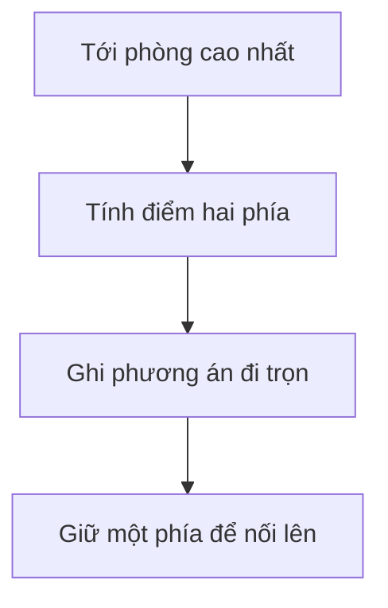
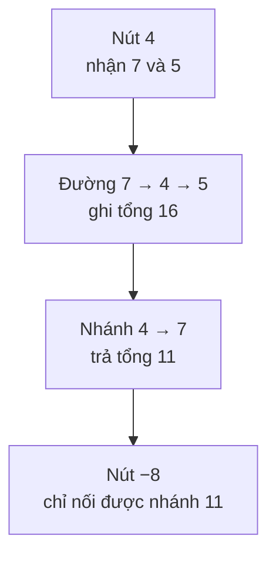

> [!tldr] Đọc nhanh
> - Hai đầu đường đi có thể ở bất cứ đâu. Mỗi đường có đúng một nút cao nhất, nơi hai nhánh có thể gặp nhau.
> - Xét một nút, mình dùng cả hai nhánh có tổng dương để cập nhật đáp án. Khi trả kết quả cho cha, mình giữ tối đa một nhánh để đường còn nối lên được.
> - Vét cạn từ mọi đầu mút mất O(n²). Duyệt [[concepts/post-order-traversal|hậu thứ tự]] gom kết quả trong O(n), dùng O(h) bộ nhớ phụ.
> - Khi toàn bộ giá trị âm, một nút vẫn tạo thành đường đi. Bản lặp dùng ngăn xếp tự quản lý và chạy thử với chuỗi lệch 30 000 nút.

> [!info] Bối cảnh
> Bài LeetCode 124 (Hard), thuộc [[posts/2026-11-26-neetcode-tree-reconstruction|ga 6: Dựng và mã hóa cây]] trên **tuyến NeetCode: Cấu trúc liên kết**. Bài [[problems/diameter-of-binary-tree|Diameter of Binary Tree]] cũng ghép hai nhánh tại một nút, nhưng đếm cạnh. Ở đây mỗi nút có điểm, và cả một nhánh có thể làm tổng giảm. Bạn chỉ cần biết cây nhị phân và cách duyệt cơ bản.

> [!abstract]- Từ điển nhanh cho bài này (bấm để mở)
> - **Cây nhị phân**: mỗi nút có tối đa hai con, trái và phải. Xem [[concepts/binary-tree|Binary Tree]].
> - **Hậu thứ tự**: tính kết quả của hai cây con trước khi xử lý nút hiện tại. Xem [[concepts/post-order-traversal|Post-order Traversal]].
> - **Nút cao nhất**: nút gần gốc nhất nằm trên một đường đi. Đó là tổ tiên chung thấp nhất của hai đầu đường.
> - **Tổng tốt nhất trả lên (downward path gain)**: tổng tốt nhất của một đường bắt đầu tại nút hiện tại và đi xuống tối đa một nhánh. Xem [[concepts/downward-path-gain|Downward Path Gain]].
> - **Khung ngăn xếp**: dữ liệu của một lần xử lý nút, gồm bước đang chờ và kết quả con trái nếu đã có. Xem [[concepts/recursion-depth-limit|Recursion Depth Limit]].

## Hình dung trước: đường chuyển thư giữa các phòng

Tưởng tượng các phòng trong một tòa nhà nối với nhau theo cây. Mỗi phòng có một số điểm thưởng hoặc phạt, và người đưa thư chọn điểm xuất phát, điểm kết thúc và một đường đi qua các hành lang. Người ấy ghi điểm cả những phòng mình chỉ đi ngang qua. Mỗi phòng được tính một lần.

| Đời thường | Khái niệm |
|---|---|
| Phòng đổi hướng từ đi lên sang đi xuống | nút cao nhất trên đường |
| Hai hành lang dẫn về hai đầu đường | hai nhánh dùng để tính phương án tại nút |
| Nối thêm hành lang lên tầng trên | tổng trả lên chỉ giữ một nhánh |
| Bỏ qua một khu làm mất điểm | cắt phần tổng trả về âm |
| Chọn đứng yên tại một phòng | đường đi một nút |



## Vấn đề: chọn một đường bất kỳ có tổng lớn nhất

Cây có từ 1 đến 30 000 nút. Mỗi giá trị là số nguyên từ −1000 đến 1000. Hai nút liên tiếp trên đường phải nối trực tiếp qua cạnh cha–con, và một nút chỉ xuất hiện một lần. Đường có thể chỉ gồm một nút và có thể nằm hoàn toàn trong một cây con. Kết quả là tổng giá trị các nút trên đường tốt nhất. [Đề gốc trên LeetCode](https://leetcode.com/problems/binary-tree-maximum-path-sum/)

Mình từng muốn hỏi mỗi nút một câu duy nhất: “Đường tốt nhất của em là bao nhiêu?” Nhưng cha cần một đường có đầu mút tại nút con để nối thêm cạnh. Tổng tốt nhất nằm sâu trong cây con có thể không tới được nút con mà vẫn giữ nguyên đường đó.

## Cơ chế

<figure class="figure-map" style="--ar: 3 / 4">
<div class="frame"><iframe data-archify="../diagrams/neetcode-binary-tree-maximum-path-sum/worked-example.html" title="Thử hai nhánh nhưng chỉ trả một nhánh" loading="lazy"></iframe></div>
<figcaption><span><b>Hình 1.</b> Thử hai nhánh nhưng chỉ trả một nhánh.</span><a href="../diagrams/neetcode-binary-tree-maximum-path-sum/worked-example.html" target="_blank" rel="noopener">Mở toàn màn hình</a></figcaption>
</figure>

<details>
<summary>Đọc từng bước</summary>
<ol>
<li>Hai nhánh con đóng góp 3 và 6. <code>node = 4; left = 3; right = 6</code></li>
<li>Thử đường đi qua cả hai nhánh. <code>3 + 4 + 6 = 13</code></li>
<li>Cha chỉ có thể nối vào một nhánh. <code>4 + max(3, 6) = 10</code></li>
<li>Ghi riêng đáp án và giá trị trả lên. <code>best = 13; gain = 10</code></li>
</ol>
</details>

### Vét cạn theo đầu mút

Lập bảng cha để coi mỗi cạnh là hai chiều. Từ từng nút xuất phát, duyệt mọi nút và cộng điểm dọc đường. Cây có đúng một đường đơn giữa mỗi cặp nút, nên trong lần duyệt từ một đầu mút chỉ cần tránh cạnh vừa đi qua. Vị trí đang đứng là một đầu mút hợp lệ ngay khi bắt đầu. Hai hướng của cùng một đường có thể được xét hai lần, nhưng chỉ lấy giá trị lớn nhất nên không cần loại trùng.

Mỗi lượt thăm n nút. Có n lượt nên thời gian là O(n²). Bảng cha và danh sách nút dùng O(n) bộ nhớ phụ. Nút được nhận diện bằng tham chiếu, vì hai nút khác nhau có thể có cùng giá trị. Phương án này dễ kiểm tra và làm đối chứng cho cách nhanh hơn.

### Hậu thứ tự và hai loại kết quả

Với một nút giá trị `v`, tính trước tổng tốt nhất mà từng con có thể cho mình nối thêm. Gọi `left`, `right` là hai tổng đã cắt về 0 nếu nhánh đó thiếu hoặc có tổng âm. Sau đó:

| Phép tính | Ý nghĩa |
|---|---|
| `v + left + right` | đường tốt nhất có nút cao nhất là nút này |
| `v + max(left, right)` | đường tốt nhất bắt đầu tại nút này để cha nối thêm |

Xét cây thử có gốc −8, con trái 4 (có hai lá 7 và 5) và con phải −3. Tại nút 4, đường hoàn chỉnh là `7 → 4 → 5`, tổng 16. Phần cha được phép nối chỉ là `4 → 7`, tổng 11. Tại gốc, phương án là `−8 + 11 = 3`, nên đáp án vẫn là 16.



Vì mọi đường đều có một nút cao nhất, xét phương án hoàn chỉnh tại mọi nút là đủ. Khi đi qua nút đó, đường có thể dùng một đoạn đi xuống từ bên trái và một đoạn đi xuống từ bên phải. Khi cha nối tiếp, cạnh đi lên chiếm một trong hai cạnh mà đường đơn có thể dùng tại nút, nên chỉ còn chỗ cho một đoạn đi xuống. Tính các tổng từ lá lên bảo đảm cả hai kết quả con có sẵn.

Bản đệ quy xử lý mỗi nút một lần, dùng O(n) thời gian và O(h) bộ nhớ phụ cho ngăn xếp gọi hàm, với h là số nút trên đường dài nhất từ gốc tới lá. Khởi tạo tổng tốt nhất bằng giá trị gốc, rồi chỉ cập nhật từ đường có ít nhất một nút.

### Hậu thứ tự bằng ngăn xếp tự quản lý

Bản lặp mô phỏng ba thời điểm của lời gọi. Một khung giữ nút, bước đang chờ và tổng nhánh trái. Khi quay lại từ bên trái, sao chép tổng vừa trả về vào khung rồi đi sang phải. Khi quay lại từ bên phải, hai tổng đủ để cập nhật đáp án và thay giá trị vừa trả về bằng kết quả của nút hiện tại. Nếu thiếu một con, lấy 0 ở phía đó. Biến kết quả vừa trả về có thể vẫn giữ số của nút khác khi không có con để gọi.

Mỗi nút có ba lượt xử lý khung, vẫn là O(n). Ngăn xếp chỉ chứa đường từ gốc đến nút đang xử lý, nên dùng O(h) bộ nhớ phụ. Bản lặp tránh giới hạn độ sâu của lời gọi hàm, nhưng vẫn cần thêm bộ nhớ trên cây lệch.

### Đếm công việc trên cùng một cây

Mình chạy JavaScript với một bộ đếm tại mỗi lần xét ứng viên trong bản vét cạn và tại mỗi lần hoàn tất một nút trong bản lặp. Trên chuỗi 512 nút, mỗi nút có giá trị 1, cả hai trả 512. Bản vét cạn xét 262 144 ứng viên có hướng, còn bản lặp hoàn tất 512 nút. Hai số đếm đo công việc ở hai điểm tương ứng, không phải tỉ lệ thời gian chạy. Trên chuỗi 30 000 nút, bản lặp qua ca thử trong cả năm ngôn ngữ. Khi mình gọi riêng bản đệ quy JavaScript trên Node 24.22.1, máy báo `RangeError: Maximum call stack size exceeded`.

## Ví dụ chạy được

Tải file [TypeScript](../code/neetcode-binary-tree-maximum-path-sum/max-path.ts), [Python](../code/neetcode-binary-tree-maximum-path-sum/max_path.py), [Go](../code/neetcode-binary-tree-maximum-path-sum/max_path.go), [Java](../code/neetcode-binary-tree-maximum-path-sum/max-path.java) hoặc [JavaScript](../code/neetcode-binary-tree-maximum-path-sum/max-path.js). Chạy lần lượt bằng `node max-path.ts`, `python3 max_path.py`, `go run max_path.go`, `java max-path.java` hoặc `node max-path.js`.

Tám ca nhỏ chạy cả ba cách, gồm cây toàn âm, đường tối ưu dưới gốc, nút trùng giá trị và nhánh có một nút âm ở giữa nhưng tổng vẫn dương. Ca thứ chín chạy bản lặp trên cây lệch 30 000 nút.

```ts
type TreeNode = { value: number; left: TreeNode | null; right: TreeNode | null }

function node(value: number, left: TreeNode | null = null, right: TreeNode | null = null): TreeNode {
  return { value, left, right }
}

function brute(root: TreeNode): number {
  let best = root.value
  const parent = new Map<TreeNode, TreeNode | null>([[root, null]])
  const nodes = [root]
  for (const current of nodes) {
    for (const child of [current.left, current.right]) {
      if (child !== null) {
        parent.set(child, current)
        nodes.push(child)
      }
    }
  }

  for (const start of nodes) {
    const stack: [TreeNode, TreeNode | null, number][] = [[start, null, start.value]]
    while (stack.length > 0) {
      const [current, previous, sum] = stack.pop()!
      best = Math.max(best, sum)
      for (const next of [current.left, current.right, parent.get(current)!]) {
        if (next !== null && next !== previous) stack.push([next, current, sum + next.value])
      }
    }
  }
  return best
}

function recursive(root: TreeNode): number {
  let best = root.value
  function gain(current: TreeNode | null): number {
    if (current === null) return 0
    const left = Math.max(0, gain(current.left))
    const right = Math.max(0, gain(current.right))
    best = Math.max(best, current.value + left + right)
    return current.value + Math.max(left, right)
  }
  gain(root)
  return best
}

type Frame = { current: TreeNode; step: number; leftGain: number }

function frame(current: TreeNode): Frame {
  return { current, step: 0, leftGain: 0 }
}

function iterative(root: TreeNode): number {
  let best = root.value
  let returned = 0
  const stack = [frame(root)]

  while (stack.length > 0) {
    const top = stack[stack.length - 1]
    const { current } = top
    if (top.step === 0) {
      top.step = 1
      if (current.left !== null) stack.push(frame(current.left))
      continue
    }

    if (top.step === 1) {
      if (current.left !== null) top.leftGain = Math.max(0, returned)
      top.step = 2
      if (current.right !== null) stack.push(frame(current.right))
      continue
    }

    const rightGain = current.right === null ? 0 : Math.max(0, returned)
    best = Math.max(best, current.value + top.leftGain + rightGain)
    returned = current.value + Math.max(top.leftGain, rightGain)
    stack.pop()
  }
  return best
}

const cases: [TreeNode, number][] = [
  [node(-9), -9],
  [node(-6, node(-1), node(-4)), -1],
  [node(6, node(3), node(5)), 14],
  [node(-8, node(4, node(7), node(5)), node(-3)), 16],
  [node(8, node(2, node(4), node(5)), node(1)), 16],
  [node(5, node(-7, node(1)), node(4)), 9],
  [node(2, node(2, node(2)), node(2)), 8],
  [node(6, node(-2, node(9)), node(4)), 17],
]

let passed = 0
for (const [root, expected] of cases) {
  for (const solve of [brute, recursive, iterative]) {
    const actual = solve(root)
    if (actual !== expected) throw new Error(`${solve.name}: ${actual} != ${expected}`)
  }
  passed++
}

let deep = node(1)
for (let length = 1; length < 30_000; length++) deep = node(1, deep)
if (iterative(deep) !== 30_000) throw new Error("iterative: 30_000")
passed++

console.log(`${passed}/${cases.length + 1} ca đúng`)

export {}
```
```python
from dataclasses import dataclass


@dataclass(eq=False)
class Node:
    value: int
    left: "Node | None" = None
    right: "Node | None" = None


def brute(root: Node) -> int:
    best = root.value
    parent = {root: None}
    nodes = [root]
    cursor = 0
    while cursor < len(nodes):
        current = nodes[cursor]
        cursor += 1
        for child in (current.left, current.right):
            if child is not None:
                parent[child] = current
                nodes.append(child)

    for start in nodes:
        stack = [(start, None, start.value)]
        while stack:
            current, previous, total = stack.pop()
            best = max(best, total)
            for neighbor in (current.left, current.right, parent[current]):
                if neighbor is not None and neighbor is not previous:
                    stack.append((neighbor, current, total + neighbor.value))
    return best


def recursive(root: Node) -> int:
    best = root.value

    def gain(current: Node | None) -> int:
        nonlocal best
        if current is None:
            return 0
        left = max(0, gain(current.left))
        right = max(0, gain(current.right))
        best = max(best, current.value + left + right)
        return current.value + max(left, right)

    gain(root)
    return best


@dataclass
class Frame:
    current: Node
    step: int = 0
    left_gain: int = 0


def iterative(root: Node) -> int:
    best = root.value
    returned = 0
    stack = [Frame(root)]

    while stack:
        top = stack[-1]
        current = top.current
        if top.step == 0:
            top.step = 1
            if current.left is not None:
                stack.append(Frame(current.left))
            continue

        if top.step == 1:
            if current.left is not None:
                top.left_gain = max(0, returned)
            top.step = 2
            if current.right is not None:
                stack.append(Frame(current.right))
            continue

        right_gain = 0 if current.right is None else max(0, returned)
        best = max(best, current.value + top.left_gain + right_gain)
        returned = current.value + max(top.left_gain, right_gain)
        stack.pop()
    return best


if __name__ == "__main__":
    cases = [
        (Node(-9), -9),
        (Node(-6, Node(-1), Node(-4)), -1),
        (Node(6, Node(3), Node(5)), 14),
        (Node(-8, Node(4, Node(7), Node(5)), Node(-3)), 16),
        (Node(8, Node(2, Node(4), Node(5)), Node(1)), 16),
        (Node(5, Node(-7, Node(1)), Node(4)), 9),
        (Node(2, Node(2, Node(2)), Node(2)), 8),
        (Node(6, Node(-2, Node(9)), Node(4)), 17),
    ]
    passed = 0
    for root, expected in cases:
        for solve in (brute, recursive, iterative):
            actual = solve(root)
            if actual != expected:
                raise AssertionError(f"{solve.__name__}: {actual} != {expected}")
        passed += 1

    deep = Node(1)
    for _ in range(1, 30_000):
        deep = Node(1, deep)
    if iterative(deep) != 30_000:
        raise AssertionError("iterative: 30_000")
    passed += 1

    print(f"{passed}/{len(cases) + 1} ca đúng")
```
```go
package main

import "fmt"

type Node struct {
	value       int
	left, right *Node
}

func leaf(value int) *Node {
	return &Node{value: value}
}

type Walk struct {
	current, previous *Node
	sum               int
}

func brute(root *Node) int {
	best := root.value
	parent := map[*Node]*Node{root: nil}
	nodes := []*Node{root}
	for cursor := 0; cursor < len(nodes); cursor++ {
		current := nodes[cursor]
		for _, child := range []*Node{current.left, current.right} {
			if child != nil {
				parent[child] = current
				nodes = append(nodes, child)
			}
		}
	}

	for _, start := range nodes {
		stack := []Walk{{start, nil, start.value}}
		for len(stack) > 0 {
			walk := stack[len(stack)-1]
			stack = stack[:len(stack)-1]
			best = max(best, walk.sum)
			for _, neighbor := range []*Node{walk.current.left, walk.current.right, parent[walk.current]} {
				if neighbor != nil && neighbor != walk.previous {
					stack = append(stack, Walk{neighbor, walk.current, walk.sum + neighbor.value})
				}
			}
		}
	}
	return best
}

func recursive(root *Node) int {
	best := root.value
	var gain func(*Node) int
	gain = func(current *Node) int {
		if current == nil {
			return 0
		}
		left := max(0, gain(current.left))
		right := max(0, gain(current.right))
		best = max(best, current.value+left+right)
		return current.value + max(left, right)
	}
	gain(root)
	return best
}

type Frame struct {
	current        *Node
	step, leftGain int
}

func iterative(root *Node) int {
	best := root.value
	returned := 0
	stack := []Frame{{current: root}}

	for len(stack) > 0 {
		top := &stack[len(stack)-1]
		current := top.current
		if top.step == 0 {
			top.step = 1
			if current.left != nil {
				stack = append(stack, Frame{current: current.left})
			}
			continue
		}

		if top.step == 1 {
			if current.left != nil {
				top.leftGain = max(0, returned)
			}
			top.step = 2
			if current.right != nil {
				stack = append(stack, Frame{current: current.right})
			}
			continue
		}

		rightGain := 0
		if current.right != nil {
			rightGain = max(0, returned)
		}
		best = max(best, current.value+top.leftGain+rightGain)
		returned = current.value + max(top.leftGain, rightGain)
		stack = stack[:len(stack)-1]
	}
	return best
}

func main() {
	cases := []struct {
		root     *Node
		expected int
	}{
		{leaf(-9), -9},
		{&Node{-6, leaf(-1), leaf(-4)}, -1},
		{&Node{6, leaf(3), leaf(5)}, 14},
		{&Node{-8, &Node{4, leaf(7), leaf(5)}, leaf(-3)}, 16},
		{&Node{8, &Node{2, leaf(4), leaf(5)}, leaf(1)}, 16},
		{&Node{5, &Node{-7, leaf(1), nil}, leaf(4)}, 9},
		{&Node{2, &Node{2, leaf(2), nil}, leaf(2)}, 8},
		{&Node{6, &Node{-2, leaf(9), nil}, leaf(4)}, 17},
	}
	passed := 0
	for _, test := range cases {
		for _, solve := range []func(*Node) int{brute, recursive, iterative} {
			if actual := solve(test.root); actual != test.expected {
				panic(fmt.Sprintf("%d != %d", actual, test.expected))
			}
		}
		passed++
	}

	deep := leaf(1)
	for length := 1; length < 30_000; length++ {
		deep = &Node{1, deep, nil}
	}
	if iterative(deep) != 30_000 {
		panic("iterative: 30_000")
	}
	passed++

	fmt.Printf("%d/%d ca đúng\n", passed, len(cases)+1)
}
```
```java
import java.util.ArrayDeque;
import java.util.ArrayList;
import java.util.IdentityHashMap;
import java.util.function.ToIntFunction;

class Main {
    record Node(int value, Node left, Node right) {
        Node(int value) { this(value, null, null); }
    }

    record Walk(Node current, Node previous, int sum) {}

    static int brute(Node root) {
        int best = root.value();
        var parent = new IdentityHashMap<Node, Node>();
        parent.put(root, null);
        var nodes = new ArrayList<Node>();
        nodes.add(root);
        for (int cursor = 0; cursor < nodes.size(); cursor++) {
            Node current = nodes.get(cursor);
            for (Node child : new Node[] {current.left(), current.right()}) {
                if (child != null) {
                    parent.put(child, current);
                    nodes.add(child);
                }
            }
        }

        for (Node start : nodes) {
            var stack = new ArrayDeque<Walk>();
            stack.push(new Walk(start, null, start.value()));
            while (!stack.isEmpty()) {
                Walk walk = stack.pop();
                best = Math.max(best, walk.sum());
                Node current = walk.current();
                for (Node next : new Node[] {current.left(), current.right(), parent.get(current)}) {
                    if (next != null && next != walk.previous()) {
                        stack.push(new Walk(next, current, walk.sum() + next.value()));
                    }
                }
            }
        }
        return best;
    }

    static int recursive(Node root) {
        int[] best = {root.value()};
        gain(root, best);
        return best[0];
    }

    static int gain(Node current, int[] best) {
        if (current == null) return 0;
        int left = Math.max(0, gain(current.left(), best));
        int right = Math.max(0, gain(current.right(), best));
        best[0] = Math.max(best[0], current.value() + left + right);
        return current.value() + Math.max(left, right);
    }

    static class Frame {
        final Node current;
        int step;
        int leftGain;

        Frame(Node current) { this.current = current; }
    }

    static int iterative(Node root) {
        int best = root.value();
        int returned = 0;
        var stack = new ArrayDeque<Frame>();
        stack.push(new Frame(root));

        while (!stack.isEmpty()) {
            Frame top = stack.peek();
            Node current = top.current;
            if (top.step == 0) {
                top.step = 1;
                if (current.left() != null) stack.push(new Frame(current.left()));
                continue;
            }

            if (top.step == 1) {
                if (current.left() != null) top.leftGain = Math.max(0, returned);
                top.step = 2;
                if (current.right() != null) stack.push(new Frame(current.right()));
                continue;
            }

            int rightGain = current.right() == null ? 0 : Math.max(0, returned);
            best = Math.max(best, current.value() + top.leftGain + rightGain);
            returned = current.value() + Math.max(top.leftGain, rightGain);
            stack.pop();
        }
        return best;
    }

    record TestCase(Node root, int expected) {}

    public static void main(String[] args) {
        TestCase[] cases = {
            new TestCase(new Node(-9), -9),
            new TestCase(new Node(-6, new Node(-1), new Node(-4)), -1),
            new TestCase(new Node(6, new Node(3), new Node(5)), 14),
            new TestCase(new Node(-8, new Node(4, new Node(7), new Node(5)), new Node(-3)), 16),
            new TestCase(new Node(8, new Node(2, new Node(4), new Node(5)), new Node(1)), 16),
            new TestCase(new Node(5, new Node(-7, new Node(1), null), new Node(4)), 9),
            new TestCase(new Node(2, new Node(2, new Node(2), null), new Node(2)), 8),
            new TestCase(new Node(6, new Node(-2, new Node(9), null), new Node(4)), 17),
        };
        var solvers = java.util.List.<ToIntFunction<Node>>of(Main::brute, Main::recursive, Main::iterative);
        int passed = 0;
        for (TestCase test : cases) {
            for (var solve : solvers) {
                int actual = solve.applyAsInt(test.root());
                if (actual != test.expected()) throw new AssertionError(actual + " != " + test.expected());
            }
            passed++;
        }

        Node deep = new Node(1);
        for (int length = 1; length < 30_000; length++) deep = new Node(1, deep, null);
        if (iterative(deep) != 30_000) throw new AssertionError("iterative: 30_000");
        passed++;

        System.out.printf("%d/%d ca đúng%n", passed, cases.length + 1);
    }
}
```
```js
function node(value, left = null, right = null) {
  return { value, left, right }
}

function brute(root) {
  let best = root.value
  const parent = new Map([[root, null]])
  const nodes = [root]
  for (const current of nodes) {
    for (const child of [current.left, current.right]) {
      if (child !== null) {
        parent.set(child, current)
        nodes.push(child)
      }
    }
  }

  for (const start of nodes) {
    const stack = [[start, null, start.value]]
    while (stack.length > 0) {
      const [current, previous, sum] = stack.pop()
      best = Math.max(best, sum)
      for (const next of [current.left, current.right, parent.get(current)]) {
        if (next !== null && next !== previous) stack.push([next, current, sum + next.value])
      }
    }
  }
  return best
}

function recursive(root) {
  let best = root.value
  function gain(current) {
    if (current === null) return 0
    const left = Math.max(0, gain(current.left))
    const right = Math.max(0, gain(current.right))
    best = Math.max(best, current.value + left + right)
    return current.value + Math.max(left, right)
  }
  gain(root)
  return best
}

function frame(current) {
  return { current, step: 0, leftGain: 0 }
}

function iterative(root) {
  let best = root.value
  let returned = 0
  const stack = [frame(root)]

  while (stack.length > 0) {
    const top = stack[stack.length - 1]
    const { current } = top
    if (top.step === 0) {
      top.step = 1
      if (current.left !== null) stack.push(frame(current.left))
      continue
    }

    if (top.step === 1) {
      if (current.left !== null) top.leftGain = Math.max(0, returned)
      top.step = 2
      if (current.right !== null) stack.push(frame(current.right))
      continue
    }

    const rightGain = current.right === null ? 0 : Math.max(0, returned)
    best = Math.max(best, current.value + top.leftGain + rightGain)
    returned = current.value + Math.max(top.leftGain, rightGain)
    stack.pop()
  }
  return best
}

const cases = [
  [node(-9), -9],
  [node(-6, node(-1), node(-4)), -1],
  [node(6, node(3), node(5)), 14],
  [node(-8, node(4, node(7), node(5)), node(-3)), 16],
  [node(8, node(2, node(4), node(5)), node(1)), 16],
  [node(5, node(-7, node(1)), node(4)), 9],
  [node(2, node(2, node(2)), node(2)), 8],
  [node(6, node(-2, node(9)), node(4)), 17],
]

let passed = 0
for (const [root, expected] of cases) {
  for (const solve of [brute, recursive, iterative]) {
    const actual = solve(root)
    if (actual !== expected) throw new Error(`${solve.name}: ${actual} != ${expected}`)
  }
  passed++
}

let deep = node(1)
for (let length = 1; length < 30_000; length++) deep = node(1, deep)
if (iterative(deep) !== 30_000) throw new Error("iterative: 30_000")
passed++

console.log(`${passed}/${cases.length + 1} ca đúng`)

export {}
```

Cả năm file in cùng một dòng:

```text
9/9 ca đúng
```

## Hiểu lầm và bẫy hay gặp

- **Trả hai nhánh cho cha.** Nếu ghép hai nhánh ở nút con rồi nối thêm cha, nút con sẽ có ba cạnh trên đường. Dùng tổng hai nhánh để cập nhật kết quả, rồi trả tổng một nhánh.
- **Khởi tạo đáp án bằng 0.** Số 0 trong phép cắt nhánh nghĩa là đóng góp tùy chọn của con. Đáp án bắt buộc chứa một nút, nên cây `−6, −1, −4` trả −1.
- **Gặp nút âm là dừng.** Có thể đáng đi qua nút âm để tới nút dương phía dưới. Trong ca có nhánh `−2 → 9`, cả nhánh góp 7.
- **Dùng giá trị nút làm khóa.** Java dùng `IdentityHashMap`, Python dùng `@dataclass(eq=False)`, Go dùng `*Node`, còn TypeScript và JavaScript dùng đối tượng làm khóa `Map`.
- **Giả sử O(h) đệ quy luôn vừa.** Java có thể ném `StackOverflowError`, Python có giới hạn đệ quy phụ thuộc môi trường, và TypeScript chạy trên cùng runtime với JavaScript. Ngăn xếp goroutine của Go có thể tăng khi cần, nhưng độ sâu vẫn tốn bộ nhớ. Bản lặp xử lý độ sâu bằng cấu trúc riêng. Tổng tuyệt đối tối đa là 30 000 000 trong giới hạn đề, nên `int` 32 bit và `Number` đều đủ ở đây.

## Câu hỏi tự kiểm tra

> [!question]- Nút 4 nhận hai nhánh góp 7 và 5. Nó ghi bao nhiêu vào phương án tại chỗ và trả bao nhiêu cho cha?
> Tổng phương án là 16. Cha nhận 11, gồm nút 4 và nhánh góp 7.

> [!question]- Ở cây toàn âm, việc cắt hai nhánh về 0 có cho ra đáp án 0 không?
> Không. Mỗi ứng viên vẫn cộng giá trị nút đang xét. Nút ít âm nhất thắng.

> [!question]- Vì sao khung lặp phải giữ riêng tổng nhánh trái?
> Xử lý nhánh phải sẽ ghi đè biến chứa kết quả vừa trả về. Khung phải lưu tổng trái trước khi chuyển sang phải.

## Tham khảo

- [LeetCode 124 — Binary Tree Maximum Path Sum](https://leetcode.com/problems/binary-tree-maximum-path-sum/)
- [Python — giới hạn đệ quy](https://docs.python.org/3/library/sys.html#sys.setrecursionlimit) và [dataclasses](https://docs.python.org/3/library/dataclasses.html)
- [Java — IdentityHashMap](https://docs.oracle.com/en/java/javase/21/docs/api/java.base/java/util/IdentityHashMap.html) và [StackOverflowError](https://docs.oracle.com/en/java/javase/24/docs/api/java.base/java/lang/StackOverflowError.html)
- [MDN — lỗi khi vượt độ sâu gọi hàm](https://developer.mozilla.org/en-US/docs/Web/JavaScript/Reference/Errors/Too_much_recursion)
- [Go FAQ — ngăn xếp goroutine](https://go.dev/doc/faq#goroutines)
