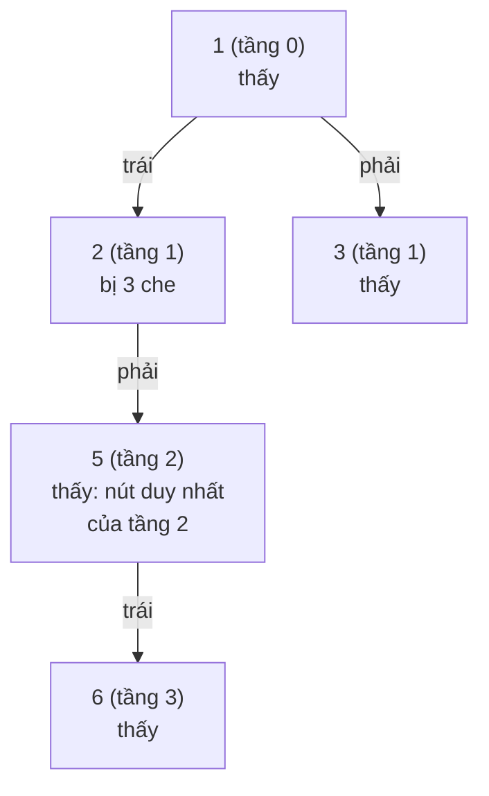
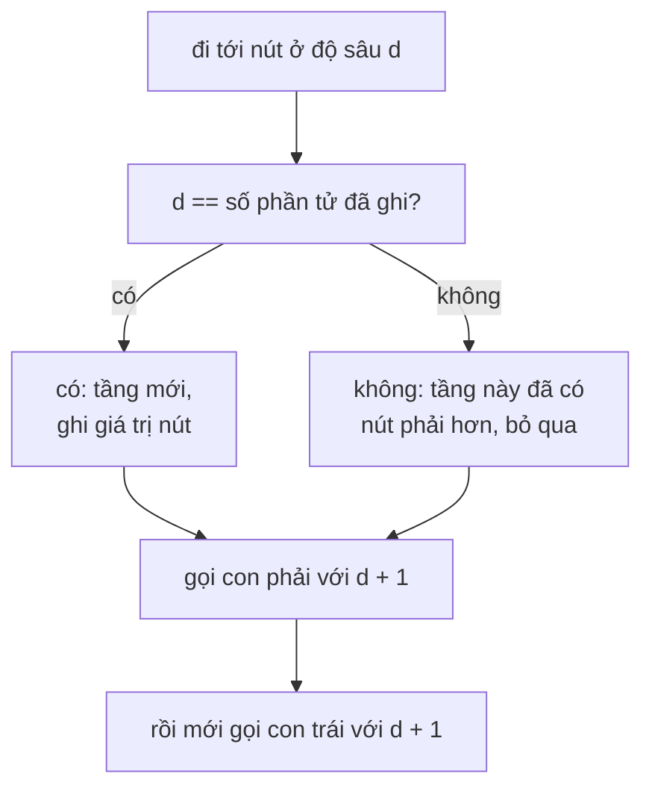

> [!tldr] Đọc nhanh
> - Đề: đứng bên phải một cây nhị phân nhìn vào, liệt kê các giá trị nhìn thấy từ trên xuống. Mỗi **tầng** thấy đúng một nút: nút **phải nhất của tầng đó**.
> - Nút phải nhất của một tầng có thể nằm trong cây con **trái**: cây `[1, 2, 3, 4]` cho `[1, 3, 4]`, và 4 là con của 2. Chỉ đi theo con trỏ phải từ gốc ra `[1, 3]`, sai 7/11 ca chạy thử.
> - Cách 1: [[concepts/breadth-first-search|BFS]] từng tầng, [[concepts/level-size-snapshot|chụp cỡ tầng]] trước khi lấy ra, giữ nút cuối. Cách 2: DFS **phải trước**, ghi một nút khi độ sâu của nó bằng số phần tử đã ghi (`depth == res.length`), tức lần đầu chạm tầng mới.
> - Cả hai O(n) thời gian. Bộ nhớ phụ khác nhau: BFS giữ cả một tầng (524 288 nút trên cây đầy đủ 2²⁰ − 1 nút), DFS giữ một đường từ gốc (20 tầng trên cùng cây đó, nhưng 10⁵ tầng trên chuỗi lệch).
> - Bẫy theo ngôn ngữ: điều kiện `i < queue.length` đọc lại độ dài mỗi lượt nên trộn hai tầng (TS, JS, Java 5/11, Go 2/11); `shift()` và `list.pop(0)` làm BFS thành O(n²) (518 ms so với 1,4 ms ở TypeScript); Python `for node in q` trên `deque` đang sửa thì ném `RuntimeError`.

> [!info] Bối cảnh
> Bài LeetCode 199 (Medium), thuộc [[posts/2026-11-25-neetcode-level-order|ga 5: Duyệt theo tầng và mang trạng thái]] trên **tuyến NeetCode: Cấu trúc liên kết**. Ở [[posts/2026-11-25-neetcode-tree-recursion|ga 3]], mọi bài đi theo chiều sâu và ghép kết quả từ dưới lên. Bài này hỏi về **tầng**, một thứ chỉ có nghĩa khi so các nút cùng độ sâu nằm ở những nhánh khác nhau, nên cách tự nhiên là đi theo chiều ngang: hết tầng này mới sang tầng sau. Hai bài cùng ga là [[problems/binary-tree-level-order-traversal|Binary Tree Level Order Traversal]] (in ra cả tầng) và [[problems/count-good-nodes-in-binary-tree|Count Good Nodes in Binary Tree]] (mang trạng thái của đường đi xuống). Lời giải có đủ TypeScript, Python, Go, Java và JavaScript. Bạn chỉ cần biết cây nhị phân và đệ quy là gì.

> [!abstract]- Từ điển nhanh cho bài này (bấm để mở)
> - **Cây nhị phân**: mỗi nút có tối đa hai con, trái và phải. Xem [[concepts/binary-tree|Binary Tree]].
> - **Độ sâu, tầng**: gốc ở độ sâu 0; con của một nút ở độ sâu d thì ở độ sâu d + 1. Mọi nút cùng độ sâu tạo thành một tầng.
> - **Hàng đợi (queue)**: danh sách vào cuối, ra đầu, ai vào trước ra trước. Trong trang này là cấu trúc dữ liệu trong bộ nhớ, không phải hàng đợi tin nhắn.
> - **BFS (breadth-first search, duyệt theo chiều rộng)**: thăm hết các nút gần gốc trước rồi mới tới nút xa hơn, nhờ một hàng đợi. Xem [[concepts/breadth-first-search|Breadth-First Search]].
> - **Chụp cỡ tầng**: đọc số phần tử trong hàng đợi **một lần** ở đầu mỗi tầng, rồi lấy ra đúng chừng đó nút. Xem [[concepts/level-size-snapshot|Level Size Snapshot]].
> - **DFS (depth-first search, duyệt theo chiều sâu)**: đi hết một nhánh rồi mới quay lại nhánh khác, thường viết bằng đệ quy.
> - **Tiền thứ tự (pre-order)**: xử lý nút trước rồi mới tới hai cây con. DFS phải trước của bài này là tiền thứ tự với thứ tự con đảo lại: nút, phải, trái. Xem [[concepts/pre-order-traversal|Pre-order Traversal]].
> - **Cây đầy đủ (complete)**: mọi tầng đầy, trừ tầng cuối được lấp từ trái sang. Cây đầy đủ n nút cao khoảng log₂ n tầng.
> - **Chuỗi lệch**: mỗi nút chỉ có một con, cây sâu đúng bằng số nút. Giới hạn độ sâu đệ quy: xem [[concepts/recursion-depth-limit|Recursion Depth Limit]].

## Hình dung trước: chụp ảnh tập thể từ bên hông

Một lớp học xếp hàng chụp ảnh tập thể. Cô giáo đứng một mình ở hàng đầu. Mỗi người được dẫn tối đa hai người đứng ngay sau mình, một người lệch về bên trái, một người lệch về bên phải. Người đứng sau lại dẫn thêm người, cứ thế thành nhiều hàng. Thợ ảnh đứng **bên phải** cả nhóm và chụp ngang: ở mỗi hàng, ống kính chỉ thấy người đứng ngoài cùng bên phải, những người còn lại trong hàng bị người đó che.

- **Gọi từng hàng:** thợ ảnh đếm hàng hiện tại có mấy người, cho đúng chừng đó người bước lên, ghi tên người cuối cùng, rồi mới tới hàng sau. Ai được dẫn theo trong lúc đó thì xếp vào hàng sau, không chen vào hàng đang chụp.
- **Đi dọc từ bên phải:** thợ ảnh đi từ cô giáo theo những người "phía sau bên phải" trước, rồi mới quay sang "phía sau bên trái". Họ cầm một danh sách: hàng nào **chưa có ai** trong danh sách thì người đầu tiên họ gặp ở hàng đó là người được thấy.
- **Đi theo vai phải:** chỉ nhìn người phía sau bên phải của người phía sau bên phải… Khi một người bên phải không dẫn ai, thợ ảnh dừng lại, dù hàng sau vẫn có người do ai đó bên trái dẫn tới. Đó là cách sai.

| Đời thường | Khái niệm |
|---|---|
| Một hàng người | một tầng, các nút cùng độ sâu |
| Người ngoài cùng bên phải của hàng | nút nhìn thấy từ bên phải |
| Người phía sau bên trái, bên phải | con trái, con phải |
| Gọi hết hàng này rồi mới tới hàng sau | [[concepts/breadth-first-search\|BFS]] với hàng đợi |
| Đếm hàng hiện tại có mấy người trước khi gọi | [[concepts/level-size-snapshot\|chụp cỡ tầng]] |
| Người mới dẫn tới chen vào hàng đang chụp | bẫy đọc lại độ dài hàng đợi trong lúc nó lớn lên |
| Đi dọc theo phía phải trước, ghi hàng chưa có ai | DFS phải trước, [[concepts/pre-order-traversal\|tiền thứ tự]] nút, phải, trái |
| Danh sách "hàng nào đã có người được thấy" | `depth == res.length`: trạng thái mang theo khi đi xuống |
| Chỉ đi theo vai phải | hiểu sai: chỉ đi theo con trỏ phải |

Cây ở ca "đáy nằm dưới cây con trái" trong file chạy thử. Ô có chữ "thấy" là nút xuất hiện trong đáp án `[1, 3, 5, 6]`:



Nút 3 là lá, nên từ tầng 2 trở xuống, mọi thứ nhìn thấy đều nằm trong cây con **trái** của gốc. Chỉ đi theo con phải thì dừng ở 3.

## Vấn đề: góc nhìn bên phải không phải đường đi bên phải

Đầu vào là gốc của một cây nhị phân có từ 0 tới 100 nút, mỗi giá trị nằm trong [−100, 100]. Trả về danh sách giá trị của các nút nhìn thấy khi đứng bên phải cây, theo thứ tự từ gốc xuống: mỗi tầng một giá trị, là giá trị của nút phải nhất trong tầng đó. Cây rỗng thì trả danh sách rỗng. Đề gốc: [LeetCode 199](https://leetcode.com/problems/binary-tree-right-side-view/) (giới hạn đề đã đối chiếu với trang LeetCode ngày 2026-11-25).

Mình từng nghĩ "góc nhìn bên phải" là "đi theo con phải cho tới khi hết". Cách đó đúng với cây đầy và với chuỗi lệch phải, nên dễ qua vài ví dụ đầu. Nó sai ngay khi cây con trái sâu hơn cây con phải: tầng dưới cùng chỉ có nút bên trái, và từ bên phải vẫn thấy nó vì không có gì che.

## Cơ chế

<figure class="figure-map" style="--ar: 3 / 4">
<div class="frame"><iframe data-archify="../diagrams/neetcode-binary-tree-right-side-view/worked-example.html" title="Mỗi tầng chỉ ghi nút nhìn thấy cuối" loading="lazy"></iframe></div>
<figcaption><span><b>Hình 1.</b> Mỗi tầng chỉ ghi nút nhìn thấy cuối.</span><a href="../diagrams/neetcode-binary-tree-right-side-view/worked-example.html" target="_blank" rel="noopener">Mở toàn màn hình</a></figcaption>
</figure>

<details>
<summary>Đọc từng bước</summary>
<ol>
<li>Đọc tầng gốc. <code>[8] → 8</code></li>
<li>Tầng tiếp theo có hai nút. <code>[3, 9] → 9</code></li>
<li>Tầng cuối chỉ có con của nhánh trái. <code>[1] → 1</code></li>
<li>Gom một nút từ mỗi tầng. <code>[8, 9, 1]</code></li>
</ol>
</details>

### Cách sai: đi theo con trỏ phải

```ts
function wrongRightPointers(root: TreeNode | null): number[] {
  const res: number[] = [];
  for (let node = root; node !== null; node = node.right) res.push(node.val);
  return res;
}
```

Hàm này trả về đường đi xuống phía phải, không phải góc nhìn bên phải. Hai thứ trùng nhau khi mọi tầng đều có nút trên đường đó. Trong 11 ca chạy thử nó chỉ đúng 4 (cây rỗng, một nút, cây đầy 7 nút, chuỗi lệch phải), và trên 3 000 cây ngẫu nhiên 0 tới 30 nút nó sai khoảng 2 550 cây. Với cây đầy đủ 100 nút nó dừng ở 63, vì tầng cuối chỉ lấp từ trái sang tới nút 100.

### Cách 1: BFS, chụp cỡ tầng, giữ nút cuối

Đi theo tầng là việc của [[concepts/breadth-first-search|BFS]]: hàng đợi bắt đầu với gốc; lấy một nút ra ở đầu thì đẩy các con của nó vào cuối. Vì con luôn vào sau cha, các nút ra khỏi hàng đợi theo đúng thứ tự tầng 0, tầng 1, tầng 2, và trong mỗi tầng từ trái sang phải.

Còn thiếu một thứ: biết **chỗ một tầng kết thúc**. Mẹo là [[concepts/level-size-snapshot|chụp cỡ tầng]]: ở đầu mỗi vòng ngoài, hàng đợi chứa **đúng** các nút của một tầng, không hơn không kém. Đọc `size = queue.length` một lần, lấy ra đúng `size` nút; nút thứ `size` là nút phải nhất. Các con được đẩy vào trong lúc đó nằm sau `size` nút này, nên chúng là tầng sau và sẽ được chụp ở vòng sau.

Chạy trên cây `[1, 2, 3, 4]`:

| Vòng | Hàng đợi lúc chụp | `size` | Lấy ra | Nút cuối (ghi) | Hàng đợi sau vòng |
|---|---|---|---|---|---|
| tầng 0 | `[1]` | 1 | 1 | 1 | `[2, 3]` |
| tầng 1 | `[2, 3]` | 2 | 2, 3 | 3 | `[4]` |
| tầng 2 | `[4]` | 1 | 4 | 4 | `[]` |

Kết quả `[1, 3, 4]`. Biến thể: đẩy con **phải trước** con trái, khi đó nút phải nhất đứng **đầu** tầng, và ta ghi nút đầu thay vì nút cuối (`bfsRightFirst` trong file chạy thử).

### Cách 2: DFS phải trước, ghi khi gặp tầng mới

Không cần hàng đợi nếu đi theo chiều sâu, miễn đi **bên phải trước**: thứ tự nút, con phải, con trái (một kiểu [[concepts/pre-order-traversal|tiền thứ tự]] đảo hai con). Với thứ tự đó, nút đầu tiên chạm tới một độ sâu d chính là nút phải nhất của tầng d: mọi nút khác cùng tầng nằm bên trái nó, và được thăm sau.

Làm sao biết "lần đầu chạm tầng d"? Danh sách kết quả đã có một phần tử cho mỗi tầng 0, 1, …, d − 1 đã gặp. Nên tầng d mới khi và chỉ khi `depth == res.length`. Đó là một mẩu [[concepts/path-state|trạng thái]] mang theo khi đi xuống: độ sâu được truyền vào lời gọi con, còn `res.length` cho biết đã đi sâu tới đâu.

Chạy trên cây ở hình đầu trang, `[1, 2, 3, null, 5, null, null, 6]`:

| Bước | Nút | `depth` | `res.length` | Làm gì | `res` |
|---|---|---|---|---|---|
| 1 | 1 | 0 | 0 | ghi | `[1]` |
| 2 | 3 | 1 | 1 | ghi | `[1, 3]` |
| 3 | 2 | 1 | 2 | bỏ qua: tầng 1 đã có | `[1, 3]` |
| 4 | 5 | 2 | 2 | ghi | `[1, 3, 5]` |
| 5 | 6 | 3 | 3 | ghi | `[1, 3, 5, 6]` |

Đổi thứ tự hai lời gọi (trái trước) mà vẫn ghi "lần đầu gặp tầng" thì ra **góc nhìn bên trái**: `wrongLeftFirst` trả `[1, 2, 4]` cho cây đầy 7 nút. Muốn đi trái trước thì phải **ghi đè** `res[depth]` ở mỗi lần gặp; lần ghi cuối ở mỗi tầng là nút phải nhất (`dfsOverwrite`).



### Độ phức tạp

| Cách | Thời gian | Bộ nhớ phụ | Ghi chú |
|---|---|---|---|
| Đi theo con trỏ phải | O(h) | O(1) | sai |
| BFS, chụp cỡ tầng | O(n) | O(w), w là tầng rộng nhất | hàng đợi phải lấy ra ở đầu trong O(1) |
| BFS, phải trước | O(n) | O(w) | ghi nút đầu thay vì nút cuối |
| DFS phải trước, đệ quy | O(n) | O(h), h là chiều cao | giới hạn độ sâu đệ quy |
| DFS phải trước, lặp | O(n) | O(h) | ngăn xếp tự quản lý |
| DFS trái trước, ghi đè | O(n) | O(h) | ghi nhiều lần mỗi tầng |

Mọi cách đúng phải ghé mọi nút: một nút sâu nhất có thể nằm ở bất kỳ đâu, kể cả tận cùng bên trái. Khác nhau là bộ nhớ phụ. Đếm thật bằng file TypeScript:

| Cây | Hàng đợi BFS lớn nhất | Độ sâu DFS lớn nhất |
|---|---|---|
| cây đầy đủ 100 nút | 37 nút | 7 tầng |
| chuỗi trái 100 nút | 1 nút | 100 tầng |
| cây đầy đủ 2²⁰ − 1 nút | 524 288 nút | 20 tầng |
| chuỗi trái 10⁵ nút | 1 nút | 100 000 tầng |

Cây rộng thì DFS nhẹ hơn, cây sâu thì BFS nhẹ hơn. Ở giới hạn đề (100 nút) cả hai đều nhỏ; độ sâu 100 không gần giới hạn đệ quy của ngôn ngữ nào.

### Đo: hàng đợi lấy ra ở đầu có thật O(1) không

BFS chỉ O(n) khi lấy phần tử đầu hàng đợi tốn O(1). Mảng thường thì không: `Array.prototype.shift()` ở JavaScript và `list.pop(0)` ở Python dời mọi phần tử còn lại lên một ô. Trên cây đầy đủ, hàng đợi chứa tới nửa số nút, nên tổng chi phí thành O(n²). Đo trung vị 5 lần (ms), cây đầy đủ, cỡ tăng gấp đôi:

| Ngôn ngữ, cách | 2¹⁵ − 1 nút | 2¹⁶ − 1 nút | 2¹⁷ − 1 nút |
|---|---|---|---|
| TS, mảng mới mỗi tầng (`bfsLast`) | 0,30 | 0,70 | 1,42 |
| TS, `shift()` | 22,5 | 116 | 518 |
| TS, DFS phải trước | 0,20 | 0,40 | 1,18 |
| Python, `deque.popleft` | 1,5 | 3,1 | 6,5 |
| Python, `list.pop(0)` | 29,2 | 124 | 494 |

- Cỡ gấp đôi thì `shift()` và `list.pop(0)` chậm gấp 4 tới 5 lần, đúng dáng n². Các cách còn lại gấp khoảng 2 lần, đúng dáng n.
- Ở giới hạn đề 100 nút, khác biệt này không thấy được. Nó thành chuyện thật khi đem cùng đoạn BFS đi duyệt một đồ thị lớn ở tuyến sau.
- Go (`queue = queue[size:]` hay hai slice) và Java (`ArrayDeque`) không có vấn đề này: trên cây 2²⁰ − 1 nút, BFS mất 5 tới 27 ms ở Go và 13 tới 18 ms ở Java, DFS 2 tới 9 ms.

## Ví dụ chạy được

[TypeScript](../code/neetcode-binary-tree-right-side-view/right-side.ts) · [Python](../code/neetcode-binary-tree-right-side-view/right_side.py) · [Go](../code/neetcode-binary-tree-right-side-view/right_side.go) · [Java](../code/neetcode-binary-tree-right-side-view/right-side.java) · [JavaScript](../code/neetcode-binary-tree-right-side-view/right-side.js)

Mỗi file dựng cây từ mảng theo tầng kiểu LeetCode (`null` là chỗ trống) và chạy 11 ca chung: cây rỗng, một nút, cây đầy 7 nút, nhánh trái sâu hơn (`[1, 2, 3, 4]`), chỉ có nhánh trái, chỉ có nhánh phải, đáy nằm dưới cây con trái (hình đầu trang), zíc zắc (`[1, 2, 3, 4, null, null, null, null, 5]`, nhìn thấy lần lượt phải, trái, rồi con phải của nút trái), giá trị âm và biên ±100, chuỗi trái 100 nút, cây đầy đủ 100 nút. Mỗi file còn đối chiếu năm cách đúng trên 3 000 cây ngẫu nhiên 0 tới 30 nút.

BFS, chụp cỡ tầng:

```ts
function bfsLast(root: TreeNode | null): number[] {
  const res: number[] = [];
  if (root === null) return res;
  let queue: TreeNode[] = [root];
  while (queue.length > 0) {
    const size = queue.length;              // chụp cỡ tầng: chỉ chừng này nút thuộc tầng hiện tại
    const next: TreeNode[] = [];
    for (let i = 0; i < size; i++) {
      const node = queue[i];
      if (i === size - 1) res.push(node.val);
      if (node.left) next.push(node.left);
      if (node.right) next.push(node.right);
    }
    queue = next;
  }
  return res;
}
```

```python
def bfs_last(root):
    """Cách 1: BFS, chụp cỡ tầng; nút cuối của tầng là nút nhìn thấy."""
    res = []
    if root is None:
        return res
    q = deque([root])
    while q:
        size = len(q)  # range(size) tính một lần, nên con đẩy vào sau không lọt vào tầng này
        for i in range(size):
            node = q.popleft()
            if i == size - 1:
                res.append(node.val)
            if node.left:
                q.append(node.left)
            if node.right:
                q.append(node.right)
    return res
```

```go
func bfsLast(root *TreeNode) []int {
	res := []int{}
	if root == nil {
		return res
	}
	queue := []*TreeNode{root}
	for len(queue) > 0 {
		size := len(queue) // chụp cỡ tầng
		for i := 0; i < size; i++ {
			node := queue[i]
			if i == size-1 {
				res = append(res, node.Val)
			}
			if node.Left != nil {
				queue = append(queue, node.Left)
			}
			if node.Right != nil {
				queue = append(queue, node.Right)
			}
		}
		queue = queue[size:] // bỏ cả tầng vừa xử lý: O(1), chỉ dời đầu slice
	}
	return res
}
```

```java
static List<Integer> bfsLast(TreeNode root) {
    List<Integer> res = new ArrayList<>();
    if (root == null) return res;
    Deque<TreeNode> q = new ArrayDeque<>();
    q.offer(root);
    while (!q.isEmpty()) {
        int size = q.size();                 // chụp cỡ tầng
        for (int i = 0; i < size; i++) {
            TreeNode node = q.poll();
            if (i == size - 1) res.add(node.val);
            if (node.left != null) q.offer(node.left);
            if (node.right != null) q.offer(node.right);
        }
    }
    return res;
}
```

```js
function bfsLast(root) {
  const res = [];
  if (root === null) return res;
  let queue = [root];
  while (queue.length > 0) {
    const size = queue.length;               // chụp cỡ tầng
    const next = [];
    for (let i = 0; i < size; i++) {
      const node = queue[i];
      if (i === size - 1) res.push(node.val);
      if (node.left) next.push(node.left);
      if (node.right) next.push(node.right);
    }
    queue = next;
  }
  return res;
}
```

DFS phải trước, ghi khi gặp tầng mới:

```ts
function dfsRightFirst(root: TreeNode | null): number[] {
  const res: number[] = [];
  const go = (node: TreeNode | null, depth: number): void => {
    if (node === null) return;
    if (depth === res.length) res.push(node.val);
    go(node.right, depth + 1);
    go(node.left, depth + 1);
  };
  go(root, 0);
  return res;
}
```

```python
def dfs_right_first(root):
    """Cách 3: DFS phải trước; nút đầu tiên chạm tới độ sâu mới là nút nhìn thấy."""
    res = []

    def go(node, depth):
        if node is None:
            return
        if depth == len(res):
            res.append(node.val)
        go(node.right, depth + 1)
        go(node.left, depth + 1)

    go(root, 0)
    return res
```

```go
func dfsRightFirst(root *TreeNode) []int {
	res := []int{}
	var walk func(node *TreeNode, depth int)
	walk = func(node *TreeNode, depth int) {
		if node == nil {
			return
		}
		if depth == len(res) {
			res = append(res, node.Val)
		}
		walk(node.Right, depth+1)
		walk(node.Left, depth+1)
	}
	walk(root, 0)
	return res
}
```

```java
static List<Integer> dfsRightFirst(TreeNode root) {
    List<Integer> res = new ArrayList<>();
    walkRight(root, 0, res);
    return res;
}
static void walkRight(TreeNode node, int depth, List<Integer> res) {
    if (node == null) return;
    if (depth == res.size()) res.add(node.val);
    walkRight(node.right, depth + 1, res);
    walkRight(node.left, depth + 1, res);
}
```

```js
function dfsRightFirst(root) {
  const res = [];
  const go = (node, depth) => {
    if (node === null) return;
    if (depth === res.length) res.push(node.val);
    go(node.right, depth + 1);
    go(node.left, depth + 1);
  };
  go(root, 0);
  return res;
}
```

Kết quả `node right-side.ts`:

```text
bfsLast                11/11 ca đúng
bfsRightFirst          11/11 ca đúng
dfsRightFirst          11/11 ca đúng
dfsRightFirstIterative 11/11 ca đúng
dfsOverwrite           11/11 ca đúng
wrongRightPointers     4/11 ca đúng; sai ở nhánh trái sâu hơn → [1,3], chỉ có nhánh trái → [1], đáy nằm dưới cây con trái → [1,3], zíc zắc → [1,3], giá trị âm và biên → [0,100], chuỗi trái 100 nút → [1], cây đầy đủ 100 nút → [1,3,7,15,31,63]
wrongLeftFirst         5/11 ca đúng; sai ở cây đầy 7 nút → [1,2,4], nhánh trái sâu hơn → [1,2,4], đáy nằm dưới cây con trái → [1,2,5,6], zíc zắc → [1,2,4,5], giá trị âm và biên → [0,-100,-50], cây đầy đủ 100 nút → [1,2,4,8,16,32,64]
wrongLiveLength        5/11 ca đúng; sai ở cây đầy 7 nút → [4,6,7], nhánh trái sâu hơn → [2,3,4], đáy nằm dưới cây con trái → [2,3,5,6], zíc zắc → [2,3,4,5], giá trị âm và biên → [-100,100,-50], cây đầy đủ 100 nút → [50,75,88,94,97,99,100]

đối chiếu 3000 cây ngẫu nhiên 0..30 nút: năm cách đúng khớp nhau 3000/3000; wrongRightPointers sai 2552 cây

bộ nhớ phụ: hàng đợi BFS lớn nhất (nút) và độ sâu DFS lớn nhất (tầng)
cây đầy đủ 100 nút       BFS      37   DFS       7
chuỗi trái 100 nút       BFS       1   DFS     100
cây đầy đủ 2^20 − 1 nút  BFS  524288   DFS      20
chuỗi trái 10^5 nút      BFS       1   DFS  100000

thời gian trung vị 5 lần (ms)
cây đầy đủ 2^15 − 1 nút  bfsLast 0.30   bfsRightFirst 0.35   bfsShift 22.47   dfsRightFirst 0.20
cây đầy đủ 2^16 − 1 nút  bfsLast 0.70   bfsRightFirst 0.71   bfsShift 116.09   dfsRightFirst 0.40
cây đầy đủ 2^17 − 1 nút  bfsLast 1.42   bfsRightFirst 1.56   bfsShift 517.89   dfsRightFirst 1.18
```

`wrongLiveLength` viết vòng trong là `for (let i = 0; i < queue.length; i++)` rồi `shift()` và `push()` bên trong, nên độ dài trong điều kiện đổi mỗi lượt. Trên cây đầy 7 nút, vòng đầu lấy ra 1, 2, 3, 4 rồi mới dừng (lúc `i` = 4 thì hàng đợi chỉ còn 3 phần tử), và ghi 4 làm "nút của tầng 0".

`python3 right_side.py`:

```text
bfs_last                  11/11 ca đúng
bfs_right_first           11/11 ca đúng
dfs_right_first           11/11 ca đúng
dfs_right_first_iterative 11/11 ca đúng
dfs_overwrite             11/11 ca đúng
wrong_right_pointers      4/11 ca đúng; sai ở nhánh trái sâu hơn → [1,3], chỉ có nhánh trái → [1], đáy nằm dưới cây con trái → [1,3], zíc zắc → [1,3], giá trị âm và biên → [0,100], chuỗi trái 100 nút → [1], cây đầy đủ 100 nút → [1,3,7,15,31,63]
wrong_left_first          5/11 ca đúng; sai ở cây đầy 7 nút → [1,2,4], nhánh trái sâu hơn → [1,2,4], đáy nằm dưới cây con trái → [1,2,5,6], zíc zắc → [1,2,4,5], giá trị âm và biên → [0,-100,-50], cây đầy đủ 100 nút → [1,2,4,8,16,32,64]
wrong_iterate_deque       1/11 ca đúng; sai ở một nút → ném RuntimeError, cây đầy 7 nút → ném RuntimeError, nhánh trái sâu hơn → ném RuntimeError, chỉ có nhánh trái → ném RuntimeError, chỉ có nhánh phải → ném RuntimeError, đáy nằm dưới cây con trái → ném RuntimeError, zíc zắc → ném RuntimeError, giá trị âm và biên → ném RuntimeError, chuỗi trái 100 nút → ném RuntimeError, cây đầy đủ 100 nút → ném RuntimeError

wrong_iterate_deque ném RuntimeError: deque mutated during iteration

đối chiếu 3000 cây ngẫu nhiên 0..30 nút: năm cách đúng khớp nhau 3000/3000; wrong_right_pointers sai 2571 cây

thời gian trung vị 5 lần (ms)
cây đầy đủ 2^15 − 1  deque 1.5   hai list 0.8   list.pop(0) 29.2   DFS lặp 2.0
cây đầy đủ 2^16 − 1  deque 3.1   hai list 1.5   list.pop(0) 123.7   DFS lặp 4.1
cây đầy đủ 2^17 − 1  deque 6.5   hai list 3.1   list.pop(0) 494.1   DFS lặp 8.2

dfs_right_first trên chuỗi trái 5000 nút: ném RecursionError (giới hạn mặc định 1000 tầng)
bfs_last trên chuỗi trái 5000 nút: 5000 số
```

`go run right_side.go`:

```text
bfsLast                11/11 ca đúng
bfsRightFirst          11/11 ca đúng
dfsRightFirst          11/11 ca đúng
dfsRightFirstIterative 11/11 ca đúng
dfsOverwrite           11/11 ca đúng
wrongRightPointers     4/11 ca đúng; sai ở nhánh trái sâu hơn → [1,3], chỉ có nhánh trái → [1], đáy nằm dưới cây con trái → [1,3], zíc zắc → [1,3], giá trị âm và biên → [0,100], chuỗi trái 100 nút → [1], cây đầy đủ 100 nút → [1,3,7,15,31,63]
wrongLeftFirst         5/11 ca đúng; sai ở cây đầy 7 nút → [1,2,4], nhánh trái sâu hơn → [1,2,4], đáy nằm dưới cây con trái → [1,2,5,6], zíc zắc → [1,2,4,5], giá trị âm và biên → [0,-100,-50], cây đầy đủ 100 nút → [1,2,4,8,16,32,64]
wrongLiveLength        2/11 ca đúng; sai ở cây đầy 7 nút → [7], nhánh trái sâu hơn → [4], chỉ có nhánh trái → [3], chỉ có nhánh phải → [3], đáy nằm dưới cây con trái → [6], zíc zắc → [5], giá trị âm và biên → [-50], chuỗi trái 100 nút → [100], cây đầy đủ 100 nút → [100]

đối chiếu 3000 cây ngẫu nhiên 0..30 nút: năm cách đúng khớp nhau 3000/3000; wrongRightPointers sai 2554 cây

thời gian trung vị 5 lần (ms)
cây đầy đủ 2^17 − 1  bfsLast 2.60   bfsRightFirst 0.88   dfsRightFirst 0.42   dfsRightFirstIterative 0.30
cây đầy đủ 2^20 − 1  bfsLast 26.64   bfsRightFirst 5.00   dfsRightFirst 3.46   dfsRightFirstIterative 2.39
dfsRightFirst trên chuỗi trái 10^6 nút: 1000000 số
```

Bản Go của `wrongLiveLength` không lấy phần tử ra trong vòng (chỉ đọc `queue[i]` rồi cắt slice sau vòng), nên `len(queue)` chỉ lớn lên: vòng trong chạy hết cả cây như một "tầng" và ghi đúng một số, nút cuối cùng theo thứ tự BFS.

`java right-side.java`:

```text
bfsLast                11/11 ca đúng
bfsRightFirst          11/11 ca đúng
dfsRightFirst          11/11 ca đúng
dfsRightFirstIterative 11/11 ca đúng
dfsOverwrite           11/11 ca đúng
wrongRightPointers     4/11 ca đúng; sai ở nhánh trái sâu hơn → [1,3], chỉ có nhánh trái → [1], đáy nằm dưới cây con trái → [1,3], zíc zắc → [1,3], giá trị âm và biên → [0,100], chuỗi trái 100 nút → [1], cây đầy đủ 100 nút → [1,3,7,15,31,63]
wrongLeftFirst         5/11 ca đúng; sai ở cây đầy 7 nút → [1,2,4], nhánh trái sâu hơn → [1,2,4], đáy nằm dưới cây con trái → [1,2,5,6], zíc zắc → [1,2,4,5], giá trị âm và biên → [0,-100,-50], cây đầy đủ 100 nút → [1,2,4,8,16,32,64]
wrongLiveLength        5/11 ca đúng; sai ở cây đầy 7 nút → [4,6,7], nhánh trái sâu hơn → [2,3,4], đáy nằm dưới cây con trái → [2,3,5,6], zíc zắc → [2,3,4,5], giá trị âm và biên → [-100,100,-50], cây đầy đủ 100 nút → [50,75,88,94,97,99,100]

đối chiếu 3000 cây ngẫu nhiên 0..30 nút: năm cách đúng khớp nhau 3000/3000; wrongRightPointers sai 2534 cây

thời gian trung vị 5 lần (ms)
cây đầy đủ 2^17 − 1  bfsLast 1.03   bfsRightFirst 0.80   dfsRightFirst 0.20   dfsRightFirstIterative 2.50
cây đầy đủ 2^20 − 1  bfsLast 18.38   bfsRightFirst 12.57   dfsRightFirst 4.30   dfsRightFirstIterative 8.87
dfsRightFirst trên chuỗi trái 10^5 nút: ném StackOverflowError
```

`node right-side.js`:

```text
bfsLast                11/11 ca đúng
bfsRightFirst          11/11 ca đúng
dfsRightFirst          11/11 ca đúng
dfsRightFirstIterative 11/11 ca đúng
dfsOverwrite           11/11 ca đúng
wrongRightPointers     4/11 ca đúng; sai ở nhánh trái sâu hơn → [1,3], chỉ có nhánh trái → [1], đáy nằm dưới cây con trái → [1,3], zíc zắc → [1,3], giá trị âm và biên → [0,100], chuỗi trái 100 nút → [1], cây đầy đủ 100 nút → [1,3,7,15,31,63]
wrongLeftFirst         5/11 ca đúng; sai ở cây đầy 7 nút → [1,2,4], nhánh trái sâu hơn → [1,2,4], đáy nằm dưới cây con trái → [1,2,5,6], zíc zắc → [1,2,4,5], giá trị âm và biên → [0,-100,-50], cây đầy đủ 100 nút → [1,2,4,8,16,32,64]
wrongLiveLength        5/11 ca đúng; sai ở cây đầy 7 nút → [4,6,7], nhánh trái sâu hơn → [2,3,4], đáy nằm dưới cây con trái → [2,3,5,6], zíc zắc → [2,3,4,5], giá trị âm và biên → [-100,100,-50], cây đầy đủ 100 nút → [50,75,88,94,97,99,100]

đối chiếu 3000 cây ngẫu nhiên 0..30 nút: năm cách đúng khớp nhau 3000/3000; wrongRightPointers sai 2552 cây
```

Số cây ngẫu nhiên mà `wrongRightPointers` làm sai khác nhau giữa các ngôn ngữ (2 534 tới 2 571) vì mỗi ngôn ngữ có bộ sinh số ngẫu nhiên riêng; TypeScript và JavaScript dùng chung mulberry32 seed 42 nên ra cùng số. Thời gian đo lúc máy đang chạy việc khác, nên đọc tỉ lệ, đừng đọc chữ số lẻ.

### Bên dưới năm ngôn ngữ

| | Hàng đợi nên dùng | Bẫy riêng |
|---|---|---|
| TypeScript / JavaScript | mảng mới mỗi tầng, hoặc mảng cộng chỉ số đầu `head` | `shift()` dời cả mảng: 518 ms so với 1,4 ms trên cây 2¹⁷ − 1 nút; `for (let i = 0; i < queue.length; i++)` đọc lại độ dài mỗi lượt |
| Python | `collections.deque` với `popleft()`, hoặc hai list | `list.pop(0)` là O(n); `for node in q` rồi sửa `deque` ngay trong vòng thì ném `RuntimeError: deque mutated during iteration`; `for _ in range(len(q))` thì an toàn vì `range` được tính một lần |
| Go | slice, cắt `queue = queue[size:]` sau mỗi tầng | `for i := 0; i < len(queue); i++` tính lại `len` mỗi lượt, cộng với `append` trong vòng là cả cây thành một tầng (2/11) |
| Java | `ArrayDeque` | `ArrayDeque` cấm phần tử `null`, nên phải kiểm `node.left != null` trước khi `offer`; `i < q.size()` trong điều kiện cũng đọc lại mỗi lượt (5/11); đệ quy trên chuỗi 10⁵ nút ném `StackOverflowError` |

Đệ quy không phải vấn đề ở giới hạn đề (độ sâu tối đa 100), nhưng là vấn đề khi dùng lại hàm cho cây lớn: Python ném `RecursionError` ở chuỗi 5 000 nút, Java ném `StackOverflowError` ở chuỗi 10⁵ nút, còn Go chạy được chuỗi 10⁶ nút vì ngăn xếp goroutine tự lớn lên.

## Hiểu lầm và bẫy hay gặp

- **"Góc nhìn bên phải là đường đi theo con phải."** Một tầng có thể chỉ có nút ở bên trái. `[1, 2, 3, 4]` cho `[1, 3, 4]`; đi theo con phải ra `[1, 3]`.
- **"Nút nhìn thấy là con phải của ai đó."** Ở ca chỉ có nhánh trái, mọi nút nhìn thấy đều là con trái.
- **Không chụp cỡ tầng.** Đọc lại độ dài hàng đợi trong điều kiện vòng lặp làm con của tầng này lọt vào tầng đang xử lý. Tùy ngôn ngữ và cách lấy ra, kết quả sai theo những kiểu khác nhau (5/11 ở TS, JS, Java; 2/11 ở Go). Chụp `size` vào một biến trước vòng, hoặc dùng hai danh sách `level`/`next`.
- **Đổi thứ tự hai lời gọi trong DFS.** "Ghi lần đầu gặp tầng" chỉ đúng khi đi bên phải trước. Đi trái trước thì ra góc nhìn bên trái, trừ khi đổi sang ghi đè.
- **Dùng `shift()` hay `list.pop(0)` làm hàng đợi.** Đúng kết quả, nhưng BFS thành O(n²). Ở 100 nút không thấy; ở 10⁵ nút thì thấy rõ.
- **Lấy giá trị lớn nhất của mỗi tầng.** Đề hỏi nút **phải nhất**, không phải nút **lớn nhất**. Cây `[1, 5, 2]` có tầng 1 là 5 rồi 2; nhìn từ bên phải thấy 2, dù 5 lớn hơn. Ca "giá trị âm và biên" trong file tình cờ có nút phải nhất cũng là nút lớn nhất, nên nó không bắt được lỗi này.

## Câu hỏi tự kiểm tra

> [!question]- Vẽ một cây mà đi theo con phải từ gốc ra kết quả ngắn hơn đáp án.
> `[1, 2, 3, 4]`: 4 là con trái của 2, ở tầng 2. Tầng 2 chỉ có 4, nên nhìn từ bên phải vẫn thấy 4. Đi theo con phải dừng ở 3 (lá), ra `[1, 3]`.

> [!question]- Vì sao ở đầu mỗi vòng ngoài của BFS, hàng đợi chứa đúng một tầng?
> Bằng quy nạp. Lúc đầu hàng đợi chỉ có gốc, tức tầng 0. Nếu đầu vòng hàng đợi đúng là tầng d với `size` nút, vòng lấy ra đúng `size` nút đó và đẩy vào con của chúng, tức mọi nút tầng d + 1, theo thứ tự trái sang phải. Hết vòng, trong hàng đợi chỉ còn tầng d + 1.

> [!question]- Trong DFS phải trước, vì sao `depth == res.length` nghĩa là "lần đầu chạm tầng này"?
> `res` có một phần tử cho mỗi tầng đã gặp, và các tầng được gặp lần đầu theo thứ tự 0, 1, 2, … vì muốn tới độ sâu d phải đi qua mọi độ sâu nhỏ hơn. Vậy `res.length` là số tầng đã gặp, tức tầng sâu nhất đã gặp cộng một. Độ sâu bằng đúng số đó thì tầng này chưa ai ghi.

> [!question]- Cây nào làm BFS tốn bộ nhớ hơn DFS, và ngược lại?
> Cây đầy đủ: hàng đợi BFS giữ cả tầng cuối, khoảng n/2 nút (524 288 với n = 2²⁰ − 1), còn DFS chỉ sâu 20 tầng. Chuỗi lệch: BFS giữ 1 nút, DFS sâu n tầng.

> [!question]- Viết DFS trái trước mà vẫn đúng thì phải đổi gì?
> Ghi đè thay vì chỉ ghi lần đầu: ở mỗi nút, đặt `res[depth] = node.val`. Đi trái trước thì nút phải nhất của mỗi tầng được thăm **sau cùng** trong tầng đó, nên lần ghi cuối là đáp án.

> [!question]- Vì sao `for _ in range(len(q))` trong Python an toàn mà `for (let i = 0; i < queue.length; i++)` trong JavaScript thì không?
> `range(len(q))` tính `len(q)` một lần lúc tạo `range`, nên số lượt cố định dù `q` lớn lên. Điều kiện của vòng `for` trong JavaScript (cũng như Go và Java) được tính lại trước mỗi lượt, nên nó thấy độ dài mới sau mỗi `push` hay `shift`.

## Tham khảo

- [LeetCode 199: Binary Tree Right Side View](https://leetcode.com/problems/binary-tree-right-side-view/) (đề gốc: 0 tới 100 nút, giá trị trong [−100, 100])
- [Python `collections.deque`](https://docs.python.org/3/library/collections.html#collections.deque): thêm và lấy ra ở hai đầu O(1); list thì `pop(0)` tốn O(n) vì phải dời bộ nhớ
- [Java `ArrayDeque`](https://docs.oracle.com/en/java/javase/21/docs/api/java.base/java/util/ArrayDeque.html): "Null elements are prohibited"
- [The Go Programming Language Specification, For statements](https://go.dev/ref/spec#For_statements): điều kiện được tính trước mỗi lượt
- Cormen, Leiserson, Rivest, Stein, *Introduction to Algorithms*, mục 22.2 (duyệt theo chiều rộng)
