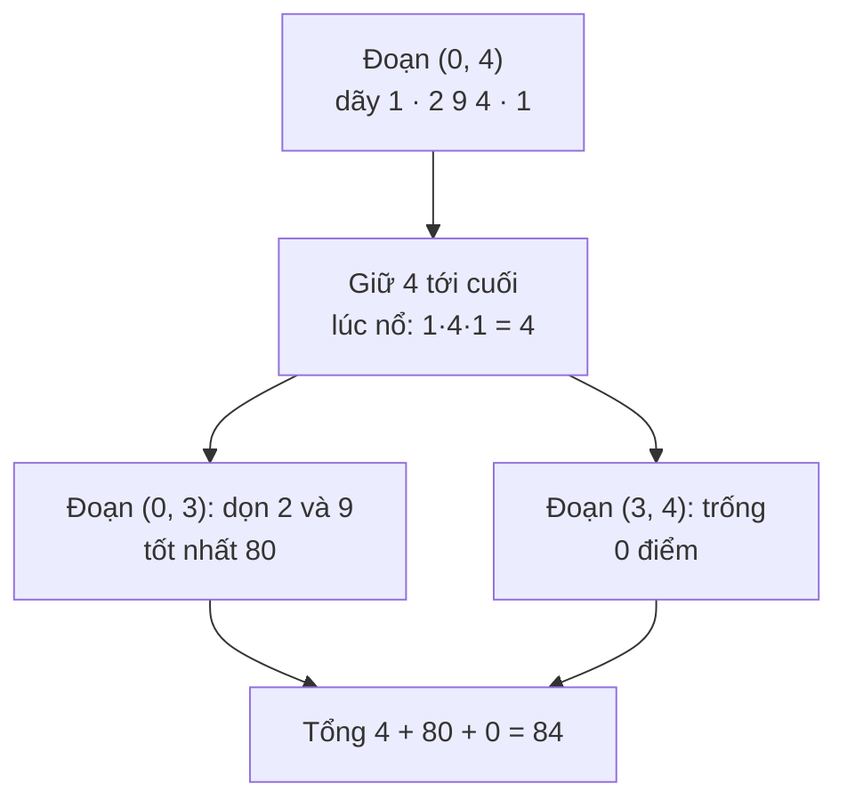
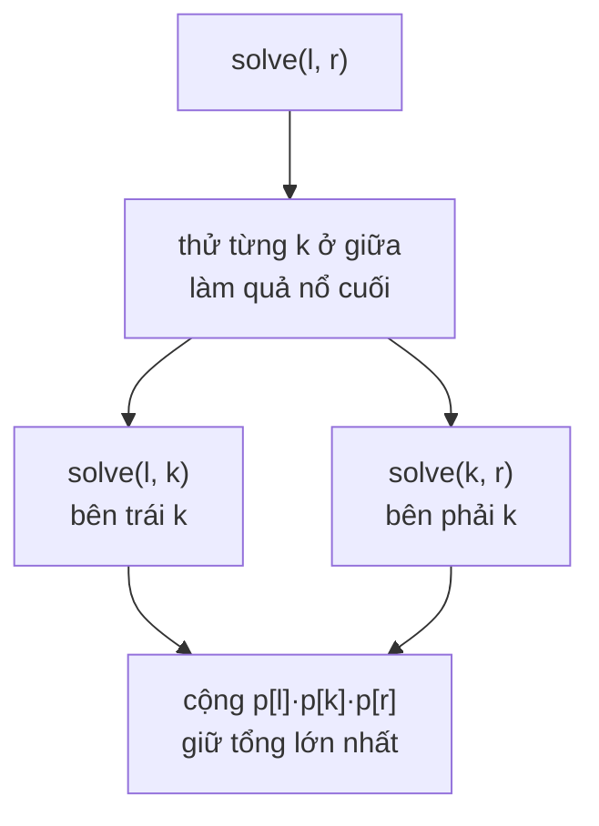

> [!tldr] Đọc nhanh
> - Thêm một quả giá trị 1 ở hai đầu. Gọi `dp[l][r]` là điểm lớn nhất khi cho nổ hết các quả nằm **giữa** l và r, còn l và r vẫn đứng đó. Đó là một [[concepts/interval-dp|DP trên khoảng]].
> - Đừng hỏi quả nào nổ đầu tiên. Hỏi quả k nào nổ **cuối cùng** trong khoảng: lúc nó nổ, hàng xóm của nó chắc chắn là l và r. Đó là [[concepts/last-split-choice|lựa chọn quả cuối]].
> - `dp[l][r] = max(p[l]·p[k]·p[r] + dp[l][k] + dp[k][r])` với mọi k nằm giữa. Hai khoảng con không còn đụng nhau vì k vẫn đứng ở giữa cho tới cuối.
> - Điền theo độ dài khoảng tăng dần: O(n³) thời gian, O(n²) bộ nhớ.

> [!info] Bối cảnh
> Đây là bài LeetCode 312 tại [[posts/2026-11-27-neetcode-interval-dp|ga DP-07: DP khoảng và khớp mẫu]] trên **tuyến NeetCode: Quy hoạch động**. Mình hình dung một dãy bóng bay buộc sát nhau trên sợi dây, mỗi quả ghi một con số. Bạn chỉ cần biết mảng, mảng hai chiều và vòng lặp lồng nhau.

> [!abstract]- Từ điển nhanh cho bài này (bấm để mở)
> - Khoảng mở (l, r) gồm các vị trí nằm giữa l và r, không tính chính l và r.
> - Lính canh (sentinel) là phần tử giả thêm vào đầu và cuối mảng để khỏi xét riêng trường hợp ở mép.
> - [[concepts/dp-state|Trạng thái DP]] nói rõ một ô của bảng lưu điều gì.
> - [[concepts/recurrence-relation|Công thức truy hồi]] cho biết ô hiện tại đọc những ô nào.
> - [[concepts/memoization|Ghi nhớ kết quả]] (memoization) lưu đáp án của một trạng thái ngay lần đầu tính.

## Hình dung trước: dãy bóng trên sợi dây

Một dãy bóng buộc sát nhau, mỗi quả ghi một số. Cho nổ một quả thì được điểm bằng tích của nó với hai quả đang đứng sát hai bên; mép dây tính như một quả số 1. Quả nổ rồi thì biến mất, hai quả hai bên xích lại thành hàng xóm mới. Câu hỏi là cho nổ theo thứ tự nào để tổng điểm lớn nhất.

Mẹo của bài này: thay vì nghĩ quả nào nổ trước, mình nghĩ quả nào được giữ lại tới cuối. Quả được giữ đến cuối như một cái cọc chia đôi sợi dây: hai đoạn hai bên không bao giờ chạm nhau, nên tính riêng được.

| Đời thường | Khái niệm |
|---|---|
| Hai cọc buộc ở hai đầu sợi dây | Lính canh `p[0] = p[n+1] = 1` |
| Đoạn dây giữa hai quả còn đứng | Khoảng mở (l, r) |
| Điểm tốt nhất khi dọn sạch đoạn đó | `dp[l][r]` |
| Quả giữ lại tới cuối trong đoạn | Quả k nổ cuối cùng |
| Lúc quả cuối nổ, hai bên chỉ còn hai cọc | Điểm `p[l]·p[k]·p[r]` |
| Hai đoạn hai bên quả cuối | Hai bài con `dp[l][k]` và `dp[k][r]` |



## Vấn đề: cho nổ hết dãy bóng để được nhiều điểm nhất

Cho mảng `nums` gồm n số nguyên, 1 ≤ n ≤ 300, mỗi số từ 0 đến 100. Cho nổ quả ở vị trí i thì được `nums[i-1] · nums[i] · nums[i+1]` tính theo các quả **còn lại** lúc đó, vị trí ngoài mảng coi như số 1. Phải cho nổ hết mọi quả; trả về tổng điểm lớn nhất. Ví dụ dãy `[2, 9, 4]`: cho nổ 9 trước được 2·9·4 = 72, rồi cho nổ 2 được 1·2·4 = 8, cuối cùng cho nổ 4 được 1·4·1 = 4, tổng 84, và không thứ tự nào hơn. [Đề gốc LeetCode 312](https://leetcode.com/problems/burst-balloons/)

Mình từng nghĩ nên cho nổ các quả nhỏ trước để giữ quả lớn làm hàng xóm lâu nhất. Với `[2, 9, 4]` thì cho nổ 2 trước (1·2·9 = 18), rồi 4 (9·4·1 = 36), rồi 9 (9) chỉ được 63. Quả 9 lớn nhất nhưng lại nên nổ đầu tiên, vì lúc đó nó nhân với cả 2 lẫn 4. Không có luật tham lam đơn giản nào đúng, nên phải thử các thứ tự một cách có tổ chức.

## Cơ chế

### Vét cạn: thử mọi thứ tự nổ

Lấy dãy còn lại, thử cho nổ từng quả, cộng điểm rồi giải tiếp dãy ngắn hơn. Có n! thứ tự. Số lượt gọi còn nhiều hơn vì mỗi tiền tố của một thứ tự cũng là một lượt: với 8 quả, hàm được gọi 109.601 lần. Mỗi lượt còn phải chép mảng còn lại, nên thời gian cỡ O(n·n!).

Ghi nhớ theo "dãy còn lại" cũng không cứu được: các quả còn lại có thể là bất kỳ tập con nào, nên có tới 2ⁿ trạng thái.

### Chia theo quả nổ đầu tiên thì sai

Ý tự nhiên là chọn quả k nổ **đầu tiên**, rồi giải phần bên trái và phần bên phải như hai bài riêng. Nhưng ngay khi k nổ, quả cuối bên trái và quả đầu bên phải thành hàng xóm của nhau. Điểm của những quả về sau phụ thuộc vào cả hai bên, nên hai bài con không độc lập.

File chạy kèm có một hàm cố tình làm như vậy: nó tính điểm của k với hai hàng xóm ban đầu, rồi cộng hai bài con. Với `[2, 3]` nó trả 12, trong khi đáp án đúng là 9: nó cho cả hai quả nhân với nhau, như thể cả hai cùng nổ trước quả kia.

### Đảo câu hỏi: quả nào nổ cuối cùng?

Thêm số 1 vào hai đầu để được mảng `p` dài n + 2. Gọi `solve(l, r)` là điểm lớn nhất khi cho nổ hết các quả nằm giữa l và r, trong khi l và r còn đứng nguyên.

Giả sử k là quả nổ **cuối cùng** trong khoảng. Trước khi k nổ, k luôn đứng giữa. Các quả bên trái k chỉ có thể kề nhau hoặc kề l và k, không bao giờ kề quả bên phải k. Vậy phần bên trái chính là bài `solve(l, k)` và phần bên phải là `solve(k, r)`, hai bài thật sự độc lập. Đến lúc k nổ, mọi quả khác trong khoảng đã đi hết, nên hàng xóm của k là l và r:

```text
solve(l, r) = max over l < k < r of  p[l]·p[k]·p[r] + solve(l, k) + solve(k, r)
solve(l, r) = 0  khi r = l + 1  (không còn quả nào ở giữa)
```

Đáp án là `solve(0, n + 1)`. Có khoảng (n + 2)²/2 cặp (l, r), mỗi cặp thử tối đa n giá trị k, nên ghi nhớ cho O(n³) thời gian và O(n²) bộ nhớ, ngăn xếp sâu tối đa n + 1 tầng. Với cùng 8 quả, số lượt gọi tụt từ 109.601 xuống 241, tính cả các lượt trả ngay từ bộ nhớ đệm.



### Bảng theo độ dài khoảng

`dp[l][r]` chỉ đọc `dp[l][k]` và `dp[k][r]`, cả hai đều là khoảng ngắn hơn. Vì vậy mình điền bảng theo độ dài `r − l` từ 2 lên n + 1, không cần đệ quy. Với `p = [1, 2, 9, 4, 1]`:

| Độ dài | Ô | Các lựa chọn k | Giá trị |
|---|---|---|---|
| 2 | `dp[0][2]` | k = 1: 1·2·9 | 18 |
| 2 | `dp[1][3]` | k = 2: 2·9·4 | 72 |
| 2 | `dp[2][4]` | k = 3: 9·4·1 | 36 |
| 3 | `dp[0][3]` | k = 1: 1·2·4 + 0 + 72 = 80; k = 2: 1·9·4 + 18 + 0 = 54 | 80 |
| 3 | `dp[1][4]` | k = 2: 2·9·1 + 0 + 36 = 54; k = 3: 2·4·1 + 72 + 0 = 80 | 80 |
| 4 | `dp[0][4]` | k = 1: 2 + 0 + 80 = 82; k = 2: 9 + 18 + 36 = 63; k = 3: 4 + 80 + 0 = 84 | 84 |

Ô cuối chọn k = 3, tức quả 4 nổ cuối. Thời gian vẫn O(n³), bộ nhớ O(n²). Với n = 300, khoảng 4,5 triệu phép thử k. Tích lớn nhất của một lần nổ là 100³ = 10⁶, và tổng 300 lần nổ không vượt quá 3·10⁸, nên số nguyên 32 bit đủ chứa.

## Ví dụ chạy được

[TypeScript](../code/neetcode-burst-balloons/balloons.ts) · [Python](../code/neetcode-burst-balloons/balloons.py) · [Go](../code/neetcode-burst-balloons/balloons.go) · [Java](../code/neetcode-burst-balloons/balloons.java) · [JavaScript](../code/neetcode-burst-balloons/balloons.js) · [PHP](../code/neetcode-burst-balloons/balloons.php) · [Rust](../code/neetcode-burst-balloons/balloons.rs)

```ts
function maxCoins(nums: number[]): number {
    const p = [1, ...nums, 1]
    const n = p.length
    const dp: number[][] = Array.from({ length: n }, () => Array(n).fill(0))
    for (let len = 2; len < n; len++) {
        for (let l = 0; l + len < n; l++) {
            const r = l + len
            let best = 0
            for (let k = l + 1; k < r; k++) {
                best = Math.max(best, p[l] * p[k] * p[r] + dp[l][k] + dp[k][r])
            }
            dp[l][r] = best
        }
    }
    return dp[0][n - 1]
}
```

```python
def max_coins(nums):
    p = [1] + list(nums) + [1]
    n = len(p)
    dp = [[0] * n for _ in range(n)]
    for length in range(2, n):
        for l in range(0, n - length):
            r = l + length
            pl_pr = p[l] * p[r]
            row_l = dp[l]
            best = 0
            for k in range(l + 1, r):
                v = pl_pr * p[k] + row_l[k] + dp[k][r]
                if v > best:
                    best = v
            dp[l][r] = best
    return dp[0][n - 1]
```

```go
func maxCoins(nums []int) int {
	p := append(append([]int{1}, nums...), 1)
	n := len(p)
	dp := make([][]int, n)
	for i := range dp {
		dp[i] = make([]int, n)
	}
	for length := 2; length < n; length++ {
		for l := 0; l+length < n; l++ {
			r := l + length
			best := 0
			for k := l + 1; k < r; k++ {
				best = max(best, p[l]*p[k]*p[r]+dp[l][k]+dp[k][r])
			}
			dp[l][r] = best
		}
	}
	return dp[0][n-1]
}
```

```java
static int maxCoins(int[] nums) {
    int[] p = pad(nums);
    int n = p.length;
    int[][] dp = new int[n][n];
    for (int len = 2; len < n; len++) {
        for (int l = 0; l + len < n; l++) {
            int r = l + len;
            int best = 0;
            for (int k = l + 1; k < r; k++) {
                best = Math.max(best, p[l] * p[k] * p[r] + dp[l][k] + dp[k][r]);
            }
            dp[l][r] = best;
        }
    }
    return dp[0][n - 1];
}
```

```js
function maxCoins(nums) {
    const p = [1, ...nums, 1]
    const n = p.length
    const dp = Array.from({ length: n }, () => Array(n).fill(0))
    for (let len = 2; len < n; len++) {
        for (let l = 0; l + len < n; l++) {
            const r = l + len
            let best = 0
            for (let k = l + 1; k < r; k++) {
                best = Math.max(best, p[l] * p[k] * p[r] + dp[l][k] + dp[k][r])
            }
            dp[l][r] = best
        }
    }
    return dp[0][n - 1]
}
```

```php
function maxCoins(array $nums): int {
    $p = array_merge([1], $nums, [1]);
    $n = count($p);
    $dp = array_fill(0, $n, array_fill(0, $n, 0));
    for ($len = 2; $len < $n; $len++) {
        for ($l = 0; $l + $len < $n; $l++) {
            $r = $l + $len;
            $best = 0;
            for ($k = $l + 1; $k < $r; $k++) {
                $v = $p[$l] * $p[$k] * $p[$r] + $dp[$l][$k] + $dp[$k][$r];
                if ($v > $best) $best = $v;
            }
            $dp[$l][$r] = $best;
        }
    }
    return $dp[0][$n - 1];
}
```

```rust
fn max_coins(nums: Vec<i32>) -> i32 {
    let p = pad(&nums);
    let n = p.len();
    let mut dp = vec![vec![0i32; n]; n];
    for len in 2..n {
        for l in 0..n - len {
            let r = l + len;
            let mut best = 0;
            for k in l + 1..r {
                best = best.max(p[l] * p[k] * p[r] + dp[l][k] + dp[k][r]);
            }
            dp[l][r] = best;
        }
    }
    dp[0][n - 1]
}
```

Các tab trích hàm điền bảng; `pad` trong bản Java và Rust thêm số 1 vào hai đầu. File tải về còn có vét cạn mọi thứ tự nổ, bản ghi nhớ và hàm sai "chia theo quả nổ đầu tiên". 11 ca gồm một quả, dãy có số 0, 300 quả đều là 1, 300 quả đều là 100 và một dãy 300 số trộn. Mọi mảng dài 1–5 với giá trị 0–3 được đối chiếu với vét cạn. Bảy ngôn ngữ in cùng kết quả:

```text
11/11 ca đúng
1364/1364 ca đúng (đối chiếu mọi thứ tự nổ)
Chia theo quả nổ đầu tiên với [2,3]: 12, đúng là 9
8 quả: vét cạn 109601 lượt gọi, memo 241 lượt gọi
```

Chạy bằng `node balloons.ts`, `python3 balloons.py`, `go run balloons.go`, `java balloons.java`, `node balloons.js`, `php -d xdebug.mode=off balloons.php` hoặc `rustc --edition 2021 -O balloons.rs -o /tmp/balloons && /tmp/balloons`.

## Hiểu lầm và bẫy hay gặp

- Cho nổ quả nhỏ trước để giữ quả lớn làm hàng xóm. Với `[2, 9, 4]` cách đó được 63, còn cho nổ 9 trước được 84. Không có luật tham lam nào đúng cho mọi dãy.
- Chia theo quả nổ đầu tiên. Hai bên trở thành hàng xóm của nhau sau khi quả đó nổ, nên hai bài con không độc lập. Phải chọn quả nổ cuối cùng.
- Định nghĩa `dp[l][r]` trên khoảng đóng, gồm cả l và r. Khi đó hàng xóm của quả cuối là `p[l-1]` và `p[r+1]`, vẫn làm được nhưng dễ lệch một. Khoảng mở với hai lính canh làm công thức gọn nhất.
- Quên hai số 1 ở hai đầu, hoặc thêm vào nhưng cho vòng `k` chạy qua chúng. Lính canh không bao giờ nổ.
- Bỏ qua quả có giá trị 0. Quả 0 vẫn phải nổ và vẫn chia dãy; với `[4, 0, 4]` nên cho nổ 0 trước để hai quả 4 thành hàng xóm, được 20.
- Điền bảng theo l tăng dần thay vì theo độ dài. `dp[l][r]` cần `dp[k][r]` với k > l, ô đó chưa có nếu l chạy từ nhỏ đến lớn. Theo độ dài thì an toàn, hoặc cho l chạy từ lớn về nhỏ.
- Python: bảng O(n³) với n = 300 là khoảng 4,5 triệu lượt vòng trong, trên máy mình mất chừng 0,2 giây; đọc trước `dp[l]` và `p[l]·p[r]` ra biến cục bộ giúp vòng trong nhẹ hơn. Bản ghi nhớ chỉ sâu n + 1 tầng, chưa chạm giới hạn đệ quy 1.000.
- PHP: closure đệ quy phải bắt chính nó bằng `use (&$solve)`, và mảng ghi nhớ cũng phải bắt theo tham chiếu, nếu không mỗi lượt gọi làm việc trên một bản sao. Chạy với `-d xdebug.mode=off` để Xdebug không chặn ở 512 tầng.
- Rust: `Vec::remove` trong bản vét cạn dời mọi phần tử phía sau, chấp nhận được vì vét cạn chỉ chạy với mảng nhỏ. Chỉ số là `usize`, nên vòng `for l in 0..n - len` an toàn vì `len < n`.

## Câu hỏi tự kiểm tra

> [!question]- Vì sao chọn quả nổ cuối cùng làm hai bài con độc lập, còn quả nổ đầu tiên thì không?
> Quả nổ cuối đứng giữa suốt quá trình, như một bức tường: không quả nào bên trái kịp làm hàng xóm của quả bên phải. Quả nổ đầu tiên biến mất ngay, nên hai bên chạm nhau.

> [!question]- Trong `dp[l][r]`, vì sao điểm của quả cuối là `p[l]·p[k]·p[r]`?
> Khi k nổ, mọi quả khác giữa l và r đã nổ hết, còn l và r chưa nổ (chúng nằm ngoài khoảng hoặc là lính canh). Hai quả kề k lúc đó đúng là l và r.

> [!question]- Khi tính `dp[1][4]`, bảng đọc những ô nào, và chúng có sẵn chưa?
> Khoảng mở (1, 4) có hai quả ở giữa, k = 2 và k = 3. Với k = 2 bảng đọc `dp[1][2]` và `dp[2][4]`; với k = 3 đọc `dp[1][3]` và `dp[3][4]`. `dp[1][2]` và `dp[3][4]` là khoảng độ dài 1, không có quả nào ở giữa, nên giữ nguyên 0 và vòng lặp không bao giờ ghi vào. `dp[1][3]` và `dp[2][4]` có độ dài 2, được điền ở lượt trước lượt độ dài 3.

> [!question]- Vì sao ghi nhớ theo cặp (l, r) chỉ cần O(n²) ô, còn ghi nhớ theo "dãy còn lại" cần 2ⁿ?
> Các quả còn lại sau vài lần nổ có thể là bất kỳ tập con nào. Khi cố định quả nổ cuối, mỗi bài con luôn là một đoạn liền giữa hai quả còn đứng, nên chỉ cần hai đầu mút để mô tả nó.

## Tham khảo

- [LeetCode 312](https://leetcode.com/problems/burst-balloons/)
- [Jeff Erickson, Algorithms, chương 3: quy hoạch động](https://jeffe.cs.illinois.edu/teaching/algorithms/book/03-dynprog.pdf)
- [cp-algorithms, giới thiệu quy hoạch động](https://cp-algorithms.com/dynamic_programming/intro-to-dp.html)
- [Xdebug max_nesting_level](https://xdebug.org/docs/all_settings#max_nesting_level) · [Rust Vec::remove](https://doc.rust-lang.org/std/vec/struct.Vec.html#method.remove)
