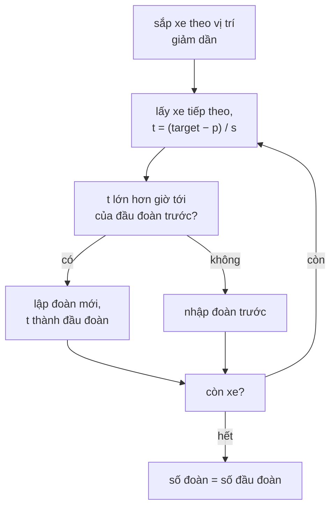

> [!tldr] Đọc nhanh
> - Đề: n xe chạy cùng chiều về đích `target`, không xe nào được vượt. Xe đuổi kịp xe trước thì chạy chậm lại theo nó và thành một **đoàn**. Hỏi có bao nhiêu đoàn về đích.
> - Mấu chốt: chỉ cần **thời gian tới đích nếu chạy một mình**, `(target − vị trí) / tốc độ`. Xét xe từ **gần đích ra xa**: xe nào tới muộn hơn đầu đoàn phía trước thì lập đoàn mới, còn không thì nhập đoàn.
> - Các đầu đoàn tạo thành một [[concepts/monotonic-stack|ngăn xếp đơn điệu]]: thời gian tăng dần từ đáy lên đỉnh. Vì chỉ cần so với **đỉnh**, một biến là đủ. Tổng O(n log n), phần lớn do sắp xếp.
> - Vị trí khác nhau và nhỏ hơn `target`, nên có thể bỏ sắp xếp: dùng mảng đánh chỉ số theo vị trí, O(n + target).
> - Hai cách so sai: tính thời gian bằng `target/s − p/s` (hai phép làm tròn) làm hai xe về cùng lúc thành hai đoàn; nhân chéo bằng `int` trong Java tràn số và gộp nhầm hai đoàn.

> [!info] Bối cảnh
> Bài LeetCode 853, thuộc [[posts/2026-11-23-neetcode-monotonic-stack|ga 7: Ngăn xếp đơn điệu]] trên **tuyến NeetCode: Mảng và chuỗi**. Lời giải có đủ TypeScript, Python, Go, Java và JavaScript. Bạn chỉ cần biết sắp xếp, vòng lặp và phép chia.

> [!abstract]- Từ điển nhanh cho bài này (bấm để mở)
> - **Đoàn xe (fleet)**: một nhóm xe chạy sát nhau cùng tốc độ của xe đầu. Một xe đi riêng cũng là một đoàn.
> - **Thời gian tới đích**: `(target − position) / speed`, giờ xe tới đích nếu không bị ai chặn.
> - **Ngăn xếp (stack)**: chỉ thêm và lấy ở đỉnh. Xem [[concepts/stack|Stack]].
> - **Nhân chéo (cross-multiplication)**: so `a/b > c/d` bằng `a·d > c·b` khi b, d dương, để tránh phép chia.
> - **Tràn số (overflow)**: kết quả vượt khoảng của kiểu số nguyên và "quay vòng" thành một số sai, thường là âm.

## Hình dung trước: đoàn xe trên đường một làn

Một con đường một làn, không chỗ vượt. Xe nhanh đuổi kịp xe chậm phía trước thì phải bám đuôi nó tới đích. Đứng ở vạch đích nhìn ngược lại, bạn chỉ cần biết mỗi xe **định** tới lúc mấy giờ.

| Đời thường | Khái niệm |
|---|---|
| Xe gần đích nhất không bị ai chặn | xét xe theo vị trí giảm dần |
| Giờ xe định tới đích nếu đường trống | `(target − p) / s` |
| Xe sau định tới **sớm hơn hoặc cùng lúc** xe trước | đuổi kịp, nhập đoàn |
| Xe sau định tới **muộn hơn** | không bao giờ đuổi kịp, lập đoàn mới |
| Bảng ghi giờ tới của các xe dẫn đoàn | ngăn xếp, giờ tăng dần |



## Vấn đề

**Đề (tóm tắt bằng lời của mình):** cho `target`, mảng `position` (các vị trí khác nhau, `0 ≤ position[i] < target`) và `speed` cùng độ dài n (n ≤ 10⁵, `target` và tốc độ ≤ 10⁶). Xe không được vượt; xe bắt kịp xe trước (kể cả đúng ở vạch đích) thì tính là cùng đoàn. Trả số đoàn về tới đích. Đề gốc: [LeetCode 853](https://leetcode.com/problems/car-fleet/).

| target | position | speed | Output |
|---|---|---|---|
| 12 | `[10, 8, 0, 5, 3]` | `[2, 4, 1, 1, 3]` | 3 |
| 100 | `[0, 2, 4]` | `[4, 2, 1]` | 1 |
| 10 | `[6, 8]` | `[3, 2]` | 2 |

Ví dụ đầu: xe ở 10 tới lúc 1, xe ở 8 tới lúc 1 (đuổi kịp ngay vạch đích, một đoàn); xe ở 5 tới lúc 7, xe ở 3 tới lúc 3 (đuổi kịp xe ở 5); xe ở 0 tới lúc 12. Ba đoàn.

Mình từng nghĩ phải mô phỏng xe chạy từng giây. Hóa ra không cần biết xe gặp nhau **ở đâu** hay **khi nào**, chỉ cần so giờ tới đích theo đúng thứ tự trên đường.

## Cơ chế

### Cách 1, vét cạn: O(n²)

Xe i dẫn một đoàn khi nó tới đích **muộn hơn mọi xe đứng trước nó**: nếu có xe phía trước tới muộn hơn hoặc bằng, xe i sẽ đuổi kịp và bị chặn. Kiểm điều đó cho từng xe bằng cách duyệt cả mảng.

### Cách 2, sắp xếp rồi quét với ngăn xếp

Sắp theo vị trí giảm dần. Đi từ xe gần đích nhất:
- tính `t = (target − p) / s`;
- nếu ngăn xếp rỗng hoặc `t` **lớn hơn** đỉnh: xe này không đuổi kịp đoàn phía trước, đẩy `t` vào (đầu đoàn mới);
- ngược lại xe nhập đoàn phía trước. Không đẩy gì: đoàn vẫn mang giờ của xe đầu, vì xe sau bị chặn.

Số phần tử trong ngăn xếp là số đoàn. Ngăn xếp luôn **tăng dần** từ đáy lên đỉnh, và mỗi bước chỉ nhìn đỉnh, nên có thể thay cả ngăn xếp bằng một biến "giờ tới của đầu đoàn gần nhất". Dấu so sánh là `>`, không phải `≥`: hai xe tới **cùng lúc** là gặp nhau ở vạch đích, và đề tính đó là một đoàn.

### Cách 3, bỏ sắp xếp

Vị trí là số nguyên khác nhau trong `[0, target)`. Ghi thời gian vào mảng `timeAt[position]`, rồi đi từ `target − 1` về 0. Không so sánh nào để sắp xếp, tổng O(n + target). Đổi lại, cần một mảng cỡ `target` (10⁶ ô) dù chỉ có vài xe.

### Đo

TypeScript, trung vị, mọi xe cùng tốc độ (ca tệ cho vét cạn: xe càng xa càng tới muộn, mỗi xe một đoàn, vòng trong không bao giờ dừng sớm):

| n | vét cạn | sắp xếp + ngăn xếp | mảng theo vị trí |
|---|---|---|---|
| 2 000 | 9,6 ms | 0,31 ms | 2,71 ms |
| 4 000 | 40,6 ms | 0,85 ms | 2,57 ms |
| 8 000 | 168,2 ms | 1,92 ms | 1,44 ms |
| 16 000 | 679,8 ms | 3,94 ms | 2,89 ms |
| 10⁵ (target 2·10⁶) | (không chạy) | 28,91 ms | 6,51 ms |
| 10⁶ (target 2·10⁶) | (không chạy) | 441,64 ms | 15,39 ms |

Vét cạn đúng dáng n²: gấp đôi n, gấp 4 thời gian. Mảng theo vị trí tốn chừng 2–3 ms cố định để duyệt 10⁶ ô, nên chỉ thắng khi n đủ lớn. Hai dòng cuối dùng `target = 2·10⁶` để chứa được 10⁶ xe, vượt giới hạn của đề, chỉ để thấy dáng: sắp mảng các cặp `[vị trí, tốc độ]` trong JS tốn kém, còn mảng theo vị trí thì gần tuyến tính.

### So thời gian: phép chia nào an toàn

Thời gian là phân số. Có ba cách so:
- **Một phép chia `(target − p) / s`**: IEEE 754 làm tròn đúng mỗi phép chia, nên hai phân số **bằng nhau** luôn ra cùng một số thực. Với giới hạn của đề (tử và mẫu ≤ 10⁶), hai phân số **khác nhau** chênh nhau ít nhất 1/(s₁·s₂) ≥ 10⁻¹², lớn hơn nhiều khoảng cách giữa hai số thực liền kề ở cùng độ lớn, nên cũng không bị làm tròn thành bằng nhau. File TypeScript đối chiếu 20 000 bộ ngẫu nhiên với cách nhân chéo: 0 lần lệch.
- **Hai phép chia `target/s − p/s`**: đúng về toán, nhưng mỗi phép chia làm tròn riêng rồi mới trừ. Với `target = 4`, xe ở 3 tốc độ 3 và xe ở 1 tốc độ 9 cùng tới lúc 1/3, nhưng công thức này cho `0.33333333333333326` và `0.3333333333333333`: xe sau "muộn hơn", thành hai đoàn.
- **Nhân chéo số nguyên**: `d₁·s₂ > d₂·s₁`, chính xác tuyệt đối, miễn kiểu số đủ rộng. 10⁶ · 10⁶ = 10¹² vượt `int` 32 bit của Java (khoảng 2,1·10⁹).

### Bên dưới năm ngôn ngữ

| | Sắp theo vị trí giảm dần | Bẫy riêng |
|---|---|---|
| TypeScript / JavaScript | `sort((a, b) => b[0] − a[0])` | thiếu hàm so sánh thì `sort` so **chuỗi**: `"17"` đứng trước `"2"` |
| Python | `sorted(zip(position, speed), reverse=True)` | quên `reverse=True`: đi từ xe xa đích, sai 4/7 ca |
| Go | `slices.SortFunc(idx, …)` | `int / int` là chia **nguyên**: phải đổi sang `float64` trước khi chia |
| Java | `Arrays.sort(Integer[], Comparator)` | `(double)` phải đứng trước phép chia; nhân chéo cần `long`, `int` tràn lặng lẽ |

## Ví dụ chạy được

[TypeScript](../code/neetcode-car-fleet/car-fleet.ts) · [Python](../code/neetcode-car-fleet/car_fleet.py) · [Go](../code/neetcode-car-fleet/car_fleet.go) · [Java](../code/neetcode-car-fleet/car-fleet.java) · [JavaScript](../code/neetcode-car-fleet/car-fleet.js)

Mỗi file chạy 7 ca (file Java thêm ca tràn số). Dưới đây là cách sắp xếp với ngăn xếp và cách nhân chéo.

```ts
// Sắp xếp theo vị trí giảm dần, rồi ngăn xếp thời gian tới đích của các đầu đoàn.
function sortStack(target: number, position: number[], speed: number[]): number {
  const cars = position.map((p, i) => [p, speed[i]]).sort((a, b) => b[0] - a[0]); // gần đích trước
  const stack: number[] = [];
  for (const [p, s] of cars) {
    const t = (target - p) / s;
    if (stack.length === 0 || t > stack[stack.length - 1]) stack.push(t); // tới muộn hơn đoàn trước: đoàn mới
    // ngược lại: đuổi kịp đoàn trước ở trước đích, nhập đoàn, không đẩy gì
  }
  return stack.length;
}

// Chỉ cần nhớ đỉnh: một biến thay cho cả ngăn xếp. So bằng nhân chéo số nguyên, không chia.
function sortCrossMultiply(target: number, position: number[], speed: number[]): number {
  const idx = position.map((_, i) => i).sort((a, b) => position[b] - position[a]);
  let fleets = 0, leadDist = 0, leadSpeed = 1; // thời gian đầu đoàn = leadDist / leadSpeed
  for (const i of idx) {
    const d = target - position[i];
    // d / speed[i] > leadDist / leadSpeed  ⇔  d·leadSpeed > leadDist·speed[i] (mẫu dương)
    if (fleets === 0 || d * leadSpeed > leadDist * speed[i]) { fleets++; leadDist = d; leadSpeed = speed[i]; }
  }
  return fleets;
}
```

```python
def sort_stack(target: int, position: list[int], speed: list[int]) -> int:
    stack: list[float] = []
    for p, s in sorted(zip(position, speed), reverse=True):  # reverse=True: xe gần đích trước
        t = (target - p) / s  # "/" luôn ra float trong Python 3
        if not stack or t > stack[-1]:
            stack.append(t)
    return len(stack)

def sort_cross_multiply(target: int, position: list[int], speed: list[int]) -> int:
    fleets, lead_d, lead_s = 0, 0, 1
    for p, s in sorted(zip(position, speed), reverse=True):
        d = target - p
        if fleets == 0 or d * lead_s > lead_d * s:  # int Python không tràn, nhân chéo luôn đúng
            fleets, lead_d, lead_s = fleets + 1, d, s
    return fleets
```

```go
func sortStack(target int, position, speed []int) int {
	idx := make([]int, len(position))
	for i := range idx {
		idx[i] = i
	}
	slices.SortFunc(idx, func(a, b int) int { return position[b] - position[a] }) // vị trí giảm dần
	stack := []float64{}
	for _, i := range idx {
		t := float64(target-position[i]) / float64(speed[i]) // int / int trong Go là chia NGUYÊN: phải đổi sang float64 trước
		if len(stack) == 0 || t > stack[len(stack)-1] {
			stack = append(stack, t)
		}
	}
	return len(stack)
}

func sortCrossMultiply(target int, position, speed []int) int {
	idx := make([]int, len(position))
	for i := range idx {
		idx[i] = i
	}
	slices.SortFunc(idx, func(a, b int) int { return position[b] - position[a] })
	fleets, leadD, leadS := 0, 0, 1
	for _, i := range idx {
		d := target - position[i]
		if fleets == 0 || d*leadS > leadD*speed[i] { // int của Go là 64 bit: 10⁶ · 10⁶ = 10¹² vừa
			fleets, leadD, leadS = fleets+1, d, speed[i]
		}
	}
	return fleets
}
```

```java
static int sortStack(int target, int[] position, int[] speed) {
    Deque<Double> stack = new ArrayDeque<>();
    for (int i : byPositionDesc(position)) {
        double t = (double) (target - position[i]) / speed[i]; // ép kiểu TRƯỚC khi chia, không thì chia nguyên
        if (stack.isEmpty() || t > stack.peek()) stack.push(t);
    }
    return stack.size();
}

static int sortCrossMultiply(int target, int[] position, int[] speed) {
    int fleets = 0;
    long leadD = 0, leadS = 1;
    for (int i : byPositionDesc(position)) {
        long d = target - position[i];
        if (fleets == 0 || d * leadS > leadD * speed[i]) { fleets++; leadD = d; leadS = speed[i]; } // long: 10¹² vừa
    }
    return fleets;
}
```

```js
function sortStack(target, position, speed) {
  const cars = position.map((p, i) => [p, speed[i]]).sort((a, b) => b[0] - a[0]); // PHẢI có hàm so sánh
  const stack = [];
  for (const [p, s] of cars) {
    const t = (target - p) / s;
    if (stack.length === 0 || t > stack[stack.length - 1]) stack.push(t);
  }
  return stack.length;
}

function sortCrossMultiply(target, position, speed) {
  const idx = position.map((_, i) => i).sort((a, b) => position[b] - position[a]);
  let fleets = 0, leadDist = 0, leadSpeed = 1;
  for (const i of idx) {
    const d = target - position[i];
    if (fleets === 0 || d * leadSpeed > leadDist * speed[i]) { fleets++; leadDist = d; leadSpeed = speed[i]; } // ≤ 10¹² < 2⁵³: vẫn chính xác
  }
  return fleets;
}
```


```text
$ node car-fleet.ts
bruteForce         7/7 ca đúng
sortStack          7/7 ca đúng
sortCrossMultiply  7/7 ca đúng
bucketByPosition   7/7 ca đúng
noComparator       6/7 ca đúng; sai ở t=20 [6,2,17]
subtractFormula    6/7 ca đúng; sai ở t=4 [3,1]

(4 − 3) / 3 = 0.3333333333333333, (4 − 1) / 9 = 0.3333333333333333
4/3 − 3/3 = 0.33333333333333326, 4/9 − 1/9 = 0.3333333333333333
20 000 bộ ngẫu nhiên (target, speed ≤ 10⁶): chia một lần lệch nhân chéo 0 lần

n          vét cạn   sắp xếp + ngăn xếp   mảng theo vị trí   (ms, trung vị)
2000           9.6                 0.31               2.71
4000          40.6                 0.85               2.57
8000         168.2                 1.92               1.44
16000        679.8                 3.94               2.89
100000           —                28.91               6.51
1000000          —               441.64              15.39
```

`noComparator` gọi `sort()` không hàm so sánh trên các cặp `[vị trí, tốc độ]`: mỗi cặp bị đổi thành chuỗi `"6,3"`, `"2,9"`, `"17,2"` rồi so từng ký tự, nên `"17,2"` đứng đầu vì `"1" < "2"`. Đảo lại thành 6, 2, 17: xe ở 17, gần đích nhất, bị xét cuối cùng. Đến Java, nhân chéo bằng `int`:

```text
$ java car-fleet.java
sortStack          8/8 ca đúng
sortCrossMultiply  8/8 ca đúng
crossMultiplyInt   7/8 ca đúng; sai ở t=1000000 [500000, 0] → 1
1_000_000 * 999_999 trong int = -728379968
```

Xe ở 0 tốc độ 10⁶ tới lúc 1, xe ở 500 000 tốc độ 999 999 tới lúc khoảng 0,5: hai đoàn. Nhưng `1 000 000 · 999 999` tràn thành số âm, phép so đảo chiều, và hai xe bị gộp làm một. Python không có bẫy này (int không giới hạn) nhưng có bẫy thứ tự:

```text
$ python3 car_fleet.py
sort_stack           7/7 ca đúng
sort_cross_multiply  7/7 ca đúng
bucket_by_position   7/7 ca đúng
sort_ascending       3/7 ca đúng; sai ở t=12 [10, 8, 0, 5, 3] t=100 [0, 2, 4] t=10 [6, 8] t=10 [0, 4, 2]
```

File Go chạy thêm bản quên đổi sang `float64` (`intDivision`, 6/7: với `target = 10`, `(10 − 6) / 3` và `(10 − 8) / 2` đều thành 1 khi chia nguyên). JavaScript in `7/7 ca đúng` cho cả ba cách.

## Hiểu lầm và bẫy hay gặp

- **"Phải mô phỏng xe chạy."** Chỉ cần thời gian tới đích và thứ tự vị trí. Xe gặp nhau ở đâu không ảnh hưởng tới số đoàn.
- **So bằng `≥` thay vì `>`.** Hai xe tới cùng lúc là gặp nhau đúng ở vạch đích, đề tính là một đoàn. Dùng `≥` để lập đoàn mới sẽ đếm thừa.
- **Cập nhật đầu đoàn khi xe nhập đoàn.** Xe sau bị chặn, nên đoàn vẫn tới theo giờ của xe đầu. Ghi đè bằng giờ của xe sau (sớm hơn) làm các xe phía sau dễ "đuổi kịp" hơn thật.
- **Sắp theo vị trí tăng dần.** Phải xét từ xe gần đích nhất, vì chỉ xe phía trước mới chặn được xe phía sau.
- **Tính thời gian bằng hai phép chia.** `target/s − p/s` lệch ở chữ số cuối và tách một đoàn làm hai. Dùng `(target − p) / s` hoặc nhân chéo.
- **Nhân chéo bằng `int` 32 bit.** 10⁶ · 10⁶ vượt 2³¹. Java cần `long`; Go `int` đã là 64 bit; JS vẫn chính xác vì 10¹² < 2⁵³.

## Câu hỏi tự kiểm tra

> [!question]- Với `target = 10`, `position = [0, 4, 2]`, `speed = [2, 1, 3]`, có mấy đoàn?
> Sắp giảm dần: xe ở 4 tới lúc 6, xe ở 2 tới lúc 8/3 ≈ 2,67 (đuổi kịp, nhập đoàn), xe ở 0 tới lúc 5 (≤ 6, nhập đoàn). Một đoàn.

> [!question]- Vì sao ngăn xếp các đầu đoàn luôn tăng dần từ đáy lên đỉnh?
> Một xe chỉ được đẩy vào khi thời gian của nó **lớn hơn** đỉnh. Nên mỗi phần tử mới lớn hơn mọi phần tử đã có.

> [!question]- Khi nào cách "mảng theo vị trí" chậm hơn cách sắp xếp?
> Khi n nhỏ so với `target`: nó luôn duyệt đủ `target` ô. Với 2 000 xe và `target = 10⁶`, nó tốn 2,71 ms so với 0,31 ms của cách sắp xếp.

> [!question]- Trong Java, sửa `crossMultiplyInt` thế nào là đủ?
> Khai báo các biến nhân là `long` (hoặc ép một thừa số sang `long` trước khi nhân). Ép **sau** khi nhân, như `(long) (d * leadS)`, thì đã tràn rồi.

## Tham khảo

- [LeetCode 853: Car Fleet](https://leetcode.com/problems/car-fleet/) (đề gốc)
- [Java Language Specification SE 21, §15.17.1 Multiplication Operator](https://docs.oracle.com/javase/specs/jls/se21/html/jls-15.html#jls-15.17.1) (nhân số nguyên tràn thì giữ các bit thấp, không báo lỗi)
- [ECMAScript 2025: `Array.prototype.sort`](https://tc39.es/ecma262/2025/#sec-array.prototype.sort) (không có hàm so sánh thì so theo chuỗi)
- [Go spec: Arithmetic operators](https://go.dev/ref/spec#Arithmetic_operators) (chia hai số nguyên thì bỏ phần lẻ)
- [Python: Sorting Techniques](https://docs.python.org/3/howto/sorting.html) (`sorted` với `reverse=True`, so tuple theo từng phần tử)
