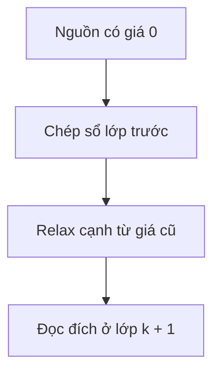

> [!tldr] Đọc nhanh
> - Có tối đa `k` điểm dừng trung gian nghĩa là có tối đa `k + 1` chặng.
> - Chi phí tốt nhất tới một thành phố phải gắn với số chặng được phép. Một đường rẻ đã dùng hết chặng có thể vô ích.
> - [[concepts/edge-layer-relaxation|Relaxation theo lớp cạnh]] đọc sổ lớp trước và ghi sang sổ mới để mỗi lượt chỉ thêm một cạnh.

> [!info] Bối cảnh
> Bài LeetCode 787, thuộc [[posts/2026-11-27-neetcode-shortest-path|ga 5: Đường đi ngắn nhất]] trên tuyến NeetCode Đồ thị. Bạn chỉ cần biết vòng lặp và mảng để bắt đầu.

> [!abstract]- Từ điển nhanh cho bài này (bấm để mở)
> - Điểm dừng là thành phố ở giữa chuyến đi, không tính nguồn và đích.
> - Chặng là một cạnh có hướng có giá vé.
> - Lớp `i` giữ giá nhỏ nhất với tối đa `i` chặng.

## Hình dung trước: vé nối chuyến cùng ngân sách chặng

Từ A, đường A → B → C giá 2, còn A → C giá 6. C → D giá 1. Nếu chỉ được dừng ở một thành phố, đường rẻ tới C qua B đã dùng hết hai chặng. Vé hợp lệ đến D giá 7 qua C.

| Đời thường | Khái niệm |
| --- | --- |
| Số lần nối chuyến được phép | Tối đa k điểm dừng |
| Mỗi cuống vé dùng một chặng | Một cạnh |
| Bảng giá theo số cuống vé | Trạng thái theo lớp cạnh |



## Vấn đề: rẻ nhất trong số đường còn đủ chặng

Có 2 đến 100 thành phố, đánh số từ 0. Cạnh là chuyến một chiều có giá từ 1 đến 10.000. Tìm giá nhỏ nhất từ nguồn đến đích khác nguồn, cho phép từ 0 đến k thành phố trung gian với `k < n`. Trả −1 nếu không có hành trình hợp lệ.

## Cơ chế

### Vét cạn và lớp cạnh

Có thể liệt kê đường đi theo chặng còn lại rồi chọn giá thấp nhất. Với b là bậc ra cực đại, số trạng thái được duyệt có thể tăng theo O(bᵏ⁺¹) khi b ≥ 2, với O(k + 1) độ sâu ngăn xếp khi tách sẵn cạnh đi ra. Tệp đối chiếu nhỏ quét danh sách cạnh để tránh thêm một cấu trúc dữ liệu.

Mình dùng `best[i][v]` cho giá nhỏ nhất tới v với tối đa i chặng. Hai khả năng là giữ giá ở lớp trước hoặc nối thêm đúng một cạnh `u → v`. Khởi tạo lớp 0 có giá 0 ở nguồn và vô cực ở nơi khác. Tiến từ lớp 1 đến `k + 1`.

Ở ví dụ, lớp 1 biết giá C là 6. Lớp 2 hạ C xuống 2 và đặt D là 7 từ **giá C lớp 1**. Cập nhật vào cùng mảng theo thứ tự A → B, B → C, C → D sẽ lén đi ba cạnh ngay lượt đầu.

Chỉ cần giữ hai lớp cạnh, nên thời gian O((k + 1)(V + E)) và bộ nhớ phụ O(V). Ví dụ tự sinh có sáu lớp rộng hai đỉnh, một đầu và một đích. DFS thực hiện 191 lời gọi; vòng DP quét 168 lượt cạnh. Hai số đếm mô tả công việc của mỗi cách, không phải tỉ lệ thời gian chạy.

## Ví dụ chạy được

[TypeScript](../code/neetcode-cheapest-flights-within-k-stops/flight-budget.ts) · [Python](../code/neetcode-cheapest-flights-within-k-stops/flight_budget.py) · [Go](../code/neetcode-cheapest-flights-within-k-stops/flight_budget.go) · [Java](../code/neetcode-cheapest-flights-within-k-stops/flight-budget.java) · [JavaScript](../code/neetcode-cheapest-flights-within-k-stops/flight-budget.js) · [PHP](../code/neetcode-cheapest-flights-within-k-stops/flight-budget.php) · [Rust](../code/neetcode-cheapest-flights-within-k-stops/flight_budget.rs)

Tab hiển thị hàm chính. File tải về còn chạy các cách so sánh trên những ca nhỏ. File TypeScript chạy thêm phép đối chiếu ngẫu nhiên.

```ts
function cheapestFlight(n: number, flights: number[][], start: number, end: number, k: number): number {
  let best = Array<number>(n).fill(Infinity)
  best[start] = 0
  for (let used = 0; used <= k; used++) {
    const next = best.slice()
    for (const [from, to, price] of flights) next[to] = Math.min(next[to], best[from] + price)
    best = next
  }
  return best[end] === Infinity ? -1 : best[end]
}
```

```python
def cheapest_flight(n, flights, start, end, k):
    best = [float("inf")] * n
    best[start] = 0
    for _ in range(k + 1):
        following = best.copy()
        for source, target, price in flights:
            following[target] = min(following[target], best[source] + price)
        best = following
    return -1 if best[end] == float("inf") else best[end]
```

```go
func cheapestFlight(n int, flights [][3]int, start, end, k int) int {
	best := make([]int, n)
	for i := range best {
		best[i] = infinity
	}
	best[start] = 0
	for used := 0; used <= k; used++ {
		next := append([]int(nil), best...)
		for _, flight := range flights {
			from, to, price := flight[0], flight[1], flight[2]
			if best[from] != infinity {
				next[to] = min(next[to], best[from]+price)
			}
		}
		best = next
	}
	if best[end] == infinity {
		return -1
	}
	return best[end]
}
```

```java
static int cheapestFlight(int n, int[][] flights, int start, int end, int k) {
    int[] best = new int[n];
    Arrays.fill(best, Integer.MAX_VALUE);
    best[start] = 0;
    for (int used = 0; used <= k; used++) {
        int[] next = best.clone();
        for (int[] flight : flights) {
            int from = flight[0], to = flight[1], price = flight[2];
            if (best[from] != Integer.MAX_VALUE) {
                next[to] = Math.min(next[to], best[from] + price);
            }
        }
        best = next;
    }
    return best[end] == Integer.MAX_VALUE ? -1 : best[end];
}
```

```js
function cheapestFlight(n, flights, start, end, k) {
  let best = Array(n).fill(Infinity)
  best[start] = 0
  for (let used = 0; used <= k; used++) {
    const next = best.slice()
    for (const [from, to, price] of flights) next[to] = Math.min(next[to], best[from] + price)
    best = next
  }
  return best[end] === Infinity ? -1 : best[end]
}
```

```php
function cheapestFlight(int $n, array $flights, int $start, int $end, int $k): int {
    $best = array_fill(0, $n, PHP_INT_MAX);
    $best[$start] = 0;
    for ($used = 0; $used <= $k; $used++) {
        $next = $best;
        foreach ($flights as [$from, $to, $price]) {
            if ($best[$from] !== PHP_INT_MAX) {
                $next[$to] = min($next[$to], $best[$from] + $price);
            }
        }
        $best = $next;
    }
    return $best[$end] === PHP_INT_MAX ? -1 : $best[$end];
}
```

```rust
fn cheapest_flight(
    n: usize,
    flights: &[(usize, usize, i32)],
    start: usize,
    end: usize,
    k: usize,
) -> i32 {
    let mut best = vec![i32::MAX; n];
    best[start] = 0;
    for _ in 0..=k {
        let mut next = best.clone();
        for &(from, to, price) in flights {
            if best[from] != i32::MAX {
                next[to] = next[to].min(best[from] + price);
            }
        }
        best = next;
    }
    if best[end] == i32::MAX {
        -1
    } else {
        best[end]
    }
}
```

```text
5/5 ca đúng
201/201 ca đối chiếu; DFS 191 lời gọi, DP 168 lượt xét cạnh
```

## Hiểu lầm và bẫy hay gặp

- **Chạy k vòng.** Không có điểm dừng vẫn được bay một cạnh trực tiếp.
- **Ghi và đọc cùng bảng giá.** Giá vừa cập nhật có thể truyền qua nhiều cạnh trong một vòng.
- **Dijkstra chỉ lưu một giá trên thành phố.** Khi có hạn chặng, hai đường đến cùng nơi có thể không thay thế được nhau.
- **Cộng vào sentinel nguyên.** Java, Go, PHP và Rust kiểm giá hữu hạn trước khi cộng.

## Câu hỏi tự kiểm tra

> [!question]- Nếu k tăng từ 1 lên 2 trong ví dụ, giá tốt nhất là bao nhiêu?
> 3, theo A → B → C → D.

> [!question]- Vì sao cần chép sổ lớp trước?
> Trạng thái là tốt nhất với tối đa i chặng. Một đường cũ dùng ít hơn vẫn hợp lệ.

## Tham khảo

- [LeetCode 787 · Cheapest Flights Within K Stops](https://leetcode.com/problems/cheapest-flights-within-k-stops/)
- [MIT 6.006 · Bellman–Ford](https://ocw.mit.edu/courses/6-006-introduction-to-algorithms-spring-2020/resources/mit6_006s20_lec12/)
