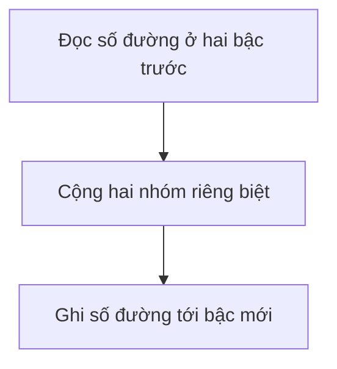

> [!tldr] Đọc nhanh
> - Chia mọi đường tới bậc i theo bước cuối dài 1 hay 2. Hai nhóm tách nhau, nên mình cộng số cách của hai bậc trước.
> - Bậc 0 có một cách là dãy bước rỗng. Giá trị này giúp công thức đếm được cú nhảy thẳng từ nền lên bậc 2.
> - Ghi kết quả từng bậc giảm số lần tính từ cấp số mũ xuống tuyến tính. Khi chỉ cần số ở đích, giữ hai kết quả gần nhất là đủ.

> [!info] Bối cảnh
> Đây là bài LeetCode 70 tại [[posts/2026-11-27-neetcode-linear-dp|ga DP-01: Truy hồi một chiều]]. Mình dùng cầu thang của một kho hàng để đếm đường tới mỗi tầng. Bạn chỉ cần biết cách đọc mảng và vòng lặp.

> [!abstract]- Từ điển nhanh cho bài này (bấm để mở)
> - [[concepts/dp-state|Trạng thái DP]] là câu hỏi nhỏ gắn với một chỉ số. Ở đây đó là số cách đứng đúng bậc i.
> - [[concepts/memoization|Memoization]] cất đáp án đã tính để lần gọi sau đọc lại.
> - [[concepts/rolling-state|Trạng thái cuộn]] giữ các giá trị còn được vòng sau đọc.

## Hình dung trước: sổ đếm tại cầu thang

Ở bậc 4, mình chia đường của người giao hàng theo lần tiếp đất trước đó. Một nhóm vừa từ bậc 3 bước tới. Nhóm kia vừa từ bậc 2 nhảy tới. Nếu sổ hai bậc đã có số, mình chỉ cần cộng chúng.

| Đời thường | Khái niệm |
|---|---|
| Trang sổ của bậc i | Trạng thái f(i) |
| Hai nơi lấy đà | Hai trạng thái phụ thuộc |
| Ghi một lần, đọc nhiều lần | Memoization hoặc bảng DP |
| Hai trang còn dùng ở bậc sau | Trạng thái cuộn |



## Vấn đề: đếm dãy bước tới đúng đích

Cho số bậc n từ 1 đến 45. Mỗi lần mình tiến đúng một hoặc hai bậc. Thứ tự tạo ra các dãy khác nhau, nên `1,2,1` và `2,1,1` là hai cách riêng. Chẳng hạn trên cầu thang bốn bậc, có `1111`, `112`, `121`, `211`, `22`. Kết quả là 5. [Đề gốc LeetCode 70](https://leetcode.com/problems/climbing-stairs/)

## Cơ chế

Với i ≥ 2, mọi dãy kết thúc ở i nối đúng một bước cuối vào dãy hợp lệ tới i−1 hoặc i−2. Bỏ bước cuối là phép ngược duy nhất. Phép chia này có cả tính đầy đủ lẫn loại trừ lẫn nhau, nên `f(i) = f(i−1) + f(i−2)`. Đặt `f(0) = f(1) = 1`. Bảng từ nền có dãy `1,1,2,3,5`.

| Cách | Thời gian | Bộ nhớ phụ |
|---|---|---|
| Vét cạn hai nhánh | Θ(φⁿ), φ ≈ 1,618 | O(n) ngăn xếp |
| Đệ quy với memo | O(n) | O(n) bảng và ngăn xếp |
| Điền bảng từ dưới lên | O(n) | O(n) bảng |
| Giữ hai số gần nhất | O(n) | O(1) |

Cây gọi của `f(4)` chạm `f(2)` qua `f(3)` và trực tiếp qua nhánh bước dài 2. Vét cạn lặp lại cả cây con. Bản memo ghi từ chỉ số i tới đáp án, vì mọi lời gọi cùng i có cùng ý nghĩa. Bảng điền từ dưới lên dùng đúng công thức đó và đi theo thứ tự phụ thuộc.

Trước lượt i của bản cuộn, hai biến chứa `f(i−2)` và `f(i−1)`. Tính tổng trước, rồi dịch cửa sổ lên một bậc. Bất biến tự lặp cho tới khi biến mới nhất chứa `f(n)`. Nếu cần đọc lại mọi bậc để phân tích, bảng cho phép tra trực tiếp.

## Ví dụ chạy được

[TypeScript](../code/neetcode-climbing-stairs/stairs.ts) · [Python](../code/neetcode-climbing-stairs/stairs.py) · [Go](../code/neetcode-climbing-stairs/stairs.go) · [Java](../code/neetcode-climbing-stairs/stairs.java) · [JavaScript](../code/neetcode-climbing-stairs/stairs.js) · [PHP](../code/neetcode-climbing-stairs/stairs.php) · [Rust](../code/neetcode-climbing-stairs/stairs.rs)

```ts
function candidates(n: number, add: (i: number) => number, choose: (a: number, b: number) => number, base: number) {
    function brute(i: number): number {
        return i < 2 ? base : choose(brute(i - 1) + add(i - 1), brute(i - 2) + add(i - 2))
    }

    const cache: Map<number, number> = new Map<number, number>()
    function memoized(i: number): number {
        if (i < 2) return base
        const saved = cache.get(i)
        if (saved !== undefined) return saved
        const answer = choose(memoized(i - 1) + add(i - 1), memoized(i - 2) + add(i - 2))
        cache.set(i, answer)
        return answer
    }

    function tabulated() {
        const dp = [base, base]
        for (let i = 2; i <= n; i++) {
            dp[i] = choose(dp[i - 1] + add(i - 1), dp[i - 2] + add(i - 2))
        }
        return dp[n]
    }

    function rolling() {
        let twoBack = base
        let oneBack = base
        for (let i = 2; i <= n; i++) {
            const next = choose(oneBack + add(i - 1), twoBack + add(i - 2))
            twoBack = oneBack
            oneBack = next
        }
        return oneBack
    }

    return { brute: () => brute(n), memoized: () => memoized(n), tabulated, rolling }
}
```

```python
def check(n, add, choose, base, expected, small):
    def brute(i):
        if i < 2:
            return base
        return choose(brute(i - 1) + add(i - 1), brute(i - 2) + add(i - 2))

    # Tránh giới hạn đệ quy Python khi đề cho n tới 1000.
    def table():
        dp = [base, base]
        for i in range(2, n + 1):
            dp.append(choose(dp[i - 1] + add(i - 1), dp[i - 2] + add(i - 2)))
        return dp[n]

    def rolling():
        two_back = one_back = base
        for i in range(2, n + 1):
            two_back, one_back = one_back, choose(one_back + add(i - 1), two_back + add(i - 2))
        return one_back

    if small:
        assert brute(n) == expected
    assert table() == expected
    assert rolling() == expected
```

```go
package main

import "fmt"

func check(n int, add func(int) int, choose func(int, int) int, base, expected int, small bool) {
	var brute func(int) int
	brute = func(i int) int {
		if i < 2 {
			return base
		}
		return choose(brute(i-1)+add(i-1), brute(i-2)+add(i-2))
	}
	if small && brute(n) != expected {
		panic("vét cạn sai")
	}

	dp := make([]int, n+1)
	dp[0], dp[1] = base, base
	twoBack, oneBack := base, base
	for i := 2; i <= n; i++ {
		dp[i] = choose(dp[i-1]+add(i-1), dp[i-2]+add(i-2))
		twoBack, oneBack = oneBack, choose(oneBack+add(i-1), twoBack+add(i-2))
	}
	if dp[n] != expected || oneBack != expected {
		panic("quy hoạch động sai")
	}
}
```

```java
import java.util.function.IntBinaryOperator;
import java.util.function.IntUnaryOperator;

class Stairs {
    static int brute(int i, IntUnaryOperator add, IntBinaryOperator choose, int base) {
        if (i < 2) return base;
        return choose.applyAsInt(brute(i-1, add, choose, base) + add.applyAsInt(i-1),
                                 brute(i-2, add, choose, base) + add.applyAsInt(i-2));
    }

    static void check(int n, IntUnaryOperator add, IntBinaryOperator choose, int base, int expected, boolean small) {
        if (small && brute(n, add, choose, base) != expected) throw new AssertionError();
        int[] dp = new int[n+1];
        dp[0] = dp[1] = base;
        int twoBack = base;
        int oneBack = base;
        for (int i = 2; i <= n; i++) {
            dp[i] = choose.applyAsInt(dp[i-1] + add.applyAsInt(i-1), dp[i-2] + add.applyAsInt(i-2));
            int next = choose.applyAsInt(oneBack + add.applyAsInt(i-1), twoBack + add.applyAsInt(i-2));
            twoBack = oneBack;
            oneBack = next;
        }
        if (dp[n] != expected || oneBack != expected) throw new AssertionError();
    }
}
```

```js
function candidates(n, add, choose, base) {
    function brute(i) {
        return i < 2 ? base : choose(brute(i - 1) + add(i - 1), brute(i - 2) + add(i - 2))
    }

    const cache = new Map()
    function memoized(i) {
        if (i < 2) return base
        const saved = cache.get(i)
        if (saved !== undefined) return saved
        const answer = choose(memoized(i - 1) + add(i - 1), memoized(i - 2) + add(i - 2))
        cache.set(i, answer)
        return answer
    }

    function tabulated() {
        const dp = [base, base]
        for (let i = 2; i <= n; i++) {
            dp[i] = choose(dp[i - 1] + add(i - 1), dp[i - 2] + add(i - 2))
        }
        return dp[n]
    }

    function rolling() {
        let twoBack = base
        let oneBack = base
        for (let i = 2; i <= n; i++) {
            const next = choose(oneBack + add(i - 1), twoBack + add(i - 2))
            twoBack = oneBack
            oneBack = next
        }
        return oneBack
    }

    return { brute: () => brute(n), memoized: () => memoized(n), tabulated, rolling }
}
```

```php
<?php
declare(strict_types=1);

function brute(int $i, callable $add, callable $choose, int $base): int {
    if ($i < 2) return $base;
    return $choose(brute($i - 1, $add, $choose, $base) + $add($i - 1),
                   brute($i - 2, $add, $choose, $base) + $add($i - 2));
}

function check(int $n, callable $add, callable $choose, int $base, int $expected, bool $small): void {
    if ($small && brute($n, $add, $choose, $base) !== $expected) {
        throw new RuntimeException('vét cạn sai');
    }
    $dp = [$base, $base];
    $twoBack = $oneBack = $base;
    for ($i = 2; $i <= $n; $i++) {
        $dp[$i] = $choose($dp[$i - 1] + $add($i - 1), $dp[$i - 2] + $add($i - 2));
        [$twoBack, $oneBack] = [$oneBack, $choose($oneBack + $add($i - 1), $twoBack + $add($i - 2))];
    }
    if ($dp[$n] !== $expected || $oneBack !== $expected) {
        throw new RuntimeException('quy hoạch động sai');
    }
}
```

```rust
fn brute(
    i: usize,
    add: &impl Fn(usize) -> i32,
    choose: &impl Fn(i32, i32) -> i32,
    base: i32,
) -> i32 {
    if i < 2 {
        return base;
    }
    choose(
        brute(i - 1, add, choose, base) + add(i - 1),
        brute(i - 2, add, choose, base) + add(i - 2),
    )
}

fn check(
    n: usize,
    add: impl Fn(usize) -> i32,
    choose: impl Fn(i32, i32) -> i32,
    base: i32,
    expected: i32,
    small: bool,
) {
    if small {
        assert_eq!(brute(n, &add, &choose, base), expected);
    }
    let mut dp = vec![base; n + 1];
    let (mut two_back, mut one_back) = (base, base);
    for i in 2..=n {
        dp[i] = choose(dp[i - 1] + add(i - 1), dp[i - 2] + add(i - 2));
        (two_back, one_back) = (
            one_back,
            choose(one_back + add(i - 1), two_back + add(i - 2)),
        );
    }
    assert_eq!(dp[n], expected);
    assert_eq!(one_back, expected);
}
```

Mỗi file kiểm 5 đầu vào, gồm n = 45. Vét cạn dừng ở n ≤ 24 để bộ kiểm chạy nhanh. Node.js chạy cả bốn cách. Các file còn lại đối chiếu vét cạn ở ca nhỏ, bảng và hai biến. Hàm gộp cộng hai số và giá từng bước ở đây là 0, để mã nhìn ra khuôn dùng lại ở bài tính phí.

Đây là số lần chạy phép gộp trong TypeScript, loại các ca cơ sở. Với n = 24, memo chỉ gộp tại các chỉ số từ 2 đến 24.

```text
5/5 ca đúng
n=24: vét cạn 75024, memo 23 lần gộp
```

## Hiểu lầm và bẫy hay gặp

- Đặt `f(0) = 0` làm mất đường chỉ nhảy một cú từ 0 lên 2. Một đường rỗng vẫn là một cách hoàn thành trạng thái số 0.
- Dịch biến trước khi cộng khiến phép cộng đọc nhầm hai bản của cùng một bậc. Dùng một biến tạm hoặc gán đồng thời.
- Ở giới hạn đề `f(45) = 1.836.311.903` vừa số nguyên có dấu 32 bit. Nếu tính thêm bậc 46 thì cần kiểu rộng hơn trong Java và Rust, hoặc số nguyên lớn nếu mở rộng đáng kể giới hạn.

## Câu hỏi tự kiểm tra

> [!question]- Tại sao không lấy n nhân 2?
> Hai lựa chọn ở mỗi bước làm thay đổi số bậc còn lại. Chỉ các dãy tổng đúng n mới hợp lệ.

> [!question]- Vì sao có thể bỏ f(i−2) sau lượt i?
> Lượt sau đọc f(i−1) và f(i). Không có lượt tương lai nào dùng f(i−2).

## Tham khảo

- [LeetCode 70](https://leetcode.com/problems/climbing-stairs/)
- [MIT 6.006, bài giảng về bài toán con và Fibonacci](https://ocw.mit.edu/courses/6-006-introduction-to-algorithms-fall-2011/resources/mit6_006f11_lec19/)
