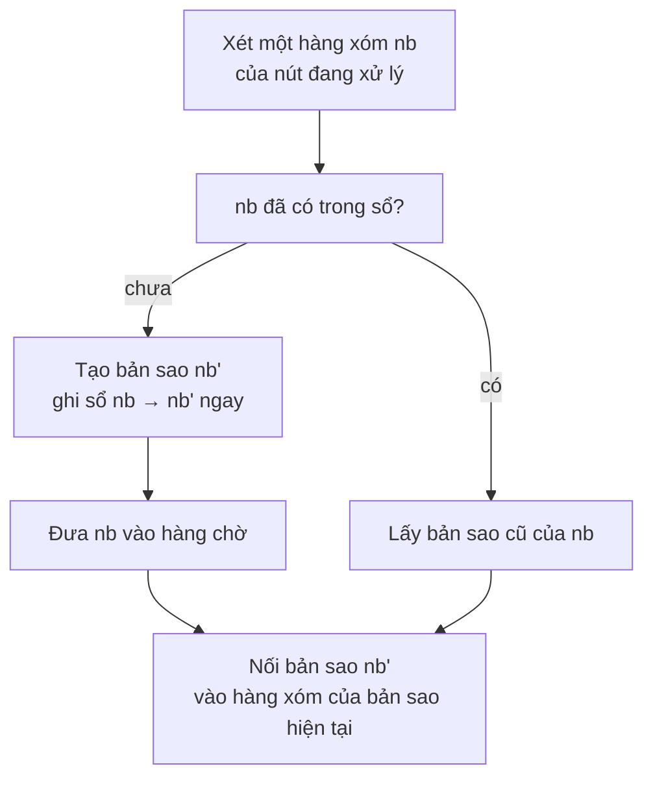

> [!tldr] Đọc nhanh
> - Đề: cho một nút của đồ thị vô hướng liên thông, trả về **bản sao sâu**: nút mới, cạnh mới, không dùng chung đối tượng nào với bản gốc.
> - Đồ thị có **vòng**: 1 nối 2 thì 2 cũng nối 1. Sao chép kiểu đệ quy ngây thơ sẽ đi 1 → 2 → 1 → 2 mãi.
> - Mẹo duy nhất là một [[concepts/clone-map|sổ "cũ → mới"]]: một [[concepts/hash-map|hash map]] từ nút gốc tới bản sao của nó. Gặp nút đã có trong sổ thì **dùng lại bản sao cũ**, không tạo thêm.
> - Ghi vào sổ **ngay khi tạo** bản sao, trước khi đi tiếp sang hàng xóm. Ghi muộn hơn thì vẫn đi vòng mãi.
> - DFS đệ quy, [[concepts/breadth-first-search|BFS]] hay DFS lặp đều chạy `O(V + E)`. Bản lặp không vướng giới hạn đệ quy.

> [!info] Bối cảnh
> Bài LeetCode 133 (Medium), thuộc [[posts/2026-11-26-neetcode-graph-bfs|ga 2: Duyệt đồ thị và BFS]] trên **tuyến NeetCode: Đồ thị**. Ở [[posts/2026-11-26-neetcode-grid-traversal|ga 1]], đồ thị là một lưới ô vuông. Bài này là đồ thị "thật": mỗi nút giữ một danh sách hàng xóm, và mình phải dựng lại toàn bộ mạng đó. Bạn chỉ cần biết hash map và hàng đợi; đồ thị được giải thích ngay dưới.

> [!abstract]- Từ điển nhanh cho bài này (bấm để mở)
> - **Đồ thị**: một tập **nút** (đỉnh) và **cạnh** nối hai nút. Đồ thị **vô hướng** nghĩa là cạnh đi được cả hai chiều: 1 nối 2 thì 2 cũng nối 1.
> - [[concepts/adjacency-list|Danh sách kề]]: mỗi nút giữ danh sách các nút nối với nó. Đề dùng đúng cách lưu này: `node.neighbors`.
> - **Vòng (chu trình)**: một đường đi quay về chỗ cũ, ví dụ 1 → 2 → 3 → 1. Đồ thị vô hướng có cạnh thì luôn quay về được.
> - **Sao nông (shallow copy)**: tạo đối tượng mới nhưng các trường bên trong vẫn trỏ vào đồ cũ. **Sao sâu (deep copy)**: tạo mới cả những gì bên trong.
> - **Danh tính đối tượng**: hai biến trỏ cùng một đối tượng trong bộ nhớ. Hai nút cùng giá trị `val` vẫn là hai đối tượng khác nhau.
> - [[concepts/hash-map|Hash map]]: bảng tra cứu khóa → giá trị trong thời gian trung bình `O(1)`.

## Hình dung trước: làm mô hình một nhóm bạn

Bạn muốn làm một mô hình bằng hình nhân của một nhóm bạn. Mỗi người thật có một hình nhân. Hai người là bạn thì hai hình nhân được nối bằng một sợi dây. Mô hình xong phải giống hệt nhóm thật, nhưng **không được dùng một người thật nào** trong mô hình.

Bạn đi từ người đầu tiên, hỏi "bạn của anh là ai", rồi đi sang từng người bạn. Rắc rối: An là bạn của Bình, nên tới Bình thì Bình lại chỉ về An. Nếu cứ gặp ai là nặn một hình nhân mới, bạn sẽ nặn An lần hai, lần ba, mãi mãi.

Cách gỡ: cầm một **cuốn sổ** ghi "người thật → hình nhân của họ". Gặp ai, mở sổ trước. Có rồi thì chỉ nối dây tới hình nhân cũ. Chưa có thì nặn, **ghi sổ ngay**, rồi mới đi hỏi bạn của người đó.

| Đời thường | Khái niệm |
|---|---|
| Nhóm bạn, mỗi người có danh sách bạn | Đồ thị lưu bằng [[concepts/adjacency-list\|danh sách kề]] |
| An là bạn Bình, Bình là bạn An | Cạnh vô hướng, tạo vòng |
| Hình nhân của một người | Bản sao của một nút |
| Nối dây giữa hai hình nhân | Thêm bản sao vào `neighbors` của bản sao |
| Cuốn sổ "người thật → hình nhân" | [[concepts/clone-map\|Sổ cũ → mới]] (hash map) |
| Nặn xong ghi sổ ngay, rồi mới đi tiếp | Ghi sổ trước khi duyệt hàng xóm |
| Đặt người thật vào mô hình | Sao nông: bản sao trỏ vào nút gốc |
| Danh sách người chờ hỏi | Hàng đợi của BFS hoặc ngăn xếp của DFS |



## Vấn đề: sao chép một mạng có vòng

Đề cho **một nút** của một đồ thị vô hướng. Mỗi nút có giá trị `val` và danh sách `neighbors`. Từ nút đó đi tới được mọi nút khác. Hãy dựng một bản sao sâu và trả về bản sao của nút được cho. [Đề LC-0133](https://leetcode.com/problems/clone-graph/)

Giới hạn (mình kiểm trên trang LeetCode ngày 2026-11-26):

- từ 0 tới 100 nút; 0 nút nghĩa là đầu vào là `null`;
- `val` từ 1 tới 100, mỗi nút một giá trị khác nhau;
- không có cạnh lặp, không có cạnh nối một nút với chính nó;
- đồ thị liên thông.

LeetCode mô tả đồ thị bằng danh sách kề đánh số từ 1: phần tử thứ `i` là danh sách hàng xóm của nút có `val = i + 1`. Ví dụ "tam giác có đuôi" mà mình dùng suốt bài:

```text
1 — 2
 \  |
   3 — 4

danh sách kề: [[2,3],[1,3],[1,2,4],[3]]
```

"Bản sao sâu" có ba điều kiện, và file chạy thử kiểm cả ba:

1. Không nút nào của bản sao là nút của bản gốc.
2. Mỗi giá trị chỉ có **một** nút trong bản sao (không nặn An hai lần).
3. Danh sách kề của bản sao giống hệt bản gốc, đúng cả thứ tự hàng xóm.

Mình từng nghĩ chỉ cần "đi qua từng nút và tạo nút mới". Thử trên hai nút nối nhau là thấy ngay: tạo 1', đi sang 2, tạo 2', từ 2 đi về 1, tạo thêm một 1' nữa, rồi lại sang 2... Không có gì bảo mình dừng. Cái thiếu là **trí nhớ**: mình cần biết nút gốc nào đã có bản sao, và bản sao đó **là đối tượng nào** để nối dây tới nó.

## Cơ chế

<figure class="figure-map" style="--ar: 3 / 4">
<div class="frame"><iframe data-archify="../diagrams/neetcode-clone-graph/worked-example.html" title="Sao đồ thị 4 nút bằng BFS và sổ cũ → mới" loading="lazy"></iframe></div>
<figcaption><span><b>Hình 1.</b> BFS trên tam giác có đuôi tạo đúng 4 bản sao: mỗi lần gặp lại một nút, sổ trả về bản sao đã có.</span><a href="../diagrams/neetcode-clone-graph/worked-example.html" target="_blank" rel="noopener">Mở toàn màn hình</a></figcaption>
</figure>

<details>
<summary>Đọc từng bước</summary>
<ol>
<li>Sao nút 1, ghi sổ, xếp hàng. <code>sổ {1→1'}; hàng [1]</code></li>
<li>Lấy 1: gặp 2 và 3 lần đầu. <code>tạo 2', 3'; 1' = [2', 3']</code></li>
<li>Lấy 2: 1 và 3 đã có trong sổ. <code>không tạo mới; 2' = [1', 3']</code></li>
<li>Lấy 3: chỉ 4 là nút mới. <code>tạo 4'; 3' = [1', 2', 4']</code></li>
<li>Lấy 4: 3 đã có trong sổ. <code>4' = [3']</code></li>
<li>Hàng rỗng: trả 1', tạo đúng 4 nút. <code>sổ có 4 ô</code></li>
</ol>
</details>

### Sổ "cũ → mới" làm hai việc cùng lúc

Một tập "đã thăm" chỉ trả lời câu hỏi "nút này gặp rồi chưa?". Bài này cần thêm câu trả lời "**bản sao của nó là ai?**", vì mình phải nối dây tới đúng bản sao đó. Vì vậy sổ là một map, không phải một set:

- **khóa** là nút gốc, so theo danh tính đối tượng (không so theo `val`);
- **giá trị** là bản sao của nút đó.

Sổ vừa là dấu "đã thăm" (khóa có mặt), vừa là chỗ tra bản sao (giá trị). Đó là lý do mọi cách giải bên dưới đều có đúng một map.

### Cách 1 — DFS đệ quy

Hàm `visit(old)` trả về bản sao của `old`:

1. Nếu `old` đã có trong sổ, trả bản sao đó luôn.
2. Nếu chưa: tạo `copy`, **ghi sổ `old → copy`**, rồi với mỗi hàng xóm `nb`, thêm `visit(nb)` vào `copy.neighbors`.

Bước 2 có thứ tự quan trọng nhất bài. Lần theo hai nút 1 ⇄ 2:

| Lời gọi | Sổ lúc vào | Việc làm |
|---|---|---|
| `visit(1)` | rỗng | tạo 1', ghi `1→1'`, gọi `visit(2)` |
| `visit(2)` | `1→1'` | tạo 2', ghi `2→2'`, gọi `visit(1)` |
| `visit(1)` lần hai | `1→1'`, `2→2'` | có trong sổ: trả 1' ngay, **dừng vòng** |

Nếu đổi chỗ, ghi sổ **sau** vòng lặp hàng xóm, thì ở dòng thứ ba sổ vẫn rỗng: `visit(1)` lại tạo 1'' và gọi `visit(2)`, cứ thế tới khi tràn ngăn xếp. File chạy thử có bản sai này (`wrongMapAfterRecurse`): 2/10 ca đúng, chỉ qua đồ thị rỗng và một nút.

Độ sâu đệ quy bằng độ dài đường đi dài nhất mà DFS đi xuống. Với 100 nút thì không sao. Trên một đường thẳng 100 000 nút (vượt giới hạn đề, chỉ để đo), bản đệ quy ném `RangeError` ở Node, `RecursionError` ở Python và `StackOverflowError` ở Java; xem [[concepts/recursion-depth-limit|giới hạn độ sâu đệ quy]].

### Cách 2 — BFS với hàng đợi

[[concepts/breadth-first-search|BFS]] xử lý nút theo thứ tự xếp hàng:

1. Tạo bản sao của nút đầu, ghi sổ, đưa nút đầu vào hàng.
2. Lấy một nút `old` ra. Với mỗi hàng xóm `nb`: nếu `nb` chưa có trong sổ thì tạo bản sao, ghi sổ, xếp `nb` vào hàng. Sau đó, dù mới hay cũ, thêm bản sao của `nb` vào hàng xóm của bản sao `old`.
3. Hàng rỗng thì trả bản sao của nút đầu.

Hình 1 chạy đúng cách này. Điểm cần nhìn là bước 3 và 5: nút đã có trong sổ chỉ được **nối dây**, không được tạo, không được xếp hàng lại. Vì mỗi nút được tạo và xếp hàng đúng một lần, hàng đợi không bao giờ phình vì nút trùng.

Thứ tự hàng xóm của bản sao vẫn đúng như bản gốc, vì với mỗi `old` mình duyệt `old.neighbors` từ đầu tới cuối và nối theo đúng thứ tự đó.

### Cách 3 — DFS lặp với ngăn xếp

Giống hệt BFS, chỉ đổi hàng đợi thành ngăn xếp: lấy nút vào sau cùng ra trước. Thứ tự **xử lý** nút khác đi, nhưng thứ tự hàng xóm trong mỗi bản sao vẫn giữ nguyên, vì nó được quyết định bởi vòng `for nb of old.neighbors`, không phải bởi thứ tự lấy nút. Cách này không có đệ quy nên chạy được cả đường thẳng 100 000 nút.

### Độ phức tạp

Gọi `V` là số nút, `E` là số cạnh. Mỗi nút được tạo bản sao một lần và được lấy ra xử lý một lần. Mỗi cạnh vô hướng xuất hiện hai lần trong danh sách kề (một lần ở mỗi đầu), mỗi lần tốn một phép tra sổ `O(1)` trung bình. Tổng thời gian `O(V + E)`. Bộ nhớ phụ: sổ có `V` ô, hàng đợi hoặc ngăn xếp tối đa `V` nút, bản đệ quy thêm ngăn xếp lời gọi sâu tối đa `V`. Bản sao tự nó cũng chiếm `O(V + E)`, nhưng đó là kết quả phải trả về.

### Đo trên đồ thị vượt giới hạn đề

Đường thẳng 1 — 2 — … — 100 000, chạy lần cuối của mỗi file (máy đang chạy các việc khác song song, nên đọc thứ tự, đừng đọc chữ số lẻ):

| Ngôn ngữ | DFS đệ quy | BFS | DFS lặp |
|---|---|---:|---:|
| TypeScript | `RangeError` | 34,3 ms | 32,2 ms |
| Python | `RecursionError` | 93,0 ms | 106,6 ms |
| Go | 45,4 ms | 19,2 ms | 19,0 ms |
| Java | `StackOverflowError` | 22,2 ms | 18,8 ms |

Go chạy được bản đệ quy vì ngăn xếp goroutine tự lớn lên (tới 1 GB trên máy 64 bit). Ở giới hạn thật của đề (100 nút), mọi cách đều chạy dưới một mili giây.

## Ví dụ chạy được

Mỗi file dựng 10 đồ thị (rỗng, một nút, hai nút, tam giác, hình vuông có đường chéo, ngôi sao, đường thẳng 5 và 100 nút, đồ thị đầy đủ 6 nút, đồ thị ngẫu nhiên 100 nút), chạy ba cách đúng và bốn cách sai, rồi kiểm ba điều kiện của bản sao sâu ở trên. Thêm 500 đồ thị ngẫu nhiên tới 100 nút cho ba cách đúng. Cả năm ngôn ngữ dùng cùng bộ sinh số mulberry32 nên dựng cùng các đồ thị. Bên dưới là phần lời giải; file đầy đủ có cả bản sai và phần kiểm tra.

[TypeScript](../code/neetcode-clone-graph/clone-graph.ts) · [Python](../code/neetcode-clone-graph/clone_graph.py) · [Go](../code/neetcode-clone-graph/clone_graph.go) · [Java](../code/neetcode-clone-graph/clone-graph.java) · [JavaScript](../code/neetcode-clone-graph/clone-graph.js)

```ts
// ---------- Cách 1: DFS đệ quy với sổ "cũ → mới" ----------
function cloneDfs(node: GraphNode | null): GraphNode | null {
  if (node === null) return null;
  const copies = new Map<GraphNode, GraphNode>(); // nút gốc → bản sao của nó
  function visit(old: GraphNode): GraphNode {
    const seen = copies.get(old);
    if (seen !== undefined) return seen; // đã sao rồi: dùng lại, không sao lần hai
    const copy = new GraphNode(old.val);
    copies.set(old, copy); // ghi sổ TRƯỚC khi đi tiếp, để vòng quay lại thấy ngay
    for (const nb of old.neighbors) copy.neighbors.push(visit(nb));
    return copy;
  }
  return visit(node);
}

// ---------- Cách 2: BFS với sổ "cũ → mới" ----------
function cloneBfs(node: GraphNode | null): GraphNode | null {
  if (node === null) return null;
  const copies = new Map<GraphNode, GraphNode>([[node, new GraphNode(node.val)]]);
  const queue: GraphNode[] = [node];
  for (let head = 0; head < queue.length; head++) {
    const old = queue[head];
    const copy = copies.get(old)!;
    for (const nb of old.neighbors) {
      let nbCopy = copies.get(nb);
      if (nbCopy === undefined) {
        nbCopy = new GraphNode(nb.val);
        copies.set(nb, nbCopy); // tạo bản sao ngay lúc thấy lần đầu, rồi mới xếp hàng
        queue.push(nb);
      }
      copy.neighbors.push(nbCopy);
    }
  }
  return copies.get(node)!;
}

// ---------- Cách 3: DFS lặp với ngăn xếp ----------
function cloneDfsIterative(node: GraphNode | null): GraphNode | null {
  if (node === null) return null;
  const copies = new Map<GraphNode, GraphNode>([[node, new GraphNode(node.val)]]);
  const stack: GraphNode[] = [node];
  while (stack.length > 0) {
    const old = stack.pop()!;
    const copy = copies.get(old)!;
    for (const nb of old.neighbors) {
      let nbCopy = copies.get(nb);
      if (nbCopy === undefined) {
        nbCopy = new GraphNode(nb.val);
        copies.set(nb, nbCopy);
        stack.push(nb);
      }
      copy.neighbors.push(nbCopy);
    }
  }
  return copies.get(node)!;
}
```

```python
# ---------- Cách 1: DFS đệ quy với sổ "cũ → mới" ----------
def clone_dfs(node: Optional[Node]) -> Optional[Node]:
    if node is None:
        return None
    copies: dict[Node, Node] = {}  # nút gốc → bản sao; khóa là chính đối tượng (băm theo id)

    def visit(old: Node) -> Node:
        if old in copies:
            return copies[old]  # đã sao rồi: dùng lại
        copy = Node(old.val)
        copies[old] = copy  # ghi sổ TRƯỚC khi đi tiếp
        for nb in old.neighbors:
            copy.neighbors.append(visit(nb))
        return copy

    return visit(node)


# ---------- Cách 2: BFS với sổ "cũ → mới" ----------
def clone_bfs(node: Optional[Node]) -> Optional[Node]:
    if node is None:
        return None
    copies = {node: Node(node.val)}
    queue = deque([node])
    while queue:
        old = queue.popleft()
        for nb in old.neighbors:
            if nb not in copies:
                copies[nb] = Node(nb.val)  # tạo bản sao lúc thấy lần đầu, rồi mới xếp hàng
                queue.append(nb)
            copies[old].neighbors.append(copies[nb])
    return copies[node]


# ---------- Cách 3: DFS lặp với ngăn xếp ----------
def clone_dfs_iterative(node: Optional[Node]) -> Optional[Node]:
    if node is None:
        return None
    copies = {node: Node(node.val)}
    stack = [node]
    while stack:
        old = stack.pop()
        for nb in old.neighbors:
            if nb not in copies:
                copies[nb] = Node(nb.val)
                stack.append(nb)
            copies[old].neighbors.append(copies[nb])
    return copies[node]
```

```go
// ---------- Cách 1: DFS đệ quy với sổ "cũ → mới" ----------
func cloneDfs(node *Node) *Node {
	if node == nil {
		return nil
	}
	copies := map[*Node]*Node{} // khóa là con trỏ: mỗi nút gốc một ô
	var visit func(old *Node) *Node
	visit = func(old *Node) *Node {
		if c, ok := copies[old]; ok {
			return c // đã sao rồi: dùng lại
		}
		c := &Node{Val: old.Val}
		copies[old] = c // ghi sổ TRƯỚC khi đi tiếp
		for _, nb := range old.Neighbors {
			c.Neighbors = append(c.Neighbors, visit(nb))
		}
		return c
	}
	return visit(node)
}

// ---------- Cách 2: BFS với sổ "cũ → mới" ----------
func cloneBfs(node *Node) *Node {
	if node == nil {
		return nil
	}
	copies := map[*Node]*Node{node: {Val: node.Val}}
	queue := []*Node{node}
	for head := 0; head < len(queue); head++ {
		old := queue[head]
		for _, nb := range old.Neighbors {
			c, ok := copies[nb]
			if !ok {
				c = &Node{Val: nb.Val} // tạo bản sao lúc thấy lần đầu, rồi mới xếp hàng
				copies[nb] = c
				queue = append(queue, nb)
			}
			copies[old].Neighbors = append(copies[old].Neighbors, c)
		}
	}
	return copies[node]
}

// ---------- Cách 3: DFS lặp với ngăn xếp ----------
func cloneDfsIterative(node *Node) *Node {
	if node == nil {
		return nil
	}
	copies := map[*Node]*Node{node: {Val: node.Val}}
	stack := []*Node{node}
	for len(stack) > 0 {
		old := stack[len(stack)-1]
		stack = stack[:len(stack)-1]
		for _, nb := range old.Neighbors {
			c, ok := copies[nb]
			if !ok {
				c = &Node{Val: nb.Val}
				copies[nb] = c
				stack = append(stack, nb)
			}
			copies[old].Neighbors = append(copies[old].Neighbors, c)
		}
	}
	return copies[node]
}
```

```java
  // ---------- Cách 1: DFS đệ quy với sổ "cũ → mới" ----------
  static Node cloneDfs(Node node) {
    if (node == null) return null;
    return visit(node, new HashMap<>());
  }

  static Node visit(Node old, Map<Node, Node> copies) {
    Node seen = copies.get(old);
    if (seen != null) return seen; // đã sao rồi: dùng lại
    Node copy = new Node(old.val);
    copies.put(old, copy); // ghi sổ TRƯỚC khi đi tiếp
    for (Node nb : old.neighbors) copy.neighbors.add(visit(nb, copies));
    return copy;
  }

  // ---------- Cách 2: BFS với sổ "cũ → mới" ----------
  static Node cloneBfs(Node node) {
    if (node == null) return null;
    Map<Node, Node> copies = new HashMap<>();
    copies.put(node, new Node(node.val));
    ArrayDeque<Node> queue = new ArrayDeque<>();
    queue.offer(node);
    while (!queue.isEmpty()) {
      Node old = queue.poll();
      for (Node nb : old.neighbors) {
        Node c = copies.get(nb);
        if (c == null) {
          c = new Node(nb.val); // tạo bản sao lúc thấy lần đầu, rồi mới xếp hàng
          copies.put(nb, c);
          queue.offer(nb);
        }
        copies.get(old).neighbors.add(c);
      }
    }
    return copies.get(node);
  }

  // ---------- Cách 3: DFS lặp với ngăn xếp ----------
  static Node cloneDfsIterative(Node node) {
    if (node == null) return null;
    Map<Node, Node> copies = new HashMap<>();
    copies.put(node, new Node(node.val));
    ArrayDeque<Node> stack = new ArrayDeque<>();
    stack.push(node);
    while (!stack.isEmpty()) {
      Node old = stack.pop();
      for (Node nb : old.neighbors) {
        Node c = copies.get(nb);
        if (c == null) {
          c = new Node(nb.val);
          copies.put(nb, c);
          stack.push(nb);
        }
        copies.get(old).neighbors.add(c);
      }
    }
    return copies.get(node);
  }
```

```js
// ---------- Cách 1: DFS đệ quy với sổ "cũ → mới" ----------
function cloneDfs(node) {
  if (node === null) return null;
  const copies = new Map(); // nút gốc → bản sao của nó
  function visit(old) {
    const seen = copies.get(old);
    if (seen !== undefined) return seen; // đã sao rồi: dùng lại, không sao lần hai
    const copy = new GraphNode(old.val);
    copies.set(old, copy); // ghi sổ TRƯỚC khi đi tiếp, để vòng quay lại thấy ngay
    for (const nb of old.neighbors) copy.neighbors.push(visit(nb));
    return copy;
  }
  return visit(node);
}

// ---------- Cách 2: BFS với sổ "cũ → mới" ----------
function cloneBfs(node) {
  if (node === null) return null;
  const copies = new Map([[node, new GraphNode(node.val)]]);
  const queue = [node];
  for (let head = 0; head < queue.length; head++) {
    const old = queue[head];
    const copy = copies.get(old);
    for (const nb of old.neighbors) {
      let nbCopy = copies.get(nb);
      if (nbCopy === undefined) {
        nbCopy = new GraphNode(nb.val);
        copies.set(nb, nbCopy); // tạo bản sao ngay lúc thấy lần đầu, rồi mới xếp hàng
        queue.push(nb);
      }
      copy.neighbors.push(nbCopy);
    }
  }
  return copies.get(node);
}

// ---------- Cách 3: DFS lặp với ngăn xếp ----------
function cloneDfsIterative(node) {
  if (node === null) return null;
  const copies = new Map([[node, new GraphNode(node.val)]]);
  const stack = [node];
  while (stack.length > 0) {
    const old = stack.pop();
    const copy = copies.get(old);
    for (const nb of old.neighbors) {
      let nbCopy = copies.get(nb);
      if (nbCopy === undefined) {
        nbCopy = new GraphNode(nb.val);
        copies.set(nb, nbCopy);
        stack.push(nb);
      }
      copy.neighbors.push(nbCopy);
    }
  }
  return copies.get(node);
}
```

Chạy `node clone-graph.ts`:

```text
cloneDfs             10/10 ca đúng
cloneBfs             10/10 ca đúng
cloneDfsIterative    10/10 ca đúng
wrongShallow         2/10 ca đúng; sai ở hai nút nối nhau → dùng chung nút với bản gốc, tam giác 1-2-3 → dùng chung nút với bản gốc và 6 ca khác
wrongNoMap           2/10 ca đúng; sai ở hai nút nối nhau → ném RangeError, tam giác 1-2-3 → ném RangeError và 6 ca khác
wrongMapAfterRecurse 2/10 ca đúng; sai ở hai nút nối nhau → ném RangeError, tam giác 1-2-3 → ném RangeError và 6 ca khác
wrongSetOnly         2/10 ca đúng; sai ở hai nút nối nhau → nút 1 bị sao 2 lần, tam giác 1-2-3 → nút 1 bị sao 3 lần và 6 ca khác
500 đồ thị ngẫu nhiên: cả ba cách đúng qua 500/500
wrongSetOnly trên đồ thị đầy đủ 6 nút: tạo 31 nút thay vì 6
đường thẳng 100 000 nút, cloneDfs: ném RangeError
đường thẳng 100 000 nút, cloneBfs: đúng, 34.3 ms
đường thẳng 100 000 nút, cloneDfsIterative: đúng, 32.2 ms
clone-graph: các cách đúng đều qua
```

Bốn file còn lại in cùng số ca đúng. Khác biệt duy nhất nằm ở cách bản sai đệ quy vô tận chết: Python ném `RecursionError`, Java ném `StackOverflowError`. Go không bắt được tràn ngăn xếp (chương trình chết hẳn với `fatal error: stack overflow`), nên file Go cho hai bản sai đó dừng ở độ sâu 10 000 bằng `panic` rồi `recover`, và in "đệ quy quá 10000 tầng (đi vòng mãi)".

## Hiểu lầm và bẫy hay gặp

- **"Tạo nút mới là đủ, hàng xóm chép sau."** Bản `wrongShallow` tạo nút mới cho nút đầu nhưng giữ nguyên mảng `neighbors` cũ. Bản sao trỏ thẳng vào nút gốc: 2/10 ca đúng, trượt mọi đồ thị có cạnh. Sửa một nút của "bản sao" là sửa luôn bản gốc.

  ```ts
  return new GraphNode(node.val, node.neighbors); // nút mới, nhưng hàng xóm là nút CŨ
  ```

- **Không có sổ.** `wrongNoMap` đi 1 → 2 → 1 → … đến khi tràn ngăn xếp, kể cả trên hai nút. Đồ thị vô hướng có cạnh là có vòng, nên bản này chỉ qua đồ thị rỗng và một nút.
- **Ghi sổ sau khi duyệt hàng xóm.** Có sổ nhưng vẫn đi vòng mãi, như bảng ở Cách 1. Ghi sổ ngay sau khi tạo bản sao.
- **Dùng set "đã thăm" thay cho map.** `wrongSetOnly` biết nút đã gặp nhưng không biết bản sao của nó là đối tượng nào, nên đành tạo một nút rỗng mới. Trên đồ thị đầy đủ 6 nút, bản này tạo **31** nút thay vì 6; trên đồ thị ngẫu nhiên 100 nút, nút 1 bị sao 11 lần.
- **Khóa sổ theo giá trị.** Ở bài này `val` khác nhau nên khóa bằng `val` vẫn chạy. Nhưng đó là may: đồ thị thật hay có hai nút cùng nhãn. Khóa bằng chính đối tượng nút là cách đúng trong mọi trường hợp.
- **Quên ca `null`.** Đồ thị 0 nút đến dưới dạng `null`. Mọi cách đều kiểm dòng đầu tiên.
- **Python: `@dataclass` cho nút.** `@dataclass` sinh `__eq__` và vì thế đặt `__hash__ = None`; dùng nút làm khóa dict ném `TypeError: unhashable type`. Một lớp thường băm theo `id`, đúng điều mình cần. Cũng đừng viết `neighbors=[]` làm giá trị mặc định: mọi nút sẽ dùng chung một danh sách.
- **Python: giới hạn đệ quy.** Mặc định khoảng 1000 tầng. Đủ cho 100 nút, nhưng đồ thị dài hơn thì chọn BFS hoặc DFS lặp.
- **Java: `record` cho nút.** `record` tự sinh `hashCode` từ mọi trường, kể cả danh sách hàng xóm. Trên đồ thị có vòng, tính `hashCode` đi 1 → 2 → 1 → … và ném `StackOverflowError` ngay lúc `put` vào `HashMap`. File Java in đúng lỗi này. Lớp thường không ghi đè `equals`/`hashCode` thì so theo danh tính.
- **Go: khóa map phải so sánh được.** `map[*Node]*Node` khóa bằng con trỏ, đúng danh tính. `map[Node]*Node` không biên dịch được, vì `Node` có trường slice mà slice không so sánh được bằng `==`.
- **JavaScript/TypeScript: object thường làm sổ.** `{}` đổi mọi khóa thành chuỗi, nên mọi nút thành `"[object Object]"` và đè lên nhau. Dùng `Map`, nó giữ khóa là chính đối tượng.

## Câu hỏi tự kiểm tra

> [!question]- Vì sao một set "đã thăm" không đủ, mà phải là map?
> Khi gặp lại một nút, mình phải nối dây tới **bản sao đã có** của nó. Set chỉ nói "đã gặp", không nói bản sao nằm ở đâu. Map trả lời cả hai.

> [!question]- Trong DFS đệ quy, ghi sổ trước hay sau vòng lặp hàng xóm? Vì sao?
> Trước. Hàng xóm sẽ quay lại nút hiện tại qua cạnh ngược; nếu sổ chưa có nút này, lời gọi đó tạo bản sao thứ hai và đi vòng mãi.

> [!question]- BFS và DFS lặp xử lý nút theo thứ tự khác nhau. Thứ tự hàng xóm trong bản sao có khác không?
> Không. Thứ tự hàng xóm của mỗi bản sao do vòng `for nb of old.neighbors` quyết định, và vòng này luôn đi từ đầu tới cuối danh sách gốc.

> [!question]- Đồ thị có `V` nút và `E` cạnh vô hướng. Tổng số lần tra sổ là bao nhiêu?
> Khoảng `2E`, vì mỗi cạnh nằm trong danh sách kề của cả hai đầu. Cộng `V` bản sao được tạo, tổng thời gian `O(V + E)`.

## Tham khảo

- [LeetCode · Clone Graph](https://leetcode.com/problems/clone-graph/): giới hạn đầu vào và định dạng danh sách kề.
- [Princeton · Breadth-first paths](https://github.com/kevin-wayne/algs4/blob/master/src/main/java/edu/princeton/cs/algs4/BreadthFirstPaths.java): đánh dấu đỉnh khi đưa vào hàng đợi.
- [Python · copy](https://docs.python.org/3/library/copy.html): `deepcopy` cũng dùng một dict `memo` từ `id` đối tượng gốc tới bản sao, chính là sổ "cũ → mới".
- [Python · dataclasses](https://docs.python.org/3/library/dataclasses.html): `eq=True` mà không `frozen` thì `__hash__` bị đặt thành `None`.
- [Java · Record](https://docs.oracle.com/en/java/javase/21/docs/api/java.base/java/lang/Record.html): `hashCode` sinh từ mọi thành phần của record.
- [Go spec · Map types](https://go.dev/ref/spec#Map_types): khóa phải so sánh được bằng `==`.
