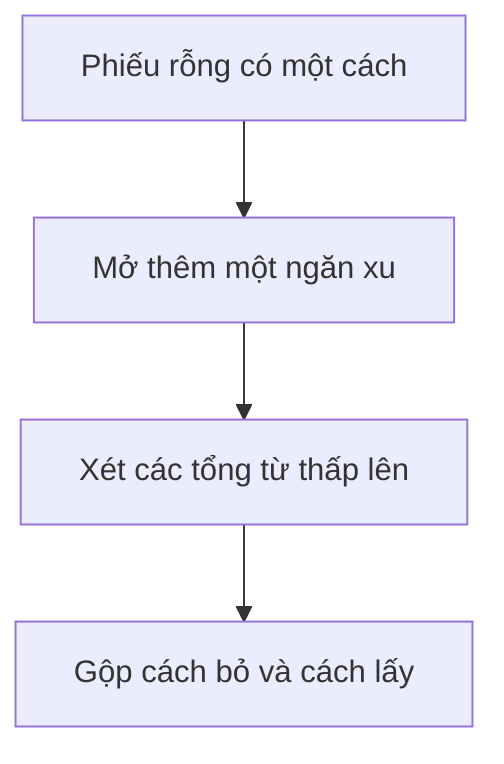

> [!tldr] Đọc nhanh
> - Mỗi cách được xác định bởi số bản sao của từng mệnh giá. Đổi chỗ các đồng xu vẫn giữ nguyên một cách.
> - Khi thêm mệnh giá `c`, cách tạo tổng `s` hoặc bỏ qua `c`, hoặc lấy một đồng `c` rồi giải tổng `s − c` với cùng tập mệnh giá.
> - Trong mảng 1D, duyệt mệnh giá ở ngoài và tổng tăng dần ở trong. Chiều tăng cho lượt hiện tại đọc được kết quả đã dùng `c`.
> - Giới hạn 32 bit áp dụng cho đáp án cuối. Mình chặn các bộ đếm ở giá trị đó để bảo vệ phép cộng khi một ô trung gian lớn hơn.

> [!info] Bối cảnh
> Bài LeetCode 518 thuộc [[posts/2026-11-27-neetcode-knapsack|ga 3 “Ba lô và đổi tiền”]] trên tuyến NeetCode Quy hoạch động. Mình lấy ví dụ một quầy có các ngăn chứa đủ xu cho từng mệnh giá. Người thu ngân cần đếm những bộ xu có tổng đúng hóa đơn. Bạn chỉ cần đọc được mảng và vòng lặp.

> [!abstract]- Từ điển nhanh cho bài này (bấm để mở)
> - Mệnh giá là số ghi trên một đồng xu.
> - [[concepts/coin-combinations|Tổ hợp xu]] có thể ghi thành một bảng số lượng, mỗi cột là một mệnh giá.
> - [[concepts/unbounded-knapsack|Ba lô không giới hạn]] cho phép lấy nhiều bản sao cùng loại.
> - [[concepts/knapsack-update-order|Thứ tự cập nhật]] quyết định ô nguồn thuộc lượt trước hay lượt hiện tại.

## Hình dung trước: ghi số xu từ từng ngăn

Quầy có ngăn 2, ngăn 3 và ngăn 5. Hóa đơn là 8. Mình chỉ ghi mỗi ngăn đã lấy mấy đồng. Phiếu ghi một đồng 3 và một đồng 5 tính là một cách, dù nhấc xu từ ngăn nào trước.

| Đời thường | Khái niệm |
| --- | --- |
| Số xu đã lấy từ mỗi ngăn | Một tổ hợp |
| Bảng chỉ cho dùng vài ngăn đầu | Một hàng của DP |
| Thêm một đồng từ ngăn vừa mở | Đọc tổng nhỏ hơn trong cùng hàng |



## Vấn đề: đếm các bộ xu có chung tổng

Có từ 1 đến 300 mệnh giá phân biệt, mỗi giá trị từ 1 đến 5.000. Mỗi mệnh giá có thể dùng lại bao nhiêu lần cũng được. Với tổng `A` từ 0 đến 5.000, trả số bộ xu cộng đúng `A`. Đề bảo đảm **đáp án cuối** vừa số nguyên có dấu 32 bit.

Ví dụ, `A = 8` với các mệnh giá `[2, 3, 5]` có ba phiếu hợp lệ. Đó là `2 + 2 + 2 + 2`, `2 + 3 + 3` và `3 + 5`. Nếu ghi cả thứ tự nhấc xu, ba phiếu này sinh ra lần lượt 1, 3 và 2 dãy. Bài [Coin Combinations I](https://cses.fi/problemset/task/1635) của CSES minh họa cách đếm theo dãy.

## Cơ chế

### Vét cạn theo số bản sao

Với mỗi mệnh giá `c`, thử lấy từ 0 đến `floor(s / c)` đồng, rồi chuyển sang mệnh giá kế tiếp với phần còn thiếu `s`. Khi đã xét hết ngăn, nhánh còn thiếu 0 đóng góp một cách. Một đường đi qua cây xác định đúng một bộ số lượng. Cách này hữu ích để đối chiếu trên đầu vào nhỏ. Với `n` mệnh giá, một cận trên thô là `O(n(A + 1)^n)` thời gian và `O(n)` ngăn xếp.

### Bảng theo số ngăn đã mở

Đặt `D[i][s]` là số cách tạo tổng `s` bằng `i` mệnh giá đầu. Trước khi mở ngăn nào, `D[0][0] = 1` và các tổng dương có 0 cách. Với mệnh giá mới `c`, nhóm bỏ qua `c` có `D[i − 1][s]` cách. Bỏ đúng một đồng `c` khỏi mỗi phiếu còn lại tạo một tương ứng một-một với `D[i][s − c]`. Phần còn lại có thể vẫn dùng `c`, nên hạng thứ hai nằm ở **hàng i**. Khi `s < c`, nhóm thứ hai rỗng.

| Ngăn vừa mở | 0 | 2 | 3 | 5 | 6 | 8 |
| --- | ---: | ---: | ---: | ---: | ---: | ---: |
| Chưa mở ngăn | 1 | 0 | 0 | 0 | 0 | 0 |
| 2 | 1 | 1 | 0 | 0 | 1 | 1 |
| 3 | 1 | 1 | 1 | 1 | 2 | 2 |
| 5 | 1 | 1 | 1 | 2 | 2 | 3 |

Minh họa chỉ hiện một số cột tổng. Bảng đầy đủ có `n + 1` hàng và `A + 1` cột. Cách điền này dùng `O(n(A + 1))` thời gian và ô đếm.

### Gộp bảng vào một mảng

Khi đến tổng `s` trong lượt mệnh giá `c`, ô `ways[s]` vẫn mang giá trị hàng trước. Vì tổng đi lên, ô `ways[s − c]` đã mang giá trị của hàng hiện tại. Hai vế bên phải chính là hai nhóm trong công thức 2D. Duyệt hết lượt thì cả mảng chuyển sang hàng mới. Đáp án nằm ở `ways[A]`. Mỗi mệnh giá chỉ thêm một lượt, nên cách chứng minh áp dụng được cả khi đầu vào chưa sắp xếp.

Số phép cập nhật là tổng của `max(0, A − c + 1)` trên các mệnh giá. Thời gian có cận `O(n(A + 1))` và mảng chiếm `O(A + 1)` ô đếm. Đặt vòng tổng ở ngoài để đếm dãy bằng cách chọn *đồng cuối*. Giữ mệnh giá ở ngoài mà duyệt tổng giảm dần thì mỗi lượt chỉ thêm được một bản sao, tương ứng với quy tắc ba lô 0/1.

### Chặn bộ đếm ở giới hạn đề

Đặt `L = 2³¹ − 1`. Với hai số đếm không âm `u, v`, có `min(L, min(L, u) + min(L, v)) = min(L, u + v)`. Vì thế, nếu chặn mỗi phép cộng ở `L`, bảng lưu đúng giá trị đã chặn tại mọi ô. Đáp án thuộc khoảng `[0, L]` nên đọc được nguyên vẹn.

Một ca kiểm có 299 mệnh giá chẵn từ 2 đến 598 và thêm mệnh giá 4.999. Mình dùng Python với số nguyên chính xác để tính riêng ô 4.998 và thu được khoảng `2,76 × 10⁵¹` cách. Ô 4.999 vẫn có đúng một cách. Tổng lẻ cần đồng 4.999, và đồng đó tự lấp đầy tổng.

## Ví dụ chạy được

Các tab trích phần mảng 1D. Trong các file, `LIMIT` hoặc `limit` bằng 2.147.483.647. File TypeScript và JavaScript trả cả mảng để xem được các ô. Chương trình kiểm tra đọc đáp án ở chỉ số `amount`. Các file còn lại trả trực tiếp đáp án. Mỗi file kiểm cùng 10 ca cho hai cách DP, và chạy vét cạn cho các tổng nhỏ.

[TypeScript](../code/neetcode-coin-change-ii/combinations.ts) · [Python](../code/neetcode-coin-change-ii/combinations.py) · [Go](../code/neetcode-coin-change-ii/combinations.go) · [Java](../code/neetcode-coin-change-ii/combinations.java) · [JavaScript](../code/neetcode-coin-change-ii/combinations.js) · [PHP](../code/neetcode-coin-change-ii/combinations.php) · [Rust](../code/neetcode-coin-change-ii/combinations.rs)

```ts
function countCombinations(amount: number, coins: number[]): number[] {
  const ways = Array<number>(amount + 1).fill(0)
  ways[0] = 1
  for (const coin of coins) {
    for (let total = coin; total <= amount; total++) {
      ways[total] = Math.min(LIMIT, ways[total] + ways[total - coin])
    }
  }
  return ways
}
```

```python
def count_combinations(amount, coins):
    ways = [1] + [0] * amount
    for coin in coins:
        for total in range(coin, amount + 1):
            ways[total] = min(LIMIT, ways[total] + ways[total - coin])
    return ways[amount]
```

```go
func countCombinations(amount int, coins []int) int64 {
	ways := make([]int64, amount+1)
	ways[0] = 1
	for _, coin := range coins {
		for total := coin; total <= amount; total++ {
			ways[total] = min(limit, ways[total]+ways[total-coin])
		}
	}
	return ways[amount]
}
```

```java
static int countCombinations(int amount, int[] coins) {
    int[] ways = new int[amount + 1];
    ways[0] = 1;
    for (int coin : coins) {
        for (int total = coin; total <= amount; total++) {
            ways[total] = (int) Math.min(Integer.MAX_VALUE,
                (long) ways[total] + ways[total - coin]);
        }
    }
    return ways[amount];
}
```

```js
function countCombinations(amount, coins) {
  const ways = Array(amount + 1).fill(0)
  ways[0] = 1
  for (const coin of coins) {
    for (let total = coin; total <= amount; total++) {
      ways[total] = Math.min(LIMIT, ways[total] + ways[total - coin])
    }
  }
  return ways
}
```

```php
function countCombinations(int $amount, array $coins): int
{
    $ways = array_fill(0, $amount + 1, 0);
    $ways[0] = 1;
    foreach ($coins as $coin) {
        for ($total = $coin; $total <= $amount; $total++) {
            $ways[$total] = min(LIMIT, $ways[$total] + $ways[$total - $coin]);
        }
    }
    return $ways[$amount];
}
```

```rust
fn count_combinations(amount: usize, coins: &[usize]) -> i32 {
    let mut ways = vec![0_i32; amount + 1];
    ways[0] = 1;
    for &coin in coins {
        for total in coin..=amount {
            ways[total] = ways[total].saturating_add(ways[total - coin]);
        }
    }
    ways[amount]
}
```

TypeScript và JavaScript còn đối chiếu với vét cạn trên mọi tập mệnh giá khác rỗng lấy từ 1 đến 6 và mọi tổng từ 0 đến 20. Hai file đếm số ô thực tế đã tạo khi chạy ca tổng 4.999, theo kích thước các mảng. Phép đo dùng đơn vị ô đếm, nên giữ nguyên giữa các runtime có biểu diễn mảng khác nhau.

```text
10/10 ca đúng
Đối chiếu vét cạn: 1323 ca
Ô đếm: bảng 2D 1505000, mảng 1D 5000
Ô 4998 sau khi chặn: 2147483647; đáp án 4999: 1
```

Năm file còn lại in `10/10 ca đúng`. Chạy bằng `node combinations.ts`, `python3 combinations.py`, `go run combinations.go`, `java combinations.java`, `node combinations.js`, `php -d xdebug.mode=off combinations.php` hoặc `rustc --edition 2021 -O combinations.rs -o /tmp/combinations-rs && /tmp/combinations-rs`.

## Hiểu lầm và bẫy hay gặp

- Ghi 0 vào ô tổng 0 làm mất phiếu rỗng. Không còn cách nào để thêm đồng đầu tiên.
- Java cần ép một toán hạng sang `long` **trước** phép cộng. Rust dùng `saturating_add` trên `i32`. Go dùng `int64` cho bộ đếm. PHP 64 bit có đủ chỗ chứa tổng tạm.
- JavaScript và TypeScript giữ phép cộng dưới `2³²` nhờ chặn hai toán hạng, nên kiểu `Number` biểu diễn chính xác. Python có số nguyên tùy độ lớn. Bản Python vẫn chặn để dùng chung quy tắc với các bản còn lại.
- Mệnh giá trùng tạo hai cột số lượng cho một loại xu và đếm thừa. Đề đã bảo đảm mệnh giá phân biệt.

## Câu hỏi tự kiểm tra

> [!question]- Với xu 4 và tổng 12, ô 8 thuộc hàng nào lúc cập nhật ô 12?
> Thuộc hàng đang xét xu 4. Ô 8 đã chứa cách lấy hai đồng 4. Thêm một đồng nữa tạo cách cho tổng 12.

> [!question]- Vì sao thêm xu 5 vào cách tạo tổng 3 cho đúng một phiếu mới ở tổng 8?
> Mỗi phiếu ở tổng 8 đã dùng xu 5 quay về đúng một phiếu tổng 3 khi bỏ một đồng 5. Số bản sao của các mệnh giá còn lại được giữ nguyên.

> [!question]- Một ô khác vượt 32 bit có buộc đáp án vượt 32 bit không?
> Các ô chỉ truyền qua cạnh phụ thuộc hợp lệ. Với xu chẵn, một ô chẵn có rất nhiều cách vẫn để các ô lẻ bằng 0.

## Tham khảo

- [LeetCode 518, đề gốc](https://leetcode.com/problems/coin-change-ii/)
- [Bài giảng CS 2500 của Shubham Chatterjee, unbounded knapsack và Coin Change II](https://shubham-chatterjee-mst.github.io/assets/pdf/cs2500-2024-2/lectures/Lecture26.pdf)
- [CSES Coin Combinations I, đếm các dãy có thứ tự](https://cses.fi/problemset/task/1635)
