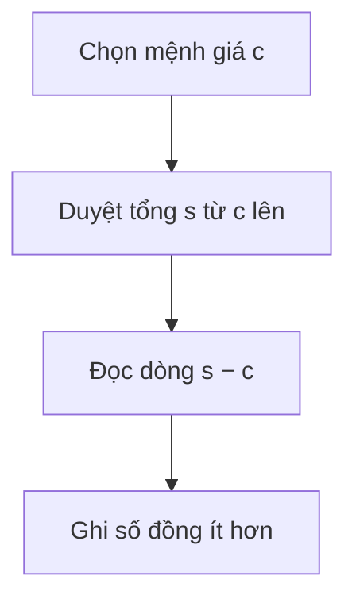

> [!tldr] Đọc nhanh
> - `dp[s]` giữ số đồng ít nhất để tạo đúng tổng `s`. Đồng cuối có mệnh giá `c` kéo theo một bài toán con ở `s − c`.
> - Mình khởi tạo `dp[0] = 0` và đánh dấu các tổng chưa tới được bằng `A + 1`, với `A` là tổng đích.
> - Có thể điền theo tổng hoặc theo mệnh giá. Khi đặt mệnh giá ở vòng ngoài, duyệt tổng tăng để đọc được kết quả vừa dùng đồng cùng loại.

> [!info] Bối cảnh
> Đây là bài LeetCode 322 tại [[posts/2026-11-27-neetcode-knapsack|ga DP-03 Ba lô và đổi tiền]] trên [[series/neetcode-dp|tuyến NeetCode: Quy hoạch động]]. Mình hình dung người trực quầy phải đưa đúng tiền thối bằng ít đồng xu nhất. Bạn chỉ cần biết mảng và vòng lặp.

> [!abstract]- Từ điển nhanh cho bài này (bấm để mở)
> - [[concepts/knapsack-state|Trạng thái theo tổng]] cho biết bài toán con đang hỏi về đúng tổng nào, với những loại đã xét nào.
> - [[concepts/unbounded-knapsack|Unbounded knapsack]] cho phép chọn lại cùng một loại nhiều lần.
> - [[concepts/memoization|Memoization]] ghi kết quả của bài toán con để lần gọi sau đọc lại.
> - Giá trị đánh dấu là số đặc biệt dành cho tổng chưa tạo được. Ở đây mình dùng `A + 1`.

## Hình dung trước: khay tiền thối

Người trực quầy có ngăn riêng cho mỗi mệnh giá và một sổ ghi số đồng tốt nhất ở từng tổng. Để tính tổng mới, mình thử đặt một đồng cuối lên khay. Phần còn lại tra trong sổ. Nếu làm cả một lượt cho một ngăn, mình ghi từ tổng nhỏ lên để đồng vừa đặt có thể xuất hiện thêm lần nữa.

| Đời thường | Khái niệm |
|---|---|
| Dòng sổ cho khoản tiền thối `s` | Trạng thái `dp[s]` |
| Khay trống cho khoản 0 | Cơ sở `dp[0] = 0` |
| Đặt thêm đồng `c` lên khay | Ứng viên `dp[s − c] + 1` |
| Dùng cùng một ngăn nhiều lần | Unbounded knapsack |
| Ghi sổ theo tổng tăng trong một lượt | [[concepts/knapsack-update-order|Thứ tự cập nhật DP]] |



## Vấn đề: đưa đúng tiền với ít đồng nhất

Cho từ 1 đến 12 mệnh giá nguyên dương, mỗi giá trị có thể lên tới `2³¹ − 1`. Tổng đích `A` nằm trong khoảng 0 đến 10.000. Mỗi mệnh giá có sẵn tùy ý. Trả về ít đồng nhất để tạo đúng `A`, hoặc `-1` nếu thiếu một cách trả chính xác.

Với mệnh giá 1, 5 và 7, lấy đồng lớn nhất trước để trả 10 cho ra `7 + 1 + 1 + 1`. Hai đồng 5 trả đúng cùng số tiền và rút kết quả từ 4 đồng xuống 2. Với mệnh giá 4 và 7, tổng 13 lại không tạo được dù có đồng nhỏ hơn đích.

## Cơ chế

### Tách theo đồng cuối

Gọi `f(s)` là số đồng nhỏ nhất tạo đúng tổng `s` từ tất cả mệnh giá. Khi `s > 0`, một cách hợp lệ phải có đồng cuối `c ≤ s`. Bỏ nó đi còn bài toán ở `s − c`. Nếu phần còn lại có cách dùng ít đồng hơn, thay phần đó vào sẽ cải thiện toàn bộ cách trả. Ngược lại, thêm `c` vào bất kỳ lời giải hợp lệ cho `s − c` đều tạo đúng `s`. Hai chiều cho công thức `f(s) = min(f(s − c) + 1)` trên các mệnh giá thỏa `c ≤ s`.

Mỗi đồng có giá ít nhất 1, nên cách tạo được một tổng `s ≤ A` dùng nhiều nhất `A` đồng. Mình dùng `A + 1` làm giá trị đánh dấu, đặt `f(0) = 0`, và lấy min với giá trị đánh dấu khi ô chưa có cách trả. Một ô chưa tới được cho ứng viên `A + 2` sau phép cộng 1. Phép min giữ nguyên dấu ở ô đích nếu chưa có ứng viên hợp lệ. Cuối cùng mới đổi dấu đó thành `-1`.

### Từ cây gọi đến bảng

Vét cạn mở một nhánh cho mỗi đồng vừa tổng còn lại. Cùng một số tiền có thể xuất hiện nhiều lần, chẳng hạn 10 còn 4 sau khi lấy 1 rồi 5, hoặc 5 rồi 1. Memoization lưu cả giá trị hữu hạn lẫn giá trị đánh dấu, để lần tra cho tổng không thể tạo cũng dùng lại được.

Bảng theo tổng chạy `s = 1…A` ở vòng ngoài. Vì mọi đồng dương, ô `s − c` đã được chốt trước ô `s`. Cách này điền đúng các phụ thuộc của công thức và tránh ngăn xếp đệ quy trên tổng lớn.

### Đổi thứ tự hai vòng

Gọi `D(i, s)` là số đồng ít nhất tạo tổng `s` bằng `i` loại đầu. Khi thêm loại `c`, hoặc giữ đáp án cũ `D(i − 1, s)`, hoặc lấy ít nhất một đồng `c` rồi nối với `D(i, s − c) + 1`. Nhánh thứ hai đọc **cùng hàng i** vì phần còn lại vẫn được dùng loại `c`. Khi gộp các hàng vào một mảng, chạy `s` tăng dần để ô nguồn đã thuộc lượt hiện tại.

Chẳng hạn với mệnh giá 4 rồi 7 và `A = 14`, lượt 4 ghi được các tổng 4, 8 và 12. Lượt 7 ghi `dp[7] = 1`, rồi dùng ngay ô đó để ghi `dp[14] = 2`. Duyệt giảm sẽ xem ô 7 trước khi nó có giá trị mới ở lượt này, vì thế chỉ cho dùng đồng 7 một lần.

Hai thứ tự vòng lặp tăng dần đều cho đáp án tối thiểu. Cách theo tổng có thể gặp cùng một nhóm đồng theo nhiều thứ tự, nhưng lặp một ứng viên không đổi phép min. Khi [[problems/coin-change-ii|Coin Change II]] cộng **số cách** thay vì lấy min, việc lặp đó làm đổi kết quả.

Gọi `k` là số loại và `d = floor(A / min(coins))` là độ sâu lớn nhất của cây gọi tính theo số cạnh. Bảng dùng thêm bộ nhớ tuyến tính theo giá trị của tổng. Độ phức tạp phụ thuộc vào `A`, trong khi biểu diễn nhị phân của nó chỉ cần cỡ `log A` bit. Đây là chi phí giả đa thức.

| Cách | Thời gian | Bộ nhớ phụ |
|---|---|---|
| Vét cạn | O(k · (1 + k + … + kᵈ)) cho cả cây và các kiểm tra mệnh giá | O(A) kể cả ngăn xếp |
| Đệ quy với memo | O(kA) | O(A), gồm memo và ngăn xếp |
| Bảng theo tổng hoặc mệnh giá | O(kA) | O(A) |

## Ví dụ chạy được

Mỗi file chạy hai bản bảng trên cả 10 ca, gồm tổng 0, tổng bất khả thi, mệnh giá lớn hơn đích và tổng 10.000. Hai bản đệ quy chỉ được gọi ở ca nhỏ. Các tab trích vòng lặp theo mệnh giá từ các file.

[TypeScript](../code/neetcode-coin-change/min_coins.ts) · [Python](../code/neetcode-coin-change/min_coins.py) · [Go](../code/neetcode-coin-change/min_coins.go) · [Java](../code/neetcode-coin-change/min_coins.java) · [JavaScript](../code/neetcode-coin-change/min_coins.js) · [PHP](../code/neetcode-coin-change/min_coins.php) · [Rust](../code/neetcode-coin-change/min_coins.rs)

```ts
function minCoins(coins: number[], amount: number) {
    const impossible = amount + 1
    const dp = Array(amount + 1).fill(impossible)
    dp[0] = 0

    for (const coin of coins) {
        for (let sum = coin; sum <= amount; sum++) {
            dp[sum] = Math.min(dp[sum], dp[sum - coin] + 1)
        }
    }
    return dp[amount] === impossible ? -1 : dp[amount]
}
```

```python
def min_coins(coins, amount):
    impossible = amount + 1
    dp = [impossible] * (amount + 1)
    dp[0] = 0
    for coin in coins:
        for total in range(coin, amount + 1):
            dp[total] = min(dp[total], dp[total - coin] + 1)
    return -1 if dp[amount] == impossible else dp[amount]
```

```go
func minCoins(coins []int, amount int) int {
	impossible := amount + 1
	dp := make([]int, amount+1)
	for sum := 1; sum <= amount; sum++ {
		dp[sum] = impossible
	}

	for _, coin := range coins {
		for sum := coin; sum <= amount; sum++ {
			dp[sum] = min(dp[sum], dp[sum-coin]+1)
		}
	}
	if dp[amount] == impossible {
		return -1
	}
	return dp[amount]
}
```

```java
static int minCoins(int[] coins, int amount) {
    int impossible = amount + 1;
    int[] dp = new int[amount + 1];
    Arrays.fill(dp, impossible);
    dp[0] = 0;

    for (int coin : coins) {
        for (int sum = coin; sum <= amount; sum++) {
            dp[sum] = Math.min(dp[sum], dp[sum - coin] + 1);
        }
    }
    return dp[amount] == impossible ? -1 : dp[amount];
}
```

```js
function minCoins(coins, amount) {
    const impossible = amount + 1
    const dp = Array(amount + 1).fill(impossible)
    dp[0] = 0

    for (const coin of coins) {
        for (let sum = coin; sum <= amount; sum++) {
            dp[sum] = Math.min(dp[sum], dp[sum - coin] + 1)
        }
    }
    return dp[amount] === impossible ? -1 : dp[amount]
}
```

```php
function minCoins(array $coins, int $amount): int {
    $impossible = $amount + 1;
    $dp = array_fill(0, $amount + 1, $impossible);
    $dp[0] = 0;

    foreach ($coins as $coin) {
        for ($sum = $coin; $sum <= $amount; $sum++) {
            $dp[$sum] = min($dp[$sum], $dp[$sum - $coin] + 1);
        }
    }
    return $dp[$amount] === $impossible ? -1 : $dp[$amount];
}
```

```rust
fn min_coins(coins: &[usize], amount: usize) -> i32 {
    let impossible = amount + 1;
    let mut dp = vec![impossible; amount + 1];
    dp[0] = 0;

    for &coin in coins {
        for sum in coin..=amount {
            dp[sum] = dp[sum].min(dp[sum - coin] + 1);
        }
    }
    if dp[amount] == impossible {
        -1
    } else {
        dp[amount] as i32
    }
}
```

Khi dùng mệnh giá 4, 6, 9 và đích 36, bộ đo tăng một lần ở mỗi lượt vào hàm đệ quy, kể cả khi trúng memo hoặc đến 0. Kết quả là 4 đồng cho cả hai bản. Cả bảy file đều cho cùng kết quả đo.

```text
10/10 ca đúng
A=36: vét cạn 804, memo 75 lượt gọi
```

## Hiểu lầm và bẫy hay gặp

- Giá trị trả về `-1` dành cho bước cuối. Đưa nó vào công thức sẽ khiến `-1 + 1` giả thành một cách dùng 0 đồng. Dùng `A + 1` trong bảng cũng tránh phép cộng vào `Integer.MAX_VALUE` trong Java và các kiểu nguyên hữu hạn khác.
- Mệnh giá có thể rất lớn nhưng bảng chỉ cần `A + 1` ô. Ở vòng theo mệnh giá, cận dưới lớn hơn `A` tạo một vòng rỗng. Khi duyệt theo tổng, kiểm tra `coin <= sum` trước khi trừ, nhất là với chỉ số `usize` của Rust.
- Duyệt giảm phù hợp với kiểu [[concepts/zero-one-knapsack|mỗi món dùng một lần]]. Bài này cho dùng lại, nên ở vòng theo mệnh giá cần duyệt tăng.
- Memoization giảm phép tính lại. Độ sâu vẫn có thể dài bằng tổng đích với mệnh giá 1. Dùng bảng lặp để tránh giới hạn đệ quy, đặc biệt trong Python và JavaScript.

## Câu hỏi tự kiểm tra

> [!question]- Vì sao `dp[0]` bằng 0?
> Khay trống đã tạo đúng tổng 0 và dùng 0 đồng. Đây là giá trị ban đầu để ghi một đồng cho tổng bằng đúng mệnh giá đó.

> [!question]- Chỉ có đồng 7 thì `dp[14]` lấy thông tin ở đâu?
> Vòng tăng đã ghi `dp[7] = dp[0] + 1 = 1`. Bước sau đọc đúng ô 7 vừa ghi và cộng 1.

> [!question]- Có thể dừng ngay khi gặp cách tạo tổng đích đầu tiên không?
> Chưa đủ căn cứ. Với các nhánh không có thứ tự theo số đồng, nhánh đầu có thể dùng nhiều đồng hơn một nhánh sau. Bảng xét các ứng viên còn lại và giữ min.

## Tham khảo

- Đề và giới hạn đầu vào. [LeetCode 322, Coin Change](https://leetcode.com/problems/coin-change/)
- Truy hồi theo đồng cuối và chi phí giả đa thức. [MIT 6.046J, Recitation 5](https://live.ocw.mit.edu/courses/6-046j-design-and-analysis-of-algorithms-spring-2015/d187472426117c2ebec700a22c209b3f_MIT6_046JS15_Recitation5.pdf)
- Bảng theo tổng và phân tích chọn đồng lớn trước. [Princeton COS 226, Dynamic Programming](https://www.cs.princeton.edu/courses/archive/fall24/cos226/lectures/DynamicProgramming.pdf)
