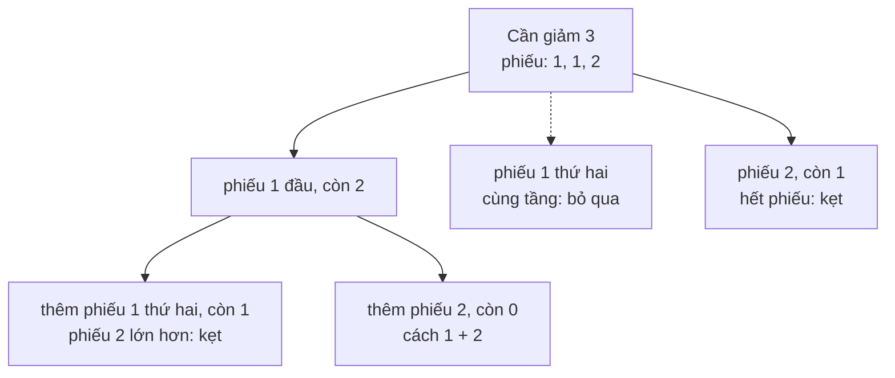
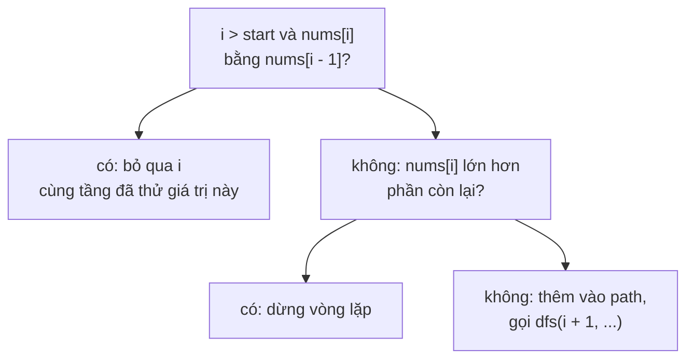

> [!tldr] Đọc nhanh
> - Khác [[problems/combination-sum|Combination Sum]] ở hai chỗ: mỗi **vị trí** chỉ được dùng một lần, và mảng có thể có **số trùng**.
> - Dùng một lần nên gọi đệ quy với `i + 1`. Vẫn giữ [[concepts/start-index|chỉ số bắt đầu]] để không in một túi theo nhiều thứ tự.
> - Số trùng làm cùng một túi xuất hiện nhiều lần (hai số 1 khác vị trí nhưng giống nhau). Sắp xếp để các bản trùng đứng cạnh nhau, rồi ở **cùng một tầng** chỉ thử bản đầu tiên: `i > start && nums[i] == nums[i - 1]` thì bỏ qua.
> - Điều kiện là `i > start`, không phải `i > 0`: ở tầng sâu hơn, bản trùng thứ hai vẫn được chọn để có túi như `[2, 2]`.
> - Khử trùng bằng tập (Set) cũng đúng, nhưng với 20 số 1 và đích 10, nó gọi hàm 616.666 lần so với 11 lần khi bỏ trùng cùng tầng.

> [!info] Bối cảnh
> Đây là bài LeetCode 40 tại [[posts/2026-11-28-neetcode-subsets-combinations|ga MISC-01: Quay lui: tập con và tổ hợp]] trên **tuyến NeetCode: Kỹ thuật tổng hợp**. Mình hình dung một hộp phiếu giảm giá, mỗi phiếu chỉ dùng được một lần và có nhiều phiếu cùng mệnh giá. Bạn chỉ cần biết mảng, sắp xếp và hàm đệ quy; đọc trang Combination Sum trước sẽ dễ hơn.

> [!abstract]- Từ điển nhanh cho bài này (bấm để mở)
> - [[concepts/backtracking|Quay lui]] (backtracking): thêm một lựa chọn, đi sâu, rồi gỡ nó ra để thử lựa chọn khác.
> - [[concepts/choice-tree|Cây lựa chọn]]: mỗi nút là một lời giải dở dang, mỗi cạnh là một lựa chọn.
> - **Tầng** của cây: tất cả các lựa chọn mà một nút có thể thêm vào ở bước tiếp theo. Trong code, đó là các vòng lặp `for i` của cùng một lời gọi `dfs(start, …)`.
> - [[concepts/start-index|Chỉ số bắt đầu]] `start`: chỉ chọn phần tử ở vị trí từ `start` trở đi.
> - [[concepts/duplicate-skipping|Bỏ trùng trên mảng đã sắp xếp]]: các giá trị bằng nhau đứng liền nhau, nên chỉ cần so với phần tử ngay trước.
> - [[concepts/zero-one-knapsack|Ba lô 0/1]]: họ bài mỗi món dùng tối đa một lần; ở đó thường đếm hoặc tối ưu, ở đây liệt kê.

## Hình dung trước: hộp phiếu giảm giá

Mình có các phiếu giảm giá 1, 1, 2 nghìn và muốn giảm đúng 3 nghìn. Mỗi phiếu chỉ dùng một lần. Phiếu 1 thứ nhất cộng phiếu 2 cho 3 nghìn, phiếu 1 thứ hai cộng phiếu 2 cũng cho 3 nghìn, nhưng với người thu ngân đó là **cùng một cách**: "một phiếu 1, một phiếu 2". Mẹo là xếp phiếu theo mệnh giá, rồi mỗi khi phải chọn "phiếu tiếp theo là phiếu nào", chỉ nhắc tới mỗi mệnh giá một lần.

| Đời thường | Khái niệm |
|---|---|
| Mỗi phiếu chỉ dùng một lần | Gọi đệ quy với `i + 1` |
| Xếp phiếu theo mệnh giá | Sắp xếp `candidates` |
| Lúc chọn phiếu tiếp theo, mỗi mệnh giá chỉ nhắc một lần | Bỏ `nums[i]` nếu `i > start` và `nums[i] == nums[i - 1]` |
| Đã cầm một phiếu 1 rồi vẫn được cầm thêm phiếu 1 kia | Ở tầng sâu hơn, `i == start` nên không bị bỏ |
| Phiếu này đã lớn hơn số còn phải giảm | Sắp xếp rồi `break` |
| Ghi ra mọi cách rồi gạch cách trùng | Khử trùng bằng tập (Set) |



Nếu không bỏ nhánh "phiếu 1 thứ hai" ở tầng đầu, nó sẽ đi tiếp tới phiếu 2 và in `[1, 2]` lần nữa. Mình đã chạy thử bản không bỏ trùng với `[1, 1, 2]` và đích 3: kết quả là `[[1, 2], [1, 2]]`.

## Vấn đề: tổ hợp không lặp khi mỗi phần tử dùng một lần

Cho mảng `candidates` có 1 đến 100 số nguyên, mỗi số từ 1 đến 50, có thể trùng nhau, và một số `target` từ 1 đến 30. Trả về mọi tổ hợp **khác nhau** có tổng đúng bằng `target`, trong đó mỗi phần tử của mảng được dùng tối đa một lần. Hai tổ hợp có cùng các giá trị (dù lấy từ vị trí khác nhau) chỉ tính một lần. Ví dụ, với `[3, 1, 3, 5, 1, 1]` và đích 8 có ba tổ hợp: `[1, 1, 1, 5]`, `[1, 1, 3, 3]` và `[3, 5]`. [Đề gốc LeetCode 40](https://leetcode.com/problems/combination-sum-ii/)

Mình từng nghĩ chỉ cần lấy lời giải Combination Sum, đổi `i` thành `i + 1`, rồi bỏ các đáp án trùng vào một tập. Cách đó ra đúng đáp án. Vấn đề là nó vẫn đi hết mọi nhánh trùng rồi mới gạch, và số nhánh trùng có thể lớn hơn số đáp án rất nhiều.

## Cơ chế

### Vét mọi tập con

Mỗi phần tử có hai trạng thái: lấy hoặc không. Duyệt 2ⁿ bitmask, giữ những tập có tổng bằng đích, sắp từng tập rồi khử trùng. Với n = 100 thì không thể, nên mình chỉ dùng cách này làm trọng tài trên mảng tối đa 6 phần tử.

### Quay lui dùng một lần, khử trùng bằng tập

Sắp xếp mảng, rồi dựng cây như Combination Sum nhưng gọi `dfs(i + 1, …)`. Mỗi `path` là một dãy vị trí tăng nghiêm ngặt, tức là một tập con của các vị trí. Vì đã sắp xếp, hai tập con có cùng giá trị cho ra cùng một `path`, nên đưa `path` vào một tập là đủ để khử trùng. `break` khi số lớn hơn phần còn lại vẫn đúng như trước.

Chỗ tốn: mỗi bản trùng mở một nhánh riêng. Với 20 số 1 và đích 10, cây đi qua mọi tập con có tổng tối đa 10 của 20 vị trí, tức là C(20,0) + C(20,1) + … + C(20,10) = 616.666 nút, chỉ để in một đáp án `[1 × 10]`.

### Bỏ số trùng ở cùng một tầng

Ở một nút, vòng lặp `for i from start` liệt kê các lựa chọn cho phần tử **kế tiếp** của `path`. Nếu `nums[i] == nums[i - 1]` và `i - 1` cũng thuộc vòng lặp này (tức `i > start`), thì nhánh của `i` sinh ra đúng những túi mà nhánh `i - 1` đã sinh, vì sau `i - 1` còn nhiều phần tử hơn để chọn. Bỏ qua nó không mất đáp án nào.

Điều kiện phải là `i > start`. Khi `i == start`, phần tử `i - 1` (nếu bằng nó) là phần tử vừa được chọn ở tầng trên, không phải một lựa chọn cùng tầng. Lấy thêm nó là hợp lệ: túi `[2, 2]` cần cả hai số 2. Mình đã thử viết `i > 0` với `[2, 2, 2]` và đích 4: kết quả rỗng thay vì `[[2, 2]]`.



**Độ phức tạp.** Sắp xếp tốn O(n log n). Mỗi nút của cây sau khi bỏ trùng là một túi giá trị khác nhau có tổng không quá đích. Trường hợp xấu nhất (toàn số khác nhau) vẫn có thể là O(2ⁿ) nút, mỗi đáp án tốn thêm O(n) để chép. Vì mọi số ≥ 1 và đích ≤ 30, một đường từ gốc xuống sâu tối đa 30 tầng, nên ngăn xếp và `path` tốn O(min(n, target)). Với 20 số 1 và đích 10, bản bỏ trùng chỉ gọi 11 lần: mỗi tầng còn đúng một lựa chọn.

## Ví dụ chạy được

[TypeScript](../code/neetcode-combination-sum-ii/once.ts) · [Python](../code/neetcode-combination-sum-ii/once.py) · [Go](../code/neetcode-combination-sum-ii/once.go) · [Java](../code/neetcode-combination-sum-ii/once.java) · [JavaScript](../code/neetcode-combination-sum-ii/once.js) · [PHP](../code/neetcode-combination-sum-ii/once.php) · [Rust](../code/neetcode-combination-sum-ii/combination_sum_once.rs)

```ts
// Sắp xếp, bỏ số trùng ở cùng một tầng, cắt nhánh khi số đã lớn hơn phần còn lại.
function combinationSum2(candidates: number[], target: number): number[][] {
    const nums = [...candidates].sort((a, b) => a - b)
    const out: number[][] = []
    const path: number[] = []
    const dfs = (start: number, remain: number): void => {
        calls++
        if (remain === 0) {
            out.push([...path])
            return
        }
        for (let i = start; i < nums.length; i++) {
            if (i > start && nums[i] === nums[i - 1]) continue // cùng tầng đã thử giá trị này rồi
            if (nums[i] > remain) break
            path.push(nums[i])
            dfs(i + 1, remain - nums[i]) // i + 1: vị trí này đã dùng
            path.pop()
        }
    }
    dfs(0, target)
    return out
}
```

```python
def combination_sum2(candidates, target):
    """Sắp xếp, bỏ số trùng ở cùng một tầng, cắt nhánh khi số đã lớn hơn phần còn lại."""
    global calls
    nums = sorted(candidates)
    out, path = [], []

    def dfs(start, remain):
        global calls
        calls += 1
        if remain == 0:
            out.append(path[:])
            return
        for i in range(start, len(nums)):
            if i > start and nums[i] == nums[i - 1]:
                continue  # cùng tầng đã thử giá trị này rồi
            if nums[i] > remain:
                break
            path.append(nums[i])
            dfs(i + 1, remain - nums[i])  # i + 1: vị trí này đã dùng
            path.pop()

    dfs(0, target)
    return out
```

```go
// Sắp xếp, bỏ số trùng ở cùng một tầng, cắt nhánh khi số đã lớn hơn phần còn lại.
func combinationSum2(candidates []int, target int) [][]int {
	nums := append([]int(nil), candidates...)
	sort.Ints(nums)
	out := [][]int{}
	path := []int{}
	var dfs func(start, remain int)
	dfs = func(start, remain int) {
		calls++
		if remain == 0 {
			out = append(out, append([]int(nil), path...)) // chép ra, path còn bị sửa tiếp
			return
		}
		for i := start; i < len(nums); i++ {
			if i > start && nums[i] == nums[i-1] {
				continue // cùng tầng đã thử giá trị này rồi
			}
			if nums[i] > remain {
				break
			}
			path = append(path, nums[i])
			dfs(i+1, remain-nums[i]) // i + 1: vị trí này đã dùng
			path = path[:len(path)-1]
		}
	}
	dfs(0, target)
	return out
}
```

```java
// Sắp xếp, bỏ số trùng ở cùng một tầng, cắt nhánh khi số đã lớn hơn phần còn lại.
static List<List<Integer>> combinationSum2(int[] candidates, int target) {
    int[] nums = candidates.clone();
    Arrays.sort(nums);
    List<List<Integer>> out = new ArrayList<>();
    dfs(nums, 0, target, new ArrayList<>(), out);
    return out;
}

static void dfs(int[] nums, int start, int remain, List<Integer> path, List<List<Integer>> out) {
    calls++;
    if (remain == 0) {
        out.add(new ArrayList<>(path)); // chép ra, path còn bị sửa tiếp
        return;
    }
    for (int i = start; i < nums.length; i++) {
        if (i > start && nums[i] == nums[i - 1]) continue; // cùng tầng đã thử giá trị này rồi
        if (nums[i] > remain) break;
        path.add(nums[i]);
        dfs(nums, i + 1, remain - nums[i], path, out); // i + 1: vị trí này đã dùng
        path.remove(path.size() - 1);
    }
}
```

```js
// Sắp xếp, bỏ số trùng ở cùng một tầng, cắt nhánh khi số đã lớn hơn phần còn lại.
function combinationSum2(candidates, target) {
    const nums = [...candidates].sort((a, b) => a - b)
    const out = []
    const path = []
    const dfs = (start, remain) => {
        calls++
        if (remain === 0) {
            out.push([...path])
            return
        }
        for (let i = start; i < nums.length; i++) {
            if (i > start && nums[i] === nums[i - 1]) continue // cùng tầng đã thử giá trị này rồi
            if (nums[i] > remain) break
            path.push(nums[i])
            dfs(i + 1, remain - nums[i]) // i + 1: vị trí này đã dùng
            path.pop()
        }
    }
    dfs(0, target)
    return out
}
```

```php
// Sắp xếp, bỏ số trùng ở cùng một tầng, cắt nhánh khi số đã lớn hơn phần còn lại.
function combinationSum2(array $candidates, int $target): array {
    $nums = $candidates;
    sort($nums);
    $out = [];
    $path = [];
    $dfs = function (int $start, int $remain) use (&$dfs, &$out, &$path, $nums) {
        global $calls;
        $calls++;
        if ($remain === 0) {
            $out[] = $path; // mảng PHP được chép theo giá trị
            return;
        }
        for ($i = $start; $i < count($nums); $i++) {
            if ($i > $start && $nums[$i] === $nums[$i - 1]) continue; // cùng tầng đã thử giá trị này rồi
            if ($nums[$i] > $remain) break;
            $path[] = $nums[$i];
            $dfs($i + 1, $remain - $nums[$i]); // i + 1: vị trí này đã dùng
            array_pop($path);
        }
    };
    $dfs(0, $target);
    return $out;
}
```

```rust
// Sắp xếp, bỏ số trùng ở cùng một tầng, cắt nhánh khi số đã lớn hơn phần còn lại.
fn combination_sum2(candidates: &[i32], target: i32) -> Vec<Vec<i32>> {
    fn dfs(nums: &[i32], start: usize, remain: i32, path: &mut Vec<i32>, out: &mut Vec<Vec<i32>>) {
        tick();
        if remain == 0 {
            out.push(path.clone()); // chép ra, path còn bị sửa tiếp
            return;
        }
        for i in start..nums.len() {
            if i > start && nums[i] == nums[i - 1] {
                continue; // cùng tầng đã thử giá trị này rồi
            }
            if nums[i] > remain {
                break;
            }
            path.push(nums[i]);
            dfs(nums, i + 1, remain - nums[i], path, out); // i + 1: vị trí này đã dùng
            path.pop();
        }
    }
    let mut nums = candidates.to_vec();
    nums.sort();
    let mut out = Vec::new();
    dfs(&nums, 0, target, &mut Vec::new(), &mut out);
    out
}
```

Các tab trích bản bỏ trùng cùng tầng. File tải về có thêm bản khử trùng bằng tập và bộ vét bitmask. Dòng đầu là 7 ca tự đặt, có mảng toàn số trùng, số lớn hơn đích và 20 số 1. Dòng hai đối chiếu cả hai bản quay lui với bộ vét trên mọi mảng dài 1 tới 6 chỉ gồm 1, 2, 3, với mọi đích từ 1 tới 8. Dòng ba đếm lượt gọi hàm, không phải thời gian.

```text
7/7 ca đúng
8736/8736 ca đúng (đối chiếu vét tập con)
20 số 1, target 10: khử trùng bằng tập 616666 lượt gọi, bỏ trùng cùng tầng 11 lượt gọi
```

Chạy bằng `node once.ts`, `python3 once.py`, `go run once.go`, `java once.java`, `node once.js`, `php -d xdebug.mode=off once.php` hoặc `rustc --edition 2021 -O combination_sum_once.rs -o /tmp/combination_sum_once && /tmp/combination_sum_once`. Bảy ngôn ngữ in cùng các con số.

## Hiểu lầm và bẫy hay gặp

- Viết `i > 0` thay vì `i > start`. Điều kiện đó chặn cả việc lấy bản trùng ở tầng sâu hơn, nên `[2, 2, 2]` với đích 4 trả rỗng.
- Quên sắp xếp. Các bản trùng không đứng cạnh nhau, nên so với `nums[i - 1]` không bắt được chúng, và `break` cũng sai (xem bẫy tương tự ở [[problems/combination-sum|Combination Sum]]).
- Gọi `dfs(i, …)` như bài 39. Một phần tử được dùng nhiều lần: `[5]` với đích 10 sẽ cho `[5, 5]`.
- Dùng `continue` cho số lớn hơn phần còn lại khi đã sắp xếp. Vẫn đúng, nhưng phí: mọi số sau cũng lớn hơn, nên `break` là đủ.
- Thêm `path` vào kết quả mà không chép. Go dính lỗi chung mảng nền (`append([]int(nil), path...)` mới an toàn), Python, TypeScript, JavaScript và Java lưu tham chiếu tới cùng một danh sách đang bị sửa. PHP chép mảng theo giá trị; Rust buộc `path.clone()`. Chi tiết ở trang Combination Sum.
- Khử trùng bằng `Set` của mảng. TypeScript và JavaScript so mảng theo tham chiếu, nên `new Set([[1, 2], [1, 2]])` có hai phần tử; phải dùng khóa chuỗi như `path.join(",")`. Java `List` và Rust `Vec` có `equals`/`Hash` theo nội dung nên đưa thẳng vào `HashSet` được. PHP dùng chuỗi làm khóa mảng.
- Java: nếu đổi mảng `int[]` sang `List<Integer>` thì `nums.get(i) == nums.get(i - 1)` so tham chiếu hai đối tượng `Integer`. JLS chỉ bảo đảm các giá trị từ -128 tới 127 được dùng chung một đối tượng, nên với giá trị ≤ 50 của đề thì `==` tình cờ đúng, và lỗi chỉ lộ ra với số lớn hơn. Dùng `equals` hoặc mảng `int[]`.

## Câu hỏi tự kiểm tra

> [!question]- Vì sao bỏ nhánh của bản trùng thứ hai ở cùng tầng không làm mất đáp án?
> Mọi túi mà nhánh `i` sinh ra đều sinh được từ nhánh `i - 1`: thay phần tử ở vị trí `i` bằng phần tử bằng nó ở vị trí `i - 1`, phần còn lại của túi vẫn chọn từ các vị trí sau `i`, nằm trong phạm vi của nhánh `i - 1`.

> [!question]- Với `[1, 1, 1]` và đích 2, cây bỏ trùng đi qua những nút nào?
> Gốc chọn bản 1 đầu (hai bản sau bị bỏ ở tầng này). Nút `[1]` có `start = 1`, chọn bản 1 thứ hai và được `[1, 1]` có tổng 2; bản thứ ba bị bỏ vì cùng tầng. Tổng cộng 3 lời gọi.

> [!question]- Khi mảng không có số trùng, bài này khác Combination Sum ở đâu?
> Chỉ ở `i + 1` thay cho `i`: mỗi số dùng tối đa một lần. Điều kiện bỏ trùng không bao giờ đúng nên không làm gì.

> [!question]- Vì sao khử trùng bằng tập vẫn đúng mà lại chậm?
> Nó sinh mỗi túi một lần cho mỗi cách chọn vị trí rồi mới gạch, nên công sức tỉ lệ với số tập con vị trí chứ không phải số túi khác nhau.

## Tham khảo

- [LeetCode 40](https://leetcode.com/problems/combination-sum-ii/)
- [Jeff Erickson, Algorithms, chương 2: quay lui](https://jeffe.cs.illinois.edu/teaching/algorithms/book/02-backtracking.pdf)
- [JLS 5.1.7: boxing conversion và khoảng giá trị được dùng chung](https://docs.oracle.com/javase/specs/jls/se21/html/jls-5.html#jls-5.1.7) · [Rust HashSet](https://doc.rust-lang.org/std/collections/struct.HashSet.html)
