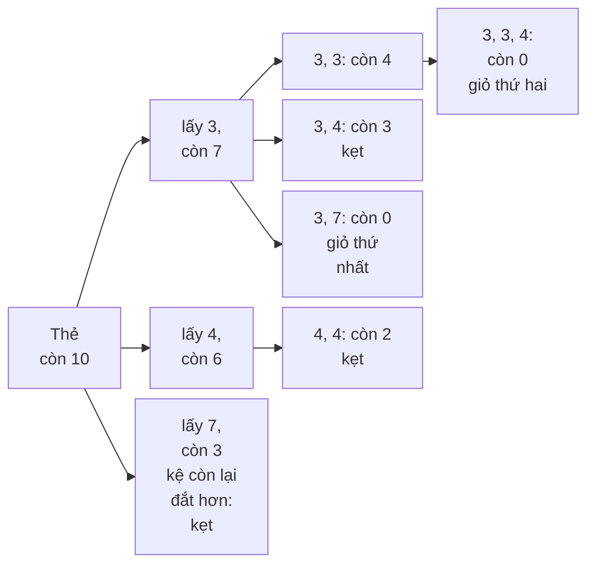
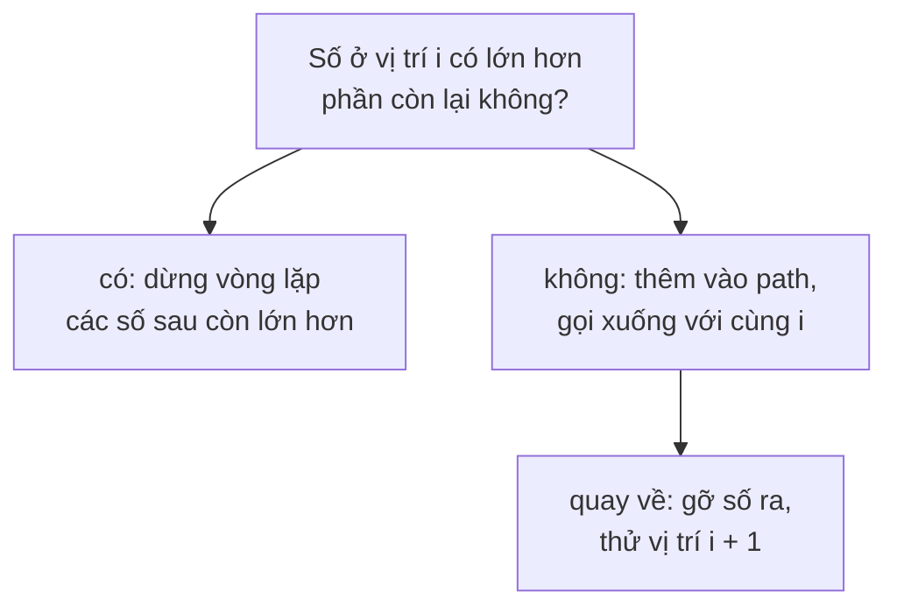

> [!tldr] Đọc nhanh
> - Đây là bài **liệt kê**, không phải bài đếm. Mỗi đáp án là một túi số (thứ tự không quan trọng), một số được lấy nhiều lần.
> - Dựng [[concepts/choice-tree|cây lựa chọn]]: mỗi tầng chọn thêm một số. Để `[2, 3]` và `[3, 2]` không bị liệt kê hai lần, chỉ cho phép chọn số ở vị trí **từ `start` trở đi** ([[concepts/start-index|chỉ số bắt đầu]]).
> - Được dùng lại nên gọi đệ quy với **cùng `i`**, không phải `i + 1`.
> - Sắp xếp trước, rồi `break` ngay khi một số lớn hơn phần còn lại: mọi số sau cũng lớn hơn. Trên 12 số nguyên tố tới 37 với đích 40, cách này giảm từ 18.976 xuống 2.699 lượt gọi.
> - Muốn chỉ biết **có bao nhiêu** tổ hợp thì dùng DP như [[problems/coin-change-ii|Coin Change II]]; muốn **in ra** từng tổ hợp thì phải quay lui.

> [!info] Bối cảnh
> Đây là bài LeetCode 39 tại [[posts/2026-11-28-neetcode-subsets-combinations|ga MISC-01: Quay lui: tập con và tổ hợp]] trên **tuyến NeetCode: Kỹ thuật tổng hợp**. Mình hình dung một tấm thẻ quà tặng phải tiêu vừa hết, mua ở một cửa hàng mà món nào cũng còn hàng không giới hạn. Bạn chỉ cần biết mảng, vòng lặp và hàm đệ quy.

> [!abstract]- Từ điển nhanh cho bài này (bấm để mở)
> - [[concepts/backtracking|Quay lui]] (backtracking): thêm một lựa chọn vào lời giải đang dựng, đi sâu, rồi gỡ lựa chọn đó ra để thử cái khác.
> - [[concepts/choice-tree|Cây lựa chọn]]: mỗi nút là một lời giải dở dang, mỗi cạnh là một lựa chọn thêm vào.
> - [[concepts/start-index|Chỉ số bắt đầu]] (`start`): ở mỗi tầng chỉ được chọn số đứng từ vị trí `start` trở về sau, để mỗi túi số chỉ xuất hiện theo một thứ tự duy nhất.
> - Cắt nhánh (pruning): dừng một nhánh ngay khi biết nó không thể dẫn tới đáp án.
> - `path`: danh sách các số đã chọn trên đường từ gốc tới nút hiện tại. Có một `path` dùng chung cho cả cây, nên khi gặp đáp án phải **chép** nó ra.
> - [[concepts/unbounded-knapsack|Ba lô không giới hạn]]: bài toán cùng họ, mỗi món dùng lại được; ở đó ta thường đếm hoặc tối ưu, ở đây ta liệt kê.

## Hình dung trước: tiêu vừa hết thẻ quà tặng

Thẻ còn 10 nghìn. Cửa hàng có ba kệ, giá 3, 4 và 7 nghìn, món nào cũng còn nhiều. Mình muốn biết **mọi giỏ hàng** tiêu vừa hết thẻ. Giỏ `3, 7` và giỏ `7, 3` là một giỏ. Mẹo: đi dọc các kệ theo một chiều. Ở kệ nào thì được lấy món của kệ đó bao nhiêu lần tùy ý, nhưng đã bước sang kệ sau thì không quay lại kệ trước. Nhờ vậy mỗi giỏ chỉ được nhặt theo đúng một trình tự.

| Đời thường | Khái niệm |
|---|---|
| Số dư trên thẻ | `remain`, phần đích còn thiếu |
| Các kệ xếp theo giá tăng dần | Mảng `candidates` đã sắp xếp |
| Đứng ở kệ nào thì chỉ lấy từ kệ đó trở đi | [[concepts/start-index\|Chỉ số bắt đầu]] `start` |
| Lấy thêm một món mà vẫn đứng ở kệ cũ | Gọi đệ quy với cùng `i` (được dùng lại) |
| Giỏ đang nhặt dở | `path` |
| Thẻ về đúng 0 | Một đáp án, chép `path` ra |
| Món ở kệ này đã đắt hơn số dư thì các kệ sau cũng vậy | Sắp xếp rồi `break` |



Hình bỏ bớt nút `3, 3, 3` (còn 1) cho gọn. Nút đó vẫn được gọi, rồi kẹt ngay vì món rẻ nhất còn được lấy đã đắt hơn số dư.

## Vấn đề: liệt kê mọi tổ hợp có tổng bằng đích

Cho mảng `candidates` gồm 1 đến 30 số nguyên **khác nhau**, mỗi số từ 2 đến 40, và một số `target` từ 1 đến 40. Trả về mọi tổ hợp các số trong mảng có tổng đúng bằng `target`. Mỗi số được dùng lại không giới hạn. Hai tổ hợp chỉ khác thứ tự được coi là một. Đề bảo đảm số tổ hợp nhỏ hơn 150. Ví dụ, với `[3, 4, 7]` và đích 10 thì có hai tổ hợp: `[3, 3, 4]` và `[3, 7]`. [Đề gốc LeetCode 39](https://leetcode.com/problems/combination-sum/)

Mình từng nghĩ cứ thử "lấy số nào cũng được ở mọi bước" rồi khử trùng ở cuối. Cách đó vẫn ra đáp án đúng nếu khử trùng cẩn thận, nhưng mỗi túi `k` số khác nhau bị sinh ra tới `k!` lần theo các thứ tự khác nhau. Câu hỏi thật là: làm sao để cây chỉ sinh **mỗi túi đúng một lần**?

## Cơ chế

### Vét mọi vector số lần dùng

Cách thô nhất: với mỗi số `c`, thử mọi số lần dùng từ 0 tới `target / c`, rồi giữ các bộ có tổng đúng. Mỗi bộ số lần dùng ứng đúng với một túi, nên không có trùng. Nhưng số bộ phải thử là tích của `(target / c + 1)` qua mọi số, tăng theo hàm mũ với độ dài mảng, kể cả những bộ vượt đích từ rất sớm. Mình chỉ dùng cách này làm "trọng tài" để đối chiếu trên đầu vào nhỏ.

### Quay lui với chỉ số bắt đầu

Hàm `dfs(start, remain)` đứng ở một nút của cây: `path` là các số đã chọn, `remain` là phần còn thiếu.

| Bước | Việc làm |
|---|---|
| bước 1 | Nếu `remain` bằng 0: chép `path` vào kết quả và quay về. |
| bước 2 | Với mỗi `i` từ `start` tới cuối mảng: thêm `candidates[i]` vào `path`. |
| bước 3 | Gọi `dfs(i, remain - candidates[i])`. Truyền `i` chứ không phải `i + 1`, vì số này còn được lấy tiếp. |
| bước 4 | Gỡ số vừa thêm ra khỏi `path`, thử `i` kế tiếp. |

Vì mỗi tầng chỉ chọn số ở vị trí không nhỏ hơn tầng trước, mọi `path` đều đi theo thứ tự vị trí không giảm. Mỗi túi số có đúng một cách viết như thế, nên không cần khử trùng. Bản chưa cắt nhánh đi tới khi `remain` âm mới quay về.

### Sắp xếp rồi cắt nhánh

Nếu mảng đã tăng dần và `candidates[i] > remain`, thì mọi số sau `i` cũng lớn hơn `remain`. Vì vậy `break` khỏi vòng lặp thay vì gọi xuống rồi mới phát hiện `remain` âm. Việc sắp xếp tốn O(n log n), nhỏ so với cây. Trên 12 số nguyên tố từ 2 tới 37 với đích 40 (302 tổ hợp), bản không cắt nhánh gọi hàm 18.976 lần, bản sắp xếp và cắt nhánh gọi 2.699 lần.



**Độ phức tạp.** Gọi n là độ dài mảng, T là đích, m là số nhỏ nhất. Một đường từ gốc xuống lá dài tối đa T/m (ở đây ≤ 20), nên ngăn xếp đệ quy và `path` tốn O(T/m). Số nút của cây bị chặn bởi O(n^(T/m + 1)) trong trường hợp xấu nhất; mỗi đáp án tốn thêm O(T/m) để chép. Thời gian thực tế phụ thuộc vào số đáp án và số nhánh cụt, nên cắt nhánh mới quan trọng.

### Đếm thì dùng DP, liệt kê thì quay lui

Nếu đề chỉ hỏi *bao nhiêu* tổ hợp, bảng `ways[t] += ways[t - c]` của [[problems/coin-change-ii|Coin Change II]] trả lời trong O(n·T) mà không dựng tổ hợp nào. Mỗi file ở dưới cũng tính con số này và kiểm tra nó bằng đúng số tổ hợp mà quay lui in ra. Nhưng DP chỉ giữ con số tại mỗi tổng, không giữ các tổ hợp, nên không thể in chúng. Đầu ra có thể dài, và một thuật toán liệt kê không thể nhanh hơn độ dài đầu ra.

## Ví dụ chạy được

[TypeScript](../code/neetcode-combination-sum/combos.ts) · [Python](../code/neetcode-combination-sum/combos.py) · [Go](../code/neetcode-combination-sum/combos.go) · [Java](../code/neetcode-combination-sum/combos.java) · [JavaScript](../code/neetcode-combination-sum/combos.js) · [PHP](../code/neetcode-combination-sum/combos.php) · [Rust](../code/neetcode-combination-sum/combination_sum.rs)

```ts
// Sắp xếp rồi cắt nhánh: số đầu tiên lớn hơn phần còn lại thì mọi số sau cũng vậy.
function combinationSum(candidates: number[], target: number): number[][] {
    const nums = [...candidates].sort((a, b) => a - b)
    const out: number[][] = []
    const path: number[] = []
    const dfs = (start: number, remain: number): void => {
        calls++
        if (remain === 0) {
            out.push([...path])
            return
        }
        for (let i = start; i < nums.length; i++) {
            if (nums[i] > remain) break
            path.push(nums[i])
            dfs(i, remain - nums[i]) // vẫn là i: được dùng lại số này
            path.pop()
        }
    }
    dfs(0, target)
    return out
}
```

```python
def combination_sum(candidates, target):
    """Sắp xếp rồi cắt nhánh: số đầu tiên lớn hơn phần còn lại thì mọi số sau cũng vậy."""
    global calls
    nums = sorted(candidates)
    out, path = [], []

    def dfs(start, remain):
        global calls
        calls += 1
        if remain == 0:
            out.append(path[:])
            return
        for i in range(start, len(nums)):
            if nums[i] > remain:
                break
            path.append(nums[i])
            dfs(i, remain - nums[i])  # vẫn là i: được dùng lại số này
            path.pop()

    dfs(0, target)
    return out
```

```go
// Sắp xếp rồi cắt nhánh: số đầu tiên lớn hơn phần còn lại thì mọi số sau cũng vậy.
func combinationSum(candidates []int, target int) [][]int {
	nums := append([]int(nil), candidates...)
	sort.Ints(nums)
	out := [][]int{}
	path := []int{}
	var dfs func(start, remain int)
	dfs = func(start, remain int) {
		calls++
		if remain == 0 {
			out = append(out, append([]int(nil), path...))
			return
		}
		for i := start; i < len(nums); i++ {
			if nums[i] > remain {
				break
			}
			path = append(path, nums[i])
			dfs(i, remain-nums[i]) // vẫn là i: được dùng lại số này
			path = path[:len(path)-1]
		}
	}
	dfs(0, target)
	return out
}
```

```java
// Sắp xếp rồi cắt nhánh: số đầu tiên lớn hơn phần còn lại thì mọi số sau cũng vậy.
static List<List<Integer>> combinationSum(int[] candidates, int target) {
    int[] nums = candidates.clone();
    Arrays.sort(nums);
    List<List<Integer>> out = new ArrayList<>();
    dfs(nums, 0, target, new ArrayList<>(), out);
    return out;
}

static void dfs(int[] nums, int start, int remain, List<Integer> path, List<List<Integer>> out) {
    calls++;
    if (remain == 0) {
        out.add(new ArrayList<>(path));
        return;
    }
    for (int i = start; i < nums.length; i++) {
        if (nums[i] > remain) break;
        path.add(nums[i]);
        dfs(nums, i, remain - nums[i], path, out); // vẫn là i: được dùng lại số này
        path.remove(path.size() - 1);
    }
}
```

```js
// Sắp xếp rồi cắt nhánh: số đầu tiên lớn hơn phần còn lại thì mọi số sau cũng vậy.
function combinationSum(candidates, target) {
    const nums = [...candidates].sort((a, b) => a - b)
    const out = []
    const path = []
    const dfs = (start, remain) => {
        calls++
        if (remain === 0) {
            out.push([...path])
            return
        }
        for (let i = start; i < nums.length; i++) {
            if (nums[i] > remain) break
            path.push(nums[i])
            dfs(i, remain - nums[i]) // vẫn là i: được dùng lại số này
            path.pop()
        }
    }
    dfs(0, target)
    return out
}
```

```php
// Sắp xếp rồi cắt nhánh: số đầu tiên lớn hơn phần còn lại thì mọi số sau cũng vậy.
function combinationSum(array $candidates, int $target): array {
    $nums = $candidates;
    sort($nums);
    $out = [];
    $path = [];
    $dfs = function (int $start, int $remain) use (&$dfs, &$out, &$path, $nums) {
        global $calls;
        $calls++;
        if ($remain === 0) {
            $out[] = $path;
            return;
        }
        for ($i = $start; $i < count($nums); $i++) {
            if ($nums[$i] > $remain) break;
            $path[] = $nums[$i];
            $dfs($i, $remain - $nums[$i]); // vẫn là i: được dùng lại số này
            array_pop($path);
        }
    };
    $dfs(0, $target);
    return $out;
}
```

```rust
// Sắp xếp rồi cắt nhánh: số đầu tiên lớn hơn phần còn lại thì mọi số sau cũng vậy.
fn combination_sum(candidates: &[i32], target: i32) -> Vec<Vec<i32>> {
    fn dfs(nums: &[i32], start: usize, remain: i32, path: &mut Vec<i32>, out: &mut Vec<Vec<i32>>) {
        tick();
        if remain == 0 {
            out.push(path.clone());
            return;
        }
        for i in start..nums.len() {
            if nums[i] > remain {
                break;
            }
            path.push(nums[i]);
            dfs(nums, i, remain - nums[i], path, out); // vẫn là i: được dùng lại số này
            path.pop();
        }
    }
    let mut nums = candidates.to_vec();
    nums.sort();
    let mut out = Vec::new();
    dfs(&nums, 0, target, &mut Vec::new(), &mut out);
    out
}
```

Các tab trích bản sắp xếp và cắt nhánh. File tải về có thêm bản không cắt nhánh, DP đếm số tổ hợp và bộ vét mọi vector số lần dùng. Dòng đầu là 7 ca tự đặt, có mảng chưa sắp xếp, đích nhỏ hơn mọi số và một số lẻ không ghép được. Dòng hai đối chiếu với bộ vét cho mọi tập con không rỗng của `{2, 3, 4, 5, 6, 7}` và mọi đích từ 1 tới 14. Dòng ba là số lần gọi hàm, không phải thời gian chạy.

```text
7/7 ca đúng
882/882 ca đúng (đối chiếu vét số lần dùng)
12 số nguyên tố tới 37, target 40: không cắt nhánh 18976 lượt gọi, sắp xếp + cắt nhánh 2699 lượt gọi, 302 tổ hợp
```

Chạy bằng `node combos.ts`, `python3 combos.py`, `go run combos.go`, `java combos.java`, `node combos.js`, `php -d xdebug.mode=off combos.php` hoặc `rustc --edition 2021 -O combination_sum.rs -o /tmp/combination_sum && /tmp/combination_sum`. Bảy ngôn ngữ in cùng các con số.

## Hiểu lầm và bẫy hay gặp

- Gọi đệ quy với `i + 1`. Khi đó mỗi số chỉ dùng được một lần, và `[3, 3, 4]` biến mất. `i + 1` là của [[problems/combination-sum-ii|Combination Sum II]].
- Gọi đệ quy với `0` thay vì `i`. Cây quay lại các kệ trước, nên `[3, 3, 4]`, `[3, 4, 3]` và `[4, 3, 3]` đều được in.
- Dùng `break` khi chưa sắp xếp. Với `[8, 2, 5]` và đích 10, sau khi chọn 8 vòng lặp gặp lại 8 trước, thấy 8 lớn hơn 2 và dừng, nên mất `[2, 8]`. Chưa sắp xếp thì chỉ được `continue`, không được `break`.
- Thêm `path` vào kết quả mà không chép. Mình đã thử với `[2, 3, 5]` và đích 8:
  - Go: `out = append(out, path)` cho `[[5 5 3 2] [5 5 3] [5 5]]` thay vì `[[2 2 2 2] [2 3 3] [3 5]]`. Các phần tử của `out` dùng chung mảng nền với `path`, nên lần ghi sau đè lên đáp án cũ. Phải viết `append([]int(nil), path...)`.
  - Python: `out.append(path)` cho `[[], [], []]`, vì cả ba phần tử là cùng một list, đã bị `pop` về rỗng. Phải viết `path[:]`.
  - TypeScript, JavaScript và Java cũng lưu tham chiếu, nên cần `[...path]` hay `new ArrayList<>(path)`.
  - PHP: `$out[] = $path` chép mảng theo giá trị nên không dính lỗi này. Ngược lại, closure phải nhận `use (&$out, &$path)` theo tham chiếu, nếu không mọi thay đổi bên trong sẽ mất.
  - Rust: borrow checker không cho đẩy `path` (đang mượn mutable) vào `out`, nên buộc phải `path.clone()`.
- Lo tràn ngăn xếp. Mỗi tầng trừ ít nhất 2 khỏi đích tối đa 40, nên cây sâu tối đa 20 tầng, rất xa giới hạn 1.000 tầng của Python hay 512 tầng của Xdebug.

## Câu hỏi tự kiểm tra

> [!question]- Vì sao chỉ số bắt đầu đủ để không in một túi hai lần?
> Mỗi `path` đi theo thứ tự vị trí không giảm. Một túi số chỉ có đúng một cách xếp các phần tử theo thứ tự đó, nên cây chỉ chứa nó một lần.

> [!question]- Đổi `dfs(i, …)` thành `dfs(i + 1, …)` thì bài này thành bài gì?
> Mỗi số dùng tối đa một lần. Vì mảng ở đây không có số trùng, đó chính là Combination Sum II khi đầu vào toàn số khác nhau.

> [!question]- Khi nào `break` sai còn `continue` thì vẫn đúng?
> Khi mảng chưa sắp xếp. Một số lớn ở vị trí `i` không nói gì về các số sau nó, nên chỉ được bỏ qua riêng nó.

> [!question]- DP của Coin Change II nhanh hơn nhiều, sao không dùng nó để in tổ hợp?
> Mỗi ô của DP chỉ giữ một con số, đã cộng gộp mọi cách đi tới tổng đó. Muốn in từng tổ hợp thì phải giữ từng đường đi, và số đường đi có thể lớn hơn nhiều so với n·T.

## Tham khảo

- [LeetCode 39](https://leetcode.com/problems/combination-sum/)
- [Jeff Erickson, Algorithms, chương 2: quay lui](https://jeffe.cs.illinois.edu/teaching/algorithms/book/02-backtracking.pdf)
- [Go blog: Go Slices, usage and internals](https://go.dev/blog/slices-intro) · [Python: mutable sequence types](https://docs.python.org/3/library/stdtypes.html#mutable-sequence-types) · [PHP: anonymous functions](https://www.php.net/manual/en/functions.anonymous.php)
