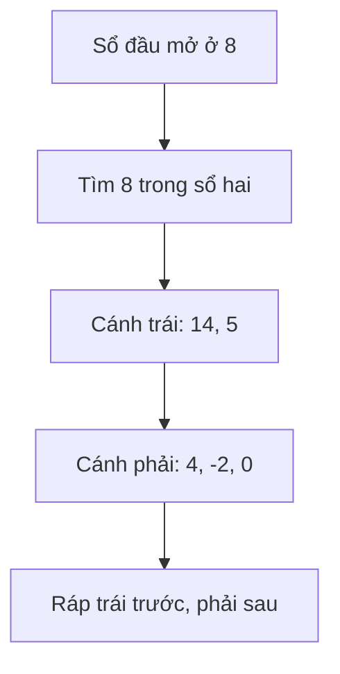

> [!tldr] Đọc nhanh
> - [[concepts/pre-order-traversal|Tiền thứ tự]] cho gốc trước. [[concepts/in-order-traversal|Trung thứ tự]] đặt gốc giữa toàn bộ cây con trái và cây con phải.
> - Giữ một [[concepts/inorder-interval|khoảng trung thứ tự]] `[lo, hi)` cho mỗi cây con và một con trỏ đọc dãy tiền thứ tự. Chọn gốc xong thì dựng trái trước, phải sau.
> - Quét tìm gốc có thể mất O(n²), còn [[concepts/hash-map|bảng băm]] vị trí cho thời gian kỳ vọng O(n) với O(n) bộ nhớ phụ.
> - Ngăn xếp tự quản lý cũng chạy O(n), chỉ cần O(h) bộ nhớ phụ với h là chiều cao cây. Bản này chạy được cả hai chuỗi lệch 3000 nút trong bộ ca mẫu.

> [!info] Bối cảnh
> Bài LeetCode 105 (Medium), thuộc [[posts/2026-11-26-neetcode-tree-reconstruction|ga 6: Dựng và mã hóa cây]] trên **tuyến NeetCode: Cấu trúc liên kết**. Ở [[posts/2026-11-25-neetcode-binary-search-tree|ga 4]] và [[posts/2026-11-25-neetcode-level-order|ga 5]], mình đã có cây rồi mới đọc ra các nút. Lần này mình làm [[concepts/tree-reconstruction|chiều ngược lại]]: nhận hai dãy và nối lại từng cạnh. Bạn chỉ cần biết mỗi nút của cây nhị phân có một chỗ cho con trái và một chỗ cho con phải.

> [!abstract]- Từ điển nhanh cho bài này (bấm để mở)
> - **Tiền thứ tự** → gốc, cả nhánh trái, cả nhánh phải.
> - **Trung thứ tự** → cả nhánh trái, gốc, cả nhánh phải.
> - **Khoảng nửa mở** `[lo, hi)` chứa các vị trí từ `lo` đến trước `hi`. Hai cận bằng nhau là khoảng rỗng.
> - **Chỉ mục vị trí** lưu vị trí trong dãy trung thứ tự theo giá trị nút.
> - **Ngăn xếp** giữ phần tử vào sau nhất ở trên cùng. Lấy phần tử trên cùng ra gọi là pop.
> - **Chiều cao h** ở đây đếm số nút trên đường dài nhất từ gốc tới lá.

## Hình dung trước: ráp lại sơ đồ các phòng

Hãy tưởng tượng mình nhận hai sổ kiểm kê phòng, mỗi phòng có một mã riêng. Sổ thứ nhất ghi phòng chính trước khi đi hai cánh, luôn đi cánh trái trước. Sổ thứ hai ghi phòng chính sau khi kiểm hết cánh trái và trước khi sang cánh phải. Đầu sổ thứ nhất cho mình mã phòng chính. Tìm mã đó trong sổ thứ hai là biết hai cánh gồm những phòng nào.

| Đời thường | Khái niệm |
|---|---|
| Mã phòng đầu tiên trong sổ thứ nhất | gốc từ tiền thứ tự |
| Hai đoạn hai bên mã phòng trong sổ thứ hai | khoảng trung thứ tự của cây con trái và phải |
| Dò từng dòng hoặc tra sổ số trang | quét tuần tự hoặc tra chỉ mục vị trí |
| Chồng thẻ phòng đang chờ kiểm xong cánh trái | ngăn xếp các nút chưa tới lượt trung thứ tự |



## Vấn đề: hai dãy mô tả cùng một cây

Mỗi mảng có từ 1 đến 3000 số nguyên thuộc đoạn từ −3000 tới 3000. Trong mỗi mảng, các giá trị phân biệt. Hai mảng là hai lượt duyệt hợp lệ của cùng một cây. Mình cần trả về nút gốc cùng các liên kết trái và phải. [Đề gốc LeetCode 105](https://leetcode.com/problems/construct-binary-tree-from-preorder-and-inorder-traversal/)

Ví dụ mình dùng `preorder = [8, 14, 5, -2, 4, 0]` và `inorder = [14, 5, 8, 4, -2, 0]`. Gốc 8 có hai con là 14 và −2. Nút 14 có đúng một con phải là 5. Nút −2 có con trái 4 và con phải 0. Điều quyết định trái hay phải là **vị trí trong dãy trung thứ tự**, nên con trái của 8 vẫn có thể lớn hơn 8.

## Cơ chế

<figure class="figure-map" style="--ar: 3 / 4">
<div class="frame"><iframe data-archify="../diagrams/neetcode-construct-binary-tree-from-preorder-and-inorder-traversal/worked-example.html" title="Tách trung thứ tự tại gốc kế tiếp" loading="lazy"></iframe></div>
<figcaption><span><b>Hình 1.</b> Tách trung thứ tự tại gốc kế tiếp.</span><a href="../diagrams/neetcode-construct-binary-tree-from-preorder-and-inorder-traversal/worked-example.html" target="_blank" rel="noopener">Mở toàn màn hình</a></figcaption>
</figure>

<details>
<summary>Đọc từng bước</summary>
<ol>
<li>Đọc gốc 6 từ tiền thứ tự. <code>pre = [6, 2, 4, 9]</code></li>
<li>Tra vị trí 6 trong trung thứ tự. <code>in = [2, 4, 6, 9]</code></li>
<li>Khoảng trái lấy 2 trước rồi tới 4. <code>[2, 4] → 2 with right child 4</code></li>
<li>Khoảng phải còn lại đúng 9. <code>6: left = 2, right = 9</code></li>
</ol>
</details>

### Quét tìm gốc và giữ hai cận

`build(lo, hi)` dựng đúng các nút trong `inorder[lo:hi]`. Khi khoảng rỗng, hàm trả về cây rỗng và giữ nguyên con trỏ tiền thứ tự. Khi khoảng còn nút, lấy giá trị kế tiếp của tiền thứ tự làm gốc. Tìm vị trí `mid` của giá trị đó bằng cách quét từ `lo`. Dựng `[lo, mid)` trước, rồi mới dựng `[mid + 1, hi)`.

| Bước | Khoảng đang dựng | Giá trị kế tiếp hoặc kết quả |
|---|---|---|
| Bắt đầu | `[0, 6)` | gốc 8 ở vị trí 2 |
| Rẽ trái của 8 | `[0, 2)` | gốc 14 ở vị trí 0 |
| Rẽ trái của 14 | `[0, 0)` | cây rỗng, giữ nguyên con trỏ |
| Rẽ phải của 14 | `[1, 2)` | lấy 5 làm lá |
| Xong trái của 8 | `[3, 6)` | giá trị kế tiếp là −2 |

Vì tiền thứ tự đọc hết cây con trái trước khi sang phải, lời gọi trái tiêu thụ đúng `mid - lo` giá trị sau gốc. Sau đó con trỏ đứng sẵn ở gốc cây con phải, nếu cây đó có nút. Đây cũng là lý do cây dựng được là duy nhất. Gốc đã xác định, điểm tách đã xác định vì các giá trị phân biệt, rồi lập luận lặp lại trên hai khoảng nhỏ hơn. [Cornell CS 2110](https://www.cs.cornell.edu/courses/cs2110/2025fa/discussions/dis08/) · [MIT 6.046](https://courses.csail.mit.edu/6.046/fall03/handouts/pset4-sol.pdf)

### Đổi bước quét thành tra vị trí

Dựng trước `index[value] = vị trí trong inorder` và thay mỗi lượt quét bằng một lượt tra. Hai cận, con trỏ và thứ tự dựng cây giữ nguyên. Bảng này hữu ích nhất khi gốc thường nằm cuối khoảng. Trên cây chỉ có con trái, quét từ đầu phải so sánh lần lượt n, n − 1, …, 1 lần. Trên cây chỉ có con phải, gốc luôn ở đầu nên chỉ cần một lần so sánh cho mỗi nút.

Mình đếm phép toán trong chương trình TypeScript và JavaScript bằng cây lệch trái 500 nút. Cùng một cây được dựng và kiểm lại bằng hai cách. Bản quét cần **125.250 phép so sánh**. Bản có chỉ mục cần **500 lần tra** sau khi ghi 500 vị trí. Hai con số đo khối lượng công việc của riêng bước tìm gốc, nên không quy đổi trực tiếp thành chênh lệch thời gian chạy.

### Dựng theo ngăn xếp và đọc cả hai dãy từ đầu

Lúc đầu, tạo gốc từ phần tử đầu tiên của tiền thứ tự. Sau đó, lấy mỗi giá trị tiền thứ tự tiếp theo làm một nút mới. Trên ngăn xếp là các nút đã tạo nhưng chưa được đi qua trong lượt trung thứ tự. Đỉnh là nút vừa tạo. Có hai trường hợp.

1. **Đỉnh khác giá trị trung thứ tự kế tiếp.** Trung thứ tự còn chờ đi trái trước khi tới đỉnh, nên nút mới là con trái của đỉnh.
2. **Đỉnh bằng giá trị trung thứ tự kế tiếp.** Cây con trái của đỉnh đã hoàn tất. Lấy đỉnh ra, tiến con trỏ trung thứ tự và tiếp tục lấy ra khi giá trị còn khớp. Nút mới là con phải của nút **cuối cùng được lấy ra**, vì đó là nơi lượt tiền thứ tự phải đi xuống tiếp.

Với cây ví dụ, ngay trước khi tạo nút −2, ngăn xếp chứa 8 và 5, đỉnh là 5. Dãy trung thứ tự đang chờ 5 rồi 8, nên mình lấy cả hai ra. Gắn −2 vào bên phải **8**. Lúc nút 14 được lấy ra để gắn 5 làm con phải, nút 8 vẫn chờ mãi tới sau 5 mới đến lượt.

| Cách | Thời gian dựng | Bộ nhớ phụ khi dựng |
|---|---|---|
| Quét khoảng từ trái sang | O(n²) xấu nhất, Θ(n) trên chuỗi lệch phải | O(h) khung gọi hàm |
| Tra chỉ mục | O(n) kỳ vọng với giả định bảng băm tra trung bình O(1) | O(n + h), gồm chỉ mục và khung gọi |
| Ngăn xếp | O(n), mỗi nút vào một lần và ra tối đa một lần | O(h), ngăn xếp giữ nhiều nhất một đường tổ tiên |

Bộ nhớ phụ trong bảng tính riêng phần dựng. Cả ba cách đều tạo n nút cho cây kết quả. Chuẩn ECMAScript yêu cầu `Map` có thời gian truy cập trung bình dưới tuyến tính theo số phần tử. Ô O(n) dùng giả định bảng băm thông thường. [ECMAScript, Map Objects](https://tc39.es/ecma262/multipage/keyed-collections.html#sec-map-objects)

## Ví dụ chạy được

Mỗi file kiểm hai lượt duyệt của cây dựng được bằng một vòng lặp. Một lần chạy gồm ba cách trên năm cây nhỏ, rồi thêm hai chuỗi 3000 nút (lệch trái và lệch phải) cho bản ngăn xếp. Năm cây nhỏ gồm một lá, cây lẫn giá trị âm và không theo thứ tự tìm kiếm, hai chuỗi một phía và cây có nhánh đổi hướng.

```typescript
import assert from "node:assert/strict"

class TreeNode {
  left: TreeNode | null = null
  right: TreeNode | null = null
  value: number

  constructor(value: number) {
    this.value = value
  }
}

type FindRoot = (value: number, lo: number) => number
type Rebuild = (preorder: number[], inorder: number[]) => TreeNode | null

function buildRanges(preorder: number[], findRoot: FindRoot): TreeNode | null {
  let next = 0

  function build(lo: number, hi: number): TreeNode | null {
    if (lo === hi) return null
    const root = new TreeNode(preorder[next++])
    const mid = findRoot(root.value, lo)
    root.left = build(lo, mid)
    root.right = build(mid + 1, hi)
    return root
  }

  return build(0, preorder.length)
}

function scanFrom(inorder: number[], value: number, lo: number): number {
  while (inorder[lo] !== value) lo++
  return lo
}

const byScan: Rebuild = (preorder, inorder) =>
  buildRanges(preorder, (value, lo) => scanFrom(inorder, value, lo))

const byIndex: Rebuild = (preorder, inorder) => {
  const index = new Map(inorder.map((value, i) => [value, i]))
  return buildRanges(preorder, (value) => index.get(value)!)
}

const byStack: Rebuild = (preorder, inorder) => {
  if (preorder.length === 0) return null
  const root = new TreeNode(preorder[0])
  const pending = [root]
  let nextIn = 0

  for (let i = 1; i < preorder.length; i++) {
    const child = new TreeNode(preorder[i])
    let parent = pending[pending.length - 1]

    if (parent.value !== inorder[nextIn]) {
      parent.left = child
    } else {
      while (pending.length && pending[pending.length - 1].value === inorder[nextIn]) {
        parent = pending.pop()!
        nextIn++
      }
      parent.right = child
    }

    pending.push(child)
  }

  return root
}

function check(root: TreeNode | null, preorder: number[], inorder: number[]) {
  const before: number[] = []
  const between: number[] = []
  const pending: TreeNode[] = []
  while (root || pending.length) {
    while (root) {
      before.push(root.value)
      pending.push(root)
      root = root.left
    }
    root = pending.pop()!
    between.push(root.value)
    root = root.right
  }
  assert.deepEqual(before, preorder)
  assert.deepEqual(between, inorder)
}

const cases = [
  [[-3000], [-3000]],
  [[8, 14, 5, -2, 4, 0], [14, 5, 8, 4, -2, 0]],
  [[1, 2, 3, 4], [4, 3, 2, 1]],
  [[1, 2, 3, 4], [1, 2, 3, 4]],
  [[1, -2, 3, -4], [-2, -4, 3, 1]],
]

let ok = 0
for (const rebuild of [byScan, byIndex, byStack]) {
  for (const [preorder, inorder] of cases) {
    check(rebuild(preorder, inorder), preorder, inorder)
    ok++
  }
}

const straight = Array.from({ length: 3000 }, (_, i) => i + 1)
for (const inorder of [straight, [...straight].reverse()]) {
  check(byStack(straight, inorder), straight, inorder)
  ok++
}
console.log(`${ok}/${cases.length * 3 + 2} ca đúng`)

const preorder = straight.slice(0, 500)
const inorder = [...preorder].reverse()
let comparisons = 0
let lookups = 0
check(buildRanges(preorder, (value, lo) => {
  const mid = scanFrom(inorder, value, lo)
  comparisons += mid - lo + 1
  return mid
}), preorder, inorder)
const index = new Map(inorder.map((value, i) => [value, i]))
check(buildRanges(preorder, (value) => {
  lookups++
  return index.get(value)!
}), preorder, inorder)
console.log(`so sánh quét: ${comparisons}, lượt tra chỉ mục: ${lookups}`)
```

```python
from dataclasses import dataclass


@dataclass
class TreeNode:
    value: int
    left: "TreeNode | None" = None
    right: "TreeNode | None" = None


def build_ranges(preorder, find_root):
    next_pre = 0

    def build(lo, hi):
        nonlocal next_pre
        if lo == hi:
            return None
        node = TreeNode(preorder[next_pre])
        next_pre += 1
        mid = find_root(node.value, lo)
        node.left = build(lo, mid)
        node.right = build(mid + 1, hi)
        return node

    return build(0, len(preorder))


def by_scan(preorder, inorder):
    return build_ranges(preorder, lambda value, lo: inorder.index(value, lo))


def by_index(preorder, inorder):
    index = {value: i for i, value in enumerate(inorder)}
    return build_ranges(preorder, lambda value, lo: index[value])


def by_stack(preorder, inorder):
    if not preorder:
        return None
    root = TreeNode(preorder[0])
    pending = [root]
    next_in = 0

    for i in range(1, len(preorder)):
        child = TreeNode(preorder[i])
        parent = pending[-1]
        if parent.value != inorder[next_in]:
            parent.left = child
        else:
            while pending and pending[-1].value == inorder[next_in]:
                parent = pending.pop()
                next_in += 1
            parent.right = child
        pending.append(child)

    return root


def check(root, preorder, inorder):
    before, between, pending = [], [], []
    while root is not None or pending:
        while root is not None:
            before.append(root.value)
            pending.append(root)
            root = root.left
        root = pending.pop()
        between.append(root.value)
        root = root.right
    assert before == preorder
    assert between == inorder


if __name__ == "__main__":
    cases = [
        ([-3000], [-3000]),
        ([8, 14, 5, -2, 4, 0], [14, 5, 8, 4, -2, 0]),
        ([1, 2, 3, 4], [4, 3, 2, 1]),
        ([1, 2, 3, 4], [1, 2, 3, 4]),
        ([1, -2, 3, -4], [-2, -4, 3, 1]),
    ]
    ok = 0
    for rebuild in (by_scan, by_index, by_stack):
        for preorder, inorder in cases:
            check(rebuild(preorder, inorder), preorder, inorder)
            ok += 1

    straight = list(range(1, 3001))
    for inorder in (straight, straight[::-1]):
        check(by_stack(straight, inorder), straight, inorder)
        ok += 1
    print(f"{ok}/{len(cases) * 3 + 2} ca đúng")
```

```go
package main

import (
	"fmt"
	"slices"
)

type treeNode struct {
	value       int
	left, right *treeNode
}

type rebuild func(preorder, inorder []int) *treeNode

func buildRanges(preorder []int, findRoot func(value, lo int) int) *treeNode {
	next := 0
	var build func(lo, hi int) *treeNode
	build = func(lo, hi int) *treeNode {
		if lo == hi {
			return nil
		}
		node := &treeNode{value: preorder[next]}
		next++
		mid := findRoot(node.value, lo)
		node.left = build(lo, mid)
		node.right = build(mid+1, hi)
		return node
	}
	return build(0, len(preorder))
}

func byScan(preorder, inorder []int) *treeNode {
	return buildRanges(preorder, func(value, lo int) int {
		for inorder[lo] != value {
			lo++
		}
		return lo
	})
}

func byIndex(preorder, inorder []int) *treeNode {
	index := make(map[int]int, len(inorder))
	for i, value := range inorder {
		index[value] = i
	}
	return buildRanges(preorder, func(value, _ int) int { return index[value] })
}

func byStack(preorder, inorder []int) *treeNode {
	if len(preorder) == 0 {
		return nil
	}
	root := &treeNode{value: preorder[0]}
	pending := []*treeNode{root}
	nextIn := 0

	for _, value := range preorder[1:] {
		child := &treeNode{value: value}
		parent := pending[len(pending)-1]
		if parent.value != inorder[nextIn] {
			parent.left = child
		} else {
			for len(pending) > 0 && pending[len(pending)-1].value == inorder[nextIn] {
				parent = pending[len(pending)-1]
				pending = pending[:len(pending)-1]
				nextIn++
			}
			parent.right = child
		}
		pending = append(pending, child)
	}
	return root
}

func check(root *treeNode, preorder, inorder []int) {
	var before, between []int
	var pending []*treeNode
	for root != nil || len(pending) > 0 {
		for root != nil {
			before = append(before, root.value)
			pending = append(pending, root)
			root = root.left
		}
		root = pending[len(pending)-1]
		pending = pending[:len(pending)-1]
		between = append(between, root.value)
		root = root.right
	}
	if !slices.Equal(before, preorder) || !slices.Equal(between, inorder) {
		panic("thứ tự duyệt không khớp")
	}
}

func main() {
	cases := []struct{ preorder, inorder []int }{
		{[]int{-3000}, []int{-3000}},
		{[]int{8, 14, 5, -2, 4, 0}, []int{14, 5, 8, 4, -2, 0}},
		{[]int{1, 2, 3, 4}, []int{4, 3, 2, 1}},
		{[]int{1, 2, 3, 4}, []int{1, 2, 3, 4}},
		{[]int{1, -2, 3, -4}, []int{-2, -4, 3, 1}},
	}
	ok := 0
	for _, build := range []rebuild{byScan, byIndex, byStack} {
		for _, c := range cases {
			check(build(c.preorder, c.inorder), c.preorder, c.inorder)
			ok++
		}
	}

	straight, reverse := make([]int, 3000), make([]int, 3000)
	for i := range straight {
		straight[i], reverse[i] = i+1, len(straight)-i
	}
	for _, inorder := range [][]int{straight, reverse} {
		check(byStack(straight, inorder), straight, inorder)
		ok++
	}
	fmt.Printf("%d/%d ca đúng\n", ok, len(cases)*3+2)
}
```

```java
import java.util.ArrayDeque;
import java.util.Deque;
import java.util.HashMap;
import java.util.List;
import java.util.Map;
import java.util.function.IntBinaryOperator;

class RebuildTree {
    static class TreeNode {
        final int value;
        TreeNode left, right;

        TreeNode(int value) {
            this.value = value;
        }
    }

    interface Rebuild {
        TreeNode build(int[] preorder, int[] inorder);
    }

    static TreeNode buildRanges(int[] preorder, IntBinaryOperator findRoot) {
        class Builder {
            int next;

            TreeNode build(int lo, int hi) {
                if (lo == hi) return null;
                TreeNode node = new TreeNode(preorder[next++]);
                int mid = findRoot.applyAsInt(node.value, lo);
                node.left = build(lo, mid);
                node.right = build(mid + 1, hi);
                return node;
            }
        }

        return new Builder().build(0, preorder.length);
    }

    static TreeNode byScan(int[] preorder, int[] inorder) {
        return buildRanges(preorder, (value, lo) -> {
            while (inorder[lo] != value) lo++;
            return lo;
        });
    }

    static TreeNode byIndex(int[] preorder, int[] inorder) {
        Map<Integer, Integer> index = new HashMap<>();
        for (int i = 0; i < inorder.length; i++) {
            index.put(inorder[i], i);
        }
        return buildRanges(preorder, (value, lo) -> index.get(value));
    }

    static TreeNode byStack(int[] preorder, int[] inorder) {
        if (preorder.length == 0) return null;
        TreeNode root = new TreeNode(preorder[0]);
        Deque<TreeNode> pending = new ArrayDeque<>();
        pending.push(root);
        int nextIn = 0;

        for (int i = 1; i < preorder.length; i++) {
            TreeNode child = new TreeNode(preorder[i]);
            TreeNode parent = pending.peek();
            if (parent.value != inorder[nextIn]) {
                parent.left = child;
            } else {
                while (!pending.isEmpty() && pending.peek().value == inorder[nextIn]) {
                    parent = pending.pop();
                    nextIn++;
                }
                parent.right = child;
            }
            pending.push(child);
        }
        return root;
    }

    static void check(TreeNode root, int[] preorder, int[] inorder) {
        Deque<TreeNode> pending = new ArrayDeque<>();
        int before = 0, between = 0;
        while (root != null || !pending.isEmpty()) {
            while (root != null) {
                require(before < preorder.length && preorder[before++] == root.value);
                pending.push(root);
                root = root.left;
            }
            root = pending.pop();
            require(between < inorder.length && inorder[between++] == root.value);
            root = root.right;
        }
        require(before == preorder.length && between == inorder.length);
    }

    static void require(boolean passed) {
        if (!passed) throw new AssertionError("thứ tự duyệt không khớp");
    }

    public static void main(String[] args) {
        int[][][] cases = {
            {{-3000}, {-3000}},
            {{8, 14, 5, -2, 4, 0}, {14, 5, 8, 4, -2, 0}},
            {{1, 2, 3, 4}, {4, 3, 2, 1}},
            {{1, 2, 3, 4}, {1, 2, 3, 4}},
            {{1, -2, 3, -4}, {-2, -4, 3, 1}},
        };
        List<Rebuild> builders = List.of(RebuildTree::byScan, RebuildTree::byIndex, RebuildTree::byStack);
        int ok = 0;
        for (Rebuild rebuild : builders) {
            for (int[][] fixture : cases) {
                check(rebuild.build(fixture[0], fixture[1]), fixture[0], fixture[1]);
                ok++;
            }
        }

        int[] straight = new int[3000], reverse = new int[3000];
        for (int i = 0; i < straight.length; i++) {
            straight[i] = i + 1;
            reverse[i] = straight.length - i;
        }
        for (int[] inorder : new int[][] {straight, reverse}) {
            check(byStack(straight, inorder), straight, inorder);
            ok++;
        }
        System.out.printf("%d/%d ca đúng%n", ok, cases.length * 3 + 2);
    }
}
```

```javascript
import assert from "node:assert/strict"

class TreeNode {
  left = null
  right = null

  constructor(value) {
    this.value = value
  }
}

function buildRanges(preorder, findRoot) {
  let next = 0

  function build(lo, hi) {
    if (lo === hi) return null
    const root = new TreeNode(preorder[next++])
    const mid = findRoot(root.value, lo)
    root.left = build(lo, mid)
    root.right = build(mid + 1, hi)
    return root
  }

  return build(0, preorder.length)
}

function scanFrom(inorder, value, lo) {
  while (inorder[lo] !== value) lo++
  return lo
}

const byScan = (preorder, inorder) =>
  buildRanges(preorder, (value, lo) => scanFrom(inorder, value, lo))

const byIndex = (preorder, inorder) => {
  const index = new Map(inorder.map((value, i) => [value, i]))
  return buildRanges(preorder, (value) => index.get(value))
}

const byStack = (preorder, inorder) => {
  if (preorder.length === 0) return null
  const root = new TreeNode(preorder[0])
  const pending = [root]
  let nextIn = 0

  for (let i = 1; i < preorder.length; i++) {
    const child = new TreeNode(preorder[i])
    let parent = pending[pending.length - 1]

    if (parent.value !== inorder[nextIn]) {
      parent.left = child
    } else {
      while (pending.length && pending[pending.length - 1].value === inorder[nextIn]) {
        parent = pending.pop()
        nextIn++
      }
      parent.right = child
    }

    pending.push(child)
  }

  return root
}

function check(root, preorder, inorder) {
  const before = []
  const between = []
  const pending = []
  while (root || pending.length) {
    while (root) {
      before.push(root.value)
      pending.push(root)
      root = root.left
    }
    root = pending.pop()
    between.push(root.value)
    root = root.right
  }
  assert.deepEqual(before, preorder)
  assert.deepEqual(between, inorder)
}

const cases = [
  [[-3000], [-3000]],
  [[8, 14, 5, -2, 4, 0], [14, 5, 8, 4, -2, 0]],
  [[1, 2, 3, 4], [4, 3, 2, 1]],
  [[1, 2, 3, 4], [1, 2, 3, 4]],
  [[1, -2, 3, -4], [-2, -4, 3, 1]],
]

let ok = 0
for (const rebuild of [byScan, byIndex, byStack]) {
  for (const [preorder, inorder] of cases) {
    check(rebuild(preorder, inorder), preorder, inorder)
    ok++
  }
}

const straight = Array.from({ length: 3000 }, (_, i) => i + 1)
for (const inorder of [straight, [...straight].reverse()]) {
  check(byStack(straight, inorder), straight, inorder)
  ok++
}
console.log(`${ok}/${cases.length * 3 + 2} ca đúng`)

const preorder = straight.slice(0, 500)
const inorder = [...preorder].reverse()
let comparisons = 0
let lookups = 0
check(buildRanges(preorder, (value, lo) => {
  const mid = scanFrom(inorder, value, lo)
  comparisons += mid - lo + 1
  return mid
}), preorder, inorder)
const index = new Map(inorder.map((value, i) => [value, i]))
check(buildRanges(preorder, (value) => {
  lookups++
  return index.get(value)
}), preorder, inorder)
console.log(`so sánh quét: ${comparisons}, lượt tra chỉ mục: ${lookups}`)
```

```php
<?php
// LC 105: dựng cây từ tiền thứ tự và trung thứ tự. Ba cách: quét, tra chỉ mục, ngăn xếp.
// Chạy: php rebuild.php (máy có Xdebug thì thêm -d xdebug.mode=off)
declare(strict_types=1);

final class TreeNode {
    public ?TreeNode $left = null;
    public ?TreeNode $right = null;
    public function __construct(public int $value) {}
}

// $findRoot($value, $lo) trả vị trí của gốc trong trung thứ tự.
function buildRanges(array $preorder, callable $findRoot): ?TreeNode {
    $next = 0;
    // $next phải đi vào closure bằng tham chiếu (&): bản sao thì mọi nút đều lấy $preorder[0].
    $build = function (int $lo, int $hi) use (&$build, &$next, $preorder, $findRoot): ?TreeNode {
        if ($lo === $hi) return null;
        $root = new TreeNode($preorder[$next++]);
        $mid = $findRoot($root->value, $lo);
        $root->left = $build($lo, $mid);
        $root->right = $build($mid + 1, $hi);
        return $root;
    };
    return $build(0, count($preorder));
}

function scanFrom(array $inorder, int $value, int $lo): int {
    while ($inorder[$lo] !== $value) $lo++;
    return $lo;
}

function byScan(array $preorder, array $inorder): ?TreeNode {
    return buildRanges($preorder, fn(int $value, int $lo): int => scanFrom($inorder, $value, $lo));
}

function byIndex(array $preorder, array $inorder): ?TreeNode {
    $index = array_flip($inorder); // giá trị → vị trí; giá trị trùng thì vị trí sau đè vị trí trước
    return buildRanges($preorder, fn(int $value, int $lo): int => $index[$value]);
}

function byStack(array $preorder, array $inorder): ?TreeNode {
    if (count($preorder) === 0) return null;
    $root = new TreeNode($preorder[0]);
    $pending = [$root];
    $nextIn = 0;

    for ($i = 1; $i < count($preorder); $i++) {
        $child = new TreeNode($preorder[$i]);
        $parent = end($pending);

        if ($parent->value !== $inorder[$nextIn]) {
            $parent->left = $child;
        } else {
            while ($pending && end($pending)->value === $inorder[$nextIn]) {
                $parent = array_pop($pending);
                $nextIn++;
            }
            $parent->right = $child;
        }

        $pending[] = $child;
    }

    return $root;
}

function check(?TreeNode $root, array $preorder, array $inorder): void {
    $before = [];
    $between = [];
    $pending = [];
    while ($root !== null || $pending) {
        while ($root !== null) {
            $before[] = $root->value;
            $pending[] = $root;
            $root = $root->left;
        }
        $root = array_pop($pending);
        $between[] = $root->value;
        $root = $root->right;
    }
    if ($before !== $preorder || $between !== $inorder) throw new RuntimeException("cây sai");
}

$cases = [
    [[-3000], [-3000]],
    [[8, 14, 5, -2, 4, 0], [14, 5, 8, 4, -2, 0]],
    [[1, 2, 3, 4], [4, 3, 2, 1]],
    [[1, 2, 3, 4], [1, 2, 3, 4]],
    [[1, -2, 3, -4], [-2, -4, 3, 1]],
];

$ok = 0;
foreach (['byScan', 'byIndex', 'byStack'] as $rebuild) {
    foreach ($cases as [$preorder, $inorder]) {
        check($rebuild($preorder, $inorder), $preorder, $inorder);
        $ok++;
    }
}

$straight = range(1, 3000);
foreach ([$straight, array_reverse($straight)] as $inorder) {
    check(byStack($straight, $inorder), $straight, $inorder);
    $ok++;
}
echo "$ok/" . (count($cases) * 3 + 2) . " ca đúng\n";
```

```rust
// LC 105: dựng cây từ tiền thứ tự và trung thứ tự. Ba cách: quét, tra chỉ mục, ngăn xếp.
// Chạy: rustc --edition 2021 -O rebuild.rs && ./rebuild
use std::cell::RefCell;
use std::collections::HashMap;
use std::rc::Rc;

// Hình dạng nút giống LeetCode.
pub struct TreeNode {
    pub val: i32,
    pub left: Option<Rc<RefCell<TreeNode>>>,
    pub right: Option<Rc<RefCell<TreeNode>>>,
}
type Node = Option<Rc<RefCell<TreeNode>>>;

fn new_node(val: i32) -> Rc<RefCell<TreeNode>> {
    Rc::new(RefCell::new(TreeNode { val, left: None, right: None }))
}

// find_root(value, lo) trả vị trí của gốc trong trung thứ tự.
fn build_ranges(preorder: &[i32], find_root: &dyn Fn(i32, usize) -> usize) -> Node {
    fn build(lo: usize, hi: usize, next: &mut usize, preorder: &[i32], find_root: &dyn Fn(i32, usize) -> usize) -> Node {
        if lo == hi {
            return None;
        }
        let value = preorder[*next];
        *next += 1;
        let root = new_node(value);
        let mid = find_root(value, lo);
        let left = build(lo, mid, next, preorder, find_root);
        let right = build(mid + 1, hi, next, preorder, find_root);
        root.borrow_mut().left = left;
        root.borrow_mut().right = right;
        Some(root)
    }
    let mut next = 0;
    build(0, preorder.len(), &mut next, preorder, find_root)
}

fn scan_from(inorder: &[i32], value: i32, mut lo: usize) -> usize {
    while inorder[lo] != value {
        lo += 1;
    }
    lo
}

fn by_scan(preorder: &[i32], inorder: &[i32]) -> Node {
    build_ranges(preorder, &|value, lo| scan_from(inorder, value, lo))
}

fn by_index(preorder: &[i32], inorder: &[i32]) -> Node {
    let index: HashMap<i32, usize> = inorder.iter().enumerate().map(|(i, &v)| (v, i)).collect();
    build_ranges(preorder, &|value, _lo| index[&value])
}

fn by_stack(preorder: &[i32], inorder: &[i32]) -> Node {
    if preorder.is_empty() {
        return None;
    }
    let root = new_node(preorder[0]);
    let mut pending = vec![root.clone()];
    let mut next_in = 0;

    for &value in &preorder[1..] {
        let child = new_node(value);
        // clone Rc của đỉnh: giữ tham chiếu vào `pending` thì không pop được bên dưới
        let mut parent = pending.last().unwrap().clone();

        if parent.borrow().val != inorder[next_in] {
            parent.borrow_mut().left = Some(child.clone());
        } else {
            while pending.last().map_or(false, |top| top.borrow().val == inorder[next_in]) {
                parent = pending.pop().unwrap();
                next_in += 1;
            }
            parent.borrow_mut().right = Some(child.clone());
        }

        pending.push(child);
    }

    Some(root)
}

fn check(root: Node, preorder: &[i32], inorder: &[i32]) {
    let (mut before, mut between, mut pending) = (Vec::new(), Vec::new(), Vec::new());
    let mut cur = root;
    while cur.is_some() || !pending.is_empty() {
        while let Some(node) = cur {
            before.push(node.borrow().val);
            cur = node.borrow().left.clone();
            pending.push(node);
        }
        let node = pending.pop().unwrap();
        between.push(node.borrow().val);
        cur = node.borrow().right.clone();
    }
    assert_eq!(before, preorder);
    assert_eq!(between, inorder);
}

fn main() {
    let cases: Vec<(Vec<i32>, Vec<i32>)> = vec![
        (vec![-3000], vec![-3000]),
        (vec![8, 14, 5, -2, 4, 0], vec![14, 5, 8, 4, -2, 0]),
        (vec![1, 2, 3, 4], vec![4, 3, 2, 1]),
        (vec![1, 2, 3, 4], vec![1, 2, 3, 4]),
        (vec![1, -2, 3, -4], vec![-2, -4, 3, 1]),
    ];
    type Rebuild = fn(&[i32], &[i32]) -> Node;
    let mut ok = 0;
    for rebuild in [by_scan as Rebuild, by_index, by_stack] {
        for (preorder, inorder) in &cases {
            check(rebuild(preorder, inorder), preorder, inorder);
            ok += 1;
        }
    }

    // chuỗi 3000 nút: thả chuỗi Rc dài là đệ quy trong drop, 3000 tầng vẫn an toàn
    let straight: Vec<i32> = (1..=3000).collect();
    let reversed: Vec<i32> = straight.iter().rev().copied().collect();
    for inorder in [&straight, &reversed] {
        check(by_stack(&straight, inorder), &straight, inorder);
        ok += 1;
    }
    println!("{}/{} ca đúng", ok, cases.len() * 3 + 2);
}
```

Tải từng file [TypeScript](../code/neetcode-construct-binary-tree-from-preorder-and-inorder-traversal/rebuild.ts) · [Python](../code/neetcode-construct-binary-tree-from-preorder-and-inorder-traversal/rebuild.py) · [Go](../code/neetcode-construct-binary-tree-from-preorder-and-inorder-traversal/rebuild.go) · [Java](../code/neetcode-construct-binary-tree-from-preorder-and-inorder-traversal/rebuild.java) · [JavaScript](../code/neetcode-construct-binary-tree-from-preorder-and-inorder-traversal/rebuild.js) · [PHP](../code/neetcode-construct-binary-tree-from-preorder-and-inorder-traversal/rebuild.php) · [Rust](../code/neetcode-construct-binary-tree-from-preorder-and-inorder-traversal/rebuild.rs).

Mình chạy `node rebuild.ts`, `python3 rebuild.py`, `go run rebuild.go`, `java rebuild.java` và `node rebuild.js` ngay trong thư mục ví dụ. Cả năm in dòng đầu như nhau. Hai bản Node in thêm dòng đếm thao tác.

```text
17/17 ca đúng
so sánh quét: 125250, lượt tra chỉ mục: 500
```

Hai file bổ sung kiểm tra cả ba cách trên cây nhỏ và kiểm tra bản ngăn xếp trên cây 3.000 nút. PHP `17/17 ca đúng` · Rust `17/17 ca đúng`.

## Hiểu lầm và bẫy hay gặp

- **Cho rằng trung thứ tự đã sắp tăng.** Đề cho cây nhị phân thường. Cắt quanh vị trí của 8, kể cả khi bên trái có 14 lớn hơn 8.
- **Tiến con trỏ trước khi kiểm cây rỗng.** `[0, 0)` dưới nút 14 không tiêu thụ nút. Nếu tiến ở đây, mình sẽ bỏ qua 5.
- **Ngầm dùng cùng một vị trí cho hai mảng.** `mid` là chỉ số bên trung thứ tự. Con trỏ tiền thứ tự tiến theo số nút thực tế đã dựng.
- **Bỏ vòng pop liên tiếp.** Ở ví dụ, pop riêng 5 rồi gắn −2 vào nó làm sai cạnh. Cần pop cả 8 trước khi gắn −2.
- **Giả sử mỗi giá trị cho đúng một vị trí khi có giá trị trùng.** Hai nút cùng mang giá trị 7 tạo ra cùng cặp dãy `[7, 7]` dù nút con nằm trái hay phải. Tính duy nhất cần mã nút phân biệt hoặc thông tin hình dạng bổ sung.
- **Chọn cấu trúc dữ liệu theo từng ngôn ngữ.** TypeScript và JavaScript lấy phần tử cuối bằng `pop()`; `shift()` lấy sai đầu. Python cũng dùng `list.pop()` ở cuối. Go gán lại biến lát cắt bằng `pending = pending[:len(pending)-1]` để lần đọc tiếp thấy đỉnh mới. Java dùng `ArrayDeque` với `push`, `peek`, `pop` cùng một đầu.
- **Lẫn thời gian tuyến tính với độ sâu an toàn.** Trên Python 3.12.3 với `sys.getrecursionlimit()` trả về 1000, mình gọi riêng cả ba bản trên chuỗi trái 3000 nút. Hai bản đệ quy ném `RecursionError`, còn bản ngăn xếp dựng và kiểm xong. [Python, giới hạn đệ quy](https://docs.python.org/3.12/library/sys.html#sys.getrecursionlimit)

## Câu hỏi tự kiểm tra

> [!question]- Vì sao phải chạy `build(lo, mid)` trước?
> Con trỏ đang chỉ nút đầu tiên sau gốc trong tiền thứ tự. Nếu cây trái có nút, đó là gốc cây trái.

> [!question]- Khi nào bản quét chỉ cần đúng một phép so sánh cho mỗi nút?
> Khi mỗi gốc ở đầu khoảng trung thứ tự của nó, như trên chuỗi chỉ có con phải.

> [!question]- Tại sao −2 gắn dưới 8 thay vì dưới 5?
> Cả 5 và 8 khớp liên tiếp với trung thứ tự. Sau khi hoàn tất nhánh trái của 8, lượt tiền thứ tự rẽ sang con phải của 8.

> [!question]- Cùng tiền thứ tự `[8, 5]`, cặp trung thứ tự nào tạo con trái?
> `[5, 8]`. Dãy `[8, 5]` tạo con phải.

## Tham khảo

- [LeetCode 105](https://leetcode.com/problems/construct-binary-tree-from-preorder-and-inorder-traversal/)
- [Cornell CS 2110, Discussion 8](https://www.cs.cornell.edu/courses/cs2110/2025fa/discussions/dis08/)
- [MIT 6.046, bài 4-1 về dựng lại cây](https://courses.csail.mit.edu/6.046/fall03/handouts/pset4-sol.pdf)
- [ECMAScript, Map Objects](https://tc39.es/ecma262/multipage/keyed-collections.html#sec-map-objects)
- [Python, sys.getrecursionlimit](https://docs.python.org/3.12/library/sys.html#sys.getrecursionlimit)
