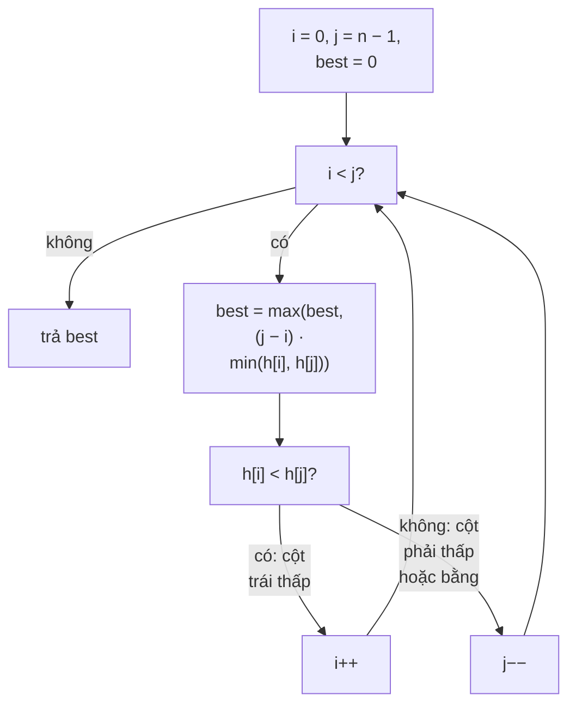

> [!tldr] Đọc nhanh
> - Đề: mảng chiều cao `h`, chọn hai cột `i < j` sao cho bể giữa chúng chứa nhiều nước nhất: diện tích `(j − i) · min(h[i], h[j])`.
> - [[concepts/two-pointers|Hai con trỏ]] từ hai đầu: tính diện tích, rồi **dời cột thấp hơn** vào trong. O(n), O(1) bộ nhớ.
> - Vì sao đúng: cột thấp quyết định mực nước. Ghép nó với bất kỳ cột nào **gần hơn** thì đáy hẹp đi mà mực nước không vượt quá nó, nên mọi cặp đó đều không tốt hơn cặp vừa tính. Đây là [[concepts/search-space-pruning|cắt không gian tìm kiếm]].
> - Đo: vét cạn 639 ms ở n = 20 000; hai con trỏ 2,2 ms ở n = 10⁶.
> - Bẫy: dời cột **cao** hơn cho ra 8 thay vì 49 ngay ở ví dụ của đề.

> [!info] Bối cảnh
> Bài LeetCode 11, thuộc [[posts/2026-11-23-neetcode-two-pointers|ga 4: Hai con trỏ]] trên **tuyến NeetCode: Mảng và chuỗi**. Khác [[problems/two-sum-ii-input-array-is-sorted|Two Sum II]], mảng ở đây **không** sắp xếp; luật dời con trỏ đến từ công thức diện tích chứ không từ thứ tự. Lời giải có đủ TypeScript, Python, Go, Java và JavaScript.

> [!abstract]- Từ điển nhanh cho bài này (bấm để mở)
> - **Diện tích bể**: chiều rộng `j − i` nhân chiều cao nước `min(h[i], h[j])`. Nước tràn qua cột thấp hơn.
> - **Không gian tìm kiếm**: tất cả các cặp `(i, j)` có thể là đáp án, ở đây n(n − 1)/2 cặp.
> - **Cắt bỏ (pruning)**: loại một nhóm cặp mà không cần thử từng cặp, vì chứng minh được không cặp nào trong nhóm tốt hơn.

## Hình dung trước: dựng vách ngăn trong mương

Một con mương có các tấm ván cao thấp khác nhau cắm dọc theo chiều dài. Bạn được chọn hai tấm làm vách để giữ nước. Nước giữa hai vách cao tới tấm **thấp** hơn, rộng bằng khoảng cách giữa chúng.

| Đời thường | Khái niệm |
|---|---|
| Hai tấm ván ở hai đầu mương | `i = 0`, `j = n − 1`: đáy rộng nhất |
| Nước chỉ cao tới tấm thấp hơn | `min(h[i], h[j])` |
| Đổi tấm cao lấy tấm gần hơn: đáy hẹp đi, nước vẫn bị tấm thấp giữ | dời cột cao không bao giờ tốt hơn |
| Đổi tấm thấp: có cơ hội gặp tấm cao hơn bù cho đáy hẹp | dời cột thấp |
| Tấm thấp đã thử với tấm xa nhất có thể, nên bỏ hẳn nó | cột thấp bị loại vĩnh viễn |



## Vấn đề

**Đề (tóm tắt bằng lời của mình):** cho mảng `height` (2 ≤ n ≤ 10⁵, mỗi giá trị 0..10⁴). Cột i là một đoạn thẳng đứng cao `height[i]` tại hoành độ i. Chọn hai cột cùng trục hoành tạo thành bể chứa nhiều nước nhất, trả lượng nước đó. Không được nghiêng bể. Đề gốc: [LeetCode 11](https://leetcode.com/problems/container-with-most-water/).

| Input | Output | Cặp tốt nhất |
|---|---|---|
| `[1, 8, 6, 2, 5, 4, 8, 3, 7]` | 49 | cột 1 (cao 8) và cột 8 (cao 7): 7 · 7 |
| `[1, 1]` | 1 | |
| `[4, 3, 2, 1, 4]` | 16 | hai cột cao 4 ở hai đầu: 4 · 4 |

Mình từng nghĩ phải dời cột nào "hứa hẹn" hơn, tức cột cao. Hóa ra ngược lại: cột cao là thứ duy nhất đáng giữ.

## Cơ chế

<figure class="figure-map" style="--ar: 3 / 4">
<div class="frame"><iframe data-archify="../diagrams/neetcode-container-with-most-water/worked-example.html" title="Dịch cột thấp để thử tăng diện tích" loading="lazy"></iframe></div>
<figcaption><span><b>Hình 1.</b> Dịch cột thấp để thử tăng diện tích.</span><a href="../diagrams/neetcode-container-with-most-water/worked-example.html" target="_blank" rel="noopener">Mở toàn màn hình</a></figcaption>
</figure>

<details>
<summary>Đọc từng bước</summary>
<ol>
<li>Tính diện tích của hai đầu. <code>[2, 7, 4, 6]: 3 × 2 = 6</code></li>
<li>Dịch cột 2 vì nó giới hạn chiều cao. <code>i = 1, j = 3</code></li>
<li>Hai đầu mới cao 7 và 6. <code>2 × 6 = 12</code></li>
<li>Các cặp còn lại cho diện tích nhỏ hơn. <code>best = 12</code></li>
</ol>
</details>

### Lập luận cắt bỏ

Giả sử `h[i] ≤ h[j]` và ta vừa tính diện tích `(j − i) · h[i]`. Xét mọi cặp `(i, k)` với `i < k < j`:
- chiều rộng `k − i < j − i`;
- chiều cao nước `min(h[i], h[k]) ≤ h[i]`.

Vậy diện tích `(i, k)` nhỏ hơn diện tích `(i, j)`. Cột `i` đã đạt mức tốt nhất của nó với `j`; không cặp nào còn lại có `i` đáng thử. Bỏ `i`.

Nếu ta dời `j` (cột cao) thay vì `i`, ta bỏ mọi cặp `(k, j)`, trong đó có thể có cặp tốt nhất, ví dụ một cột `k` cao gần bằng `h[j]` nằm sát `i`. Không có lập luận nào bảo đảm chúng kém hơn.

Hình dung bảng n × n mọi cặp: mỗi bước gạch bỏ cả một hàng (hoặc một cột) của bảng, nên chỉ cần n − 1 bước thay vì n²/2 lần thử.

### Khi hai cột bằng nhau

Dời bên nào cũng được. Với `h[i] = h[j]`, mọi cặp `(i, k)` và `(k, j)` bên trong đều có chiều cao ≤ `h[i]` và đáy hẹp hơn, nên cả hai cột đều đã hết tác dụng.

### Đo

TypeScript, chiều cao ngẫu nhiên 0..10⁴, trung vị:

| n | vét cạn | hai con trỏ |
|---|---|---|
| 5 000 | 36,1 ms | 0,10 ms |
| 10 000 | 155,7 ms | 0,10 ms |
| 20 000 | 639,3 ms | 0,03 ms |
| 10⁵ (giới hạn đề) | (không chạy) | 0,16 ms |
| 10⁶ | (không chạy) | 2,20 ms |

Vét cạn gấp 4 lần khi n gấp đôi; ở n = 10⁵ nó cần khoảng 5·10⁹ phép tính.

### Bên dưới năm ngôn ngữ

| | `min`, `max` | Bẫy riêng |
|---|---|---|
| TypeScript / JavaScript | `Math.min`, `Math.max` | `Math.max(...arr)` với mảng lớn có thể tràn ngăn xếp gọi hàm; dùng vòng lặp |
| Python | `min`, `max` có sẵn | vét cạn bằng generator vẫn O(n²): đẹp nhưng không nhanh hơn |
| Go | `min`, `max` có sẵn từ Go 1.21 | bản cũ hơn phải tự viết |
| Java | `Math.min`, `Math.max` | diện tích tối đa 10⁵ · 10⁴ = 10⁹ vẫn vừa `int` (< 2³¹ ≈ 2,1·10⁹) |

## Ví dụ chạy được

[TypeScript](../code/neetcode-container-with-most-water/container-most-water.ts) · [Python](../code/neetcode-container-with-most-water/container_most_water.py) · [Go](../code/neetcode-container-with-most-water/container_most_water.go) · [Java](../code/neetcode-container-with-most-water/container-most-water.java) · [JavaScript](../code/neetcode-container-with-most-water/container-most-water.js) · [PHP](../code/neetcode-container-with-most-water/container-most-water.php) · [Rust](../code/neetcode-container-with-most-water/container_most_water.rs)

Mỗi file trong năm bản đầu có vét cạn và hai con trỏ, chạy 7 ca. Dưới đây là hai con trỏ.

```ts
// Hai con trỏ: luôn dời cột THẤP hơn vào trong.
function twoPointers(h: number[]): number {
  let i = 0, j = h.length - 1, best = 0;
  while (i < j) {
    best = Math.max(best, (j - i) * Math.min(h[i], h[j]));
    // Cột thấp quyết định mực nước. Ghép cột thấp với bất kỳ cột nào gần hơn thì đáy hẹp đi
    // mà mực nước không vượt được nó: mọi cặp đó không thể tốt hơn. Bỏ hẳn cột thấp.
    if (h[i] < h[j]) i++; else j--;
  }
  return best;
}
```

```python
def two_pointers(h: list[int]) -> int:
    i, j, best = 0, len(h) - 1, 0
    while i < j:
        best = max(best, (j - i) * min(h[i], h[j]))
        if h[i] < h[j]:  # cột thấp giới hạn mực nước: bỏ nó
            i += 1
        else:
            j -= 1
    return best
```

```go
func twoPointers(h []int) int {
	i, j, best := 0, len(h)-1, 0
	for i < j {
		best = max(best, (j-i)*min(h[i], h[j]))
		if h[i] < h[j] {
			i++
		} else {
			j--
		}
	}
	return best
}
```

```java
static int twoPointers(int[] h) {
    int i = 0, j = h.length - 1, best = 0;
    while (i < j) {
        best = Math.max(best, (j - i) * Math.min(h[i], h[j])); // tối đa 10⁵ · 10⁴ = 10⁹ < 2³¹: vừa int
        if (h[i] < h[j]) i++; else j--;
    }
    return best;
}
```

```js
function twoPointers(h) {
  let i = 0, j = h.length - 1, best = 0;
  while (i < j) {
    best = Math.max(best, (j - i) * Math.min(h[i], h[j]));
    if (h[i] < h[j]) i++; else j--;
  }
  return best;
}
```

```php
<?php
declare(strict_types=1);

function maxArea(array $height): int {
    $left = 0;
    $right = count($height) - 1;
    $best = 0;
    while ($left < $right) {
        $best = max($best, ($right - $left) * min($height[$left], $height[$right]));
        if ($height[$left] < $height[$right]) {
            $left++;
        } else {
            $right--;
        }
    }
    return $best;
}
```

```rust
fn max_area(height: &[i32]) -> i32 {
    let (mut left, mut right) = (0, height.len().saturating_sub(1));
    let mut best = 0;
    while left < right {
        best = best.max((right - left) as i32 * height[left].min(height[right]));
        if height[left] < height[right] {
            left += 1;
        } else {
            right -= 1;
        }
    }
    best
}
```


File TypeScript chạy thêm bản dời cột cao, rồi đo:

```text
$ node container-most-water.ts
bruteForce   7/7 ca đúng
twoPointers  7/7 ca đúng
moveTaller   4/7 ca đúng; sai ở [1,8,6,2,5,4,8,3,7] → 8 (đúng 49) [2,3,4,5,18,17,6] → 12 (đúng 17) [1,3,2,5,25,24,5] → 6 (đúng 24)

n          vét cạn   hai con trỏ   (ms, trung vị; chiều cao ngẫu nhiên 0..10⁴)
5000          36.1          0.10
10000        155.7          0.10
20000        639.3          0.03
100000           —          0.16
1000000          —          2.20
```

Ở ví dụ đầu, bản dời cột cao giữ cột 0 (cao 1) tới cuối và chỉ thấy các bể cao 1: được 8. Python, Go, Java và JavaScript in `7/7 ca đúng` cho cả hai cách.

PHP và Rust dùng hai con trỏ. Rust dùng `saturating_sub(1)` để chỉ số cuối vẫn hợp lệ cho điều kiện lặp khi mảng rỗng. PHP `4/4 ca đúng` · Rust `4/4 ca đúng`.

## Hiểu lầm và bẫy hay gặp

- **Dời cột cao hơn.** Sai ở ví dụ đầu tiên của đề: ra 8 thay vì 49.
- **"Mảng không sắp xếp thì không dùng hai con trỏ được."** Hai con trỏ cần một lý do để bỏ một phía. Ở Two Sum II lý do là thứ tự; ở đây lý do là `min` trong công thức.
- **Nhầm với Trapping Rain Water.** Bài này chọn **hai** cột và bỏ qua các cột ở giữa (chúng không chắn nước). [[problems/trapping-rain-water|Trapping Rain Water]] tính nước đọng trên **mọi** cột.
- **Dùng `Math.max(...arr)` cho mảng 10⁵ phần tử** ở đâu đó trong bài: có thể ném `RangeError` vì số đối số vượt giới hạn ngăn xếp.

## Câu hỏi tự kiểm tra

> [!question]- Với `[2, 3, 10, 5, 7, 8, 9]`, viết ba bước đầu của hai con trỏ.
> (0, 6): 6 · min(2, 9) = 12, dời i. (1, 6): 5 · 3 = 15, dời i. (2, 6): 4 · 9 = 36, dời j (9 < 10).

> [!question]- Vì sao bỏ cột thấp không bao giờ làm mất đáp án?
> Mọi cặp còn lại chứa cột thấp đều có đáy hẹp hơn và mực nước không cao hơn cột thấp, nên diện tích không lớn hơn cặp vừa tính.

> [!question]- Mỗi bước loại bao nhiêu cặp khỏi bảng n × n mọi cặp?
> Cả một hàng (mọi cặp chứa cột thấp vừa bỏ, với các cột còn lại trong đoạn). Bảng có n hàng, nên tối đa n − 1 bước.

## Tham khảo

- [LeetCode 11: Container With Most Water](https://leetcode.com/problems/container-with-most-water/) (đề gốc)
- [MDN: `Math.max`](https://developer.mozilla.org/en-US/docs/Web/JavaScript/Reference/Global_Objects/Math/max) (spread một mảng rất lớn có thể vượt giới hạn số đối số)
- [Go 1.21 release notes](https://go.dev/doc/go1.21#language) (hàm có sẵn `min`, `max`)
