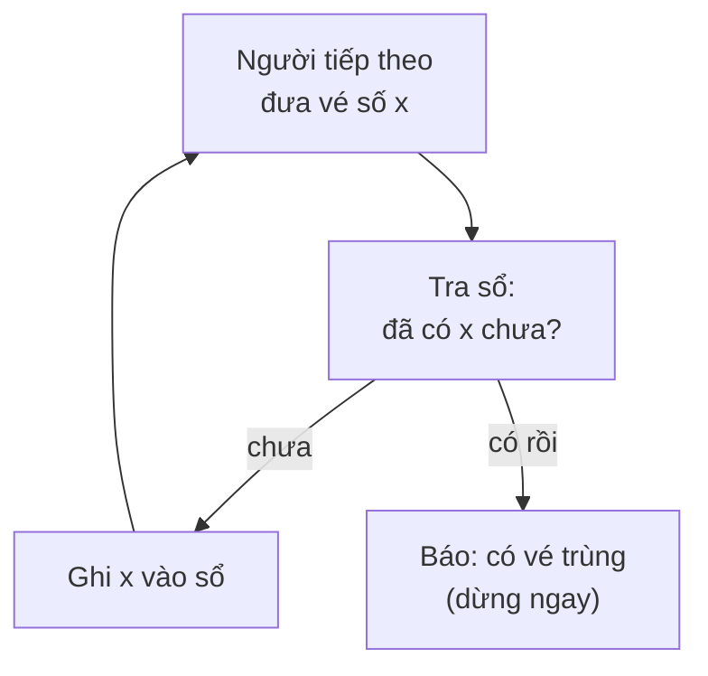

> [!tldr] Đọc nhanh
> - Đề: cho một mảng số nguyên, trả `true` nếu có số xuất hiện từ hai lần trở lên.
> - [[concepts/brute-force|Vét cạn]] so mọi cặp: [[concepts/big-o-notation|O(n²)]]. Với 10 000 số mất 38 ms; với 100 000 số sẽ mất vài giây.
> - [[concepts/sort-then-scan|Sắp xếp rồi quét]]: số trùng nằm cạnh nhau, O(n log n). Trong JS phải truyền hàm so sánh, vì `sort()` mặc định so sánh **chuỗi**.
> - [[concepts/hash-set|Hash set]]: ghi mọi số đã thấy vào một `Set`, tra mất O(1) trung bình, tổng O(n). Gặp trùng sớm thì dừng ngay: 0,000 ms so với 206 ms của cách sắp xếp.
> - Đổi thời gian lấy bộ nhớ là một [[concepts/space-time-tradeoff|đánh đổi]], không phải bữa trưa miễn phí: Set tốn O(n) bộ nhớ, sắp xếp tại chỗ thì gần như không.

> [!info] Bối cảnh
> Bài LeetCode 217, thuộc [[posts/2026-11-22-neetcode-hash-lookup|ga 1: Tra cứu bằng hash]] trên **tuyến NeetCode: Mảng và chuỗi**. NeetCode 150 là danh sách 150 bài LeetCode xếp theo mẫu giải; đây là bài đầu tiên của cả danh sách. Mỗi bài có lời giải chạy được bằng TypeScript, JavaScript, Python, Go và Java. Bạn chỉ cần biết viết vòng lặp và hàm trong một ngôn ngữ bất kỳ.

> [!abstract]- Từ điển nhanh cho bài này (bấm để mở)
> - **Mảng (array)**: dãy phần tử đánh số từ 0. Đọc phần tử thứ i mất thời gian như nhau, dù i lớn hay nhỏ.
> - **n**: số phần tử của input. Mọi phép đo trong bài đều tính theo n.
> - **Độ phức tạp thời gian / bộ nhớ**: số bước, hoặc lượng bộ nhớ phụ, tăng thế nào khi n tăng.
> - **Hash (băm)**: hàm biến một giá trị thành một con số, dùng để chọn ô lưu trong bảng. Hai giá trị bằng nhau luôn có cùng hash.
> - **Set (tập hợp)**: cấu trúc chứa các giá trị không lặp, trả lời được "có x chưa?". `Set` (JS/TS), `set` (Python), `HashSet` (Java); Go không có kiểu riêng, dùng `map`.
> - **Trung vị (median)**: giá trị đứng giữa khi xếp các lần đo theo thứ tự; ít bị một lần đo lệch làm sai hơn trung bình cộng.

## Hình dung trước: người soát vé ở cửa

Một buổi hòa nhạc phát vé có số. Bạn đứng ở cửa, nhiệm vụ duy nhất là phát hiện có hai người cầm **cùng một số vé** hay không.

| Đời thường | Khái niệm |
|---|---|
| Mỗi người tới, bạn so vé của họ với vé của **từng người** đã vào | [[concepts/brute-force\|Vét cạn]], O(n²) |
| Gom hết vé, xếp theo số, rồi nhìn từng cặp vé nằm cạnh nhau | [[concepts/sort-then-scan\|Sắp xếp rồi quét]], O(n log n) |
| Cầm một cuốn sổ có mục lục theo số vé; người tới thì tra sổ, chưa có thì ghi vào | [[concepts/hash-set\|Hash set]], O(n) |
| Cuốn sổ phải đủ dày để ghi mọi số vé | [[concepts/space-time-tradeoff\|Đánh đổi bộ nhớ lấy thời gian]] |
| Khách tăng gấp đôi thì việc của bạn tăng gấp mấy lần? | [[concepts/big-o-notation\|Big-O]] |



## Vấn đề

**Đề (tóm tắt bằng lời của mình):** cho mảng số nguyên `nums`, trả `true` nếu có ít nhất một giá trị xuất hiện từ hai lần trở lên, ngược lại trả `false`. Đề gốc: [LeetCode 217](https://leetcode.com/problems/contains-duplicate/).

| Input | Output | Vì sao |
|---|---|---|
| `[1, 2, 3, 1]` | `true` | số 1 xuất hiện hai lần |
| `[1, 2, 3, 4]` | `false` | mọi số khác nhau |
| `[1, 1, 1, 3, 3, 4, 3, 2, 4, 2]` | `true` | nhiều số lặp |

Giới hạn: mảng có tới **100 000** phần tử, mỗi số nằm trong khoảng **±10⁹**. Chính giới hạn này quyết định lời giải nào qua được. Mình từng nghĩ "bài dễ, hai vòng lặp là xong". Hai vòng lặp với 100 000 phần tử là khoảng 5 tỷ phép so sánh, quá giới hạn thời gian.

Giá trị lên tới 10⁹ cũng loại luôn mẹo "tạo một mảng đánh dấu có 10⁹ ô": mảng đó tốn vài GB.

## Cơ chế

<figure class="figure-map" style="--ar: 3 / 4">
<div class="frame"><iframe data-archify="../diagrams/neetcode-contains-duplicate/seen-set.html" title="Duyệt [1, 2, 3, 1] với một Set đã thấy" loading="lazy"></iframe></div>
<figcaption><span><b>Hình 1.</b> Duyệt [1, 2, 3, 1]: mỗi số hỏi sổ "có chưa?", chưa thì ghi vào. Số 1 lần thứ hai thấy đã có, nên dừng ngay mà không cần đọc tiếp.</span><a href="../diagrams/neetcode-contains-duplicate/seen-set.html" target="_blank" rel="noopener">Mở toàn màn hình</a></figcaption>
</figure>

### Big-O: đo hình dạng, không đo giây

[[concepts/big-o-notation|Big-O]] mô tả số bước tăng thế nào khi n tăng, bỏ qua hằng số và các số hạng nhỏ hơn. "O(n²)" nghĩa là n tăng gấp 10 thì số bước tăng khoảng gấp 100. Big-O không nói thuật toán chạy mất bao nhiêu mili giây; nó nói đường cong cong cỡ nào. Hai thuật toán cùng O(n) có thể chênh nhau 10 lần, và một thuật toán O(n) có thể chậm hơn một thuật toán O(n log n) ở mọi kích thước bạn gặp thật (bài Top K Frequent Elements có ví dụ).

Có hai thứ để đo: **thời gian** (số bước) và **bộ nhớ phụ** (bộ nhớ dùng thêm ngoài input). Khi nói "O(1) bộ nhớ", người ta thường không tính chính mảng input.

### Cách 1, vét cạn: O(n²) thời gian, O(1) bộ nhớ

[[concepts/brute-force|Vét cạn]] thử mọi khả năng: với mỗi i, so `nums[i]` với mọi `nums[j]` đứng sau. Số cặp là n(n−1)/2, tức O(n²). Đúng, không tốn bộ nhớ, và là điểm xuất phát tốt để nói "mình biết cách đúng, giờ làm nhanh hơn".

### Cách 2, sắp xếp rồi quét: O(n log n) thời gian

Sau khi sắp xếp, mọi số bằng nhau nằm liền nhau, nên chỉ cần so mỗi phần tử với phần tử ngay trước nó. Đây là mẹo [[concepts/sort-then-scan|sắp xếp rồi quét]], dùng lại rất nhiều về sau. Chi phí nằm ở bước sắp xếp, O(n log n) với mọi thuật toán sắp xếp dựa trên so sánh.

Bộ nhớ phụ thì tùy:

- Sắp xếp **đè lên** mảng của người gọi: gần như O(1), nhưng làm hỏng input của họ. Trong code thật, đó là một side effect đáng ngại.
- Sao chép rồi sắp xếp: O(n).
- Bản thân thuật toán sắp xếp cũng có thể dùng bộ nhớ phụ. TimSort của V8 và Python cần tới n/2 ô tạm khi gộp.

Mỗi ngôn ngữ dùng một thuật toán khác nhau (bảng ở dưới), nhưng đều là O(n log n).

### Cách 3, hash set: O(n) thời gian, O(n) bộ nhớ

Một [[concepts/hash-set|hash set]] trả lời "có x chưa?" mà không phải duyệt hết. Nó tính hash của x để biết x phải nằm ở ô nào, rồi chỉ nhìn ô đó. Trung bình mỗi lần tra và ghi là O(1), nên cả bài là O(n). Đặc tả ECMAScript không bắt `Set` phải là hash table; nó chỉ yêu cầu thời gian truy cập trung bình **dưới tuyến tính** theo số phần tử.

Điểm cộng ít được nhắc: **dừng sớm**. Nếu hai số đầu đã trùng, vòng lặp kết thúc sau 2 bước. Cách sắp xếp luôn phải sắp xếp cả mảng trước đã.

Đó là một [[concepts/space-time-tradeoff|đánh đổi bộ nhớ lấy thời gian]]: cuốn sổ tốn O(n) bộ nhớ. Với 100 000 số thì không đáng kể. Với một tỷ số trên một máy ít RAM, sắp xếp tại chỗ có thể là lựa chọn duy nhất.

### Bên dưới bảy ngôn ngữ

| | "Set" là gì | Sắp xếp mặc định |
|---|---|---|
| TypeScript / JavaScript | `Set`, so khóa bằng SameValueZero (`NaN` bằng `NaN`); V8 cài bằng hash table giữ thứ tự chèn | `Array.prototype.sort`: TimSort trong V8; **không có hàm so sánh thì so theo chuỗi** |
| Python | `set`, hash table địa chỉ mở; `hash(n)` của số nguyên chính là n (trừ −1) | `sorted` / `list.sort`: TimSort, gộp theo chiến lược powersort từ 3.11 |
| Go | không có kiểu set; dùng `map[int]struct{}` (giá trị rỗng, 0 byte). Từ Go 1.24 map là Swiss Table | `slices.Sort`: pdqsort từ Go 1.19 |
| Java | `HashSet<Integer>`, thực chất là một `HashMap`; mỗi `int` bị **đóng hộp** thành `Integer` | `Arrays.sort(int[])`: Dual-Pivot Quicksort, không đóng hộp |
| PHP | không có kiểu set riêng; mảng PHP là bảng băm có thứ tự, dùng giá trị làm **khóa** (`$seen[$x] = true`) | `sort`: lai quicksort và sắp xếp chèn, ổn định từ PHP 8.0; sửa bản sao vì mảng truyền theo giá trị |
| Rust | `HashSet<i32>`, bảng băm SwissTable (hashbrown), băm mặc định bằng SipHash-1-3 | `sort_unstable`: ipnsort; `sort` ổn định: driftsort (từ Rust 1.81) |

## Ví dụ chạy được

Mỗi ngôn ngữ một file, tự chạy test của nó: [TypeScript](../code/neetcode-contains-duplicate/contains-duplicate.ts) · [JavaScript](../code/neetcode-contains-duplicate/contains-duplicate.js) · [Python](../code/neetcode-contains-duplicate/contains_duplicate.py) · [Go](../code/neetcode-contains-duplicate/contains_duplicate.go) · [Java](../code/neetcode-contains-duplicate/contains-duplicate.java) · [PHP](../code/neetcode-contains-duplicate/contains-duplicate.php) · [Rust](../code/neetcode-contains-duplicate/contains_duplicate.rs).

```ts
// TypeScript: node contains-duplicate.ts
function hashSet(nums: number[]): boolean {
  const seen = new Set<number>();
  for (const x of nums) {
    if (seen.has(x)) return true; // đã thấy: có trùng, dừng ngay
    seen.add(x);
  }
  return false;
}

function sortThenScan(nums: number[]): boolean {
  const a = [...nums].sort((x, y) => x - y); // so sánh số; mặc định JS so sánh chuỗi
  for (let i = 1; i < a.length; i++) if (a[i] === a[i - 1]) return true;
  return false;
}
```

```python
def contains_duplicate(nums: list[int]) -> bool:
    seen: set[int] = set()
    for x in nums:
        if x in seen:  # tra trong set: O(1) trung bình
            return True
        seen.add(x)
    return False

# một dòng: gọn, nhưng luôn dựng cả set, không dừng sớm
def contains_duplicate_oneliner(nums: list[int]) -> bool:
    return len(set(nums)) != len(nums)
```

```go
// map[int]struct{} là cách viết "set" trong Go: struct{} không chiếm byte nào.
func containsDuplicate(nums []int) bool {
	seen := make(map[int]struct{}, len(nums)) // cấp sẵn chỗ, tránh nới bảng nhiều lần
	for _, x := range nums {
		if _, ok := seen[x]; ok {
			return true
		}
		seen[x] = struct{}{}
	}
	return false
}
```

```java
// HashSet.add trả về false nếu phần tử đã có: một lần tra thay cho contains + add.
static boolean containsDuplicate(int[] nums) {
    Set<Integer> seen = new HashSet<>(nums.length * 2);
    for (int x : nums) {
        if (!seen.add(x)) return true;
    }
    return false;
}
```

```js
function containsDuplicate(nums) {
  const seen = new Set();
  for (const x of nums) {
    if (seen.has(x)) return true;
    seen.add(x);
  }
  return false;
}
```

```php
// PHP: mảng chính là bảng băm có thứ tự; dùng số làm KHÓA để tra O(1)
function containsDuplicate(array $nums): bool {
    $seen = [];
    foreach ($nums as $x) {
        if (isset($seen[$x])) return true; // in_array($x, $seen) sẽ quét cả mảng: O(n)
        $seen[$x] = true;
    }
    return false;
}
```

```rust
// Rust: insert trả về false nếu phần tử đã có, một lần tra là đủ
fn contains_duplicate(nums: &[i32]) -> bool {
    let mut seen = HashSet::with_capacity(nums.len());
    for &x in nums {
        if !seen.insert(x) {
            return true;
        }
    }
    false
}
```

File TypeScript chạy test cho cả bốn cách, rồi đo trên mảng **không có số trùng** (ca tệ nhất, không cách nào dừng sớm được):

```text
$ node contains-duplicate.ts
test: 4 cách × 6 ca, 0 ca sai

[10, 9, 1, 100].sort()           → [1,10,100,9]
[10, 9, 1, 100].sort((a,b)=>a-b) → [1,9,10,100]
Set coi NaN bằng NaN: true | NaN === NaN: false

n           vét cạn   sắp xếp  hash set   một dòng   (ms, trung vị 5 lần)
1000          0.50      0.12      0.08      0.03
10000        38.46      1.32      0.60      0.46
100000           –     16.94      4.85      4.47
1000000          –    205.57     66.85     65.29

trùng ở vị trí 0 và 1, n = 1 000 000: sắp xếp 206.11 ms, hash set 0.000 ms, một dòng 64.48 ms
```

Đọc kết quả:

- **Vét cạn**: n tăng 10 lần (1 000 → 10 000), thời gian tăng 77 lần, đúng dáng O(n²). Theo cùng tỉ lệ, 100 000 số sẽ mất khoảng 4 giây, nên mình không chạy.
- **Sắp xếp** và **hash set**: n tăng 10 lần thì thời gian tăng khoảng 10–13 lần. Hash set nhanh hơn sắp xếp khoảng 3 lần ở mọi cỡ.
- **Một dòng** (`new Set(nums).size !== nums.length`) nhanh ngang hash set khi không có số trùng, vì `Set` dựng từ cả mảng một lần được tối ưu tốt. Nhưng khi trùng nằm ngay đầu mảng, nó vẫn mất 64 ms, còn vòng lặp có dừng sớm thì không mất gì.
- Python, Go, Java in ra `✓` cho cùng các ca test; PHP và Rust in `test: 4 cách × 6 ca, 0 ca sai` như TypeScript.

## Hiểu lầm và bẫy hay gặp

- **"Thuật toán nào có Big-O nhỏ hơn thì luôn nhanh hơn."** Big-O bỏ hằng số. Ở đây thứ tự khớp với Big-O, nhưng bài Top K Frequent Elements có ca O(n) chậm hơn O(n log n).
- **Gọi `sort()` không có hàm so sánh trong JS.** `[10, 9, 1, 100].sort()` cho ra `[1, 10, 100, 9]`, vì đặc tả đổi từng số thành chuỗi rồi mới so. Ở bài này, may mắn là các số bằng nhau vẫn đứng cạnh nhau nên kết quả vẫn đúng. Ở bài Two Sum, cùng lỗi đó làm sai hẳn đáp án.
- **Sắp xếp đè lên mảng của người gọi.** `nums.sort()` trong JS, `list.sort()` trong Python, `Arrays.sort(nums)` trong Java và `slices.Sort(nums)` trong Go đều sửa thẳng input. Sao chép trước nếu người gọi còn dùng mảng đó.
- **"Hash set luôn O(1)."** Đó là trung bình. Bài Two Sum cho thấy khi mọi khóa rơi vào cùng một ô, một `HashMap` của Java chậm tới mức O(n) cho mỗi lần tra.
- **Quên rằng "một dòng" không dừng sớm.** `len(set(nums)) != len(nums)` gọn và hay, nhưng luôn tốn O(n) thời gian và O(n) bộ nhớ, kể cả khi hai số đầu đã trùng.
- **Java: tưởng `HashSet<Integer>` rẻ như mảng `int`.** Mỗi phần tử là một object `Integer` riêng, cộng thêm một nút trong bảng. Với vài triệu phần tử, sắp xếp `int[]` có thể tốn ít bộ nhớ hơn hẳn.
- **PHP: tra bằng `in_array` thay vì bằng khóa.** `in_array($x, $seen)` quét toàn bộ mảng, biến lời giải thành O(n²). Lưu số làm khóa rồi hỏi `isset($seen[$x])`. Thêm nữa, `in_array` không có tham số thứ ba so sánh lỏng: `in_array('1e1', ['10'])` trả `true`.
- **Rust: quên rằng `nums` chỉ được mượn.** Hàm nhận `&[i32]` thì không sắp xếp tại chỗ được; muốn sắp phải `to_vec()` trước, và cái giá O(n) bộ nhớ hiện rõ ngay trong code. `HashSet` mặc định băm bằng SipHash (chống tấn công va chạm), chậm hơn hàm băm của Go hay Java một chút.

## Câu hỏi tự kiểm tra

> [!question]- Vét cạn với n = 10 000 mất khoảng 38 ms. Ước lượng với n = 100 000, và giải thích vì sao.
> Khoảng 3,8 giây. O(n²) nghĩa là n tăng 10 lần thì số cặp phải so tăng khoảng 100 lần.

> [!question]- Vì sao sau khi sắp xếp, chỉ cần so mỗi phần tử với phần tử ngay trước nó?
> Sắp xếp đặt mọi giá trị bằng nhau vào một đoạn liền nhau. Nếu có hai số bằng nhau, ít nhất một cặp trong đoạn đó là hai phần tử kề nhau.

> [!question]- Hash set và cách "một dòng" `new Set(nums).size !== nums.length` khác nhau ở đâu, dù cùng O(n)?
> Vòng lặp có `has` rồi `add` dừng ngay khi gặp số trùng đầu tiên. Cách một dòng luôn đọc hết mảng và dựng cả tập hợp.

> [!question]- Máy chỉ còn rất ít RAM, mảng một tỷ số được phép sửa tại chỗ. Bạn chọn cách nào?
> Sắp xếp tại chỗ rồi quét: O(n log n) thời gian nhưng gần như không tốn bộ nhớ phụ. Hash set cần bộ nhớ tỉ lệ với n.

> [!question]- Trong Go, vì sao người ta viết `map[int]struct{}` thay vì `map[int]bool` cho một set?
> `struct{}` có kích thước 0 byte, nên giá trị không tốn chỗ, và kiểu dữ liệu nói rõ "chỉ quan tâm khóa". `map[int]bool` cũng chạy được, nhưng mỗi phần tử tốn thêm một byte.

## Tham khảo

- [LeetCode 217: Contains Duplicate](https://leetcode.com/problems/contains-duplicate/) (đề gốc)
- [ECMAScript 2025](https://tc39.es/ecma262/2025/) (Set: truy cập trung bình dưới tuyến tính, so khóa bằng SameValueZero; `Array.prototype.sort` so theo chuỗi khi không có hàm so sánh)
- [V8: Getting things sorted in V8](https://v8.dev/blog/array-sort) (TimSort)
- [Go 1.19 release notes](https://go.dev/doc/go1.19) (pdqsort) và [Go 1.24 release notes](https://go.dev/doc/go1.24) (map dùng Swiss Tables)
- [Java 21: Arrays](https://docs.oracle.com/en/java/javase/21/docs/api/java.base/java/util/Arrays.html) (Dual-Pivot Quicksort cho mảng số nguyên thủy)
- [CPython: listsort.txt](https://github.com/python/cpython/blob/main/Objects/listsort.txt) (TimSort và powersort)
