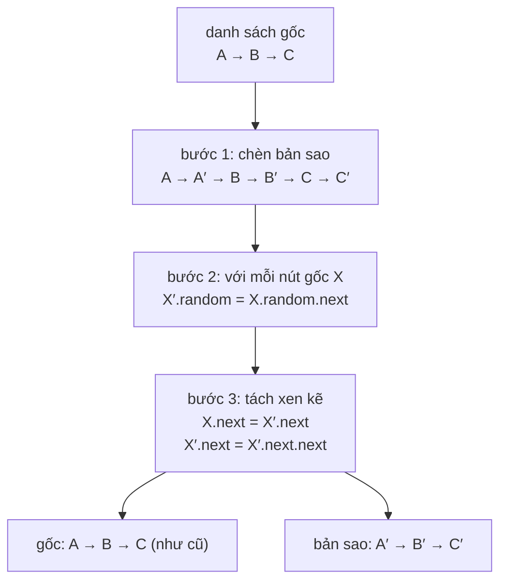

> [!tldr] Đọc nhanh
> - Đề: mỗi nút có `next` và thêm `random` (trỏ tới một nút bất kỳ trong danh sách, hoặc null). Tạo một bản sao **sâu**: nút mới hoàn toàn, và mọi `next`, `random` của bản sao trỏ vào nút **của bản sao**, không bao giờ vào nút cũ.
> - Cái khó: khi chép nút A, nút mà `A.random` trỏ tới có thể chưa được chép. Cách tự nhiên là một [[concepts/hash-map|bảng băm]] **nút cũ → nút mới**: lượt 1 tạo mọi nút mới, lượt 2 nối dây qua bảng. O(n) thời gian, O(n) bộ nhớ thêm.
> - Cách không cần bảng: [[concepts/node-interleaving|đan bản sao]] ngay sau nút gốc (A → A′ → B → B′ …). Khi đó bản sao của `X.random` chính là `X.random.next`. Đặt random, rồi tách hai danh sách ra. Ở 10⁶ nút trong TypeScript: 30 ms và 48 MB, so với 175 ms và 107 MB của bảng.
> - Bản sai nguy hiểm nhất in ra **giống hệt** đáp án: random của bản sao trỏ về nút cũ. Sửa danh sách gốc thì bản sao đổi theo. Bản đan quên trả `next` cho danh sách gốc cũng sai 6/7 ca, dù bản sao thì đúng.
> - Có sẵn hàm sao chép sâu mà vẫn không dùng được: `structuredClone` gãy ở 1645 nút và làm mất lớp `Node`, `copy.deepcopy` của Python gãy ở 249 nút, trong khi đề cho tới 1000.

> [!info] Bối cảnh
> Bài LeetCode số 138 của [[posts/2026-11-24-neetcode-advanced-linked-list|ga 2: Danh sách liên kết nâng cao]] trên **tuyến NeetCode: Cấu trúc liên kết**. Ở ga 1, mọi bài chỉ đổi mũi tên `next` của các nút có sẵn. Bài này phải tạo cả một danh sách mới, và khó ở chỗ con trỏ thứ hai `random` nhảy lung tung. Lời giải có đủ TypeScript, Python, Go, Java và JavaScript. Bạn chỉ cần biết vòng lặp, object và bảng băm.

> [!abstract]- Từ điển nhanh cho bài này (bấm để mở)
> - **Danh sách liên kết**: chuỗi nút, mỗi nút giữ giá trị và mũi tên `next`. Xem [[concepts/linked-list|Danh sách liên kết]].
> - **Sao chép nông (shallow copy)**: tạo object mới nhưng các trường con trỏ vẫn trỏ vào object cũ.
> - **Sao chép sâu (deep copy)**: chép cả những gì được trỏ tới, đệ quy, sao cho bản sao không dùng chung gì với bản gốc.
> - **Danh tính (identity)**: hai biến trỏ cùng **một** object. Khác với "bằng nhau về giá trị": hai nút cùng `val = 3` vẫn là hai nút khác nhau.
> - **Bảng băm**: tra khóa → giá trị trong O(1) trung bình. Xem [[concepts/hash-map|Bảng băm]].
> - **Đan nút**: chèn nút mới xen giữa các nút cũ để vị trí của nút cũ chỉ ra nút mới tương ứng. Xem [[concepts/node-interleaving|Đan nút]].

## Hình dung trước: chuyển cả một lớp học sang phòng mới

Một lớp học có các học sinh ngồi thành hàng (mỗi người biết ai ngồi sau mình: `next`), và mỗi người còn được giao **kèm cặp** một bạn bất kỳ trong lớp (`random`). Nhà trường muốn mở lớp song song: một nhóm học sinh mới, xếp đúng như lớp cũ, và người mới số 2 phải kèm cặp **người mới** tương ứng, không phải người cũ. Cô giáo có hai cách. Cách thứ nhất: lập **danh sách đối chiếu** "em An cũ ↔ em An mới" cho cả lớp trước, rồi tra danh sách để xếp chỗ và giao kèm cặp. Cách thứ hai không cần giấy: cho mỗi bạn mới **ngồi ngay sau** bạn cũ của mình. Muốn biết bạn mới của An kèm ai, nhìn xem An cũ kèm ai, rồi lấy **người ngồi ngay sau** người đó. Xếp xong thì tách hai hàng ra, và trả ghế cho lớp cũ như ban đầu.

| Đời thường | Khái niệm |
|---|---|
| Học sinh | một nút |
| Người ngồi sau mình | `next` |
| Bạn được giao kèm cặp | `random` |
| Danh sách đối chiếu cũ ↔ mới | bảng băm nút cũ → nút mới |
| Bạn mới ngồi ngay sau bạn cũ | đan nút: A → A′ → B → B′ |
| Kèm cặp của bạn mới = người ngồi sau người được kèm cũ | `X.next.random = X.random.next` |
| Tách hai hàng, trả ghế lớp cũ | tách danh sách, khôi phục `next` của bản gốc |
| Bạn mới lại đi kèm cặp người cũ | bản sai: random trỏ về danh sách cũ |



## Vấn đề

Chép một danh sách chỉ có `next` thì dễ: đi từ đầu, tạo nút mới, nối vào đuôi. Thêm `random` thì vướng: khi đang chép nút thứ 2 mà `random` của nó trỏ tới nút thứ 5, nút thứ 5 **mới** chưa tồn tại. Gán thẳng `copy.random = cur.random` thì bản sao trỏ vào nút **cũ**: in ra giá trị vẫn đúng, nhưng đó là bản sao nông. Ta cần một cách để, từ một nút cũ bất kỳ, tìm ra nút mới tương ứng.

## Cơ chế

### Cách 1: bảng nút cũ → nút mới, hai lượt

Lượt 1 đi hết danh sách, tạo mỗi nút mới (chưa nối gì) và ghi vào bảng `map[cũ] = mới`. Lượt 2 đi lại, nối `mới.next = map[cũ.next]` và `mới.random = map[cũ.random]`. Lúc này mọi nút mới đã tồn tại nên tra bảng không bao giờ hụt.

```ts
// Cách 1: bảng băm nút cũ → nút mới, hai lượt.
function copyTwoPass(head: Node | null): Node | null {
  const map = new Map<Node, Node>();
  // lượt 1: tạo mọi nút mới, chưa nối gì
  for (let cur = head; cur !== null; cur = cur.next) map.set(cur, new Node(cur.val));
  // lượt 2: nối next và random qua bảng
  for (let cur = head; cur !== null; cur = cur.next) {
    const copy = map.get(cur)!;
    copy.next = cur.next === null ? null : map.get(cur.next)!;
    copy.random = cur.random === null ? null : map.get(cur.random)!;
  }
  return head === null ? null : map.get(head)!;
}
```


Khóa của bảng là **chính object nút**, so bằng danh tính. Đề có thể cho nhiều nút cùng giá trị (ví dụ 3: ba nút đều là `3`), nên khóa theo giá trị là sai. Đây là chỗ mỗi ngôn ngữ gài bẫy riêng, xem bảng dưới.

### Cách 2: một lượt, tạo khi cần

Gộp hai lượt làm một: gặp nút cũ nào (nút hiện tại, `next` của nó, `random` của nó) mà chưa có bản sao thì tạo ngay rồi ghi vào bảng.

```ts
// Cách 2: một lượt, nút nào chưa có bản sao thì tạo ngay khi cần (get-or-create).
function copyOnePass(head: Node | null): Node | null {
  const map = new Map<Node, Node>();
  const get = (n: Node | null): Node | null => {
    if (n === null) return null;
    let c = map.get(n);
    if (c === undefined) { c = new Node(n.val); map.set(n, c); }
    return c;
  };
  for (let cur = head; cur !== null; cur = cur.next) {
    const copy = get(cur)!;
    copy.next = get(cur.next);
    copy.random = get(cur.random);
  }
  return get(head);
}
```


Ít lượt hơn nhưng không nhanh hơn: mỗi vòng tra bảng 3 lần thay vì 2. Đo ở 10⁶ nút: 222 ms so với 175 ms của hai lượt.

### Cách 3: đan bản sao vào giữa, O(1) bộ nhớ thêm

Bảng tốn bộ nhớ chỉ để trả lời câu "nút mới của X là nút nào?". Nếu đặt nút mới **ngay sau** X thì câu trả lời là `X.next`, không cần bảng.

```ts
// Cách 3: đan bản sao ngay sau nút gốc (A → A' → B → B' …), đặt random, rồi tách ra. O(1) bộ nhớ thêm.
function copyInterleave(head: Node | null): Node | null {
  if (head === null) return null;
  // bước 1: chèn A' ngay sau A
  for (let cur: Node | null = head; cur !== null; cur = cur.next!.next) {
    const copy = new Node(cur.val);
    copy.next = cur.next;
    cur.next = copy;
  }
  // bước 2: bản sao của X.random chính là X.random.next
  for (let cur: Node | null = head; cur !== null; cur = cur.next!.next) {
    cur.next!.random = cur.random === null ? null : cur.random.next;
  }
  // bước 3: tách hai danh sách, trả lại next cho danh sách gốc
  const newHead = head.next!;
  for (let cur: Node | null = head; cur !== null; cur = cur.next) {
    const copy: Node = cur.next!;
    cur.next = copy.next;
    copy.next = copy.next === null ? null : copy.next.next;
  }
  return newHead;
}
```


- **Bước 1** chèn A′ sau A, B′ sau B, … Vòng `for` nhảy `cur.next.next` để bỏ qua nút vừa chèn.
- **Bước 2** đặt random: nếu `A.random` là C thì `A′.random` phải là C′, và C′ đang nằm ở `C.next`. Bước này chỉ đọc `next` nên phải làm **trước** khi tách.
- **Bước 3** tách: mỗi nút gốc nhảy qua bản sao của mình (`cur.next = copy.next`), mỗi bản sao nhảy qua nút gốc tiếp theo.

"O(1) bộ nhớ thêm" nghĩa là ngoài chính các nút mới (đề bắt phải tạo) không cần gì nữa. Đó là lý do bộ nhớ đo được của cách đan (48 MB ở 10⁶ nút) bằng đúng kích thước 10⁶ nút mới, còn cách bảng tốn thêm khoảng 58 MB cho bảng.

### Bản sai 1: random trỏ về danh sách cũ

```ts
// SAI: chép next đúng nhưng random vẫn trỏ vào nút của danh sách CŨ. In ra trông giống hệt.
function wrongRandomToOld(head: Node | null): Node | null {
  const dummy = new Node(0);
  let tail = dummy;
  for (let cur = head; cur !== null; cur = cur.next) {
    const copy = new Node(cur.val);
    copy.random = cur.random; // nút cũ, không phải bản sao
    tail.next = copy;
    tail = copy;
  }
  return dummy.next;
}
```


So sánh theo giá trị thì bản này đúng hết. File kiểm thêm điều đề thực sự đòi: không nút nào của bản sao, và không `random` nào của bản sao, trỏ vào danh sách cũ. Bản này sai 5/7 ca, chỉ qua được danh sách rỗng và danh sách mọi random null. Để thấy tận mắt, file cộng 100 vào mọi giá trị của danh sách **gốc** sau khi chép: random của bản sao đọc ra `[null,7,1,11,7]` trước và `[null,107,101,111,107]` sau. Bản "sao" vẫn dính vào bản gốc.

### Bản sai 2: đan rồi quên trả lại danh sách gốc

```ts
// SAI: đan rồi tách bản sao ra nhưng quên trả next cho danh sách gốc. Bản sao đúng, danh sách gốc bị hỏng.
function wrongNoRestore(head: Node | null): Node | null {
  if (head === null) return null;
  for (let cur: Node | null = head; cur !== null; cur = cur.next!.next) {
    const copy = new Node(cur.val);
    copy.next = cur.next;
    cur.next = copy;
  }
  for (let cur: Node | null = head; cur !== null; cur = cur.next!.next) {
    cur.next!.random = cur.random === null ? null : cur.random.next;
  }
  const newHead = head.next!;
  for (let copy: Node | null = newHead; copy !== null; copy = copy.next) {
    copy.next = copy.next === null ? null : copy.next.next;
  }
  return newHead;
}
```


Bước 3 chỉ tách bản sao ra, còn các nút gốc vẫn trỏ vào bản sao: đi `next` từ đầu danh sách gốc gặp A, A′, B, B′, … Bản sao trả về **đúng hoàn toàn**, nhưng đề không cho sửa đầu vào, và LeetCode kiểm cả danh sách gốc. Sai 6/7 ca, chỉ thoát ở danh sách rỗng.

### Bên dưới năm ngôn ngữ

Bảng nút cũ → mới chỉ đúng khi bảng so khóa bằng **danh tính**. Mỗi ngôn ngữ có một cách để vô tình so bằng thứ khác:

| | Bảng nên dùng | Bẫy riêng (đã chạy) |
|---|---|---|
| TypeScript | `Map<Node, Node>` (so khóa object bằng danh tính) | `structuredClone(head)` chép đúng cấu trúc có vòng nhưng trả object thường, `c instanceof Node` là `false`; và ném `RangeError` khi danh sách dài hơn 1645 nút |
| Python | `dict` với lớp thường (băm theo `id`) | nút viết bằng `@dataclass` không làm khóa được: `TypeError: unhashable type`, sai 6/7 ca. `copy.deepcopy` đúng nhưng ném `RecursionError` từ 250 nút |
| Go | `map[*Node]*Node` (khóa là địa chỉ) | `c := *cur` chép cả struct, nên `Next` và `Random` vẫn là con trỏ cũ: bản sao nông, sai 6/7 |
| Java | `HashMap` với lớp thường, hoặc `IdentityHashMap` | lớp nút có `equals`/`hashCode` theo `val`: hai nút cùng giá trị thành một khóa, sai ca `[3,3,3]`; `IdentityHashMap` đúng 7/7 |
| JavaScript | `Map` | object thường `{}` làm bảng: khóa object bị đổi thành chuỗi `"[object Object]"`, mọi nút chung một ô, sai 5/7 |

Bẫy `@dataclass` cùng gốc với trang [[problems/linked-list-cycle|Linked List Cycle]]: `@dataclass` mặc định có `eq=True`, sinh ra `__eq__` so theo trường và đặt `__hash__ = None`. Ở bài 141 nó làm `set` các nút đã thăm ném `TypeError`; ở đây nó làm `dict` nút cũ → mới ném cùng lỗi. Ngay cả khi thêm `unsafe_hash=True`, khóa sẽ băm theo `(val, next, random)` và đệ quy theo cả danh sách, vừa chậm vừa sai khi hai nút giống hệt nhau. Lớp thường không định nghĩa `__eq__` thì băm theo `id`, đúng như cần.

Còn `copy.deepcopy` và `structuredClone` đều là "sao chép sâu có sẵn": chúng giữ một bảng object đã chép (đúng ý tưởng cách 1) nên xử lý được vòng và chỗ dùng chung. Nhưng cả hai đi theo con trỏ bằng **đệ quy**, nên một danh sách dài là một chuỗi lời gọi lồng nhau dài bằng số nút. Đề cho tới 1000 nút: Python gãy trước (249), JavaScript qua được đề nhưng mất lớp `Node`.

### Đo

TypeScript, danh sách ngẫu nhiên (mulberry32, 20% random null), trung vị 5 lần chạy; bộ nhớ là phần heap tăng thêm sau khi hàm chạy, **gồm cả các nút mới**:

| n nút | Hai lượt (Map) | Một lượt (Map) | Đan nút |
|---|---|---|---|
| 10⁵ | 10,12 ms, 12,3 MB | 11,20 ms, 12,2 MB | 2,09 ms, 4,8 MB |
| 10⁶ | 174,60 ms, 106,8 MB | 222,17 ms, 106,8 MB | 30,45 ms, 48,0 MB |

- Đan nút nhanh hơn bảng khoảng 6 lần: không băm, không cấp phát bảng, chỉ đổi mũi tên.
- 48 MB là giá của 10⁶ nút mới, cách nào cũng phải trả. Phần chênh 58 MB là cái bảng.

Các ngôn ngữ khác ở 10⁶ nút: Go bảng 186,82 ms và 99,6 MB cấp phát, đan nút 24,93 ms và 24,0 MB; Java `HashMap` 257,44 ms, `IdentityHashMap` 219,95 ms, đan nút 19,83 ms. Python ở 10⁵ nút: bảng 106,07 ms và 15,55 MB đỉnh, đan nút 123,62 ms và 8,80 MB (Python không nhanh hơn vì ba vòng lặp thông dịch tốn hơn ba lần tra `dict` viết bằng C, nhưng vẫn đỡ nửa bộ nhớ). `copy.deepcopy` trên 200 nút mất 20,85 ms, so với 0,12 ms của bảng: chậm hơn khoảng 170 lần vì nó xét kiểu và chép mọi thuộc tính một cách tổng quát.

## Ví dụ chạy được

[TypeScript](../code/neetcode-copy-list-with-random-pointer/copy-random-list.ts) · [Python](../code/neetcode-copy-list-with-random-pointer/copy_random_list.py) · [Go](../code/neetcode-copy-list-with-random-pointer/copy_random_list.go) · [Java](../code/neetcode-copy-list-with-random-pointer/copy-random-list.java) · [JavaScript](../code/neetcode-copy-list-with-random-pointer/copy-random-list.js)

Mỗi file chạy 7 ca chung: ba ví dụ của đề, danh sách rỗng, một nút có random trỏ vào chính nó, mọi random null, mọi random trỏ nút cuối. Mỗi ca kiểm ba điều: bản sao đúng cấu trúc (giá trị và vị trí random), không nút nào của bản sao (kể cả qua random) thuộc danh sách gốc, và danh sách gốc còn nguyên. TypeScript chạy thêm 2000 danh sách ngẫu nhiên dài 0..60.

Bảng nút cũ → mới, hai lượt:

```ts
// Cách 1: bảng băm nút cũ → nút mới, hai lượt.
function copyTwoPass(head: Node | null): Node | null {
  const map = new Map<Node, Node>();
  // lượt 1: tạo mọi nút mới, chưa nối gì
  for (let cur = head; cur !== null; cur = cur.next) map.set(cur, new Node(cur.val));
  // lượt 2: nối next và random qua bảng
  for (let cur = head; cur !== null; cur = cur.next) {
    const copy = map.get(cur)!;
    copy.next = cur.next === null ? null : map.get(cur.next)!;
    copy.random = cur.random === null ? null : map.get(cur.random)!;
  }
  return head === null ? null : map.get(head)!;
}
```

```python
# Cách 1: dict nút cũ → nút mới, hai lượt. Khóa là chính object nút: Node thường băm theo danh tính (id).
def copy_two_pass(head):
    m = {}
    cur = head
    while cur:
        m[cur] = Node(cur.val)
        cur = cur.next
    cur = head
    while cur:
        m[cur].next = m.get(cur.next)
        m[cur].random = m.get(cur.random)
        cur = cur.next
    return m.get(head)
```

```go
// Cách 1: map con trỏ nút cũ → nút mới, hai lượt. Khóa *Node so bằng địa chỉ.
func copyTwoPass(head *Node) *Node {
	m := map[*Node]*Node{nil: nil}
	for cur := head; cur != nil; cur = cur.Next {
		m[cur] = &Node{Val: cur.Val}
	}
	for cur := head; cur != nil; cur = cur.Next {
		m[cur].Next = m[cur.Next]
		m[cur].Random = m[cur.Random]
	}
	return m[head]
}
```

```java
// Cách 1: bảng nút cũ → nút mới, hai lượt. HashMap dùng equals/hashCode của khóa; Node thường kế thừa của Object (so danh tính).
static Node copyTwoPass(Node head) {
    Map<Node, Node> map = new HashMap<>();
    for (Node cur = head; cur != null; cur = cur.next) map.put(cur, new Node(cur.val));
    for (Node cur = head; cur != null; cur = cur.next) {
        map.get(cur).next = map.get(cur.next);
        map.get(cur).random = map.get(cur.random);
    }
    return map.get(head);
}
```

```js
// Cách 1: Map nút cũ → nút mới, hai lượt. Map so khóa object bằng danh tính.
function copyTwoPass(head) {
  const map = new Map();
  for (let cur = head; cur !== null; cur = cur.next) map.set(cur, new Node(cur.val));
  for (let cur = head; cur !== null; cur = cur.next) {
    map.get(cur).next = cur.next === null ? null : map.get(cur.next);
    map.get(cur).random = cur.random === null ? null : map.get(cur.random);
  }
  return head === null ? null : map.get(head);
}
```


Đan nút, O(1) bộ nhớ thêm:

```ts
// Cách 3: đan bản sao ngay sau nút gốc (A → A' → B → B' …), đặt random, rồi tách ra. O(1) bộ nhớ thêm.
function copyInterleave(head: Node | null): Node | null {
  if (head === null) return null;
  // bước 1: chèn A' ngay sau A
  for (let cur: Node | null = head; cur !== null; cur = cur.next!.next) {
    const copy = new Node(cur.val);
    copy.next = cur.next;
    cur.next = copy;
  }
  // bước 2: bản sao của X.random chính là X.random.next
  for (let cur: Node | null = head; cur !== null; cur = cur.next!.next) {
    cur.next!.random = cur.random === null ? null : cur.random.next;
  }
  // bước 3: tách hai danh sách, trả lại next cho danh sách gốc
  const newHead = head.next!;
  for (let cur: Node | null = head; cur !== null; cur = cur.next) {
    const copy: Node = cur.next!;
    cur.next = copy.next;
    copy.next = copy.next === null ? null : copy.next.next;
  }
  return newHead;
}
```

```python
# Cách 3: đan bản sao sau nút gốc, đặt random, tách ra. O(1) bộ nhớ thêm.
def copy_interleave(head):
    if head is None:
        return None
    cur = head
    while cur:
        cur.next = Node(cur.val, cur.next)
        cur = cur.next.next
    cur = head
    while cur:
        cur.next.random = cur.random.next if cur.random else None
        cur = cur.next.next
    new_head = head.next
    cur = head
    while cur:
        c = cur.next
        cur.next = c.next
        c.next = c.next.next if c.next else None
        cur = cur.next
    return new_head
```

```go
// Cách 3: đan bản sao sau nút gốc, đặt random, tách ra.
func copyInterleave(head *Node) *Node {
	if head == nil {
		return nil
	}
	for cur := head; cur != nil; cur = cur.Next.Next {
		cur.Next = &Node{Val: cur.Val, Next: cur.Next}
	}
	for cur := head; cur != nil; cur = cur.Next.Next {
		if cur.Random != nil {
			cur.Next.Random = cur.Random.Next
		}
	}
	newHead := head.Next
	for cur := head; cur != nil; cur = cur.Next {
		c := cur.Next
		cur.Next = c.Next
		if c.Next != nil {
			c.Next = c.Next.Next
		}
	}
	return newHead
}
```

```java
// Cách 3: đan bản sao sau nút gốc, đặt random, tách ra.
static Node copyInterleave(Node head) {
    if (head == null) return null;
    for (Node cur = head; cur != null; cur = cur.next.next) {
        Node c = new Node(cur.val);
        c.next = cur.next;
        cur.next = c;
    }
    for (Node cur = head; cur != null; cur = cur.next.next) cur.next.random = cur.random == null ? null : cur.random.next;
    Node newHead = head.next;
    for (Node cur = head; cur != null; cur = cur.next) {
        Node c = cur.next;
        cur.next = c.next;
        c.next = c.next == null ? null : c.next.next;
    }
    return newHead;
}
```

```js
// Cách 3: đan bản sao sau nút gốc, đặt random, tách ra.
function copyInterleave(head) {
  if (head === null) return null;
  for (let cur = head; cur !== null; cur = cur.next.next) {
    const c = new Node(cur.val);
    c.next = cur.next;
    cur.next = c;
  }
  for (let cur = head; cur !== null; cur = cur.next.next) cur.next.random = cur.random === null ? null : cur.random.next;
  const newHead = head.next;
  for (let cur = head; cur !== null; cur = cur.next) {
    const c = cur.next;
    cur.next = c.next;
    c.next = c.next === null ? null : c.next.next;
  }
  return newHead;
}
```


Các bẫy riêng của từng ngôn ngữ:

```python
# Nút viết bằng @dataclass: eq=True mặc định sinh __eq__ và đặt __hash__ = None, nên không làm khóa dict được.
@dataclass
class DataNode:
    val: int
    next: "DataNode | None" = None
    random: "DataNode | None" = None
```

```go
// SAI: c := *cur chép cả struct, nên Next và Random của bản sao vẫn là con trỏ vào danh sách CŨ (chép nông).
func wrongStructCopy(head *Node) *Node {
	if head == nil {
		return nil
	}
	c := *head
	return &c
}
```

```java
// Nút "tiện tay" có equals/hashCode theo giá trị: hai nút cùng val bị HashMap coi là một khóa.
static class ValueNode extends Node {
    ValueNode(int val) { super(val); }
    @Override public boolean equals(Object o) { return o instanceof ValueNode v && v.val == val; }
    @Override public int hashCode() { return Integer.hashCode(val); }
}
```

```js
// SAI: object thường {} làm bảng. Khóa object bị đổi thành chuỗi "[object Object]", nên mọi nút chung một ô.
function wrongObjectMap(head) {
  const map = {};
  for (let cur = head; cur !== null; cur = cur.next) map[cur] = new Node(cur.val);
  for (let cur = head; cur !== null; cur = cur.next) {
    map[cur].next = cur.next === null ? null : map[cur.next];
    map[cur].random = cur.random === null ? null : map[cur.random];
  }
  return head === null ? null : map[head];
}
```


Kết quả `node copy-random-list.ts`:

```text
copyTwoPass      7/7 ca đúng
copyOnePass      7/7 ca đúng
copyInterleave   7/7 ca đúng
wrongRandomToOld 2/7 ca đúng; sai ở ví dụ 1 của đề → dùng chung nút với danh sách gốc, ví dụ 2 → dùng chung nút với danh sách gốc, ví dụ 3 (giá trị trùng) → dùng chung nút với danh sách gốc, một nút tự trỏ → dùng chung nút với danh sách gốc, mọi random trỏ nút cuối → dùng chung nút với danh sách gốc
wrongNoRestore   1/7 ca đúng; sai ở ví dụ 1 của đề → danh sách gốc bị đổi, ví dụ 2 → danh sách gốc bị đổi, ví dụ 3 (giá trị trùng) → danh sách gốc bị đổi, một nút tự trỏ → danh sách gốc bị đổi, mọi random null → danh sách gốc bị đổi, mọi random trỏ nút cuối → danh sách gốc bị đổi

wrongRandomToOld, giá trị random của bản sao: trước [null,7,1,11,7] → sau khi sửa danh sách gốc [null,107,101,111,107]
ngẫu nhiên: ba cách đúng qua kiểm tra (cấu trúc, không dùng chung nút, gốc còn nguyên) ở 2000/2000 danh sách

structuredClone: cấu trúc đúng, random của nút 2 trỏ đúng nút 1 của bản sao: true, còn là Node: false
JSON.stringify(head): ném TypeError
structuredClone sao chép được danh sách dài tối đa 1645 nút; dài hơn thì ném RangeError

n nút      hai lượt (Map)         một lượt (Map)         đan nút
100000        10.16 ms  12.3 MB      11.20 ms  12.2 MB       2.09 ms   4.8 MB
1000000      174.60 ms 106.8 MB     222.17 ms 106.8 MB      30.45 ms  48.0 MB
```

Kết quả `python3 copy_random_list.py`:

```text
copy_two_pass            7/7 ca đúng
copy_interleave          7/7 ca đúng
copy_deepcopy            7/7 ca đúng
copy_two_pass (DataNode) 1/7 ca đúng; sai ở 6 ca, đầu tiên: ví dụ 1 của đề → ném TypeError

copy.deepcopy chép được danh sách dài tối đa 249 nút (giới hạn đệ quy 1000); dài hơn thì ném RecursionError

n nút      hai lượt (dict)        đan nút                deepcopy
200             0.12 ms   0.03 MB        0.10 ms   0.02 MB       20.85 ms   0.20 MB
100000        106.07 ms  15.55 MB      123.62 ms   8.80 MB        RecursionError     
```

Kết quả `go run copy_random_list.go`:

```text
copyTwoPass      7/7 ca đúng
copyInterleave   7/7 ca đúng
wrongStructCopy  1/7 ca đúng; sai ở ví dụ 1 của đề → dùng chung nút với danh sách gốc, ví dụ 2 → dùng chung nút với danh sách gốc, ví dụ 3 (giá trị trùng) → dùng chung nút với danh sách gốc, một nút tự trỏ → dùng chung nút với danh sách gốc, mọi random null → dùng chung nút với danh sách gốc, mọi random trỏ nút cuối → dùng chung nút với danh sách gốc

n nút      hai lượt (map)               đan nút
100000          9.83 ms     7.1 MB cấp phát        2.52 ms     2.4 MB cấp phát
1000000       186.82 ms    99.6 MB cấp phát       24.93 ms    24.0 MB cấp phát
```

Kết quả `java copy-random-list.java`:

```text
copyTwoPass                7/7 ca đúng
copyIdentity               7/7 ca đúng
copyInterleave             7/7 ca đúng
copyTwoPass (ValueNode)    6/7 ca đúng; sai ở ví dụ 3 (giá trị trùng) → sai cấu trúc
copyIdentity (ValueNode)   7/7 ca đúng

n nút      HashMap      IdentityHashMap   đan nút
100000        11.58 ms      10.72 ms           1.85 ms
1000000      257.44 ms     219.95 ms          19.83 ms
```

Kết quả `node copy-random-list.js`:

```text
copyTwoPass     7/7 ca đúng
copyInterleave  7/7 ca đúng
wrongObjectMap  2/7 ca đúng; sai ở ví dụ 1 của đề → sai cấu trúc, ví dụ 2 → sai cấu trúc, ví dụ 3 (giá trị trùng) → sai cấu trúc, mọi random null → sai cấu trúc, mọi random trỏ nút cuối → sai cấu trúc

khóa mà {} thực sự lưu cho một nút: ["[object Object]"]
```

## Hiểu lầm và bẫy hay gặp

- **"In ra đúng là chép đúng."** Bản random trỏ về danh sách cũ in ra y hệt đáp án. Phải kiểm danh tính: không con trỏ nào của bản sao được rơi vào danh sách gốc.
- **Khóa bảng theo giá trị.** Đề cho phép giá trị trùng. Khóa phải là chính nút; trong Python đừng dùng `@dataclass` mặc định, trong Java cẩn thận lớp có `equals` theo giá trị, trong JavaScript đừng dùng `{}`.
- **Quên trả lại danh sách gốc ở cách đan.** Bản sao đúng nhưng đầu vào bị sửa. Bước tách phải nối lại `next` cho **cả hai** danh sách.
- **Đặt random sau khi đã tách.** Bước 2 dựa vào việc `X.random.next` là bản sao của `X.random`; tách rồi thì quan hệ đó mất. Phải đặt random trong lúc hai danh sách còn đan nhau.
- **Quên random null.** `X.random.next` khi `X.random` là null sẽ ném lỗi; phải kiểm trước.
- **"Có sẵn deep copy thì dùng."** `copy.deepcopy` gãy ở 249 nút, `structuredClone` gãy ở 1645 nút và trả object thường. Và người phỏng vấn hỏi bài này chính để xem bạn tự làm được việc của chúng.
- **"Một lượt nhanh hơn hai lượt."** Số lần tra bảng mới quyết định. Bản một lượt tra 3 lần mỗi nút và chậm hơn ở 10⁶ nút (222 ms so với 175 ms).

## Câu hỏi tự kiểm tra

> [!question]- Ở cách bảng hai lượt, vì sao lượt 2 không bao giờ tra hụt?
> Lượt 1 đã tạo bản sao cho **mọi** nút cũ. `cur.next` và `cur.random` đều là nút cũ trong danh sách (hoặc null), nên đều đã có trong bảng. Cách một lượt phải tự lo việc này bằng get-or-create.

> [!question]- Ở cách đan, vì sao `X′.random = X.random.next` là đúng?
> Sau bước 1, ngay sau mỗi nút gốc Y là bản sao Y′. `X.random` là một nút gốc Y nào đó, nên `X.random.next` chính là Y′, đúng nút mà `X′.random` cần trỏ tới.

> [!question]- Bản sao có random trỏ vào danh sách cũ in ra đúng hết. Viết một phép kiểm nào để bắt nó?
> Gom mọi nút gốc vào một tập theo danh tính, rồi đi bản sao: nút nào, hoặc `random` của nút nào, nằm trong tập là sai. Hoặc sửa giá trị danh sách gốc sau khi chép và xem bản sao có đổi theo không.

> [!question]- Vì sao nút `@dataclass` của Python không làm khóa `dict` được, còn lớp thường thì được?
> `@dataclass` mặc định sinh `__eq__` so theo các trường, và lớp nào định nghĩa `__eq__` mà không định nghĩa `__hash__` thì có `__hash__ = None`, tức là không băm được. Lớp thường kế thừa `__eq__` và `__hash__` của `object`, so và băm theo danh tính.

> [!question]- Cách đan O(1) bộ nhớ thêm, nhưng đo vẫn tốn 48 MB ở 10⁶ nút. Mâu thuẫn không?
> Không. 48 MB là 10⁶ nút mới, thứ mà đề bắt phải tạo, nên không tính là bộ nhớ thêm. Cách bảng tốn 107 MB: cũng 48 MB nút mới, cộng khoảng 58 MB cho bảng.

## Tham khảo

- [LeetCode 138: Copy List with Random Pointer](https://leetcode.com/problems/copy-list-with-random-pointer/) (đề gốc: 0 ≤ số nút ≤ 1000, giá trị trong −10⁴..10⁴, random là null hoặc trỏ tới một nút trong danh sách)
- [Python `copy`](https://docs.python.org/3/library/copy.html) (deepcopy dùng dict `memo` để xử lý vòng và chỗ dùng chung)
- [Python `dataclasses`](https://docs.python.org/3/library/dataclasses.html) (`eq=True` mặc định; `__hash__` được đặt thành `None` khi `eq=True` và `frozen=False`)
- [Java `IdentityHashMap`](https://docs.oracle.com/en/java/javase/21/docs/api/java.base/java/util/IdentityHashMap.html) (so khóa bằng `==` thay vì `equals`)
- [HTML Standard: structured cloning](https://html.spec.whatwg.org/multipage/structured-data.html#structured-cloning) (thuật toán mà `structuredClone` dùng; giữ chỗ dùng chung qua một bảng memory, không giữ prototype của lớp)
