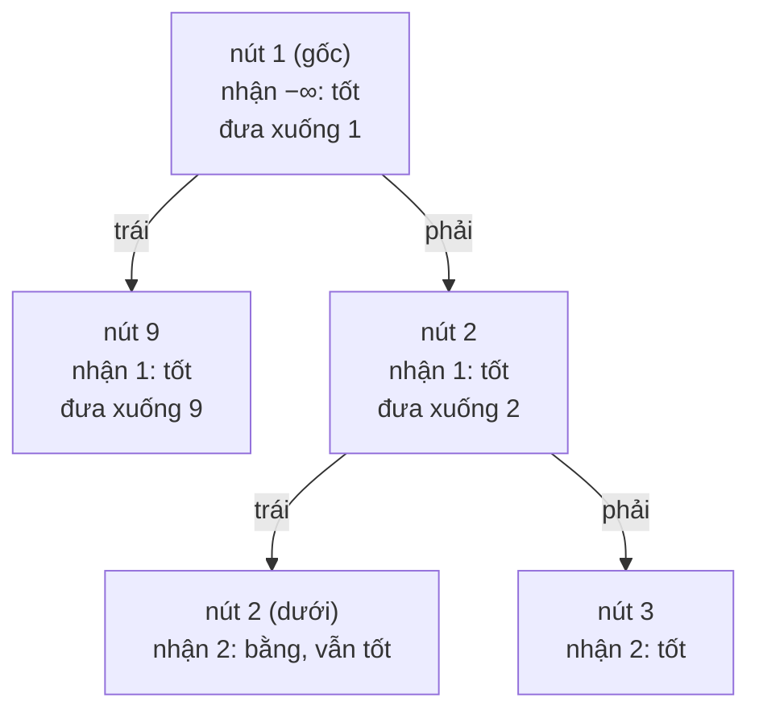
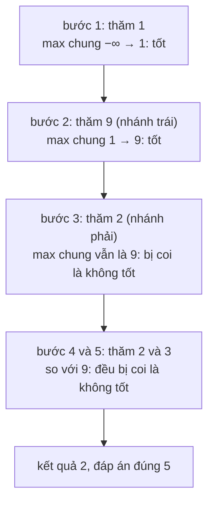

> [!tldr] Đọc nhanh
> - Đề: đếm số nút **tốt** trong một cây nhị phân. Nút X tốt nếu trên đường từ gốc xuống X không có nút nào **lớn hơn** X. Gốc luôn tốt; nút **bằng** giá trị lớn nhất phía trên vẫn tốt.
> - Vét cạn: với mỗi nút, leo ngược lên gốc và so với từng tổ tiên. Đúng, nhưng O(n·h): chuỗi 10⁴ nút tốn 49 995 000 phép so.
> - Cách O(n): đi từ gốc xuống và **mang theo giá trị lớn nhất của đường đi** ([[concepts/path-state|trạng thái đường đi]]). Ở mỗi nút chỉ một phép so `val >= max`, rồi đưa `max(max, val)` xuống cho hai con. Đệ quy, ngăn xếp hay [[concepts/breadth-first-search|BFS]] đều được, miễn mỗi nút giữ max **của riêng đường nó**.
> - Ba bản sai chạy thật: so ngặt `>` (sai 4/10 ca), khởi tạo max bằng 0 trong khi giá trị có thể âm (sai 3/10), một biến max dùng chung cho cả cây để kỷ lục của nhánh trái rò sang nhánh phải (sai 1/10, lệch 802 trên 3 000 cây ngẫu nhiên).
> - Đề cho tới **10⁵ nút**. Chuỗi lệch 10⁵ nút làm bản đệ quy ném lỗi ở TypeScript, JavaScript, Python và Java; chỉ Go qua. Hàng đợi bằng `shift()`, `pop(0)` hay `remove(0)` đúng nhưng chậm hơn 100 tới 200 lần trên cây 10⁵ nút.

> [!info] Bối cảnh
> Bài LeetCode 1448 (Medium), thuộc [[posts/2026-11-25-neetcode-level-order|ga 5: Duyệt theo tầng và mang trạng thái]] trên **tuyến NeetCode: Cấu trúc liên kết**. Ở [[posts/2026-11-25-neetcode-tree-recursion|ga 3]], kết quả đi **từ dưới lên** (chiều cao trả về cho cha). Ở [[posts/2026-11-25-neetcode-binary-search-tree|ga 4]], bài [[problems/validate-binary-search-tree|Validate BST]] mang một khoảng **từ trên xuống**. Bài này cũng đi từ trên xuống, nhưng thứ được mang là một con số tóm tắt cả đường đi: giá trị lớn nhất từ gốc tới đây. Hai bài cùng ga, [[problems/binary-tree-level-order-traversal|Binary Tree Level Order Traversal]] và [[problems/binary-tree-right-side-view|Binary Tree Right Side View]], duyệt theo tầng; bài này giải được cả theo chiều sâu lẫn theo tầng. Lời giải có đủ TypeScript, Python, Go, Java và JavaScript. Bạn chỉ cần biết đệ quy là gì.

> [!abstract]- Từ điển nhanh cho bài này (bấm để mở)
> - **Cây nhị phân**: mỗi nút có tối đa hai con, trái và phải. Xem [[concepts/binary-tree|Binary Tree]].
> - **Đường đi từ gốc**: dãy nút từ gốc xuống một nút, mỗi bước đi từ cha sang con. Các nút trên đường đó (trừ chính nó) là **tổ tiên** của nút.
> - **Trạng thái đường đi (path state)**: một giá trị tóm tắt đường từ gốc tới nút hiện tại, được cha tính rồi đưa xuống cho con. Ở đây là giá trị lớn nhất. Xem [[concepts/path-state|Path State]].
> - **Tiền thứ tự (pre-order)**: xử lý nút trước, rồi mới tới hai cây con. Xem [[concepts/pre-order-traversal|Pre-order Traversal]].
> - **DFS (duyệt theo chiều sâu)**: đi hết một nhánh rồi mới quay lại nhánh khác; viết bằng đệ quy hoặc bằng một [[concepts/stack|ngăn xếp]] tự quản lý.
> - **BFS (duyệt theo chiều rộng)**: thăm hết tầng này rồi mới sang tầng sau, dùng một hàng đợi vào trước ra trước. Xem [[concepts/breadth-first-search|Breadth-First Search]].
> - **Chuỗi lệch**: mọi nút chỉ có một con, cây sâu đúng bằng số nút. Xem [[concepts/recursion-depth-limit|Recursion Depth Limit]].
> - **O(n·h)**: thời gian tỉ lệ với số nút nhân chiều cao cây; trên chuỗi lệch h = n nên thành O(n²).

## Hình dung trước: gia phả và cuốn sổ kỷ lục

Một dòng họ ghi gia phả theo kiểu cây, mỗi người có một con số "điểm thành tích", có thể âm. Một người được **ghi danh** nếu điểm của họ không thua ai trong dòng trực hệ phía trên: cha, ông, cụ, … tới cụ tổ. Anh chị em, chú bác, cô dì không tính, vì họ không nằm trên đường từ cụ tổ xuống người đó.

- **Cách hỏi từng đời:** với mỗi người, lần ngược gia phả lên tới cụ tổ và so với từng người. Đúng, nhưng dòng họ càng nhiều đời thì càng phải hỏi lại cùng những người ấy nhiều lần.
- **Cách cuốn sổ kỷ lục:** cụ tổ mở một cuốn sổ ghi "kỷ lục của dòng tới đời này". Mỗi người nhìn sổ là biết mình có được ghi danh không, rồi sửa kỷ lục nếu mình cao hơn và **chép một bản cho mỗi đứa con**. Hai nhánh con cầm hai bản riêng, nên kỷ lục của nhánh này không lọt sang nhánh kia.
- **Cả họ dùng chung một cuốn sổ:** người bác ghi kỷ lục 9 vào sổ, và đứa cháu ở nhánh khác (con của người em) bị so với 9, dù người bác không phải tổ tiên của nó.

| Đời thường | Khái niệm |
|---|---|
| Gia phả | [[concepts/binary-tree\|cây nhị phân]] |
| Dòng trực hệ từ cụ tổ tới mình | đường từ gốc tới nút |
| Không thua ai trong dòng trực hệ | nút tốt: `val >= max của đường đi` |
| Bằng kỷ lục vẫn được ghi danh | so `>=`, không phải `>` |
| Lần ngược gia phả cho từng người | vét cạn leo ngược về gốc, O(n·h) |
| Cuốn sổ kỷ lục, mỗi con một bản chép | [[concepts/path-state\|trạng thái đường đi]] mang xuống, O(n) |
| Ghi danh rồi mới chép sổ cho con | [[concepts/pre-order-traversal\|tiền thứ tự]]: xử lý nút trước hai con |
| Điểm có thể âm, sổ mở sẵn kỷ lục 0 | bẫy khởi tạo max bằng 0 |
| Cả họ dùng chung một cuốn sổ | bẫy max dùng chung, kỷ lục rò sang nhánh khác |
| Đi hết một chi rồi mới sang chi khác | DFS, đệ quy hoặc ngăn xếp |
| Gọi tên từng đời, hết đời này tới đời sau | [[concepts/breadth-first-search\|BFS]] với hàng đợi |

Cây dưới đây là ca "max nhánh trái lớn" trong file chạy thử, mảng theo tầng `[1, 9, 2, null, null, 2, 3]`. Mỗi ô ghi max mà nút nhận từ cha:



Năm nút đều tốt. Nút 9 to nhất cây nhưng nằm ở nhánh trái, nên không ảnh hưởng gì tới ba nút bên phải.

## Vấn đề

Đầu vào là gốc của một cây nhị phân có từ 1 tới 10⁵ nút, giá trị mỗi nút là số nguyên trong [−10⁴, 10⁴]. Gọi một nút X là tốt nếu không có nút nào trên đường từ gốc tới X mang giá trị lớn hơn giá trị của X. Trả về số nút tốt. Đề gốc: [LeetCode 1448](https://leetcode.com/problems/count-good-nodes-in-binary-tree/). Giới hạn ở trên mình đối chiếu với trang đề ngày 25/11/2026.

Mình từng đọc "không có nút nào lớn hơn" thành "lớn hơn mọi nút phía trên", tức so ngặt, và đếm thiếu mọi nút bằng kỷ lục. Câu chữ của đề là "không có nút nào **lớn hơn** nó": nút bằng thì không vi phạm. Cái thứ hai mình phải nghĩ lại là "phía trên" nghĩa là **tổ tiên**, không phải mọi nút đã thăm trước.

## Cơ chế

<figure class="figure-map" style="--ar: 3 / 4">
<div class="frame"><iframe data-archify="../diagrams/neetcode-count-good-nodes-in-binary-tree/worked-example.html" title="Mang giá trị lớn nhất trên đường đi" loading="lazy"></iframe></div>
<figcaption><span><b>Hình 1.</b> Mang giá trị lớn nhất trên đường đi.</span><a href="../diagrams/neetcode-count-good-nodes-in-binary-tree/worked-example.html" target="_blank" rel="noopener">Mở toàn màn hình</a></figcaption>
</figure>

<details>
<summary>Đọc từng bước</summary>
<ol>
<li>Gặp gốc 5 và ghi nhận nó. <code>previous max = -∞; max = 5</code></li>
<li>Tới con 2 và giữ mốc 5. <code>2 &lt; 5 → skip</code></li>
<li>Tới cháu 4, vẫn so với 5. <code>4 &lt; 5 → skip</code></li>
<li>Nhánh còn lại có 7 nên ghi nhận. <code>7 ≥ 5; total = 2</code></li>
</ol>
</details>

### Cách 1: vét cạn, mỗi nút leo ngược về gốc

Viết đúng theo định nghĩa: ghi lại cha của từng nút, rồi với mỗi nút đi ngược lên gốc, gặp tổ tiên nào lớn hơn thì dừng.

```ts
// Cách 1: vét cạn, mỗi nút leo ngược lên gốc. O(n·h).
function goodBrute(root: TreeNode | null): number {
  if (root === null) return 0;
  const parent = new Map<TreeNode, TreeNode | null>([[root, null]]);
  const order: TreeNode[] = [root];
  for (let i = 0; i < order.length; i++) {
    const node = order[i];
    for (const child of [node.left, node.right]) {
      if (child !== null) { parent.set(child, node); order.push(child); }
    }
  }
  let good = 0;
  for (const node of order) {
    let ok = true;
    for (let a = parent.get(node) ?? null; a !== null; a = parent.get(a) ?? null) {
      compares++;
      if (a.val > node.val) { ok = false; break; }
    }
    if (ok) good++;
  }
  return good;
}
```

Mỗi nút tốn tối đa bằng độ sâu của nó, nên tổng là O(n·h) thời gian, cộng O(n) bộ nhớ cho bảng cha. Tệ nhất là khi **mọi nút đều tốt**: không bao giờ dừng sớm, nút thứ k so đủ k − 1 tổ tiên. Chuỗi không giảm 10⁴ nút tốn 49 995 000 phép so, đúng n(n − 1)/2. Trên chuỗi 10⁵ nút, con số đó là khoảng 5·10⁹, nên file không chạy vét cạn ở cỡ ấy.

Vét cạn lãng phí ở đâu? Hai nút anh em cùng hỏi lại đúng một dãy tổ tiên. Thông tin "lớn nhất trong đám tổ tiên" bị tính lại từ đầu cho mỗi nút, trong khi cha đã biết sẵn nó.

### Cách 2: mang max của đường đi xuống

Đảo chiều: thay vì mỗi nút hỏi ngược lên, cha **đưa xuống** cho con thứ duy nhất con cần, là giá trị lớn nhất trên đường từ gốc tới cha. Con so một lần, rồi đưa xuống tiếp `max(maxSoFar, val)`.

```ts
// Cách 2: DFS tiền thứ tự, mang max của đường đi xuống. O(n), O(h).
function goodDfs(root: TreeNode | null): number {
  const go = (node: TreeNode | null, maxSoFar: number): number => {
    if (node === null) return 0;
    const good = node.val >= maxSoFar ? 1 : 0;   // bằng max vẫn là tốt
    const m = Math.max(maxSoFar, node.val);
    return good + go(node.left, m) + go(node.right, m);
  };
  return go(root, -Infinity);
}
```

Mỗi nút được xét đúng một lần: O(n) thời gian, O(h) bộ nhớ cho ngăn xếp gọi hàm. Vì sao chỉ cần **một** con số? Câu hỏi "có tổ tiên nào lớn hơn tôi không" tương đương với "tổ tiên lớn nhất có lớn hơn tôi không". Max có tính dồn: max của đường tới con bằng max của (max của đường tới cha, giá trị cha). Đó là điều kiện để một [[concepts/path-state|trạng thái đường đi]] mang xuống được mà không mất thông tin. Bài [[problems/validate-binary-search-tree|Validate BST]] dùng đúng ý này với hai con số (cận dưới, cận trên); xem [[concepts/bounds-propagation|Bounds Propagation]].

Thứ tự ở đây là [[concepts/pre-order-traversal|tiền thứ tự]]: nút được xét **trước** hai con, vì con cần max mà nút vừa cập nhật. Kết quả đếm thì vẫn đi từ dưới lên như [[concepts/post-order-traversal|hậu thứ tự]] của ga 3: mỗi lời gọi trả về số nút tốt trong cây con của nó. Một hàm, hai chiều thông tin: max đi xuống qua tham số, số đếm đi lên qua giá trị trả về.

**Giá trị khởi tạo.** Gốc luôn tốt, nên max ban đầu phải nhỏ hơn hoặc bằng mọi giá trị có thể có. `-Infinity` (JS), `float("-inf")` (Python), `math.MinInt` (Go), `Integer.MIN_VALUE` (Java) đều được, vì đề chỉ cho giá trị tới −10⁴. Cách gọn nhất là khởi tạo bằng chính `root.val`. Khởi tạo bằng 0 thì sai ngay khi gốc âm.

### Cách 3: DFS lặp, ngăn xếp giữ cặp (nút, max)

Bỏ đệ quy bằng một ngăn xếp tự quản lý. Điểm mấu chốt: đẩy vào **cặp** (nút, max của đường tới nút đó), không phải chỉ nút. Mỗi phần tử trong ngăn xếp tự mang trạng thái của riêng đường nó, nên lấy ra theo thứ tự nào cũng đúng.

```ts
// Cách 3: DFS lặp, ngăn xếp giữ cặp (nút, max tới nút đó).
function goodIterative(root: TreeNode | null): number {
  if (root === null) return 0;
  let good = 0;
  const stack: [TreeNode, number][] = [[root, root.val]];
  while (stack.length > 0) {
    const [node, maxSoFar] = stack.pop()!;
    if (node.val >= maxSoFar) good++;
    const m = Math.max(maxSoFar, node.val);
    if (node.right !== null) stack.push([node.right, m]);
    if (node.left !== null) stack.push([node.left, m]);
  }
  return good;
}
```

Cùng O(n) thời gian; bộ nhớ là O(h) cho ngăn xếp (mỗi tầng còn chờ tối đa một anh em). Không có giới hạn độ sâu đệ quy, nên chuỗi 10⁵ nút chạy được ở cả năm ngôn ngữ.

### Cách 4: BFS theo tầng

Thay ngăn xếp bằng hàng đợi là thành [[concepts/breadth-first-search|BFS]]: thăm hết tầng 0, rồi tầng 1, … Vẫn là cặp (nút, max), vẫn O(n). Bài này không cần biết nút nằm ở tầng nào, nên không cần [[concepts/level-size-snapshot|chụp kích thước tầng]] như hai bài cùng ga; thứ tự thăm không ảnh hưởng đáp án. Bộ nhớ thì khác: hàng đợi của BFS có thể chứa cả một tầng, tới khoảng n/2 nút trên cây đầy đủ, còn ngăn xếp của DFS chỉ O(h).

Bẫy nằm ở **cách lấy phần tử đầu hàng đợi**:

| Ngôn ngữ | Lấy đầu hàng đợi chậm | Lấy đầu hàng đợi nhanh |
|---|---|---|
| TypeScript / JavaScript | `queue.shift()`: dời cả mảng | đọc `queue[head++]`, không xóa gì |
| Python | `list.pop(0)`: dời cả list (tài liệu Python ghi rõ O(n)) | `collections.deque` với `popleft()` |
| Java | `ArrayList.remove(0)`: dời mọi phần tử phía sau | `ArrayDeque` với `poll()` |
| Go | không có cách chậm phổ biến | `queue = queue[1:]` chỉ dời đầu lát cắt, O(1) |

Ba cách chậm đều cho đáp án đúng, nên chỉ phép đo mới lộ ra. Ở phần đo dưới đây, trên cây 10⁵ nút, chúng chậm hơn bản nhanh 100 tới 200 lần.

### Ba bản sai

**Sai 1: so ngặt.** Viết `val > maxSoFar` thì nút bằng kỷ lục không được đếm. Cây `[5, 5, 5]` có 3 nút tốt, bản này trả 1. Trên chuỗi không giảm 10⁵ nút (mỗi giá trị lặp 5 lần liền), nó chỉ đếm 20 000 trên 100 000.

**Sai 2: khởi tạo max bằng 0.** Nhiều người quen bài có giá trị không âm. Ở đây giá trị xuống tới −10⁴, nên cây một nút `[-10000]` bị trả 0, còn cây toàn số âm thì không nút nào được đếm.

**Sai 3: một biến max dùng chung cho cả cây.** Đây là lỗi tinh nhất, vì nó đúng trên mọi chuỗi và mọi cây mà max chỉ tăng dọc thứ tự duyệt:

```ts
// Sai 3: một biến max dùng chung cho cả cây. Max của nhánh trái rò sang nhánh phải.
function wrongSharedMax(root: TreeNode | null): number {
  if (root === null) return 0;
  let max = -Infinity, good = 0;
  const stack: TreeNode[] = [root];
  while (stack.length > 0) {
    const node = stack.pop()!;
    if (node.val >= max) { good++; max = node.val; }
    if (node.right !== null) stack.push(node.right);
    if (node.left !== null) stack.push(node.left);
  }
  return good;
}
```

Trên cây ở hình đầu trang, nó đi theo tiền thứ tự 1, 9, 2, 2, 3 với một biến `max` duy nhất:



Lỗi là 9 không phải tổ tiên của các nút bên phải, nhưng nó vẫn nằm trong biến `max` khi đi sang nhánh phải. Bản đệ quy cũng mắc lỗi này nếu dùng biến ngoài và quên **khôi phục** max khi quay về: `max = old` sau khi xong một nhánh. Truyền max qua tham số (cách 2) hay giữ nó trong cặp (cách 3) thì khỏi phải nhớ khôi phục, vì mỗi lời gọi hay mỗi phần tử ngăn xếp có bản sao riêng. Trên 3 000 cây ngẫu nhiên nhỏ, bản này lệch 802 cây.

| Cách | Thời gian | Bộ nhớ thêm | Ghi chú |
|---|---|---|---|
| Vét cạn leo về gốc | O(n·h): O(n log n) cây cân, O(n²) chuỗi | O(n) | đúng nhưng chậm |
| DFS đệ quy mang max | O(n) | O(h) | 10⁵ tầng vượt giới hạn đệ quy ở 4/5 ngôn ngữ |
| DFS lặp, cặp (nút, max) | O(n) | O(h) | an toàn với mọi độ sâu |
| BFS, cặp (nút, max) | O(n) | O(bề rộng), tới n/2 | cẩn thận cách lấy đầu hàng đợi |
| So ngặt `>` | O(n) | O(h) | **sai** khi có giá trị bằng |
| Max khởi tạo 0 | O(n) | O(h) | **sai** khi có giá trị âm |
| Max dùng chung | O(n) | O(h) | **sai** khi nhánh trước có kỷ lục cao hơn |

### Đo

**Vét cạn trên chuỗi không giảm** (mọi nút tốt nên vét cạn không bao giờ dừng sớm), trung vị 5 lần (ms):

| n | Phép so của vét cạn | TypeScript | Python | Go | Java | DFS lặp (TS) |
|---|---|---|---|---|---|---|
| 1 000 | 499 500 | 4,83 | 32,9 | 7,36 | 2,96 | 0,01 |
| 2 000 | 1 999 000 | 22,8 | 135 | 28,6 | 9,83 | 0,01 |
| 4 000 | 7 998 000 | 117 | 536 | 123 | 46,9 | 0,04 |
| 10 000 | 49 995 000 | 793 | (không đo) | 803 | 446 | 0,07 |

n gấp đôi thì số phép so gấp bốn, đúng dáng n². Bản DFS lặp ghé đúng n nút. Vét cạn của TypeScript và Go chậm cỡ nhau ở đây vì mỗi bước leo là một lần tra bảng băm `parent`, không phải một lần đọc con trỏ.

**Cây đầy đủ 10⁵ nút** (cao 17), giá trị sinh bằng cùng một bộ sinh tuyến tính ở cả năm ngôn ngữ, nên cả năm đều đếm ra 8 191 nút tốt. Vét cạn chỉ tốn 330 132 phép so (khoảng 3,3 lần n) vì giá trị ngẫu nhiên làm nó gặp tổ tiên lớn hơn rất sớm. Trung vị 5 lần (ms):

| | TypeScript | Python | Go | Java |
|---|---|---|---|---|
| Vét cạn | 17,0 | 39,6 | 15,6 | 12,4 |
| DFS đệ quy | 1,00 | 14,0 | 0,28 | 0,16 |
| DFS lặp | 1,83 | 13,1 | 0,18 | 2,13 |
| BFS, hàng đợi nhanh | 1,67 | 29,6 | 5,56 | 0,81 |
| BFS, `shift()` / `pop(0)` / `remove(0)` | **287** | **328** | (không có) | **170** |

Ba ô in đậm là cùng một thuật toán O(n) với ô ngay phía trên, chỉ khác cách lấy đầu hàng đợi. Hàng đợi của BFS trên cây đầy đủ 10⁵ nút có lúc chứa vài chục nghìn phần tử, và mỗi lần lấy đầu là dời chừng ấy phần tử. Một thử nghiệm riêng trên Node 24: lấy hết 10⁴ phần tử bằng `shift()` mất 0,9 ms, nhưng 10⁵ phần tử thì mất 575 ms, trong khi đọc bằng chỉ số chỉ mất 2,1 ms.

Số đo đổi theo máy và theo lần chạy; tỉ lệ giữa các cách thì ổn định. Mình đo lúc máy đang chạy song song việc khác.

### Bên dưới năm ngôn ngữ

| | Đệ quy trên chuỗi 10⁵ nút | Bẫy riêng |
|---|---|---|
| TypeScript / JavaScript | `RangeError`; Node chịu được khoảng 7 400 tới 7 800 tầng của `goodDfs` tùy lần chạy | `shift()` trên mảng lớn; đọc bằng chỉ số `head` |
| Python | `RecursionError` (giới hạn mặc định 1 000 tầng); `sys.setrecursionlimit(200000)` thì chạy được | quên `nonlocal` khi đếm bằng biến ngoài: `count += 1` biến `count` thành biến cục bộ chưa gán, ném `UnboundLocalError` ở cả 10/10 ca; `list.pop(0)` |
| Go | chạy được: ngăn xếp goroutine tự lớn lên | truyền biến đếm kiểu `int` vào hàm đệ quy là truyền bản sao; muốn đếm qua tham số thì dùng `*int` hoặc trả về giá trị |
| Java | `StackOverflowError` trên luồng chính; luồng tự tạo với ngăn xếp 256 MB thì chạy được | `int` luôn truyền theo giá trị, nên `countInto(node, max, count)` không bao giờ đổi được `count` của người gọi: 0/10 ca; `ArrayList.remove(0)` |

## Ví dụ chạy được

[TypeScript](../code/neetcode-count-good-nodes-in-binary-tree/good-nodes.ts) · [Python](../code/neetcode-count-good-nodes-in-binary-tree/good_nodes.py) · [Go](../code/neetcode-count-good-nodes-in-binary-tree/good_nodes.go) · [Java](../code/neetcode-count-good-nodes-in-binary-tree/good-nodes.java) · [JavaScript](../code/neetcode-count-good-nodes-in-binary-tree/good-nodes.js)

Mỗi file dựng cây từ mảng theo tầng kiểu LeetCode (`null` là chỗ trống) và chạy 10 ca chung: một nút, một nút âm (−10⁴), ba nút, ba nút cùng giá trị, cây toàn số âm, cây ở hình đầu trang, cây đầy 7 nút, nhánh xuống thấp rồi vượt lại kỷ lục (`[6, 2, null, 1, 7]`), chuỗi phải không giảm 10⁵ nút (mọi nút tốt) và chuỗi trái không tăng 10⁵ nút (chỉ 5 nút đầu, bằng gốc, là tốt). Vét cạn bỏ qua ca chuỗi không giảm 10⁵ nút (5·10⁹ phép so) và được đo riêng ở cỡ nhỏ hơn. File TypeScript và JavaScript còn đối chiếu bốn cách đúng với vét cạn trên 3 000 cây ngẫu nhiên 1 tới 12 nút, giá trị −3 tới 3 (sinh bằng mulberry32), để hay có giá trị bằng và giá trị âm.

DFS đệ quy, mang max qua tham số:

```ts
function goodDfs(root: TreeNode | null): number {
  const go = (node: TreeNode | null, maxSoFar: number): number => {
    if (node === null) return 0;
    const good = node.val >= maxSoFar ? 1 : 0;   // bằng max vẫn là tốt
    const m = Math.max(maxSoFar, node.val);
    return good + go(node.left, m) + go(node.right, m);
  };
  return go(root, -Infinity);
}
```

```python
def good_dfs(root):
    def go(node, max_so_far):
        if node is None:
            return 0
        good = 1 if node.val >= max_so_far else 0  # bằng max vẫn là tốt
        m = max(max_so_far, node.val)
        return good + go(node.left, m) + go(node.right, m)

    return go(root, float("-inf"))
```

```go
func goodDfs(root *TreeNode) int {
	var walk func(node *TreeNode, maxSoFar int) int
	walk = func(node *TreeNode, maxSoFar int) int {
		if node == nil {
			return 0
		}
		good := 0
		if node.Val >= maxSoFar { // bằng max vẫn là tốt
			good = 1
		}
		m := max(maxSoFar, node.Val)
		return good + walk(node.Left, m) + walk(node.Right, m)
	}
	return walk(root, math.MinInt) // MinInt (64 bit) nhỏ hơn mọi giá trị đề cho
}
```

```java
static int goodDfs(TreeNode root) { return walk(root, Integer.MIN_VALUE); }

static int walk(TreeNode node, int maxSoFar) {
    if (node == null) return 0;
    int good = node.val >= maxSoFar ? 1 : 0;  // bằng max vẫn là tốt
    int m = Math.max(maxSoFar, node.val);
    return good + walk(node.left, m) + walk(node.right, m);
}
```

```js
function goodDfs(root) {
  const go = (node, maxSoFar) => {
    if (node === null) return 0;
    const good = node.val >= maxSoFar ? 1 : 0;   // bằng max vẫn là tốt
    const m = Math.max(maxSoFar, node.val);
    return good + go(node.left, m) + go(node.right, m);
  };
  return go(root, -Infinity);
}
```

DFS lặp, ngăn xếp giữ cặp (nút, max), an toàn với chuỗi 10⁵ nút ở mọi ngôn ngữ:

```ts
function goodIterative(root: TreeNode | null): number {
  if (root === null) return 0;
  let good = 0;
  const stack: [TreeNode, number][] = [[root, root.val]];
  while (stack.length > 0) {
    const [node, maxSoFar] = stack.pop()!;
    if (node.val >= maxSoFar) good++;
    const m = Math.max(maxSoFar, node.val);
    if (node.right !== null) stack.push([node.right, m]);
    if (node.left !== null) stack.push([node.left, m]);
  }
  return good;
}
```

```python
def good_iterative(root):
    if root is None:
        return 0
    good = 0
    stack = [(root, root.val)]
    while stack:
        node, max_so_far = stack.pop()
        if node.val >= max_so_far:
            good += 1
        m = max(max_so_far, node.val)
        if node.right is not None:
            stack.append((node.right, m))
        if node.left is not None:
            stack.append((node.left, m))
    return good
```

```go
type item struct {
	node     *TreeNode
	maxSoFar int
}

func goodIterative(root *TreeNode) int {
	if root == nil {
		return 0
	}
	good := 0
	stack := []item{{root, root.Val}}
	for len(stack) > 0 {
		it := stack[len(stack)-1]
		stack = stack[:len(stack)-1]
		if it.node.Val >= it.maxSoFar {
			good++
		}
		m := max(it.maxSoFar, it.node.Val)
		if it.node.Right != nil {
			stack = append(stack, item{it.node.Right, m})
		}
		if it.node.Left != nil {
			stack = append(stack, item{it.node.Left, m})
		}
	}
	return good
}
```

```java
record Item(TreeNode node, int maxSoFar) {}

static int goodIterative(TreeNode root) {
    if (root == null) return 0;
    int good = 0;
    Deque<Item> stack = new ArrayDeque<>();
    stack.push(new Item(root, root.val));
    while (!stack.isEmpty()) {
        Item it = stack.pop();
        if (it.node().val >= it.maxSoFar()) good++;
        int m = Math.max(it.maxSoFar(), it.node().val);
        if (it.node().right != null) stack.push(new Item(it.node().right, m));
        if (it.node().left != null) stack.push(new Item(it.node().left, m));
    }
    return good;
}
```

```js
function goodIterative(root) {
  if (root === null) return 0;
  let good = 0;
  const stack = [[root, root.val]];
  while (stack.length > 0) {
    const [node, maxSoFar] = stack.pop();
    if (node.val >= maxSoFar) good++;
    const m = Math.max(maxSoFar, node.val);
    if (node.right !== null) stack.push([node.right, m]);
    if (node.left !== null) stack.push([node.left, m]);
  }
  return good;
}
```

Kết quả `node good-nodes.ts`:

```text
goodBrute       10/10 ca đúng
goodDfs         8/10 ca đúng; sai ở chuỗi không giảm 10^5 nút → ném RangeError, chuỗi không tăng 10^5 nút → ném RangeError
goodIterative   10/10 ca đúng
goodBfs         10/10 ca đúng
wrongStrict     6/10 ca đúng; sai ở bằng max vẫn tốt → 1, max nhánh trái lớn → 4, chuỗi không giảm 10^5 nút → 20000, chuỗi không tăng 10^5 nút → 1
wrongInitZero   7/10 ca đúng; sai ở một nút âm → 0, toàn số âm → 0, chuỗi không giảm 10^5 nút → 50000
wrongSharedMax  9/10 ca đúng; sai ở max nhánh trái lớn → 2

đối chiếu 3000 cây ngẫu nhiên 1..12 nút, giá trị -3..3: bốn cách đúng khớp vét cạn 3000/3000
bản sai lệch với vét cạn: wrongStrict 1546, wrongInitZero 1292, wrongSharedMax 802 cây

chuỗi không giảm (mọi nút tốt, vét cạn không dừng sớm), trung vị 5 lần (ms)
n        vét cạn: phép so     ms   DFS lặp ms
1000               499500     4.83         0.01
2000              1999000    22.77         0.01
4000              7998000   116.85         0.04
10000            49995000   793.39         0.07

cây đầy đủ 10^5 nút (cao 17): 8191 nút tốt, vét cạn 330132 phép so
vét cạn             17.02 ms
DFS đệ quy           1.00 ms
DFS lặp              1.83 ms
BFS chỉ số head      1.67 ms
BFS shift()        287.10 ms

chuỗi dài nhất goodDfs đệ quy chạy được: 7822 nút (đề cho tới 10^5)
chuỗi 10^5 nút: goodIterative → 100000, goodBfs → 100000
```

Dòng "dài nhất" tìm nhị phân độ dài chuỗi mà bản đệ quy còn chạy được. Qua các lần chạy file, con số dao động từ 7 421 tới 7 822: Node đặt ngăn xếp khoảng 1 MB, và mỗi khung gọi to hay nhỏ tùy hàm đã được JIT tối ưu tới đâu. Dù thế nào, nó cũng chỉ bằng chưa tới một phần mười giới hạn đề.

`python3 good_nodes.py`:

```text
good_brute         10/10 ca đúng
good_dfs           8/10 ca đúng; sai ở chuỗi không giảm 10^5 nút → ném RecursionError, chuỗi không tăng 10^5 nút → ném RecursionError
good_dfs_nonlocal  8/10 ca đúng; sai ở chuỗi không giảm 10^5 nút → ném RecursionError, chuỗi không tăng 10^5 nút → ném RecursionError
good_iterative     10/10 ca đúng
good_bfs           10/10 ca đúng
wrong_strict       6/10 ca đúng; sai ở bằng max vẫn tốt → 1, max nhánh trái lớn → 4, chuỗi không giảm 10^5 nút → 20000, chuỗi không tăng 10^5 nút → 1
wrong_init_zero    7/10 ca đúng; sai ở một nút âm → 0, toàn số âm → 0, chuỗi không giảm 10^5 nút → 50000
wrong_shared_max   9/10 ca đúng; sai ở max nhánh trái lớn → 2
wrong_no_nonlocal  0/10 ca đúng; sai ở một nút → ném UnboundLocalError, một nút âm → ném UnboundLocalError, ba nút → ném UnboundLocalError, bằng max vẫn tốt → ném UnboundLocalError, toàn số âm → ném UnboundLocalError, max nhánh trái lớn → ném UnboundLocalError, cây đầy 7 nút → ném UnboundLocalError, xuống thấp rồi vượt lại → ném UnboundLocalError, chuỗi không giảm 10^5 nút → ném UnboundLocalError, chuỗi không tăng 10^5 nút → ném UnboundLocalError

chuỗi không giảm (mọi nút tốt, vét cạn không dừng sớm), trung vị 5 lần (ms)
n        vét cạn: phép so       ms   DFS lặp ms
1000               499500       32.9         0.14
2000              1999000      135.4         0.30
4000              7998000      535.7         0.55

cây đầy đủ 10^5 nút (cao 17): 8191 nút tốt, vét cạn 330132 phép so
vét cạn               39.6 ms
DFS đệ quy            14.0 ms
DFS lặp               13.1 ms
BFS deque             29.6 ms
BFS list.pop(0)      327.6 ms

giới hạn đệ quy mặc định: 1000
sau sys.setrecursionlimit(200000): good_dfs trên chuỗi 10^5 nút → 100000
```

`go run good_nodes.go`:

```text
goodBrute         10/10 ca đúng
goodDfs           10/10 ca đúng
goodIterative     10/10 ca đúng
goodBfs           10/10 ca đúng
wrongStrict       6/10 ca đúng; sai ở bằng max vẫn tốt → 1, max nhánh trái lớn → 4, chuỗi không giảm 10^5 nút → 20000, chuỗi không tăng 10^5 nút → 1
wrongInitZero     7/10 ca đúng; sai ở một nút âm → 0, toàn số âm → 0, chuỗi không giảm 10^5 nút → 50000
wrongSharedMax    9/10 ca đúng; sai ở max nhánh trái lớn → 2
wrongCountByValue 2/10 ca đúng; sai ở ba nút → 1, bằng max vẫn tốt → 1, toàn số âm → 1, max nhánh trái lớn → 1, cây đầy 7 nút → 1, xuống thấp rồi vượt lại → 1, chuỗi không giảm 10^5 nút → 1, chuỗi không tăng 10^5 nút → 1

chuỗi không giảm (mọi nút tốt, vét cạn không dừng sớm), trung vị 5 lần (ms)
n        vét cạn: phép so       ms   DFS lặp ms
1000               499500       7.36        0.002
2000              1999000      28.61        0.004
4000              7998000     122.70        0.008
10000            49995000     802.69        0.024

cây đầy đủ 10^5 nút (cao 17): 8191 nút tốt, vét cạn 330132 phép so
vét cạn             15.61 ms
DFS đệ quy           0.28 ms
DFS lặp              0.18 ms
BFS                  5.56 ms

DFS đệ quy trên chuỗi 10^5 nút: 100000 (ngăn xếp goroutine tự lớn lên)
```

`wrongCountByValue` của Go đọc biến đếm ở gốc sau khi đệ quy xong. Biến đó chỉ tăng vì chính gốc (gốc luôn tốt), nên hàm trả 1 cho mọi cây; nó chỉ "đúng" ở hai ca một nút.

`java good-nodes.java`:

```text
goodBrute         10/10 ca đúng
goodDfs           8/10 ca đúng; sai ở chuỗi không giảm 10^5 nút → ném StackOverflowError, chuỗi không tăng 10^5 nút → ném StackOverflowError
goodIterative     10/10 ca đúng
goodBfs           10/10 ca đúng
wrongStrict       6/10 ca đúng; sai ở bằng max vẫn tốt → 1, max nhánh trái lớn → 4, chuỗi không giảm 10^5 nút → 20000, chuỗi không tăng 10^5 nút → 1
wrongInitZero     7/10 ca đúng; sai ở một nút âm → 0, toàn số âm → 0, chuỗi không giảm 10^5 nút → 50000
wrongSharedMax    9/10 ca đúng; sai ở max nhánh trái lớn → 2
wrongCountByValue 0/10 ca đúng; sai ở một nút → 0, một nút âm → 0, ba nút → 0, bằng max vẫn tốt → 0, toàn số âm → 0, max nhánh trái lớn → 0, cây đầy 7 nút → 0, xuống thấp rồi vượt lại → 0, chuỗi không giảm 10^5 nút → ném StackOverflowError, chuỗi không tăng 10^5 nút → ném StackOverflowError

chuỗi không giảm (mọi nút tốt, vét cạn không dừng sớm), trung vị 5 lần (ms)
n        vét cạn: phép so       ms   DFS lặp ms
1000               499500       2.96        0.022
2000              1999000       9.83        0.037
4000              7998000      46.89        0.037
10000            49995000     445.52        0.118

cây đầy đủ 10^5 nút (cao 17): 8191 nút tốt, vét cạn 330132 phép so
vét cạn             12.41 ms
DFS đệ quy           0.16 ms
DFS lặp              2.13 ms
BFS ArrayDeque       0.81 ms
BFS remove(0)      170.03 ms

luồng có ngăn xếp 256 MB: goodDfs trên chuỗi 10^5 nút → 100000
```

`node good-nodes.js` in đúng các dòng ca chạy thử và đối chiếu như bản TypeScript; số đo xê dịch vài phần trăm (`BFS shift()` 308,79 ms), và chuỗi dài nhất bản đệ quy chạy được là 7 421 nút.

## Hiểu lầm và bẫy hay gặp

- **"Nút tốt phải lớn hơn mọi nút phía trên."** Đề nói không có nút nào phía trên **lớn hơn** nó; bằng thì vẫn tốt. `>` thay cho `>=` sai 4/10 ca và lệch 1 546 trên 3 000 cây ngẫu nhiên.
- **"Phía trên" là mọi nút đã thăm trước.** Chỉ tổ tiên mới tính. Một biến max chung cho cả lần duyệt để kỷ lục của nhánh trái rò sang nhánh phải: cây `[1, 9, 2, null, null, 2, 3]` ra 2 thay vì 5.
- **Khởi tạo max bằng 0.** Giá trị xuống tới −10⁴. Khởi tạo bằng `root.val` hoặc âm vô cực.
- **"Đệ quy là đủ, cây của LeetCode đâu có sâu."** Đề cho phép 10⁵ nút, tức một chuỗi sâu 10⁵ tầng. Bản đệ quy ném lỗi ở TypeScript, JavaScript (khoảng 7 400 tới 7 800 tầng), Python (1 000 tầng) và Java (luồng chính); chỉ Go qua. Bản lặp với cặp (nút, max) thì không có giới hạn này.
- **Đếm bằng biến ngoài trong Python mà quên `nonlocal`.** Phép gán `count += 1` trong hàm lồng làm `count` thành biến cục bộ, và lần đọc đầu tiên ném `UnboundLocalError`. Trả số đếm qua giá trị trả về thì khỏi cần biến ngoài.
- **Truyền biến đếm vào tham số `int` ở Go hay Java.** Mỗi lời gọi tăng bản sao của riêng nó; người gọi không thấy gì. Java ra 0 ở mọi ca, Go ra 1.
- **Hàng đợi bằng `shift()`, `pop(0)`, `remove(0)`.** Đúng nhưng dời cả mảng mỗi lần lấy: 287 ms, 328 ms, 170 ms trên cây 10⁵ nút, so với 1 tới 30 ms của hàng đợi đúng kiểu.

## Câu hỏi tự kiểm tra

> [!question]- Vì sao chỉ cần mang **một** con số (max của đường đi) xuống, mà không cần cả danh sách tổ tiên?
> Câu hỏi "có tổ tiên nào lớn hơn tôi không" chỉ phụ thuộc vào tổ tiên lớn nhất. Và max của đường tới con tính được từ max của đường tới cha cộng giá trị cha, nên cha luôn đưa xuống được con số đúng mà không cần nhớ cả đường.

> [!question]- Cây `[3, 3, null, 4, 2]` có mấy nút tốt? Bản so ngặt trả mấy?
> Gốc 3 tốt. Con trái 3 bằng max 3: tốt. Nút 4 (con trái của nút 3 thứ hai) lớn hơn max 3: tốt. Nút 2 nhỏ hơn max 3: không tốt. Đáp án 3. Bản so ngặt bỏ nút 3 thứ hai, trả 2.

> [!question]- Bản dùng một biến `max` chung cho cả cây sai trên cây nào? Có cây nào nhiều nút mà nó vẫn đúng không?
> Nó sai khi một nhánh được thăm trước có giá trị lớn hơn kỷ lục của một nhánh thăm sau, như `[1, 9, 2, null, null, 2, 3]`. Trên mọi chuỗi (chỉ có một nhánh) nó luôn đúng, vì tiền thứ tự của chuỗi chính là đường đi; nên chạy thử trên chuỗi không bắt được lỗi này.

> [!question]- Đổi ngăn xếp trong cách 3 thành hàng đợi thì đáp án có đổi không? Bộ nhớ thì sao?
> Đáp án không đổi, vì mỗi phần tử mang max của riêng đường nó, nên thứ tự thăm không quan trọng. Bộ nhớ đổi: ngăn xếp DFS giữ O(h) phần tử, hàng đợi BFS giữ cả một tầng, tới khoảng n/2 trên cây đầy đủ.

> [!question]- Vì sao vét cạn trên chuỗi không giảm 10⁴ nút tốn đúng 49 995 000 phép so, còn trên cây đầy đủ 10⁵ nút giá trị ngẫu nhiên chỉ 330 132?
> Trên chuỗi không giảm, mọi nút tốt, nên nút thứ k phải so hết k − 1 tổ tiên: tổng 0 + 1 + … + 9 999 = n(n − 1)/2. Trên cây ngẫu nhiên, đường đi ngắn (cao 17) và một tổ tiên lớn hơn thường xuất hiện sau vài bước, nên vòng leo dừng sớm.

> [!question]- Trong Python, `count += 1` trong hàm lồng ném `UnboundLocalError`, nhưng `stack.append(...)` trong hàm lồng thì không. Vì sao?
> Phép gán (kể cả `+=`) vào một tên ở bất kỳ đâu trong hàm làm tên đó thành biến cục bộ của hàm. `stack.append` không gán tên `stack`, chỉ gọi phương thức trên đối tượng mà tên đó trỏ tới, nên Python vẫn tìm `stack` ở hàm ngoài.

## Tham khảo

- [LeetCode 1448: Count Good Nodes in Binary Tree](https://leetcode.com/problems/count-good-nodes-in-binary-tree/) (đề gốc: 1 tới 10⁵ nút, giá trị trong [−10⁴, 10⁴]; đã đối chiếu ngày 25/11/2026)
- [Python `collections.deque`](https://docs.python.org/3/library/collections.html#collections.deque): list tốn O(n) cho `pop(0)` và `insert(0, v)`, deque thì O(1) ở cả hai đầu
- [Python FAQ: UnboundLocalError khi biến có giá trị](https://docs.python.org/3/faq/programming.html#why-am-i-getting-an-unboundlocalerror-when-the-variable-has-a-value)
- [Java `ArrayList.remove(int)`](https://docs.oracle.com/en/java/javase/21/docs/api/java.base/java/util/ArrayList.html#remove(int)): dời mọi phần tử phía sau sang trái
- [Go blog: Go Slices: usage and internals](https://go.dev/blog/slices-intro): lát cắt lại chỉ tạo một đầu nhìn mới, không chép mảng
