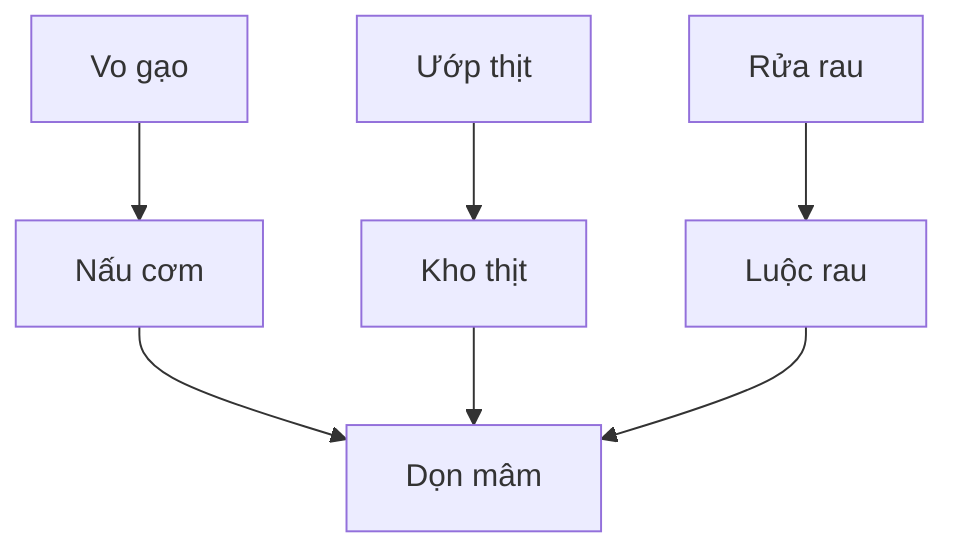
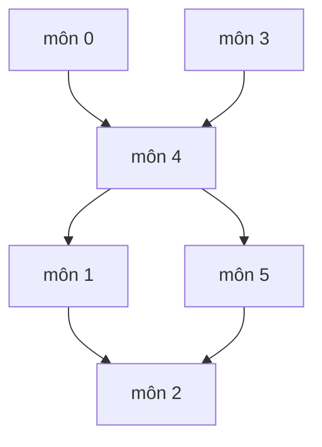
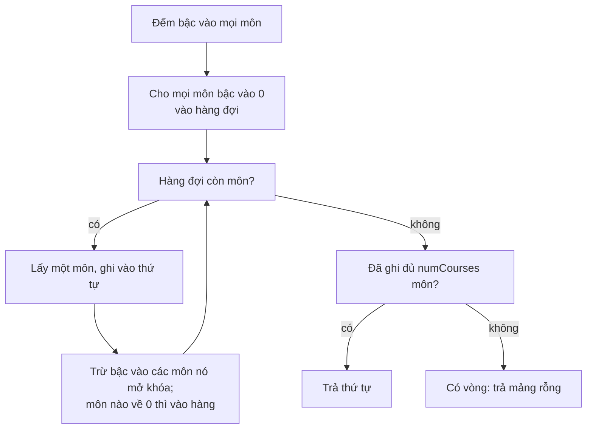
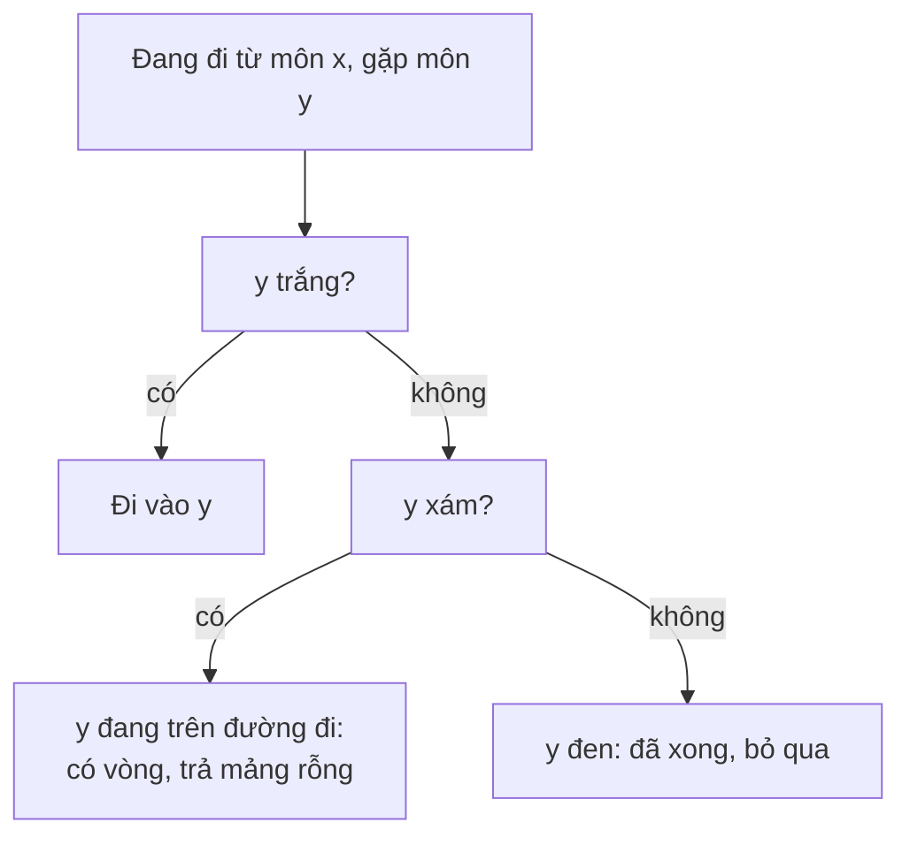

> [!tldr] Đọc nhanh
> - Mỗi môn là một đỉnh. Điều kiện `[a, b]` nghĩa là **học `b` trước rồi mới học `a`**, nên cạnh đi từ `b` sang `a`. Đề hỏi một [[concepts/topological-sort|thứ tự topo]]: xếp mọi môn thành hàng sao cho mọi cạnh đều chỉ về phía sau.
> - Cách dễ hiểu nhất là **Kahn**: đếm [[concepts/in-degree|bậc vào]] (số môn còn phải học trước), cho các môn có bậc vào 0 vào [[concepts/queue|hàng đợi]], học xong môn nào thì trừ bậc vào của các môn nó mở khóa. Hàng đợi chính là đáp án.
> - Nếu học xong mà vẫn còn môn chưa xếp, các môn còn lại đang chờ nhau thành vòng. Trả `[]`. Đồ thị có thứ tự topo khi và chỉ khi nó là một [[concepts/directed-acyclic-graph|DAG]].
> - Cách thứ hai là [[concepts/three-color-dfs|DFS ba màu]]: ghi một môn vào danh sách lúc nó "xong", rồi đảo danh sách. Phải có màu xám (đang trên đường đi). Chỉ một tập "đã thăm" thì báo vòng nhầm, kể cả với hai môn.
> - Đáp án **không duy nhất**: ví dụ sáu môn có 4 thứ tự đúng, Kahn và DFS trả hai thứ tự khác nhau. Muốn tự chấm thì kiểm từng điều kiện, đừng so với một đáp án cố định.

> [!info] Bối cảnh
> Bài LeetCode 210 (Medium), thuộc [[posts/2026-11-26-neetcode-topological-sort|ga 3: Sắp xếp topo]] trên **tuyến NeetCode: Đồ thị**. Bài [[problems/course-schedule|Course Schedule]] (LC 207) chỉ hỏi "có học hết được không". Bài này hỏi thêm "học theo thứ tự nào", nên cùng một thuật toán, chỉ khác ở chỗ phải giữ lại thứ tự. Bạn chỉ cần biết mảng, vòng lặp và hàng đợi; mọi thứ khác được giải thích ngay dưới.

> [!abstract]- Từ điển nhanh cho bài này (bấm để mở)
> - **Đỉnh, cạnh có hướng**: đỉnh là một môn. Cạnh `b → a` là một mũi tên một chiều: "xong `b` thì mới tới `a`".
> - [[concepts/adjacency-list|Danh sách kề]]: mỗi môn giữ danh sách các môn nó mở khóa (`next[b]` chứa `a`).
> - [[concepts/in-degree|Bậc vào]]: số mũi tên chỉ vào một môn, tức số môn còn phải học trước nó.
> - [[concepts/queue|Hàng đợi]]: danh sách vào trước ra trước.
> - [[concepts/topological-sort|Thứ tự topo]]: một cách xếp mọi đỉnh thành hàng sao cho mọi cạnh đều đi từ trước ra sau.
> - **Chu trình (vòng)**: đi theo mũi tên mà quay về chỗ cũ, ví dụ `0 → 1 → 0`. Có vòng thì không xếp được.
> - [[concepts/directed-acyclic-graph|DAG]]: đồ thị có hướng không có vòng.
> - **DFS** (duyệt theo chiều sâu): đi theo một mũi tên thật sâu, hết đường mới quay lại.
> - [[concepts/three-color-dfs|DFS ba màu]]: mỗi đỉnh mang một trong ba màu: trắng (chưa tới), xám (đang trên đường đi), đen (đã xong).

## Hình dung trước: nấu một mâm cơm

Bạn nấu một mâm cơm một mình. Mỗi việc có thể cần vài việc khác làm xong trước: phải vo gạo rồi mới nấu cơm, phải ướp thịt rồi mới kho thịt, phải có cơm, thịt và rau thì mới dọn mâm. Bạn cần một **danh sách việc theo thứ tự** để cứ làm từ trên xuống là xong.

Cách làm tự nhiên nhất: nhìn xem việc nào **không còn phải chờ ai**, làm nó, rồi gạch nó khỏi danh sách chờ của các việc sau. Lặp lại tới khi hết việc. Vo gạo trước hay rửa rau trước đều được, nên danh sách đúng có thể có nhiều bản.

| Đời thường | Khái niệm |
|---|---|
| Một việc trong bếp | Một môn, tức một đỉnh |
| "Vo gạo rồi mới nấu cơm" | Điều kiện `[nấu cơm, vo gạo]`, tức cạnh `vo gạo → nấu cơm` |
| Số việc một món còn phải chờ | [[concepts/in-degree\|Bậc vào]] |
| Rổ các việc làm được ngay | Hàng đợi các môn có bậc vào 0 |
| Làm xong một việc, gạch nó khỏi danh sách chờ của việc sau | Trừ bậc vào của các môn nó mở khóa |
| Danh sách việc theo thứ tự | [[concepts/topological-sort\|Thứ tự topo]], tức đáp án |
| Vo gạo hay rửa rau trước đều được | Thứ tự topo không duy nhất |
| Công thức ghi "nước sốt cần thịt kho, thịt kho cần nước sốt" | Chu trình: không ai bắt đầu được, trả `[]` |
| Người soát lại danh sách: việc nào cũng làm sau các việc nó cần | Bộ chấm kiểm từng cạnh |



Ba việc ở hàng trên không chờ ai, nên làm được ngay. "Dọn mâm" chờ ba việc, nên phải để cuối.

## Vấn đề: xếp lịch học cho mọi môn

Đề cho `numCourses` môn, đánh số `0` tới `numCourses − 1`, và một danh sách điều kiện `prerequisites`. Mỗi điều kiện `[a, b]` nói: muốn học `a` thì phải học xong `b`. Trả về **một** thứ tự học hết mọi môn mà không phạm điều kiện nào. Nếu không có thứ tự như vậy, trả mảng rỗng. Có nhiều thứ tự đúng thì trả cái nào cũng được. [Đề LC-0210](https://leetcode.com/problems/course-schedule-ii/)

Giới hạn (mình đối chiếu với LeetCode ngày 26/11/2026): từ 1 tới 2 000 môn; số điều kiện từ 0 tới `numCourses × (numCourses − 1)`; trong một điều kiện `a ≠ b`; không có hai điều kiện trùng nhau.

Bốn điểm dễ trượt ngay từ đề:

| Câu hỏi | Trả lời | Ví dụ |
|---|---|---|
| `[a, b]` nghĩa là ai trước ai? | `b` trước, `a` sau. Cạnh đi `b → a`. | `[1, 0]`: học `0` rồi mới học `1` |
| Môn không có điều kiện nào? | Vẫn phải có trong đáp án. | 3 môn, không điều kiện: `[0, 1, 2]` là một đáp án |
| Có nhiều đáp án đúng? | Trả cái nào cũng được. | ví dụ sáu môn dưới đây có 4 đáp án |
| Các môn chờ nhau thành vòng? | Trả `[]`, không trả một phần. | `[[0, 1], [1, 0]]` trả `[]` |

Ví dụ xuyên suốt bài: **6 môn**, điều kiện `[[4, 3], [4, 0], [1, 4], [5, 4], [2, 1], [2, 5]]`. Đổi từng điều kiện thành mũi tên:



Môn 0 và môn 3 không cần gì. Môn 4 cần cả 0 và 3. Môn 2 cần cả 1 và 5.

## Cơ chế

<figure class="figure-map" style="--ar: 3 / 4">
<div class="frame"><iframe data-archify="../diagrams/neetcode-course-schedule-ii/worked-example.html" title="Course Schedule II: Kahn xếp sáu môn theo bậc vào" loading="lazy"></iframe></div>
<figcaption><span><b>Hình 1.</b> Kahn chỉ lấy môn có bậc vào 0, nên môn nào ra khỏi hàng đợi cũng đã học đủ điều kiện. Lấy ra đủ 6 môn nghĩa là không có vòng.</span><a href="../diagrams/neetcode-course-schedule-ii/worked-example.html" target="_blank" rel="noopener">Mở toàn màn hình</a></figcaption>
</figure>

<details>
<summary>Đọc từng bước</summary>
<ol>
<li>Đếm bậc vào từ 6 điều kiện. <code>bậc vào: 0→0 1→1 2→2 3→0 4→2 5→1</code></li>
<li>Xếp hàng mọi môn có bậc vào 0. <code>hàng đợi: [0, 3]</code></li>
<li>Lấy 0, bậc vào của 4 còn 1. <code>thứ tự: [0]</code></li>
<li>Lấy 3, bậc vào của 4 về 0, nên 4 vào hàng. <code>thứ tự: [0, 3], hàng đợi: [4]</code></li>
<li>Lấy 4, mở khóa cả 1 và 5. <code>thứ tự: [0, 3, 4], hàng đợi: [1, 5]</code></li>
<li>Lấy 1, bậc vào của 2 còn 1. <code>thứ tự: [0, 3, 4, 1]</code></li>
<li>Lấy 5, bậc vào của 2 về 0. <code>thứ tự: [0, 3, 4, 1, 5], hàng đợi: [2]</code></li>
<li>Lấy 2: đủ 6/6 môn, không có vòng. <code>đáp án: [0, 3, 4, 1, 5, 2]</code></li>
</ol>
</details>

### Cách 1: quét lặp lại, O(V·(V+E))

Ý tưởng đầu tiên của mình: mỗi lượt, đi từ môn 0 tới môn cuối, tìm môn đầu tiên **chưa học mà đã học đủ điều kiện**. Học nó, rồi quét lại từ đầu. Không tìm được môn nào mà vẫn còn môn chưa học thì có vòng.

```ts
// Cách 1: quét lặp. Mỗi lượt đi từ môn 0, lấy môn đầu tiên đã học đủ điều kiện. O(V·(V+E)).
function orderScan(n: number, prereqs: number[][]): number[] {
  const need: number[][] = Array.from({ length: n }, () => [])
  for (const [a, b] of prereqs) need[a].push(b) // muốn học a thì phải xong b
  const taken: boolean[] = new Array(n).fill(false)
  const order: number[] = []
  while (order.length < n) {
    let found = -1
    for (let c = 0; c < n && found < 0; c++) {
      work++ // cả môn đã học cũng tốn một lần nhìn qua
      if (taken[c]) continue
      let ready = true
      for (const b of need[c]) {
        work++
        if (!taken[b]) { ready = false; break }
      }
      if (ready) found = c
    }
    if (found < 0) return [] // còn môn chưa học mà không môn nào đủ điều kiện: có vòng
    taken[found] = true
    order.push(found)
  }
  return order
}
```

Cách này đúng, nhưng mỗi lượt có thể phải nhìn qua gần hết `V` môn và `E` điều kiện, và có `V` lượt: `O(V·(V+E))`. Trường hợp xấu là **chuỗi ngược**: môn `i` cần môn `i + 1`, nên môn học được duy nhất luôn nằm ở cuối. Với 2 000 môn, file chạy thử đếm được **4 001 999** bước.

### Cách 2: Kahn, O(V+E)

Chỗ phí của Cách 1 là mỗi lượt lại hỏi lại từ đầu "môn này đủ điều kiện chưa?". Kahn ghi sẵn câu trả lời vào một con số: [[concepts/in-degree|bậc vào]], tức số môn còn phải học trước. Học xong `b` thì mọi môn trong `next[b]` bớt một môn phải chờ. Môn nào về 0 thì vào hàng đợi. Giống trong bếp: làm xong vo gạo thì gạch nó khỏi danh sách chờ của "nấu cơm", không cần đọc lại cả công thức.

| Lượt | Lấy ra | Bậc vào sau khi trừ | Vào hàng | Thứ tự |
|---|---|---|---|---|
| đầu | (chưa lấy) | `0:0 1:1 2:2 3:0 4:2 5:1` | 0, 3 | `[]` |
| 1 | 0 | 4 còn 1 | | `[0]` |
| 2 | 3 | 4 về 0 | 4 | `[0, 3]` |
| 3 | 4 | 1 về 0, 5 về 0 | 1, 5 | `[0, 3, 4]` |
| 4 | 1 | 2 còn 1 | | `[0, 3, 4, 1]` |
| 5 | 5 | 2 về 0 | 2 | `[0, 3, 4, 1, 5]` |
| 6 | 2 | (không mở khóa ai) | | `[0, 3, 4, 1, 5, 2]` |

Mỗi môn vào hàng nhiều nhất một lần, mỗi cạnh bị trừ nhiều nhất một lần: `O(V + E)` thời gian, `O(V + E)` bộ nhớ cho danh sách kề. Thứ tự lấy ra khỏi hàng đợi chính là đáp án, nên trong code mình dùng luôn mảng hàng đợi (kèm chỉ số `head`) làm kết quả.

**Vì sao thiếu môn nghĩa là có vòng?** Xét một vòng `1 → 2 → 1`. Môn 1 chờ môn 2, môn 2 chờ môn 1. Bậc vào của mỗi môn trong vòng luôn còn ít nhất 1 (mũi tên từ môn đứng trước nó trong vòng), vì môn kia chưa bao giờ được lấy ra. Không môn nào trong vòng về 0, nên chúng không bao giờ vào hàng. Ngược lại, nếu không có vòng thì luôn có ít nhất một môn bậc vào 0 trong số môn còn lại, nên Kahn lấy hết được. Vì vậy chỉ cần một phép so: `số môn đã lấy ra < numCourses` thì trả `[]`.



### Cách 3: DFS ba màu, đảo thứ tự "xong", O(V+E)

Cách này nhìn từ đầu kia. Đi theo mũi tên thật sâu từ một môn. Một môn chỉ được coi là **xong** khi mọi môn đứng sau nó (mọi môn nó mở khóa, và các môn sau nữa) đều đã xong. Ghi môn vào danh sách `post` lúc nó xong. Vậy trong `post`, môn nào cũng đứng **sau** mọi môn cần nó. Đảo `post` lại là được một thứ tự học.

Để phát hiện vòng, mỗi môn mang một trong ba màu:

| Màu | Nghĩa | Gặp lại môn này khi đang đi thì sao |
|---|---|---|
| Trắng | chưa tới | đi vào nó |
| Xám | đang trên đường đi hiện tại | **vòng**: mình đang đi từ nó, đi tiếp lại gặp nó |
| Đen | đã xong, mọi đường phía sau đã đi hết | bỏ qua, không có vòng qua nó |

Chạy trên ví dụ sáu môn, xét môn theo thứ tự 0 tới 5:

| Bước | Việc | Màu xám đang trên đường | `post` |
|---|---|---|---|
| 1 | vào 0, sang 4, sang 1, sang 2 | 0, 4, 1, 2 | `[]` |
| 2 | 2 không mở khóa ai: 2 xong | 0, 4, 1 | `[2]` |
| 3 | 1 hết đường: 1 xong | 0, 4 | `[2, 1]` |
| 4 | 4 sang 5; 5 thấy 2 đã đen, bỏ qua; 5 xong | 0, 4 | `[2, 1, 5]` |
| 5 | 4 xong, rồi 0 xong | (trống) | `[2, 1, 5, 4, 0]` |
| 6 | 1, 2 đã đen; vào 3, thấy 4 đã đen; 3 xong | (trống) | `[2, 1, 5, 4, 0, 3]` |
| 7 | đảo `post` | | `[3, 0, 4, 5, 1, 2]` |

DFS cũng chạm mỗi môn một lần, mỗi cạnh một lần: `O(V + E)`. Đổi lại, nó dùng đệ quy (hoặc một ngăn xếp tự quản) sâu bằng đường dài nhất trong đồ thị. Với chuỗi 2 000 môn, đệ quy sâu 2 000 tầng. Python dừng ở 1 000 tầng theo mặc định (xem mục bẫy).

### Vì sao một tập "đã thăm" không đủ

Nhiều người viết DFS phát hiện vòng chỉ với một tập `seen`: gặp lại môn đã thấy thì báo vòng. Thử với **hai môn**, điều kiện `[[0, 1]]` (học 1 rồi mới học 0, cạnh `1 → 0`):

- Vòng ngoài xét môn 0 trước. Môn 0 không mở khóa ai, nên 0 xong và nằm trong `seen`.
- Vòng ngoài xét tiếp môn 1. Môn 1 có cạnh sang 0, mà 0 đã nằm trong `seen`. Bản sai báo vòng và trả `[]`.

Nhưng 0 đã **xong** (đen), không phải đang trên đường đi (xám). Đi tới một môn đã xong chỉ là gặp lại một phần đã giải quyết, như hai việc cùng cần "vo gạo" thì không có gì mâu thuẫn. Bản `wrongOneSetDfs` trong file sai 3/8 ca vì đúng lỗi này. Chỉ màu xám mới chứng minh được vòng.



### Thứ tự không duy nhất: chấm bằng cách kiểm từng cạnh

Kahn trả `[0, 3, 4, 1, 5, 2]`. DFS trả `[3, 0, 4, 5, 1, 2]`. Cả hai đều đúng. File chạy thử vét cạn đủ 720 hoán vị của 6 môn và đếm được **4** thứ tự hợp lệ: 0 và 3 đổi chỗ được cho nhau, 1 và 5 cũng vậy.

Vì vậy bộ chấm trong file **không** so đáp án với một mảng cố định. Nếu so với `[0, 3, 4, 1, 5, 2]`, DFS sẽ bị chấm sai dù nó đúng. Bộ chấm làm ba việc:

1. Có vòng thì đáp án phải là `[]`.
2. Không có vòng thì đáp án phải chứa mỗi môn đúng một lần.
3. Ghi vị trí `pos[c]` của từng môn, rồi kiểm mọi điều kiện `[a, b]` thỏa `pos[b] < pos[a]`.

Ba bước này là định nghĩa của thứ tự topo, viết thành code. Để biết một đồ thị có vòng hay không mà không tin vào chính các cách đang kiểm, file thử thêm 1 000 đồ thị ngẫu nhiên tới 6 môn, vét cạn mọi hoán vị để biết đáp án thật, rồi kiểm cả ba cách. Kết quả: 1 000/1 000 khớp, trong đó 338 đồ thị có vòng.

### Đo trên 2 000 môn

File chạy thử dựng ba đồ thị 2 000 môn: chuỗi xuôi (môn `i + 1` cần môn `i`), chuỗi ngược (môn `i` cần môn `i + 1`) và một DAG ngẫu nhiên 20 000 điều kiện. "Bước" là số lần nhìn qua một môn hoặc xét một điều kiện; con số này giống hệt nhau ở cả năm ngôn ngữ.

| Đồ thị | Cách | Bước | TS | Python | Go | Java |
|---|---|---:|---:|---:|---:|---:|
| chuỗi xuôi | Cách 1: quét lặp | 2 002 999 | 7,2 ms | 59,7 ms | 1,6 ms | 5,3 ms |
| | Cách 2: Kahn | 3 999 | 0,66 ms | 0,39 ms | 0,06 ms | 0,07 ms |
| | Cách 3: DFS | 3 999 | 0,41 ms | RecursionError | 0,41 ms | 0,19 ms |
| chuỗi ngược | Cách 1: quét lặp | 4 001 999 | 27,3 ms | 151 ms | 5,1 ms | 15,7 ms |
| | Cách 2: Kahn | 3 999 | 0,17 ms | 0,38 ms | 0,04 ms | 0,14 ms |
| | Cách 3: DFS | 3 999 | 0,43 ms | 0,33 ms | 0,04 ms | 0,18 ms |
| DAG ngẫu nhiên | Cách 1: quét lặp | 4 551 896 | 32,8 ms | 170 ms | 7,1 ms | 8,6 ms |
| | Cách 2: Kahn | 22 000 | 1,0 ms | 2,2 ms | 0,79 ms | 0,69 ms |
| | Cách 3: DFS | 22 000 | 1,0 ms | 1,7 ms | 0,33 ms | 0,57 ms |

Số đo thời gian đổi theo máy và theo lần chạy; cột "bước" thì cố định. Ba điều đáng nhớ:

- Kahn và DFS luôn tốn đúng `V + E` bước (2 000 + 1 999 = 3 999 trên chuỗi, 2 000 + 20 000 = 22 000 trên DAG). Quét lặp tốn gấp 200 tới 1 000 lần số bước đó.
- Ở Python, DFS đệ quy **chết** trên chuỗi xuôi, vì đường dài 2 000 môn vượt giới hạn đệ quy 1 000 tầng. Bản dùng ngăn xếp tự quản (`order_dfs_iterative`) chạy xong trong 0,7 ms, cùng 3 999 bước.
- Cùng một chuỗi, chỉ đánh số ngược lại, mà DFS đệ quy Python lúc chết lúc sống. Bài có `numCourses ≤ 2 000` nên ca đó hoàn toàn có thể xuất hiện.

| Cách | Thời gian | Bộ nhớ thêm | Ghi chú |
|---|---|---|---|
| Quét lặp | `O(V·(V+E))` | `O(V + E)` | dễ nghĩ ra, chậm khi nhiều môn |
| Kahn | `O(V + E)` | `O(V + E)` | không đệ quy, phát hiện vòng bằng một phép đếm |
| DFS ba màu | `O(V + E)` | `O(V + E)`, ngăn xếp sâu tới `V` | cần màu xám; Python nên dùng ngăn xếp tự quản |

## Ví dụ chạy được

Mỗi file chạy cùng 8 ca: ví dụ sáu môn, không có điều kiện, một môn, hai môn, vòng hai môn, vòng ba môn, hình kim cương (hai môn cùng cần một môn, rồi cùng mở khóa một môn) và một vòng nằm ở một góc của đồ thị. Bộ chấm kiểm từng điều kiện thay vì so với một đáp án. File còn đếm số thứ tự hợp lệ của ví dụ sáu môn, đối chiếu với vét cạn trên 1 000 đồ thị ngẫu nhiên và đo ba đồ thị 2 000 môn. Bên dưới là Kahn và DFS; quét lặp và các bản sai nằm trong file đầy đủ.

[TypeScript](../code/neetcode-course-schedule-ii/course-schedule-ii.ts) · [Python](../code/neetcode-course-schedule-ii/course_schedule_ii.py) · [Go](../code/neetcode-course-schedule-ii/course_schedule_ii.go) · [Java](../code/neetcode-course-schedule-ii/course-schedule-ii.java) · [JavaScript](../code/neetcode-course-schedule-ii/course-schedule-ii.js)

```ts
// Cách 2: Kahn. Đếm bậc vào, môn nào về 0 thì xếp hàng. Chính hàng đợi là thứ tự. O(V+E).
function orderKahn(n: number, prereqs: number[][]): number[] {
  const next: number[][] = Array.from({ length: n }, () => [])
  const indegree: number[] = new Array(n).fill(0)
  for (const [a, b] of prereqs) {
    next[b].push(a) // cạnh b → a: học b xong mới mở khóa a
    indegree[a]++
  }
  const queue: number[] = []
  for (let c = 0; c < n; c++) if (indegree[c] === 0) queue.push(c)
  for (let head = 0; head < queue.length; head++) {
    const c = queue[head]
    work++
    for (const d of next[c]) {
      work++
      if (--indegree[d] === 0) queue.push(d)
    }
  }
  return queue.length === n ? queue : [] // thiếu môn nghĩa là có vòng
}

// Cách 3: DFS ba màu. Môn xong hết đường phía sau thì ghi vào post; đảo post là thứ tự. O(V+E).
function orderDfs(n: number, prereqs: number[][]): number[] {
  const next: number[][] = Array.from({ length: n }, () => [])
  for (const [a, b] of prereqs) next[b].push(a)
  const color: number[] = new Array(n).fill(0) // 0 trắng: chưa tới, 1 xám: đang trên đường đi, 2 đen: đã xong
  const post: number[] = []
  function visit(c: number): boolean {
    color[c] = 1
    work++
    for (const d of next[c]) {
      work++
      if (color[d] === 1) return false // quay lại một môn đang xám: vòng
      if (color[d] === 0 && !visit(d)) return false
    }
    color[c] = 2
    post.push(c)
    return true
  }
  for (let c = 0; c < n; c++) {
    if (color[c] === 0 && !visit(c)) return []
  }
  return post.reverse() // push rồi đảo một lần, không unshift từng phần tử
}
```

```python
# Cách 2: Kahn. Đếm bậc vào, môn nào về 0 thì xếp hàng. O(V+E).
def order_kahn(n: int, prereqs: list[list[int]]) -> list[int]:
    global work
    nxt: list[list[int]] = [[] for _ in range(n)]
    indegree = [0] * n
    for a, b in prereqs:
        nxt[b].append(a)  # cạnh b → a: học b xong mới mở khóa a
        indegree[a] += 1
    queue = deque(c for c in range(n) if indegree[c] == 0)
    order: list[int] = []
    while queue:
        c = queue.popleft()
        work += 1
        order.append(c)
        for d in nxt[c]:
            work += 1
            indegree[d] -= 1
            if indegree[d] == 0:
                queue.append(d)
    return order if len(order) == n else []  # thiếu môn nghĩa là có vòng


WHITE, GRAY, BLACK = 0, 1, 2  # chưa tới, đang trên đường đi, đã xong


# Cách 3: DFS ba màu, đệ quy. Đảo thứ tự "xong" là thứ tự học. O(V+E).
# Chuỗi 2 000 môn đệ quy sâu 2 000 tầng, vượt giới hạn mặc định 1 000 của Python.
def order_dfs(n: int, prereqs: list[list[int]]) -> list[int]:
    nxt: list[list[int]] = [[] for _ in range(n)]
    for a, b in prereqs:
        nxt[b].append(a)
    color = [WHITE] * n
    post: list[int] = []

    def visit(c: int) -> bool:
        global work
        color[c] = GRAY
        work += 1
        for d in nxt[c]:
            work += 1
            if color[d] == GRAY:
                return False  # quay lại một môn đang xám: vòng
            if color[d] == WHITE and not visit(d):
                return False
        color[c] = BLACK
        post.append(c)
        return True

    for c in range(n):
        if color[c] == WHITE and not visit(c):
            return []
    post.reverse()
    return post


# Cách 3, bản dùng ngăn xếp tự quản: cùng thứ tự với bản đệ quy, không lo giới hạn đệ quy.
def order_dfs_iterative(n: int, prereqs: list[list[int]]) -> list[int]:
    global work
    nxt: list[list[int]] = [[] for _ in range(n)]
    for a, b in prereqs:
        nxt[b].append(a)
    color = [WHITE] * n
    post: list[int] = []
    for start in range(n):
        if color[start] != WHITE:
            continue
        color[start] = GRAY
        work += 1
        stack = [(start, 0)]  # (môn, vị trí hàng xóm sẽ xét tiếp)
        while stack:
            c, i = stack[-1]
            if i == len(nxt[c]):
                stack.pop()
                color[c] = BLACK
                post.append(c)
                continue
            stack[-1] = (c, i + 1)
            d = nxt[c][i]
            work += 1
            if color[d] == GRAY:
                return []
            if color[d] == WHITE:
                color[d] = GRAY
                work += 1
                stack.append((d, 0))
    post.reverse()
    return post
```

```go
// Cách 2: Kahn. Đếm bậc vào, môn nào về 0 thì xếp hàng. Chính hàng đợi là thứ tự. O(V+E).
func orderKahn(n int, prereqs [][2]int) []int {
	next := make([][]int, n)
	indegree := make([]int, n)
	for _, p := range prereqs {
		next[p[1]] = append(next[p[1]], p[0]) // cạnh b → a: học b xong mới mở khóa a
		indegree[p[0]]++
	}
	queue := make([]int, 0, n)
	for c := 0; c < n; c++ {
		if indegree[c] == 0 {
			queue = append(queue, c)
		}
	}
	for head := 0; head < len(queue); head++ {
		c := queue[head]
		work++
		for _, d := range next[c] {
			work++
			indegree[d]--
			if indegree[d] == 0 {
				queue = append(queue, d)
			}
		}
	}
	if len(queue) < n {
		return []int{} // thiếu môn nghĩa là có vòng
	}
	return queue
}

const (
	white = iota // chưa tới
	gray         // đang trên đường đi
	black        // đã xong
)

// Cách 3: DFS ba màu. Môn xong hết đường phía sau thì ghi vào post; đảo post là thứ tự. O(V+E).
func orderDfs(n int, prereqs [][2]int) []int {
	next := make([][]int, n)
	for _, p := range prereqs {
		next[p[1]] = append(next[p[1]], p[0])
	}
	color := make([]int, n)
	post := make([]int, 0, n)
	var visit func(c int) bool
	visit = func(c int) bool {
		color[c] = gray
		work++
		for _, d := range next[c] {
			work++
			if color[d] == gray {
				return false // quay lại một môn đang xám: vòng
			}
			if color[d] == white && !visit(d) {
				return false
			}
		}
		color[c] = black
		post = append(post, c)
		return true
	}
	for c := 0; c < n; c++ {
		if color[c] == white && !visit(c) {
			return []int{}
		}
	}
	for i, j := 0, len(post)-1; i < j; i, j = i+1, j-1 {
		post[i], post[j] = post[j], post[i]
	}
	return post
}
```

```java
// Cách 2: Kahn. Đếm bậc vào, môn nào về 0 thì xếp hàng. Chính hàng đợi là thứ tự. O(V+E).
static int[] orderKahn(int n, int[][] prereqs) {
    List<Integer>[] next = lists(n);
    int[] indegree = new int[n];
    for (int[] p : prereqs) {
        next[p[1]].add(p[0]); // cạnh b → a: học b xong mới mở khóa a
        indegree[p[0]]++;
    }
    int[] queue = new int[n]; // mảng cỡ n kèm chỉ số đầu/cuối: mỗi môn vào hàng đúng một lần
    int tail = 0;
    for (int c = 0; c < n; c++) if (indegree[c] == 0) queue[tail++] = c;
    for (int head = 0; head < tail; head++) {
        int c = queue[head];
        work++;
        for (int d : next[c]) {
            work++;
            if (--indegree[d] == 0) queue[tail++] = d;
        }
    }
    return tail == n ? queue : new int[0]; // thiếu môn nghĩa là có vòng
}

static final int WHITE = 0, GRAY = 1, BLACK = 2; // chưa tới, đang trên đường đi, đã xong

// Cách 3: DFS ba màu. Môn xong hết đường phía sau thì ghi vào post; đảo post là thứ tự. O(V+E).
static int[] orderDfs(int n, int[][] prereqs) {
    List<Integer>[] next = lists(n);
    for (int[] p : prereqs) next[p[1]].add(p[0]);
    int[] color = new int[n];
    int[] post = new int[n];
    int[] size = {0};
    for (int c = 0; c < n; c++) {
        if (color[c] == WHITE && !visit(c, next, color, post, size)) return new int[0];
    }
    int[] order = new int[n];
    for (int i = 0; i < n; i++) order[i] = post[n - 1 - i];
    return order;
}

static boolean visit(int c, List<Integer>[] next, int[] color, int[] post, int[] size) {
    color[c] = GRAY;
    work++;
    for (int d : next[c]) {
        work++;
        if (color[d] == GRAY) return false; // quay lại một môn đang xám: vòng
        if (color[d] == WHITE && !visit(d, next, color, post, size)) return false;
    }
    color[c] = BLACK;
    post[size[0]++] = c;
    return true;
}
```

```js
// Cách 2: Kahn. Đếm bậc vào, môn nào về 0 thì xếp hàng. Chính hàng đợi là thứ tự. O(V+E).
function orderKahn(n, prereqs) {
    const next = Array.from({ length: n }, () => []);
    const indegree = new Array(n).fill(0);
    for (const [a, b] of prereqs) {
        next[b].push(a); // cạnh b → a: học b xong mới mở khóa a
        indegree[a]++;
    }
    const queue = [];
    for (let c = 0; c < n; c++)
        if (indegree[c] === 0)
            queue.push(c);
    for (let head = 0; head < queue.length; head++) {
        const c = queue[head];
        work++;
        for (const d of next[c]) {
            work++;
            if (--indegree[d] === 0)
                queue.push(d);
        }
    }
    return queue.length === n ? queue : []; // thiếu môn nghĩa là có vòng
}
// Cách 3: DFS ba màu. Môn xong hết đường phía sau thì ghi vào post; đảo post là thứ tự. O(V+E).
function orderDfs(n, prereqs) {
    const next = Array.from({ length: n }, () => []);
    for (const [a, b] of prereqs)
        next[b].push(a);
    const color = new Array(n).fill(0); // 0 trắng: chưa tới, 1 xám: đang trên đường đi, 2 đen: đã xong
    const post = [];
    function visit(c) {
        color[c] = 1;
        work++;
        for (const d of next[c]) {
            work++;
            if (color[d] === 1)
                return false; // quay lại một môn đang xám: vòng
            if (color[d] === 0 && !visit(d))
                return false;
        }
        color[c] = 2;
        post.push(c);
        return true;
    }
    for (let c = 0; c < n; c++) {
        if (color[c] === 0 && !visit(c))
            return [];
    }
    return post.reverse(); // push rồi đảo một lần, không unshift từng phần tử
}
```


Kết quả chạy `node course-schedule-ii.ts` (bốn bản còn lại in cùng các dòng ca đúng, cùng số bước; chỉ thời gian khác, và bản Python có thêm `order_dfs_iterative` cùng dòng `RecursionError` ở chuỗi xuôi):

```text
orderScan            8/8 ca đúng
orderKahn            8/8 ca đúng
orderDfs             8/8 ca đúng
wrongEdgeDirection   5/8 ca đúng; sai ở ví dụ sáu môn, hai môn, hình kim cương
wrongOneSetDfs       5/8 ca đúng; sai ở ví dụ sáu môn, hai môn, hình kim cương
wrongNoCycleCheck    7/8 ca đúng; sai ở vòng ở một góc
ví dụ sáu môn: Kahn → [0,3,4,1,5,2], DFS → [3,0,4,5,1,2]; cả hai hợp lệ: true; có 4/720 thứ tự hợp lệ
chấm bằng cách so với đáp án cố định [0,3,4,1,5,2]: DFS bị chấm sai
ngẫu nhiên: 1000/1000 đồ thị, ba cách đều hợp lệ (338 đồ thị có vòng)
chuỗi xuôi (i+1 cần i), 2000 môn:
  orderScan  hợp lệ: true, 2002999 bước, 7.24 ms
  orderKahn  hợp lệ: true, 3999 bước, 0.66 ms
  orderDfs   hợp lệ: true, 3999 bước, 0.41 ms
chuỗi ngược (i cần i+1), 2000 môn:
  orderScan  hợp lệ: true, 4001999 bước, 27.29 ms
  orderKahn  hợp lệ: true, 3999 bước, 0.17 ms
  orderDfs   hợp lệ: true, 3999 bước, 0.43 ms
DAG ngẫu nhiên, 20000 điều kiện, 2000 môn:
  orderScan  hợp lệ: true, 4551896 bước, 32.83 ms
  orderKahn  hợp lệ: true, 22000 bước, 1.02 ms
  orderDfs   hợp lệ: true, 22000 bước, 1.04 ms
```

## Hiểu lầm và bẫy hay gặp

- **Lật chiều cạnh.** `[a, b]` nghĩa là `b` trước `a`, nên cạnh là `next[b].push(a)` và bậc vào tăng ở `a`. Viết ngược thì vẫn ra một thứ tự, nhưng là thứ tự ngược hẳn. Bản `wrongEdgeDirection` sai 3/8 ca. Ca có vòng vẫn đúng, vì lật một vòng vẫn là một vòng, nên chỉ thử với ca có vòng thì không bắt được lỗi này.
- **DFS chỉ có một tập "đã thăm".** Gặp lại một môn đã xong không phải là vòng. Bản `wrongOneSetDfs` sai 3/8 ca, kể cả ca chỉ có hai môn `[[0, 1]]`.
- **Quên kiểm số môn đã xếp.** Bản `wrongNoCycleCheck` trả luôn hàng đợi. Nó đúng ở "vòng hai môn" và "vòng ba môn", vì ở đó không môn nào có bậc vào 0 và hàng đợi rỗng sẵn. Nó chỉ lộ ở ca "vòng ở một góc": môn 0, 3, 4 xếp được, vòng `1 ⇄ 2` thì không, và bản sai trả `[0, 3, 4]` thay vì `[]`. Bộ test chỉ có vòng toàn phần sẽ không bắt được lỗi này.
- **Chấm bằng cách so với một đáp án cố định.** Có 4 đáp án đúng cho ví dụ sáu môn. So với `[0, 3, 4, 1, 5, 2]` thì đáp án đúng của DFS bị chấm sai.
- **Quên môn không có điều kiện.** Với Kahn, chúng có bậc vào 0 nên tự vào hàng. Với DFS, vòng ngoài phải đi qua **mọi** môn, không chỉ các môn xuất hiện trong `prerequisites`.
- **Python: đệ quy sâu.** Giới hạn mặc định là 1 000 tầng (`sys.getrecursionlimit()`). Chuỗi 2 000 môn làm `order_dfs` ném `RecursionError`. Nâng giới hạn bằng `sys.setrecursionlimit` có thể làm tràn ngăn xếp C và sập cả tiến trình. Dùng Kahn, hoặc DFS với ngăn xếp tự quản như `order_dfs_iterative`.
- **TypeScript và JavaScript: `queue.shift()` và `order.unshift()`.** `shift` và `unshift` dời cả mảng ở mỗi lần gọi. Mình dùng chỉ số `head` chạy trên mảng hàng đợi, và trong DFS thì `push` vào `post` rồi đảo một lần ở cuối.
- **Java: hàng đợi cỡ cố định.** Mỗi môn vào hàng đúng một lần, nên một `int[]` dài `n` kèm hai chỉ số `head`, `tail` là đủ, không cần `ArrayDeque<Integer>` (mỗi phần tử là một `Integer` được đóng hộp). Kiểm `tail == n` là kiểm vòng.
- **Go: hàm đệ quy trong hàm.** Một closure muốn gọi lại chính nó phải được khai báo trước (`var visit func(int) bool`) rồi mới gán. Đảo `post` thì dùng `slices.Reverse` (Go 1.21 trở lên) hoặc hai chỉ số chạy vào giữa như trong file.

## Câu hỏi tự kiểm tra

> [!question]- Điều kiện `[3, 7]` thêm cạnh nào và tăng bậc vào của môn nào?
> Học 7 rồi mới học 3, nên cạnh `7 → 3`: `next[7]` thêm 3, và bậc vào của môn 3 tăng 1.

> [!question]- Kahn xong mà mới lấy ra 4 trên 6 môn. Hai môn còn lại có đặc điểm gì?
> Bậc vào của chúng chưa bao giờ về 0. Mỗi môn còn lại chờ ít nhất một môn khác cũng còn lại, nên đi theo các mũi tên chờ đó sẽ quay về chỗ cũ: chúng nằm trên một vòng, hoặc đứng sau một vòng. Đáp án là `[]`.

> [!question]- Trong DFS ba màu, đang ở môn x thì gặp môn y màu đen. Vì sao không có vòng qua y?
> Giả sử có đường từ y quay về x. Lúc y còn xám, DFS đã đi theo đường đó. Nếu khi ấy x đang xám thì vòng đã bị phát hiện rồi. Nếu x còn trắng thì DFS đã đi vào x và làm x xong (đen) trước cả y. Cả hai đều trái với việc bây giờ x đang xám, nên không có đường nào như vậy.

> [!question]- Bạn của bạn nộp `[3, 0, 4, 5, 1, 2]` cho ví dụ sáu môn, đáp án mẫu là `[0, 3, 4, 1, 5, 2]`. Bạn ấy đúng không? Kiểm thế nào?
> Đúng. Ghi vị trí từng môn rồi kiểm sáu điều kiện: 3 và 0 trước 4, 4 trước 1 và 5, 1 và 5 trước 2. Cả sáu đều đi xuôi.

> [!question]- 2 000 môn xếp thành một chuỗi dài. Vì sao DFS đệ quy bằng Python có thể chết mà Kahn thì không?
> DFS đệ quy sâu bằng độ dài đường đi, ở đây tới 2 000 tầng, vượt giới hạn 1 000 tầng mặc định của Python. Kahn chỉ dùng vòng lặp và một hàng đợi, không đệ quy.

## Tham khảo

- [LeetCode · Course Schedule II](https://leetcode.com/problems/course-schedule-ii/): đề bài và giới hạn đầu vào.
- [Princeton · Directed Graphs](https://algs4.cs.princeton.edu/42digraph/): đồ thị có hướng, DAG và thứ tự topo bằng thứ tự hậu tố đảo ngược.
- [Princeton · Topological.java](https://algs4.cs.princeton.edu/42digraph/Topological.java.html) và [DirectedCycle.java](https://algs4.cs.princeton.edu/42digraph/DirectedCycle.java.html): thứ tự topo chỉ tồn tại khi không có vòng, và cách tìm vòng bằng các đỉnh "đang trên ngăn xếp".
- [Wikipedia · Topological sorting](https://en.wikipedia.org/wiki/Topological_sorting): thuật toán Kahn (1962) và thuật toán dựa trên DFS.
- [Python · sys.getrecursionlimit](https://docs.python.org/3/library/sys.html#sys.getrecursionlimit): giới hạn độ sâu đệ quy và lời cảnh báo khi nâng nó.
